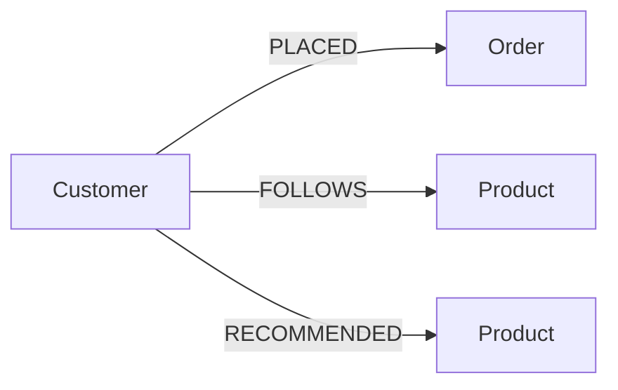

# @ReadOnlyProperty trên relationship và ranh giới dữ liệu được ghi

## Mục tiêu bài học

Một entity Spring Data Neo4j (SDN) có thể ánh xạ nhiều relationship để đọc graph. Tuy nhiên, không phải relationship nào ứng dụng đọc cũng được phép hoặc cần cập nhật khi gọi `save()`. Có những liên kết do dịch vụ khác quản lý, được đồng bộ từ hệ thống bên ngoài, hoặc chỉ được hiển thị như dữ liệu tham chiếu.

SDN cung cấp `@ReadOnlyProperty` để đánh dấu một property chỉ được đọc từ Neo4j mà không được ghi thông qua quá trình lưu entity. Annotation này có thể áp dụng cho trường ánh xạ relationship. Bài học giải thích cách dùng, phạm vi tác động, sự khác nhau giữa read-only và hướng relationship, và cách thiết kế ranh giới ghi giữa entity mapping, Cypher tùy chỉnh và transaction.

## 1. Vì sao cần relationship chỉ đọc?

Giả sử hệ thống bán hàng có các liên kết sau:



Ứng dụng có thể quản lý việc tạo đơn hàng và theo dõi sản phẩm, trong khi danh sách sản phẩm được đề xuất do một dịch vụ gợi ý cập nhật. Khi mở hồ sơ khách hàng, màn hình vẫn cần đọc cả ba loại liên kết.

Nếu tất cả relationship đều được ánh xạ như những trường có thể ghi, một lần lưu entity có thể đưa các relationship đó vào phạm vi đồng bộ của SDN. Điều này không phù hợp nếu một phần graph thuộc quyền quản lý của một quy trình khác.

Ví dụ, service hồ sơ chỉ cần đọc danh sách gợi ý để hiển thị. Service này không nên vô tình tạo lại hoặc xóa các relationship `RECOMMENDED` khi cập nhật tên khách hàng. Đánh dấu relationship đó bằng `@ReadOnlyProperty` giúp thể hiện rõ ranh giới này trong mô hình persistence.

Một property chỉ đọc vẫn có thể được nạp từ graph để ứng dụng sử dụng. Annotation tác động đến việc ghi property qua SDN; nó không xóa relationship khỏi Neo4j và cũng không ngăn Cypher truy vấn relationship đó.

## 2. Cú pháp @ReadOnlyProperty với relationship

`@ReadOnlyProperty` thuộc package `org.springframework.data.annotation`. Khi đặt cùng `@Relationship`, trường relationship được đọc khi SDN nạp entity nhưng không được ghi khi entity được lưu.

```java
import java.util.LinkedHashSet;
import java.util.Set;

import org.springframework.data.annotation.Id;
import org.springframework.data.annotation.ReadOnlyProperty;
import org.springframework.data.neo4j.core.schema.Node;
import org.springframework.data.neo4j.core.schema.Relationship;
import org.springframework.data.neo4j.core.schema.Relationship.Direction;

@Node("Customer")
public class Customer {

    @Id
    private String id;

    private String name;

    @Relationship(type = "PLACED")
    private Set<Order> orders = new LinkedHashSet<>();

    @ReadOnlyProperty
    @Relationship(type = "RECOMMENDED", direction = Direction.OUTGOING)
    private Set<Product> recommendations = new LinkedHashSet<>();

    // Constructor, getter và setter được lược bỏ.
}
```

Trong ví dụ:

- `orders` là relationship thông thường. SDN có thể dùng dữ liệu trường này khi ghi aggregate.
- `recommendations` được nạp để hiển thị nhưng bị loại khỏi quá trình ghi property qua entity mapping.
- `Direction.OUTGOING` mô tả chiều cạnh từ `Customer` đến `Product`.
- `@ReadOnlyProperty` xác định rằng trường relationship không được SDN ghi.

Khi truy vấn và nạp `Customer`, SDN vẫn có thể đi theo `RECOMMENDED` để dựng collection `recommendations`. Nếu ứng dụng thay đổi collection đó rồi gọi `customerRepository.save(customer)`, thay đổi trong trường read-only không được dùng để tạo, cập nhật hoặc xóa relationship thông qua mapping của trường này.

Có thêm một điểm cần lưu ý: node đích chỉ xuất hiện trong collection relationship read-only sẽ không được persist theo collection đó. Nếu node đích được tham chiếu qua một relationship writable khác hoặc được lưu bằng một thao tác độc lập, nó vẫn có thể được persist qua đường ghi đó. Vì vậy, read-only áp dụng cho property relationship và không phải lệnh lưu các node đích đi kèm.

Tên và kiểu relationship phải khớp với graph hiện có. `@ReadOnlyProperty` không tự tạo relationship; nó chỉ điều khiển cách SDN xử lý property đã được ánh xạ.

## 3. Read-only và direction giải quyết hai vấn đề khác nhau

Hai cấu hình thường bị nhầm lẫn:

- `Direction.OUTGOING` hoặc `Direction.INCOMING` cho biết relationship được định hướng thế nào so với node hiện tại.
- `@ReadOnlyProperty` cho biết SDN có ghi property đó khi lưu entity hay không.

Ví dụ graph có cạnh:

```cypher
(:Customer)-[:RECOMMENDED]->(:Product)
```

Nếu entity gốc là `Customer`, relationship được ánh xạ theo hướng `OUTGOING`. Nếu entity gốc là `Product`, cùng cạnh đó có thể được nhìn từ phía node đích bằng hướng `INCOMING`.

| Cấu hình | Ý nghĩa |
|---|---|
| `@Relationship(direction = OUTGOING)` | Ánh xạ cạnh đi từ node hiện tại; có thể tham gia ghi theo mapping |
| `@Relationship(direction = INCOMING)` | Ánh xạ cạnh đi vào node hiện tại; có thể tham gia ghi theo mapping |
| `@ReadOnlyProperty` kết hợp `OUTGOING` | Đọc cạnh đi ra, bỏ qua property này khi ghi |
| `@ReadOnlyProperty` kết hợp `INCOMING` | Đọc cạnh đi vào, bỏ qua property này khi ghi |

Vì vậy, không thể dùng `INCOMING` như một cách thay thế cho read-only. Một relationship incoming vẫn có thể thuộc phạm vi ghi của entity nếu mapping được cấu hình như property có thể ghi. Khi mục tiêu là đọc nhưng không ghi, hãy biểu đạt mục tiêu đó bằng `@ReadOnlyProperty`.

## 4. Ví dụ ranh giới ghi trong ứng dụng

Giả sử dịch vụ gợi ý cập nhật các sản phẩm được đề xuất cho khách hàng. Service hồ sơ chỉ đọc danh sách này và cập nhật tên hiển thị.

```java
@Service
public class CustomerProfileService {

    private final CustomerRepository customerRepository;

    public CustomerProfileService(CustomerRepository customerRepository) {
        this.customerRepository = customerRepository;
    }

    @Transactional
    public void renameCustomer(String customerId, String newName) {
        Customer customer = customerRepository.findById(customerId)
                .orElseThrow(() -> new IllegalArgumentException(
                        "Customer not found"));

        customer.setName(newName);

        // recommendations là @ReadOnlyProperty:
        // thay đổi trường này không được ghi qua entity mapping.
        customerRepository.save(customer);
    }
}
```

Trong trường hợp này, `name` là dữ liệu do service hồ sơ quản lý. `recommendations` chỉ phục vụ đọc. Việc gọi `save()` không biến danh sách gợi ý thành dữ liệu do service hồ sơ sở hữu.

Nếu dịch vụ gợi ý cần cập nhật relationship `RECOMMENDED`, hãy đặt thao tác đó trong repository hoặc thành phần truy cập dữ liệu dành cho quy trình gợi ý. Ví dụ Cypher:

```cypher
MATCH (c:Customer {id: $customerId})
MATCH (p:Product {id: $productId})
MERGE (c)-[:RECOMMENDED]->(p)
```

Câu lệnh trên là một đường ghi tường minh cho relationship. Nó có thể được gọi từ một service khác có transaction phù hợp. Annotation `@ReadOnlyProperty` trên entity `Customer` không chặn câu lệnh Cypher này, bởi Cypher đang thao tác trực tiếp với graph chứ không ghi property thông qua entity mapping.

## 5. Ranh giới của @ReadOnlyProperty

Cần hiểu chính xác annotation bảo vệ điều gì và không bảo vệ điều gì.

**Annotation có tác dụng với thao tác lưu entity qua mapping của SDN.** Property được đánh dấu vẫn có thể được đọc khi SDN hydrate entity. Khi SDN ghi entity, property này không tham gia vào quá trình ghi của entity mapping.

**Annotation không phải ràng buộc bảo mật ở database.** Nó không ngăn người dùng có quyền truy cập Neo4j chạy Cypher `CREATE`, `MERGE`, `SET` hoặc `DELETE`. Nó cũng không ngăn một repository khác, một ứng dụng khác hoặc một quy trình đồng bộ khác thay đổi relationship.

Phạm vi read-only gắn với property được đánh dấu. Nếu cùng một relationship còn được ánh xạ qua một property writable khác, thao tác lưu qua property kia vẫn có thể ghi relationship đó. Vì vậy, hãy kiểm tra toàn bộ các đường ánh xạ tới cùng loại cạnh, nhất là khi mô hình khai báo relationship ở cả hai phía.

**Annotation không biến object Java thành immutable.** Collection trong bộ nhớ vẫn có thể bị thay đổi nếu được khai báo mutable. Tuy nhiên, các thay đổi đó không được ghi qua property đã đánh dấu read-only. Nếu ứng dụng cần tránh hiểu nhầm, có thể cung cấp API chỉ đọc cho collection hoặc không công khai setter.

**Annotation không thay thế transaction.** Nó không xác định ranh giới nguyên tử giữa nhiều thao tác. Nếu một nghiệp vụ cập nhật node và một relationship writable cần thành công hoặc thất bại cùng nhau, hãy dùng transaction ở tầng service.

**Annotation không thay thế quyền truy cập.** Nếu một dịch vụ tuyệt đối không được phép ghi một loại relationship, hãy áp dụng phân quyền ở tầng ứng dụng, credential/database role hoặc kiến trúc dịch vụ phù hợp. Không dùng annotation làm cơ chế kiểm soát truy cập.

Những phân biệt này đặc biệt quan trọng khi nhiều bounded context cùng dùng một graph. Mỗi dịch vụ nên biết dữ liệu nào nó sở hữu, dữ liệu nào chỉ đọc và nơi nào là điểm ghi chính thức.

## 6. Dùng @ReadOnlyProperty cho relationship properties

Một relationship có thể được ánh xạ thành lớp riêng bằng `@RelationshipProperties`. Khi toàn bộ relationship chỉ phục vụ đọc, có thể đánh dấu trường relationship trong entity gốc là read-only:

```java
@Node("Customer")
public class Customer {

    @Id
    private String id;

    @ReadOnlyProperty
    @Relationship(type = "MEMBER_OF", direction = Direction.OUTGOING)
    private Set<Membership> memberships = new LinkedHashSet<>();

    // Constructor, getter và setter được lược bỏ.
}

@RelationshipProperties
public class Membership {

    @RelationshipId
    private Long id;

    private String role;

    private LocalDate joinedAt;

    @TargetNode
    private Group group;

    // Constructor, getter và setter được lược bỏ.
}
```

`Membership` giúp ứng dụng đọc thuộc tính của relationship như `role` và `joinedAt`. Vì trường `memberships` được đánh dấu `@ReadOnlyProperty`, SDN không dùng collection này để ghi các relationship khi lưu `Customer`.

Đây là lựa chọn phù hợp khi quan hệ thành viên được quản lý bởi một dịch vụ khác nhưng ứng dụng hiện tại cần hiển thị vai trò và ngày tham gia. Nếu ứng dụng cần cập nhật vai trò, hãy thực hiện bằng một luồng ghi có chủ đích, chẳng hạn một custom Cypher query hoặc một service sở hữu quan hệ đó.

Nếu chỉ một thuộc tính trên node hoặc relationship cần được đọc nhưng không ghi, hãy xác định đúng property cần đánh dấu. Phạm vi annotation là property được gắn; không nên suy ra rằng mọi thuộc tính khác của entity hoặc mọi relationship khác cũng trở thành read-only.

## 7. Chọn entity mapping hay custom query cho dữ liệu chỉ đọc

Không phải màn hình đọc nào cũng cần hydrate một entity graph đầy đủ. Nếu chỉ cần một số trường của node và relationship, projection hoặc DTO thường là lựa chọn đơn giản hơn.

Ví dụ, màn hình chỉ cần tên khách hàng, tên sản phẩm gợi ý và thời điểm gợi ý:

```java
public interface RecommendationView {
    String getCustomerName();
    String getProductName();
    LocalDateTime getRecommendedAt();
}
```

Repository có thể truy vấn trực tiếp:

```java
public interface CustomerRepository
        extends Neo4jRepository<Customer, String> {

    @Query("MATCH (c:Customer)-[r:RECOMMENDED]->(p:Product) " +
           "WHERE c.id = $customerId " +
           "RETURN c.name AS customerName, " +
           "p.name AS productName, " +
           "r.recommendedAt AS recommendedAt " +
           "ORDER BY r.recommendedAt DESC")
    List<RecommendationView> findRecommendations(
            @Param("customerId") String customerId);
}
```

Projection chỉ chứa dữ liệu màn hình cần dùng. Truy vấn này không yêu cầu entity `Customer` phải có trường `recommendations`. Nó cũng không phụ thuộc vào `@ReadOnlyProperty`, vì kết quả được ánh xạ trực tiếp vào projection.

Chọn theo nhu cầu:

| Nhu cầu | Phương án |
|---|---|
| Cần domain entity và collection relationship để điều hướng | Entity mapping với `@Relationship` |
| Cần đọc relationship nhưng không muốn `save()` ghi nó | `@ReadOnlyProperty` trên trường relationship |
| Chỉ cần vài thuộc tính để hiển thị hoặc báo cáo | Custom query với projection/DTO |
| Cần cập nhật relationship theo quy tắc nghiệp vụ riêng | Custom Cypher trong service/repository có ranh giới transaction rõ ràng |

## 8. Kiểm thử hành vi đọc và ghi

Một kiểm thử tốt cần xác nhận cả hai nửa của hợp đồng: relationship được đọc vào entity và thay đổi ở trường read-only không bị ghi lại thông qua `save()`.

Ví dụ kịch bản integration test:

```java
@DataNeo4jTest
class CustomerReadOnlyRelationshipTest {

    @Autowired
    private CustomerRepository customerRepository;

    @Autowired
    private Neo4jClient neo4jClient;

    @Test
    void shouldReadButNotWriteRecommendations() {
        // Tạo Customer, Product và relationship RECOMMENDED.
        // Đọc Customer qua repository.
        // Xác nhận recommendations có Product mong đợi.
        // Thay đổi collection recommendations trong object.
        // Gọi save(customer).
        // Dùng Cypher độc lập để xác nhận relationship trong graph
        // vẫn giữ nguyên như trước khi save.
    }
}
```

Có thể dùng `Neo4jClient` hoặc một repository test query để xác nhận trạng thái graph. Không nên chỉ kiểm tra collection trong object Java sau khi gọi `save()`, vì object vẫn giữ dữ liệu trong bộ nhớ; điều cần kiểm tra là relationship đã lưu trong Neo4j.

Nên bổ sung các trường hợp:

1. Entity có một relationship read-only và một relationship writable.
2. Lưu thay đổi thuộc tính node không làm mất relationship read-only.
3. Thay đổi collection read-only không tạo hoặc xóa cạnh.
4. Relationship được cập nhật qua custom Cypher vẫn thay đổi được.
5. Relationship properties chỉ đọc được nạp với đầy đủ thuộc tính cần dùng.
6. Một transaction rollback sẽ hoàn tác các thao tác ghi thuộc phạm vi transaction đó.

Khi có nhiều service hoặc nhiều transaction cùng cập nhật graph, hãy kiểm thử các quy trình ghi độc lập để xác nhận ranh giới sở hữu dữ liệu không bị vi phạm.

## 9. Lỗi thường gặp

| Lỗi | Hệ quả | Cách xử lý |
|---|---|---|
| Nghĩ `INCOMING` đồng nghĩa với read-only | Relationship vẫn có thể thuộc phạm vi ghi của mapping | Dùng `@ReadOnlyProperty` nếu cần chỉ đọc |
| Nghĩ read-only relationship sẽ không được nạp | Ứng dụng thiếu dữ liệu để hiển thị | Annotation vẫn cho phép đọc property |
| Thay đổi collection read-only rồi kỳ vọng `save()` cập nhật graph | Thay đổi trong bộ nhớ không được ghi qua mapping đó | Dùng luồng ghi tường minh cho relationship |
| Dùng annotation như một cơ chế phân quyền | Cypher hoặc ứng dụng khác vẫn có thể ghi graph | Kiểm soát quyền tại database và tầng ứng dụng |
| Dùng entity đầy đủ cho báo cáo nhỏ | Nạp object graph và relationship không cần thiết | Dùng projection hoặc DTO |
| Không kiểm thử trạng thái graph sau save | Không phát hiện relationship bị ghi sai qua mapping khác | Đọc lại trực tiếp từ Neo4j sau thao tác |
| Đánh dấu read-only mọi trường mà không xác định chủ sở hữu | Luồng ghi nghiệp vụ trở nên khó hiểu | Xác định rõ dịch vụ sở hữu từng node và relationship |

## 10. Tự kiểm tra

1. `@ReadOnlyProperty` có làm relationship biến mất khỏi kết quả đọc entity không?
2. Sự khác nhau giữa `Direction.INCOMING` và `@ReadOnlyProperty` là gì?
3. Khi gọi `save()` trên entity có trường relationship read-only, SDN xử lý trường đó thế nào?
4. Annotation có ngăn một câu lệnh Cypher độc lập tạo hoặc xóa relationship không?
5. Khi relationship có thuộc tính riêng nhưng chỉ cần đọc, có thể kết hợp `@RelationshipProperties` với `@ReadOnlyProperty` như thế nào?
6. Vì sao một projection có thể phù hợp hơn entity mapping cho màn hình báo cáo?
7. Cần kiểm tra điều gì trong integration test để chứng minh relationship chỉ được đọc?

Hãy tạo một `Customer` có relationship `PLACED` writable và `RECOMMENDED` read-only. Nạp entity, thay đổi cả hai collection rồi gọi `save()`. Đọc graph trực tiếp bằng Cypher để xác định relationship nào được đồng bộ theo entity mapping. Cuối cùng dùng một custom query có transaction để cập nhật `RECOMMENDED` và xác nhận annotation không chặn luồng ghi độc lập đó.

## Tài liệu tham khảo

- [Spring Data Neo4j — Object Mapping](https://docs.spring.io/spring-data/neo4j/reference/object-mapping.html)
- [Spring Data Commons — ReadOnlyProperty](https://docs.spring.io/spring-data/commons/docs/current/api/org/springframework/data/annotation/ReadOnlyProperty.html)
