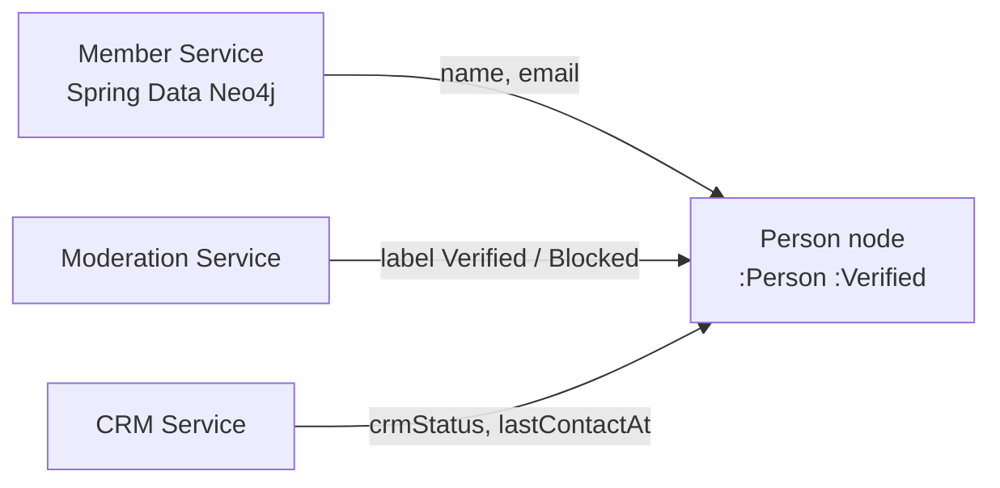

# Phối hợp với ứng dụng khác cùng sửa label hoặc property

Một database Neo4j có thể được dùng chung bởi nhiều ứng dụng. Chẳng hạn, ứng dụng quản lý thành viên dùng Spring Data Neo4j (SDN) lưu node `Person`, trong khi ứng dụng kiểm duyệt thêm label `Verified` và ứng dụng CRM cập nhật property `crmStatus`. Để các ứng dụng không vô tình ghi đè thay đổi của nhau, cần xác định rõ phần dữ liệu mỗi ứng dụng sở hữu, cách SDN ánh xạ label động và cách cập nhật property khi entity có thể đã cũ.

Nguyên tắc quan trọng là phân chia quyền sở hữu ở cấp label và property, dùng `@DynamicLabels` khi entity cần đọc và duy trì các label bổ sung, đồng thời dùng câu lệnh cập nhật có phạm vi hẹp cho property mà một ứng dụng sở hữu. Khi nhiều ứng dụng cùng sửa một property, cần có quy tắc đồng bộ hoặc kiểm soát xung đột như optimistic locking.

## 1. Vì sao cần quy ước khi nhiều ứng dụng dùng chung graph?

Giả sử một node `Person` được hai ứng dụng sử dụng:

- **Member Service** dùng SDN để quản lý `name`, `email` và định danh của người dùng.
- **Moderation Service** thêm hoặc gỡ label `Verified` và `Blocked` theo kết quả kiểm duyệt.
- **CRM Service** quản lý property `crmStatus` và `lastContactAt`.

Đồ thị có thể trông như sau:



| Dữ liệu | Ứng dụng sở hữu | Ví dụ |
|---|---|---|
| Label chính | Member Service | `Person` |
| Label phân loại bổ sung | Moderation Service | `Verified`, `Blocked` |
| Property hồ sơ | Member Service | `name`, `email` |
| Property chăm sóc khách hàng | CRM Service | `crmStatus`, `lastContactAt` |

Nếu không có quy ước, một ứng dụng có thể xóa label mà ứng dụng khác vừa thêm, ghi lại giá trị property cũ hoặc diễn giải `null` theo cách khác. Vấn đề không nằm ở việc nhiều ứng dụng kết nối cùng database; vấn đề xuất hiện khi chúng cùng ghi một phần dữ liệu mà không thống nhất quyền sở hữu và quy tắc cập nhật.

## 2. Phân biệt label tĩnh và label động trong SDN

`@Node("Person")` khai báo label chính mà SDN dùng để ánh xạ entity. Label này thuộc cấu trúc cố định của mô hình Java. Trong khi đó, label động là những label bổ sung có thể thay đổi theo dữ liệu hoặc do ứng dụng khác quản lý.

SDN cung cấp `@DynamicLabels` để ánh xạ tập hợp label bổ sung vào một property của entity:

```java
@Node("Person")
public class Person {

    @Id
    @GeneratedValue
    private Long id;

    private String name;

    @DynamicLabels
    private Set<String> dynamicLabels = new HashSet<>();
}
```

Trong ví dụ:

- `Person` là label chính được khai báo qua `@Node`.
- `dynamicLabels` chứa các label bổ sung được SDN ánh xạ.
- `@DynamicLabels` không biến các giá trị trong collection thành property; chúng vẫn là label của node trong Neo4j.

Một node có thể có nhiều label cùng lúc. Ví dụ:

```cypher
MATCH (p:Person {id: $id})
SET p:Verified
RETURN labels(p) AS labels;
```

Khi đọc entity có `@DynamicLabels`, SDN có thể đưa label bổ sung vào collection `dynamicLabels`. Ứng dụng có thể kiểm tra hoặc cập nhật collection rồi lưu entity theo mapping đã khai báo.

### Thêm và gỡ label động qua entity

Với entity mutable, có thể thêm hoặc gỡ label trong collection:

```java
Person person = personRepository.findById(personId)
        .orElseThrow(() -> new IllegalArgumentException("Person not found"));

person.getDynamicLabels().add("Verified");
personRepository.save(person);
```

Gỡ label:

```java
person.getDynamicLabels().remove("Verified");
personRepository.save(person);
```

Việc thêm hoặc gỡ collection label động được SDN đồng bộ khi lưu entity. Nếu ứng dụng khác cũng có thể thay đổi các label này, hãy đọc trạng thái mới nhất trước khi sửa. Một collection được tải từ trước có thể không còn phản ánh các thay đổi vừa diễn ra.

### Thêm hoặc gỡ label bằng Cypher

Ứng dụng khác có thể quản lý label trực tiếp bằng Cypher:

```cypher
MATCH (p:Person {id: $id})
SET p:Verified;
```

```cypher
MATCH (p:Person {id: $id})
REMOVE p:Verified;
```

Các thao tác này chỉ thay đổi label được chỉ định. Khi SDN cần round-trip các label bổ sung, `@DynamicLabels` giúp đưa chúng vào mô hình entity. Không nên dựa vào một entity không ánh xạ label động để bảo toàn mọi label do ứng dụng khác quản lý; hãy cấu hình mapping và kiểm thử hành vi lưu trên đúng phiên bản SDN đang sử dụng.

Label thường được dùng trong câu truy vấn, index và constraint, vì vậy cần thống nhất tên, cách viết và ý nghĩa. Không nhận một chuỗi label tùy ý từ request rồi đưa thẳng vào mô hình. Hãy xác thực label theo allowlist, ví dụ chỉ chấp nhận `Verified`, `Blocked` hoặc `Premium`.

## 3. Phân biệt property được ánh xạ và property do ứng dụng khác sở hữu

SDN ánh xạ các field của entity thành property trên node. Một ứng dụng khác có thể bổ sung các property mà entity SDN không khai báo. Ví dụ:

```cypher
MATCH (p:Person {id: $id})
SET p.crmStatus = 'ACTIVE',
    p.lastContactAt = datetime();
```

Nếu `Person` không khai báo `crmStatus` hoặc `lastContactAt`, ứng dụng Member Service không có field tương ứng để chủ động cập nhật chúng. Với câu lệnh Cypher dùng `SET p += $properties`, Neo4j chỉ áp dụng các key có trong map; các property khác không nằm trong map được giữ nguyên. Tuy nhiên, nếu hai ứng dụng cùng ghi một key, giá trị cuối cùng phụ thuộc thứ tự commit.

Điểm cần phân biệt là:

- **Property không được ánh xạ:** SDN không có field để quản lý giá trị đó. Các cập nhật Cypher chỉ nhắm tới property khác có thể giữ nguyên nó.
- **Property được ánh xạ nhưng entity đang cũ:** khi SDN lưu entity, giá trị trong object có thể ghi đè giá trị mới hơn trong database.
- **Property được ánh xạ nhưng đang là `null`:** tùy câu lệnh ghi được tạo, `null` có thể được dùng để xóa property. Vì vậy, không dùng `null` như một giá trị "không tải" nếu nghiệp vụ cần phân biệt với "xóa".

Ví dụ, nếu `crmStatus` thuộc quyền sở hữu của CRM Service, không nên thêm field đó vào entity SDN chỉ để hiển thị nếu Member Service không có trách nhiệm ghi nó. Nếu cần đọc giá trị, hãy dùng projection hoặc truy vấn chỉ đọc. Việc ánh xạ một property vào entity đồng nghĩa ứng dụng cần hiểu và tuân thủ semantics ghi của property đó.

## 4. Chỉ cập nhật property mà ứng dụng sở hữu

Khi một ứng dụng chỉ cần thay đổi một property, hãy dùng câu Cypher có phạm vi cập nhật hẹp thay vì đọc một entity lớn, thay đổi một field rồi lưu toàn bộ entity nếu có khả năng dữ liệu khác đã thay đổi.

Ví dụ CRM Service chỉ cập nhật `crmStatus` bằng `Neo4jClient`:

```java
neo4jClient.query("""
        MATCH (p:Person {id: $id})
        SET p.crmStatus = $status
        RETURN p.id AS id
        """)
    .bind(personId).to("id")
    .bind(status).to("status")
    .run();
```

Truy vấn này chỉ nhắm tới property `crmStatus`. Các property khác như `name`, `email` và label `Verified` không bị thay đổi bởi câu lệnh. Dùng parameter thay vì nối chuỗi để truyền ID và giá trị một cách an toàn.

Nếu dùng repository `@Query`, có thể tạo phương thức chuyên biệt cho thao tác cập nhật tương tự. Chọn kết quả trả về phù hợp với mục đích: nếu chỉ cần xác nhận thao tác, trả số hàng hoặc một giá trị đơn giản; nếu cần entity, bảo đảm truy vấn trả đủ dữ liệu mà mapping yêu cầu.

### Tránh lưu entity được đọc từ kết quả không đầy đủ

Một truy vấn tùy chỉnh có thể chỉ trả về một phần property hoặc relationship:

```cypher
MATCH (p:Person {id: $id})
RETURN p.id AS id, p.name AS name;
```

Kết quả này phù hợp với projection chỉ đọc. Không nên biến projection thành một entity `Person` thiếu field rồi gọi `save` như thể đó là aggregate đầy đủ. Những field không được tải có thể mang giá trị mặc định hoặc `null` trong object, dẫn đến thao tác ghi ngoài ý muốn.

Hãy dùng DTO/projection cho truy vấn chỉ đọc và dùng câu cập nhật chuyên biệt cho thao tác thay đổi một phần dữ liệu. Chỉ lưu aggregate entity khi đã tải đúng phần dữ liệu mà thao tác cập nhật cần quản lý.

## 5. Khi nhiều ứng dụng cùng sửa một property

Phân chia property cho từng ứng dụng là cách đơn giản nhất để tránh xung đột. Nhưng đôi khi hai ứng dụng cùng cần cập nhật một property, ví dụ cả Member Service và CRM Service cùng cập nhật `displayName`.

Khi đó cần xác định một trong các quy tắc:

- Một ứng dụng là nguồn dữ liệu chính; ứng dụng còn lại gửi yêu cầu cập nhật tới nguồn chính.
- Mỗi ứng dụng chỉ cập nhật khi giá trị hiện tại thỏa một điều kiện nghiệp vụ.
- Dùng version để phát hiện cập nhật dựa trên dữ liệu cũ.
- Dùng một câu Cypher nguyên tử cho phép cập nhật đồng thời theo phép toán có tính kết hợp, ví dụ tăng counter.

### Optimistic locking với @Version

SDN hỗ trợ optimistic locking bằng `@Version`:

```java
@Node("Person")
public class Person {

    @Id
    @GeneratedValue
    private Long id;

    @Version
    private Long version;

    private String name;
}
```

SDN dùng version để kiểm tra entity có bị thay đổi kể từ lúc được đọc hay không. Nếu một transaction khác đã cập nhật và tăng version, thao tác lưu dựa trên version cũ có thể thất bại với lỗi optimistic locking. Ứng dụng cần tải lại entity, hợp nhất thay đổi theo quy tắc nghiệp vụ rồi thử lại hoặc trả lỗi xung đột.

Nếu ứng dụng ngoài SDN cũng cập nhật cùng node, nó phải tham gia cùng quy ước version thì optimistic locking mới phát hiện được thay đổi đó. Ví dụ, ứng dụng ngoài có thể kiểm tra version hiện tại và tăng version trong cùng một câu lệnh:

```cypher
MATCH (p:Person {id: $id, version: $expectedVersion})
SET p.crmStatus = $status,
    p.version = $expectedVersion + 1
RETURN p.version AS newVersion;
```

Nếu không có node nào khớp `expectedVersion`, ứng dụng cần coi đó là xung đột hoặc dữ liệu đã thay đổi, rồi đọc lại trước khi quyết định. Câu lệnh thực tế cần xử lý cả trường hợp node chưa có version theo quy ước khởi tạo của hệ thống.

`@Version` không tự bảo vệ trước một ứng dụng ngoài ghi property mà không cập nhật version. Nếu writer bên ngoài bỏ qua quy ước, SDN có thể không nhận ra dữ liệu đã thay đổi. Vì vậy, version chỉ hiệu quả khi mọi writer tham gia cùng một giao thức.

### Cập nhật nguyên tử bằng Cypher

Với counter hoặc phép cập nhật có thể thực hiện ngay trên database, tránh đọc giá trị về Java rồi tính và ghi lại. Ví dụ tăng số lần xem:

```cypher
MATCH (m:Movie {id: $id})
SET m.viewCount = coalesce(m.viewCount, 0) + 1
RETURN m.viewCount AS viewCount;
```

Neo4j thực hiện phép tăng trong một câu lệnh ghi, tránh kiểu read-modify-write tách thành hai thao tác độc lập ở ứng dụng. Đây là lựa chọn tốt cho counter đơn giản. Với quy tắc phức tạp hơn, cần thiết kế transaction và điều kiện cập nhật rõ ràng.

## 6. Quy ước chia sẻ schema giữa các ứng dụng

Trước khi cho nhiều ứng dụng cùng ghi một graph, nên thống nhất hợp đồng dữ liệu. Một bảng sở hữu đơn giản có thể giúp các nhóm biết trường nào được thay đổi:

| Thành phần | Chủ sở hữu | Quy tắc |
|---|---|---|
| Label `Person` | Member Service | Không được gỡ trong các luồng kiểm duyệt hoặc CRM |
| Label `Verified`, `Blocked` | Moderation Service | Thay đổi theo trạng thái kiểm duyệt; Member Service ánh xạ bằng `@DynamicLabels` nếu cần round-trip |
| Property `name`, `email` | Member Service | CRM không tự sửa; thay đổi qua API hoặc event của Member Service |
| Property `crmStatus`, `lastContactAt` | CRM Service | Member Service không khai báo field ghi cho các property này |
| Property `version` | Giao thức dùng chung | Mọi writer cập nhật node phải tuân thủ nếu dùng optimistic locking |

Hợp đồng cần trả lời các câu hỏi:

1. Ứng dụng nào tạo node và chịu trách nhiệm định danh node?
2. Ứng dụng nào có quyền thêm hoặc gỡ từng label?
3. Ứng dụng nào sở hữu từng property và kiểu dữ liệu của property đó?
4. `null`, property không tồn tại và chuỗi rỗng có ý nghĩa khác nhau không?
5. Khi một property đổi tên hoặc đổi kiểu, các ứng dụng khác được nâng cấp theo phiên bản nào?
6. Khi xóa node hoặc gỡ label, dữ liệu liên quan được xử lý theo quy tắc nào?
7. Nếu nhiều writer cùng sửa một property, dùng nguồn dữ liệu chính, version hay câu lệnh cập nhật nguyên tử?

Nên quản lý thay đổi schema có version, thông báo cho các nhóm phụ thuộc và triển khai tương thích theo giai đoạn. Không nên đổi tên property hoặc label chỉ ở một ứng dụng rồi giả định các ứng dụng khác tự thích nghi.

## 7. Transaction và thứ tự cập nhật giữa các ứng dụng

Mỗi ứng dụng có transaction riêng khi kết nối tới Neo4j. Một transaction Neo4j có thể bảo đảm tính nguyên tử cho các câu lệnh nằm trong cùng transaction, nhưng không tự tạo một transaction phân tán bao trùm nhiều request hoặc nhiều dịch vụ độc lập.

Ví dụ, Moderation Service thêm label `Verified`, còn Member Service đồng thời lưu lại entity `Person`. Hai thao tác có thể xảy ra theo thứ tự khác nhau. Nếu Member Service đã tải `dynamicLabels` trước khi Moderation Service cập nhật, collection trong bộ nhớ có thể bị cũ. Trước khi lưu thay đổi label, hãy đọc trạng thái mới nhất hoặc dùng một câu Cypher cập nhật label có phạm vi hẹp.

Với thay đổi cần truyền sang ứng dụng khác, có thể dùng event/message để thông báo sau khi transaction của nguồn dữ liệu chính commit. Ứng dụng nhận event cần xử lý idempotent vì message có thể được gửi lại. Nếu cần bảo đảm sự kiện và cập nhật graph không bị lệch, cân nhắc transactional outbox thay vì gửi message giữa transaction database.

## 8. Kiểm thử tương tác giữa các ứng dụng

Kiểm thử một repository đơn lẻ chưa đủ để chứng minh hai ứng dụng không ghi đè dữ liệu của nhau. Nên có integration test mô phỏng hai writer độc lập dùng cùng Neo4j instance.

Một kịch bản kiểm thử:

1. Member Service tạo `Person` với `name` và `email`.
2. Moderation Service thêm label `Verified` bằng Cypher.
3. CRM Service thêm `crmStatus` bằng Cypher.
4. Member Service tải lại entity có `@DynamicLabels`, cập nhật `name` và lưu.
5. Đọc node trực tiếp bằng Cypher để xác nhận `Verified`, `crmStatus`, `email` và `name` đều đúng.
6. Kiểm thử thêm trường hợp hai writer cùng sửa `name` hoặc `version` để xác nhận xung đột được phát hiện hoặc giải quyết theo quy tắc đã chọn.

Ví dụ truy vấn xác minh:

```cypher
MATCH (p:Person {id: $id})
RETURN p.name AS name,
       p.email AS email,
       p.crmStatus AS crmStatus,
       labels(p) AS labels,
       p.version AS version;
```

Ngoài kết quả cuối, cần kiểm tra các tình huống lỗi: writer ngoài xóa label, property bị đặt `null`, request cập nhật lặp, version cũ và transaction rollback. Những trường hợp này cho thấy hợp đồng dữ liệu có thực sự được tuân thủ hay không.

## 9. Những lỗi thường gặp

| Lỗi | Hậu quả | Cách xử lý |
|---|---|---|
| Không ánh xạ label động nhưng kỳ vọng SDN duy trì mọi label bổ sung | Các label ngoài mô hình có thể không được round-trip theo cách mong đợi | Dùng `@DynamicLabels` và kiểm thử với phiên bản SDN thực tế |
| Hai ứng dụng cùng sở hữu một property nhưng không có quy tắc | Giá trị cuối cùng phụ thuộc thứ tự ghi | Chọn một nguồn dữ liệu chính hoặc giao thức đồng bộ |
| Lưu entity được tải từ trước khi ứng dụng khác cập nhật | Ghi đè dữ liệu mới bằng giá trị cũ | Tải lại, dùng `@Version` hoặc cập nhật từng property bằng Cypher |
| Dùng `null` để biểu thị "không tải" | Có thể xóa property đã tồn tại | Dùng projection/DTO hoặc câu lệnh cập nhật riêng |
| Đưa label tùy ý từ request vào entity | Sinh label ngoài quy ước, gây khó quản trị và truy vấn | Xác thực bằng allowlist |
| Dùng `@Version` nhưng writer ngoài không tăng version | Optimistic locking không phát hiện được thay đổi ngoài | Yêu cầu mọi writer tuân thủ cùng giao thức version |
| Dùng entity projection một phần rồi gọi `save` | Các field không tải có thể bị ghi sai | Chỉ dùng projection cho đọc; cập nhật qua query chuyên biệt |
| Gửi event trước khi transaction commit | Ứng dụng khác có thể xử lý một thay đổi chưa được lưu | Phát event sau commit hoặc dùng outbox |

## 10. Tự kiểm tra

1. Khác biệt giữa label chính từ `@Node` và label bổ sung được ánh xạ bằng `@DynamicLabels` là gì?
2. Khi nào cần ánh xạ label động trong entity SDN?
3. Vì sao property không được ánh xạ thường có thể tồn tại song song với entity SDN, trong khi property được ánh xạ nhưng cũ có nguy cơ bị ghi đè?
4. Vì sao một projection chỉ đọc một phần node không nên được lưu lại như entity đầy đủ?
5. `@Version` giúp phát hiện xung đột giữa các ứng dụng trong điều kiện nào?
6. Vì sao counter nên được tăng bằng một câu Cypher nguyên tử thay vì đọc rồi ghi lại ở Java?
7. Một hợp đồng dữ liệu dùng chung cần xác định những quyền sở hữu và semantics nào?
8. Làm thế nào kiểm thử rằng label và property do ứng dụng khác quản lý vẫn được bảo toàn sau khi SDN lưu entity?

Khi nắm được cách ánh xạ label động, giới hạn cập nhật property, quản lý entity stale và phối hợp version, người học có thể thiết kế nhiều ứng dụng cùng làm việc trên một Neo4j graph mà vẫn duy trì được quyền sở hữu và tính nhất quán của dữ liệu.
