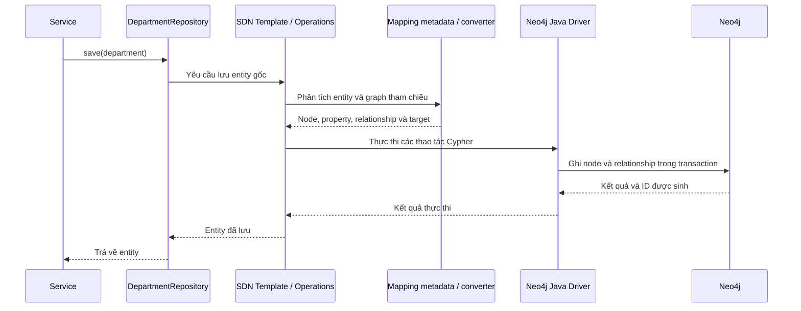

# Đường đi xử lý `save` từ entity gốc đến node và relationship liên quan

Trong Spring Data Neo4j (SDN), gọi `save` trên repository của một entity gốc có thể ghi cả đồ thị đối tượng mà entity đó tham chiếu. SDN sử dụng metadata mapping để xác định node, property và relationship trong mô hình Java, sau đó phối hợp với Neo4j Java Driver để thực thi các thao tác Cypher trong transaction.

Điều này có nghĩa `save` không chỉ đơn giản ghi các field của một object Java. Nếu entity gốc chứa các entity liên quan qua `@Relationship`, SDN còn phải xử lý các node đích và các cạnh nối chúng. Với relationship có thuộc tính, framework cũng cần ghi các property của cạnh. Hiểu đường đi này giúp bạn dự đoán tác động của một lần lưu, tránh vô tình ghi một đồ thị không đầy đủ và chọn đúng API khi chỉ muốn cập nhật một phần dữ liệu.

## 1. Mô hình đồ thị được lưu

Giả sử ứng dụng quản lý phòng ban và nhân viên. Một phòng ban có nhiều nhân viên, mỗi relationship `EMPLOYS` có thêm thông tin vai trò. Mô hình đồ thị có dạng:

```mermaid
flowchart LR
    D[Department] -->|EMPLOYS {role}| E1[Employee]
    D -->|EMPLOYS {role}| E2[Employee]
    D -->|EMPLOYS {role}| E3[Employee]
```

Trong Java, `Department` là entity gốc. Collection relationship trên entity này chứa các đối tượng `Employment`; mỗi đối tượng `Employment` giữ node đích `Employee` cùng property của relationship.

## 2. Khai báo entity gốc và các node liên quan

Entity `Employee` biểu diễn node ở đầu đích:

```java
import org.springframework.data.neo4j.core.schema.GeneratedValue;
import org.springframework.data.neo4j.core.schema.Id;
import org.springframework.data.neo4j.core.schema.Node;

@Node("Employee")
public class Employee {

    @Id
    @GeneratedValue
    private Long id;

    private String name;
    private String email;

    protected Employee() {
    }

    public Employee(String name, String email) {
        this.name = name;
        this.email = email;
    }

    public Long getId() {
        return id;
    }
}
```

Entity `Department` là node gốc mà repository sẽ lưu:

```java
import java.util.ArrayList;
import java.util.List;

import org.springframework.data.neo4j.core.schema.GeneratedValue;
import org.springframework.data.neo4j.core.schema.Id;
import org.springframework.data.neo4j.core.schema.Node;
import org.springframework.data.neo4j.core.schema.Relationship;

@Node("Department")
public class Department {

    @Id
    @GeneratedValue
    private Long id;

    private String code;
    private String name;

    @Relationship(type = "EMPLOYS", direction = Relationship.Direction.OUTGOING)
    private List<Employment> employments = new ArrayList<>();

    protected Department() {
    }

    public Department(String code, String name) {
        this.code = code;
        this.name = name;
    }

    public void addEmployee(Employee employee, String role) {
        employments.add(new Employment(employee, role));
    }

    public Long getId() {
        return id;
    }

    public List<Employment> getEmployments() {
        return employments;
    }
}
```

Lớp relationship properties mô tả cạnh `EMPLOYS`:

```java
import org.springframework.data.neo4j.core.schema.RelationshipId;
import org.springframework.data.neo4j.core.schema.RelationshipProperties;
import org.springframework.data.neo4j.core.schema.TargetNode;

@RelationshipProperties
public class Employment {

    @RelationshipId
    private Long id;

    @TargetNode
    private Employee employee;

    private String role;

    protected Employment() {
    }

    public Employment(Employee employee, String role) {
        this.employee = employee;
        this.role = role;
    }

    public Employee getEmployee() {
        return employee;
    }

    public String getRole() {
        return role;
    }
}
```

`@Relationship` trên `Department` xác định type và hướng cạnh. `@RelationshipProperties` mô tả dữ liệu gắn với cạnh; `@TargetNode` trỏ tới entity `Employee`; `@RelationshipId` là định danh persistence của relationship đã tồn tại. Các ID được sinh không cần được ứng dụng gán khi tạo graph mới.

## 3. Repository và thao tác lưu entity gốc

Repository khai báo kiểu entity và kiểu ID tương ứng:

```java
import java.util.Optional;

import org.springframework.data.neo4j.repository.Neo4jRepository;

public interface DepartmentRepository
        extends Neo4jRepository<Department, Long> {

    Optional<Department> findByCode(String code);
}
```

Repository cho node liên quan có thể khai báo riêng:

```java
import org.springframework.data.neo4j.repository.Neo4jRepository;

public interface EmployeeRepository extends Neo4jRepository<Employee, Long> {
}
```

Khi tạo một phòng ban cùng hai nhân viên mới, service xây dựng graph trong bộ nhớ rồi gọi `save` một lần trên entity gốc:

```java
import org.springframework.stereotype.Service;
import org.springframework.transaction.annotation.Transactional;

@Service
public class DepartmentService {

    private final DepartmentRepository departments;

    public DepartmentService(DepartmentRepository departments) {
        this.departments = departments;
    }

    @Transactional
    public Department createDepartment() {
        Department department = new Department("ENG", "Engineering");

        Employee an = new Employee("An Nguyen", "an@example.com");
        Employee binh = new Employee("Binh Tran", "binh@example.com");

        department.addEmployee(an, "Lead");
        department.addEmployee(binh, "Developer");

        return departments.save(department);
    }
}
```

`departments.save(department)` là điểm bắt đầu của thao tác persistence. Vì hai đối tượng `Employee` được tham chiếu qua collection `employments`, chúng là một phần của graph mà SDN cần xử lý khi lưu entity gốc. Mỗi relationship cũng mang property `role` cần được ghi cùng cạnh.

Hãy dùng object được trả về từ `save`. Với ID được sinh, kết quả lưu có thể chứa định danh mà object ban đầu chưa có. Điều này cũng quan trọng với entity bất biến hoặc entity dùng cơ chế tạo bản sao khi gán ID.

## 4. Đường đi xử lý từ repository đến Neo4j

Ở mức khái niệm, một lần gọi `save` đi qua các bước sau:



Các bước mapping và ghi ở đây mô tả luồng trách nhiệm, không khẳng định SDN luôn phát đúng một câu Cypher hoặc luôn ghi từng node theo một thứ tự cố định. Tùy cấu trúc graph, metadata và phiên bản SDN, framework có thể tạo nhiều câu lệnh hoặc nhóm thao tác phù hợp để bảo đảm node và relationship được lưu nhất quán.

Các trách nhiệm chính:

1. **Repository nhận entity gốc:** `save` nhận `Department` và chuyển yêu cầu xuống cơ chế persistence của SDN.
2. **Mapping metadata phân tích graph:** SDN xác định label node, property, ID, quan hệ được khai báo và node đích được tham chiếu.
3. **Chuyển đổi dữ liệu:** converter xử lý giá trị Java thành kiểu dữ liệu Neo4j có thể lưu, đồng thời xác định thông tin relationship properties.
4. **Tạo thao tác ghi:** SDN xây dựng các thao tác Cypher cho node và relationship trong graph.
5. **Driver thực thi:** Neo4j Java Driver gửi lệnh tới máy chủ trong transaction phù hợp.
6. **Trả kết quả:** ID được sinh và dữ liệu cần thiết được phản ánh vào entity trả về.

## 5. Node mới và node đã tồn tại

Trong graph có thể có cả node mới lẫn node đã tồn tại. Với entity dùng `@GeneratedValue`, object mới thường chưa có ID trước khi lưu. Khi được lưu, Neo4j tạo node và SDN nhận định danh để quản lý entity đó.

Khi graph tham chiếu một entity đã có định danh, SDN có thông tin để nhận diện node đó trong quá trình persistence. Dữ liệu và trạng thái object cần phản ánh đúng những gì ứng dụng muốn lưu. Tránh tạo một object rút gọn chỉ có ID rồi đặt nó vào graph nếu bạn không chủ định cập nhật các property khác của node đó.

Ví dụ, nếu nhân viên đã tồn tại và service muốn thêm họ vào phòng ban mới, hãy tải entity nhân viên cần dùng rồi tạo relationship tới chính entity đó:

```java
Employee employee = employeeRepository.findById(employeeId)
    .orElseThrow(() -> new IllegalArgumentException("Employee not found"));

department.addEmployee(employee, "Reviewer");
departments.save(department);
```

Trong ví dụ, `employeeRepository` là repository của `Employee`. Việc tải entity giúp ứng dụng làm việc với dữ liệu hiện có và tránh vô tình ghi một object thiếu các property khác. Nếu nghiệp vụ chỉ cần tạo cạnh mà không cần tải entity đầy đủ, có thể dùng một truy vấn Cypher tường minh với định danh nghiệp vụ phù hợp.

## 6. Relationship cũng là một phần của graph được lưu

SDN không chỉ lưu hai node rồi bỏ qua cạnh. Relationship được khai báo trong entity gốc là một phần của mapping. Với relationship đơn giản, SDN đọc type và direction từ `@Relationship`. Với relationship properties, SDN còn ánh xạ các field như `role` từ object `Employment` thành property của cạnh.

Graph sau khi lưu có thể được quan sát bằng Cypher:

```cypher
MATCH (d:Department {code: 'ENG'})-[r:EMPLOYS]->(e:Employee)
RETURN d.name AS department,
       e.name AS employee,
       r.role AS role;
```

Kết quả thể hiện ba phần riêng biệt: node `Department`, node `Employee` và relationship `EMPLOYS` mang property `role`. Nếu thiếu relationship mapping trong entity hoặc collection không chứa object relationship mong muốn, graph ghi ra có thể không giống cấu trúc nghiệp vụ dự kiến.

## 7. Cập nhật graph và ý nghĩa của collection relationship

Khi đọc entity có các relationship rồi chỉnh sửa collection và gọi `save`, SDN có thể đồng bộ thay đổi theo trạng thái object graph được ánh xạ. Vì vậy, collection relationship không chỉ là dữ liệu phụ để hiển thị; nó tham gia vào trạng thái persistence của entity.

Ví dụ, thêm một nhân viên vào phòng ban đã đọc:

```java
import org.springframework.stereotype.Service;
import org.springframework.transaction.annotation.Transactional;

@Service
public class DepartmentMembershipService {

    private final DepartmentRepository departments;
    private final EmployeeRepository employees;

    public DepartmentMembershipService(DepartmentRepository departments,
                                       EmployeeRepository employees) {
        this.departments = departments;
        this.employees = employees;
    }

    @Transactional
    public Department addEmployee(String departmentCode, Long employeeId, String role) {
        Department department = departments.findByCode(departmentCode)
            .orElseThrow(() -> new IllegalArgumentException("Department not found"));

        Employee employee = employees.findById(employeeId)
            .orElseThrow(() -> new IllegalArgumentException("Employee not found"));

        department.addEmployee(employee, role);
        return departments.save(department);
    }
}
```

Khi xóa một phần tử khỏi collection rồi lưu entity, relationship tương ứng có thể bị xóa theo trạng thái graph mà SDN quản lý; node đích không tự động bị xóa chỉ vì một relationship bị loại bỏ. Hãy phân biệt thao tác xóa cạnh với thao tác xóa node.

Không nên tạo một entity gốc mới chỉ chứa `id` và một collection rỗng rồi lưu như thể đó là toàn bộ trạng thái của graph, nếu mục tiêu chỉ là đổi một thuộc tính. Một graph rút gọn có thể không mang đủ thông tin relationship để thể hiện ý định cập nhật. Với cập nhật có phạm vi hẹp, hãy dùng truy vấn Cypher rõ ràng hoặc đọc entity hiện có, sửa phần cần thay đổi rồi lưu.

## 8. Transaction và tính nhất quán của graph

Một lần lưu graph có thể bao gồm nhiều node và relationship. Các thao tác đó cần được thực thi trong transaction để tránh trạng thái ghi dở dang khi một bước thất bại. Các phương thức ghi của repository có transaction theo cấu hình Spring Data; với một use case gồm nhiều lần đọc/ghi hoặc nhiều repository, hãy đặt ranh giới transaction ở service bằng `@Transactional`.

Ví dụ `createDepartment` tạo một phòng ban, hai nhân viên và hai relationship. Nếu một thao tác ghi thất bại trong transaction, các thay đổi thuộc transaction đó sẽ rollback cùng nhau. Điều này giúp graph không bị lưu một phần theo ý định của use case.

Với ứng dụng reactive, hãy dùng reactive repository và transaction manager reactive tương ứng. Không trộn lời gọi imperative hoặc tự mở driver session bên ngoài vào một reactive transaction rồi giả định chúng tự tham gia cùng context.

## 9. Khi nào nên dùng `save`, khi nào nên dùng Cypher trực tiếp?

| Nhu cầu | Cách tiếp cận phù hợp |
|---|---|
| Tạo hoặc cập nhật entity cùng graph relationship đã ánh xạ | `repository.save(entity)` |
| Thêm một entity liên quan đã tải vào collection relationship | Sửa graph object rồi `save` entity gốc |
| Cập nhật property của relationship đã ánh xạ | Sửa relationship properties rồi `save` entity gốc |
| Cập nhật một property trên số lượng lớn node | Cypher trực tiếp qua `@Query` hoặc `Neo4jClient` |
| Tạo hoặc xóa cạnh theo điều kiện phức tạp | Cypher tường minh qua repository/client |
| Ghi graph rất lớn hoặc thao tác theo lô | Thiết kế truy vấn Cypher theo lô, tránh dựng toàn bộ graph trong bộ nhớ |

`save` thuận tiện khi graph Java đã phản ánh đúng trạng thái muốn lưu. Cypher trực tiếp phù hợp khi thao tác có phạm vi hẹp, cần cập nhật hàng loạt hoặc cần điều khiển chính xác các cạnh bị tác động. Với Cypher tùy chỉnh, hãy bind tham số và kiểm tra rõ dữ liệu trả về.

## 10. Những lỗi thường gặp

| Lỗi | Hệ quả | Cách xử lý |
|---|---|---|
| Nghĩ `save(root)` chỉ ghi các field của node gốc | Các node và relationship tham chiếu có thể bị bỏ sót trong hiểu biết của người phát triển | Xem toàn bộ object graph được mapping là phạm vi persistence cần kiểm tra |
| Đưa object target chỉ có ID vào graph mà không hiểu trạng thái của nó | Có thể ghi dữ liệu thiếu hoặc làm thay đổi property ngoài ý muốn | Tải entity hiện có hoặc dùng Cypher tạo cạnh theo ID nghiệp vụ |
| Lưu entity gốc được tạo rời rạc với collection rỗng | Trạng thái relationship có thể không phản ánh graph hiện tại | Đọc entity hiện có rồi sửa collection hoặc dùng Cypher cập nhật có phạm vi rõ |
| Quên khai báo `@TargetNode` trong relationship properties | SDN không xác định được node đích của relationship object | Khai báo target node rõ ràng |
| Tự gán `@RelationshipId` | Can thiệp vào định danh nội bộ do Neo4j/SDN quản lý | Để framework quản lý ID relationship |
| Thực hiện nhiều thao tác ghi nhưng không có transaction nghiệp vụ | Graph có thể ở trạng thái một phần khi lỗi xảy ra | Đặt `@Transactional` quanh use case |
| Dùng `save` để cập nhật hàng loạt graph lớn | Tốn bộ nhớ và tạo nhiều thao tác persistence | Dùng Cypher theo lô hoặc thao tác set-based |

## 11. Tự kiểm tra

1. Khi gọi `departmentRepository.save(department)`, vì sao SDN còn phải xử lý các object `Employee` được tham chiếu?
2. `@Relationship` và `@RelationshipProperties` cung cấp những thông tin gì cho quá trình lưu graph?
3. Vì sao nên sử dụng entity được trả về từ `save` khi ID được sinh tự động?
4. Khi muốn thêm một nhân viên đã tồn tại vào phòng ban, vì sao nên tải entity đó trước khi tạo relationship?
5. Khác biệt giữa xóa relationship khỏi collection và xóa node đích là gì?
6. Khi nào nên dùng Cypher trực tiếp thay vì lưu toàn bộ object graph bằng repository?

Khi hiểu `save` là thao tác persistence trên graph được ánh xạ từ entity gốc, bạn có thể kiểm soát phạm vi node và relationship bị tác động, tổ chức transaction đúng ranh giới và chọn giữa object mapping với Cypher trực tiếp theo nhu cầu nghiệp vụ.
