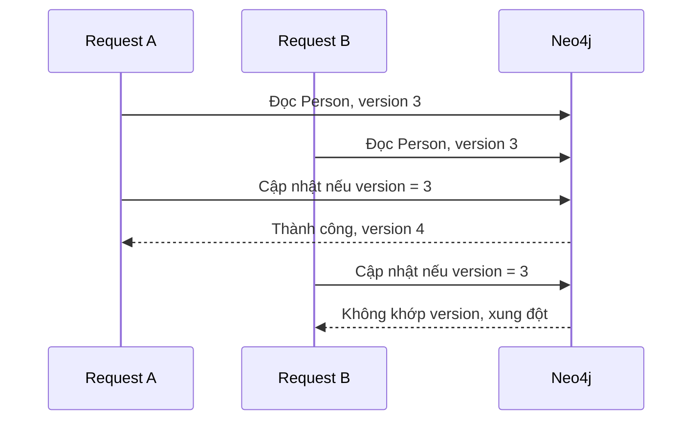

# Quyết định tạo mới hoặc cập nhật theo ID và version

Khi gọi `save()` trên repository Spring Data Neo4j, ứng dụng cần xác định entity đang được lưu lần đầu hay đã tồn tại. ID giúp xác định entity nào đang được ánh xạ; version giúp nhận biết trạng thái persistence và kiểm soát cập nhật đồng thời. Hai thông tin này phối hợp để Spring Data Neo4j (SDN) chọn đường ghi phù hợp và phát hiện trường hợp một bản cập nhật dựa trên dữ liệu cũ.

Bài học thuộc module **SPRING_DATA_NEO4J**, tập trung vào đọc và ghi đồ thị qua node entity, relationship, repository và Cypher. Ví dụ sử dụng node `Person` với ID sinh tự động hoặc ID nghiệp vụ được gán sẵn, sau đó so sánh cách SDN quyết định tạo mới, cập nhật và xử lý xung đột version.

## 1. ID, trạng thái mới và version giải quyết ba câu hỏi khác nhau

Ba khái niệm cần được tách biệt:

- **ID** trả lời: đây là entity nào? Ví dụ `personId = "P-1042"` xác định một người trong miền nghiệp vụ.
- **Trạng thái mới (`isNew`)** trả lời: entity này đang được persistence lưu lần đầu hay đã được lưu trước đó? Trạng thái này quyết định đường tạo mới hoặc cập nhật.
- **Version** trả lời: entity đang được cập nhật dựa trên phiên bản nào? Version hỗ trợ optimistic locking để phát hiện thay đổi đồng thời.

ID có giá trị không tự chứng minh node đã tồn tại. Một entity mới có thể được cấp ID nghiệp vụ trước khi ghi lần đầu. Ngược lại, một entity đã tồn tại có thể đang được cập nhật với ID và version được đọc từ database.

## 2. Cách Spring Data xác định entity mới

Spring Data Commons cung cấp cơ chế nhận diện entity mới dùng chung cho các module Spring Data. Với entity SDN thông thường, cơ chế này ưu tiên kiểm tra trạng thái được cung cấp bởi `Persistable`, sau đó xét version property phù hợp, rồi mới xét ID.

| Cấu hình entity | Điều kiện thường được xem là mới |
|---|---|
| Entity triển khai `Persistable<ID>` | `isNew()` trả về `true` |
| Có version property dạng đối tượng, ví dụ `Long` | Version đang là `null` |
| Không có version property phù hợp | ID đang là `null` |

Vì vậy, một entity có ID tự gán nhưng có `@Version Long version` đang là `null` vẫn có thể được nhận diện là entity mới. Khi version đã có giá trị, Spring Data xem entity là đã tồn tại và dùng thông tin version trong quá trình cập nhật.

Đây là quy tắc nhận diện trạng thái của object mapping. Nó không có nghĩa SDN luôn gửi một truy vấn kiểm tra sự tồn tại của node theo ID trước mỗi lần `save()`.

## 3. Trường hợp ID được sinh tự động

Với ID do Neo4j/SDN sinh, trường `@Id` thường bắt đầu bằng `null`. Điều này cho phép Spring Data nhận diện entity mới nếu không có cơ chế trạng thái khác chi phối.

```java
import org.springframework.data.annotation.Id;
import org.springframework.data.neo4j.core.schema.GeneratedValue;
import org.springframework.data.neo4j.core.schema.Node;

@Node("Person")
public class Person {

    @Id
    @GeneratedValue
    private Long id;

    private String name;
    private Integer born;

    public Person(String name, Integer born) {
        this.name = name;
        this.born = born;
    }
}
```

Lưu entity mới:

```java
Person person = new Person("Keanu Reeves", 1964);
Person saved = personRepository.save(person);
```

Trước lần lưu đầu, `id` chưa có giá trị. SDN đi theo đường tạo node và gán ID được sinh. Hãy dùng đối tượng được trả về từ `save()` vì kết quả persistence có thể chứa ID và version mới được gán.

Ở lần lưu sau, entity đã có ID nên được nhận diện là entity đã tồn tại nếu không có cơ chế nhận diện khác. SDN thực hiện cập nhật node theo định danh và các quy tắc mapping của entity.

## 4. ID nghiệp vụ được gán sẵn cần version để nhận diện lần lưu đầu

Trong nhiều ứng dụng, ID đến từ hệ thống nghiệp vụ, ví dụ `personId = "P-1042"`. Entity có ID ngay từ lúc được tạo, nên nếu chỉ dựa vào việc ID có `null` hay không thì Spring Data có thể xem nó là entity đã tồn tại.

Một cách phổ biến là khai báo `@Version` bằng kiểu đối tượng như `Long`:

```java
import org.springframework.data.annotation.Id;
import org.springframework.data.annotation.Version;
import org.springframework.data.neo4j.core.schema.Node;

@Node("Person")
public class Person {

    @Id
    private String personId;

    @Version
    private Long version;

    private String name;
    private Integer born;

    public Person(String personId, String name, Integer born) {
        this.personId = personId;
        this.name = name;
        this.born = born;
    }
}
```

Lúc tạo entity:

```java
Person person = new Person("P-1042", "Keanu Reeves", 1964);
// personId đã có giá trị, nhưng version vẫn null.

Person saved = personRepository.save(person);
```

`version == null` báo hiệu entity chưa được lưu. Sau khi tạo node, SDN quản lý version ban đầu. Những lần lưu tiếp theo sử dụng version đã đọc hoặc được trả về từ lần ghi trước để kiểm soát cập nhật.

Không dùng kiểu nguyên thủy `long` cho trường hợp cần trạng thái `null` ban đầu. `long` mặc định là `0`, không thể biểu diễn trạng thái chưa có version. Dùng `Long` để phân biệt rõ entity mới và entity đã được lưu.

## 5. @Version và optimistic locking

Optimistic locking giả định xung đột cập nhật không xảy ra thường xuyên. Thay vì khóa bản ghi trong suốt thời gian người dùng chỉnh sửa, ứng dụng đọc version hiện tại và chỉ cho phép cập nhật nếu version trong database vẫn khớp với version mà entity đang giữ.

Ví dụ:

1. Request A đọc `Person P-1042` với `version = 3`.
2. Request B cũng đọc cùng node với `version = 3`.
3. Request A cập nhật tên; database ghi thành công và version tăng lên `4`.
4. Request B gửi cập nhật dựa trên version `3`; điều kiện version không còn khớp nên cập nhật bị từ chối.



SDN dùng `@Version` để đưa kiểm tra version vào thao tác persistence được framework quản lý. Nếu entity đã bị một tiến trình khác cập nhật, thao tác có thể phát sinh ngoại lệ optimistic locking, chẳng hạn `OptimisticLockingFailureException` hoặc ngoại lệ chuyên biệt tương ứng trong tầng Spring Data.

Không tự tăng version trong service và không nhận version tùy ý từ client rồi ghi đè lên entity. Hãy đọc entity cùng version hiện tại, áp dụng thay đổi nghiệp vụ và để SDN quản lý việc kiểm tra/cập nhật version.

## 6. Luồng quyết định tạo mới hay cập nhật

Có thể hình dung đường đi của `save()` như sau:

```mermaid
flowchart TD
    A[Ứng dụng gọi repository.save(entity)] --> B{Entity có Persistable?}
    B -->|Có| C[Đọc isNew()]
    B -->|Không| D{Có version property dạng đối tượng?}
    D -->|Có| E{version == null?}
    D -->|Không| F{ID == null?}
    C --> G{Entity mới?}
    E --> G
    F --> G
    G -->|Có| H[Tạo node và ghi graph mới]
    G -->|Không| I[Cập nhật theo ID và kiểm tra version nếu có]
    H --> J[Trả entity sau persistence]
    I --> J
```

Đây là mô hình khái quát của cơ chế entity-state detection. Chi tiết triển khai có thể phụ thuộc phiên bản Spring Data và cấu hình mapping, nhưng nguyên tắc quan trọng là ID và version được dùng để quyết định trạng thái persistence, còn version hỗ trợ kiểm soát cập nhật cạnh tranh.

## 7. ID tự gán nhưng không có @Version

Nếu entity có ID được gán sẵn và không có version property phù hợp, cơ chế mặc định có thể xem entity là đã tồn tại vì ID khác `null`. Khi đó, `save()` có thể đi theo nhánh cập nhật thay vì tạo mới.

Ví dụ cần thận trọng:

```java
@Node("Person")
public class Person {

    @Id
    private String personId; // Được gán trước lần save đầu tiên.

    private String name;
}
```

Nếu muốn tiếp tục dùng ID tự gán mà không có `@Version`, ứng dụng có thể triển khai `Persistable<String>` để cung cấp `isNew()` theo quy tắc của mình. Tuy nhiên, trạng thái này phải được quản lý đúng qua vòng đời đối tượng: entity mới trả về `true`, entity đã lưu hoặc được tải từ database trả về `false`.

Không nên triển khai một cờ `isNew` luôn là `true` mà không có cơ chế chuyển trạng thái. Nếu không, lần `save()` tiếp theo vẫn có thể đi theo đường tạo mới và gây lỗi uniqueness hoặc dữ liệu không mong muốn.

Với nhiều ứng dụng, `@Version Long` là lựa chọn đơn giản hơn vì vừa giúp nhận diện entity mới khi ID tự gán, vừa cung cấp optimistic locking cho cập nhật đồng thời.

## 8. ID, uniqueness constraint và trạng thái mới

ID trong entity Java không tự tạo uniqueness constraint cho property nghiệp vụ. Nếu `personId` là mã duy nhất của node `Person`, cần khai báo constraint ở Neo4j:

```cypher
CREATE CONSTRAINT person_person_id_unique IF NOT EXISTS
FOR (p:Person)
REQUIRE p.personId IS UNIQUE;
```

Constraint bảo vệ dữ liệu trước các lần ghi trùng, kể cả khi hai request cùng cố tạo một ID. `@Version` giải quyết vấn đề khác: phát hiện một entity đã tồn tại bị cập nhật dựa trên version cũ. Hai cơ chế bổ sung cho nhau:

| Cơ chế | Bảo vệ điều gì? |
|---|---|
| `@Id` | Định danh entity trong mapping SDN |
| Uniqueness constraint | Không cho phép trùng giá trị khóa trong phạm vi label/property |
| `@Version` | Phát hiện cập nhật dựa trên phiên bản cũ |
| `Persistable.isNew()` | Cho phép ứng dụng quyết định trạng thái mới theo quy tắc riêng |

Không dùng version thay cho ID hoặc uniqueness constraint. Version có thể giống nhau trên nhiều node; nó chỉ có ý nghĩa trong phạm vi entity đang được quản lý.

## 9. Phân biệt repository.save() với Cypher MERGE

`repository.save(entity)` và Cypher `MERGE` đều có thể tham gia quy trình tạo mới hoặc cập nhật, nhưng chúng không phải cùng một cơ chế.

- `save()` dựa trên trạng thái mới của entity theo Spring Data, mapping metadata, ID và version.
- `MERGE` tìm hoặc tạo một mẫu graph theo các property được chỉ định trong câu lệnh Cypher.
- `@Version` được SDN áp dụng trong các thao tác persistence do framework quản lý. Một câu Cypher ghi tùy chỉnh không nên được giả định là tự động kiểm tra và tăng version như repository save.
- Uniqueness constraint bảo vệ tính duy nhất ở database bất kể dữ liệu được ghi bằng repository hay Cypher.

Ví dụ `MERGE` theo ID nghiệp vụ:

```cypher
MERGE (p:Person {personId: $personId})
ON CREATE SET
    p.name = $name,
    p.born = $born,
    p.version = 0
ON MATCH SET
    p.name = $name
RETURN p;
```

Đây chỉ là minh họa upsert theo ID. Với Cypher tùy chỉnh trong hệ thống có optimistic locking, không nên cập nhật node theo `MERGE` đơn thuần rồi bỏ qua version. Hãy kiểm tra version hiện tại, cập nhật có điều kiện và tăng version trong cùng một câu lệnh/transaction.

Ví dụ compare-and-set cho một cập nhật có version kỳ vọng:

```cypher
MATCH (p:Person {personId: $personId})
WHERE p.version = $expectedVersion
SET p.name = $name,
    p.version = p.version + 1
RETURN p;
```

Nếu truy vấn không trả về dòng nào, node có thể không tồn tại hoặc version đã thay đổi. Tầng dịch vụ có thể kiểm tra bổ sung để phân biệt không tìm thấy với xung đột cập nhật. Câu lệnh ghi tùy chỉnh phải được thực hiện trong transaction phù hợp.

## 10. Xử lý xung đột version trong service

Khi optimistic locking phát hiện xung đột, service cần có chính sách nghiệp vụ rõ ràng. Một số lựa chọn thường gặp:

- **Thông báo xung đột:** trả lỗi phù hợp để client tải dữ liệu mới và gửi lại thay đổi.
- **Đọc lại rồi áp dụng lại:** tải entity/version mới nhất, kiểm tra thay đổi có còn hợp lệ và áp dụng lại nếu không làm mất dữ liệu của người khác.
- **Gộp thay đổi:** nếu các trường thay đổi độc lập, có thể gộp theo quy tắc domain thay vì ghi đè toàn bộ entity.
- **Từ chối cập nhật:** dùng khi thay đổi dựa trên trạng thái cũ không còn hợp lệ, chẳng hạn hai người cùng đặt một tài nguyên.

Không nên tự động retry vô hạn. Retry chỉ phù hợp khi thao tác có thể thực hiện lại an toàn và service có thể đánh giá trạng thái mới. Với thao tác không idempotent như cộng điểm hoặc trừ số dư, cần thiết kế khóa idempotency hoặc cơ chế nghiệp vụ riêng.

## 11. Các tình huống thường gặp

| Tình huống | Trạng thái cần lưu ý | Hướng xử lý |
|---|---|---|
| ID sinh tự động đang `null` | Entity mới theo ID | Gọi `save()` và dùng entity trả về |
| ID nghiệp vụ đã có, version `null` | Entity mới nếu version được dùng để nhận diện | Dùng `@Version Long` và để framework quản lý |
| ID và version đều đã có | Entity hiện hữu | Cập nhật dựa trên version đã đọc |
| ID tự gán, không version | Có thể bị xem là entity hiện hữu | Thêm version hoặc triển khai `Persistable` đúng vòng đời |
| Version cũ hơn database | Cập nhật cạnh tranh | Xử lý optimistic locking, đọc lại hoặc báo conflict |
| Client gửi ID nhưng không có version | Không đủ thông tin để bảo vệ cập nhật đồng thời | Đọc entity mới nhất trước khi cập nhật hoặc yêu cầu version kỳ vọng |
| Hai request tạo cùng ID | Cạnh tranh tạo mới | Dùng uniqueness constraint và xử lý lỗi trùng |

## 12. Checklist trước khi gọi save()

- Trường `@Id` có giá trị đúng và có kiểu khớp với ID generic của repository.
- Nếu ID được gán sẵn, đã xác định cách Spring Data nhận diện entity mới.
- Nếu dùng `@Version`, trường version dùng kiểu đối tượng như `Long`, không tự tăng trong code nghiệp vụ.
- Entity được tải từ database giữ version mới nhất trước khi cập nhật.
- Có uniqueness constraint cho ID nghiệp vụ trong Neo4j.
- Code dùng đối tượng trả về từ `save()` khi cần ID/version sau persistence.
- Các relationship cần ghi đã được tải và thay đổi trong phạm vi phù hợp.
- Ngoại lệ optimistic locking được chuyển thành hành vi nghiệp vụ có thể hiểu được.
- Truy vấn Cypher tùy chỉnh tự quản lý điều kiện version nếu cần optimistic locking.

## 13. Bài tập thực hành

1. Tạo entity `Person` dùng ID sinh tự động; mô tả trạng thái `id` trước và sau lần `save()` đầu tiên.
2. Chuyển sang ID nghiệp vụ `personId` kiểu `String`, thêm `@Version Long` và giải thích vì sao version `null` giúp nhận diện entity mới.
3. Thử thay `Long version` bằng `long version`; phân tích vì sao kiểu nguyên thủy không thể biểu diễn trạng thái chưa có version.
4. Viết một service cập nhật `Person` từ entity vừa đọc, sau đó mô phỏng hai request cùng đọc một version và giải thích kết quả optimistic locking.
5. Tạo uniqueness constraint cho `personId`; phân biệt lỗi trùng ID với lỗi version cũ.
6. Thiết kế `Persistable<String>` cho entity ID tự gán và mô tả cách chuyển `isNew` sau lần lưu đầu tiên.
7. Viết Cypher compare-and-set có `expectedVersion`, rồi giải thích cách service phân biệt node không tồn tại với version conflict.

Khi hoàn thành, bạn cần giải thích được vì sao ID có giá trị chưa đủ để kết luận node đã tồn tại, cách `@Version` giúp SDN nhận diện entity mới và bảo vệ cập nhật đồng thời, cũng như khi nào cần `Persistable` hoặc Cypher có kiểm tra version riêng. Đây là nền tảng để tầng đọc/ghi đồ thị xử lý đúng cả lần tạo đầu tiên lẫn các cập nhật về sau.
