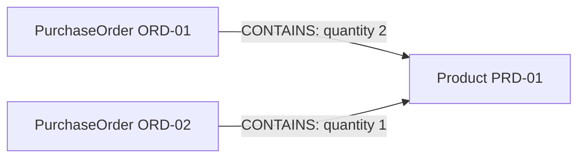

# Lưu các node dùng chung mà không tạo bản sao ngoài ý muốn

Trong một đồ thị Neo4j, nhiều thực thể có thể cùng tham chiếu đến một node. Ví dụ, nhiều đơn hàng có thể chứa cùng một sản phẩm; nhiều bài viết có thể cùng tham chiếu đến một tác giả; nhiều nhân viên có thể cùng làm việc trong một phòng ban. Khi lưu một phần graph bằng Spring Data Neo4j (SDN), ứng dụng cần giữ đúng danh tính của node dùng chung để các relationship mới trỏ về node hiện có thay vì tạo thêm bản sao.

Điều quan trọng là phân biệt **node được chia sẻ** với **relationship riêng của từng liên kết**. Sản phẩm là một node dùng chung, còn số lượng và đơn giá chốt cho từng đơn hàng thường thuộc relationship `CONTAINS`. Thiết kế định danh rõ ràng, nạp node đã tồn tại trước khi liên kết và dùng constraint cùng `MERGE` khi ghi bằng Cypher giúp bảo vệ tính nhất quán của graph.

## 1. Node dùng chung trong đồ thị

Giả sử hai đơn hàng khác nhau cùng chứa một sản phẩm `PRD-01`. Mô hình mong muốn là một node `Product` duy nhất được nối với hai node `PurchaseOrder`:



Nếu mỗi lần tạo đơn hàng, ứng dụng lại tạo một node `Product` mới dù cùng là `PRD-01`, graph sẽ xuất hiện các bản sao biểu diễn cùng một sản phẩm. Khi cập nhật tên hoặc trạng thái sản phẩm, các bản sao có thể lệch dữ liệu. Truy vấn thống kê cũng có thể đếm cùng một sản phẩm thành nhiều thực thể.

Hãy phân chia dữ liệu theo ý nghĩa:

- `Product` chứa thông tin dùng chung như mã SKU, tên và thuộc tính mô tả sản phẩm.
- `PurchaseOrder` chứa thông tin riêng của đơn hàng.
- Relationship `CONTAINS` chứa dữ liệu riêng cho lần đặt hàng như số lượng và đơn giá tại thời điểm mua.

Không sao chép property dùng chung vào mọi đơn hàng nếu dữ liệu đó cần được quản lý tập trung. Ngược lại, dữ liệu lịch sử như đơn giá đã chốt nên được lưu trên relationship hoặc một dòng hàng riêng để việc thay đổi giá hiện tại của sản phẩm không làm thay đổi lịch sử đơn hàng.

## 2. Định danh ổn định cho node được chia sẻ

SDN cần một định danh để nhận diện entity. Với dữ liệu nghiệp vụ như sản phẩm, có thể dùng khóa do ứng dụng cấp, chẳng hạn `sku`, làm `@Id`:

```java
import org.springframework.data.annotation.Id;
import org.springframework.data.annotation.Version;
import org.springframework.data.neo4j.core.schema.Node;

@Node("Product")
public class Product {

    @Id
    private String sku;

    private String name;

    @Version
    private Long version;

    protected Product() {
    }

    public Product(String sku, String name) {
        this.sku = sku;
        this.name = name;
    }

    public String getSku() {
        return sku;
    }

    public String getName() {
        return name;
    }
}
```

`sku` là định danh nghiệp vụ được ứng dụng kiểm soát. `@Version` hỗ trợ optimistic locking và cũng giúp Spring Data nhận biết trạng thái mới/cũ của entity khi dùng ID được gán từ bên ngoài: entity mới có version chưa được thiết lập; entity đã được nạp có version hiện tại. Không tự đặt version cho một entity mới.

Database cần bảo đảm `sku` là duy nhất. Có thể tạo uniqueness constraint:

```cypher
CREATE CONSTRAINT product_sku_unique IF NOT EXISTS
FOR (p:Product)
REQUIRE p.sku IS UNIQUE;
```

Constraint bảo vệ dữ liệu ngay tại Neo4j, kể cả khi có nhiều instance ứng dụng cùng ghi. Chỉ khai báo `@Id` trong Java không tự tạo uniqueness constraint ở database; hãy quản lý constraint bằng migration hoặc quy trình triển khai schema của dự án.

Một lựa chọn khác là dùng internal ID do Neo4j sinh với `@Id @GeneratedValue`, đồng thời lưu `sku` như property nghiệp vụ và đặt uniqueness constraint cho `sku`. Khi đó, entity đại diện cho node hiện có phải giữ internal ID đã được SDN nạp. Không tạo một entity mới có internal ID null rồi kỳ vọng SDN tự hiểu nó là node sản phẩm cũ chỉ vì `sku` giống nhau.

## 3. Ánh xạ relationship riêng đến node dùng chung

Mỗi đơn hàng có thể chứa nhiều dòng hàng. Relationship `CONTAINS` nối đơn hàng với sản phẩm, còn các property của relationship mô tả dòng hàng trong đơn đó:

```cypher
CREATE (o:PurchaseOrder {orderId: 'ORD-01'})
CREATE (p:Product {sku: 'PRD-01', name: 'Keyboard'})
CREATE (o)-[:CONTAINS {
    lineId: 'LINE-01',
    quantity: 2,
    unitPriceMinor: 850000
}]->(p);
```

Trong SDN, ánh xạ relationship có property bằng `@RelationshipProperties` và `@TargetNode`:

```java
import org.springframework.data.neo4j.core.schema.RelationshipId;
import org.springframework.data.neo4j.core.schema.RelationshipProperties;
import org.springframework.data.neo4j.core.schema.TargetNode;

@RelationshipProperties
public class OrderLine {

    @RelationshipId
    private Long id;

    private String lineId;
    private int quantity;
    private long unitPriceMinor;

    @TargetNode
    private Product product;

    protected OrderLine() {
    }

    public OrderLine(String lineId, Product product,
                     int quantity, long unitPriceMinor) {
        this.lineId = lineId;
        this.product = product;
        this.quantity = quantity;
        this.unitPriceMinor = unitPriceMinor;
    }
}
```

`@RelationshipId` là định danh kỹ thuật của relationship do SDN quản lý. `lineId` là mã dòng hàng nghiệp vụ, còn `product` là tham chiếu đến node `Product` dùng chung. Mỗi đơn hàng có thể có một `OrderLine` khác nhau trỏ đến cùng một `Product`.

Entity đơn hàng khai báo collection relationship:

```java
import java.util.ArrayList;
import java.util.List;

import org.springframework.data.annotation.Id;
import org.springframework.data.annotation.Version;
import org.springframework.data.neo4j.core.schema.Node;
import org.springframework.data.neo4j.core.schema.Relationship;
import org.springframework.data.neo4j.core.schema.Direction;

@Node("PurchaseOrder")
public class PurchaseOrder {

    @Id
    private String orderId;

    @Version
    private Long version;

    @Relationship(type = "CONTAINS", direction = Direction.OUTGOING)
    private List<OrderLine> lines = new ArrayList<>();

    protected PurchaseOrder() {
    }

    public void addLine(String lineId, Product product,
                        int quantity, long unitPriceMinor) {
        if (quantity <= 0) {
            throw new IllegalArgumentException("Quantity must be positive");
        }
        lines.add(new OrderLine(lineId, product, quantity, unitPriceMinor));
    }
}
```

Trong ví dụ, `PurchaseOrder` là node root, `OrderLine` mô tả relationship và `Product` là node đích dùng chung. Các dòng hàng của hai đơn khác nhau có thể cùng tham chiếu đến một đối tượng sản phẩm theo định danh `sku`.

## 4. Nạp node dùng chung trước khi tạo liên kết

Khi tạo đơn hàng mới, hãy tìm sản phẩm bằng định danh ổn định qua repository. Nếu sản phẩm không tồn tại, xử lý theo quy tắc nghiệp vụ: báo lỗi hoặc tạo sản phẩm mới qua use case quản lý catalog. Sau đó gắn entity đã nạp vào relationship của đơn hàng.

```java
import org.springframework.data.neo4j.repository.Neo4jRepository;

public interface ProductRepository extends Neo4jRepository<Product, String> {
}

public interface PurchaseOrderRepository
        extends Neo4jRepository<PurchaseOrder, String> {
}
```

Service điều phối việc tạo đơn:

```java
import org.springframework.stereotype.Service;
import org.springframework.transaction.annotation.Transactional;

@Service
public class OrderService {

    private final ProductRepository products;
    private final PurchaseOrderRepository orders;

    public OrderService(ProductRepository products,
                        PurchaseOrderRepository orders) {
        this.products = products;
        this.orders = orders;
    }

    @Transactional
    public void addProduct(
            PurchaseOrder order,
            String sku,
            String lineId,
            int quantity,
            long unitPriceMinor) {

        Product product = products.findById(sku)
                .orElseThrow(() -> new IllegalArgumentException("Product not found"));

        order.addLine(lineId, product, quantity, unitPriceMinor);
        orders.save(order);
    }
}
```

Điểm quan trọng là `product` được nạp từ repository và mang định danh cùng version của node đã tồn tại. Khi lưu đơn hàng, SDN có thể nhận diện node đích đó là entity hiện hữu và duy trì relationship đến đúng node. Nếu tạo `new Product(sku, name)` trong mỗi lần thêm dòng hàng, ứng dụng đang tạo một entity mới với version chưa có; điều này không tương đương với việc tham chiếu node đã tồn tại.

Trong ví dụ, `order` được truyền vào service để tập trung vào thao tác thêm dòng hàng. Trong ứng dụng thực tế, service thường tải `PurchaseOrder` bằng `orders.findById(orderId)` bên trong transaction rồi cập nhật root đó. Hãy bảo đảm root và các relationship cần ghi được nạp đầy đủ trước khi gọi `save`.

## 5. Phân biệt node dùng chung và relationship mới

Khi một sản phẩm được thêm vào hai đơn hàng, điều mong muốn là:

- Chỉ có một node `Product` cho `sku` đó.
- Mỗi đơn hàng có relationship `CONTAINS` riêng đến node sản phẩm.
- `quantity`, `unitPriceMinor` và `lineId` thuộc từng dòng hàng, không ghi đè thông tin của đơn hàng khác.

Ví dụ graph sau khi tạo hai đơn:

```cypher
MATCH (p:Product {sku: 'PRD-01'})
MATCH (o1:PurchaseOrder {orderId: 'ORD-01'})
MATCH (o2:PurchaseOrder {orderId: 'ORD-02'})
CREATE (o1)-[:CONTAINS {
    lineId: 'LINE-01', quantity: 2, unitPriceMinor: 850000
}]->(p)
CREATE (o2)-[:CONTAINS {
    lineId: 'LINE-07', quantity: 1, unitPriceMinor: 850000
}]->(p);
```

Không tạo bản sao `Product` cho từng đơn. Nếu giá sản phẩm hiện tại thay đổi, các dòng hàng cũ vẫn giữ `unitPriceMinor` đã chốt. Đây là ví dụ về việc dùng chung node nhưng giữ dữ liệu riêng trên relationship.

Nếu nghiệp vụ cho phép một sản phẩm xuất hiện nhiều lần trong cùng đơn, mỗi dòng hàng cần một khóa `lineId` riêng. Không giả định cặp `orderId` và `sku` luôn duy nhất nếu mô hình cho phép nhiều dòng cùng sản phẩm với mức giá, lô hàng hoặc điều kiện khác nhau.

## 6. Dùng MERGE và uniqueness constraint khi ghi bằng Cypher

Với lệnh ghi trực tiếp bằng Cypher, `MERGE` giúp tìm node theo khóa hoặc tạo node khi chưa có. Kết hợp với uniqueness constraint để bảo vệ khóa dùng chung:

```cypher
CREATE CONSTRAINT product_sku_unique IF NOT EXISTS
FOR (p:Product)
REQUIRE p.sku IS UNIQUE;

CREATE CONSTRAINT purchase_order_id_unique IF NOT EXISTS
FOR (o:PurchaseOrder)
REQUIRE o.orderId IS UNIQUE;
```

Sau đó có thể tạo hoặc tìm node theo khóa nghiệp vụ:

```cypher
MERGE (p:Product {sku: $sku})
ON CREATE SET p.name = $productName,
              p.createdAt = datetime()
MERGE (o:PurchaseOrder {orderId: $orderId})
ON CREATE SET o.createdAt = datetime()
MERGE (o)-[line:CONTAINS {lineId: $lineId}]->(p)
SET line.quantity = $quantity,
    line.unitPriceMinor = $unitPriceMinor
RETURN p, o, line;
```

`ON CREATE SET` chỉ khởi tạo thuộc tính sản phẩm khi node mới được tạo. Khi sản phẩm đã tồn tại, câu lệnh không ghi đè `p.name` bằng giá trị đầu vào có thể đã cũ. Nếu use case có quyền cập nhật thông tin catalog, hãy thực hiện thay đổi đó qua lệnh nghiệp vụ riêng.

`MERGE` trên relationship cùng `lineId` giúp tránh tạo lại cùng dòng hàng khi lệnh được chạy lặp với cùng các khóa và endpoints. Nếu nghiệp vụ có quy tắc duy nhất khác, hãy điều chỉnh pattern theo khóa thực tế. Uniqueness constraint trên `Product.sku` và `PurchaseOrder.orderId` bảo vệ tính duy nhất của node; không dựa riêng vào `MERGE` khi có ghi đồng thời.

## 7. Tránh các cách tạo bản sao ngoài ý muốn

Một số tình huống dễ làm graph xuất hiện node trùng:

1. **Tạo entity mới mỗi lần tham chiếu:** `new Product(...)` với định danh chưa được SDN nhận diện là node hiện hữu.
2. **Dùng tên thay cho khóa:** hai sản phẩm có thể cùng tên hoặc tên có thể thay đổi.
3. **Không có uniqueness constraint:** hai request đồng thời có thể cùng kiểm tra chưa tồn tại rồi tạo node cùng khóa nghiệp vụ.
4. **Không nạp node dùng chung:** object graph được tạo từ dữ liệu đầu vào không có đủ thông tin định danh hoặc version để SDN nhận diện entity cũ.
5. **Dùng nhầm ID kỹ thuật:** internal ID và khóa nghiệp vụ có vòng đời, mục đích khác nhau.

Hãy dùng khóa ổn định, uniqueness constraint, và nạp entity hiện hữu từ repository trước khi liên kết. Nếu dùng generated internal ID, giữ ID đã nạp; nếu dùng ID do ứng dụng cấp, cân nhắc `@Version` để quản lý newness và optimistic locking.

## 8. Đọc dữ liệu mà không cần lưu toàn bộ object graph

Không phải use case nào cũng cần nạp entity rồi gọi `save`. Nếu chỉ cần hiển thị đơn hàng cùng sản phẩm, có thể dùng Cypher projection để đọc các trường cần thiết:

```java
public interface OrderProductView {
    String getOrderId();
    String getSku();
    String getProductName();
    Integer getQuantity();
    Long getUnitPriceMinor();
}
```

```java
import java.util.List;

import org.springframework.data.neo4j.repository.Neo4jRepository;
import org.springframework.data.neo4j.repository.query.Query;
import org.springframework.data.repository.query.Param;

public interface OrderReadRepository
        extends Neo4jRepository<PurchaseOrder, String> {

    @Query("""
        MATCH (o:PurchaseOrder {orderId: $orderId})
              -[line:CONTAINS]->(p:Product)
        RETURN o.orderId AS orderId,
               p.sku AS sku,
               p.name AS productName,
               line.quantity AS quantity,
               line.unitPriceMinor AS unitPriceMinor
        ORDER BY p.name
        """)
    List<OrderProductView> findProducts(
            @Param("orderId") String orderId);
}
```

Projection chỉ đọc dữ liệu từ graph, không tạo entity `Product` mới và không yêu cầu lưu lại object graph. Đây thường là lựa chọn phù hợp cho màn hình hoặc báo cáo chỉ cần một số trường.

## 9. Kiểm tra node dùng chung sau khi ghi

Sau khi tạo nhiều đơn hàng, có thể kiểm tra số node sản phẩm mang cùng SKU:

```cypher
MATCH (p:Product {sku: 'PRD-01'})
OPTIONAL MATCH (o:PurchaseOrder)-[line:CONTAINS]->(p)
RETURN count(DISTINCT p) AS productCount,
       count(line) AS lineCount,
       collect({orderId: o.orderId, lineId: line.lineId,
                quantity: line.quantity}) AS orderLines;
```

Với dữ liệu ví dụ, `productCount` phải là `1`, còn `lineCount` bằng số dòng hàng tham chiếu đến sản phẩm. Nếu `productCount` lớn hơn một, hãy tìm các node trùng theo SKU:

```cypher
MATCH (p:Product)
WITH p.sku AS sku, collect(elementId(p)) AS nodeIds, count(*) AS copies
WHERE copies > 1
RETURN sku, copies, nodeIds
ORDER BY copies DESC;
```

Truy vấn kiểm tra giúp phát hiện dữ liệu trùng đã tồn tại. Trước khi hợp nhất node trùng, cần xác định node chuẩn, chuyển các relationship sang node chuẩn và giải quyết xung đột property theo quy tắc nghiệp vụ. Không xóa node trùng trước khi xử lý các relationship đang tham chiếu đến chúng.

## 10. Những lỗi thường gặp

| Lỗi | Hệ quả | Cách xử lý |
|---|---|---|
| Tạo `new Product(...)` mỗi lần thêm vào đơn | Có thể tạo node sản phẩm mới thay vì tham chiếu node hiện có | Nạp sản phẩm bằng repository theo định danh ổn định |
| Chỉ dựa vào tên sản phẩm | Tên không bảo đảm duy nhất và có thể đổi | Dùng SKU hoặc khóa nghiệp vụ ổn định |
| Không đặt uniqueness constraint | Dữ liệu trùng có thể xuất hiện khi ghi đồng thời | Tạo constraint cho khóa nghiệp vụ |
| Đặt số lượng và đơn giá của đơn trên node Product | Đơn hàng này có thể ghi đè dữ liệu của đơn hàng khác | Lưu dữ liệu theo từng dòng trên relationship hoặc node OrderLine |
| Thay relationship collection bằng danh sách thiếu phần tử | Khi đồng bộ, relationship không còn trong object graph có thể bị loại bỏ | Nạp đủ collection cần quản lý trước khi lưu hoặc dùng lệnh ghi hẹp |
| Dùng `MERGE` mà không xác định khóa relationship | Có thể gộp các dòng hàng vốn là hai nghiệp vụ riêng | Xác định `lineId` hoặc khóa dòng hàng phù hợp |
| Dùng `ON MATCH SET` để cập nhật mọi thuộc tính dùng chung | Dữ liệu đầu vào cũ có thể ghi đè node đang được nhiều nơi dùng | Chỉ cập nhật property dùng chung qua use case có quyền sở hữu rõ ràng |
| Cho rằng `@Id` tự tạo constraint | Database vẫn có thể nhận node trùng nếu không có constraint | Quản lý uniqueness constraint ở Neo4j |

## 11. Bài tập thực hành

Tạo một sản phẩm dùng chung và hai đơn hàng:

```cypher
CREATE CONSTRAINT product_sku_unique IF NOT EXISTS
FOR (p:Product) REQUIRE p.sku IS UNIQUE;

MERGE (p:Product {sku: 'PRD-100'})
ON CREATE SET p.name = 'Monitor';

CREATE (:PurchaseOrder {orderId: 'ORD-100'});
CREATE (:PurchaseOrder {orderId: 'ORD-200'});
```

Thực hiện các yêu cầu:

1. Viết entity `Product` với `sku` làm `@Id` và trường `@Version`.
2. Viết `OrderLine` bằng `@RelationshipProperties`, có `@RelationshipId`, `lineId`, `quantity`, `unitPriceMinor` và `@TargetNode Product`.
3. Viết entity `PurchaseOrder` với collection `List<OrderLine>`.
4. Dùng service tải cùng một sản phẩm `PRD-100` qua `ProductRepository`, rồi thêm sản phẩm đó vào cả hai đơn hàng.
5. Lưu hai đơn và truy vấn xác nhận chỉ có một node `Product` nhưng có hai relationship `CONTAINS`.
6. Thử tạo product entity mới chỉ có cùng SKU và quan sát vai trò của version cùng uniqueness constraint.
7. Viết một truy vấn `MERGE` để thêm dòng hàng theo `lineId`, sau đó chạy lại với cùng khóa và kiểm tra không phát sinh dòng trùng.

Sau bài tập, cần giải thích được vì sao node sản phẩm được dùng chung, dữ liệu dòng hàng thuộc relationship, cách SDN nhận diện entity hiện hữu và vai trò của uniqueness constraint khi có nhiều request ghi đồng thời.

## Kết luận

Để lưu các node dùng chung mà không tạo bản sao, hãy nhận diện node bằng khóa ổn định, đặt uniqueness constraint ở Neo4j và nạp entity hiện hữu trước khi gắn nó vào relationship của aggregate khác. Với SDN, `@Id` cùng `@Version` hoặc generated ID đã được nạp giúp xác định entity mới và cũ; `@RelationshipProperties` giữ dữ liệu riêng của từng liên kết. Khi ghi bằng Cypher, dùng `MERGE` theo khóa nghiệp vụ và kiểm soát `ON CREATE`/`ON MATCH` có chủ đích. Cách thiết kế này giữ một node dùng chung cho nhiều aggregate, đồng thời bảo toàn dữ liệu riêng của từng relationship.
