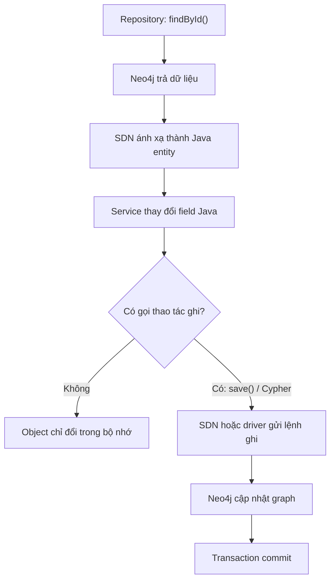

# Không có dirty checking: thời điểm thay đổi Java được ghi vào Neo4j

## Mục tiêu bài học

Sau bài này, bạn có thể:

- Giải thích vì sao thay đổi một entity Java không tự động được ghi vào Neo4j.
- Xác định thao tác nào thực sự kích hoạt việc ghi dữ liệu trong Spring Data Neo4j (SDN).
- Phân biệt vai trò của `save()`, `@Transactional` và thời điểm commit transaction.
- Cập nhật node và relationship có chủ đích, đồng thời sử dụng đúng đối tượng trả về từ thao tác lưu.
- Nhận biết tình huống custom Cypher đã thay đổi cơ sở dữ liệu nhưng object Java trong bộ nhớ vẫn giữ dữ liệu cũ.

## 1. Thay đổi object Java không đồng nghĩa thay đổi dữ liệu Neo4j

Trong ứng dụng Spring Data Neo4j, entity Java là mô hình đối tượng dùng để biểu diễn node và relationship. Khi đọc một entity từ repository, SDN truy vấn Neo4j và ánh xạ kết quả thành object Java.

Sau khi object được tạo, ứng dụng có thể thay đổi các field của nó:

```java
Customer customer = customerRepository.findById("C-100")
    .orElseThrow();

customer.setDisplayName("An Nguyen");
```

Dòng `setDisplayName` chỉ thay đổi object đang nằm trong bộ nhớ của ứng dụng. Neo4j không tự nhận được thông báo rằng field Java đã thay đổi.

Spring Data Neo4j không cung cấp cơ chế dirty checking tự động như JPA/Hibernate. Nó không duy trì một persistence context theo dõi mọi thay đổi trên entity đã đọc để tự động phát lệnh cập nhật khi transaction kết thúc.

Muốn ghi thay đổi xuống Neo4j, ứng dụng phải gọi một thao tác ghi rõ ràng, thường là:

- `repository.save(entity)`
- `neo4jTemplate.save(entity)`
- Một lệnh ghi Cypher thông qua `@Query`, `Neo4jClient` hoặc API tương ứng.

Nếu chỉ thay đổi object rồi kết thúc phương thức, dữ liệu trong Neo4j vẫn giữ giá trị cũ.

## 2. Luồng đọc, thay đổi và ghi dữ liệu

Một luồng cập nhật thông thường có ba bước:

1. Đọc entity từ repository.
2. Thay đổi trạng thái object theo nghiệp vụ.
3. Gọi `save()` để SDN ghi trạng thái entity xuống Neo4j.



Ví dụ đầy đủ:

```java
Customer customer = customerRepository.findById("C-100")
    .orElseThrow();

customer.setDisplayName("An Nguyen");

// Ghi trạng thái entity xuống Neo4j
Customer saved = customerRepository.save(customer);
```

Sau khi `save()` hoàn tất thành công, SDN đã thực hiện thao tác ghi trong transaction hiện hành. Nếu không có transaction bên ngoài, thao tác repository thường chạy trong transaction do Spring Data quản lý. Nếu có transaction service bao quanh, lệnh ghi tham gia transaction đó và được commit khi transaction kết thúc thành công.

Cần phân biệt hai thời điểm:

- **Gọi save:** yêu cầu ghi được thực thi trong transaction.
- **Commit:** transaction được xác nhận và các thay đổi trở nên bền vững đối với các transaction khác theo cơ chế của Neo4j.

Vì vậy, trong một service có `@Transactional`, `save()` có thể hoàn tất lệnh ghi trước khi phương thức service trả về, nhưng transaction chỉ commit khi toàn bộ phương thức kết thúc thành công. Nếu có lỗi làm transaction rollback, các thay đổi trong transaction đó sẽ không được commit.

## 3. Vai trò của save() trong repository

Repository kế thừa `Neo4jRepository<T, ID>` cung cấp phương thức `save()` để lưu entity:

```java
import org.springframework.data.neo4j.repository.Neo4jRepository;

public interface CustomerRepository
        extends Neo4jRepository<Customer, String> {
}
```

Giả sử entity `Customer` có constructor nhận mã và tên, có thể sử dụng:

```java
Customer customer = new Customer("C-100", "An");
Customer savedCustomer = customerRepository.save(customer);
```

`save()` dùng cho cả entity mới và entity đã tồn tại. SDN dựa trên metadata định danh, version và trạng thái entity để thực hiện thao tác lưu phù hợp.

Không nên hiểu `save()` là một lệnh chỉ cập nhật đúng field vừa thay đổi. SDN ánh xạ entity và các quan hệ được mô hình hóa để tạo thao tác ghi tương ứng. Vì vậy, cần hiểu rõ cấu trúc entity, các thuộc tính quan hệ và dữ liệu nào đang được cung cấp cho thao tác lưu.

Ví dụ, khi cập nhật một entity có các relationship được ánh xạ, hãy bảo đảm object graph chứa đúng trạng thái mà nghiệp vụ muốn lưu. Nếu chỉ có một phần dữ liệu, hãy chọn cách truy vấn và cập nhật phù hợp để không vô tình ghi trạng thái thiếu hoặc thay đổi các quan hệ ngoài ý muốn.

## 4. Đặt save() trong service và transaction

Một service thường là nơi thích hợp để kết hợp đọc, kiểm tra nghiệp vụ, thay đổi entity và lưu dữ liệu trong cùng một đơn vị công việc.

```java
import org.springframework.stereotype.Service;
import org.springframework.transaction.annotation.Transactional;

@Service
public class CustomerService {

    private final CustomerRepository customerRepository;

    public CustomerService(CustomerRepository customerRepository) {
        this.customerRepository = customerRepository;
    }

    @Transactional
    public Customer renameCustomer(String id, String newName) {
        Customer customer = customerRepository.findById(id)
            .orElseThrow(() ->
                new IllegalArgumentException("Customer not found: " + id)
            );

        customer.setDisplayName(newName);

        return customerRepository.save(customer);
    }
}
```

Trong ví dụ:

- `findById()` đọc dữ liệu trong transaction của service.
- Service kiểm tra sự tồn tại và thay đổi entity.
- `save()` phát lệnh ghi rõ ràng.
- Khi phương thức service kết thúc bình thường, transaction được commit.
- Nếu có exception làm transaction rollback theo cấu hình Spring, các thay đổi của transaction sẽ bị hủy.

`@Transactional` xác định ranh giới transaction. Nó không bật dirty checking và không tự lưu mọi object được thay đổi trong phương thức.

Một transaction có thể chứa nhiều thao tác đọc và ghi:

```java
@Transactional
public void transferOwnership(
        String customerId,
        String newOwnerId) {

    Customer customer = customerRepository.findById(customerId)
        .orElseThrow();

    Owner owner = ownerRepository.findById(newOwnerId)
        .orElseThrow();

    customer.setOwner(owner);

    customerRepository.save(customer);
}
```

Việc đọc và ghi nằm trong cùng transaction giúp các thao tác thuộc cùng nghiệp vụ được commit hoặc rollback như một đơn vị. Tuy nhiên, thao tác lưu vẫn phải được gọi rõ ràng.

## 5. save() trả về entity đã lưu

Một điểm quan trọng là cần sử dụng kết quả trả về từ `save()`, đặc biệt khi entity có định danh được sinh tự động, version hoặc sử dụng mô hình bất biến.

```java
Customer customer = new Customer("An");

Customer savedCustomer = customerRepository.save(customer);

System.out.println(savedCustomer.getId());
```

Khi lưu entity mới, SDN có thể nhận ID được Neo4j cấp hoặc áp dụng generator đã cấu hình. Giá trị định danh được đồng bộ vào kết quả lưu. Với entity có version, giá trị version cũng được quản lý theo cơ chế ánh xạ.

Với entity mutable, SDN có thể cập nhật các thuộc tính có thể ghi của object. Với entity immutable, SDN có thể tạo instance mới chứa các giá trị được cập nhật. Vì vậy, nên dùng object trả về từ `save()` làm trạng thái mới nhất:

```java
customer = customerRepository.save(customer);
```

Không nên giả định mọi entity đều giữ nguyên cùng object reference sau khi lưu. Điều quan trọng là sử dụng instance phản ánh kết quả của thao tác lưu.

## 6. Thay đổi relationship cũng cần thao tác ghi

Dirty checking không chỉ liên quan đến property của node. Thay đổi collection hoặc field quan hệ trong Java cũng không tự cập nhật relationship trong Neo4j.

Ví dụ entity `Person` có danh sách bạn bè:

```java
@Node("Person")
public class Person {

    @Id
    private String id;

    private String name;

    @Relationship(type = "KNOWS")
    private List<Person> friends = new ArrayList<>();

    public void addFriend(Person friend) {
        friends.add(friend);
    }
}
```

Thay đổi collection:

```java
Person person = personRepository.findById("P-100")
    .orElseThrow();

Person friend = personRepository.findById("P-200")
    .orElseThrow();

person.addFriend(friend);
```

Chưa có relationship nào được ghi chỉ vì `addFriend()` được gọi. Cần lưu entity:

```java
Person savedPerson = personRepository.save(person);
```

Sau thao tác lưu, SDN sử dụng metadata `@Relationship` để ánh xạ quan hệ trong object graph thành relationship trong Neo4j.

Khi xóa một phần tử khỏi collection, cũng cần gọi thao tác ghi để yêu cầu SDN đồng bộ trạng thái quan hệ theo mô hình được ánh xạ. Hãy cẩn trọng với object graph chỉ chứa một phần dữ liệu: nếu nghiệp vụ muốn cập nhật riêng một relationship, một câu Cypher có phạm vi rõ ràng có thể dễ kiểm soát hơn việc lưu một aggregate không đầy đủ.

## 7. Neo4jTemplate cũng yêu cầu thao tác ghi rõ ràng

Nếu không dùng repository, ứng dụng có thể gọi `Neo4jTemplate`:

```java
import org.springframework.data.neo4j.core.Neo4jTemplate;
import org.springframework.stereotype.Service;
import org.springframework.transaction.annotation.Transactional;

@Service
public class CustomerWriter {

    private final Neo4jTemplate neo4jTemplate;

    public CustomerWriter(Neo4jTemplate neo4jTemplate) {
        this.neo4jTemplate = neo4jTemplate;
    }

    @Transactional
    public Customer update(Customer customer) {
        customer.setDisplayName("An Nguyen");
        return neo4jTemplate.save(customer);
    }
}
```

`Neo4jTemplate.save()` là thao tác ghi tường minh. Việc thay đổi object trước đó không tự kích hoạt ghi; chính lời gọi `save()` mới yêu cầu SDN lưu entity.

Có thể chọn repository khi cần API CRUD quen thuộc và template khi cần điều khiển tầng dữ liệu linh hoạt hơn. Cả hai vẫn tuân theo nguyên tắc: thay đổi Java object và ghi xuống Neo4j là hai hành động riêng biệt.

## 8. Custom Cypher thay đổi graph nhưng không tự đồng bộ object Java

Một truy vấn Cypher có thể cập nhật trực tiếp node hoặc relationship:

```cypher
MATCH (c:Customer {id: $id})
SET c.displayName = $newName
RETURN c
```

Khi gọi truy vấn này qua `@Query`, `Neo4jClient` hoặc driver, dữ liệu trong Neo4j được cập nhật trong transaction. Nhưng một object `Customer` đã được đọc trước đó trong bộ nhớ không tự thay đổi theo kết quả Cypher.

Ví dụ:

```java
Customer customer = customerRepository.findById("C-100")
    .orElseThrow();

customerRepository.renameWithCypher("C-100", "An Nguyen");

// Object đã đọc trước đó không tự nhận giá trị mới.
System.out.println(customer.getDisplayName());
```

Nếu cần trạng thái mới nhất, hãy dùng kết quả trả về của truy vấn nếu được ánh xạ phù hợp, hoặc đọc lại entity:

```java
Customer refreshed = customerRepository.findById("C-100")
    .orElseThrow();
```

Không nên giữ một object cũ rồi giả định nó luôn phản ánh dữ liệu mới nhất trong Neo4j. Khi có nhiều luồng ghi, dữ liệu trong bộ nhớ có thể trở nên lỗi thời sau khi một truy vấn khác cập nhật graph.

## 9. @Version không phải dirty checking

SDN hỗ trợ optimistic locking thông qua trường `@Version`. Version giúp phát hiện trường hợp một entity đã bị thay đổi bởi transaction khác kể từ lúc được đọc.

```java
import org.springframework.data.annotation.Version;
import org.springframework.data.neo4j.core.schema.Id;
import org.springframework.data.neo4j.core.schema.Node;

@Node("Customer")
public class Customer {

    @Id
    private String id;

    @Version
    private Long version;

    private String displayName;
}
```

Khi lưu entity, SDN có thể sử dụng version để kiểm tra tính nhất quán và cập nhật version. Nếu một cập nhật không còn phù hợp với version hiện tại, thao tác lưu có thể thất bại với lỗi optimistic locking.

Tuy nhiên, `@Version` không theo dõi mọi thay đổi field và không tự gửi lệnh ghi khi object thay đổi. Nó chỉ tham gia vào quá trình kiểm soát đồng thời khi ứng dụng thực hiện thao tác lưu được quản lý phù hợp.

Các truy vấn Cypher tùy chỉnh cũng không tự động có đầy đủ hành vi optimistic locking của `save()`. Nếu custom query cập nhật entity có version, cần đưa điều kiện version và quy tắc tăng version vào truy vấn hoặc chọn cơ chế cập nhật phù hợp.

## 10. Những hiểu lầm thường gặp

| Hiểu lầm | Thực tế |
| --- | --- |
| Thay đổi setter là dữ liệu Neo4j đổi ngay | Setter chỉ thay đổi object Java trong bộ nhớ |
| Có `@Transactional` thì mọi entity tự được lưu | Transaction quản lý commit/rollback; vẫn cần gọi thao tác ghi |
| Repository tự phát hiện field nào dirty | SDN không cung cấp dirty checking tự động như JPA/Hibernate |
| Gọi `findById()` rồi sửa object là đủ | Cần gọi `save()` hoặc một lệnh ghi rõ ràng |
| Thay đổi collection relationship sẽ tự đồng bộ | Cần thao tác ghi để SDN cập nhật graph |
| Custom Cypher tự cập nhật object đã đọc | Object Java cũ vẫn giữ trạng thái trước đó cho đến khi được cập nhật hoặc đọc lại |
| `@Version` bật dirty checking | Version hỗ trợ optimistic locking, không theo dõi thay đổi tự động |
| Transaction commit đồng nghĩa SDN đã tự lưu mọi object | Chỉ các thao tác ghi thực sự được thực hiện trong transaction mới được commit |

## 11. Quy trình kiểm tra khi dữ liệu không được cập nhật

Khi thấy object Java đã thay đổi nhưng Neo4j vẫn chứa giá trị cũ, hãy kiểm tra theo thứ tự:

1. Xác định field thay đổi ở đâu: setter, collection, mapper hay logic nghiệp vụ.
2. Kiểm tra có gọi `repository.save()`, `neo4jTemplate.save()` hoặc custom Cypher ghi dữ liệu hay không.
3. Kiểm tra lời gọi ghi có thực sự được thực thi, đặc biệt nếu dùng API reactive.
4. Kiểm tra transaction có bị rollback do exception hoặc lỗi optimistic locking không.
5. Kiểm tra entity có đúng ID và mapping metadata không.
6. Nếu dùng custom Cypher, xác nhận truy vấn có `SET`, `CREATE`, `MERGE` hoặc thao tác ghi phù hợp.
7. Đọc lại node hoặc relationship từ Neo4j để xác nhận trạng thái đã commit.

Với API reactive, thao tác thường được biểu diễn bằng `Mono` hoặc `Flux`; các publisher là lazy và cần được subscribe hoặc được framework tiếp tục xử lý thì truy vấn mới thực thi. Chỉ tạo một `Mono` từ `save()` rồi bỏ qua kết quả không có nghĩa thao tác ghi đã chạy. Trong ứng dụng reactive, hãy nối publisher vào luồng xử lý và dùng reactive transaction manager tương ứng.

## 12. Câu hỏi tự kiểm tra

1. Vì sao thay đổi một field Java không tự cập nhật node trong Neo4j?
2. Dirty checking trong JPA khác cách lưu entity của Spring Data Neo4j như thế nào?
3. Lời gọi nào thường kích hoạt ghi entity qua repository?
4. `@Transactional` quản lý điều gì và không tự làm điều gì?
5. Vì sao nên dùng kết quả trả về từ `save()`?
6. Thay đổi một collection được đánh dấu `@Relationship` có tự ghi relationship không?
7. Sau khi custom Cypher cập nhật node, object Java đã đọc trước đó có tự thay đổi không?
8. `@Version` có vai trò gì và vì sao nó không thay thế dirty checking?
9. Trong ứng dụng reactive, vì sao cần quan tâm việc subscribe vào publisher từ `save()`?

## Kết luận

Spring Data Neo4j không tự theo dõi thay đổi trên các entity Java để ghi dữ liệu khi transaction kết thúc. Thay đổi field hoặc relationship trong bộ nhớ chỉ làm thay đổi object. Ứng dụng phải gọi `repository.save()`, `Neo4jTemplate.save()` hoặc thực hiện một lệnh ghi Cypher rõ ràng.

`@Transactional` xác định ranh giới commit và rollback cho các thao tác cơ sở dữ liệu; nó không thay thế lời gọi ghi. Hãy lưu entity sau khi thay đổi, sử dụng kết quả trả về từ `save()`, quản lý relationship có chủ đích và đọc lại dữ liệu khi custom Cypher hoặc một luồng ghi khác có thể làm object trong bộ nhớ lỗi thời.
