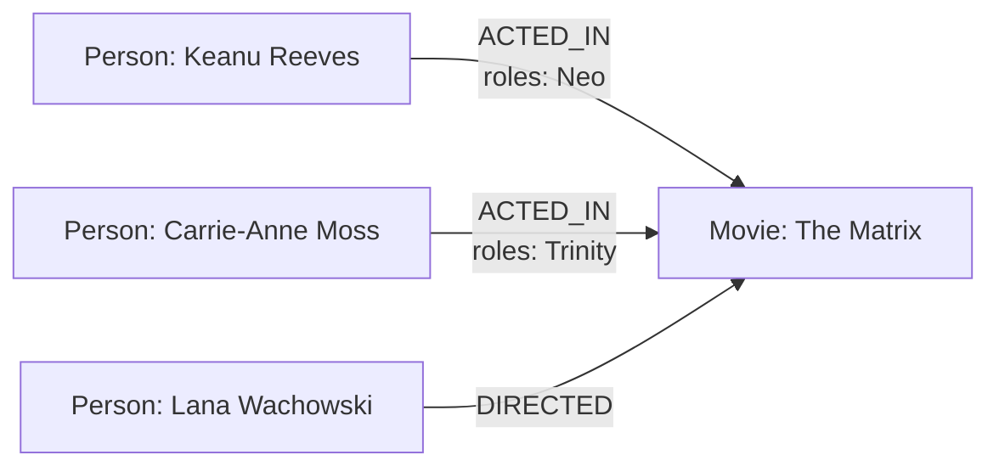
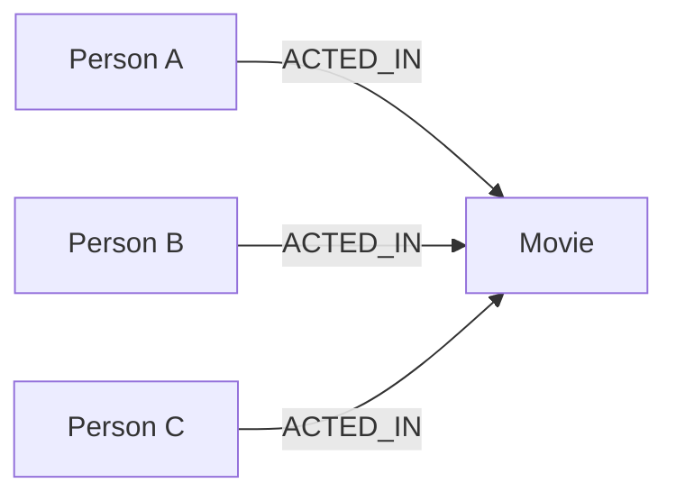

# Phạm vi xóa của phương thức repository và tác động lên dữ liệu liên quan

Trong Neo4j, xóa một node có thể ảnh hưởng đến nhiều relationship nối với node đó. Một repository Spring Data Neo4j (SDN) cung cấp các phương thức như `deleteById()`, `delete()` và `deleteAll()`, nhưng tên phương thức không tự nói hết phạm vi graph bị tác động. Muốn chọn đúng thao tác, cần phân biệt xóa node, xóa relationship, xóa một tập entity theo repository và xóa toàn bộ graph.

Bài học thuộc module **SPRING_DATA_NEO4J**, tập trung vào đọc và ghi đồ thị qua node entity, relationship, repository và Cypher. Các ví dụ dùng `Person`, `Movie`, relationship `ACTED_IN` và `DIRECTED` để theo dõi điều gì xảy ra với node đích, node liên quan và thuộc tính trên relationship sau khi xóa.

## 1. Bắt đầu từ cấu trúc graph

Giả sử đồ thị có hai người cùng tham gia một bộ phim:



Một node `Movie` có thể được nhiều node `Person` tham chiếu. Relationship `ACTED_IN` có thể chứa property như `roles`; khi relationship bị xóa, property trên chính relationship đó cũng biến mất.

Trước khi gọi lệnh xóa, hãy trả lời ba câu hỏi:

1. Đối tượng cần xóa là node nào hay chỉ một relationship?
2. Các relationship kề với node đó có cần bị xóa theo không?
3. Các node ở đầu còn lại có phải tiếp tục tồn tại vì còn được dùng ở nơi khác không?

Ví dụ, xóa credit diễn xuất của Keanu Reeves trong `The Matrix` thường chỉ cần xóa relationship `ACTED_IN`. Xóa hồ sơ người đó là một quyết định khác và có thể ảnh hưởng đến các relationship khác của người đó.

## 2. Các phương thức xóa cơ bản của Neo4jRepository

Một repository có thể kế thừa `Neo4jRepository`:

```java
public interface PersonRepository extends Neo4jRepository<Person, Long> {
}
```

Các phương thức CRUD phổ biến có phạm vi đầu vào khác nhau:

| Phương thức | Đối tượng được chọn | Cần chú ý |
|---|---|---|
| `deleteById(id)` | Entity có ID được truyền vào | Dùng ID của entity thuộc repository; API SDN mô tả thao tác này xóa entity cùng các entity liên quan |
| `delete(entity)` | Entity instance được truyền vào | Dùng khi service đã tải entity và cần áp dụng quy tắc nghiệp vụ trước khi xóa |
| `deleteAllById(ids)` | Các entity có ID nằm trong iterable | Chỉ nhắm tới danh sách ID truyền vào |
| `deleteAll(entities)` | Các entity trong iterable | Không có nghĩa là xóa toàn bộ entity của repository |
| `deleteAll()` | Toàn bộ entity thuộc domain type của repository | Phạm vi rộng; cần xác nhận đúng repository và dữ liệu trước khi gọi |

Tài liệu API của `Neo4jOperations` mô tả `deleteById` và `deleteAllById` là xóa entity cùng các entity liên quan; `deleteAll(Class<?>)` được mô tả là xóa tất cả entity của một domain type. Đây là hợp đồng ở tầng SDN. Với graph có node dùng chung, relationship properties hoặc mapping nhiều tầng, hãy kiểm thử trên phiên bản SDN thực tế để xác nhận chính xác các node và relationship bị ảnh hưởng. Không suy ra hành vi cascade giống JPA chỉ từ tên một phương thức repository.

Ví dụ xóa một người theo ID:

```java
personRepository.deleteById(personId);
```

Ví dụ service tải entity trước khi xóa:

```java
Person person = personRepository.findById(personId)
    .orElseThrow(() -> new PersonNotFoundException(personId));

// Kiểm tra quyền, trạng thái và quy tắc nghiệp vụ tại đây.
personRepository.delete(person);
```

Phương thức thứ hai giúp service kiểm tra điều kiện trước khi xóa. Nếu entity dùng `@Version`, hãy chú ý version của instance đã tải và kiểm tra hành vi optimistic locking của phương thức xóa trong phiên bản SDN đang dùng. Chỉ truyền ID không thể hiện version kỳ vọng do client đang giữ.

## 3. deleteAll() có phạm vi theo repository

`deleteAll()` không đồng nghĩa với lệnh xóa toàn bộ database. Nó áp dụng cho domain type mà repository quản lý.

Ví dụ:

```java
movieRepository.deleteAll();
```

Lời gọi này nhắm tới các entity `Movie` của `MovieRepository`. Tuy nhiên, xóa node trong Neo4j còn phải xử lý relationship đang nối với node đó. Những cạnh bị xóa có thể mang theo property như `roles`, `rating` hoặc `created_at`.

Không dùng `deleteAll()` trong một luồng nghiệp vụ thông thường nếu mục tiêu chỉ là xóa một phim theo điều kiện. Hãy chọn `deleteById`, `deleteAllById` hoặc truy vấn có điều kiện cụ thể. Trong môi trường production, thao tác xóa hàng loạt nên có giới hạn, log số lượng và cơ chế kiểm tra trước khi thực thi.

## 4. Phân biệt DELETE relationship, DELETE node và DETACH DELETE

Cypher cho phép chỉ định chính xác phần graph cần xóa. Ba trường hợp sau có ý nghĩa khác nhau.

### 4.1. Xóa riêng relationship

Nếu chỉ muốn xóa credit `ACTED_IN` giữa một người và một phim:

```cypher
MATCH (p:Person {personId: $personId})
      -[credit:ACTED_IN]->
      (m:Movie {movieId: $movieId})
DELETE credit;
```

Kết quả:

- Relationship `ACTED_IN` được xóa.
- Các property của relationship như `roles`, `rating`, `created_at` cũng biến mất.
- Node `Person` và node `Movie` vẫn tồn tại.
- Các relationship khác nối với hai node không bị truy vấn này chọn để xóa.

Đây là cách phù hợp khi muốn gỡ một liên kết mà vẫn giữ cả hai thực thể.

### 4.2. DELETE node khi node không còn relationship

Cypher `DELETE` có thể xóa node không còn relationship:

```cypher
MATCH (p:Person {personId: $personId})
DELETE p;
```

Nếu `p` vẫn có relationship, Neo4j từ chối thao tác vì node còn được kết nối. Cần chủ động quyết định xóa các relationship trước hay dùng `DETACH DELETE`.

### 4.3. DETACH DELETE node và các relationship kề

```cypher
MATCH (p:Person {personId: $personId})
DETACH DELETE p;
```

`DETACH DELETE` xóa node `Person` được chọn cùng tất cả relationship nối trực tiếp với node đó. Các node ở đầu còn lại không tự động bị xóa chỉ vì relationship của chúng bị xóa. Ví dụ, `Movie` vẫn còn nếu không nằm trong tập node được chọn bởi câu lệnh.

| Câu lệnh | Node được chọn | Relationship được chọn |
|---|---|---|
| `DELETE credit` | Không xóa node | Chỉ xóa relationship `credit` |
| `DELETE p` | Xóa `p` nếu không còn relationship | Không tự tháo relationship đang tồn tại |
| `DETACH DELETE p` | Xóa `p` | Xóa mọi relationship kề với `p` |

Sự khác nhau này thuộc ngữ nghĩa Cypher của Neo4j. Phương thức repository SDN là API ở tầng mapping và có hợp đồng riêng; khi cần xóa chính xác một cạnh hoặc một tập node, có thể dùng truy vấn Cypher tường minh.

## 5. Xóa relationship từ repository bằng Cypher tùy chỉnh

Repository có thể khai báo truy vấn xóa relationship khi thao tác mặc định không diễn đạt đúng yêu cầu:

```java
public interface PersonRepository extends Neo4jRepository<Person, Long> {

    @Query("""
        MATCH (p:Person {personId: $personId})
              -[credit:ACTED_IN]->
              (m:Movie {movieId: $movieId})
        DELETE credit
        """)
    void removeActingCredit(String personId, String movieId);
}
```

Phương thức trên chỉ xóa relationship khớp cả `personId` và `movieId`. Nó không xóa hai node. Nếu có nhiều relationship trùng type giữa cùng hai node, mẫu `MATCH` có thể khớp nhiều cạnh và xóa tất cả các cạnh đó. Khi nghiệp vụ phân biệt từng credit, cần thêm khóa hoặc điều kiện nhận diện relationship cụ thể.

Nếu cần xóa node cùng relationship kề bằng truy vấn tùy chỉnh:

```java
@Query("""
    MATCH (p:Person {personId: $personId})
    DETACH DELETE p
    """)
void deletePersonAndIncidentRelationships(String personId);
```

Tên phương thức được đặt rõ để người gọi nhận ra phạm vi thao tác. Đừng đặt tên chung như `removePerson()` nếu hành vi thực tế là xóa toàn bộ relationship kề.

## 6. Xóa theo điều kiện và derived delete query

Spring Data hỗ trợ query method có tiền tố `delete…By` hoặc `remove…By` trong cơ chế query derivation. Ví dụ về mặt khai báo:

```java
long deleteByStatus(String status);
```

Trước khi sử dụng, cần kiểm tra predicate và kiểu trả về mà phiên bản Spring Data Neo4j của dự án hỗ trợ. Một derived delete query chọn các entity theo điều kiện; nó không phải cách diễn đạt để xóa một relationship riêng lẻ. Nếu yêu cầu là xóa cạnh theo hai đầu node, theo property của cạnh hoặc theo một pattern graph phức tạp, `@Query` với Cypher thể hiện phạm vi rõ hơn.

Khi xóa theo điều kiện rộng, hãy chạy truy vấn đọc trước để xác định tập kết quả:

```cypher
MATCH (p:Person)
WHERE p.status = $status
RETURN p.personId, p.name
ORDER BY p.personId;
```

Sau khi xác nhận danh sách, mới thực hiện thao tác xóa tương ứng. Không dùng một predicate có thể khớp quá nhiều node chỉ vì muốn rút ngắn code.

## 7. Node dùng chung và tác động lên dữ liệu liên quan

Một node có thể được kết nối với nhiều node khác. Trong ví dụ phim–diễn viên, `Movie` thường được nhiều `Person` tham chiếu. Xóa một relationship không nên làm mất node phim vì các diễn viên khác vẫn cần node đó.



Nếu chỉ gỡ credit của `Person A`, truy vấn nên nhắm đúng relationship:

```cypher
MATCH (p:Person {personId: $personId})-[r:ACTED_IN]->(m:Movie)
WHERE m.movieId = $movieId
DELETE r;
```

Nếu xóa node `Person A`, các relationship kề với người đó cần được xử lý. Node `Movie` vẫn có thể được `Person B` và `Person C` sử dụng. Nếu nghiệp vụ muốn xóa cả phim, hãy kiểm tra rõ các liên kết còn lại và thực hiện một thao tác riêng cho node `Movie`.

Đây là lý do cần phân biệt:

- **Xóa liên kết:** gỡ một relationship, giữ nguyên các node hai đầu.
- **Xóa một node:** loại bỏ node và xử lý các relationship nối với node đó.
- **Xóa một nhóm node:** chọn tập node theo điều kiện, sau đó xác định các cạnh và node liên quan có được xóa hay giữ lại.

Không nên suy luận cascade remove từ quan hệ Java đơn thuần. Mô hình `@Relationship` mô tả liên kết và cách SDN ánh xạ graph; quy tắc sở hữu dữ liệu và chính sách xóa vẫn cần được xác định trong domain.

## 8. Relationship properties khi xóa cạnh

Nếu relationship được ánh xạ bằng `@RelationshipProperties`, các property của lớp đó thuộc về cạnh trong Neo4j:

```java
@RelationshipProperties
public class ActingCredit {

    @RelationshipId
    private Long id;

    private List<String> roles;
    private Double rating;

    @TargetNode
    private Movie movie;
}
```

Khi xóa relationship `ACTED_IN`, property `roles` và `rating` trên cạnh cũng bị xóa. Điều này không đồng nghĩa node `Movie` bị xóa. Nếu `rating` hoặc lịch sử credit cần được lưu sau khi gỡ quan hệ, hãy lưu bản ghi audit hoặc chuyển credit thành node riêng trước khi xóa.

Ví dụ lưu lịch sử trước khi xóa có thể thực hiện trong cùng transaction bằng một node audit hoặc bằng cơ chế sự kiện nghiệp vụ. Không nên kỳ vọng property trên relationship còn truy cập được sau khi relationship đã bị xóa.

## 9. Transaction, version và kiểm soát thao tác xóa

Các phương thức repository CRUD của SDN được quản lý transaction. Khi một thao tác xóa gồm nhiều bước, ví dụ kiểm tra điều kiện, lưu audit và xóa relationship, hãy đặt ranh giới transaction ở tầng service:

```java
@Service
public class PersonService {

    private final PersonRepository personRepository;
    private final CreditAuditRepository auditRepository;

    public PersonService(
            PersonRepository personRepository,
            CreditAuditRepository auditRepository) {
        this.personRepository = personRepository;
        this.auditRepository = auditRepository;
    }

    @Transactional
    public void removeCredit(String personId, String movieId) {
        // Kiểm tra người và phim tồn tại.
        // Ghi audit nếu nghiệp vụ yêu cầu.
        // Xóa đúng relationship ACTED_IN.
        personRepository.removeActingCredit(personId, movieId);
    }
}
```

Đây là khung minh họa; các repository audit và bước kiểm tra cần được triển khai theo ứng dụng. Transaction giúp các thao tác tham gia cùng đơn vị công việc commit hoặc rollback nhất quán khi có lỗi.

Nếu entity dùng `@Version`, cần xem xét xung đột cập nhật khi xóa. Một instance được tải từ trước có thể không còn là phiên bản mới nhất. Với thao tác xóa dựa trên entity, hãy để SDN áp dụng cơ chế version mà API hỗ trợ; với Cypher tùy chỉnh, nếu cần optimistic locking thì phải đưa điều kiện version vào truy vấn và cập nhật theo một thao tác có điều kiện.

## 10. Kiểm tra trước và sau khi xóa

Trước khi xóa, có thể đếm số relationship và kiểm tra node đích:

```cypher
MATCH (p:Person {personId: $personId})-[r]->(other)
RETURN type(r) AS relationshipType,
       count(r) AS relationshipCount,
       collect(labels(other)) AS targetLabels;
```

Sau khi xóa một credit:

```cypher
MATCH (p:Person {personId: $personId})
      -[r:ACTED_IN]->
      (m:Movie {movieId: $movieId})
RETURN count(r) AS remainingCredits;
```

Nếu chỉ xóa một relationship, kỳ vọng `remainingCredits = 0` cho cặp node đó, trong khi hai node vẫn tồn tại. Nếu xóa một node, kiểm tra cả `existsById` ở repository và các node/relationship liên quan trong Cypher.

Kiểm thử tích hợp nên tạo graph nhỏ có node được chia sẻ, thực hiện xóa và xác nhận:

- Node mục tiêu có còn hay không theo yêu cầu.
- Relationship mục tiêu đã biến mất.
- Relationship không thuộc phạm vi xóa vẫn còn.
- Node được node khác sử dụng vẫn tồn tại.
- Property trên relationship đã xóa không còn được truy cập.
- Transaction rollback khi một bước trong quy trình thất bại.

## 11. Các lỗi thường gặp

| Lỗi | Hệ quả | Cách xử lý |
|---|---|---|
| Gọi `deleteAll()` khi chỉ muốn xóa một bản ghi | Xóa toàn bộ entity của domain type trong repository | Dùng `deleteById` hoặc truy vấn theo điều kiện cụ thể |
| Dùng `DELETE node` khi node còn relationship | Neo4j từ chối truy vấn | Xóa relationship trước hoặc dùng `DETACH DELETE` nếu đúng nghiệp vụ |
| Dùng `DETACH DELETE` để gỡ một credit | Xóa cả node và tất cả relationship kề | Dùng `DELETE relationship` |
| Giả định xóa Person sẽ xóa mọi Movie liên quan | Có thể làm mất node được nhiều người dùng chung | Xác định rõ node sở hữu và node dùng chung; kiểm thử graph sau xóa |
| Dùng truy vấn xóa theo tên không duy nhất | Xóa nhiều node hoặc cạnh ngoài dự kiến | Dùng ID nghiệp vụ và ràng buộc duy nhất |
| Xóa relationship trước khi lưu audit | Mất property của cạnh cần lưu lại | Ghi audit trước hoặc trong cùng transaction |
| Dùng entity cũ để xóa sau khi có cập nhật đồng thời | Có thể bỏ qua hoặc gặp xung đột version tùy API | Tải lại entity hoặc dùng version-aware delete phù hợp |
| Dùng Cypher tùy chỉnh rồi tiếp tục dùng object cũ | Trạng thái trong bộ nhớ không còn đồng bộ với graph | Tải lại entity khi cần sử dụng dữ liệu mới |

## 12. Checklist chọn thao tác xóa

- Xác định rõ cần xóa node hay relationship.
- Nếu xóa theo repository, xác định domain type và ID được chọn.
- Phân biệt `deleteAll(entities)` với `deleteAll()`.
- Đọc hợp đồng API SDN của phiên bản dự án, đặc biệt với entity có quan hệ nhiều tầng hoặc node dùng chung.
- Nếu chỉ xóa một cạnh, viết Cypher `MATCH ... DELETE relationship`.
- Nếu xóa node có relationship kề, quyết định rõ có dùng `DETACH DELETE` hay cần xử lý cạnh theo từng loại.
- Không dùng `MATCH (n) DETACH DELETE n` trừ khi mục tiêu thực sự là xóa toàn bộ graph.
- Ghi audit và thực hiện các bước liên quan trong transaction khi cần tính nhất quán.
- Kiểm tra optimistic locking nếu entity có `@Version`.
- Viết integration test xác nhận node và relationship nào còn lại sau thao tác.

## 13. Bài tập thực hành

1. Tạo graph có hai `Person` cùng tham gia một `Movie`, mỗi relationship `ACTED_IN` có property `roles`.
2. Viết truy vấn xóa một relationship theo `personId` và `movieId`; xác nhận node hai đầu vẫn tồn tại.
3. Thử `DELETE p` khi `Person` vẫn còn relationship và quan sát lỗi; sau đó thử `DETACH DELETE p`.
4. Dùng `PersonRepository.deleteById(id)` và kiểm tra node, relationship bị ảnh hưởng theo mapping của phiên bản SDN đang dùng.
5. So sánh `deleteAll(entities)` với `deleteAll()` trên một repository thử nghiệm.
6. Viết repository method `removeActingCredit` bằng `@Query` và giải thích vì sao nó có phạm vi hẹp hơn xóa node.
7. Thiết kế service xóa credit có ghi audit trong cùng transaction.
8. Viết integration test để bảo đảm xóa một diễn viên không làm mất phim vẫn còn được diễn viên khác tham chiếu.

Khi hoàn thành, bạn cần đọc được phạm vi xóa từ API repository, hiểu sự khác nhau giữa xóa node và relationship trong Cypher, và thiết kế thao tác xóa không làm mất dữ liệu dùng chung. Đây là kỹ năng quan trọng để quản lý vòng đời graph an toàn trong các ứng dụng Spring Data Neo4j.

## Tài liệu tham khảo

- [Spring Data Neo4j — SimpleNeo4jRepository API](https://docs.spring.io/spring-data/neo4j/reference/api/java/org/springframework/data/neo4j/repository/support/SimpleNeo4jRepository.html)
- [Spring Data Neo4j — Neo4jOperations API](https://docs.spring.io/spring-data/neo4j/reference/api/java/org/springframework/data/neo4j/core/Neo4jOperations.html)
- [Spring Data Neo4j — Repository query keywords](https://docs.spring.io/spring-data/neo4j/reference/repositories/query-keywords-reference.html)
- [Neo4j Cypher Manual — DELETE](https://neo4j.com/docs/cypher-manual/current/clauses/delete/)
