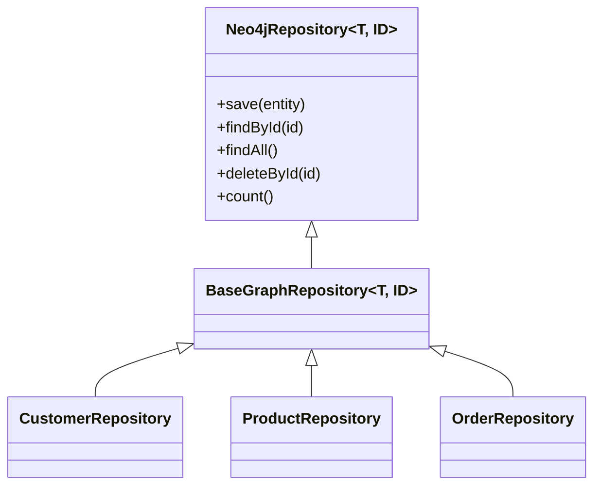

# Thiết kế giao diện cơ sở bằng @NoRepositoryBean

## Mục tiêu bài học

Trong ứng dụng dùng Spring Data Neo4j (SDN), nhiều repository thường có cùng kiểu thao tác như tìm theo ID, lưu, xóa và đếm node. Nếu mỗi repository đều khai báo lại cùng một nhóm phương thức, mã nguồn sẽ lặp và khó bảo trì. Ta có thể tạo một giao diện repository cơ sở chứa hợp đồng dùng chung rồi cho các repository cụ thể kế thừa.

Tuy nhiên, Spring Data quét các giao diện repository để tạo proxy bean. Một giao diện cơ sở còn tham số generic như `T` và `ID` chưa đại diện cho một entity cụ thể. Nếu để Spring Data khởi tạo nó như repository độc lập, framework không có kiểu domain cụ thể để ánh xạ. Annotation `@NoRepositoryBean` giải quyết tình huống này: nó báo cho Spring Data rằng giao diện đó chỉ là nền tảng kế thừa, không tạo repository bean trực tiếp từ chính giao diện đó.

Bài học hướng dẫn cách thiết kế generic base repository, kế thừa nó cho từng node entity, lựa chọn nơi đặt phương thức dùng chung và kiểm tra repository proxy trong application context.

## 1. Vì sao cần giao diện repository cơ sở?

Giả sử ứng dụng quản lý `Customer`, `Product` và `Order`. Các repository cụ thể đều cần những thao tác CRUD cơ bản:



Nếu mỗi interface đều kế thừa trực tiếp `Neo4jRepository`, các thao tác CRUD đã được dùng lại thông qua kế thừa. Nhưng ứng dụng có thể muốn gom các khai báo chung khác, quy ước API hoặc các phương thức mặc định vào một interface nội bộ.

Ví dụ, một module có thể thống nhất kiểu ID của entity là `String`, hoặc muốn các repository nghiệp vụ cùng kế thừa một contract. Khi đó, giao diện cơ sở giúp biểu đạt quy ước chung một lần.

Điểm cần nhớ: giao diện cơ sở không đại diện cho một node label cụ thể. Chỉ các interface con như `CustomerRepository` hay `ProductRepository` mới xác định domain type cụ thể để SDN tạo repository proxy.

## 2. @NoRepositoryBean làm gì?

`@NoRepositoryBean` thuộc package `org.springframework.data.repository`. Đặt annotation này trên một interface repository cơ sở để Spring Data không tạo bean repository cho chính interface đó trong quá trình quét repository.

```java
import org.springframework.data.repository.NoRepositoryBean;
import org.springframework.data.neo4j.repository.Neo4jRepository;

@NoRepositoryBean
public interface BaseGraphRepository<T, ID>
        extends Neo4jRepository<T, ID> {
}
```

Interface trên khai báo hai kiểu generic:

- `T`: kiểu node entity mà repository cụ thể quản lý, ví dụ `Customer`.
- `ID`: kiểu định danh của entity, ví dụ `String` hoặc `Long`.

Khi Spring Data gặp `BaseGraphRepository`, annotation báo rằng đây là interface trung gian. Framework không cố tạo bean với `T` và `ID` chưa được ràng buộc thành kiểu cụ thể. Khi một repository cụ thể kế thừa interface này và cung cấp kiểu thực, Spring Data có thể tạo proxy cho repository con.

`@NoRepositoryBean` không xóa interface khỏi classpath, không ngăn các interface khác kế thừa nó và không làm các phương thức CRUD biến mất. Annotation chỉ điều khiển việc tạo repository instance trực tiếp từ interface được đánh dấu.

## 3. Tạo repository cơ sở và repository cụ thể

Ví dụ, khai báo interface cơ sở cho các node entity dùng ID kiểu chuỗi:

```java
@NoRepositoryBean
public interface StringIdGraphRepository<T>
        extends Neo4jRepository<T, String> {
}
```

Sau đó, repository cụ thể kế thừa interface này:

```java
public interface CustomerRepository
        extends StringIdGraphRepository<Customer> {
}
```

Một repository khác cũng có thể sử dụng cùng contract:

```java
public interface ProductRepository
        extends StringIdGraphRepository<Product> {
}
```

Spring Data tạo repository proxy cho `CustomerRepository` và `ProductRepository` với domain type tương ứng. Nó không tạo proxy riêng cho `StringIdGraphRepository`.

Nếu ứng dụng cần nhiều kiểu ID, giữ cả hai tham số generic trong base interface sẽ linh hoạt hơn:

```java
@NoRepositoryBean
public interface BaseGraphRepository<T, ID>
        extends Neo4jRepository<T, ID> {
}

public interface CustomerRepository
        extends BaseGraphRepository<Customer, String> {
}

public interface LegacyRecordRepository
        extends BaseGraphRepository<LegacyRecord, Long> {
}
```

Các ví dụ giả định `Customer` và `LegacyRecord` là những node entity hợp lệ đã được ánh xạ bằng SDN. Mỗi repository cụ thể phải xác định đúng kiểu domain và kiểu ID tương ứng với entity.

## 4. Đặt phương thức dùng chung ở đúng tầng

Một base repository có thể chứa các phương thức mà mọi repository con đều cần. Tuy nhiên, không phải mọi truy vấn đều phù hợp để đặt ở interface generic.

### Phương thức CRUD có sẵn

`Neo4jRepository<T, ID>` đã kế thừa các thao tác từ hệ thống repository của Spring Data, gồm:

| Phương thức | Mục đích |
|---|---|
| `save(entity)` | Lưu entity |
| `saveAll(entities)` | Lưu nhiều entity |
| `findById(id)` | Tìm entity theo ID |
| `findAll()` | Lấy tất cả entity |
| `existsById(id)` | Kiểm tra ID có tồn tại |
| `deleteById(id)` | Xóa theo ID |
| `count()` | Đếm entity |

Không cần khai báo lại các phương thức này trong base interface chỉ để dùng lại. Chúng đã có thông qua kế thừa `Neo4jRepository`.

### Hợp đồng dùng chung

Nếu ứng dụng muốn bổ sung một tên phương thức thống nhất hoặc một hành vi mặc định chỉ dựa trên API repository đã có, có thể khai báo trong base interface:

```java
@NoRepositoryBean
public interface BaseGraphRepository<T, ID>
        extends Neo4jRepository<T, ID> {

    default boolean contains(ID id) {
        return existsById(id);
    }
}
```

Các repository cụ thể thừa hưởng phương thức `contains`. Đây là phương thức mặc định của Java interface nên không cần một query Cypher riêng.

Với phương thức cần truy vấn graph, hãy kiểm tra xem truy vấn có thực sự dùng được cho mọi domain type hay không. Một câu Cypher gắn với nhãn `Customer` hoặc property `email` không phải hợp đồng chung cho repository `Product`. Đặt truy vấn đặc thù ở repository cụ thể sẽ rõ ràng và an toàn hơn.

## 5. Ví dụ repository cụ thể với truy vấn riêng

Một repository cụ thể có thể kế thừa base repository và khai báo các phương thức riêng theo entity:

```java
public interface CustomerRepository
        extends BaseGraphRepository<Customer, String> {

    Optional<Customer> findByEmail(String email);

    @Query("MATCH (c:Customer) " +
           "WHERE c.status = $status " +
           "RETURN c")
    List<Customer> findByStatus(@Param("status") String status);
}
```

Repository `CustomerRepository` nhận toàn bộ CRUD từ `Neo4jRepository`, phương thức mặc định `contains` từ `BaseGraphRepository`, và hai phương thức riêng cho nghiệp vụ khách hàng.

Repository sản phẩm có thể có truy vấn khác:

```java
public interface ProductRepository
        extends BaseGraphRepository<Product, String> {

    Optional<Product> findBySku(String sku);

    @Query("MATCH (p:Product) " +
           "WHERE p.available = true " +
           "RETURN p")
    List<Product> findAvailableProducts();
}
```

Không cần đặt các truy vấn trên vào base interface chỉ để tránh lặp một vài dòng. Nếu mỗi truy vấn có nhãn, property hoặc quy tắc khác nhau, việc để ở repository cụ thể giúp người đọc thấy rõ domain mà truy vấn phục vụ.

## 6. @NoRepositoryBean không phải custom repository implementation

Có ba khái niệm cần phân biệt:

| Cơ chế | Vai trò |
|---|---|
| Interface cơ sở có `@NoRepositoryBean` | Tạo contract generic để repository cụ thể kế thừa; không tạo bean cho interface cơ sở |
| Repository interface cụ thể | Xác định domain type và được Spring Data tạo proxy |
| Custom repository fragment hoặc base implementation | Cung cấp logic truy cập dữ liệu tùy chỉnh cần mã triển khai |

`@NoRepositoryBean` không tự cung cấp implementation cho một phương thức abstract tùy ý. Nếu thêm phương thức abstract vào base interface mà Spring Data không thể phân tích thành derived query, và cũng không có fragment hay implementation tương ứng, việc tạo repository có thể thất bại.

Khi cần một hành vi truy cập graph tùy chỉnh dùng chung, hãy cân nhắc repository fragment hoặc custom base class. Ví dụ, fragment cho một thao tác tìm kiếm dùng chung có thể khai báo contract riêng và có implementation sử dụng `Neo4jClient`. Mỗi repository cần chức năng đó sẽ kế thừa fragment.

Không nên nhầm annotation đánh dấu interface trung gian với cấu hình custom base class. Custom base class còn cần cấu hình để Spring Data sử dụng implementation đó; chỉ thêm `@NoRepositoryBean` không làm việc này tự động.

## 7. Tổ chức package và quét repository

Trong ứng dụng Spring Boot, các interface repository thường được đặt trong package nằm dưới package gốc của ứng dụng để cơ chế auto-configuration tìm thấy chúng. Một cách tổ chức đơn giản:

```text
com.example.graph
├── GraphApplication.java
├── domain
│   ├── Customer.java
│   ├── Product.java
│   └── Order.java
└── repository
    ├── BaseGraphRepository.java
    ├── CustomerRepository.java
    ├── ProductRepository.java
    └── OrderRepository.java
```

Đặt `@NoRepositoryBean` trên `BaseGraphRepository`; không đặt annotation đó trên `CustomerRepository`, `ProductRepository` hoặc `OrderRepository`. Nếu đánh dấu nhầm repository cụ thể, Spring Data sẽ bỏ qua việc tạo bean cho interface đó và các nơi inject repository sẽ không tìm thấy bean.

Nếu ứng dụng cấu hình phạm vi quét bằng `@EnableNeo4jRepositories`, hãy bảo đảm package chứa repository cụ thể nằm trong phạm vi quét. Base interface có thể ở cùng package hoặc package khác được compiler nhìn thấy; điều quan trọng là repository con được phát hiện và có domain type xác định.

## 8. Kiểm thử repository bean

Có thể kiểm tra application context để xác nhận repository cụ thể được tạo và interface cơ sở không được đăng ký như một bean độc lập.

Ví dụ kiểm tra ở mức Spring context:

```java
@DataNeo4jTest
class RepositoryConfigurationTest {

    @Autowired
    private ApplicationContext context;

    @Test
    void shouldCreateConcreteRepositoryButNotBaseRepository() {
        assertTrue(context.containsBean("customerRepository"));
        assertFalse(context.containsBean("baseGraphRepository"));
    }
}
```

Tên bean mặc định thường được tạo từ tên interface với chữ cái đầu viết thường, nhưng test có thể kiểm tra trực tiếp kiểu bean thay vì phụ thuộc vào tên nếu ứng dụng tùy chỉnh cấu hình.

Ví dụ kiểm tra theo kiểu:

```java
assertTrue(context.getBeansOfType(CustomerRepository.class).size() == 1);
assertTrue(context.getBeansOfType(ProductRepository.class).size() == 1);
```

Không dùng `getBeansOfType(BaseGraphRepository.class).isEmpty()` để chứng minh base interface không có bean: các proxy của `CustomerRepository` và `ProductRepository` cũng là instance của kiểu cha `BaseGraphRepository`. Hãy kiểm tra tên bean độc lập của base interface không tồn tại, đồng thời xác nhận các repository cụ thể được inject và gọi được.

Sau khi xác nhận proxy tồn tại, kiểm thử thêm thao tác repository với Neo4j thật hoặc Testcontainers để bảo đảm mapping và truy vấn hoạt động như mong đợi. Kiểm tra context đơn thuần không chứng minh Cypher hoặc dữ liệu entity chính xác.

## 9. Lỗi thường gặp

| Lỗi | Nguyên nhân | Cách xử lý |
|---|---|---|
| Spring cố tạo bean từ base repository generic | Thiếu `@NoRepositoryBean` | Đánh dấu interface cơ sở |
| Không inject được repository cụ thể | Đánh dấu nhầm repository cụ thể bằng `@NoRepositoryBean` hoặc package ngoài phạm vi quét | Bỏ annotation ở interface cụ thể và kiểm tra cấu hình scan |
| Không xác định được domain type | Repository con chưa ràng buộc `T` và `ID` | Kế thừa với entity và kiểu ID cụ thể |
| Phương thức abstract không có query hoặc implementation | Spring Data không thể suy ra cách thực thi | Dùng derived query, `@Query`, default method hoặc repository fragment |
| Đưa truy vấn của một entity vào base interface | Nhãn hoặc property không áp dụng cho các repository con khác | Đặt truy vấn đặc thù trong repository tương ứng |
| Nghĩ `@NoRepositoryBean` tự cung cấp logic dùng chung | Annotation chỉ ngăn tạo bean cho interface cơ sở | Dùng default method, fragment hoặc custom base implementation |
| Test chỉ kiểm tra context nhưng bỏ qua dữ liệu | Proxy có thể tồn tại trong khi truy vấn sai | Bổ sung integration test với Neo4j |

## 10. Tự kiểm tra

1. Vì sao interface generic kế thừa `Neo4jRepository<T, ID>` thường cần `@NoRepositoryBean`?
2. Annotation này ảnh hưởng đến interface cơ sở hay tất cả interface kế thừa nó?
3. Khi nào nên dùng `BaseGraphRepository<T, ID>` và khi nào có thể cố định kiểu ID?
4. Vì sao truy vấn có nhãn `Customer` không nên đặt trong base repository dùng cho cả `Product`?
5. `@NoRepositoryBean` có tự cung cấp implementation cho phương thức abstract mới không?
6. Khác biệt giữa base repository interface, repository fragment và custom base class là gì?
7. Làm thế nào kiểm tra repository cụ thể được tạo trong Spring application context?

Hãy tạo `BaseGraphRepository<T, ID>` kế thừa `Neo4jRepository<T, ID>` và đánh dấu `@NoRepositoryBean`. Cho `CustomerRepository` và `ProductRepository` kế thừa với kiểu entity và ID cụ thể. Khởi tạo Spring context, xác nhận hai repository cụ thể được inject thành công, sau đó gọi một thao tác CRUD trên từng repository để kiểm tra cấu hình SDN.

## Tài liệu tham khảo

- [Spring Data Commons — NoRepositoryBean](https://docs.spring.io/spring-data/commons/docs/current/api/org/springframework/data/repository/NoRepositoryBean.html)
- [Spring Data Neo4j — Repository support](https://docs.spring.io/spring-data/neo4j/reference/repositories.html)
