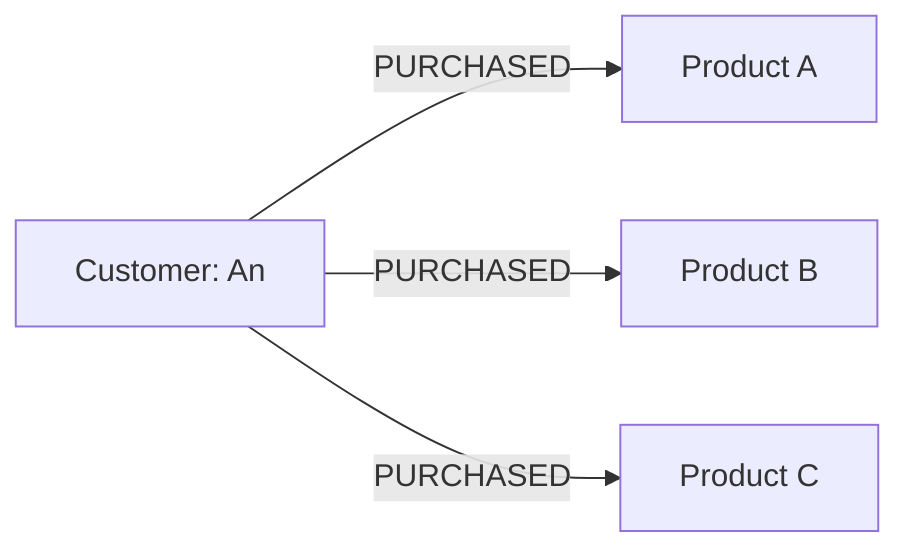

# existsById và count

## Mục tiêu bài học

Sau bài này, bạn có thể:

- Sử dụng `existsById()` để kiểm tra một entity có tồn tại theo định danh hay không.
- Phân biệt kiểm tra tồn tại với việc tải entity bằng `findById()`.
- Dùng `count()` và các truy vấn đếm theo điều kiện để thống kê node.
- Hiểu sự khác nhau giữa đếm node và đếm số đường đi khi truy vấn qua relationship.
- Thiết kế index hoặc constraint phù hợp và nhận biết giới hạn của thao tác kiểm tra trước khi ghi.

## 1. Kiểm tra tồn tại và đếm dữ liệu trong Repository

Spring Data Neo4j cung cấp các thao tác CRUD thông qua `Neo4jRepository<T, ID>`. Bên cạnh việc lưu, tìm và xóa entity, repository còn có hai thao tác hữu ích khi xử lý dữ liệu:

- `existsById(ID id)`: trả về `true` nếu entity có định danh tương ứng tồn tại, ngược lại trả về `false`.
- `count()`: trả về tổng số entity thuộc loại mà repository quản lý.

Hai thao tác này trả về thông tin tổng quát thay vì tải toàn bộ entity về ứng dụng. Chúng phù hợp khi service chỉ cần biết một đối tượng có tồn tại hay cần thống kê số lượng node.

Ví dụ repository:

```java
import org.springframework.data.neo4j.repository.Neo4jRepository;

public interface CustomerRepository
        extends Neo4jRepository<Customer, String> {

    boolean existsByStatus(String status);
}
```

Entity `Customer` có thể được ánh xạ như sau:

```java
import org.springframework.data.neo4j.core.schema.Id;
import org.springframework.data.neo4j.core.schema.Node;

@Node("Customer")
public class Customer {

    @Id
    private String id;

    private String name;

    private String status;

    private String customerCode;

    private String email;

    protected Customer() {
    }

    public Customer(
            String id,
            String name,
            String status,
            String customerCode,
            String email) {
        this.id = id;
        this.name = name;
        this.status = status;
        this.customerCode = customerCode;
        this.email = email;
    }

    public String getId() {
        return id;
    }

    public String getName() {
        return name;
    }

    public String getStatus() {
        return status;
    }
}
```

Trong ví dụ, kiểu ID của repository là `String`, khớp với trường `@Id` của entity. Nếu entity dùng kiểu định danh khác, tham số kiểu `ID` của repository cũng phải thay đổi tương ứng.

## 2. Sử dụng existsById()

`existsById()` kiểm tra một entity theo định danh mà SDN ánh xạ từ trường `@Id`.

```java
boolean exists = customerRepository.existsById("C-100");

if (exists) {
    System.out.println("Khách hàng đã tồn tại");
} else {
    System.out.println("Không tìm thấy khách hàng");
}
```

Kết quả là một giá trị boolean. Ứng dụng không nhận về một object `Customer` và không cần ánh xạ toàn bộ các thuộc tính hay relationship của entity chỉ để trả lời câu hỏi tồn tại.

Điều này hữu ích khi:

- Kiểm tra một mã tham chiếu trước khi hiển thị thông báo cho người dùng.
- Xác định một node có còn tồn tại trước khi thực hiện một luồng nghiệp vụ.
- Kiểm tra dữ liệu đầu vào có trỏ đến một entity đã được tạo hay chưa.

### 2.1. existsById() khác findById() như thế nào?

Hai phương thức có mục tiêu khác nhau:

```java
boolean exists = customerRepository.existsById("C-100");

Optional<Customer> customer =
    customerRepository.findById("C-100");
```

| Phương thức | Kiểu trả về | Mục đích |
| --- | --- | --- |
| `existsById(id)` | `boolean` | Chỉ xác định có entity theo ID hay không |
| `findById(id)` | `Optional<Customer>` | Tải entity nếu tồn tại để sử dụng dữ liệu |
| `count()` | `long` | Đếm tổng entity thuộc repository |

Nếu service chỉ cần kiểm tra tồn tại, dùng `existsById()` giúp diễn đạt ý định rõ ràng và tránh yêu cầu ánh xạ entity không cần thiết. Nếu cần đọc tên, trạng thái hoặc relationship, dùng `findById()` để lấy dữ liệu.

Không nên gọi cả hai liên tiếp cho cùng một quyết định nếu không có lý do cụ thể:

```java
if (customerRepository.existsById(id)) {
    Customer customer = customerRepository.findById(id).orElseThrow();
    // Xử lý customer
}
```

Đoạn code trên có thể tạo hai lượt truy vấn. Nếu bước tiếp theo cần entity, chỉ cần gọi `findById()` rồi xử lý trường hợp `Optional.empty()`.

## 3. existsById() không phải là khóa hay bảo đảm dữ liệu còn tồn tại

Một kết quả `true` chỉ phản ánh trạng thái tại thời điểm truy vấn được thực thi. Một transaction khác vẫn có thể xóa node sau khi kiểm tra và trước khi ứng dụng sử dụng nó.

Ví dụ:

```java
if (customerRepository.existsById(customerId)) {
    // Một transaction khác có thể xóa node ở khoảng thời gian này.
    orderService.createOrderFor(customerId);
}
```

Không nên xem kiểm tra tồn tại như một cơ chế khóa. Nếu nghiệp vụ cần đọc và ghi dựa trên cùng một trạng thái, hãy tổ chức các thao tác trong transaction phù hợp và vẫn xử lý tình huống dữ liệu thay đổi đồng thời.

Tương tự, `existsById()` không bảo đảm một ID mới chưa bị transaction khác sử dụng ngay sau khi kiểm tra. Với ID hoặc business key cần duy nhất, hãy dùng unique constraint trong Neo4j. Constraint mới là cơ chế bảo vệ tính duy nhất ở cấp cơ sở dữ liệu.

## 4. Kiểm tra tồn tại theo thuộc tính khác ID

Đôi khi ứng dụng cần kiểm tra theo mã khách hàng, email hoặc một thuộc tính nghiệp vụ. Có thể khai báo derived query trong repository nếu tên property được SDN hỗ trợ:

```java
public interface CustomerRepository
        extends Neo4jRepository<Customer, String> {

    boolean existsByCustomerCode(String customerCode);

    boolean existsByEmail(String email);
}
```

Các phương thức trên minh họa truy vấn dẫn xuất theo property Java `customerCode` và `email`. Entity cần có các property tương ứng được ánh xạ vào node.

Nếu thuộc tính dùng để nhận diện duy nhất, hãy tạo constraint phù hợp. Ví dụ:

```cypher
CREATE CONSTRAINT customer_code_unique IF NOT EXISTS
FOR (c:Customer)
REQUIRE c.customerCode IS UNIQUE
```

Sau đó, `existsByCustomerCode()` có thể được dùng để kiểm tra trước khi hiển thị thông báo hoặc xử lý nghiệp vụ. Tuy nhiên, constraint vẫn cần thiết vì hai request đồng thời có thể cùng kiểm tra một mã chưa tồn tại rồi cùng thử tạo dữ liệu.

Nếu tên phương thức dẫn xuất không thể diễn đạt truy vấn mong muốn, có thể viết Cypher bằng `@Query`:

```java
import org.springframework.data.neo4j.repository.query.Query;
import org.springframework.data.repository.query.Param;

@Query("""
    MATCH (c:Customer {customerCode: $code})
    RETURN count(c) > 0
    """)
boolean existsCustomerWithCode(@Param("code") String code);
```

Truy vấn dùng `count(c) > 0` để trả về một giá trị boolean ngay cả khi không có node khớp.

## 5. Sử dụng count()

`count()` trả về tổng số entity thuộc loại mà repository quản lý. Với `CustomerRepository`, phương thức này đếm node `Customer` theo mapping của entity.

```java
long totalCustomers = customerRepository.count();

System.out.println("Tổng khách hàng: " + totalCustomers);
```

Kiểu trả về là `long` để biểu diễn số lượng lớn. Không nên chuyển sang `int` nếu chưa kiểm tra phạm vi giá trị, vì số node có thể vượt giới hạn của kiểu `int`.

Một số tình huống phù hợp:

- Hiển thị tổng số khách hàng trên trang quản trị.
- Thống kê số node thuộc một loại entity.
- Kiểm tra dữ liệu sau một quy trình import.
- Lấy số lượng làm đầu vào cho báo cáo hoặc nghiệp vụ phân trang.

`count()` không trả về danh sách entity và không đếm relationship. Nó đếm entity thuộc loại repository quản lý.

## 6. Đếm theo điều kiện với countBy...

Khi cần đếm một nhóm dữ liệu, có thể khai báo derived count query theo property:

```java
public interface CustomerRepository
        extends Neo4jRepository<Customer, String> {

    long countByStatus(String status);

    long countByNameContaining(String keyword);
}
```

Ví dụ sử dụng:

```java
long activeCustomers =
    customerRepository.countByStatus("ACTIVE");

long matchingNames =
    customerRepository.countByNameContaining("An");
```

`countByStatus` đếm các entity có property `status` khớp giá trị được truyền vào. `countByNameContaining` minh họa điều kiện chứa chuỗi trên property tên.

Các phương thức dẫn xuất cần tuân theo tên property Java và các predicate mà SDN hỗ trợ. Với điều kiện phức tạp, truy vấn qua relationship hoặc phép tổng hợp đặc thù, dùng `@Query` để kiểm soát Cypher rõ ràng hơn.

Ví dụ đếm khách hàng theo trạng thái bằng Cypher:

```java
import org.springframework.data.neo4j.repository.query.Query;
import org.springframework.data.repository.query.Param;

@Query("""
    MATCH (c:Customer)
    WHERE c.status = $status
    RETURN count(c)
    """)
    long countCustomersByStatus(@Param("status") String status);
```

Truy vấn tương đương trực tiếp trong Neo4j:

```cypher
MATCH (c:Customer)
WHERE c.status = $status
RETURN count(c)
```

Nếu không có node phù hợp, phép tổng hợp `count(c)` trả về `0`.

## 7. Phân biệt count node và count đường đi

Đây là điểm đặc biệt quan trọng khi làm việc với dữ liệu đồ thị. Một truy vấn có relationship có thể tạo nhiều dòng cho cùng một node.

Giả sử một khách hàng đã mua ba sản phẩm:



Truy vấn:

```cypher
MATCH (c:Customer)-[:PURCHASED]->(p:Product)
RETURN count(c)
```

có thể trả về `3`, vì pattern tạo ba dòng khớp và `count(c)` đếm giá trị `c` trong từng dòng.

Nếu mục tiêu là đếm khách hàng duy nhất đã mua sản phẩm, hãy dùng `DISTINCT`:

```cypher
MATCH (c:Customer)-[:PURCHASED]->(:Product)
RETURN count(DISTINCT c)
```

Kết quả của ví dụ là `1`.

Phân biệt các biểu thức:

| Biểu thức | Ý nghĩa |
| --- | --- |
| `count(*)` | Đếm số dòng trong kết quả pattern |
| `count(c)` | Đếm số giá trị không null của biến `c` trên các dòng |
| `count(DISTINCT c)` | Đếm số giá trị node `c` khác nhau |
| `count(p)` | Đếm số giá trị relationship hoặc node được gán cho biến `p`, tùy pattern |

Khi truy vấn đi qua nhiều relationship, hãy xác định mình muốn đếm node duy nhất, relationship hay số đường đi. Chọn biểu thức `count` tương ứng để tránh báo cáo sai số liệu.

## 8. Kết hợp exists và count trong service

Có thể sử dụng hai thao tác này trong service để kiểm tra điều kiện và cung cấp số liệu:

```java
import org.springframework.stereotype.Service;
import org.springframework.transaction.annotation.Transactional;

@Service
public class CustomerStatisticsService {

    private final CustomerRepository customerRepository;

    public CustomerStatisticsService(CustomerRepository customerRepository) {
        this.customerRepository = customerRepository;
    }

    @Transactional(readOnly = true)
    public CustomerStatistics getStatistics(String customerId) {
        boolean exists = customerRepository.existsById(customerId);
        long total = customerRepository.count();

        return new CustomerStatistics(exists, total);
    }
}
```

DTO đơn giản:

```java
public record CustomerStatistics(
    boolean customerExists,
    long totalCustomers
) {
}
```

Ví dụ này thể hiện mục đích đọc dữ liệu. Transaction `readOnly = true` giúp diễn đạt rằng service không dự định ghi dữ liệu; nó không thay thế các truy vấn cần thiết để tính kết quả.

Nếu chỉ cần biết khách hàng có tồn tại và tổng số khách hàng, đây là cách tách bạch giữa kiểm tra và thống kê. Nếu sau đó cần dữ liệu chi tiết của khách hàng, hãy tải entity bằng `findById()`.

## 9. Index, constraint và hiệu năng

Các thao tác tồn tại hoặc đếm có thể được gọi thường xuyên, vì vậy cần quan tâm đến cách Neo4j tìm node và tính kết quả.

### 9.1. Index cho thuộc tính tìm kiếm

Nếu thường xuyên kiểm tra theo một business key, hãy tạo index hoặc unique constraint cho property đó. Ví dụ:

```cypher
CREATE INDEX customer_status_index IF NOT EXISTS
FOR (c:Customer)
ON (c.status)
```

Index giúp Neo4j tìm node theo property hiệu quả hơn trong các truy vấn phù hợp. Index không có nghĩa mọi phép đếm đều miễn phí; chi phí còn phụ thuộc số lượng node, điều kiện lọc và kế hoạch thực thi.

### 9.2. Unique constraint cho identity

Nếu `customerCode` phải duy nhất, dùng unique constraint thay vì chỉ dựa vào câu lệnh `existsByCustomerCode()`:

```cypher
CREATE CONSTRAINT customer_code_unique IF NOT EXISTS
FOR (c:Customer)
REQUIRE c.customerCode IS UNIQUE
```

Unique constraint vừa bảo đảm tính toàn vẹn dữ liệu vừa tạo backing index cho property theo cơ chế Neo4j. Ứng dụng vẫn cần xử lý lỗi constraint khi hai thao tác ghi cạnh tranh.

### 9.3. Đừng dùng count để thay cho exists

Nếu mục tiêu chỉ là kiểm tra có ít nhất một node, dùng `existsById()` hoặc `existsBy...` diễn đạt ý định tốt hơn việc đếm tất cả bản ghi rồi so sánh với 0.

Ví dụ không cần thiết:

```java
boolean exists = customerRepository.countByStatus("ACTIVE") > 0;
```

Nếu repository có method phù hợp:

```java
boolean exists = customerRepository.existsByStatus("ACTIVE");
```

Cách thứ hai diễn đạt rõ câu hỏi tồn tại. Hiệu năng thực tế phụ thuộc cách SDN sinh truy vấn và kế hoạch Neo4j; hãy dùng `EXPLAIN` hoặc `PROFILE` khi cần phân tích truy vấn quan trọng.

## 10. Những lỗi thường gặp

| Lỗi | Hệ quả | Cách xử lý |
| --- | --- | --- |
| Dùng `findById()` chỉ để biết entity có tồn tại | Tải và ánh xạ dữ liệu không cần thiết | Dùng `existsById()` |
| Gọi `existsById()` rồi `findById()` ngay sau đó | Tạo hai lượt truy vấn cho cùng quyết định | Dùng `findById()` và xử lý `Optional.empty()` nếu cần entity |
| Nghĩ `existsById()` khóa node khỏi bị xóa | Dữ liệu có thể thay đổi sau khi kiểm tra | Dùng transaction phù hợp và xử lý cạnh tranh |
| Dùng exists để bảo đảm mã duy nhất | Hai request đồng thời vẫn có thể tạo trùng | Tạo unique constraint |
| Dùng `count()` để đếm relationship | Kết quả không phản ánh số relationship | Viết Cypher đếm biến relationship |
| Đếm node sau khi MATCH nhiều relationship mà quên DISTINCT | Một node có thể bị đếm nhiều lần | Dùng `count(DISTINCT node)` khi cần node duy nhất |
| Lưu số đếm vào `int` | Có thể tràn số | Dùng `long` |
| Tạo index cho mọi property động | Tăng chi phí lưu trữ và cập nhật index | Chỉ index các property được truy vấn thường xuyên |

## 11. Câu hỏi tự kiểm tra

1. `existsById()` trả về kiểu dữ liệu gì và dùng để trả lời câu hỏi nào?
2. Khi nào nên dùng `existsById()` thay cho `findById()`?
3. Vì sao kết quả `existsById() == true` không bảo đảm node vẫn còn tồn tại ở thời điểm ghi?
4. `count()` đếm loại dữ liệu nào trong một repository?
5. Vì sao các phương thức `countByStatus()` thường trả về `long`?
6. Trong truy vấn có nhiều relationship, vì sao `count(c)` có thể đếm một node nhiều lần?
7. Khi nào cần dùng `count(DISTINCT c)`?
8. Unique constraint bổ sung điều gì mà `existsByCustomerCode()` không thể bảo đảm?
9. Khi nào nên dùng Cypher qua `@Query` thay cho derived count query?

## Kết luận

`existsById()` giúp kiểm tra sự tồn tại của entity theo định danh mà không cần tải entity về ứng dụng. `count()` đếm tổng số entity thuộc repository; các phương thức `existsBy...` và `countBy...` có thể dùng để kiểm tra hoặc thống kê theo property khi truy vấn dẫn xuất đáp ứng yêu cầu.

Khi đếm dữ liệu đồ thị, cần phân biệt số node duy nhất với số dòng hoặc số đường đi được tạo ra bởi relationship. Dùng `DISTINCT` khi cần đếm node duy nhất, tạo index cho các property thường xuyên được tra cứu và dùng unique constraint để bảo vệ khóa nghiệp vụ. Cuối cùng, xem thao tác kiểm tra tồn tại là một kết quả tại thời điểm truy vấn, không phải cơ chế khóa hay bảo đảm cho lần ghi tiếp theo.
