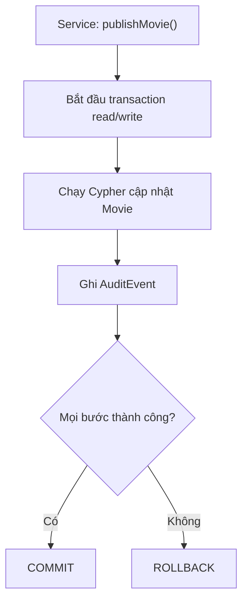

# Chọn ranh giới giao dịch cho truy vấn đọc hoặc ghi tự khai báo

Khi dùng Spring Data Neo4j (SDN), ứng dụng có thể khai báo Cypher trực tiếp bằng `@Query`, thực thi truy vấn qua `Neo4jClient` hoặc dùng `Neo4jTemplate`. Các API này cho phép kiểm soát truy vấn linh hoạt, nhưng người viết phải xác định rõ truy vấn chỉ đọc hay có thay đổi graph và giao dịch cần bao trùm những thao tác nào.

Quy tắc thực hành là đặt ranh giới transaction theo nghiệp vụ ở tầng service. Với một nghiệp vụ chỉ đọc, dùng `@Transactional(readOnly = true)`. Với nghiệp vụ ghi hoặc kết hợp đọc và ghi, dùng `@Transactional` mặc định ở chế độ read/write. Đặc biệt, đừng cho rằng SDN tự phân tích Cypher để nhận ra một `@Query` chỉ đọc: truy vấn tùy chỉnh được giả định là có thể ghi, vì `MERGE`, procedure hoặc phần truy vấn lồng có thể thay đổi dữ liệu.

## 1. Transaction có vai trò gì khi chạy Cypher tùy chỉnh?

Neo4j thực thi thay đổi dữ liệu trong transaction. Một transaction nhóm một hoặc nhiều câu lệnh thành một đơn vị công việc: nếu tất cả thành công thì commit; nếu có lỗi làm transaction rollback thì các thay đổi trong transaction được hoàn tác.

Ví dụ nghiệp vụ xuất bản phim có thể gồm:

1. Tìm phim theo ID.
2. Đổi trạng thái phim thành `PUBLISHED`.
3. Ghi một node sự kiện kiểm toán `AuditEvent`.
4. Trả thông tin phim đã cập nhật.

Nếu bước ghi sự kiện thất bại, ứng dụng thường muốn thay đổi trạng thái phim cũng rollback. Đặt transaction ở service giúp cả hai thao tác repository hoặc Cypher tham gia cùng một đơn vị công việc.



Transaction giúp giữ tính nguyên tử cho các thao tác Neo4j tham gia cùng transaction manager. Nó không tự bao trùm lời gọi HTTP, gửi email hoặc ghi vào một hệ thống khác. Nếu nghiệp vụ có side effect ngoài Neo4j, cần thiết kế outbox, event sau commit hoặc một quy trình bù trừ phù hợp.

## 2. Phân biệt truy vấn đọc và truy vấn ghi

Không thể chỉ nhìn tên phương thức để kết luận loại transaction. Cần đọc toàn bộ Cypher, kể cả procedure được gọi.

| Thành phần Cypher | Ý nghĩa thường gặp | Loại transaction |
|---|---|---|
| `MATCH ... RETURN` | Tìm và đọc dữ liệu | Read-only |
| `OPTIONAL MATCH ... RETURN` | Đọc dữ liệu có thể không có quan hệ khớp | Read-only |
| `CREATE`, `MERGE` | Tạo node hoặc relationship | Read/write |
| `SET`, `REMOVE` | Thay đổi property hoặc label | Read/write |
| `DELETE`, `DETACH DELETE` | Xóa relationship hoặc node | Read/write |
| `CALL` procedure | Phụ thuộc hành vi procedure | Phải kiểm tra; có thể read hoặc write |
| `MATCH` rồi `SET` và `RETURN` | Đọc, cập nhật và trả kết quả | Read/write |

Một truy vấn có `RETURN` vẫn có thể là truy vấn ghi. Ví dụ `MERGE` vừa tìm hoặc tạo node, sau đó `RETURN` node đó. Tương tự, một procedure được gọi bằng `CALL` có thể thực hiện cập nhật dù câu truy vấn bên ngoài không có `CREATE` hay `SET`.

SDN và Neo4j Java Driver không phân tích nội dung Cypher để tự suy ra read/write. Vì vậy, các truy vấn tùy chỉnh cần được phân loại rõ ràng bằng cấu hình transaction. Một số phương thức dựng sẵn như `findById`, `findAllById`, `findAll` và các phương thức kiểm tra tồn tại được định nghĩa sẵn được SDN đánh dấu read-only; không suy rộng mặc định đó cho mọi phương thức `@Query` hoặc custom repository method.

## 3. @Transactional(readOnly = true) cho truy vấn đọc

Khi một phương thức chỉ đọc dữ liệu, đánh dấu transaction là read-only:

```java
public interface MovieRepository extends Neo4jRepository<Movie, String> {

    @Transactional(readOnly = true)
    @Query("""
        MATCH (m:Movie {id: $id})
        RETURN m
        """)
    Optional<Movie> findMovieDetails(@Param("id") String id);
}
```

`@Transactional(readOnly = true)` khai báo rằng thao tác chỉ đọc. Điều này đặc biệt quan trọng khi ứng dụng chạy trên Neo4j cluster có primary và read replica: transaction read-only có thể được định tuyến tới máy chủ phục vụ đọc, giúp giảm tải cho primary. Nếu không đánh dấu, SDN và driver mặc định giả định thao tác có thể ghi.

Một service đọc nhiều nguồn dữ liệu có thể đặt một transaction read-only bao quanh tất cả lời gọi:

```java
@Service
public class MovieQueryService {

    private final MovieRepository movieRepository;
    private final ActorRepository actorRepository;

    public MovieQueryService(
            MovieRepository movieRepository,
            ActorRepository actorRepository) {
        this.movieRepository = movieRepository;
        this.actorRepository = actorRepository;
    }

    @Transactional(readOnly = true)
    public MovieDetails getMovieDetails(String movieId) {
        Movie movie = movieRepository.findMovieDetails(movieId)
                .orElseThrow(() -> new IllegalArgumentException("Movie not found"));

        List<Actor> actors = actorRepository.findByMoviesId(movieId);
        return new MovieDetails(movie, actors);
    }
}
```

Ví dụ lược bỏ DTO và các phương thức repository phụ trợ. Cả hai thao tác đọc tham gia cùng transaction read-only ở service, thay vì tạo các ranh giới độc lập cho từng lời gọi.

`readOnly = true` là metadata điều khiển transaction và routing; không dùng nó thay cho quyền truy cập database. Tài khoản Neo4j vẫn cần được cấp quyền phù hợp. Nếu query có procedure hoặc nhánh logic có thể ghi, không được đánh dấu read-only chỉ vì tên phương thức bắt đầu bằng `find`.

## 4. @Transactional mặc định cho truy vấn ghi

Với truy vấn có `CREATE`, `MERGE`, `SET`, `REMOVE` hoặc `DELETE`, dùng transaction read/write. Ví dụ repository khai báo một truy vấn cập nhật trạng thái phim:

```java
public interface MovieRepository extends Neo4jRepository<Movie, String> {

    @Query("""
        MATCH (m:Movie {id: $id})
        SET m.status = $status
        RETURN m
        """)
    Optional<Movie> changeStatus(
            @Param("id") String id,
            @Param("status") String status);
}
```

Phương thức này thay đổi graph dù có `RETURN m`. Có thể đặt transaction trực tiếp trên phương thức repository:

```java
@Transactional
@Query("""
    MATCH (m:Movie {id: $id})
    SET m.status = $status
    RETURN m
    """)
Optional<Movie> changeStatus(
        @Param("id") String id,
        @Param("status") String status);
```

Tuy nhiên, khi truy vấn là một phần của nghiệp vụ gồm nhiều thao tác, nên đặt ranh giới ở service:

```java
@Service
public class MovieCommandService {

    private final MovieRepository movieRepository;
    private final AuditEventRepository auditEventRepository;

    public MovieCommandService(
            MovieRepository movieRepository,
            AuditEventRepository auditEventRepository) {
        this.movieRepository = movieRepository;
        this.auditEventRepository = auditEventRepository;
    }

    @Transactional
    public Movie publish(String movieId) {
        Movie updated = movieRepository.changeStatus(movieId, "PUBLISHED")
                .orElseThrow(() -> new IllegalArgumentException("Movie not found"));

        auditEventRepository.save(
                new AuditEvent("MOVIE_PUBLISHED", movieId));

        return updated;
    }
}
```

Trong ví dụ, thay đổi phim và ghi sự kiện kiểm toán cùng tham gia transaction read/write. Nếu lưu `AuditEvent` thất bại và exception được truyền ra ngoài, thay đổi trạng thái phim cũng rollback. Các lớp và constructor của ví dụ được rút gọn để tập trung vào ranh giới giao dịch.

Không đánh dấu service ghi dữ liệu là `readOnly = true`. Cũng không dựa vào việc phương thức repository có tên `change`, `update` hay `save` để tự xác định transaction; hãy khai báo rõ ràng.

## 5. Chọn ranh giới ở service thay vì từng câu lệnh

Một service method thường là đơn vị nghiệp vụ phù hợp để định nghĩa transaction. Nếu nhiều lời gọi repository, `@Query`, `Neo4jClient` hoặc `Neo4jTemplate` dùng cùng transaction manager, chúng có thể tham gia cùng transaction đang hoạt động.

Ví dụ:

```java
@Transactional
public void addActorToMovie(String movieId, String actorId) {
    movieRepository.assertExists(movieId);
    actorRepository.assertExists(actorId);
    castingRepository.createCredit(movieId, actorId);
    auditEventRepository.save(new AuditEvent("CASTING_ADDED", movieId));
}
```

Khi một bước ném exception, các thao tác Neo4j trong cùng transaction có thể rollback cùng nhau. Điều này tránh trạng thái nửa hoàn thành, chẳng hạn relationship đã được tạo nhưng sự kiện kiểm toán không được ghi.

Nếu mỗi phương thức repository tự mở một transaction độc lập, các thao tác có thể commit riêng lẻ. Khi một bước sau thất bại, các bước trước đã commit không tự động được hoàn tác. Đặt transaction ở service giúp nhóm chúng thành một unit of work.

### Phạm vi transaction nên ngắn và có mục đích

Không giữ transaction mở trong lúc chờ người dùng, gọi dịch vụ ngoài hoặc xử lý file lớn. Một transaction kéo dài có thể giữ tài nguyên và làm tăng tranh chấp. Hãy chuẩn bị dữ liệu bên ngoài trước khi mở transaction nếu có thể, thực hiện các thao tác graph cần nguyên tử trong một phạm vi ngắn, rồi phát event sau commit hoặc dùng outbox.

## 6. Neo4jClient và Neo4jTemplate tham gia Spring transaction

`Neo4jClient` và `Neo4jTemplate` được tích hợp với transaction management của Spring. Khi service có `@Transactional`, các thao tác qua hai abstraction này có thể dùng transaction đang hoạt động.

Ví dụ cập nhật trạng thái bằng `Neo4jClient`:

```java
@Service
public class MovieCypherService {

    private final Neo4jClient neo4jClient;

    public MovieCypherService(Neo4jClient neo4jClient) {
        this.neo4jClient = neo4jClient;
    }

    @Transactional
    public long updateStatus(String movieId, String status) {
        return neo4jClient.query("""
                MATCH (m:Movie {id: $id})
                SET m.status = $status
                RETURN count(m) AS updated
                """)
                .bind(movieId).to("id")
                .bind(status).to("status")
                .fetchAs(Long.class)
                .mappedBy((typeSystem, record) -> record.get("updated").asLong())
                .one()
                .orElse(0L);
    }
}
```

Truy vấn trả về số node được khớp và cập nhật. Nếu không có phim phù hợp, `count(m)` trả về 0. Các giá trị được bind riêng qua tham số, không nối chuỗi đầu vào vào Cypher.

Với thao tác chỉ đọc qua `Neo4jClient`, có thể đặt `@Transactional(readOnly = true)` ở service hoặc phương thức repository fragment. `Neo4jClient` không tự quyết định truy vấn là read hay write bằng cách phân tích Cypher; transaction metadata vẫn cần được khai báo đúng.

`Neo4jTemplate` cũng tuân theo transaction Spring. Nếu một service gọi template để đọc entity, sau đó gọi repository để ghi entity khác, có thể đặt một `@Transactional` ở service để điều phối cả hai nếu chúng dùng cùng cấu hình transaction manager.

## 7. TransactionTemplate khi cần điều khiển bằng mã

`@Transactional` phù hợp với phương thức service đi qua Spring proxy. Có trường hợp cần transaction trong một đoạn mã nội bộ, private method hoặc khi muốn chọn read-only/read-write tại thời điểm chạy. Khi đó có thể dùng `TransactionTemplate`.

Ví dụ transaction đọc:

```java
@Service
public class MovieReportService {

    private final TransactionTemplate readOnlyTransaction;
    private final Neo4jClient neo4jClient;

    public MovieReportService(
            PlatformTransactionManager transactionManager,
            Neo4jClient neo4jClient) {
        this.readOnlyTransaction = new TransactionTemplate(transactionManager);
        this.readOnlyTransaction.setReadOnly(true);
        this.neo4jClient = neo4jClient;
    }

    public List<String> findMovieTitles() {
        return readOnlyTransaction.execute(status ->
                neo4jClient.query("MATCH (m:Movie) RETURN m.title AS title")
                        .fetchAs(String.class)
                        .mappedBy((typeSystem, record) -> record.get("title").asString())
                        .all());
    }
}
```

`TransactionTemplate` bắt đầu và kết thúc transaction quanh callback. Nếu callback ném exception không được xử lý, transaction được rollback theo quy tắc của Spring. Với transaction ghi, dùng template mặc định read/write hoặc cấu hình `setReadOnly(false)`.

Không cần dùng `TransactionTemplate` chỉ vì một phương thức có một câu Cypher. Dùng nó khi cần điều khiển lập trình, khi ranh giới không phù hợp với proxy hoặc khi cần chọn đặc tính transaction động.

## 8. Lưu ý khi dùng trực tiếp Neo4j Java Driver

`Driver` và `Session` là API mức thấp. Có thể mở transaction rõ ràng bằng `executeRead` hoặc `executeWrite`:

```java
try (Session session = driver.session()) {
    long updated = session.executeWrite(tx -> {
        Result result = tx.run("""
                MATCH (m:Movie {id: $id})
                SET m.status = $status
                RETURN count(m) AS updated
                """, Values.parameters("id", movieId, "status", status));

        return result.single().get("updated").asLong();
    });
}
```

`executeWrite` tạo transaction do driver quản lý và có thể retry callback khi gặp lỗi tạm thời phù hợp. Callback có thể được thực thi lại, vì vậy không đặt side effect ngoài database như gửi email hoặc gọi HTTP bên trong callback nếu chưa thiết kế idempotent.

Một điểm rất quan trọng: transaction do Java Driver tự quản lý không tự tham gia Spring transaction. Nếu một service có `@Transactional` rồi mở một `Session` mới và gọi `executeWrite`, thao tác Driver là một transaction riêng. Nếu transaction Spring rollback, transaction Driver đã commit không tự rollback theo. Khi cần một đơn vị công việc Spring thống nhất, ưu tiên `Neo4jClient` hoặc `Neo4jTemplate`. Nếu thực sự cần Driver API, hãy thiết kế và quản lý ranh giới transaction độc lập một cách tường minh.

Luôn đóng session bằng `try-with-resources`. Không giữ session trong field của service hoặc chia sẻ session giữa nhiều luồng.

## 9. Transaction lồng nhau và quy tắc outermost

Spring mặc định dùng propagation `REQUIRED` cho `@Transactional`: nếu đã có transaction, lời gọi bên trong thường tham gia transaction hiện tại. Khi đó, cấu hình transaction của phương thức bên ngoài quyết định đặc tính thực tế.

Ví dụ cần tránh:

```java
@Transactional(readOnly = true)
public void processRequest(String id) {
    reportRepository.readSummary(id);
    movieRepository.changeStatus(id, "PUBLISHED");
}
```

Phương thức ngoài đã mở transaction read-only. Một phương thức repository bên trong được đánh dấu read/write không tự động biến transaction hiện tại thành read/write. Không trộn thao tác ghi vào một service transaction được khai báo read-only.

Hãy tách rõ use case đọc và use case ghi:

```java
@Transactional(readOnly = true)
public MovieDetails getDetails(String id) {
    return queryMovieDetails(id);
}

@Transactional
public Movie publish(String id) {
    return updateMovieAndAudit(id);
}
```

Ngoài ra, `@Transactional` thường được áp dụng qua Spring proxy. Gọi một phương thức transactional từ một phương thức khác trong cùng instance (self-invocation) có thể không đi qua proxy, nên annotation bên trong không được kích hoạt như mong đợi. Đặt ranh giới ở phương thức được gọi từ bean khác hoặc dùng `TransactionTemplate` khi phù hợp.

Theo mặc định, Spring rollback với unchecked exception (`RuntimeException`) và `Error`. Checked exception không tự động rollback trừ khi cấu hình `rollbackFor`, ví dụ `@Transactional(rollbackFor = IOException.class)`. Hãy chọn quy tắc rollback phù hợp với lỗi nghiệp vụ.

## 10. Reactive transaction

Nếu ứng dụng dùng reactive repository hoặc `ReactiveNeo4jClient`, cần dùng reactive transaction manager và giữ toàn bộ thao tác trong pipeline Reactor. Transaction context reactive được truyền qua Reactor Context, không dựa vào thread-local như luồng imperative.

Ví dụ:

```java
@Service
public class ReactiveMovieService {

    private final ReactiveMovieRepository movieRepository;

    public ReactiveMovieService(ReactiveMovieRepository movieRepository) {
        this.movieRepository = movieRepository;
    }

    @Transactional
    public Mono<Movie> publish(String id) {
        return movieRepository.changeStatus(id, "PUBLISHED");
    }
}
```

Ví dụ lược bỏ repository và DTO. Với reactive application, Spring cần chọn `ReactiveNeo4jTransactionManager`; transaction imperative không điều phối pipeline reactive. Không gọi `.block()` hoặc tự `subscribe()` bên trong service reactive để thực hiện truy vấn, vì điều đó tách thao tác khỏi pipeline và transaction context.

Nếu cần điều khiển transaction reactive bằng toán tử, có thể dùng `TransactionalOperator` để bao một `Mono` hoặc `Flux`. Không trộn một truy vấn imperative với reactive transaction trong cùng unit of work nếu chưa thiết kế cơ chế phối hợp rõ ràng.

## 11. Kiểm thử ranh giới transaction

Integration test nên xác minh cả kết quả truy vấn và hành vi commit/rollback. Có thể dùng `@DataNeo4jTest` cùng Neo4j test instance hoặc Testcontainers.

Một số kịch bản cần có:

1. Truy vấn đọc được đánh dấu read-only trả đúng dữ liệu và không làm thay đổi graph.
2. Truy vấn ghi cập nhật đúng property hoặc relationship.
3. Service thực hiện hai thao tác ghi, sau đó ném exception; xác minh cả hai thay đổi đều rollback.
4. Service read-only không gọi nhầm truy vấn có `MERGE`, `SET`, `DELETE` hoặc procedure có side effect.
5. Truy vấn ghi trả về đúng dữ liệu hoặc số lượng bản ghi được cập nhật.
6. Với reactive application, xác minh rollback trong cùng reactive pipeline.

Ví dụ ý tưởng kiểm tra rollback:

```java
@Test
void rollsBackAllWritesWhenLaterStepFails() {
    assertThatThrownBy(() -> movieCommandService.publishThenFail("movie-42"))
            .isInstanceOf(IllegalStateException.class);

    Movie movie = movieRepository.findById("movie-42").orElseThrow();
    assertThat(movie.getStatus()).isEqualTo("DRAFT");
    assertThat(auditEventRepository.existsByMovieId("movie-42")).isFalse();
}
```

`publishThenFail` là phương thức test fixture gọi các thao tác ghi trong một service transaction rồi ném exception có chủ đích. Test cần xác nhận trạng thái sau khi transaction đã kết thúc. Khi test framework tự mở transaction cho test, hãy hiểu rõ transaction của test và transaction của service đang tham gia hay độc lập để tránh kết luận sai.

## 12. Checklist chọn ranh giới giao dịch

| Câu hỏi | Quyết định |
|---|---|
| Cypher chỉ đọc node, relationship và property? | Đánh dấu `@Transactional(readOnly = true)` cho custom query hoặc service đọc |
| Cypher có `CREATE`, `MERGE`, `SET`, `REMOVE`, `DELETE`? | Dùng transaction read/write |
| `CALL` procedure có thể tạo hoặc cập nhật dữ liệu? | Xem là truy vấn ghi và chọn read/write |
| Nghiệp vụ gọi nhiều repository hoặc `Neo4jClient`? | Đặt transaction ở service để nhóm các thao tác |
| Cần custom mapping nhưng vẫn muốn Spring transaction? | Ưu tiên `Neo4jClient` hoặc `Neo4jTemplate` |
| Cần dùng Driver API trực tiếp? | Quản lý `Session` và `executeRead`/`executeWrite` rõ ràng; không giả định nó tham gia transaction Spring |
| Ứng dụng chạy trên cluster có read replica? | Đánh dấu đúng thao tác đọc là read-only để hỗ trợ routing |
| Dùng reactive repository? | Dùng reactive transaction manager và giữ pipeline không blocking |
| Có transaction ngoài đang hoạt động? | Kiểm tra cấu hình outermost, tránh gọi write bên trong read-only transaction |

## 13. Những lỗi thường gặp

| Lỗi | Hậu quả | Cách xử lý |
|---|---|---|
| Cho rằng SDN tự nhận ra `@Query` chỉ đọc | Truy vấn đọc có thể bị xử lý như write và định tuyến không phù hợp | Khai báo `@Transactional(readOnly = true)` rõ ràng |
| Đánh dấu query có `MERGE` là read-only | Lệnh ghi có thể thất bại trên read replica hoặc sai transaction semantics | Phân loại theo side effect thực tế |
| Đánh dấu cả service ghi là read-only | Transaction bên trong vẫn chịu cấu hình outermost | Tách service read và write |
| Mỗi repository call commit riêng | Nghiệp vụ có thể chỉ hoàn thành một phần | Đặt `@Transactional` ở service |
| Gọi `Driver.executeWrite` trong Spring transaction và kỳ vọng cùng rollback | Hai transaction độc lập, có thể commit lệch nhau | Dùng `Neo4jClient`/`Neo4jTemplate` hoặc quản lý Driver transaction riêng |
| Gọi procedure mà không kiểm tra side effect | Một query tưởng là đọc có thể thay đổi graph | Kiểm tra tài liệu và hành vi procedure |
| Dùng `@Transactional` trong self-invocation | Spring proxy có thể không áp dụng annotation | Gọi qua bean proxy hoặc dùng `TransactionTemplate` |
| Gọi `.block()` trong reactive service | Làm đứt transaction context và chặn luồng | Dùng reactive operators |
| Gửi event bên ngoài trước khi transaction commit | Hệ thống khác có thể nhận sự kiện cho thay đổi chưa được lưu | Dùng event sau commit hoặc transactional outbox |

## 14. Tự kiểm tra

1. Vì sao SDN không thể mặc định xem mọi phương thức có tên `find...` hoặc `@Query` là read-only?
2. Khi nào `@Transactional(readOnly = true)` có ý nghĩa đặc biệt trong Neo4j cluster?
3. Một câu Cypher có `MERGE` và `RETURN` thuộc loại transaction nào? Vì sao?
4. Vì sao nên đặt transaction ở service khi nghiệp vụ gọi nhiều repository hoặc `Neo4jClient`?
5. `Neo4jClient` khác Driver API trực tiếp như thế nào về tích hợp Spring transaction?
6. Điều gì xảy ra khi service read-only gọi một repository method được đánh dấu read/write?
7. Vì sao self-invocation có thể làm `@Transactional` không hoạt động như mong đợi?
8. Reactive transaction context khác imperative transaction context ở điểm nào?
9. Làm thế nào kiểm thử rằng hai thao tác ghi cùng rollback khi bước thứ hai thất bại?

Khi chọn đúng transaction boundary, người học có thể phân loại Cypher tùy chỉnh theo side effect, định tuyến truy vấn đọc phù hợp, nhóm nhiều thao tác ghi thành một unit of work và tránh trộn lẫn transaction của Spring với transaction do Driver tự quản lý trong ứng dụng Spring Data Neo4j.

## Tài liệu tham khảo

- [Spring Data Neo4j Reference — FAQ: Read-only transactions và Neo4j cluster](https://docs.spring.io/spring-data/neo4j/reference/faq.html)
- [Spring Data Neo4j Reference — Custom queries và custom mappings](https://docs.spring.io/spring-data/neo4j/reference/faq.html)
- [Spring Framework Reference — Declarative transaction management](https://docs.spring.io/spring-framework/reference/data-access/transaction/declarative.html)
