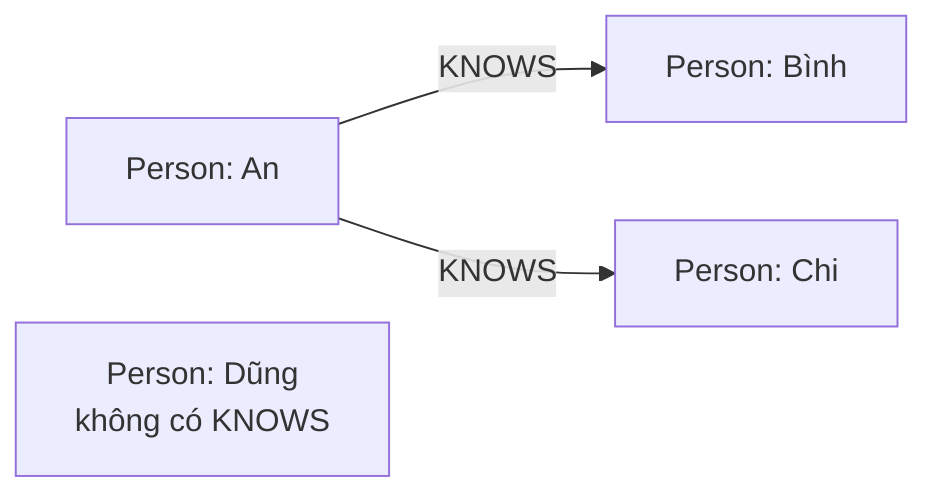

# OPTIONAL MATCH và collection rỗng trong kết quả đồ thị

Khi truy vấn một node cùng các relationship tùy chọn, có thể có node gốc nhưng không có node liên quan nào. Trong Cypher, `OPTIONAL MATCH` giữ lại dòng kết quả của node gốc và đặt các biến không khớp thành `null`. Khi kết hợp với `collect()`, các giá trị `null` bị bỏ qua, vì vậy collection thu được là danh sách rỗng `[]`.

Đây là kỹ thuật quan trọng khi dùng Spring Data Neo4j để ánh xạ kết quả Cypher thành entity có collection relationship. Framework xử lý kết quả truy vấn theo record; để dựng đúng một entity graph, truy vấn tùy chỉnh cần trả về node gốc cùng các relationship và node liên quan trong cùng một record. Bài học dùng ví dụ `Person` có danh sách bạn bè để giải thích cách giữ node gốc, tạo collection rỗng và tránh nhân bản dữ liệu.

## 1. Phân biệt node gốc không tồn tại và node không có relationship

Giả sử một người có thể biết nhiều người khác qua relationship `KNOWS`:



Có hai tình huống khác nhau:

1. **Node gốc tồn tại nhưng không có relationship:** `Person` vẫn phải xuất hiện trong kết quả; collection `friends` của nó phải rỗng.
2. **Node gốc không tồn tại:** không có entity nào để ánh xạ; repository trả về không có kết quả, ví dụ `Optional.empty()`.

`OPTIONAL MATCH` giải quyết tình huống thứ nhất. Nó không tạo ra node gốc khi phần `MATCH` đầu tiên không tìm thấy node.

Ví dụ truy vấn node gốc:

```cypher
MATCH (p:Person {id: $personId})
RETURN p;
```

Nếu không có `Person` mang ID đó, truy vấn trả về 0 record. Nếu có người nhưng không có `KNOWS`, truy vấn trên vẫn trả về node `p`; tuy nhiên, nó chưa truy vấn collection relationship. Ta cần `OPTIONAL MATCH` để lấy nhánh tùy chọn.

## 2. OPTIONAL MATCH giữ lại dòng kết quả

`MATCH` yêu cầu pattern phải khớp. Nếu một pattern không khớp, dòng tương ứng bị loại khỏi kết quả. `OPTIONAL MATCH` hoạt động tương tự phép left outer join: khi pattern không khớp, các biến của pattern được đặt thành `null`, còn những biến đã có từ trước vẫn được giữ lại.

Truy vấn sau tìm một người và các bạn bè đi ra từ người đó:

```cypher
MATCH (p:Person {id: $personId})
OPTIONAL MATCH (p)-[r:KNOWS]->(friend:Person)
RETURN p, r, friend;
```

Nếu người đó có hai bạn bè, truy vấn tạo hai record. Nếu không có bạn bè, truy vấn vẫn tạo một record với `p` được giữ lại và hai cột `r`, `friend` có giá trị `null`:

| Trường hợp | `p` | `r` | `friend` | Số record |
|---|---|---|---|---:|
| Có hai bạn bè | Node `Person` | Relationship `KNOWS` | Node bạn bè | 2 |
| Không có bạn bè | Node `Person` | `null` | `null` | 1 |
| Không có node gốc | Không có giá trị | Không có giá trị | Không có giá trị | 0 |

Kết quả một dòng có `null` chưa phải là collection rỗng. Nó chỉ cho biết không có phần tử nào khớp trong nhánh tùy chọn. Bước tiếp theo là gom các relationship và node liên quan bằng `collect()`.

## 3. collect() biến nhánh không khớp thành collection rỗng

Trong Cypher, `collect(expression)` bỏ qua các giá trị `null`. Nếu không có giá trị khác `null` để gom, kết quả là list rỗng `[]`.

```cypher
MATCH (p:Person {id: $personId})
OPTIONAL MATCH (p)-[r:KNOWS]->(friend:Person)
RETURN p,
       collect(r) AS relationships,
       collect(friend) AS friends;
```

Kết quả có ý nghĩa:

| Trường hợp | `p` | `relationships` | `friends` |
|---|---|---|---|
| Có hai bạn bè | Node `Person` | `[r1, r2]` | `[friend1, friend2]` |
| Không có bạn bè | Node `Person` | `[]` | `[]` |
| Không có node gốc | Không có record | Không có record | Không có record |

Hai biểu thức `collect(r)` và `collect(friend)` có vai trò khác nhau:

- `collect(r)` cung cấp các relationship để Spring Data Neo4j biết cạnh nào nối node gốc với node đích.
- `collect(friend)` cung cấp các node ở đầu còn lại để converter có thể dựng các entity liên quan.

Nếu chỉ trả `p` và danh sách tên bạn bè, truy vấn có thể đủ cho một DTO hiển thị, nhưng không cung cấp đầy đủ cấu trúc graph để hydrate collection entity relationship. Khi mục tiêu là ánh xạ `Person` với `Set<Person> friends`, hãy trả về cả node và relationship.

Không cần thêm `coalesce(collect(r), [])` chỉ để biến kết quả không có phần tử thành list rỗng: `collect()` vốn đã trả `[]` khi chỉ gặp `null`. `coalesce` có thể hữu ích cho những biểu thức khác, nhưng không thay thế `OPTIONAL MATCH` và cũng không tạo lại một node gốc đã không được `MATCH`.

## 4. Ánh xạ kết quả vào entity Spring Data Neo4j

Entity có thể khai báo collection relationship như sau:

```java
import org.springframework.data.neo4j.core.schema.Id;
import org.springframework.data.neo4j.core.schema.Node;
import org.springframework.data.neo4j.core.schema.Relationship;

import java.util.LinkedHashSet;
import java.util.Set;

@Node("Person")
public class Person {

    @Id
    private String id;

    private String name;

    @Relationship(type = "KNOWS", direction = Relationship.Direction.OUTGOING)
    private Set<Person> friends = new LinkedHashSet<>();

    protected Person() {
    }

    public String getId() {
        return id;
    }

    public String getName() {
        return name;
    }

    public Set<Person> getFriends() {
        return friends;
    }
}
```

Vì repository tìm node theo `id`, ứng dụng nên bảo đảm property này duy nhất trong label `Person`:

```cypher
CREATE CONSTRAINT person_id_unique IF NOT EXISTS
FOR (p:Person)
REQUIRE p.id IS UNIQUE;
```

Trường `friends` mô tả các relationship `KNOWS` đi từ node hiện tại đến các node `Person` ở đầu kia. Khởi tạo collection giúp entity mới có trạng thái Java dễ dự đoán ngay cả trước khi được lưu.

Repository dùng truy vấn tùy chỉnh:

```java
import org.springframework.data.neo4j.repository.Neo4jRepository;
import org.springframework.data.neo4j.repository.query.Query;
import org.springframework.data.repository.query.Param;

import java.util.Optional;

public interface PersonRepository extends Neo4jRepository<Person, String> {

    @Query("""
        MATCH (p:Person {id: $personId})
        OPTIONAL MATCH (p)-[r:KNOWS]->(friend:Person)
        RETURN p,
               collect(r) AS relationships,
               collect(friend) AS friends
        """)
    Optional<Person> findWithFriends(@Param("personId") String personId);
}
```

Truy vấn tạo một record cho node gốc, gom các relationship và node đích thành collection rồi trả về. Với người có bạn bè, collection chứa các phần tử tương ứng. Với người không có bạn bè, hai collection được trả về rỗng, trong khi `p` vẫn có mặt để Spring Data Neo4j ánh xạ thành `Person`.

Kết quả của `findWithFriends` có hai khả năng ở cấp repository:

- `Optional.of(person)`: node gốc tồn tại; `friends` có các node liên quan hoặc là collection rỗng.
- `Optional.empty()`: không có node `Person` khớp `personId` trong phần `MATCH` gốc.

Đây là lý do cần phân biệt collection rỗng với entity không tồn tại. Một người không có bạn bè vẫn là một `Person` hợp lệ.

## 5. Vì sao Spring Data Neo4j cần một record cho mỗi node gốc?

Spring Data Neo4j ánh xạ kết quả truy vấn theo record. Nếu truy vấn trả nhiều record lặp lại cùng một node gốc, mỗi record có thể chỉ chứa một phần relationship. Điều này dễ dẫn đến kết quả không đầy đủ hoặc collection bị lặp khi ánh xạ.

Ví dụ không nên dùng làm kết quả cuối cho một entity graph có nhiều bạn bè:

```cypher
MATCH (p:Person {id: $personId})-[r:KNOWS]->(friend:Person)
RETURN p, r, friend;
```

Với ba bạn bè, truy vấn trả ba record có cùng `p`. Cách phù hợp là gom relationship và node đích để có một record cho `p`:

```cypher
MATCH (p:Person {id: $personId})-[r:KNOWS]->(friend:Person)
RETURN p, collect(r), collect(friend);
```

Khi cần giữ cả người không có bạn bè, thay `MATCH` của nhánh relationship bằng `OPTIONAL MATCH`:

```cypher
MATCH (p:Person {id: $personId})
OPTIONAL MATCH (p)-[r:KNOWS]->(friend:Person)
RETURN p, collect(r), collect(friend);
```

Quy tắc ghi nhớ: một record cho mỗi root entity; trong record đó, trả về node gốc và collection relationship/node đã gom. Đây là hình dạng kết quả phù hợp với cơ chế ánh xạ graph của Spring Data Neo4j.

## 6. Đặt điều kiện WHERE đúng vị trí

Với `OPTIONAL MATCH`, vị trí của `WHERE` ảnh hưởng trực tiếp đến việc giữ hay loại node gốc.

### WHERE gắn với OPTIONAL MATCH

Nếu `WHERE` xuất hiện ngay sau `OPTIONAL MATCH`, điều kiện được xem là một phần của pattern tùy chọn:

```cypher
MATCH (p:Person {id: $personId})
OPTIONAL MATCH (p)-[r:KNOWS]->(friend:Person)
WHERE friend.active = true
RETURN p, collect(r), collect(friend);
```

Nếu không có bạn bè active, `p` vẫn được giữ lại và hai collection là rỗng. Điều kiện lọc chỉ quyết định nhánh relationship nào được coi là khớp.

### WHERE lọc sau WITH

Nếu chuyển điều kiện sang một bước `WITH` riêng, nó lọc các dòng đã tạo:

```cypher
MATCH (p:Person {id: $personId})
OPTIONAL MATCH (p)-[r:KNOWS]->(friend:Person)
WITH p, r, friend
WHERE friend.active = true
RETURN p, collect(r), collect(friend);
```

Khi không có bạn bè hoặc không có bạn bè active, `friend` là `null`; điều kiện `friend.active = true` không đúng, nên dòng bị loại. Kết quả lúc này có thể không còn node gốc, trái với ý định giữ người có collection rỗng.

Nếu muốn lọc nhánh tùy chọn mà vẫn giữ root, đặt điều kiện ngay sau `OPTIONAL MATCH`. Nếu muốn chủ động loại root không có phần tử phù hợp, lọc sau `WITH` hoặc sau aggregation là một lựa chọn có chủ đích.

## 7. Tránh phần tử giả khi gom map hoặc scalar

`collect()` bỏ qua giá trị `null`, nhưng không tự loại một map có các trường bên trong là `null`. Ví dụ:

```cypher
MATCH (p:Person {id: $personId})
OPTIONAL MATCH (p)-[:KNOWS]->(friend:Person)
RETURN p,
       collect({id: friend.id, name: friend.name}) AS friendSummaries;
```

Khi không có `friend`, biểu thức map vẫn tạo ra một map với các giá trị `null`; kết quả có thể chứa một phần tử map rỗng về nội dung thay vì `[]`. Nếu thật sự cần gom map, hãy chuyển toàn bộ biểu thức thành `null` khi node đích không tồn tại:

```cypher
MATCH (p:Person {id: $personId})
OPTIONAL MATCH (p)-[:KNOWS]->(friend:Person)
RETURN p,
       collect(
           CASE WHEN friend IS NULL THEN null
                ELSE {id: friend.id, name: friend.name}
           END
       ) AS friendSummaries;
```

Tương tự, `collect(friend.name)` bỏ qua các giá trị tên `null`. Nếu node `friend` tồn tại nhưng property `name` không có, phần tử đó cũng không xuất hiện trong collection scalar. Khi cần bảo toàn sự tương ứng giữa node và property, hãy gom node hoặc map có điều kiện thay vì chỉ gom một property có thể null.

Với mục tiêu hydrate entity graph, ưu tiên `collect(r)` và `collect(friend)` để trả các phần tử Neo4j mà Spring Data Neo4j có thể ánh xạ. Chỉ gom map hoặc scalar khi kiểu kết quả là DTO/projection phù hợp.

## 8. Nhiều nhánh OPTIONAL MATCH và Cartesian product

Một node có thể có nhiều collection relationship, chẳng hạn bạn bè và nhóm tham gia:

```cypher
MATCH (p:Person {id: $personId})
OPTIONAL MATCH (p)-[knows:KNOWS]->(friend:Person)
OPTIONAL MATCH (p)-[membership:MEMBER_OF]->(group:Group)
RETURN p,
       collect(knows), collect(friend),
       collect(membership), collect(group);
```

Nếu một người có 3 bạn bè và 2 nhóm, hai nhánh có thể tạo 3 × 2 = 6 dòng trước khi aggregation. Khi đó mỗi relationship `KNOWS` có thể xuất hiện lặp trong `collect(knows)`, và mỗi `MEMBER_OF` cũng có thể bị lặp.

`collect(DISTINCT ...)` có thể loại các phần tử trùng trong kết quả:

```cypher
MATCH (p:Person {id: $personId})
OPTIONAL MATCH (p)-[knows:KNOWS]->(friend:Person)
OPTIONAL MATCH (p)-[membership:MEMBER_OF]->(group:Group)
RETURN p,
       collect(DISTINCT knows),
       collect(DISTINCT friend),
       collect(DISTINCT membership),
       collect(DISTINCT group);
```

Tuy nhiên, `DISTINCT` chỉ loại phần tử trùng ở bước aggregation; nó không loại bỏ chi phí tạo các dòng kết hợp ở database. Với nhiều nhánh độc lập, correlated subquery giúp gom từng nhánh riêng trước khi kết hợp:

```cypher
MATCH (p:Person {id: $personId})
CALL {
    WITH p
    OPTIONAL MATCH (p)-[r:KNOWS]->(friend:Person)
    RETURN collect(r) AS knowsRelationships,
           collect(friend) AS friends
}
CALL {
    WITH p
    OPTIONAL MATCH (p)-[m:MEMBER_OF]->(group:Group)
    RETURN collect(m) AS membershipRelationships,
           collect(group) AS groups
}
RETURN p,
       knowsRelationships,
       friends,
       membershipRelationships,
       groups;
```

Mỗi subquery nhận cùng node gốc `p`, xử lý một nhánh độc lập và trả về các collection đã gom. Khi nhánh không có kết quả, `collect()` trả collection rỗng. Cách này tránh phép nhân số dòng giữa các nhánh độc lập và giúp kiểm soát kết quả tốt hơn.

Hãy chọn giữa `collect(DISTINCT ...)` và subquery theo số lượng nhánh, kích thước graph và kế hoạch thực thi. Với một nhánh đơn giản, một lần `OPTIONAL MATCH` cùng `collect()` thường là đủ.

## 9. Khi chỉ cần DTO thay vì entity graph

Không phải mọi use case đều cần hydrate entity và relationship. Nếu màn hình chỉ hiển thị tên người cùng danh sách tên bạn bè, có thể trả projection:

```java
import java.util.List;

public interface PersonFriendsView {
    String getPersonName();
    List<String> getFriendNames();
}
```

```java
import org.springframework.data.neo4j.repository.query.Query;
import org.springframework.data.repository.query.Param;

@Query("""
    MATCH (p:Person {id: $personId})
    OPTIONAL MATCH (p)-[:KNOWS]->(friend:Person)
    RETURN p.name AS personName,
           collect(friend.name) AS friendNames
    """)
Optional<PersonFriendsView> findFriendsView(@Param("personId") String personId);
```

Vì `collect()` bỏ qua `null`, `friendNames` là list rỗng khi người đó không có bạn bè có tên. Tuy nhiên, projection này không chứa relationship hoặc node entity; nó phù hợp cho dữ liệu trình bày. Nếu `name` có thể null nhưng vẫn cần biểu diễn từng node, hãy trả thêm ID hoặc dùng map có điều kiện để giữ đủ thông tin.

Quy tắc lựa chọn:

- **Cần entity graph:** trả node gốc, `collect(relationship)` và `collect(relatedNode)`.
- **Chỉ cần dữ liệu trình bày:** trả scalar hoặc map projection với alias khớp property của DTO.
- **Cần nhiều nhánh graph:** gom riêng từng nhánh hoặc dùng `collect(DISTINCT ...)` sau khi cân nhắc Cartesian product.

## 10. Các lỗi thường gặp

| Biểu hiện | Nguyên nhân | Cách xử lý |
|---|---|---|
| Người không có bạn bè biến mất khỏi kết quả | Dùng `MATCH` bắt buộc cho relationship | Dùng `OPTIONAL MATCH` cho nhánh có thể không tồn tại |
| Entity tồn tại nhưng collection không được ánh xạ đầy đủ | Chỉ trả node gốc hoặc chỉ trả node đích mà thiếu relationship | Trả node gốc cùng `collect(r)` và `collect(relatedNode)` |
| Kết quả chứa nhiều entity gốc lặp | Một root tạo nhiều record theo từng relationship | Gom relationship và node đích để có một record cho mỗi root |
| Collection có map chỉ chứa giá trị null | `collect({ ... })` tạo map khác null dù node tùy chọn không tồn tại | Dùng `CASE WHEN node IS NULL THEN null ELSE map END` trước `collect()` |
| Người không có phần tử phù hợp bị loại sau khi thêm điều kiện | `WHERE` lọc dòng null sau `WITH` | Đặt `WHERE` ngay sau `OPTIONAL MATCH` nếu muốn giữ root |
| Collection bị trùng phần tử | Nhiều nhánh OPTIONAL MATCH tạo Cartesian product | Dùng subquery để gom từng nhánh; hoặc `collect(DISTINCT ...)` khi phù hợp |
| `Optional.empty()` bị nhầm với collection rỗng | Node gốc không tồn tại nhưng code mong có entity với list rỗng | Phân biệt 0 record của root với một record có collection `[]` |
| DTO mất một số phần tử | `collect(property)` bỏ qua cả giá trị property null | Gom node hoặc map có điều kiện nếu cần giữ từng phần tử |

Khi debug, hãy kiểm tra kết quả Cypher thô trước: node gốc có tồn tại không, `OPTIONAL MATCH` tạo dòng null hay không, `collect()` trả list gì và mỗi root có bao nhiêu record. Sau đó mới kiểm tra kiểu trả về Java và cách Spring Data Neo4j ánh xạ collection.

## 11. Tự kiểm tra

1. Nếu node `Person` tồn tại nhưng không có relationship `KNOWS`, `OPTIONAL MATCH` trả về những giá trị nào?
2. Vì sao `collect(r)` trả `[]` khi `r` là `null`?
3. Khác biệt giữa node gốc không tồn tại và node gốc có collection relationship rỗng là gì?
4. Vì sao truy vấn custom của Spring Data Neo4j nên trả một record cho mỗi root entity?
5. Để hydrate `Set<Person> friends`, vì sao cần trả cả `collect(r)` và `collect(friend)`?
6. Điều gì thay đổi nếu đặt `WHERE friend.active = true` sau `WITH` thay vì ngay sau `OPTIONAL MATCH`?
7. Vì sao `collect({id: friend.id})` có thể tạo phần tử map chứa null khi không có friend?
8. Nhiều nhánh OPTIONAL MATCH độc lập có thể tạo Cartesian product như thế nào và subquery giúp gì?

`OPTIONAL MATCH` giữ node gốc khi một nhánh relationship không khớp; `collect()` bỏ qua các giá trị null và tạo collection rỗng. Khi ánh xạ entity graph với Spring Data Neo4j, hãy gom relationship cùng node đích để mỗi root có một record đầy đủ. Phân biệt rõ root không tồn tại, collection rỗng và collection có phần tử; đồng thời đặt điều kiện đúng vị trí và kiểm soát các nhánh truy vấn để kết quả không bị mất hoặc nhân bản.

## Tài liệu tham khảo

- [Spring Data Neo4j — Custom queries: queries with relationships and one record per root node](https://docs.spring.io/spring-data/neo4j/reference/appendix/custom-queries.html)
- [Neo4j Cypher Manual — OPTIONAL MATCH](https://neo4j.com/docs/cypher-manual/current/clauses/optional-match/)
- [Neo4j Cypher Manual — Aggregating functions: collect()](https://neo4j.com/docs/cypher-manual/current/functions/aggregating/)
