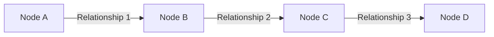

# Kết quả đường đi: tách node và relationship để ánh xạ

Trong Neo4j, một đường đi (path) là chuỗi các node được nối với nhau bằng các relationship theo một thứ tự xác định. Khi truy vấn trả về cả đường đi, kết quả không còn là một node đơn lẻ mà là một cấu trúc gồm nhiều node và nhiều relationship. Để chuyển kết quả này thành dữ liệu Java có ích, ứng dụng cần hiểu cách tách hai thành phần và ánh xạ chúng theo đúng thứ tự của đường đi.

Spring Data Neo4j (SDN) ánh xạ node và relationship thành entity khi kết quả truy vấn có hình dạng phù hợp với mô hình domain. Với truy vấn cần xử lý một path như một cấu trúc độc lập, `Neo4jClient` kết hợp Neo4j Java Driver cho phép đọc giá trị `Path`, duyệt node và relationship rồi chuyển chúng thành DTO hoặc mô hình kết quả riêng. Cách tiếp cận này đặc biệt hữu ích với truy vấn tìm tuyến đường, chuỗi phụ thuộc, luồng kết nối hoặc đường đi nhiều bước.

## 1. Path gồm những thành phần nào?

Một path có dạng xen kẽ giữa node và relationship:



Với path có `n` relationship, path có `n + 1` node. Thứ tự node và relationship phản ánh thứ tự duyệt trong path. Ví dụ:

```cypher
MATCH path = (a:Station {code: 'SGN'})-[:CONNECTS*1..4]->(b:Station {code: 'DAD'})
RETURN path;
```

Biến `path` là một giá trị tổng hợp. Nó chứa các node và relationship đi qua từ ga `SGN` tới ga `DAD`. Khi trả về `path`, ứng dụng có thể đọc từng node và từng cạnh thay vì chỉ nhận một node cuối cùng.

## 2. Phân biệt kết quả path với kết quả entity

Không phải mọi kết quả có chứa node đều nên được ánh xạ thành một entity duy nhất.

| Hình dạng Cypher trả về | Ý nghĩa | Cách ánh xạ thường phù hợp |
|---|---|---|
| `RETURN n` | Một node | Entity `@Node` tương ứng |
| `RETURN n, m` | Hai node riêng | Nhiều entity hoặc projection theo nhu cầu |
| `RETURN r` | Một relationship | Dữ liệu relationship hoặc DTO phù hợp |
| `RETURN path` | Một path gồm nhiều node và relationship | Đọc `Path` bằng driver và tách thành DTO hoặc cấu trúc kết quả |
| `RETURN nodes(path), relationships(path)` | Hai danh sách thành phần của path | Ánh xạ từng danh sách theo thứ tự tương ứng |

Nếu mục tiêu là tải một entity domain, hãy để SDN ánh xạ node và các relationship cần thiết theo metadata entity. Nếu mục tiêu là trả về toàn bộ tuyến đường với danh sách node và cạnh theo đúng thứ tự, DTO path thường thể hiện ý định rõ hơn. Không nên ép một path nhiều node thành một entity đơn lẻ vì sẽ làm mất cấu trúc đường đi.

## 3. Mô hình kết quả đường đi bằng DTO

Giả sử ứng dụng quản lý các ga và các tuyến kết nối. Node `Station` có `code` và `name`; relationship `CONNECTS` có property `distanceKm`.

Kết quả Java có thể được biểu diễn bằng ba kiểu:

```java
import java.util.List;

public record StationView(String code, String name) {
}

public record ConnectionView(String type, double distanceKm) {
}

public record RouteView(
    List<StationView> stations,
    List<ConnectionView> connections
) {
}
```

`RouteView` giữ riêng danh sách node và danh sách relationship. Vị trí phần tử trong hai danh sách có quan hệ với nhau: `connections[i]` nối `stations[i]` với `stations[i + 1]` theo thứ tự của path. Với path hợp lệ không rỗng, số station bằng số connection cộng một.

DTO này chỉ biểu diễn kết quả truy vấn. Nó không bắt buộc phải là entity được SDN quản lý hoặc được lưu ngược lại vào Neo4j.

## 4. Truy vấn path bằng Cypher

Truy vấn sau tìm các đường đi có từ một đến bốn relationship giữa hai ga:

```cypher
MATCH path = (origin:Station {code: $from})-[:CONNECTS*1..4]->(destination:Station {code: $to})
RETURN path;
```

Các điểm cần chú ý:

- `path = ...` gán toàn bộ đường đi vào biến `path`.
- `*1..4` giới hạn độ dài đường đi từ một đến bốn relationship.
- Mũi tên `->` xác định hướng duyệt của relationship.
- `$from` và `$to` là tham số giá trị, được bind từ ứng dụng.
- Mỗi hàng kết quả có thể chứa một path; truy vấn có thể trả về nhiều path nếu tồn tại nhiều tuyến phù hợp.

Nếu cần nhìn riêng hai thành phần ở phía Cypher, có thể dùng:

```cypher
MATCH path = (origin:Station {code: $from})-[:CONNECTS*1..4]->(destination:Station {code: $to})
RETURN nodes(path) AS pathNodes,
       relationships(path) AS pathRelationships;
```

`nodes(path)` trả về danh sách node theo thứ tự path; `relationships(path)` trả về danh sách relationship theo thứ tự tương ứng. Không dùng `UNWIND` cả hai danh sách độc lập rồi ghép kết quả nếu không kiểm soát số hàng, vì hai lần `UNWIND` có thể tạo tích Descartes và nhân bản dữ liệu.

## 5. Tách node và relationship bằng Neo4jClient

Khi Cypher trả về `path`, `Neo4jClient` có thể đọc giá trị đó thành kiểu `Path` của Neo4j Java Driver. Sau đó, duyệt `path.nodes()` và `path.relationships()` để ánh xạ riêng từng thành phần.

```java
import java.util.ArrayList;
import java.util.List;

import org.neo4j.driver.types.Node;
import org.neo4j.driver.types.Path;
import org.neo4j.driver.types.Relationship;
import org.springframework.data.neo4j.core.Neo4jClient;
import org.springframework.stereotype.Repository;

@Repository
public class RouteQueryRepository {

    private final Neo4jClient neo4jClient;

    public RouteQueryRepository(Neo4jClient neo4jClient) {
        this.neo4jClient = neo4jClient;
    }

    public List<RouteView> findRoutes(String from, String to) {
        return neo4jClient.query("""
                MATCH path = (origin:Station {code: $from})
                    -[:CONNECTS*1..4]->
                    (destination:Station {code: $to})
                RETURN path
                """)
            .bind(from).to("from")
            .bind(to).to("to")
            .fetchAs(RouteView.class)
            .mappedBy((typeSystem, record) -> {
                Path path = record.get("path").asPath();

                List<StationView> stations = new ArrayList<>();
                for (Node node : path.nodes()) {
                    stations.add(new StationView(
                        node.get("code").asString(),
                        node.get("name").asString()
                    ));
                }

                List<ConnectionView> connections = new ArrayList<>();
                for (Relationship relationship : path.relationships()) {
                    connections.add(new ConnectionView(
                        relationship.type(),
                        relationship.get("distanceKm").asDouble()
                    ));
                }

                return new RouteView(stations, connections);
            })
            .all();
    }
}
```

Trong ví dụ:

1. `record.get("path").asPath()` đọc giá trị path từ record.
2. `path.nodes()` cung cấp các node theo thứ tự đường đi.
3. `path.relationships()` cung cấp các relationship theo thứ tự đường đi.
4. Mỗi node được chuyển thành `StationView`; mỗi relationship thành `ConnectionView`.
5. `RouteView` gom hai danh sách thành một kết quả hoàn chỉnh.

Truy vấn yêu cầu `code`, `name` và `distanceKm` tồn tại trên các node/relationship tương ứng. Nếu property có thể vắng mặt, hãy kiểm tra null trước khi gọi `asString()` hoặc `asDouble()`, rồi chọn kiểu nullable hoặc giá trị mặc định theo quy tắc nghiệp vụ. Không tự mặc định một giá trị có ý nghĩa như khoảng cách bằng `0` nếu dữ liệu thực tế chưa biết.

## 6. Duy trì quan hệ vị trí giữa node và relationship

Khi tách path, không nên chỉ tạo hai tập hợp không có thứ tự. Cần giữ thứ tự và quan hệ liền kề giữa các phần tử:

```text
stations:     [A, B, C, D]
connections:  [AB, BC, CD]
```

`connections[0]` nối `stations[0]` với `stations[1]`; `connections[1]` nối `stations[1]` với `stations[2]`, và cứ tiếp tục như vậy. Nếu sắp xếp riêng hai danh sách hoặc loại bỏ phần tử trùng lặp không đúng cách, kết quả có thể không còn mô tả đúng path ban đầu.

Một path có thể đi qua cùng một node nhiều lần tùy pattern và quy tắc truy vấn. Nếu dùng `DISTINCT` hoặc chuyển node sang `Set`, bạn có thể làm mất thông tin thứ tự hoặc số lần xuất hiện. Hãy giữ danh sách theo path khi thứ tự duyệt là một phần của nghiệp vụ.

## 7. Đọc hướng relationship đúng cách

Path có thứ tự duyệt; relationship trong Neo4j cũng có hướng lưu trữ. Với truy vấn dùng pattern có hướng như `-[:CONNECTS]->`, thứ tự node và relationship trong path phản ánh hướng khớp của pattern.

Nếu truy vấn dùng relationship không định hướng như `-[:CONNECTS]-`, một cạnh có thể được duyệt theo hướng ngược với hướng lưu trữ của relationship. Trong trường hợp cần biểu diễn hướng di chuyển, hãy dựa trên thứ tự node trong path và hiểu rõ chiều duyệt, không suy ra hướng nghiệp vụ chỉ từ `relationship.type()`.

Khi cần biết hướng lưu trữ của relationship, Neo4j Java Driver cung cấp thông tin endpoint của relationship. So sánh endpoint với hai node liên tiếp trong path để xác định cạnh đang được duyệt cùng hay ngược chiều lưu trữ. Với truy vấn tuyến đường, cách đơn giản nhất là viết pattern có hướng rõ ràng ngay từ đầu.

## 8. Khi nào dùng mapping entity của SDN?

Nếu truy vấn cần trả về một entity `Station` cùng các quan hệ được mô hình hóa trong entity, hãy để SDN ánh xạ theo domain model. Một truy vấn custom repository thường trả về node hoặc các thành phần graph mà mapping cần:

```java
import java.util.Optional;

import org.springframework.data.neo4j.repository.Neo4jRepository;
import org.springframework.data.neo4j.repository.query.Query;
import org.springframework.data.repository.query.Param;

public interface StationRepository extends Neo4jRepository<Station, Long> {

    @Query("""
        MATCH (station:Station {code: $code})
        RETURN station
        """)
    Optional<Station> findStationByCode(@Param("code") String code);
}
```

Đối với path gồm nhiều node và relationship, trả về `path` là một giá trị tổng hợp. Nếu mục tiêu là một DTO mô tả đường đi, hãy xử lý path rõ ràng qua `Neo4jClient` như ví dụ trên. Nếu mục tiêu là ánh xạ các node thành entity, hãy thiết kế query trả về các node và relationship cần thiết theo hình dạng mà SDN có thể ánh xạ vào kiểu trả về; tránh giả định rằng một đối tượng `Path` tự động trở thành một entity domain.

## 9. Xử lý nhiều path và node lặp

Một truy vấn có thể trả về nhiều path. Mỗi record cần được ánh xạ thành một `RouteView` độc lập. Không ghép tất cả node từ mọi record vào một danh sách toàn cục nếu ứng dụng cần giữ từng tuyến riêng.

Các path khác nhau có thể dùng chung node hoặc relationship. Nếu cần tối ưu dữ liệu trả về, có thể xây dựng một graph DTO với danh sách node duy nhất và danh sách cạnh tham chiếu node bằng khóa ổn định. Tuy nhiên, cấu trúc đó cần giữ thông tin thứ tự của từng path riêng biệt. Chỉ khử trùng lặp khi use case thực sự cần mô hình graph dùng chung; với một tuyến đường, danh sách tuần tự thường đơn giản và chính xác hơn.

Không dùng internal element ID của driver làm khóa nghiệp vụ công khai. Nếu cần tham chiếu node giữa các kết quả hoặc API, hãy dùng property định danh ổn định của ứng dụng như `code` hoặc UUID đã được ràng buộc duy nhất.

## 10. Hiệu năng và giới hạn độ dài path

Truy vấn path có thể tạo ra nhiều kết quả khi graph có nhiều nhánh. Giới hạn độ dài như `*1..4` giúp thu hẹp không gian tìm kiếm, nhưng không tự bảo đảm số path nhỏ. Một graph có nhiều cạnh có thể sinh ra rất nhiều tổ hợp ngay cả ở độ sâu thấp.

Một số nguyên tắc:

- Lọc node đầu và cuối bằng property có index, chẳng hạn `Station.code`.
- Đặt giới hạn độ dài path theo nghiệp vụ; tránh truy vấn đường đi không giới hạn khi graph lớn.
- Chỉ trả về property cần dùng nếu không cần toàn bộ node/relationship.
- Tránh `UNWIND` nhiều danh sách độc lập nếu điều đó tạo tích Descartes.
- Dùng `EXPLAIN` hoặc `PROFILE` để kiểm tra số lượng row, operator và chi phí thực thi.
- Cân nhắc trả về một tập kết quả giới hạn hoặc phân trang theo mô hình truy vấn phù hợp.

## 11. Những lỗi thường gặp

| Lỗi | Hệ quả | Cách xử lý |
|---|---|---|
| Coi path là một node | Mất thông tin các node và cạnh trung gian | Đọc path và tách `nodes()` cùng `relationships()` |
| Ánh xạ path thành entity đơn | Kiểu kết quả không phản ánh cấu trúc đường đi | Dùng DTO path hoặc trả về entity phù hợp với từng node |
| Duyệt hai danh sách mà không giữ thứ tự | Cạnh có thể bị ghép sai với node | Giữ danh sách theo thứ tự path; số node bằng số cạnh cộng một |
| `UNWIND nodes(path)` và `UNWIND relationships(path)` độc lập | Tạo tích Descartes, nhân bản row | Trả path trực tiếp hoặc xử lý hai list trong cùng record |
| Dùng `Set` để khử trùng lặp node | Mất thứ tự và số lần node xuất hiện trong path | Dùng `List` khi thứ tự đường đi quan trọng |
| Truy vấn path không giới hạn độ dài | Số path tăng mạnh trên graph nhiều nhánh | Đặt giới hạn và phân tích bằng `PROFILE` |
| Giả định mapping entity tự chuẩn hóa path | Kết quả không đúng với nhu cầu tùy chỉnh | Viết rõ bước chuyển đổi trong mapper |

## 12. Tự kiểm tra

1. Một path có bao nhiêu node nếu có bốn relationship?
2. `nodes(path)` và `relationships(path)` trả về những gì và theo thứ tự nào?
3. Vì sao `RETURN path` phù hợp với việc tạo DTO đường đi qua `Neo4jClient`?
4. Vì sao không nên `UNWIND` hai danh sách node và relationship độc lập trong cùng một query mà không kiểm soát số row?
5. Nếu path có node lặp, vì sao chuyển danh sách node thành `Set` có thể làm sai kết quả?
6. Khi nào nên dùng SDN entity mapping và khi nào nên ánh xạ path thủ công thành DTO?

Khi tách path thành danh sách node và relationship mà vẫn giữ nguyên thứ tự, ứng dụng có thể biểu diễn chính xác cấu trúc đường đi. Hãy chọn entity mapping khi kết quả là domain entity; dùng `Neo4jClient` và DTO khi cần kiểm soát tường minh từng node, cạnh và thứ tự traversal.
