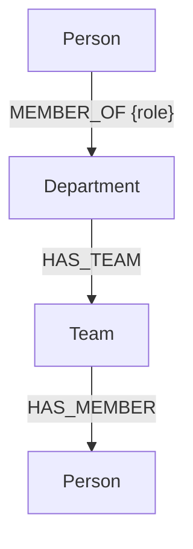

# Projection nhiều tầng để giới hạn relationship cần tải

## Mục tiêu bài học

Sau bài này, bạn có thể:

- Giải thích cách projection nhiều tầng mô tả phần đồ thị mà một truy vấn repository cần trả về.
- Thiết kế interface projection lồng nhau cho node và relationship properties.
- Giới hạn các nhánh relationship được ánh xạ theo đúng nhu cầu của màn hình hoặc nghiệp vụ.
- Nhận biết cách SDN xử lý projection có chu trình và projection trên `@RelationshipProperties`.
- Phân biệt giới hạn chiều sâu của projection với giới hạn số phần tử trong một collection.
- Chọn interface projection, DTO hoặc Cypher tùy chỉnh phù hợp với hình dạng kết quả cần dùng.

## 1. Vì sao cần projection nhiều tầng?

Một entity Neo4j có thể liên kết với nhiều node khác, và mỗi node liên quan lại có các relationship riêng. Nếu một màn hình chỉ hiển thị tên người, phòng ban và tên một số nhóm trực thuộc, việc tải toàn bộ object graph có thể đưa về nhiều thuộc tính và liên kết mà màn hình không sử dụng.

Projection là kiểu trả về mô tả phần dữ liệu mà ứng dụng muốn nhận. Trong Spring Data Neo4j (SDN), interface projection và DTO projection đều ảnh hưởng đến các property và relationship được chuyển từ Neo4j về ứng dụng. SDN sử dụng domain type của repository để xây dựng truy vấn; với interface projection, tên các accessor phải tương ứng với property của entity. <https://docs.spring.io/spring-data/neo4j/reference/projections/sdn-projections.html>

Projection nhiều tầng (multi-level projection) mở rộng ý tưởng đó bằng cách lồng projection bên trong projection. Mỗi tầng mô tả những thuộc tính cần lấy từ node hoặc relationship ở tầng tương ứng.

Ví dụ, đồ thị tổ chức có thể gồm:



Một màn hình danh bạ có thể cần tên người, vai trò trong phòng ban, tên phòng ban và tên các nhóm. Nó không cần tải danh sách thành viên của từng nhóm. Projection nhiều tầng cho phép mô tả đúng phần dữ liệu cần dùng và dừng tại tầng `Team`.

## 2. Projection nhiều tầng hoạt động như thế nào?

Một interface projection đơn giản có các accessor trùng với property của entity:

```java
public interface PersonNameView {
    String getName();
}
```

Nếu cần thêm dữ liệu từ một relationship, accessor có thể trả về một projection khác:

```java
public interface PersonDepartmentView {

    String getName();

    DepartmentView getDepartment();

    interface DepartmentView {
        String getName();
    }
}
```

Trong ví dụ rút gọn này, giả sử entity `Person` có một property quan hệ tên `department` trỏ đến entity `Department`.

Ở đây:

- `PersonDepartmentView` mô tả phần dữ liệu lấy từ entity gốc `Person`.
- `getDepartment()` tương ứng với property quan hệ `department` trên `Person`.
- `DepartmentView` chỉ công khai tên phòng ban.

SDN tạo projection interface dưới dạng proxy dựa trên entity được ánh xạ. Khi gọi accessor lồng nhau, ứng dụng nhận projection tương ứng với property ở tầng tiếp theo. Vì vậy, projection lồng nhau cần dùng tên property chính xác của entity, kể cả khi tên relationship trong Neo4j có kiểu khác tên field Java.

Một projection chỉ mô tả phần dữ liệu cần thiết cho truy vấn. Nó không thay đổi schema Neo4j và không tạo node hay relationship mới.

## 3. Mô hình entity dùng trong ví dụ

Giả sử ứng dụng quản lý người dùng, phòng ban và nhóm. Một người có thể tham gia nhiều phòng ban; mỗi quan hệ tham gia có vai trò riêng. Phòng ban có nhiều nhóm, còn nhóm có nhiều thành viên.

Entity `Person`:

```java
import java.util.ArrayList;
import java.util.List;

import org.springframework.data.neo4j.core.schema.Id;
import org.springframework.data.neo4j.core.schema.Node;
import org.springframework.data.neo4j.core.schema.Relationship;

@Node("Person")
public class Person {

    @Id
    private String id;

    private String name;

    @Relationship(
        type = "MEMBER_OF",
        direction = Relationship.Direction.OUTGOING
    )
    private List<Membership> memberships = new ArrayList<>();

    protected Person() {
    }
}
```

Relationship có thuộc tính riêng được ánh xạ bằng `@RelationshipProperties`:

```java
import org.springframework.data.neo4j.core.schema.RelationshipId;
import org.springframework.data.neo4j.core.schema.RelationshipProperties;
import org.springframework.data.neo4j.core.schema.TargetNode;

@RelationshipProperties
public class Membership {

    @RelationshipId
    private Long relationshipId;

    private String role;

    @TargetNode
    private Department department;

    protected Membership() {
    }
}
```

Entity `Department`:

```java
import java.util.ArrayList;
import java.util.List;

import org.springframework.data.neo4j.core.schema.Id;
import org.springframework.data.neo4j.core.schema.Node;
import org.springframework.data.neo4j.core.schema.Relationship;

@Node("Department")
public class Department {

    @Id
    private String id;

    private String name;

    @Relationship(
        type = "HAS_TEAM",
        direction = Relationship.Direction.OUTGOING
    )
    private List<Team> teams = new ArrayList<>();

    protected Department() {
    }
}
```

Entity `Team`:

```java
import java.util.ArrayList;
import java.util.List;

import org.springframework.data.neo4j.core.schema.Id;
import org.springframework.data.neo4j.core.schema.Node;
import org.springframework.data.neo4j.core.schema.Relationship;

@Node("Team")
public class Team {

    @Id
    private String id;

    private String name;

    @Relationship(
        type = "HAS_MEMBER",
        direction = Relationship.Direction.OUTGOING
    )
    private List<Person> members = new ArrayList<>();

    protected Team() {
    }
}
```

Trong mô hình này, `Membership` là một phần của đường đi giữa `Person` và `Department`, đồng thời giữ property `role`. Projection có thể chọn cả property của relationship lẫn property của node đích.

## 4. Xây dựng projection cho từng tầng

Ta bắt đầu từ dữ liệu cần hiển thị: tên người, vai trò, tên phòng ban và tên các nhóm của phòng ban.

```java
import java.util.List;

public interface PersonOrganizationView {

    String getName();

    List<MembershipView> getMemberships();

    interface MembershipView {

        String getRole();

        DepartmentView getDepartment();

        interface DepartmentView {

            String getName();

            List<TeamView> getTeams();

            interface TeamView {
                String getName();
            }
        }
    }
}
```

Đọc projection theo từng tầng:

| Tầng | Property được lấy | Projection con |
| --- | --- | --- |
| Person | `name`, `memberships` | `MembershipView` |
| Membership | `role`, `department` | `DepartmentView` |
| Department | `name`, `teams` | `TeamView` |
| Team | `name` | Không khai báo tầng tiếp theo |

Projection dừng ở `TeamView`. Dù entity `Team` có property `members`, projection không khai báo accessor cho property đó, nên nhánh thành viên không thuộc hình dạng dữ liệu mà projection yêu cầu.

Điều này làm cho ý định truy vấn dễ đọc: ứng dụng chỉ cần tên các nhóm, không cần mở rộng tiếp sang thành viên của từng nhóm.

## 5. Gắn projection vào repository

Khai báo một phương thức truy vấn có kiểu trả về là projection:

```java
import java.util.List;

import org.springframework.data.neo4j.repository.Neo4jRepository;

public interface PersonRepository
        extends Neo4jRepository<Person, String> {

    List<PersonOrganizationView> findByName(String name);
}
```

Khi gọi:

```java
List<PersonOrganizationView> people =
    personRepository.findByName("An");

for (PersonOrganizationView person : people) {
    System.out.println(person.getName());

    for (PersonOrganizationView.MembershipView membership
            : person.getMemberships()) {

        System.out.println(membership.getRole());

        var department = membership.getDepartment();
        System.out.println(department.getName());

        department.getTeams().forEach(
            team -> System.out.println(team.getName())
        );
    }
}
```

SDN sử dụng entity `Person` làm domain type để xác định mapping và tạo truy vấn cho phương thức repository. Projection trả về một góc nhìn lồng nhau của entity đó. Ứng dụng thao tác qua các interface được khai báo, không cần nhận toàn bộ các field của `Person`, `Membership`, `Department` và `Team`.

Nếu phương thức repository trả về projection, hãy dùng một finder có tên riêng như `findByName`. Không nên đổi kiểu trả về của phương thức CRUD kế thừa như `findById` hoặc `findAll` rồi kỳ vọng nó tự trở thành projection; các phương thức cơ sở được thực thi theo hợp đồng repository nền.

## 6. Projection giới hạn đường đi, không đặt giới hạn số phần tử

Một điểm quan trọng là projection nhiều tầng xác định **những property và relationship nào được đưa vào kết quả**. Nó không tự động đặt giới hạn số node trong một collection.

Trong `DepartmentView`, accessor sau yêu cầu projection lấy property relationship `teams` và áp dụng `TeamView` cho từng node đích:

```java
List<TeamView> getTeams();
```

nghĩa là projection yêu cầu property relationship `teams` và chỉ công khai các property được khai báo trong `TeamView`. Nếu phòng ban có hàng nghìn nhóm, collection vẫn có thể chứa rất nhiều phần tử.

Phân biệt hai nhu cầu:

- **Giới hạn chiều sâu và hình dạng:** dùng projection lồng nhau, bỏ accessor cho các relationship không cần.
- **Giới hạn số lượng phần tử:** dùng truy vấn Cypher có `ORDER BY`, `LIMIT`, phân trang hoặc phương thức truy vấn riêng phù hợp.

Ví dụ, nếu giao diện chỉ cần năm nhóm đầu tiên, cần thiết kế truy vấn để giới hạn số nhóm trong Neo4j. Chỉ khai báo `List<TeamView>` không có nghĩa SDN sẽ tự lấy tối đa năm nhóm.

Với các collection lớn, cũng cần cân nhắc phân trang hoặc tách thành truy vấn riêng để tránh một projection nhỏ về số field nhưng vẫn trả về quá nhiều node.

## 7. Projection trên relationship properties

Trong SDN, lớp được đánh dấu `@RelationshipProperties` cũng được xem là một entity khi áp dụng projection nhiều tầng. Vì thế, projection có thể đi qua relationship properties trước khi đến node đích.

Trong ví dụ, `MembershipView` có hai accessor:

- `getRole()` đọc property `role` nằm trên relationship.
- `getDepartment()` đi tiếp đến node `Department` thông qua field `@TargetNode`.

Đây là cấu trúc hữu ích khi relationship mang ý nghĩa nghiệp vụ riêng, ví dụ:

- Thành viên thuộc nhóm với một vai trò.
- Người tham gia dự án với ngày bắt đầu và trạng thái.
- Tài khoản liên kết với tổ chức qua một loại quyền.
- Sản phẩm được cung cấp bởi nhà bán hàng với mức giá hoặc thời hạn hợp đồng.

Không nên bỏ qua tầng relationship properties nếu giao diện cần hiển thị các thuộc tính nằm trên liên kết. Nếu projection chỉ đi thẳng đến node đích, ứng dụng sẽ không có accessor cho các giá trị như `role`.

## 8. Tránh mở rộng projection thành chu trình

Đồ thị thực tế thường có quan hệ quay ngược hoặc liên kết hai chiều về mặt nghiệp vụ. Ví dụ, `Team` có danh sách `members`, trong khi `Person` có thể có danh sách các nhóm tham gia. Nếu projection tiếp tục lồng các kiểu này vô hạn, hình dạng dữ liệu sẽ trở thành chu trình.

SDN không tiếp tục mở rộng projection theo chu trình như vậy; logic projection tạo truy vấn không có chu trình. Tuy nhiên, thiết kế projection rõ ràng vẫn quan trọng để người đọc biết chính xác dữ liệu nào được mong đợi.

Ví dụ, projection danh bạ chỉ cần:

```text
Person
  -> Membership
      -> Department
          -> Team
```

Không cần quay lại:

```text
Team
  -> Person
      -> Membership
          -> Department
              -> ...
```

Hãy khai báo projection con riêng cho từng tầng và dừng ở nơi nghiệp vụ không cần dữ liệu sâu hơn. Cách này làm rõ hợp đồng trả về và tránh việc client phụ thuộc vào những nhánh graph ngoài mục đích của truy vấn.

## 9. Khi nào dùng interface projection, DTO hoặc Cypher tùy chỉnh?

Interface projection phù hợp khi kết quả chủ yếu phản ánh property và relationship đã có trong domain entity, đặc biệt khi cần cấu trúc lồng nhiều tầng.

DTO phù hợp khi ứng dụng muốn một kiểu dữ liệu truyền tải cụ thể, chẳng hạn record chứa tên, mã và số liệu tổng hợp. Với custom query, SDN có thể ánh xạ các thuộc tính bổ sung từ record vào DTO nếu tên property khớp chính xác và kiểu dữ liệu được hỗ trợ. Collection của kiểu đơn giản hoặc persistent entity được hỗ trợ; Map không được hỗ trợ như một property bổ sung trong cơ chế này.

Cypher tùy chỉnh phù hợp khi cần kiểm soát chính xác đường đi, thứ tự, số lượng node hoặc phép tổng hợp. Ví dụ, projection mô tả những gì cần trả về, còn Cypher `ORDER BY` và `LIMIT` giúp giới hạn số nhóm trong collection. Khi custom query, phải bảo đảm các cột và cấu trúc record tương thích với kiểu kết quả đã khai báo.

| Nhu cầu | Cách phù hợp |
| --- | --- |
| Lấy một số field của node gốc | Interface projection đơn giản |
| Lấy một số field qua nhiều tầng relationship | Multi-level interface projection |
| Trả về cấu trúc dữ liệu cố định cho API | DTO hoặc Java record |
| Thêm số liệu tổng hợp ngoài entity | DTO kết hợp custom Cypher |
| Giới hạn số phần tử của collection | Cypher có `ORDER BY` và `LIMIT`, hoặc truy vấn phân trang |
| Kiểm soát chính xác đường đi và điều kiện graph | `@Query`, `Neo4jClient` hoặc `Neo4jTemplate` |

Ngoài projection, SDN còn có cơ chế `aggregateBoundary` trên `@Node` để xác định ranh giới tải ở cấp entity. Với loại node được khai báo làm aggregate boundary, SDN chỉ báo cáo ID và không đi tiếp qua relationship hoặc tải các property khác của node đó trong quá trình ánh xạ aggregate. Đây là lựa chọn ở cấp mô hình entity, trong khi projection nhiều tầng định nghĩa hình dạng dữ liệu cho một kiểu trả về cụ thể.

## 10. Những lỗi thường gặp

| Lỗi | Hệ quả | Cách xử lý |
| --- | --- | --- |
| Getter projection không khớp property Java | SDN không tìm thấy property để ánh xạ | Đặt tên accessor theo property của entity |
| Projection chỉ có field gốc nhưng kỳ vọng có dữ liệu sâu | Không có accessor cho các relationship ở tầng sau | Khai báo projection con cho từng tầng cần đọc |
| Dùng entity đầy đủ cho màn hình chỉ cần vài field | Truyền nhiều dữ liệu không cần thiết | Dùng interface projection hoặc DTO |
| Cho rằng nested projection giới hạn số phần tử collection | Collection lớn vẫn có thể trả về nhiều phần tử | Dùng Cypher `LIMIT` hoặc phân trang |
| Bỏ qua lớp `@RelationshipProperties` | Không truy cập được property nằm trên relationship | Tạo projection cho relationship properties |
| Tạo projection lồng nhau quay về entity trước đó | Mô hình trả về khó hiểu và dễ phụ thuộc ngoài ý muốn | Dừng ở tầng nghiệp vụ cần thiết; SDN tạo truy vấn không chu trình |
| Dùng DTO như interface projection nhiều tầng | Mong đợi proxy lồng nhau từ DTO | Dùng interface projection hoặc custom query với cấu trúc DTO rõ ràng |
| Đổi kiểu trả về của phương thức CRUD kế thừa | Phương thức nền vẫn tuân theo hợp đồng repository | Khai báo finder riêng để trả projection |

## 11. Quy trình thiết kế projection nhiều tầng

Khi thiết kế projection cho một màn hình hoặc API, có thể thực hiện theo thứ tự:

1. Xác định node gốc mà repository quản lý.
2. Liệt kê property của node gốc thực sự cần hiển thị.
3. Vẽ đường đi relationship từ node gốc đến các node liên quan cần dùng.
4. Với relationship properties, xác định property nào nằm trên liên kết và node nào là `@TargetNode`.
5. Tạo interface projection cho từng tầng, chỉ khai báo accessor cần thiết.
6. Dừng ở tầng cuối cùng mà nghiệp vụ cần.
7. Nếu collection có thể lớn, thiết kế thêm truy vấn giới hạn số lượng hoặc phân trang.
8. Kiểm tra truy vấn thực tế và kích thước kết quả bằng dữ liệu đại diện.

Hãy coi projection là hợp đồng dữ liệu giữa tầng repository và tầng ứng dụng. Khi nhu cầu màn hình thay đổi, có thể điều chỉnh projection tương ứng mà không cần công khai toàn bộ entity.

## 12. Câu hỏi tự kiểm tra

1. Projection nhiều tầng giải quyết vấn đề gì khi một entity có nhiều relationship?
2. Vì sao tên accessor trong interface projection phải khớp property của domain entity?
3. Trong ví dụ, `MembershipView` có thể truy cập property nào nằm trên relationship?
4. Vì sao `DepartmentView` cần khai báo `List<TeamView>` nếu màn hình cần tên các nhóm?
5. Projection nhiều tầng có tự giới hạn collection ở năm phần tử không?
6. SDN xử lý thế nào khi projection có thể tạo chu trình?
7. Khi nào nên chọn interface projection thay cho DTO?
8. Khi nào cần custom Cypher với `ORDER BY` và `LIMIT`?
9. `aggregateBoundary` khác projection nhiều tầng ở phạm vi áp dụng như thế nào?

## Tài liệu tham khảo

- [Spring Data Neo4j 8.2 – Projections](https://docs.spring.io/spring-data/neo4j/reference/projections/sdn-projections.html)
- [Spring Data Neo4j 8.2 – Node annotation và aggregateBoundary](https://docs.spring.io/spring-data/neo4j/reference/api/java/org/springframework/data/neo4j/core/schema/Node.html)
- [Spring Data Commons – Projections](https://docs.spring.io/spring-data/commons/reference/repositories/projections.html)

## Kết luận

Projection nhiều tầng cho phép mô tả phần graph cần đọc bằng các interface lồng nhau. Mỗi tầng công khai một số property và relationship cụ thể; các tầng không được khai báo sẽ không thuộc hình dạng projection mà ứng dụng yêu cầu. Cách này đặc biệt hữu ích khi một node gốc có nhiều nhánh quan hệ nhưng từng màn hình chỉ cần một đường đi giới hạn.

Khi thiết kế, hãy bắt đầu từ domain type của repository, đặt accessor trùng property, tạo projection riêng cho node và relationship properties cần đọc, rồi dừng ở tầng nghiệp vụ phù hợp. Projection giới hạn hình dạng và chiều sâu dữ liệu; nếu cần giới hạn số phần tử hoặc kiểm soát thứ tự trong collection, hãy kết hợp truy vấn Cypher hoặc phân trang. 
