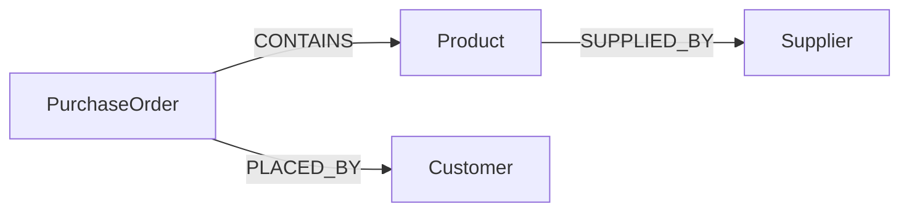
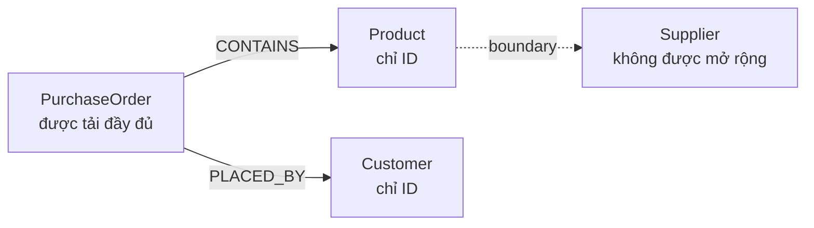

# Định nghĩa aggregate boundary ở entity trong phiên bản hỗ trợ

Khi một node liên kết với nhiều node khác, Spring Data Neo4j có thể mở rộng việc ánh xạ theo các relationship đã khai báo. Trong một số use case, ứng dụng chỉ cần biết một node liên quan là đối tượng nào, không cần tải toàn bộ property và các nhánh relationship phía sau nó. Từ Spring Data Neo4j 8.0, có thể khai báo ranh giới này ngay trên entity bằng thuộc tính `aggregateBoundary` của annotation `@Node`.

Với `SPRING_DATA_NEO4J`, aggregate boundary giúp kiểm soát phạm vi graph mà một entity đại diện khi được tải hoặc lưu. Ví dụ, một đơn hàng có thể tham chiếu đến sản phẩm và khách hàng, trong khi mỗi sản phẩm lại có nhà cung cấp, danh mục và các dữ liệu khác. Nếu use case của đơn hàng chỉ cần ID của sản phẩm và khách hàng, ta có thể đặt các kiểu đó làm aggregate boundary để Spring Data Neo4j dừng việc mở rộng graph tại các node này.

## 1. Aggregate boundary giải quyết vấn đề gì?

Giả sử mô hình có các node `PurchaseOrder`, `Product`, `Customer` và `Supplier`:



Khi tải một `PurchaseOrder`, ứng dụng có thể chỉ cần:

- ID và trạng thái của đơn hàng.
- Danh sách sản phẩm được tham chiếu.
- Khách hàng đã đặt đơn.

Ứng dụng không nhất thiết cần tải tên, mô tả, tồn kho, nhà cung cấp hoặc các relationship khác của từng sản phẩm. Nếu để mapping mở rộng không giới hạn theo entity graph, một thao tác đọc đơn hàng có thể tải nhiều dữ liệu hơn use case cần.

Aggregate boundary cho phép khai báo rằng `Product` và `Customer` là điểm dừng khi Spring Data Neo4j ánh xạ `PurchaseOrder`. Các node này vẫn được tham chiếu qua ID; framework không đi tiếp qua relationship của chúng và không tải các property khác trong ngữ cảnh aggregate đó.

## 2. Phiên bản hỗ trợ và vị trí khai báo

`aggregateBoundary` là thuộc tính của `org.springframework.data.neo4j.core.schema.Node`:

```java
@Node(aggregateBoundary = {Product.class, Customer.class})
public class PurchaseOrder {
    // Entity fields
}
```

Thuộc tính nhận một mảng `Class<?>`, vì vậy có thể khai báo một hoặc nhiều kiểu entity làm boundary. Đây là thuộc tính ở cấp lớp, đặt trong `@Node`; nó không phải annotation riêng trên field và cũng không phải thuộc tính của `@Relationship`.

<badge color="info">Spring Data Neo4j 8.0+</badge>

Lưu ý tương thích:

- API Spring Data Neo4j 8.0, 8.1 và 8.2 có `Node.aggregateBoundary()`.
- API Spring Data Neo4j 7.5 không có thuộc tính này. Nếu dự án đang dùng 7.5 hoặc cũ hơn, đoạn `@Node(aggregateBoundary = ...)` sẽ không biên dịch.
- Annotation `@Node` đã tồn tại từ các phiên bản trước; phần mới cần chú ý ở đây là thuộc tính `aggregateBoundary`, không phải toàn bộ annotation.

Nếu dự án chưa nâng lên phiên bản hỗ trợ, có thể giới hạn dữ liệu theo từng use case bằng interface projection, DTO projection hoặc truy vấn Cypher tùy chỉnh. Không thêm một annotation tự định nghĩa có cùng tên để thay thế hành vi của framework.

## 3. Ví dụ khai báo boundary trên PurchaseOrder

Đầu tiên, khai báo các node được tham chiếu:

```java
import org.springframework.data.neo4j.core.schema.Id;
import org.springframework.data.neo4j.core.schema.Node;
import org.springframework.data.neo4j.core.schema.Relationship;

@Node
public class Product {

    @Id
    private Long id;

    private String name;
    private Integer stock;

    @Relationship(type = "SUPPLIED_BY")
    private Supplier supplier;
}

@Node
public class Customer {

    @Id
    private Long id;

    private String fullName;
    private String email;
}
```

`Product` có property `name`, `stock` và relationship `SUPPLIED_BY`; `Customer` có `fullName` và `email`. Khi các kiểu này được tải độc lập làm entity gốc, các property và relationship của chúng vẫn thuộc mapping thông thường.

Đơn hàng khai báo hai kiểu trên làm aggregate boundary:

```java
import org.springframework.data.neo4j.core.schema.GeneratedValue;
import org.springframework.data.neo4j.core.schema.Id;
import org.springframework.data.neo4j.core.schema.Node;
import org.springframework.data.neo4j.core.schema.Relationship;

import java.util.Set;

@Node(aggregateBoundary = {Product.class, Customer.class})
public class PurchaseOrder {

    @Id
    @GeneratedValue
    private Long id;

    private String orderNumber;
    private String status;

    @Relationship(type = "CONTAINS")
    private Set<Product> products;

    @Relationship(type = "PLACED_BY")
    private Customer customer;
}
```

Trong mapping của `PurchaseOrder`:

1. `PurchaseOrder` vẫn là node gốc và các property của chính nó được ánh xạ bình thường.
2. Relationship `CONTAINS` và `PLACED_BY` vẫn thể hiện các kết nối từ đơn hàng đến node đích.
3. Với các node đích có kiểu `Product` hoặc `Customer`, Spring Data Neo4j chỉ sử dụng `@Id` làm định danh tham chiếu.
4. Framework không tải các property khác của `Product`/`Customer` và không tiếp tục mở rộng các relationship của những node này trong phạm vi aggregate đó.

Sơ đồ phạm vi sau khi áp dụng boundary:



`Product` và `Customer` không bị xóa khỏi graph. Các relationship nối từ đơn hàng đến chúng vẫn được giữ trong mô hình. Boundary chỉ giới hạn việc mở rộng và ánh xạ các node đích đó trong ngữ cảnh entity được khai báo.

## 4. Ảnh hưởng đến việc đọc và lưu entity

Tài liệu Spring Data Neo4j mô tả aggregate boundary là cơ chế xác định cả loading boundary và persisting boundary ở cấp entity definition. Vì vậy, khi làm việc với `PurchaseOrder`, hãy coi `Product` và `Customer` là các tham chiếu qua ID.

### Khi đọc PurchaseOrder

Ví dụ repository:

```java
import org.springframework.data.neo4j.repository.Neo4jRepository;

public interface PurchaseOrderRepository
        extends Neo4jRepository<PurchaseOrder, Long> {
}
```

Khi gọi:

```java
PurchaseOrder order = purchaseOrderRepository.findById(orderId)
    .orElseThrow(() -> new OrderNotFoundException(orderId));
```

`order` có thể chứa các tham chiếu `Product` và `Customer` với ID được ánh xạ. Không nên giả định `product.getName()`, `product.getStock()` hoặc `product.getSupplier()` đã được tải trong lần đọc aggregate này. Những dữ liệu đó nằm ngoài boundary của `PurchaseOrder`.

Nếu use case cần tên sản phẩm, hãy chọn một projection cụ thể có khai báo `Product.name`, hoặc tải `Product` bằng repository riêng. Boundary không có nghĩa là dữ liệu đó không thể được truy vấn trong bất kỳ tình huống nào; nó giới hạn mapping mặc định của aggregate đang xét.

### Khi lưu PurchaseOrder

Khi lưu aggregate `PurchaseOrder`, các entity ở phía bên kia boundary được xử lý như tham chiếu định danh. Không dựa vào việc lưu đơn hàng để cập nhật property hoặc các relationship nội bộ của `Product` và `Customer`.

Ví dụ, nếu cần đổi tồn kho của sản phẩm, hãy thực hiện use case cập nhật `Product` qua repository hoặc service quản lý sản phẩm. Sau đó, thao tác với `PurchaseOrder` chỉ quản lý trạng thái đơn hàng và các relationship thuộc phạm vi của nó.

Điều này làm rõ trách nhiệm của từng aggregate và tránh việc một entity gốc vô tình ghi lại dữ liệu của nhiều phần graph mà nó chỉ tham chiếu.

## 5. Aggregate boundary không phải là gì?

Không nên hiểu `aggregateBoundary` như một cơ chế tạo ràng buộc nghiệp vụ tự động.

| Khái niệm | Ý nghĩa |
|---|---|
| `@Node(aggregateBoundary = ...)` | Giới hạn việc tải và lưu các kiểu entity được liệt kê khi chúng được tham chiếu từ entity khai báo boundary |
| DDD aggregate root | Đối tượng gốc của một aggregate theo mô hình miền và quy tắc nhất quán nghiệp vụ |
| Neo4j relationship | Cạnh thực tế giữa hai node trong graph |
| Transaction | Ranh giới commit/rollback của một đơn vị công việc |

`aggregateBoundary` không tự động:

- Tạo node, label hoặc relationship mới trong Neo4j.
- Tạo unique constraint hoặc index.
- Kiểm tra invariant nghiệp vụ của aggregate.
- Ngăn service khác gọi repository để cập nhật trực tiếp node ở phía boundary.
- Tạo transaction riêng hoặc khóa dữ liệu để bảo đảm tính nhất quán đồng thời.
- Thay thế việc thiết kế aggregate root và ranh giới transaction trong domain.

Nó là metadata của Spring Data Neo4j để điều khiển phạm vi mapping và thao tác persistence. Quy tắc nghiệp vụ vẫn cần được thực thi ở service/domain model và transaction phù hợp.

## 6. Aggregate boundary và projection

Aggregate boundary và projection giải quyết hai nhu cầu gần nhau nhưng khác nhau:

- **Aggregate boundary:** khai báo ở entity, dùng để giới hạn mapping khi một kiểu entity khác được tham chiếu trong aggregate.
- **Projection:** khai báo theo kiểu kết quả của một query hoặc thao tác cụ thể, chọn các property và relationship cần đọc hoặc ghi.

Spring Data Neo4j hỗ trợ interface-based projection và DTO-based projection. Interface projection là proxy trên domain type; accessor phải khớp property có trong domain type. DTO projection linh hoạt hơn với custom query vì có thể nhận thêm các giá trị được trả về trong record. Các projection nhiều cấp có thể mô tả cấu trúc con mà use case cần.

Ví dụ projection hiển thị đơn hàng cùng tên sản phẩm:

```java
import java.util.List;

public interface PurchaseOrderView {

    String getOrderNumber();

    List<ProductView> getProducts();

    interface ProductView {
        String getName();
    }
}
```

Repository có thể khai báo phương thức trả projection:

```java
import java.util.Optional;
import org.springframework.data.neo4j.repository.Neo4jRepository;

public interface PurchaseOrderViewRepository
        extends Neo4jRepository<PurchaseOrder, Long> {

    Optional<PurchaseOrderView> findOrderViewById(Long id);
}
```

Tài liệu Spring Data Neo4j nêu rõ interface projection vẫn có thể rộng hơn aggregate boundary đã khai báo và bao gồm property hoặc relationship của entity ở phía boundary. Vì vậy, nếu một màn hình cần thêm `Product.name`, hãy thể hiện nhu cầu đó trong projection thay vì bỏ boundary của mọi use case.

Khi cần DTO projection với dữ liệu tính toán hoặc field bổ sung, có thể viết `@Query` và trả alias khớp property của DTO. Với custom query, hãy thiết kế mệnh đề `RETURN` đúng kiểu dữ liệu mong muốn; đừng giả định annotation aggregate boundary sẽ tự thay đổi một câu Cypher viết tay để chỉ trả những cột cần thiết.

## 7. Chọn boundary nào và khi nào?

Chỉ thêm một kiểu vào `aggregateBoundary` khi entity gốc thường xuyên tham chiếu kiểu đó nhưng không cần quản lý toàn bộ state của nó trong cùng thao tác.

| Tình huống | Có nên đặt boundary? | Lý do |
|---|---|---|
| Đơn hàng tham chiếu sản phẩm, chỉ cần ID sản phẩm | Có thể phù hợp | Không cần tải tồn kho, nhà cung cấp và các nhánh khác khi đọc đơn hàng |
| Đơn hàng tham chiếu khách hàng, chỉ cần định danh | Có thể phù hợp | Tránh mở rộng sang hồ sơ và các relationship của khách hàng |
| Use case cần hiển thị tên sản phẩm ngay trong kết quả mặc định | Cân nhắc projection | Projection có thể lấy đúng property cần thiết |
| Service cần cập nhật tồn kho cùng một use case sản phẩm | Không nên dựa vào boundary của đơn hàng | Tải và cập nhật Product trong use case/aggregate phù hợp |
| Node đích là một value-like entity nhỏ, luôn cần đầy đủ property | Có thể không cần boundary | Việc mở rộng graph nhỏ và có chủ đích |
| Entity có nhiều nhánh relationship không liên quan đến use case gốc | Có thể phù hợp | Boundary ngăn tải các nhánh không cần thiết |

Trước khi chọn boundary, hãy trả lời ba câu hỏi:

1. Entity gốc cần những thông tin nào của node đích: chỉ ID, một vài property hay toàn bộ graph?
2. Use case có cần cập nhật state của node đích khi lưu entity gốc không?
3. Những use case cần dữ liệu rộng hơn có thể dùng projection hoặc repository riêng không?

Boundary tốt là boundary phản ánh ranh giới dữ liệu mà use case thường xuyên cần, không phải cách thêm annotation cho mọi relationship để giảm truy vấn một cách máy móc.

## 8. Lưu ý khi dùng nhiều boundary class

Có thể khai báo nhiều kiểu cùng lúc:

```java
@Node(aggregateBoundary = {
    Product.class,
    Customer.class,
    ShippingAddress.class
})
public class PurchaseOrder {
    // ...
}
```

Khi đó, mỗi kiểu trong danh sách được xử lý như boundary khi được tham chiếu từ aggregate `PurchaseOrder`. Các kiểu entity khác không nằm trong danh sách vẫn tuân theo mapping thông thường và có thể được mở rộng qua relationship.

Một vài điểm cần chú ý:

- Khai báo đúng class literal, chẳng hạn `Product.class`; không truyền tên class dưới dạng chuỗi.
- Các kiểu boundary phải có metadata mapping hợp lệ và định danh `@Id` để SDN nhận diện node được tham chiếu.
- Boundary áp dụng theo entity khai báo `@Node`; cùng một kiểu `Product` có thể được tải đầy đủ khi nó là entity gốc trong repository riêng.
- Nếu thay đổi danh sách boundary, hãy rà soát các use case đọc và ghi đang dựa vào graph được mở rộng trước đó.
- Khi dùng projection, kiểm tra projection thực tế và câu query được sinh để bảo đảm kết quả chứa các property mà màn hình cần.

## 9. Những lỗi thường gặp

| Biểu hiện | Nguyên nhân | Cách xử lý |
|---|---|---|
| Không biên dịch với `aggregateBoundary` | Dự án đang dùng Spring Data Neo4j 7.5 hoặc cũ hơn | Kiểm tra dependency; thuộc tính này có trong API từ dòng 8.0 |
| `Product.name` là `null` sau khi tải đơn hàng | `Product` đã được khai báo là aggregate boundary | Chỉ đọc ID ở ngữ cảnh đó; dùng projection hoặc repository Product nếu cần tên |
| `Product.supplier` không được tải | SDN dừng mở rộng graph tại boundary `Product` | Tải Product riêng hoặc khai báo projection có nhánh cần thiết |
| Thay đổi tồn kho không được lưu khi save đơn hàng | Product nằm ngoài phạm vi persistence của aggregate Order | Cập nhật Product bằng use case và repository quản lý Product |
| Nghĩ boundary đã tạo transaction riêng | Nhầm metadata mapping với transaction boundary | Thiết kế `@Transactional` ở service theo quy tắc nghiệp vụ |
| Projection không có field mong muốn | Accessor không khớp property hoặc custom query thiếu alias | Kiểm tra tên property và `RETURN` của query |
| Thay đổi boundary làm kết quả query khác trước | Mapping graph đã được thu hẹp hoặc mở rộng | Rà soát metadata `@Node` và các projection liên quan |

Khi debug, hãy kiểm tra phiên bản Spring Data Neo4j trước, sau đó kiểm tra `aggregateBoundary` trên entity gốc, kiểu node đích và kiểu trả về của repository. Nếu dùng projection hoặc custom query, xác minh riêng những property và relationship mà query thực sự trả về.

## 10. Tự kiểm tra

1. `aggregateBoundary` được khai báo ở annotation nào và nhận kiểu giá trị gì?
2. Vì sao một `Product` nằm trong boundary của `PurchaseOrder` vẫn có thể được tải đầy đủ khi gọi `ProductRepository.findById()`?
3. Khi `Product` là aggregate boundary, Spring Data Neo4j còn tải property `name` và relationship `SUPPLIED_BY` trong mapping của `PurchaseOrder` không?
4. Vì sao `aggregateBoundary` không đồng nghĩa với DDD aggregate root hoặc transaction boundary?
5. Phiên bản Spring Data Neo4j 7.5 có hỗ trợ thuộc tính `Node.aggregateBoundary()` không?
6. Nếu màn hình cần `Product.name` dù `Product` là boundary của `PurchaseOrder`, nên cân nhắc giải pháp nào?
7. Vì sao không nên dựa vào việc save `PurchaseOrder` để cập nhật tồn kho của `Product`?

`@Node(aggregateBoundary = ...)` cho phép khai báo điểm dừng của graph mapping ngay trên entity trong Spring Data Neo4j 8.0 trở lên. Các kiểu được liệt kê vẫn được tham chiếu bằng ID, còn property và relationship phía sau chúng không được mở rộng trong aggregate đó. Hãy dùng boundary để giữ phạm vi đọc/ghi rõ ràng, kết hợp projection cho các màn hình cần dữ liệu rộng hơn và giữ quy tắc nghiệp vụ trong service cùng transaction phù hợp.

## Tài liệu tham khảo

- [Spring Data Neo4j 8.2 — Projections and aggregate boundaries](https://docs.spring.io/spring-data/neo4j/reference/projections/sdn-projections.html)
- [Spring Data Neo4j 8.0 — `@Node` API, including `aggregateBoundary`](https://docs.spring.io/spring-data/neo4j/reference/8.0/api/java/org/springframework/data/neo4j/core/schema/Node.html)
- [Spring Data Neo4j 7.5 — `@Node` API without `aggregateBoundary`](https://docs.spring.io/spring-data/neo4j/reference/7.5/api/java/org/springframework/data/neo4j/core/schema/Node.html)
