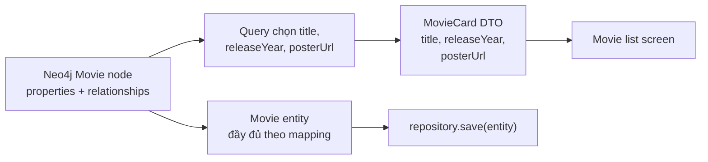

# Tránh ghi lại projection hoặc entity thiếu dữ liệu bằng save toàn phần

Trong Spring Data Neo4j (SDN), projection và DTO giúp truy vấn đúng phần dữ liệu mà một màn hình hoặc use case cần. Tuy nhiên, một projection chỉ có vài property không đại diện cho toàn bộ entity trong graph. Nếu chuyển projection thành một entity thiếu field hoặc relationship rồi gọi `repository.save(...)`, ứng dụng có thể ghi đè dữ liệu mới hơn, xóa property hoặc làm mất liên kết mà nó chưa từng tải.

Hãy xem projection là mô hình đọc, còn entity được lưu là trạng thái miền mà thao tác ghi chịu trách nhiệm quản lý. Với cập nhật một phần, hãy dùng Cypher chỉ thay đổi đúng property hoặc relationship cần sửa. Nếu nghiệp vụ thực sự cần lưu toàn bộ entity graph, hãy đọc lại đầy đủ phần aggregate cần quản lý, áp dụng thay đổi rồi lưu entity đó trong transaction phù hợp.

## 1. Projection và entity giải quyết hai mục đích khác nhau

Giả sử node `Movie` có các property `id`, `title`, `releaseYear`, `status`, `description`, `posterUrl` và nhiều relationship tới `Actor`, `Genre` và `Review`.

Một trang danh sách phim chỉ cần tiêu đề, năm phát hành và ảnh poster. Truy vấn tất cả property và relationship của `Movie` sẽ tải nhiều dữ liệu không cần thiết. Projection cho phép trả về đúng ba trường:



| Khái niệm | Mục đích | Thành phần thường có |
|---|---|---|
| Entity `Movie` | Đại diện node và phần graph được SDN ánh xạ để đọc/ghi | ID, property, relationship |
| Projection `MovieCard` | Mô tả tập dữ liệu nhỏ phục vụ truy vấn hoặc màn hình | Một vài field được chọn |
| DTO command `UpdateMovieTitle` | Mang dữ liệu đầu vào cho một thao tác cập nhật | ID và field cần thay đổi |
| Projection summary | Trả dữ liệu tổng hợp hoặc tính toán | Alias truy vấn như `actorCount`, `averageRating` |

Projection không phải entity rút gọn có thể lưu lại như thể nó chứa đầy đủ trạng thái node. DTO command cũng không nên được xem là entity chỉ vì nó có trường `id` và `title`.

## 2. Vì sao save toàn phần có thể làm mất dữ liệu?

`repository.save(entity)` thực hiện thao tác lưu theo mapping của entity. SDN dùng trạng thái object và các field được ánh xạ để ghi property cùng relationship thuộc entity graph. Nếu object được tạo từ một kết quả chỉ có một phần dữ liệu, các field không có trong kết quả có thể mang giá trị `null`, giá trị mặc định hoặc collection rỗng.

Ví dụ node trong database đang có:

```cypher
(:Movie {
    id: 'movie-42',
    title: 'Graph Stories',
    releaseYear: 2024,
    status: 'PUBLISHED',
    description: 'A story about connected worlds',
    posterUrl: '/posters/graph-stories.png'
})
```

Giả sử một truy vấn chỉ lấy `id` và `title`, sau đó code tạo entity như sau:

```java
Movie partial = new Movie("movie-42", "New title");
movieRepository.save(partial);
```

Nếu constructor không nhận `releaseYear`, `status`, `description`, `posterUrl` và các relationship, object không thể biểu diễn đầy đủ trạng thái đang có trong Neo4j. Khi lưu, những giá trị thiếu có thể bị ghi thành giá trị mặc định hoặc bị loại khỏi graph theo cách SDN đồng bộ entity và relationship. Kết quả là ứng dụng có thể vô tình xóa `description`, `posterUrl`, hoặc làm thay đổi các liên kết mà thao tác chỉ định sửa tiêu đề không hề muốn đụng tới.

Đây là lỗi đặc biệt dễ xuất hiện khi:

- Ánh xạ kết quả `RETURN` chỉ gồm một số property vào lớp entity.
- Dùng constructor tạo entity mới từ DTO có ít field.
- Tải entity với một phần relationship rồi coi collection đó là danh sách đầy đủ.
- Dùng object cũ sau khi một ứng dụng hoặc transaction khác đã cập nhật node.
- Dùng `null` cho cả hai ý nghĩa “không tải trường này” và “xóa property này”.

Không phải mọi lần lưu entity thiếu dữ liệu đều xóa mọi field còn lại theo cùng một cách; hành vi cụ thể phụ thuộc mapping, câu Cypher được tạo và phần graph mà SDN quản lý. Nhưng `save` không phải API patch tự động. Nếu chỉ muốn thay một phần, hãy dùng một thao tác cập nhật có phạm vi rõ ràng.

## 3. Dùng DTO riêng cho truy vấn chỉ đọc

Tạo DTO chỉ chứa các trường cần cho màn hình:

```java
public record MovieCard(
        String title,
        Integer releaseYear,
        String posterUrl) {
}
```

Với `Neo4jClient`, có thể chọn property trong Cypher và ánh xạ kết quả một cách tường minh:

```java
public List<MovieCard> findMovieCards(String status) {
    return neo4jClient.query("""
            MATCH (m:Movie {status: $status})
            RETURN m.title AS title,
                   m.releaseYear AS releaseYear,
                   m.posterUrl AS posterUrl
            ORDER BY m.title
            """)
            .bind(status).to("status")
            .fetchAs(MovieCard.class)
            .mappedBy((typeSystem, record) -> new MovieCard(
                    record.get("title").asString(),
                    record.get("releaseYear").isNull()
                            ? null
                            : record.get("releaseYear").asInt(),
                    record.get("posterUrl").isNull()
                            ? null
                            : record.get("posterUrl").asString()))
            .all();
}
```

`MovieCard` là kết quả đọc, không phải kiểu entity của `MovieRepository`. Các alias trong `RETURN` được ánh xạ trực tiếp vào constructor DTO. Việc kiểm tra giá trị null trước khi chuyển kiểu giúp tránh lỗi khi property không tồn tại trong node.

Một DTO có thể chứa cả dữ liệu tính toán:

```java
public record MovieSummary(
        String title,
        Long actorCount,
        Double averageRating) {
}
```

```java
public MovieSummary getMovieSummary(String movieId) {
    return neo4jClient.query("""
            MATCH (m:Movie {id: $id})
            OPTIONAL MATCH (m)<-[:ACTED_IN]-(a:Actor)
            OPTIONAL MATCH (m)<-[:REVIEWED]-(r:Review)
            RETURN m.title AS title,
                   count(DISTINCT a) AS actorCount,
                   avg(r.score) AS averageRating
            """)
            .bind(movieId).to("id")
            .fetchAs(MovieSummary.class)
            .mappedBy((typeSystem, record) -> new MovieSummary(
                    record.get("title").asString(),
                    record.get("actorCount").asLong(),
                    record.get("averageRating").isNull()
                            ? null
                            : record.get("averageRating").asDouble()))
            .one()
            .orElseThrow(() -> new IllegalArgumentException("Movie not found"));
}
```

Ví dụ minh họa cách ánh xạ kết quả tổng hợp; trong truy vấn thực tế, nếu hai nhánh `OPTIONAL MATCH` tạo tích số hàng, các phép đếm không loại trùng như `count(r)` có thể bị nhân bội. Hãy tổng hợp từng nhánh độc lập hoặc dùng pattern/subquery phù hợp; `count(DISTINCT a)` trong ví dụ loại trùng diễn viên. Điểm quan trọng là DTO nhận dữ liệu đọc được chọn, không được gửi ngược vào `save` như entity.

Nếu dùng interface-based projection hoặc DTO projection qua repository, hãy kiểm tra khả năng hỗ trợ và quy tắc mapping của phiên bản SDN đang dùng. Dù dùng cách ánh xạ nào, giữ kiểu kết quả tách biệt với entity là cách giúp compiler và code review nhận ra mục đích chỉ đọc.

## 4. Không ánh xạ kết quả một phần vào entity rồi lưu lại

Tránh thiết kế phương thức repository trả về entity `Movie` trong khi Cypher chỉ trả một vài property như:

```cypher
MATCH (m:Movie {id: $id})
RETURN m.id AS id, m.title AS title;
```

Kết quả này không mô tả toàn bộ property và relationship mà entity có thể quản lý. Nếu cần hiển thị tiêu đề, hãy trả về DTO `MovieTitleView`. Nếu cần cập nhật tiêu đề, hãy dùng câu lệnh `SET` chỉ thay đổi tiêu đề.

Không dùng projection như một cách tạo “entity nhẹ” để tiết kiệm truy vấn rồi lưu lại. Nếu use case cần thay đổi entity graph, hãy thực hiện một trong hai cách:

1. Đọc đầy đủ phần aggregate mà thao tác ghi sở hữu, thay đổi object đó rồi gọi `save`.
2. Viết câu Cypher chuyên biệt để cập nhật đúng property hoặc relationship, không dựng entity thiếu dữ liệu.

Lựa chọn phụ thuộc vào phạm vi thay đổi. Sửa một property đơn giản thường phù hợp với Cypher chuyên biệt. Cập nhật một aggregate có nhiều quy tắc miền và quan hệ cần đồng bộ có thể phù hợp với entity đã được tải đầy đủ.

## 5. Cập nhật một property bằng Cypher có phạm vi hẹp

Ví dụ chỉ cập nhật tiêu đề phim bằng `Neo4jClient`:

```java
public boolean updateMovieTitle(String movieId, String newTitle) {
    long updated = neo4jClient.query("""
            MATCH (m:Movie {id: $id})
            SET m.title = $title
            RETURN count(m) AS updated
            """)
            .bind(movieId).to("id")
            .bind(newTitle).to("title")
            .fetchAs(Long.class)
            .mappedBy((typeSystem, record) -> record.get("updated").asLong())
            .one()
            .orElse(0L);

    return updated == 1;
}
```

Truy vấn chỉ cập nhật `m.title`. Các property khác và relationship không được nhắc tới sẽ không bị thay đổi bởi câu lệnh này. Giá trị trả về cho biết có node khớp ID hay không; nếu ID không duy nhất theo dữ liệu, cần có unique constraint để bảo đảm số node được cập nhật đúng.

Đặt thao tác trong service transaction khi nó là một phần của nghiệp vụ lớn hơn:

```java
@Transactional
public void renameMovie(String movieId, String title) {
    if (!movieRepository.updateMovieTitle(movieId, title)) {
        throw new IllegalArgumentException("Movie not found");
    }
    auditRepository.recordTitleChanged(movieId);
}
```

Ví dụ lược bỏ phần khai báo repository và DTO. Câu lệnh cập nhật cùng thao tác ghi audit có thể tham gia một transaction Spring khi dùng cùng transaction manager.

## 6. Cập nhật nhiều property tùy chọn bằng map

Khi một API nhận patch gồm nhiều field tùy chọn, có thể dùng `SET n += $patch` để cập nhật các key có trong map:

```cypher
MATCH (m:Movie {id: $id})
SET m += $patch
RETURN count(m) AS updated;
```

Với `SET m += $patch`:

- Key không có trong map sẽ không thay đổi property tương ứng.
- Key có giá trị sẽ thêm hoặc thay giá trị property.
- Key có giá trị `null` sẽ xóa property đó trong Neo4j.

Điều này hữu ích cho patch, nhưng ứng dụng phải phân biệt “field không được gửi” với “field được gửi rõ ràng là null để xóa”. Một DTO chỉ dùng `String title` không phải lúc nào cũng biểu diễn được cả ba trạng thái: không gửi, gửi giá trị và gửi null. Có thể dùng wrapper/field-presence flag hoặc tự xây map patch sau khi parse request.

Ví dụ xây map trong service:

```java
Map<String, Object> patch = new HashMap<>();

if (request.titleWasProvided()) {
    patch.put("title", request.title());
}

if (request.descriptionWasProvided()) {
    patch.put("description", request.description());
}

neo4jClient.query("""
        MATCH (m:Movie {id: $id})
        SET m += $patch
        RETURN count(m) AS updated
        """)
    .bind(movieId).to("id")
    .bind(patch).to("patch")
    .run();
```

`titleWasProvided()` và `descriptionWasProvided()` là accessor minh họa cho DTO có theo dõi sự hiện diện của field. Chỉ đưa key được phép cập nhật vào map. Không chuyển trực tiếp một map tùy ý từ request thành property map của node; hãy dùng allowlist để ngăn client sửa những field như `id`, `version`, `createdAt` hoặc property thuộc ứng dụng khác.

Nếu cần xóa property, có thể đưa key với giá trị `null` theo semantics của `SET +=`, hoặc dùng `REMOVE m.description` tường minh. Hãy kiểm thử rõ cả trường hợp không gửi field và trường hợp yêu cầu xóa field.

## 7. Cập nhật relationship mà không lưu lại toàn bộ node

Một projection của `Movie` có thể không tải danh sách `Actor` hoặc relationship properties `ACTED_IN`. Nếu chỉ cần đổi `billingOrder` của một credit, không nên tạo một `Movie` thiếu collection rồi gọi `movieRepository.save(movie)`.

Dùng Cypher để cập nhật đúng relationship:

```cypher
MATCH (a:Actor {id: $actorId})
      -[credit:ACTED_IN {creditCode: $creditCode}]->
      (m:Movie {id: $movieId})
SET credit.billingOrder = $billingOrder
RETURN count(credit) AS updated;
```

`creditCode` là business key minh họa được ứng dụng quản lý. Nếu mô hình không có business key, hãy xác định một tiêu chí khác bảo đảm chọn đúng relationship, đặc biệt khi giữa cùng hai node có thể có nhiều relationship cùng type. Không dùng ID nội bộ của relationship như mã công khai lâu dài.

Nếu cần thêm hoặc xóa relationship, viết câu Cypher riêng thể hiện rõ endpoint và điều kiện. Chỉ dùng `save` trên entity nguồn khi collection relationship đã được tải đầy đủ theo phạm vi aggregate và thao tác có chủ đích đồng bộ collection đó.

## 8. Khi nào nên đọc lại entity đầy đủ rồi save?

Một số nghiệp vụ cần áp dụng quy tắc miền trên nhiều field hoặc relationship. Khi đó, lưu entity đầy đủ là hợp lý, nhưng phải đọc đúng phần dữ liệu mà thao tác có quyền quản lý.

```java
@Transactional
public Movie changeMovieDetails(String movieId, MovieChange command) {
    Movie movie = movieRepository.findForEditing(movieId)
            .orElseThrow(() -> new IllegalArgumentException("Movie not found"));

    movie.rename(command.title());
    movie.changeReleaseYear(command.releaseYear());

    return movieRepository.save(movie);
}
```

`findForEditing` là truy vấn đọc được thiết kế để tải đầy đủ property và relationship cần cho quy tắc chỉnh sửa. Tên này chỉ là ví dụ; cần triển khai truy vấn phù hợp với entity graph thực tế. Không giả định `findById` luôn tải toàn bộ graph có thể đi tới. SDN chỉ ánh xạ dữ liệu được truy vấn trả về theo cấu hình và mapping hiện có.

Trước khi gọi `save`, hãy xác nhận:

- Entity được tạo từ dữ liệu đầy đủ cho phạm vi cập nhật.
- Các relationship collection được dùng để đồng bộ đã được tải theo đúng yêu cầu.
- Không có field `null` chỉ vì truy vấn không lấy field đó.
- Không dùng entity cũ sau một khoảng thời gian dài hoặc sau khi có writer khác cập nhật.
- Transaction bao trùm việc đọc, kiểm tra quy tắc miền và lưu nếu cần tính nhất quán giữa các bước.

Nếu chỉ thay đổi một hoặc hai property độc lập, câu Cypher chuyên biệt thường đơn giản và an toàn hơn việc tải rồi lưu toàn bộ entity.

## 9. Entity cũ và optimistic locking

Ngay cả entity được tải đầy đủ cũng có thể trở nên cũ trước khi lưu. Ví dụ:

1. Transaction A đọc `Movie.status = DRAFT` và `version = 3`.
2. Transaction B đổi trạng thái thành `PUBLISHED` và commit `version = 4`.
3. Transaction A đổi tiêu đề dựa trên object cũ rồi gọi `save`.

Nếu không có cơ chế phát hiện xung đột, dữ liệu cũ của A có thể ghi đè thay đổi mới hơn tùy cách cập nhật. SDN hỗ trợ optimistic locking bằng `@Version`:

```java
@Node("Movie")
public class Movie {

    @Id
    private String id;

    @Version
    private Long version;

    private String title;

    private String status;
}
```

SDN dùng version để kiểm tra entity có bị cập nhật kể từ lần đọc hay không. Nếu version không còn khớp, thao tác lưu có thể thất bại với lỗi optimistic locking. Ứng dụng cần tải lại trạng thái mới, hợp nhất thay đổi theo quy tắc nghiệp vụ rồi thử lại hoặc trả xung đột.

Với câu Cypher cập nhật thủ công, `@Version` không tự động thêm điều kiện vào query tùy chỉnh. Nếu muốn bảo vệ cùng quy tắc, phải kiểm tra và tăng version trong Cypher:

```cypher
MATCH (m:Movie {id: $id, version: $expectedVersion})
SET m.title = $title,
    m.version = $expectedVersion + 1
RETURN count(m) AS updated;
```

Nếu `updated` bằng 0, node có thể không tồn tại hoặc version đã thay đổi. Ứng dụng nên đọc lại để phân biệt hai trường hợp và quyết định xử lý. Mọi writer cùng sửa node phải tuân thủ giao thức version; một ứng dụng ngoài bỏ qua version có thể làm mất hiệu lực bảo vệ optimistic locking.

## 10. Kiểm thử để phát hiện mất dữ liệu

Một integration test hữu ích cần tạo node có nhiều property và relationship, sau đó thực hiện thao tác chỉ đọc hoặc cập nhật một phần và xác minh phần dữ liệu không liên quan vẫn được giữ.

Ví dụ kịch bản:

1. Tạo phim có `title`, `description`, `posterUrl` và relationship tới `Actor`.
2. Đọc `MovieCard` chỉ gồm `title` và `posterUrl`.
3. Cập nhật tiêu đề bằng Cypher chuyên biệt.
4. Đọc lại node và relationship bằng truy vấn kiểm tra.
5. Xác minh `description`, `posterUrl` và relationship diễn viên vẫn tồn tại.

Ví dụ kiểm tra phần dữ liệu được giữ lại:

```java
@Test
void narrowUpdatePreservesUnrelatedPropertiesAndRelationships() {
    movieService.updateMovieTitle("movie-42", "Updated title");

    MovieState state = movieReadRepository.findState("movie-42").orElseThrow();

    assertThat(state.title()).isEqualTo("Updated title");
    assertThat(state.description()).isEqualTo("Original description");
    assertThat(state.posterUrl()).isEqualTo("/posters/original.png");
    assertThat(state.actorCount()).isEqualTo(2);
}
```

`MovieState` là DTO kiểm tra chỉ đọc; `findState` trả về các giá trị qua truy vấn kiểm tra riêng. Test cần database Neo4j thật hoặc Testcontainers để xác minh hành vi mapping và Cypher thực tế.

Nên có thêm test cho các trường hợp:

- DTO patch không gửi `description`: property hiện tại phải được giữ.
- DTO patch gửi `description = null` với ý nghĩa xóa: property phải bị xóa đúng chủ đích.
- Entity thiếu relationship không được dùng để save toàn phần.
- Hai transaction cùng cập nhật entity có `@Version`: một thao tác stale phải được phát hiện.
- Câu Cypher cập nhật relationship chọn đúng một liên kết khi có nhiều relationship cùng type giữa hai node.

## 11. Quy tắc lựa chọn cách ghi

| Tình huống | Cách phù hợp | Vì sao |
|---|---|---|
| Trang danh sách chỉ cần vài property | Projection/DTO chỉ đọc | Không tải entity graph dư thừa |
| Báo cáo cần `count`, `avg` hoặc dữ liệu tổng hợp | DTO/projection từ truy vấn | Kết quả không phải trạng thái entity để lưu |
| Cập nhật một property độc lập | Cypher `SET` có phạm vi hẹp | Không chạm field và relationship khác |
| Cập nhật patch nhiều field tùy chọn | `SET n += $patch` với map đã xác thực | Chỉ thay đổi key được gửi |
| Cập nhật một relationship cụ thể | Cypher match đúng relationship rồi `SET` | Không cần lưu lại toàn bộ node nguồn |
| Thay đổi nhiều field và relationship theo quy tắc miền | Đọc đầy đủ aggregate rồi `save` trong transaction | SDN có đủ trạng thái để đồng bộ phần graph được quản lý |
| Entity đã đọc từ lâu hoặc nhiều writer cùng sửa | `@Version` và xử lý xung đột | Phát hiện cập nhật dựa trên trạng thái cũ |

## 12. Những lỗi thường gặp

| Lỗi | Hậu quả | Cách xử lý |
|---|---|---|
| Ánh xạ kết quả một phần vào entity rồi gọi `save` | Field thiếu có thể bị ghi thành giá trị mặc định hoặc bị xóa | Dùng DTO/projection cho kết quả đọc |
| Tạo entity mới từ request patch rồi gọi `save` | Các property không có trong request có thể bị ảnh hưởng | Dùng Cypher patch hoặc đọc aggregate đầy đủ trước khi sửa |
| Xem collection relationship rỗng là collection đầy đủ | Có thể gỡ liên kết chưa từng tải | Chỉ đồng bộ collection đã tải đúng phạm vi |
| Dùng `null` cho cả “không gửi” và “xóa” | Xóa dữ liệu ngoài ý muốn | Dùng field-presence/tri-state cho patch |
| Ghi lại projection tổng hợp như entity | Sai mô hình và không đủ dữ liệu để lưu | Giữ DTO ở luồng đọc |
| Lưu entity cũ mà không kiểm tra version | Ghi đè thay đổi của transaction khác | Dùng `@Version` và xử lý optimistic lock |
| Dùng Cypher cập nhật một phần nhưng trả entity không đầy đủ | Caller có thể tiếp tục lưu object thiếu dữ liệu | Trả số hàng, ID hoặc DTO phù hợp |
| Dùng map patch trực tiếp từ request | Client có thể sửa property không được phép | Xây map theo allowlist ở service |

## 13. Checklist trước khi ghi dữ liệu

1. Đối tượng hiện tại là entity đầy đủ, projection hay DTO command?
2. Truy vấn có lấy đủ property và relationship mà thao tác save sẽ quản lý không?
3. Có field `null` hoặc collection rỗng do chưa tải dữ liệu không?
4. Use case chỉ sửa một phần? Nếu có, có thể dùng `SET` hoặc `SET +=` để giới hạn cập nhật không?
5. Patch có phân biệt field bị bỏ qua với field yêu cầu xóa không?
6. Map patch đã được giới hạn bằng allowlist chưa?
7. Relationship được cập nhật có được nhận diện đủ chính xác không?
8. Entity có thể đã cũ? Có cần `@Version` hoặc điều kiện version trong Cypher không?
9. Test có xác minh các property và relationship không liên quan vẫn được bảo toàn không?

## 14. Tự kiểm tra

1. Vì sao projection chỉ chứa `title` và `posterUrl` không nên được xem như entity `Movie` đầy đủ?
2. Những giá trị nào có thể xuất hiện trong field không được tải khi tạo entity từ kết quả một phần?
3. Vì sao `save` không tương đương với một thao tác PATCH?
4. Câu Cypher nào phù hợp khi chỉ muốn đổi `Movie.title`?
5. Với `SET n += $patch`, key bị bỏ qua và key có giá trị `null` có ý nghĩa gì?
6. Vì sao phải theo dõi field-presence trong DTO patch?
7. Khi nào nên đọc lại aggregate đầy đủ trước khi gọi `save`?
8. `@Version` bảo vệ entity stale như thế nào, và tại sao query Cypher thủ công phải xử lý version riêng?
9. Làm thế nào kiểm thử rằng cập nhật một property không làm mất relationship chưa được tải?

Khi phân biệt rõ projection, DTO command và entity có thể lưu, người học sẽ tránh ghi đè trạng thái chưa tải, chọn được cập nhật Cypher có phạm vi phù hợp và chỉ dùng `save` khi object thực sự đại diện cho phần entity graph mà ứng dụng chịu trách nhiệm quản lý.
