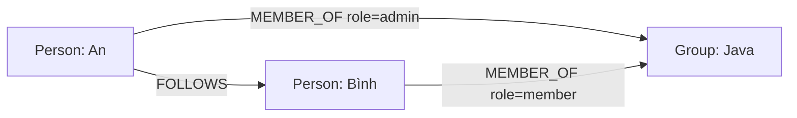

# Relationship có hướng, có kiểu và có thuộc tính

## Mục tiêu bài học

Trong Neo4j, dữ liệu được biểu diễn bằng các node và relationship. Node lưu thực thể như người dùng hoặc nhóm; relationship nối các node và diễn tả cách chúng liên quan với nhau. Một relationship luôn có **hướng**, có đúng một **kiểu**, và có thể mang các **thuộc tính** riêng.

Sau bài này, bạn có thể đọc và thiết kế một mô hình quan hệ đơn giản, ánh xạ nó bằng Spring Data Neo4j (SDN), viết mẫu Cypher để duyệt và cập nhật relationship, đồng thời nhận biết một số điểm cần lưu ý khi lưu aggregate và tối ưu truy vấn.

## 1. Ba đặc điểm của relationship

Xét mạng xã hội có người dùng theo dõi nhau và tham gia các nhóm:



### Relationship có hướng

Relationship được lưu theo chiều từ node bắt đầu đến node kết thúc. Trong ví dụ `An -[:FOLLOWS]-> Bình`, An theo dõi Bình. Điều đó không tự động có nghĩa Bình theo dõi An; nếu Bình cũng theo dõi An thì cần một relationship theo chiều ngược lại.

Hướng là một phần của ý nghĩa nghiệp vụ. Với `SENT_TO`, `REPORTS_TO`, `MEMBER_OF` hoặc `FOLLOWS`, việc đảo chiều có thể làm thay đổi hoàn toàn ý nghĩa. Khi thiết kế, hãy xác định rõ node nào là nguồn và node nào là đích.

Cypher thể hiện hướng ngay trong mẫu đồ thị:

```cypher
// Relationship đi từ p đến target.
MATCH (p:Person)-[:FOLLOWS]->(target:Person)
RETURN p, target

// Relationship đi từ source đến p.
MATCH (source:Person)-[:FOLLOWS]->(p:Person)
RETURN source, p
```

Mẫu không có mũi tên, chẳng hạn `(a)-[:FOLLOWS]-(b)`, có thể tìm relationship theo cả hai chiều. Đây chỉ là cách truy vấn linh hoạt; relationship trong graph vẫn được lưu với một hướng xác định.

Một số khái niệm nghiệp vụ có vẻ đối xứng, như hai người là bạn bè. Neo4j vẫn lưu từng relationship có hướng. Ứng dụng có thể chọn quy ước lưu một chiều và truy vấn không hướng, hoặc tạo hai relationship đối chiều. Hãy chọn một quy ước nhất quán để tránh dữ liệu trùng và kết quả khó hiểu.

### Relationship có kiểu

Kiểu relationship mô tả chính xác loại liên kết, ví dụ `FOLLOWS`, `MEMBER_OF`, `PURCHASED` hoặc `WORKS_FOR`. Trong Cypher, kiểu được đặt sau dấu hai chấm:

```cypher
MATCH (p:Person)-[r:MEMBER_OF]->(g:Group)
RETURN p, r, g
```

Các kiểu khác nhau giúp truy vấn thể hiện rõ ý định. Từ cùng một node `Person`, ứng dụng có thể duyệt `FOLLOWS` để tìm người được theo dõi và duyệt `MEMBER_OF` để tìm nhóm mà người đó tham gia.

Nên đặt tên kiểu theo từ vựng của miền nghiệp vụ, thường dùng chữ in hoa và dấu gạch dưới. Tránh gom mọi liên kết vào một kiểu chung như `RELATED_TO` rồi đặt loại quan hệ trong một thuộc tính `type`; cách đó làm mẫu Cypher kém rõ ràng và khiến truy vấn phải lọc thêm dữ liệu.

Kiểu relationship là một phần của cấu trúc graph, không phải giá trị có thể thay đổi tùy ý trên từng bản ghi. Nếu hai liên kết mang ý nghĩa khác nhau, hãy cân nhắc dùng hai kiểu riêng.

### Relationship có thuộc tính

Relationship có thể mang dữ liệu mô tả chính liên kết đó. Với quan hệ thành viên, `role` và `joinedAt` thuộc về việc một người tham gia một nhóm:

```cypher
MATCH (p:Person {id: $personId})-[r:MEMBER_OF]->(g:Group)
RETURN p.name, g.name, r.role, r.joinedAt
```

`role` không nhất thiết là thuộc tính của `Person`, vì cùng một người có thể là `admin` ở nhóm này và `member` ở nhóm khác. Tương tự, `joinedAt` mô tả thời điểm tham gia một nhóm cụ thể, không phải ngày tạo tài khoản của người đó.

Hãy đặt thuộc tính ở đúng nơi chứa ý nghĩa của nó:

| Dữ liệu | Vị trí phù hợp | Lý do |
|---|---|---|
| Tên người dùng | Thuộc tính node `Person` | Mô tả bản thân người dùng |
| Tên nhóm | Thuộc tính node `Group` | Mô tả bản thân nhóm |
| Vai trò trong nhóm | Thuộc tính relationship `MEMBER_OF` | Có thể khác nhau theo từng nhóm |
| Ngày tham gia nhóm | Thuộc tính relationship `MEMBER_OF` | Gắn với một lần tham gia cụ thể |
| Thời điểm theo dõi | Thuộc tính relationship `FOLLOWS` | Gắn với liên kết theo dõi |

Neo4j lưu thuộc tính relationship dưới dạng các cặp khóa và giá trị. Các kiểu giá trị phổ biến gồm chuỗi, số, boolean, ngày giờ và danh sách các giá trị được hỗ trợ. Không nên xem relationship như một object tùy ý có thể chứa cấu trúc lồng nhau giống một JSON document.

## 2. Ánh xạ relationship bằng Spring Data Neo4j

SDN dùng `@Relationship` để khai báo liên kết giữa các node trong mô hình Java. Với liên kết đơn giản không có thuộc tính riêng, trường quan hệ có thể trỏ trực tiếp đến node đích. Với relationship có thuộc tính, SDN cung cấp `@RelationshipProperties` và `@TargetNode`.

### Relationship đơn giản

Ví dụ dưới đây ánh xạ quan hệ một người theo dõi nhiều người khác:

```java
@Node("Person")
public class Person {

    @Id
    private String id;

    private String name;

    @Relationship(type = "FOLLOWS", direction = Direction.OUTGOING)
    private Set<Person> following = new LinkedHashSet<>();

    // Constructor, getter và setter được lược bỏ.
}
```

`@Relationship` khai báo kiểu `FOLLOWS`; `Direction.OUTGOING` cho biết relationship đi từ `Person` hiện tại đến các phần tử trong `following`. `OUTGOING` cũng là hướng mặc định, nhưng ghi rõ giúp người đọc hiểu mô hình nhanh hơn. Có thể dùng `Direction.INCOMING` khi trường biểu diễn các node có relationship hướng vào node hiện tại.

Tên trường Java có thể khác tên kiểu relationship trong Neo4j. Điều quan trọng là annotation phải mô tả đúng kiểu và hướng của dữ liệu trong graph. Dùng collection khi một node có thể liên kết với nhiều node đích.

### Relationship có thuộc tính

Khi liên kết cần lưu thêm vai trò và ngày tham gia, hãy mô hình hóa nó bằng một lớp relationship properties:

```java
@Node("Person")
public class Person {

    @Id
    private String id;

    private String name;

    @Relationship(type = "MEMBER_OF", direction = Direction.OUTGOING)
    private List<Membership> memberships = new ArrayList<>();

    // Constructor, getter và setter được lược bỏ.
}

@Node("Group")
public class Group {

    @Id
    private String id;

    private String name;

    // Constructor, getter và setter được lược bỏ.
}

@RelationshipProperties
public class Membership {

    @RelationshipId
    private Long id;

    private String role;

    private LocalDate joinedAt;

    @TargetNode
    private Group group;

    // Constructor, getter và setter được lược bỏ.
}
```

Trong mô hình này:

- `Person` và `Group` là node entity, được đánh dấu bằng `@Node`.
- `@Relationship(type = "MEMBER_OF")` khai báo liên kết đi từ `Person` đến `Group`.
- `Membership` là lớp mô tả relationship, được đánh dấu bằng `@RelationshipProperties`.
- Các trường `role` và `joinedAt` trở thành thuộc tính của relationship.
- `@TargetNode` đánh dấu node ở đầu đích của relationship; ở đây đó là `Group`.
- `@RelationshipId` là định danh nội bộ do SDN quản lý cho relationship. Không nên dùng nó làm mã nghiệp vụ hoặc tự gán giá trị.

Ví dụ lược bỏ constructor, getter và setter để tập trung vào cấu trúc ánh xạ. Trong ứng dụng thực tế, hãy bổ sung chúng hoặc dùng cơ chế sinh mã phù hợp với dự án. `id` của node trong ví dụ là mã nghiệp vụ do ứng dụng quản lý; cần bảo đảm nó được tạo và duy nhất theo quy tắc dữ liệu của ứng dụng.

Không phải mọi liên kết đều cần một lớp riêng. Dùng `Set<Person>` hoặc `List<Person>` cho quan hệ đơn giản; dùng lớp `@RelationshipProperties` khi bản thân liên kết có dữ liệu cần đọc hoặc cập nhật. Nếu một mối liên hệ có vòng đời độc lập, có nhiều liên kết riêng đến các thực thể khác, hoặc cần được quản lý như một thực thể nghiệp vụ, hãy cân nhắc mô hình nó thành node thay vì cố nhồi mọi thứ vào relationship.

## 3. Đọc và cập nhật relationship bằng Cypher

### Đọc theo hướng và kiểu

Để tìm các nhóm mà một người tham gia, truy vấn phải chỉ rõ kiểu `MEMBER_OF` và hướng đi từ người đến nhóm:

```cypher
MATCH (p:Person {id: $personId})-[r:MEMBER_OF]->(g:Group)
RETURN g.name AS groupName, r.role AS role, r.joinedAt AS joinedAt
ORDER BY r.joinedAt DESC
```

Các biến `p`, `r` và `g` lần lượt đại diện cho node nguồn, relationship và node đích. Tham số `$personId` được truyền từ ứng dụng; dùng tham số giúp truy vấn có thể tái sử dụng và tránh ghép giá trị đầu vào trực tiếp vào chuỗi Cypher.

Nếu muốn tìm những người có vai trò nhất định trong một nhóm, hãy duyệt relationship theo cùng hướng rồi lọc thuộc tính trên relationship:

```cypher
MATCH (p:Person)-[r:MEMBER_OF]->(g:Group {id: $groupId})
WHERE r.role = $role
RETURN p.name AS personName
ORDER BY personName
```

`MATCH` yêu cầu tồn tại đường đi phù hợp. Nếu cần trả về cả nhóm chưa có thành viên, dùng `OPTIONAL MATCH` để giữ lại node nhóm khi không tìm thấy relationship; các giá trị của phần không khớp sẽ là `null`.

### Tạo hoặc cập nhật relationship

`CREATE` luôn tạo relationship mới. `MERGE` tìm mẫu relationship đã tồn tại và chỉ tạo khi chưa có mẫu khớp. Khi thao tác cần có thể chạy lặp lại mà không chủ ý tạo thêm liên kết giống nhau, `MERGE` thường phù hợp hơn:

```cypher
MATCH (p:Person {id: $personId})
MATCH (g:Group {id: $groupId})
MERGE (p)-[r:MEMBER_OF]->(g)
ON CREATE SET r.joinedAt = date($joinedAt)
SET r.role = $role
RETURN p, r, g
```

Ở đây, `joinedAt` chỉ được thiết lập khi relationship mới được tạo; `role` được cập nhật cả khi relationship đã tồn tại. Hàm `date()` chuyển chuỗi ngày theo định dạng ISO thành giá trị ngày của Neo4j. Hãy truyền các tham số từ repository hoặc Neo4j client thay vì nối chuỗi đầu vào vào câu lệnh.

`MERGE` áp dụng cho toàn bộ mẫu được chỉ định. Vì vậy, hãy bảo đảm các node nguồn và đích được nhận diện bằng khóa duy nhất phù hợp. Với các luồng ghi đồng thời hoặc quy tắc nghiệp vụ phức tạp, cần xem xét thêm ràng buộc dữ liệu và chiến lược cập nhật để kiểm soát việc tạo trùng.

## 4. Đưa truy vấn vào repository và quản lý transaction

Repository có thể kế thừa `Neo4jRepository` cho các thao tác CRUD thông thường và khai báo Cypher tùy chỉnh bằng `@Query`:

```java
public interface PersonRepository extends Neo4jRepository<Person, String> {

    @Query("MATCH (p:Person)-[r:MEMBER_OF]->(:Group {id: $groupId}) " +
           "WHERE r.role = $role RETURN p")
    List<Person> findMembersByRole(
            @Param("groupId") String groupId,
            @Param("role") String role);
}
```

Truy vấn trên trả về node `p`, vì vậy kết quả là danh sách `Person`. Nếu màn hình hoặc nghiệp vụ cần cả dữ liệu trên relationship, hãy trả về các trường cần thiết với alias rõ ràng và ánh xạ sang projection:

```java
public interface MembershipSummary {
    String getPersonName();
    String getGroupName();
    String getRole();
    LocalDate getJoinedAt();
}
```

```java
@Query("MATCH (p:Person)-[r:MEMBER_OF]->(g:Group) " +
       "WHERE g.id = $groupId " +
       "RETURN p.name AS personName, g.name AS groupName, " +
       "r.role AS role, r.joinedAt AS joinedAt")
List<MembershipSummary> findMembershipSummaries(
        @Param("groupId") String groupId);
```

Projection chỉ lấy những dữ liệu cần dùng và tránh buộc một truy vấn báo cáo phải nạp toàn bộ object graph. Tên alias trong `RETURN` cần khớp với tên thuộc tính mà projection cung cấp.

Các thao tác repository thường đã có ranh giới transaction theo cấu hình của Spring Data. Khi một nghiệp vụ gồm nhiều lần đọc, kiểm tra và ghi cần thành công hoặc thất bại cùng nhau, đặt `@Transactional` ở service method bao quanh toàn bộ quy trình:

```java
@Service
public class MembershipService {

    private final PersonRepository personRepository;

    public MembershipService(PersonRepository personRepository) {
        this.personRepository = personRepository;
    }

    @Transactional
    public void updateMembershipRole(String personId,
                                     String groupId,
                                     String newRole) {
        // Đọc và kiểm tra dữ liệu cần thiết.
        // Cập nhật aggregate hoặc chạy một Cypher update có tham số.
        // Nếu có lỗi chưa được xử lý, transaction sẽ rollback.
    }
}
```

Trong SDN, relationship được ánh xạ từ node entity chứa trường `@Relationship`. Khi lưu một aggregate root, object graph được dùng để đồng bộ các relationship thuộc phạm vi aggregate đó. Vì vậy, tránh tạo một object chỉ có một phần dữ liệu quan hệ rồi gọi `save` nếu chưa chủ ý cập nhật trạng thái quan hệ theo phần dữ liệu đó. Với cập nhật nhỏ, có mục tiêu rõ ràng, một câu Cypher chuyên biệt thường dễ kiểm soát hơn việc ghi lại một aggregate chưa được nạp đầy đủ.

## 5. Các nguyên tắc thiết kế và tối ưu

**Chọn đúng nơi đặt dữ liệu.** Thuộc tính mô tả node nên nằm trên node; thuộc tính mô tả mối liên kết nên nằm trên relationship. Ví dụ, `role` của một người trong từng nhóm thuộc về `MEMBER_OF`, trong khi `email` của người đó thuộc về `Person`.

**Giữ hướng và kiểu nhất quán.** Thống nhất cách diễn giải nguồn, đích và tên kiểu trong domain model, annotation SDN và Cypher. Đừng giả định relationship đối xứng chỉ vì câu tiếng Việt mô tả hai bên có vẻ tương hỗ.

**Đặt khóa và ràng buộc cho node được tra cứu thường xuyên.** Những thuộc tính như `Person.id` và `Group.id` thường được dùng để tìm điểm bắt đầu của truy vấn. Tạo index hoặc uniqueness constraint phù hợp giúp Neo4j tìm node hiệu quả và bảo vệ tính duy nhất của mã nghiệp vụ. Cú pháp constraint phụ thuộc phiên bản Neo4j; với Neo4j 5, ví dụ là:

```cypher
CREATE CONSTRAINT person_id_unique IF NOT EXISTS
FOR (p:Person) REQUIRE p.id IS UNIQUE;

CREATE CONSTRAINT group_id_unique IF NOT EXISTS
FOR (g:Group) REQUIRE g.id IS UNIQUE;
```

**Bắt đầu từ điểm có tính chọn lọc cao.** Khi truy vấn cần tìm thành viên theo nhóm, hãy định vị nhóm bằng nhãn và khóa trước rồi mới duyệt `MEMBER_OF`. Hạn chế quét toàn bộ graph hoặc dùng mẫu đường đi không giới hạn độ sâu nếu nghiệp vụ không yêu cầu.

**Chỉ trả về dữ liệu cần thiết.** Truy vấn báo cáo nên trả về projection hoặc các thuộc tính cần hiển thị thay vì toàn bộ node, relationship và các nhánh liên quan. Với collection có thể rất lớn, cân nhắc phân trang hoặc truy vấn riêng theo điều kiện.

**Đo truy vấn bằng kế hoạch thực thi.** Dùng `EXPLAIN` để xem kế hoạch mà Neo4j dự định sử dụng; dùng `PROFILE` khi cần đo các operator và lượng dữ liệu thực tế đã xử lý. Kiểm tra xem truy vấn có dùng index, có mở rộng quá nhiều relationship, hoặc có tạo ra lượng bản ghi trung gian lớn hay không.

**Tránh nhầm lẫn giữa truy vấn và lưu trữ.** Mẫu Cypher không hướng `()-[]-()` có thể duyệt relationship ở cả hai chiều, nhưng không biến dữ liệu đã lưu thành liên kết vô hướng. Tương tự, `RETURN p` chỉ trả về node `p`; nếu cần thuộc tính relationship trong kết quả tùy chỉnh, hãy trả về và ánh xạ chúng một cách tường minh.

## 6. Lỗi thường gặp

| Lỗi | Hệ quả | Cách xử lý |
|---|---|---|
| Nghĩ rằng `A -[:FOLLOWS]-> B` đồng nghĩa `B -[:FOLLOWS]-> A` | Kết quả truy vấn sai nghiệp vụ | Xác định rõ chiều; tạo cạnh ngược nếu mô hình yêu cầu |
| Lưu `role` trên `Person` dù vai trò thay đổi theo nhóm | Một người không thể có vai trò khác nhau ở các nhóm | Đặt `role` trên `MEMBER_OF` |
| Dùng một kiểu chung cho nhiều ý nghĩa | Cypher khó đọc và phải lọc thêm | Đặt kiểu relationship theo hành động hoặc quan hệ nghiệp vụ |
| Chỉ trả về node nhưng kỳ vọng nhận cả thuộc tính cạnh | Projection hoặc entity thiếu dữ liệu quan hệ | Trả về relationship hoặc các thuộc tính cần thiết |
| Lưu aggregate được dựng từ dữ liệu quan hệ chưa đầy đủ | Có thể làm trạng thái quan hệ bị đồng bộ sai ý muốn | Nạp aggregate phù hợp hoặc dùng câu lệnh cập nhật có phạm vi rõ ràng |
| Dùng đường đi không giới hạn trên graph lớn | Truy vấn mở rộng quá nhiều node và relationship | Giới hạn độ sâu, lọc sớm và kiểm tra bằng `PROFILE` |

## 7. Tự kiểm tra

1. Nếu An theo dõi Bình, cần biểu diễn thế nào để khẳng định Bình cũng theo dõi An?
2. Một người có vai trò `admin` ở nhóm A và `member` ở nhóm B. `role` nên nằm ở node hay relationship? Vì sao?
3. Trong SDN, annotation nào đánh dấu lớp chứa thuộc tính của relationship và annotation nào đánh dấu node đích?
4. Khi một truy vấn repository trả về `p`, ứng dụng có thể mặc định nhận được mọi thuộc tính của relationship nối với `p` không?
5. Khi một service cần cập nhật node và relationship trong cùng một nghiệp vụ, nên đặt ranh giới transaction ở đâu?

Hãy thử viết một truy vấn tìm các nhóm mà một người tham gia, chỉ lấy những nhóm mà `role` là `admin`, rồi sắp xếp theo `joinedAt`. Sau đó thay `MATCH` bằng `OPTIONAL MATCH` và quan sát sự khác nhau khi người đó chưa tham gia nhóm nào.
