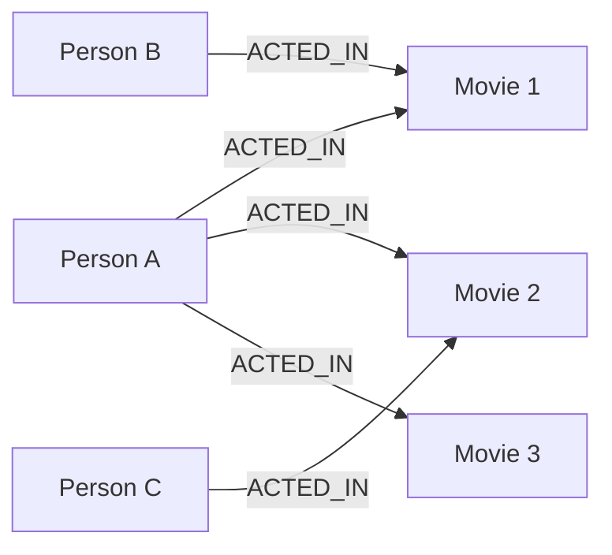

# countQuery cho Page và cách đếm đúng số entity gốc

Khi một repository Spring Data Neo4j trả về `Page<T>`, ứng dụng nhận được cả dữ liệu của trang hiện tại và thông tin tổng số phần tử, tổng số trang. Với truy vấn Cypher tùy chỉnh, SDN có thể cần một câu truy vấn đếm riêng được khai báo qua `countQuery` trong `@Query`. Câu đếm phải phản ánh đúng số kết quả logic mà trang đại diện.

Điểm dễ sai trong cơ sở dữ liệu đồ thị là một entity gốc có thể xuất hiện trên nhiều dòng sau khi `MATCH` qua relationship. Nếu trang trả về `Person`, nhưng một người tham gia nhiều phim, số dòng khớp không đồng nghĩa với số người. Bài học thuộc module **SPRING_DATA_NEO4J**, tập trung vào tầng dữ liệu đồ thị qua node entity, relationship, repository và Cypher; ví dụ dùng `Person`, `Movie`, `ACTED_IN` để làm rõ cách đếm đúng entity gốc.

## 1. Page cần biết tổng số phần tử

`Page<T>` chứa dữ liệu trang hiện tại cùng metadata như:

- `getContent()`: các phần tử của trang.
- `getNumber()`: chỉ số trang hiện tại, bắt đầu từ 0.
- `getSize()`: kích thước trang yêu cầu.
- `getNumberOfElements()`: số phần tử thực tế trong trang hiện tại.
- `getTotalElements()`: tổng số phần tử thỏa điều kiện trên toàn bộ tập kết quả.
- `getTotalPages()`: tổng số trang dựa trên kích thước trang.

Để tính `totalElements`, một truy vấn phân trang cần biết có bao nhiêu kết quả nếu bỏ giới hạn trang. Với derived query, Spring Data thường có thể suy ra truy vấn đếm. Với Cypher tùy chỉnh qua `@Query`, hãy khai báo `countQuery` khi cần tổng số chính xác và không thể dựa vào cách suy diễn mặc định.

Ví dụ hình dung: có 37 người thỏa điều kiện, mỗi trang chứa 10 người. Trang đầu có 10 phần tử, nhưng `Page` còn cần biết tổng số là 37 để tính `totalPages = 4`.

## 2. countQuery trong @Query

Annotation `@Query` của SDN có thuộc tính `countQuery` để khai báo câu Cypher đếm tổng số kết quả. Câu đếm được thực thi riêng với câu lấy dữ liệu trang; kết quả được dùng để điền metadata tổng của `Page`.

```java
public interface PersonRepository extends Neo4jRepository<Person, Long> {

    @Query(
        value = """
            MATCH (p:Person)-[:ACTED_IN]->(m:Movie)
            WHERE m.released >= $fromYear
            WITH DISTINCT p
            RETURN p
            ORDER BY p.name ASC, p.personId ASC
            """,
        countQuery = """
            MATCH (p:Person)-[:ACTED_IN]->(m:Movie)
            WHERE m.released >= $fromYear
            RETURN count(DISTINCT p)
            """
    )
    Page<Person> findPeopleWithRecentCredits(
            @Param("fromYear") Integer fromYear,
            Pageable pageable);
}
```

Trong ví dụ:

- `value` là truy vấn lấy nội dung trang.
- `countQuery` là truy vấn tính tổng số người phù hợp.
- Cả hai truy vấn dùng cùng điều kiện `m.released >= $fromYear`.
- `WITH DISTINCT p` bảo đảm mỗi người chỉ xuất hiện một lần trước khi phân trang.
- `count(DISTINCT p)` đếm số node `Person` khác nhau, không đếm số relationship hoặc số dòng trung gian.
- `Pageable` cung cấp thông tin phân trang cho repository; không cần tự thêm `SKIP` và `LIMIT` vào truy vấn này.

Các tham số dùng trong `value` và `countQuery` phải được khai báo nhất quán. Dùng `@Param` tường minh để tránh phụ thuộc vào việc compiler có giữ tên tham số hay không.

## 3. Vì sao count(*) có thể đếm sai số entity?

Xét graph:



Truy vấn:

```cypher
MATCH (p:Person)-[:ACTED_IN]->(m:Movie)
RETURN p;
```

tạo một dòng cho mỗi cặp `Person`–`Movie`. Trong dữ liệu trên, `Person A` xuất hiện ba lần; `Person B` và `Person C` mỗi người xuất hiện một lần. Có 5 dòng nhưng chỉ có 3 node `Person` khác nhau.

Nếu `Page<Person>` dùng `count(*)`, tổng số có thể là 5 trong khi nội dung logic chỉ có 3 người. `count(p)` cũng đếm các giá trị `p` theo từng dòng, vì cùng node có thể xuất hiện nhiều lần. Để đếm node gốc duy nhất, dùng:

```cypher
MATCH (p:Person)-[:ACTED_IN]->(m:Movie)
RETURN count(DISTINCT p) AS totalPeople;
```

`count(DISTINCT p)` đếm mỗi node `Person` một lần trong tập kết quả, dù node đó xuất hiện trên bao nhiêu relationship hoặc đường đi khớp.

## 4. Phải khử trùng lặp cả nội dung trang và tổng số

Một lỗi thường gặp là chỉ sửa `countQuery` thành `count(DISTINCT p)` nhưng vẫn để truy vấn trang trả về các dòng lặp:

```cypher
// Chưa đúng cho Page<Person> nếu một người khớp nhiều phim.
MATCH (p:Person)-[:ACTED_IN]->(m:Movie)
WHERE m.released >= $fromYear
RETURN p
ORDER BY p.name;
```

Khi đó, dù `totalElements` được đếm đúng, nội dung trang vẫn có thể chứa cùng một người nhiều lần. Một người có thể chiếm nhiều vị trí trong cùng trang, khiến số entity duy nhất ít hơn kích thước trang và các trang kế tiếp bị lệch.

Hãy khử trùng lặp node gốc trước khi áp dụng phân trang:

```cypher
MATCH (p:Person)-[:ACTED_IN]->(m:Movie)
WHERE m.released >= $fromYear
WITH DISTINCT p
RETURN p
ORDER BY p.name ASC, p.personId ASC;
```

Và dùng câu đếm tương ứng:

```cypher
MATCH (p:Person)-[:ACTED_IN]->(m:Movie)
WHERE m.released >= $fromYear
RETURN count(DISTINCT p);
```

Hai phần có hai trách nhiệm riêng:

- Truy vấn trang tạo đúng một dòng cho mỗi entity gốc trước khi SDN áp dụng giới hạn trang.
- `countQuery` đếm đúng số entity gốc trong toàn bộ tập thỏa điều kiện.

Không thể dùng một câu count đúng để bù cho truy vấn nội dung trang còn trùng lặp.

## 5. Giữ predicate của countQuery đồng nhất với truy vấn chính

`countQuery` phải đếm đúng tập kết quả mà truy vấn trang đại diện. Các điều kiện làm thay đổi tập entity phải được giữ tương ứng:

- Label và loại relationship được `MATCH`.
- Điều kiện `WHERE` trên node, relationship hoặc property.
- Điều kiện lọc theo tenant, trạng thái, quyền truy cập hoặc thời gian.
- Logic `EXISTS`, `OPTIONAL MATCH` và các bước `WITH` làm thay đổi tập node được chọn.
- Điều kiện lọc theo aggregate nếu nó quyết định entity nào xuất hiện trong trang.

Ví dụ truy vấn trang chỉ lấy người có ít nhất một phim phát hành từ năm `$fromYear`:

```cypher
MATCH (p:Person)-[:ACTED_IN]->(m:Movie)
WHERE m.released >= $fromYear
WITH DISTINCT p
RETURN p
ORDER BY p.name ASC, p.personId ASC;
```

Count query phải giữ cùng điều kiện:

```cypher
MATCH (p:Person)-[:ACTED_IN]->(m:Movie)
WHERE m.released >= $fromYear
RETURN count(DISTINCT p);
```

Nếu bỏ `WHERE m.released >= $fromYear` khỏi `countQuery`, tổng số sẽ bao gồm cả người không có phim trong khoảng thời gian yêu cầu. Nếu thêm một điều kiện chỉ ở `countQuery`, metadata có thể nhỏ hơn số kết quả thực tế.

`ORDER BY`, `SKIP` và `LIMIT` không thuộc câu đếm tổng thể: chúng chỉ sắp xếp hoặc cắt trang, không thay đổi số entity phù hợp trên toàn bộ tập kết quả. Không sao chép giới hạn trang vào `countQuery`.

## 6. Đếm node gốc với nhiều nhánh relationship

Một truy vấn có thể mở rộng nhiều nhánh từ cùng một node. Ví dụ tìm người vừa đóng phim vừa đạo diễn phim:

```cypher
MATCH (p:Person)-[:ACTED_IN]->(acted:Movie)
MATCH (p)-[:DIRECTED]->(directed:Movie)
WHERE acted.released >= $fromYear
RETURN p;
```

Nếu một người đóng trong 3 phim và đạo diễn 2 phim, phép ghép hai nhánh có thể tạo tối đa 6 tổ hợp dòng cho người đó. `count(*)` đếm các tổ hợp, không phải số người.

Với `Page<Person>`, có thể viết:

```cypher
MATCH (p:Person)-[:ACTED_IN]->(acted:Movie)
MATCH (p)-[:DIRECTED]->(directed:Movie)
WHERE acted.released >= $fromYear
WITH DISTINCT p
RETURN p
ORDER BY p.name ASC, p.personId ASC;
```

Và:

```cypher
MATCH (p:Person)-[:ACTED_IN]->(acted:Movie)
MATCH (p)-[:DIRECTED]->(directed:Movie)
WHERE acted.released >= $fromYear
RETURN count(DISTINCT p);
```

Ở đây `DISTINCT p` loại các bản sao do tích hợp nhiều nhánh relationship. Nếu nghiệp vụ chỉ yêu cầu người có ít nhất một phim đóng và ít nhất một phim đạo diễn, có thể cân nhắc `EXISTS` để tránh nhân dòng:

```cypher
MATCH (p:Person)
WHERE EXISTS {
    MATCH (p)-[:ACTED_IN]->(acted:Movie)
    WHERE acted.released >= $fromYear
}
AND EXISTS {
    MATCH (p)-[:DIRECTED]->(:Movie)
}
RETURN p
ORDER BY p.name ASC, p.personId ASC;
```

Vì truy vấn bắt đầu từ mỗi node `Person` và dùng `EXISTS` để kiểm tra điều kiện, mỗi người chỉ tạo một dòng. Count query có thể đếm `count(p)` với cùng các điều kiện `EXISTS`. Cách viết nào dễ hiểu và có hiệu năng tốt hơn cần được kiểm tra bằng `EXPLAIN` hoặc `PROFILE` trên dữ liệu thực tế.

## 7. Đếm đúng khi dùng OPTIONAL MATCH

`OPTIONAL MATCH` giữ lại node gốc ngay cả khi không có relationship khớp; các biến không tìm thấy có giá trị `null`. Điều này ảnh hưởng đến `count(*)`, `count(expression)` và việc xác định tập entity.

Ví dụ muốn phân trang tất cả `Person`, kể cả người chưa tham gia phim nào, và đếm số phim của từng người:

```cypher
MATCH (p:Person)
OPTIONAL MATCH (p)-[:ACTED_IN]->(m:Movie)
WITH p, count(DISTINCT m) AS movieCount
RETURN p, movieCount
ORDER BY p.name ASC, p.personId ASC;
```

Nếu repository trả về DTO gồm `Person` và `movieCount`, count query cần đếm tất cả node `Person` sau các điều kiện lọc áp dụng cho tập người. Ví dụ không có điều kiện lọc thêm:

```cypher
MATCH (p:Person)
RETURN count(p);
```

Không dùng `count(m)` để đếm người: người chưa có phim sẽ có `m = null` và bị bỏ qua. Cũng không dùng `count(*)` sau `OPTIONAL MATCH` như một phép đếm entity nếu một người có nhiều phim, vì số dòng của người đó vẫn lớn hơn một.

Nếu điều kiện lọc phụ thuộc vào relationship, hãy đặt điều kiện đúng vị trí. Ví dụ, nếu muốn giữ người không có phim và chỉ đếm phim từ năm `$fromYear`, đặt điều kiện trong pattern `OPTIONAL MATCH` hoặc trong biểu thức aggregate phù hợp; đặt `WHERE m.released >= $fromYear` ở vị trí khiến `null` bị loại có thể biến hành vi thành lọc bắt buộc.

## 8. Page chứa DTO được nhóm theo phim

Không phải `Page<T>` nào cũng đếm node `Person`. `T` có thể là DTO đại diện một nhóm. Nếu truy vấn trả về một dòng cho mỗi phim cùng số diễn viên, tổng số cần đếm là số phim thuộc tập nhóm, không phải số relationship `ACTED_IN`.

Truy vấn nội dung:

```cypher
MATCH (p:Person)-[:ACTED_IN]->(m:Movie)
WHERE m.released >= $fromYear
WITH m, count(DISTINCT p) AS actorCount
RETURN m.movieId AS movieId,
       m.title AS title,
       actorCount
ORDER BY title ASC, movieId ASC;
```

Count query cho một dòng mỗi node phim:

```cypher
MATCH (:Person)-[:ACTED_IN]->(m:Movie)
WHERE m.released >= $fromYear
RETURN count(DISTINCT m);
```

Ở đây:

- Nội dung trang là các nhóm theo `m`.
- `actorCount` là giá trị tổng hợp bên trong mỗi nhóm.
- `count(DISTINCT m)` đếm số phim duy nhất, tương ứng với số DTO `MovieSummary`.
- `count(*)` trên các relationship đầu vào sẽ đếm số credit, không phải số nhóm/phim.

Nếu nhóm được xác định bởi nhiều biểu thức, count query phải đếm số tổ hợp nhóm duy nhất. Có thể tạo tập nhóm bằng `WITH DISTINCT` hoặc subquery rồi đếm số dòng nhóm, thay vì đếm số dòng đầu vào ban đầu.

Ví dụ, đếm số tổ hợp người và năm phát hành:

```cypher
CALL {
    MATCH (p:Person)-[:ACTED_IN]->(m:Movie)
    WHERE m.released >= $fromYear
    RETURN DISTINCT p.personId AS personId, m.released AS releaseYear
}
RETURN count(*) AS totalGroups;
```

Truy vấn này đếm số tổ hợp `(personId, releaseYear)` duy nhất. Cần bảo đảm phần subquery mô tả đúng cùng tập nhóm với truy vấn lấy nội dung trang.

## 9. Ví dụ hoàn chỉnh với PageRequest

Repository:

```java
import org.springframework.data.domain.Page;
import org.springframework.data.domain.Pageable;
import org.springframework.data.neo4j.repository.Neo4jRepository;
import org.springframework.data.neo4j.repository.query.Query;
import org.springframework.data.repository.query.Param;

public interface PersonRepository extends Neo4jRepository<Person, Long> {

    @Query(
        value = """
            MATCH (p:Person)-[:ACTED_IN]->(m:Movie)
            WHERE m.released >= $fromYear
            WITH DISTINCT p
            RETURN p
            ORDER BY p.name ASC, p.personId ASC
            """,
        countQuery = """
            MATCH (p:Person)-[:ACTED_IN]->(m:Movie)
            WHERE m.released >= $fromYear
            RETURN count(DISTINCT p)
            """
    )
    Page<Person> findPeopleWithRecentCredits(
            @Param("fromYear") Integer fromYear,
            Pageable pageable);
}
```

Service:

```java
import org.springframework.data.domain.Page;
import org.springframework.data.domain.PageRequest;
import org.springframework.data.domain.Sort;

Page<Person> page = personRepository.findPeopleWithRecentCredits(
        2000,
        PageRequest.of(0, 10, Sort.unsorted())
);

long totalPeople = page.getTotalElements();
int totalPages = page.getTotalPages();
```

Trong ví dụ, thứ tự đã được khai báo tĩnh trong Cypher nên `Sort.unsorted()` tránh yêu cầu thêm một thứ tự động. Nếu muốn caller điều khiển sort, hãy thiết kế query và Pageable phù hợp, đồng thời bảo đảm thứ tự cuối cùng vẫn có tiêu chí phụ duy nhất để phân trang ổn định.

Không tự chèn `SKIP` và `LIMIT` vào `value` khi đã dùng cơ chế phân trang của repository với `Pageable`, trừ khi có một thiết kế truy vấn riêng được kiểm soát rõ ràng. Nếu cả framework và câu Cypher cùng giới hạn, kết quả có thể bị cắt hai lần hoặc lệch offset.

## 10. Page, Slice và List: chọn đúng nhu cầu

| Kiểu trả về | Metadata | Nhu cầu đếm tổng |
|---|---|---|
| `Page<T>` | Trang hiện tại, tổng phần tử, tổng trang | Cần tổng số để cung cấp `totalElements` và `totalPages` |
| `Slice<T>` | Trang hiện tại và thông tin còn trang tiếp theo hay không | Không cần tổng số toàn bộ kết quả; cách thực thi với custom query cần đối chiếu phiên bản SDN |
| `List<T>` với `Pageable` | Chỉ danh sách trong phạm vi trang | Không tạo metadata tổng của `Page` |

Nếu giao diện cần hiển thị “trang 2 trên 8” hoặc tổng số kết quả, `Page<T>` phù hợp. Nếu chỉ cần nút “Xem thêm”, `Slice<T>` có thể tránh chi phí tính tổng. Nếu chỉ cần giới hạn kết quả theo một `Pageable` nhưng không cần metadata, `List<T>` là lựa chọn đơn giản.

Count query là một truy vấn bổ sung có thể tạo thêm round trip và chi phí tính toán. Với graph lớn hoặc nhiều nhánh relationship, hãy cân nhắc cách viết count query riêng gọn hơn, nhưng phải giữ nguyên ngữ nghĩa tập kết quả.

## 11. Sắp xếp ổn định khi phân trang

Phân trang theo offset dựa trên thứ tự các dòng. Nếu không có `ORDER BY`, Neo4j không bảo đảm thứ tự kết quả; hai lần gọi cùng một trang có thể trả các phần tử khác nhau. Khi nhiều node có cùng `name`, chỉ sắp xếp theo `name` vẫn chưa xác định thứ tự giữa chúng.

Hãy thêm một khóa phụ duy nhất:

```cypher
RETURN p
ORDER BY p.name ASC, p.personId ASC;
```

`personId` là ID nghiệp vụ duy nhất của `Person`, do đó tạo thứ tự xác định hơn khi tên bằng nhau. Nếu dùng ID nội bộ, hãy cân nhắc độ ổn định và khả năng thay đổi của loại định danh đó; ID nghiệp vụ thường phù hợp hơn cho thứ tự phân trang có thể tái lập.

Thứ tự ổn định không giải quyết hoàn toàn việc dữ liệu thay đổi giữa hai request. Nếu node được thêm hoặc xóa trong lúc người dùng chuyển trang, offset có thể dịch chuyển và gây lặp hoặc bỏ sót phần tử. Với tập dữ liệu cập nhật liên tục, cân nhắc keyset/seek pagination hoặc một chiến lược snapshot phù hợp với nghiệp vụ.

## 12. Kiểm tra countQuery bằng dữ liệu thử

Tạo dữ liệu có một người tham gia nhiều phim để kiểm chứng sự khác biệt giữa đếm dòng và đếm entity:

```cypher
CREATE
  (a:Person {personId: 'P-A', name: 'Person A'}),
  (b:Person {personId: 'P-B', name: 'Person B'}),
  (c:Person {personId: 'P-C', name: 'Person C'}),
  (m1:Movie {movieId: 'M-1', released: 2001}),
  (m2:Movie {movieId: 'M-2', released: 2002}),
  (m3:Movie {movieId: 'M-3', released: 2003}),
  (a)-[:ACTED_IN]->(m1),
  (a)-[:ACTED_IN]->(m2),
  (a)-[:ACTED_IN]->(m3),
  (b)-[:ACTED_IN]->(m1),
  (c)-[:ACTED_IN]->(m2);
```

Đếm dòng và đếm người:

```cypher
MATCH (p:Person)-[:ACTED_IN]->(m:Movie)
WHERE m.released >= 2000
RETURN count(*) AS matchedRows,
       count(p) AS personValues,
       count(DISTINCT p) AS uniquePeople;
```

Kết quả kỳ vọng: `matchedRows = 5`, `personValues = 5`, `uniquePeople = 3`. Khi chạy `Page<Person>`, tổng số đúng là 3 và truy vấn trang cũng phải trả về tối đa ba người không lặp.

Có thể gọi các trang với kích thước 2:

```java
Page<Person> first = repository.findPeopleWithRecentCredits(
        2000, PageRequest.of(0, 2));
Page<Person> second = repository.findPeopleWithRecentCredits(
        2000, PageRequest.of(1, 2));
```

Kiểm tra:

- `first.getTotalElements()` và `second.getTotalElements()` đều bằng 3.
- Trang đầu có 2 người duy nhất.
- Trang thứ hai có 1 người duy nhất.
- Không có người nào xuất hiện ở cả hai trang.
- `getTotalPages()` bằng 2.

## 13. Lỗi thường gặp

| Lỗi | Hệ quả | Cách sửa |
|---|---|---|
| Dùng `count(*)` khi `MATCH` nhân bản node gốc | `totalElements` lớn hơn số entity duy nhất | Dùng `count(DISTINCT root)` |
| Chỉ sửa countQuery mà không khử trùng lặp page query | Nội dung trang vẫn có entity lặp | Dùng `WITH DISTINCT root` trước `RETURN` và phân trang |
| Bỏ điều kiện `WHERE` khỏi countQuery | Tổng số không khớp tập kết quả trang | Giữ cùng predicate trong cả hai query |
| Đưa `SKIP`/`LIMIT` vào countQuery | Đếm riêng một trang thay vì toàn bộ kết quả | Bỏ giới hạn trang khỏi countQuery |
| Đếm relationship thay vì node | Tổng số là số cạnh/credit, không phải số entity | Xác định kiểu `T` và đếm node gốc tương ứng |
| Đếm node gốc khi Page chứa DTO nhóm | Tổng số nhóm không khớp số node | Đếm số khóa nhóm hoặc số dòng sau grouping |
| Dùng `count(m)` để đếm node nguồn sau OPTIONAL MATCH | Bỏ qua entity không có node đích | Đếm root hoặc biểu thức đúng với ý nghĩa nghiệp vụ |
| Thiếu ORDER BY hoặc thiếu tie-breaker | Các trang có thể lặp hoặc bỏ sót phần tử | Sắp xếp theo nhiều tiêu chí, kết thúc bằng khóa duy nhất |
| Dùng Page khi không cần tổng số | Phát sinh chi phí count không cần thiết | Cân nhắc Slice hoặc List |

## 14. Checklist thiết kế Page và countQuery

- Xác định rõ `T` của `Page<T>` là entity node nào hay một DTO/group nào.
- Xác định truy vấn tạo một dòng cho mỗi entity gốc hay nhiều dòng cho một entity.
- Nếu một entity có thể lặp, khử trùng lặp trước khi phân trang.
- Viết `countQuery` đếm đúng cùng tập kết quả logic.
- Dùng `count(DISTINCT root)` khi đếm entity gốc qua relationship có thể nhân dòng.
- Giữ cùng điều kiện lọc, tenant, quyền truy cập và điều kiện relationship trong hai query.
- Không đưa `ORDER BY`, `SKIP`, `LIMIT` của trang vào countQuery.
- Với DTO nhóm, đếm số nhóm chứ không đếm số dòng đầu vào.
- Dùng tham số có tên nhất quán giữa `value`, `countQuery` và phương thức Java.
- Thêm `ORDER BY` ổn định với khóa phụ duy nhất.
- Kiểm thử bằng dữ liệu có một root node liên kết nhiều node đích.
- Cân nhắc `Slice` hoặc `List` nếu không cần tổng số toàn bộ kết quả.
- Dùng `EXPLAIN`/`PROFILE` để đánh giá chi phí truy vấn trang và truy vấn đếm riêng biệt.

## 15. Bài tập thực hành

1. Viết repository `Page<Person>` tìm người tham gia phim phát hành từ năm cho trước; khai báo `countQuery` dùng `count(DISTINCT p)`.
2. Tạo dữ liệu một người tham gia ba phim và hai người khác tham gia mỗi người một phim; so sánh `count(*)`, `count(p)` và `count(DISTINCT p)`.
3. Bỏ `WITH DISTINCT p` khỏi truy vấn nội dung trang, quan sát việc một người xuất hiện nhiều lần dù `countQuery` vẫn đúng.
4. Viết truy vấn có hai nhánh `ACTED_IN` và `DIRECTED`; giải thích vì sao số dòng có thể tăng theo tích số relationship.
5. Viết lại truy vấn nhiều nhánh bằng `EXISTS` để tránh nhân dòng và so sánh count query.
6. Dùng `OPTIONAL MATCH` để trả về cả người chưa tham gia phim nào; thiết kế count query đếm tất cả người phù hợp.
7. Tạo `Page<MovieSummary>` với một dòng cho mỗi phim; viết count query đếm số phim duy nhất thay vì số credit.
8. Thử phân trang khi chỉ sắp xếp theo `name`, sau đó thêm `personId` làm tie-breaker và so sánh tính ổn định.
9. Chuyển từ `Page` sang `Slice` cho một màn hình “Xem thêm” và xác định metadata nào không còn được cung cấp.

Khi hoàn thành, bạn cần phân biệt được số dòng Cypher với số entity hoặc nhóm kết quả mà `Page<T>` đại diện. `countQuery` phải đếm đúng tập kết quả logic, còn truy vấn lấy trang phải loại bỏ các bản sao của entity gốc trước khi phân trang. Đây là hai điều kiện cùng cần thiết để `totalElements`, nội dung trang và các trang tiếp theo nhất quán.

## Tài liệu tham khảo

- [Spring Data Neo4j — @Query API 8.0.x](https://www.springframework.org/spring-data/data-graph/docs/8.0.x/api/org/springframework/data/neo4j/repository/query/Query.html)
- [Spring Data Neo4j — @Query API 7.5.x](https://docs.spring.io/spring-data/neo4j/reference/7.5/api/java/org/springframework/data/neo4j/repository/query/Query.html)
- [Spring Data Neo4j — Paging and Sorting](https://docs.spring.io/spring-data/neo4j/reference/repositories/query-methods-details.html)
- [Neo4j Cypher Manual — Aggregating functions and count()](https://neo4j.com/docs/cypher-manual/current/functions/aggregating/)
- [Neo4j Cypher Manual — ORDER BY](https://neo4j.com/docs/cypher-manual/current/clauses/order-by/)
- [Neo4j Cypher Manual — SKIP](https://neo4j.com/docs/cypher-manual/current/clauses/skip/)
