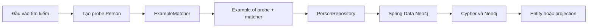

# Tạo đối tượng mẫu, Example và ExampleMatcher

Query by Example (QBE) là cách tạo truy vấn từ một đối tượng mẫu thay vì viết điều kiện truy vấn cho từng trường hợp. Ứng dụng tạo một probe chứa các giá trị muốn tìm, cấu hình `ExampleMatcher` để xác định cách so khớp, rồi đóng gói hai thành phần đó thành `Example` và chuyển cho repository.

Trong module `SPRING_DATA_NEO4J`, QBE hữu ích khi màn hình tìm kiếm cho phép người dùng nhập một số tiêu chí tùy chọn như tên, email, trạng thái hoặc cờ hoạt động. Spring Data Neo4j dùng metadata của entity để tạo truy vấn Cypher tương ứng. Cách này giảm việc ghép chuỗi truy vấn, nhưng phù hợp nhất với các điều kiện property đơn giản; truy vấn nhiều nhánh relationship hoặc logic lồng nhau vẫn cần cách tiếp cận khác.

## 1. Bốn thành phần của Query by Example

QBE gồm bốn khái niệm chính:

| Thành phần | Vai trò |
|---|---|
| Probe | Đối tượng domain chứa các giá trị mẫu muốn tìm |
| `ExampleMatcher` | Quy định cách so khớp, xử lý `null`, phân biệt hoa thường và bỏ qua property |
| `Example` | Đóng gói probe và matcher thành điều kiện tìm kiếm bất biến |
| `FetchableFluentQuery` | API tùy biến cách lấy kết quả như sắp xếp, giới hạn, phân trang hoặc projection |

Luồng sử dụng:



Ví dụ, người dùng nhập tên có chứa `An` và trạng thái `ACTIVE`. Ứng dụng tạo `Person` mẫu chỉ có hai giá trị đó. Matcher quy định tên được tìm theo kiểu chứa chuỗi và trạng thái được so khớp chính xác. Các trường còn lại không được đưa vào điều kiện nếu probe giữ giá trị `null` và matcher dùng cách xử lý mặc định.

## 2. Chuẩn bị domain entity và repository

Dùng một entity `Person` có các property đơn giản để minh họa:

```java
import org.springframework.data.neo4j.core.schema.GeneratedValue;
import org.springframework.data.neo4j.core.schema.Id;
import org.springframework.data.neo4j.core.schema.Node;

@Node("Person")
public class Person {

    @Id
    @GeneratedValue
    private Long id;

    private String name;
    private String email;
    private PersonStatus status;

    // Dùng Boolean để phân biệt chưa cung cấp tiêu chí với false.
    private Boolean active;

    public Person() {
    }

    public Long getId() {
        return id;
    }

    public String getName() {
        return name;
    }

    public void setName(String name) {
        this.name = name;
    }

    public String getEmail() {
        return email;
    }

    public void setEmail(String email) {
        this.email = email;
    }

    public PersonStatus getStatus() {
        return status;
    }

    public void setStatus(PersonStatus status) {
        this.status = status;
    }

    public Boolean getActive() {
        return active;
    }

    public void setActive(Boolean active) {
        this.active = active;
    }
}
```

```java
public enum PersonStatus {
    ACTIVE,
    INACTIVE,
    SUSPENDED
}
```

Repository kế thừa `Neo4jRepository`:

```java
import org.springframework.data.neo4j.repository.Neo4jRepository;

public interface PersonRepository extends Neo4jRepository<Person, Long> {
}
```

`Neo4jRepository` đã tích hợp `QueryByExampleExecutor`, vì vậy có sẵn các phương thức nhận `Example` như `findAll(example)`, `findOne(example)`, `count(example)`, `exists(example)` và API fluent `findBy(example, ...)`. Không cần tự viết implementation cho các thao tác QBE cơ bản.

Kiểu ID `Long` trong repository phải khớp với trường `@Id` của `Person`. Trong ví dụ, ID được Neo4j cấp bằng `@GeneratedValue`; khi probe mới được tạo, `id` là `null` nên mặc định không tham gia điều kiện tìm kiếm. Có thể bỏ qua `id` tường minh trong matcher để thể hiện rõ mục tiêu tìm theo các tiêu chí nghiệp vụ.

## 3. Tạo probe và Example đơn giản

Probe là một instance của domain entity. Chỉ đặt giá trị cho các trường muốn dùng làm tiêu chí:

```java
import org.springframework.data.domain.Example;
import java.util.List;

Person probe = new Person();
probe.setName("An");

Example<Person> example = Example.of(probe);

List<Person> people = personRepository.findAll(example);
```

Với matcher mặc định, các property khác `null` của probe được dùng làm điều kiện. Chuỗi được so khớp theo mặc định của store; các kiểu khác như enum, số, boolean và thời gian được so khớp chính xác.

Nếu probe chỉ có `name = "An"`, kết quả là những `Person` có tên khớp chính xác theo mặc định của store. Nó không tự hiểu rằng người dùng muốn tìm tên có chứa chuỗi `An`; muốn tìm gần đúng, cần cấu hình `ExampleMatcher`.

`Example` và `ExampleMatcher` là immutable. Các phương thức cấu hình matcher trả về một matcher mới, vì vậy hãy giữ kết quả của chuỗi cấu hình. Sau khi tạo `Example`, thay đổi object probe bên ngoài không phải cách cập nhật an toàn cho điều kiện; hãy tạo probe và example mới khi cần một bộ tiêu chí khác.

## 4. Cách xử lý property null và primitive

Mặc định, property có giá trị `null` trong probe bị bỏ qua. Điều này phù hợp với form tìm kiếm có nhiều trường tùy chọn:

```java
Person probe = new Person();
probe.setName("An");
probe.setStatus(PersonStatus.ACTIVE);
// email và active vẫn null nên không tham gia điều kiện mặc định.

Example<Person> example = Example.of(probe);
```

Điều kiện có ý nghĩa là:

```text
name = "An"
AND status = ACTIVE
```

`null` ở đây có nghĩa là “không đưa property vào điều kiện”, không có nghĩa là “tìm node mà property đang không tồn tại”. Nếu muốn so khớp property null, cần bật chế độ include null values:

```java
import org.springframework.data.domain.ExampleMatcher;

ExampleMatcher matcher = ExampleMatcher.matchingAll()
    .withIgnorePaths("id")
    .withIncludeNullValues();

Example<Person> example = Example.of(probe, matcher);
```

Chế độ này đưa các property null vào tiêu chí so khớp. Trong Neo4j, property có giá trị `null` được xem như property không tồn tại; hãy dùng chế độ này có chủ đích vì nó có thể khiến truy vấn yêu cầu nhiều property không tồn tại cùng lúc.

### Cẩn thận với kiểu primitive

Property primitive như `boolean`, `int`, `long` luôn có một giá trị mặc định trong Java: `false`, `0`, `0L`. Vì chúng không thể là `null`, QBE có thể đưa các giá trị mặc định đó vào điều kiện ngay cả khi người dùng không nhập tiêu chí.

Ví dụ:

```java
private boolean active;
```

Probe mới sẽ có `active == false`, do đó điều kiện có thể vô tình tìm các node không hoạt động. Với form tìm kiếm tùy chọn, dùng kiểu wrapper:

```java
private Boolean active;
private Integer age;
```

Khi chưa nhập, các trường wrapper có thể giữ `null` và được bỏ qua. Khi người dùng chọn `false` hoặc nhập `0`, giá trị đó vẫn được biểu diễn rõ ràng.

## 5. Tạo ExampleMatcher với matchingAll và matchingAny

`ExampleMatcher.matchingAll()` yêu cầu mọi điều kiện được đưa vào probe cùng khớp. Đây là cách mặc định và tương đương logic `AND`:

```java
import org.springframework.data.domain.ExampleMatcher;

ExampleMatcher matcher = ExampleMatcher.matchingAll();
```

`ExampleMatcher.matchingAny()` yêu cầu ít nhất một điều kiện khớp, tương đương logic `OR` giữa các predicate được tạo từ probe:

```java
import org.springframework.data.domain.ExampleMatcher;

ExampleMatcher matcher = ExampleMatcher.matchingAny();
```

Ví dụ, probe có `name = "An"` và `email = "an@example.com"`:

| Matcher | Ý nghĩa |
|---|---|
| `matchingAll()` | `name` khớp **và** `email` khớp |
| `matchingAny()` | `name` khớp **hoặc** `email` khớp |

Ví dụ tìm theo một trong hai thông tin:

```java
import org.springframework.data.domain.Example;
import org.springframework.data.domain.ExampleMatcher;

Person probe = new Person();
probe.setName("An");
probe.setEmail("an@example.com");

Example<Person> example = Example.of(
    probe,
    ExampleMatcher.matchingAny()
);
```

Không nhầm `matchingAny()` với khả năng nhóm điều kiện tùy ý. QBE không biểu diễn được các biểu thức logic lồng hoặc nhóm phức tạp như `name = ? OR (status = ? AND active = true)`. Khi cần nhóm điều kiện như vậy, dùng Cypher tùy chỉnh hoặc công cụ truy vấn khác phù hợp.

## 6. Cấu hình kiểu so khớp chuỗi

`ExampleMatcher` cho phép chọn kiểu so khớp chuỗi ở cấp toàn cục hoặc riêng từng property. Các chế độ thường gặp:

| `StringMatcher` | Ý nghĩa với giá trị probe `"An"` | Ví dụ giá trị khớp |
|---|---|---|
| `EXACT` | Bằng chính xác | `An` |
| `STARTING` | Bắt đầu bằng chuỗi mẫu | `An Nguyen` |
| `ENDING` | Kết thúc bằng chuỗi mẫu | `Tran An` |
| `CONTAINING` | Có chứa chuỗi mẫu | `Nguyen An Binh` |
| `REGEX` | Khớp biểu thức chính quy | Tùy biểu thức và hỗ trợ của store |

Ví dụ tìm tên có chứa `An`, không phân biệt hoa thường:

```java
import org.springframework.data.domain.Example;
import org.springframework.data.domain.ExampleMatcher;
import java.util.List;

ExampleMatcher matcher = ExampleMatcher.matchingAll()
    .withIgnorePaths("id")
    .withMatcher(
        "name",
        ExampleMatcher.GenericPropertyMatchers.contains().ignoreCase()
    );

Person probe = new Person();
probe.setName("An");

Example<Person> example = Example.of(probe, matcher);
List<Person> result = personRepository.findAll(example);
```

Với matcher riêng cho từng trường, email có thể được so khớp chính xác và không phân biệt hoa thường:

```java
import org.springframework.data.domain.ExampleMatcher;

ExampleMatcher matcher = ExampleMatcher.matchingAll()
    .withIgnorePaths("id")
    .withMatcher(
        "name",
        ExampleMatcher.GenericPropertyMatchers.contains().ignoreCase()
    )
    .withMatcher(
        "email",
        ExampleMatcher.GenericPropertyMatchers.exact().ignoreCase()
    );
```

Matcher ở cấp property có độ ưu tiên cao hơn cấu hình mặc định. Nếu cấu hình global là `CONTAINING` nhưng property `email` được cấu hình `EXACT`, email vẫn được so khớp chính xác.

Hỗ trợ chuỗi phụ thuộc vào store và phiên bản Spring Data. Neo4j hỗ trợ các kiểu so khớp chuỗi phổ biến; với regex hoặc điều kiện đặc biệt, hãy xác minh hành vi ở phiên bản đang triển khai và kiểm tra truy vấn được tạo. Các property không phải chuỗi thường được so khớp chính xác, không tự áp dụng `contains` hoặc `startsWith`.

## 7. Bỏ qua property và chuẩn hóa đầu vào

`withIgnorePaths(...)` loại property khỏi tiêu chí ngay cả khi probe đã có giá trị. Điều này hữu ích cho các trường kỹ thuật như ID hoặc các property được khởi tạo mặc định:

```java
import org.springframework.data.domain.ExampleMatcher;

ExampleMatcher matcher = ExampleMatcher.matchingAll()
    .withIgnorePaths("id", "active");
```

Trong ví dụ trên, `id` và `active` không tham gia truy vấn. Nếu muốn cho phép người dùng lọc `active`, không đưa trường này vào danh sách bỏ qua.

Có thể chuẩn hóa dữ liệu đầu vào trước khi tạo probe. Ví dụ, loại bỏ khoảng trắng ở email:

```java
import java.util.Locale;

String normalizedEmail = emailInput == null
    ? null
    : emailInput.trim().toLowerCase(Locale.ROOT);

Person probe = new Person();
probe.setEmail(normalizedEmail);
```

`ExampleMatcher` cũng hỗ trợ value transformer theo property để chuẩn hóa giá trị probe. Tuy nhiên, hãy chọn một nơi chịu trách nhiệm chuẩn hóa rõ ràng để tránh việc cùng một giá trị bị chuyển đổi nhiều lần hoặc khác nhau giữa lúc ghi và lúc tìm.

## 8. Kết hợp probe và matcher trong một service tìm kiếm

Một service có thể nhận các tiêu chí tùy chọn từ request, tạo probe và matcher rồi gọi repository:

```java
import org.springframework.data.domain.Example;
import org.springframework.data.domain.ExampleMatcher;
import org.springframework.stereotype.Service;

import java.util.List;

@Service
public class PersonSearchService {

    private final PersonRepository people;

    public PersonSearchService(PersonRepository people) {
        this.people = people;
    }

    public List<Person> search(
        String name,
        String email,
        PersonStatus status,
        Boolean active
    ) {
        Person probe = new Person();
        probe.setName(blankToNull(name));
        probe.setEmail(blankToNull(email));
        probe.setStatus(status);
        probe.setActive(active);

        ExampleMatcher matcher = ExampleMatcher.matchingAll()
            .withIgnorePaths("id")
            .withMatcher(
                "name",
                ExampleMatcher.GenericPropertyMatchers.contains().ignoreCase()
            )
            .withMatcher(
                "email",
                ExampleMatcher.GenericPropertyMatchers.exact().ignoreCase()
            );

        Example<Person> example = Example.of(probe, matcher);
        return people.findAll(example);
    }

    private String blankToNull(String value) {
        return value == null || value.isBlank() ? null : value.trim();
    }
}
```

Service dùng `matchingAll()` nên mọi tiêu chí được cung cấp đều phải thỏa mãn. `name` được tìm theo chuỗi chứa, `email` theo chính xác không phân biệt hoa thường, còn `status` và `active` được so khớp chính xác. Tiêu chí không được cung cấp sẽ là `null` và bị bỏ qua theo mặc định.

Nếu cả bốn tiêu chí đều rỗng, probe không có điều kiện hữu ích và truy vấn có thể trả về toàn bộ `Person`. Ứng dụng nên quyết định rõ có cho phép tìm kiếm không điều kiện hay cần yêu cầu ít nhất một tiêu chí trước khi gọi repository.

## 9. Dùng fluent API để sắp xếp, giới hạn và phân trang

`QueryByExampleExecutor` cung cấp `findBy(example, queryFunction)`. Fluent API cho phép tùy biến cách đọc kết quả mà không phải tạo một query method riêng cho mỗi biến thể:

```java
import org.springframework.data.domain.Page;
import org.springframework.data.domain.PageRequest;
import org.springframework.data.domain.Sort;

Page<Person> page = personRepository.findBy(
    example,
    query -> query
        .sortBy(Sort.by("name").ascending())
        .page(PageRequest.of(0, 20))
);
```

Có thể giới hạn kết quả đầu tiên:

```java
import org.springframework.data.domain.Sort;
import java.util.Optional;

Optional<Person> first = personRepository.findBy(
    example,
    query -> query
        .sortBy(Sort.by("name").ascending())
        .first()
);
```

Hoặc chỉ cần biết số lượng và sự tồn tại:

```java
long count = personRepository.count(example);
boolean exists = personRepository.exists(example);
```

Fluent API còn hỗ trợ projection, giới hạn số kết quả, slice, scrolling và stream tùy phiên bản Spring Data. Stream là tài nguyên cần được đóng sau khi xử lý; không giữ stream mở ngoài phạm vi cần thiết.

## 10. Giới hạn của Query by Example

QBE phù hợp với bộ lọc đơn giản dựa trên property của entity, nhưng không thay thế mọi khả năng của Cypher.

| Giới hạn | Ý nghĩa thực tế | Hướng xử lý |
|---|---|---|
| Không hỗ trợ nhóm predicate tùy ý | Không diễn đạt được biểu thức lồng như `A OR (B AND C)` | Dùng `@Query` hoặc Cypher DSL |
| Không phù hợp truy vấn nhiều nhánh relationship | Probe không phải công cụ mô tả pattern graph tùy ý | Viết Cypher thể hiện rõ node và relationship |
| Kiểu không phải chuỗi thường so khớp chính xác | Không có toán tử khoảng hoặc so sánh linh hoạt cho mọi kiểu qua matcher | Dùng derived query hoặc Cypher khi cần điều kiện lớn hơn/nhỏ hơn |
| Hỗ trợ string matcher phụ thuộc store | Không nên mặc định mọi kiểu regex hoặc collation đều giống nhau | Kiểm tra hành vi của Spring Data Neo4j và Neo4j đang dùng |
| Primitive luôn có giá trị mặc định | `false` hoặc `0` có thể vô tình thành tiêu chí | Dùng wrapper như `Boolean`, `Integer` cho filter tùy chọn |
| Null mặc định bị bỏ qua | Không tìm được node thiếu property nếu không bật include-null | Dùng `withIncludeNullValues()` khi thực sự cần điều kiện null |

Ví dụ, nếu cần tìm `Person` có bạn bè cùng trạng thái hoặc thỏa một trong nhiều pattern relationship, QBE không phải công cụ phù hợp. Hãy viết Cypher với `MATCH`, `OPTIONAL MATCH`, `WHERE` và `RETURN` để biểu đạt chính xác graph pattern.

## 11. Các lỗi thường gặp

| Biểu hiện | Nguyên nhân | Cách xử lý |
|---|---|---|
| Kết quả quá ít vì tên chỉ khớp chính xác | Dùng matcher mặc định cho chuỗi | Chọn `contains()`, `startsWith()` hoặc `endsWith()` theo nhu cầu |
| Kết quả chứa cả người không hoạt động | Probe `active` là `null` nên điều kiện bị bỏ qua | Đặt `Boolean.TRUE` hoặc `Boolean.FALSE` khi muốn lọc |
| Truy vấn vô tình lọc `active = false` | Dùng primitive `boolean` có giá trị mặc định `false` | Dùng `Boolean` để biểu diễn tiêu chí chưa nhập |
| Không tìm được node có property vắng mặt | Null mặc định bị bỏ qua | Dùng `withIncludeNullValues()` nếu cần so khớp null |
| Kết quả rỗng khi nhập email khác hoa thường | Matcher exact phân biệt hoa thường theo cấu hình | Dùng `ignoreCase()` nếu nghiệp vụ không phân biệt hoa thường |
| Matcher không tác động lên property | Sai tên property trong `withMatcher` hoặc `withIgnorePaths` | Dùng đúng tên property Java của entity |
| Query không thể diễn đạt điều kiện nghiệp vụ | QBE không hỗ trợ nhóm logic hoặc pattern relationship phức tạp | Chuyển sang `@Query` hoặc Cypher DSL |
| Tìm kiếm không nhập tiêu chí lại trả quá nhiều node | Probe không có property nào tham gia điều kiện | Xác thực ít nhất một tiêu chí hoặc đặt giới hạn kết quả |

Khi debug, hãy in hoặc kiểm tra probe trước, xác nhận property nào khác `null`, sau đó kiểm tra matcher toàn cục và cấu hình từng property. Nếu kết quả vẫn khác mong đợi, xem truy vấn được tạo và xác minh các giá trị property thực tế trong Neo4j.

## 12. Tự kiểm tra

1. Probe khác `Example` ở điểm nào?
2. Vì sao `ExampleMatcher.matchingAll()` phù hợp với form tìm kiếm có nhiều tiêu chí bắt buộc cùng đúng?
3. `matchingAny()` thay đổi logic kết hợp các property như thế nào?
4. Giá trị `null` trong probe được xử lý ra sao theo mặc định?
5. Vì sao nên dùng `Boolean` thay vì `boolean` cho một tiêu chí tìm kiếm tùy chọn?
6. Khác biệt giữa `StringMatcher.EXACT` và `StringMatcher.CONTAINING` là gì?
7. Khi nào nên bỏ qua `id` bằng `withIgnorePaths("id")`?
8. Vì sao QBE không phù hợp với điều kiện graph nhiều nhánh hoặc logic nhóm phức tạp?

QBE giúp tạo truy vấn động từ đối tượng mẫu: probe giữ giá trị cần tìm, `ExampleMatcher` quyết định cách so khớp, `Example` đóng gói hai phần đó và repository thực thi. Hãy dùng QBE cho bộ lọc property đơn giản, xử lý rõ `null` và giá trị primitive, đồng thời chuyển sang Cypher khi nghiệp vụ cần điều kiện nhóm hoặc traversal relationship phức tạp.

## Tài liệu tham khảo

- [Spring Data Neo4j — Query by Example](https://docs.spring.io/spring-data/neo4j/reference/query-by-example.html)
- [Spring Data Neo4j — `Neo4jRepository` API](https://docs.spring.io/spring-data/neo4j/docs/current/api/org/springframework/data/neo4j/repository/Neo4jRepository.html)
- [Spring Data Commons — Query by Example and ExampleMatcher](https://docs.spring.io/spring-data/commons/reference/query-by-example.html)
