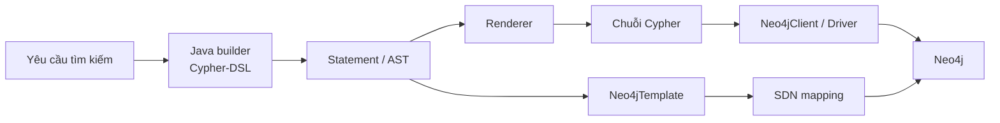

# Khi nào dùng Cypher-DSL thay vì nối chuỗi truy vấn?

Trong ứng dụng Spring Data Neo4j (SDN), truy vấn Cypher có thể được viết trực tiếp bằng chuỗi, khai báo cố định qua `@Query`, hoặc xây dựng bằng Neo4j Cypher-DSL. Mỗi cách phù hợp với một mức độ linh hoạt khác nhau. Một câu truy vấn cố định thường dễ đọc nhất khi viết bằng Cypher có tham số. Khi cấu trúc truy vấn thay đổi theo nhiều điều kiện tùy chọn, Cypher-DSL giúp ghép các phần truy vấn có cấu trúc, giảm lỗi cú pháp do nối chuỗi và quản lý tham số có hệ thống.

Cypher-DSL không làm truy vấn tự động nhanh hơn và cũng không thay thế việc hiểu Cypher. Nó cung cấp API Java dạng builder để tạo một cây cú pháp (AST), sau đó kết xuất AST thành Cypher hoặc chuyển trực tiếp `Statement` cho `Neo4jTemplate`. Vì vậy, quyết định dùng DSL nên dựa trên độ động và độ phức tạp của cấu trúc truy vấn, khả năng kiểm thử và cách nhóm phát triển muốn bảo trì truy vấn.

## 1. Ba cách viết truy vấn thường gặp

Giả sử ứng dụng quản lý phim cần tìm node `Movie` theo trạng thái và năm phát hành.

**Cách 1: Nối chuỗi trực tiếp**

```java
String cypher = "MATCH (m:Movie) WHERE m.status = '" + status
        + "' AND m.releaseYear >= " + minYear + " RETURN m";
```

Cách này nhanh để thử nghiệm, nhưng nguy hiểm khi đưa dữ liệu đầu vào vào chuỗi truy vấn. Dấu nháy, ký tự đặc biệt hoặc nội dung do người dùng kiểm soát có thể làm thay đổi cấu trúc câu lệnh. Khi có nhiều nhánh `if`, chuỗi còn khó đọc, khó kiểm tra dấu cách, dấu ngoặc và thứ tự mệnh đề.

**Cách 2: Chuỗi Cypher có tham số**

```java
@Query("""
    MATCH (m:Movie)
    WHERE m.status = $status
      AND m.releaseYear >= $minYear
    RETURN m
    """)
List<Movie> findMovies(
        @Param("status") String status,
        @Param("minYear") Integer minYear);
```

Đây là lựa chọn rõ ràng cho truy vấn có cấu trúc cố định. Các giá trị thay đổi được truyền bằng tham số `$status` và `$minYear`, nên không cần ghép giá trị vào chuỗi.

**Cách 3: Xây dựng truy vấn bằng Cypher-DSL**

```java
var movie = Cypher.node("Movie").named("m");
var statement = Cypher.match(movie)
        .where(movie.property("status")
                .isEqualTo(Cypher.parameter("status")))
        .returning(movie)
        .build();
```

DSL phù hợp khi cần tạo cấu trúc truy vấn theo từng phần. Ví dụ, điều kiện lọc theo năm chỉ xuất hiện khi request có truyền `minYear`; điều kiện theo thể loại chỉ xuất hiện khi request chọn thể loại. Thay vì ghép đoạn chuỗi `WHERE`, `AND`, `MATCH` bằng tay, ta ghép các đối tượng biểu diễn điều kiện.

## 2. Cypher-DSL là gì?

Neo4j Cypher-DSL là thư viện Java cung cấp API builder để mô tả các cấu trúc của Cypher như node, relationship, pattern, điều kiện, biểu thức, `MATCH`, `WITH`, `UNWIND`, `RETURN` và các mệnh đề khác.

Khi hoàn tất việc xây dựng, DSL tạo một `org.neo4j.cypherdsl.core.Statement`. Đối tượng này biểu diễn cây cú pháp của truy vấn. Có thể:

- Kết xuất `Statement` thành chuỗi Cypher bằng renderer hoặc `statement.getCypher()`.
- Đọc tên tham số và các giá trị đã gắn vào statement.
- Truyền `Statement` trực tiếp cho `Neo4jTemplate` hoặc `ReactiveNeo4jTemplate` trong các phiên bản SDN hỗ trợ.
- Dùng statement trong custom repository fragment hoặc thực thi qua API phù hợp.



DSL tạo ra Cypher; database vẫn thực thi Cypher. Việc sử dụng DSL không làm thay đổi mô hình node, label, relationship hoặc property trong Neo4j.

## 3. Khi nào nên chọn Cypher-DSL?

Cypher-DSL có giá trị nhất khi **cấu trúc truy vấn thay đổi theo dữ liệu hoặc lựa chọn của người gọi**.

| Tình huống | Lựa chọn phù hợp | Lý do |
|---|---|---|
| Một câu `MATCH` cố định, một vài tham số | `@Query` hoặc chuỗi có tham số | Ngắn, trực tiếp và dễ review |
| Có nhiều bộ lọc tùy chọn | Cypher-DSL | Ghép điều kiện chỉ khi cần, không phải quản lý nhiều mảnh chuỗi |
| Có nhiều pattern hoặc nhánh `MATCH` được tái sử dụng | Cypher-DSL | Có thể xây dựng và kết hợp các thành phần truy vấn |
| Truy vấn đường đi, `WITH`, `UNWIND`, subquery hoặc biểu thức phức tạp | Cypher-DSL hoặc Cypher viết tay có tham số | DSL giúp tổ chức cấu trúc bằng API; Cypher viết tay vẫn phù hợp nếu dễ đọc hơn |
| Một truy vấn đơn giản nhưng chỉ thay đổi giá trị | Chuỗi có tham số | Thay đổi giá trị không đòi hỏi tạo cấu trúc truy vấn động |
| Truy vấn cần cú pháp đặc thù chưa được DSL hỗ trợ | Cypher viết tay có tham số hoặc kết hợp phần raw có kiểm soát | Không nên ép mọi cú pháp vào builder |

Ví dụ, màn hình tìm phim có thể cho phép lọc theo trạng thái, năm phát hành tối thiểu và tiêu đề. Người dùng có thể chỉ truyền một trong ba điều kiện, hoặc truyền cả ba. Đây là trường hợp có cấu trúc động tự nhiên.

## 4. Vì sao không nên nối chuỗi Cypher bằng dữ liệu đầu vào?

Nối giá trị đầu vào trực tiếp vào Cypher có thể làm hỏng câu lệnh và tạo lỗ hổng Cypher injection:

```java
String cypher = "MATCH (m:Movie) WHERE m.title = '"
        + requestTitle + "' RETURN m";
```

Nếu `requestTitle` chứa dấu nháy hoặc một đoạn Cypher, nội dung có thể thoát khỏi literal dự kiến và làm thay đổi truy vấn. Cách sửa đúng cho truy vấn cố định là dùng parameter:

```java
neo4jClient.query("""
        MATCH (m:Movie)
        WHERE m.title = $title
        RETURN m.title AS title
        """)
    .bind(requestTitle).to("title")
    .fetchAs(String.class)
    .mappedBy((typeSystem, record) -> record.get("title").asString())
    .all();
```

Ví dụ chỉ lấy tiêu đề để làm rõ việc bind tham số. Với `@Query`, SDN tự bind các tham số được khai báo trong chữ ký phương thức.

**Điểm quan trọng:** Cypher-DSL không phải điều kiện bắt buộc để tránh injection. Chuỗi Cypher cố định có parameter vẫn an toàn và thường đơn giản hơn. Khi dùng DSL, cũng nên biểu diễn giá trị thay đổi bằng `Cypher.parameter(...)` thay vì chèn literal từ request vào câu truy vấn. Tránh đưa dữ liệu người dùng vào `Cypher.raw(...)`.

## 5. Ví dụ: xây dựng bộ lọc tùy chọn bằng Cypher-DSL

Entity mẫu:

```java
@Node("Movie")
public class Movie {

    @Id
    private String id;

    private String title;

    private String status;

    private Integer releaseYear;
}
```

Giả sử service cần tìm phim theo `status` bắt buộc, `minYear` tùy chọn. Có thể tạo điều kiện ban đầu, rồi thêm điều kiện năm khi tham số được truyền:

```java
import java.util.HashMap;
import java.util.List;
import java.util.Map;

import org.neo4j.cypherdsl.core.Condition;
import org.neo4j.cypherdsl.core.Statement;
import org.springframework.data.neo4j.core.Neo4jTemplate;

import static org.neo4j.cypherdsl.core.Cypher.match;
import static org.neo4j.cypherdsl.core.Cypher.node;
import static org.neo4j.cypherdsl.core.Cypher.parameter;

public class MovieSearch {

    private final Neo4jTemplate neo4jTemplate;

    public MovieSearch(Neo4jTemplate neo4jTemplate) {
        this.neo4jTemplate = neo4jTemplate;
    }

    public List<Movie> search(String status, Integer minYear) {
        var movie = node("Movie").named("m");

        Condition condition = movie.property("status")
                .isEqualTo(parameter("status"));

        Map<String, Object> parameters = new HashMap<>();
        parameters.put("status", status);

        if (minYear != null) {
            condition = condition.and(
                    movie.property("releaseYear").gte(parameter("minYear")));
            parameters.put("minYear", minYear);
        }

        Statement statement = match(movie)
                .where(condition)
                .returning(movie)
                .build();

        return neo4jTemplate.findAll(statement, parameters, Movie.class);
    }
}
```

Trong ví dụ:

- `node("Movie").named("m")` tạo biểu thức node mang label `Movie` và symbolic name `m`.
- `property("status")` tham chiếu property trên node.
- `parameter("status")` tạo placeholder `$status`.
- `Condition` biểu diễn điều kiện có thể ghép bằng `and(...)`.
- Nhánh `if` chỉ thêm điều kiện năm và tham số `minYear` khi có giá trị.
- `Neo4jTemplate.findAll(statement, parameters, Movie.class)` thực thi statement và ánh xạ node kết quả thành `Movie`.

Nếu `minYear` là `null`, truy vấn chỉ lọc theo status. Nếu có `minYear`, điều kiện `releaseYear >= $minYear` được thêm vào. Cấu trúc query được tạo từ các thành phần có kiểu, còn dữ liệu thực tế được bind riêng.

Đây là ví dụ custom repository fragment ở dạng lớp Java để làm rõ cách dùng template. Trong dự án, nên đặt phương thức này trong repository fragment như `MovieSearch` và triển khai bằng `MovieSearchImpl`, sau đó cho `MovieRepository` kế thừa fragment đó. Như vậy, truy vấn động vẫn nằm trong tầng repository thay vì làm service chứa chi tiết truy cập dữ liệu.

## 6. Dùng Statement trực tiếp với Neo4jTemplate

`Neo4jTemplate` hiểu entity metadata của SDN. Khi trả về entity domain, template có thể ánh xạ kết quả theo mapping của lớp `@Node`:

```java
var movie = Cypher.node("Movie").named("m");
var statement = Cypher.match(movie)
        .where(movie.property("status")
                .isEqualTo(Cypher.parameter("status")))
        .returning(movie)
        .build();

Map<String, Object> parameters = Map.of("status", "PUBLISHED");

List<Movie> movies = neo4jTemplate.findAll(
        statement,
        parameters,
        Movie.class);
```

Không cần render thành chuỗi trước khi truyền statement cho template. Nếu cần log hoặc kiểm tra câu Cypher, có thể gọi `statement.getCypher()`; để kết xuất theo cấu hình renderer cụ thể, dùng `Renderer`.

Với ứng dụng reactive, có thể sử dụng `ReactiveNeo4jTemplate` và API trả về publisher tương ứng. Hãy giữ thao tác trong pipeline reactive, không gọi `.block()` chỉ để lấy kết quả.

### Phụ thuộc và dialect

Spring Data Neo4j sử dụng Cypher-DSL trong hạ tầng tạo truy vấn. Với Spring Boot starter, dependency có thể đã được kéo theo. Nếu dự án khai báo thư viện trực tiếp hoặc quản lý dependency riêng, artifact là `org.neo4j:neo4j-cypher-dsl`; hãy dùng dependency management/BOM tương thích với phiên bản SDN, thay vì tự chọn một version rời rạc.

Dialect điều khiển cách renderer tạo một số cú pháp theo phiên bản Neo4j. Ví dụ cấu hình cho môi trường dùng Neo4j 5:

```java
@Bean
Configuration cypherDslConfiguration() {
    return Configuration.newConfig()
            .withDialect(Dialect.NEO4J_5)
            .build();
}
```

Nếu hệ thống dùng Neo4j 4, chọn dialect Neo4j 4 nếu phiên bản Cypher-DSL đi kèm hỗ trợ. Tên enum và dialect khả dụng thay đổi theo phiên bản thư viện; đối chiếu tài liệu tương ứng với dependency thực tế. Cấu hình dialect phù hợp giúp tránh kết xuất cú pháp không tương thích hoặc bỏ lỡ cách biểu diễn tối ưu cho server.

## 7. Tích hợp Cypher-DSL vào repository

SDN cung cấp các mixin dành cho truy vấn DSL như `CypherdslStatementExecutor` và `ReactiveCypherdslStatementExecutor`. Chúng hữu ích khi muốn thêm khả năng thực thi statement được xây dựng động vào repository.

Một lựa chọn linh hoạt khác là custom repository fragment:

```java
public interface MovieSearch {
    List<Movie> search(String status, Integer minYear);
}
```

```java
public interface MovieRepository
        extends Neo4jRepository<Movie, String>, MovieSearch {
}
```

Lớp triển khai fragment có tên theo quy ước, ví dụ `MovieSearchImpl`, và nhận `Neo4jTemplate` qua constructor. Phần tạo `Statement` được đặt trong phương thức `search` như ví dụ ở phần trước.

Chọn fragment khi truy vấn cần nhiều logic tạo câu lệnh, có nhiều phương thức liên quan hoặc cần custom mapping. Nếu truy vấn chỉ là một câu Cypher cố định, `@Query` thường gọn hơn. Nếu cần custom result không phải entity, `Neo4jClient` cung cấp API bind tham số và ánh xạ record phù hợp.

## 8. Cypher-DSL an toàn kiểu đến đâu?

DSL cung cấp API có kiểu để xây dựng các cấu trúc Cypher hợp lệ. Các bước builder giới hạn cách nối mệnh đề, và nhiều lỗi về thứ tự hoặc cấu trúc có thể được phát hiện ngay khi biên dịch Java.

Tuy nhiên, cần hiểu đúng giới hạn:

- `node("Movie")` và `property("title")` vẫn nhận tên label/property dưới dạng chuỗi.
- DSL không tự đọc schema Neo4j để bảo đảm label, relationship type hoặc property thật sự tồn tại.
- Một truy vấn có thể hợp lệ về cú pháp nhưng sai logic nghiệp vụ.
- Một số cú pháp Cypher có thể chưa được DSL hỗ trợ ở phiên bản đang dùng.
- `Cypher.raw(...)` cho phép chèn biểu thức Cypher tự do và làm giảm lợi ích kiểm tra cấu trúc của DSL.

Do đó, DSL không thay thế kiểm thử trên Neo4j. Nếu label, relationship type hoặc property name được chọn động, hãy lấy chúng từ allowlist do ứng dụng kiểm soát. Không truyền trực tiếp tên cấu trúc từ request bên ngoài vào builder.

## 9. Quản lý tham số và renderer

Cypher-DSL hỗ trợ tạo parameter placeholder:

```java
var movie = Cypher.node("Movie").named("m");
var statement = Cypher.match(movie)
        .where(movie.property("title")
                .isEqualTo(Cypher.parameter("title")))
        .returning(movie)
        .build();
```

Các placeholder xuất hiện trong Cypher dưới dạng `$title`. Có thể cung cấp map tham số riêng cho `Neo4jTemplate`, hoặc gắn giá trị vào parameter khi xây statement bằng API `withValue(...)` nếu phù hợp. Không trộn hai nguồn giá trị cho cùng một tên tham số với các giá trị xung đột.

`Renderer` chuyển AST thành chuỗi Cypher. Có thể dùng renderer mặc định:

```java
String cypher = Renderer.getDefaultRenderer().render(statement);
```

Hoặc dùng `statement.getCypher()` khi chỉ cần chuỗi Cypher mặc định. Renderer có thể cấu hình dialect và pretty printing. Hãy chọn dialect tương thích với phiên bản Neo4j của môi trường chạy; cấu hình dialect có thể ảnh hưởng cách kết xuất một số hàm và cú pháp.

## 10. Cypher-DSL không tự làm truy vấn nhanh hơn

Hiệu năng truy vấn chủ yếu phụ thuộc vào Cypher cuối cùng, index, cardinality của dữ liệu, kế hoạch thực thi, số node/relationship phải duyệt và lượng dữ liệu trả về. DSL là công cụ tạo câu truy vấn, không phải một bộ tối ưu hóa thay thế Neo4j query planner.

Parameter có lợi cho việc tái sử dụng query plan vì cấu trúc câu truy vấn được giữ ổn định giữa các lần gọi. Điều này đúng với cả Cypher viết tay có tham số và Cypher-DSL. Vì vậy, không nên chọn DSL với kỳ vọng tự động nhanh hơn nối chuỗi; hãy chọn vì khả năng tổ chức và kiểm tra cấu trúc động.

Khi cần đánh giá truy vấn:

1. Render statement để xem Cypher thực tế.
2. Kiểm tra map tham số có đủ key và đúng kiểu.
3. Chạy truy vấn với dữ liệu đại diện.
4. Dùng `EXPLAIN` để xem kế hoạch hoặc `PROFILE` để quan sát truy vấn thực thi.
5. Kiểm tra index, số hàng qua từng operator và lượng dữ liệu trả về.
6. So sánh với truy vấn Cypher có tham số tương đương nếu nghi ngờ builder tạo ra cấu trúc không tối ưu.

## 11. Khi nào nên tránh Cypher-DSL?

Không cần dùng DSL cho mọi câu truy vấn. Một truy vấn cố định ngắn như:

```java
@Query("""
    MATCH (m:Movie {id: $id})
    RETURN m
    """)
Optional<Movie> findMovie(String id);
```

đã rõ ràng, dễ đọc và dễ kiểm tra. Chuyển nó thành nhiều dòng builder có thể làm code dài hơn mà không đem lại lợi ích tương xứng.

Nên cân nhắc viết Cypher trực tiếp có tham số khi:

- Truy vấn có cấu trúc cố định và dễ đọc dưới dạng Cypher.
- Cú pháp cần dùng chưa được DSL hỗ trợ tốt.
- Người review cần đối chiếu trực tiếp với Cypher trong Neo4j Browser.
- Một truy vấn chuyên biệt chỉ được dùng một lần và không có phần cấu trúc cần tái sử dụng.

Nếu dùng chuỗi, hãy dùng text block Java hoặc `@Query` để trình bày Cypher thành nhiều dòng, bind tham số riêng và không ghép dữ liệu người dùng vào câu lệnh.

## 12. So sánh nhanh

| Tiêu chí | Nối chuỗi trực tiếp | Cypher string có tham số | Cypher-DSL |
|---|---|---|---|
| Dễ viết truy vấn cố định | Trung bình | Tốt | Có thể dài hơn cần thiết |
| Quản lý giá trị đầu vào | Rủi ro nếu ghép literal | Tốt khi bind đúng | Tốt khi dùng parameter |
| Cấu trúc truy vấn động | Khó bảo trì khi nhiều nhánh | Có thể làm được nhưng cần quản lý mảnh chuỗi | Mạnh về ghép điều kiện và pattern |
| Kiểm tra cấu trúc ở compile time | Không | Không | Có ở mức API/builder |
| Kiểm tra schema database | Không | Không | Không tự động |
| Đọc Cypher trực tiếp | Có | Có | Cần render để xem |
| Tái sử dụng thành phần query | Thường phải tự tổ chức | Thường phải tự tổ chức | Thuận tiện qua AST và biểu thức |
| Phù hợp nhất | Không nên dùng với dữ liệu đầu vào | Query tĩnh, đơn giản | Query động, nhiều thành phần |

## 13. Checklist trước khi chọn cách viết

1. Cấu trúc query có thực sự thay đổi theo điều kiện đầu vào hay chỉ thay đổi giá trị?
2. Một câu `@Query` hoặc chuỗi Cypher có tham số đã đủ rõ chưa?
3. Có nhiều nhánh `MATCH`, `WHERE`, `WITH`, `UNWIND` hoặc pattern cần ghép động không?
4. Giá trị đầu vào đã được bind bằng parameter thay vì nối chuỗi chưa?
5. Label, relationship type và property name động có được giới hạn bằng allowlist không?
6. Statement có trả về đúng cấu trúc để SDN ánh xạ entity hoặc projection không?
7. Đã render và review Cypher cuối cùng chưa?
8. Dialect của DSL có phù hợp phiên bản Neo4j không?
9. Đã kiểm thử logic và đo kế hoạch thực thi trên dữ liệu đại diện chưa?

## 14. Tự kiểm tra

1. Cypher-DSL tạo ra đối tượng trung gian nào trước khi thực thi?
2. Vì sao chuỗi Cypher cố định có tham số thường là lựa chọn tốt hơn nối chuỗi hoặc DSL?
3. Khi nào cấu trúc truy vấn động khiến Cypher-DSL có lợi thế rõ ràng?
4. Dùng `Cypher.parameter("status")` khác gì đưa giá trị `status` trực tiếp vào chuỗi?
5. Cypher-DSL có tự kiểm tra label và property có tồn tại trong database không?
6. Vì sao không nên đưa dữ liệu người dùng vào `Cypher.raw(...)` hoặc tên label/property tùy ý?
7. `Neo4jTemplate` giúp ích gì khi nhận một `Statement`?
8. Vì sao dùng Cypher-DSL không đồng nghĩa truy vấn sẽ chạy nhanh hơn?

Khi biết phân biệt truy vấn tĩnh với truy vấn có cấu trúc động, người học có thể chọn `@Query`, Cypher string có tham số hoặc Cypher-DSL đúng hoàn cảnh. Mục tiêu là tạo truy vấn dễ đọc, an toàn, kiểm thử được và phù hợp với cách SDN ánh xạ dữ liệu đồ thị.

## Tài liệu tham khảo

- [Spring Data Neo4j — Getting started và cấu hình Cypher-DSL](https://docs.spring.io/spring-data/neo4j/reference/getting-started.html)
- [Spring Data Neo4j — FAQ: CypherdslStatementExecutor và custom repository fragments](https://docs.spring.io/spring-data/neo4j/reference/faq.html)
- [Neo4j Cypher-DSL — Manual](https://neo4j.github.io/cypher-dsl/)
- [Neo4j Cypher Manual — Parameters](https://neo4j.com/docs/cypher-manual/current/syntax/parameters/)
