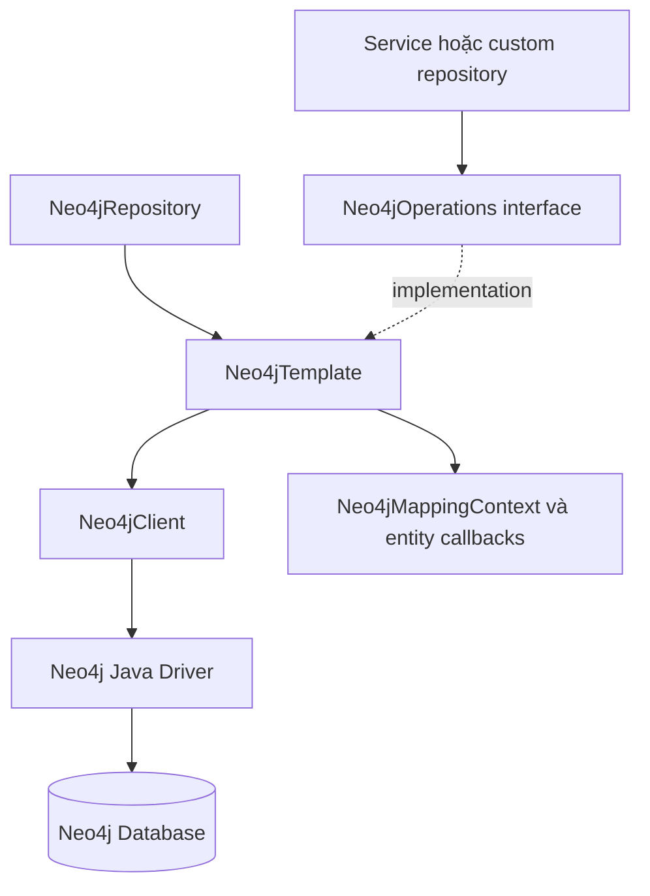

# Vai trò của Neo4jOperations và Neo4jTemplate

Spring Data Neo4j cung cấp `Neo4jOperations` và `Neo4jTemplate` để thao tác trực tiếp với entity đã được ánh xạ vào graph. `Neo4jOperations` là interface mô tả hợp đồng thao tác theo kiểu domain; `Neo4jTemplate` là implementation do Spring cung cấp. Cặp API này hữu ích khi một service hoặc thành phần tùy chỉnh cần đọc, lưu, đếm hay xóa entity mà không muốn tạo một repository riêng cho từng loại.

Trong module `SPRING_DATA_NEO4J`, repository vẫn là lựa chọn phù hợp cho các thao tác CRUD và query method gắn với một domain cụ thể. `Neo4jOperations` mở ra API tổng quát hơn để làm việc với nhiều domain type hoặc chạy Cypher có tham số và ánh xạ kết quả về entity. Hiểu ranh giới giữa interface, implementation, repository và `Neo4jClient` giúp chọn đúng lớp truy cập dữ liệu, giữ mapping nhất quán và phối hợp transaction trong service.

## 1. Neo4jOperations và Neo4jTemplate khác nhau thế nào?

Hai tên này liên quan trực tiếp nhưng không phải hai cách gọi cho cùng một loại thành phần:

| Thành phần | Bản chất | Vai trò |
|---|---|---|
| `Neo4jOperations` | Interface của Spring Data Neo4j | Khai báo các thao tác trên database dựa theo domain type |
| `Neo4jTemplate` | Class implementation của `Neo4jOperations` | Thực thi thao tác đọc, ghi, đếm, xóa và truy vấn có ánh xạ entity |
| `Neo4jRepository<T, ID>` | Interface repository theo domain | Cung cấp CRUD và query method cho một entity cụ thể |
| `Neo4jClient` | Client thực thi Cypher ở mức record | Bind tham số, chạy Cypher và trả record/map hoặc kết quả qua mapping function |

`Neo4jOperations` là hợp đồng mà code ứng dụng có thể phụ thuộc vào. `Neo4jTemplate` là class thực hiện hợp đồng đó. API hiện đại đánh dấu `Neo4jOperations` ổn định từ Spring Data Neo4j 6.0; `Neo4jTemplate` cũng là implementation ổn định từ dòng 6.0.

Sơ đồ các lớp chính:



Các repository đơn giản của Spring Data Neo4j ủy quyền thao tác cho `Neo4jTemplate`. Vì vậy, repository và template dùng chung nền tảng mapping, callback và cơ chế truy cập database của Spring Data Neo4j.

## 2. Vì sao nên phụ thuộc vào Neo4jOperations?

Khi cần gọi template từ service, nên khai báo dependency theo interface:

```java
import org.springframework.data.neo4j.core.Neo4jOperations;
import org.springframework.stereotype.Service;

@Service
public class PersonGraphService {

    private final Neo4jOperations neo4jOperations;

    public PersonGraphService(Neo4jOperations neo4jOperations) {
        this.neo4jOperations = neo4jOperations;
    }
}
```

Spring Boot và cấu hình Spring Data Neo4j cung cấp bean template phù hợp để Spring inject qua interface `Neo4jOperations`. Cách khai báo này giúp code phụ thuộc vào hợp đồng thao tác, giảm liên kết trực tiếp với class implementation và thuận tiện hơn khi kiểm thử service bằng mock hoặc test double.

Không cần tự tạo `new Neo4jTemplate(...)` trong service. Template được cấu hình cùng `Neo4jClient`, `Neo4jMappingContext`, entity callbacks và transaction manager. Tự khởi tạo thủ công có thể bỏ qua một phần cấu hình mà Spring Data Neo4j đã chuẩn bị.

Nếu một thành phần thực sự cần API fluent riêng mà chỉ class `Neo4jTemplate` công khai, có thể cân nhắc inject implementation đó một cách có chủ đích. Với các thao tác domain thông thường, `Neo4jOperations` là abstraction nên dùng.

## 3. Entity dùng trong ví dụ

Ví dụ sử dụng node `Person` với ID nội bộ do Neo4j cấp:

```java
import org.springframework.data.neo4j.core.schema.GeneratedValue;
import org.springframework.data.neo4j.core.schema.Id;
import org.springframework.data.neo4j.core.schema.Node;

@Node("Person")
public class Person {

    @Id
    @GeneratedValue
    private Long id;

    private String name;
    private String email;
    private String status;

    protected Person() {
    }

    public Person(String name, String email) {
        this.name = name;
        this.email = email;
    }

    public Long getId() {
        return id;
    }

    public String getName() {
        return name;
    }

    public String getEmail() {
        return email;
    }

    public void changeEmail(String email) {
        this.email = email;
    }
}
```

`@Node` cung cấp metadata để Spring Data Neo4j ánh xạ `Person` thành node. `@Id @GeneratedValue` đánh dấu định danh persistence được framework/database quản lý; trường `id` trong ví dụ không phải property `id` do ứng dụng lưu trên node.

## 4. Các thao tác domain cơ bản qua Neo4jOperations

Interface cung cấp các thao tác tổng quát nhận `Class<T>` để biết entity cần ánh xạ. Một số phương thức quan trọng:

| Phương thức | Mục đích | Kiểu kết quả |
|---|---|---|
| `findById(id, Person.class)` | Đọc một entity theo ID | `Optional<Person>` |
| `findAllById(ids, Person.class)` | Đọc các entity theo tập ID | `List<Person>` |
| `findAll(Person.class)` | Đọc tất cả entity của kiểu đã chọn | `List<Person>` |
| `save(person)` | Lưu entity cùng graph liên quan theo mapping | Entity đã lưu |
| `saveAll(people)` | Lưu nhiều entity | `List<Person>` |
| `count(Person.class)` | Đếm entity của kiểu đã chọn | `long` |
| `existsById(id, Person.class)` | Kiểm tra entity theo ID | `boolean` |
| `deleteById(id, Person.class)` | Xóa entity theo ID | `void` |

`deleteById` là thao tác xóa entity theo mapping của Spring Data Neo4j; API mô tả thao tác này bao gồm cả các entity liên quan. Nếu mục tiêu chỉ là gỡ một relationship nhưng giữ hai node, hãy viết Cypher nhắm trực tiếp vào relationship thay vì dùng thao tác xóa entity.

Ví dụ sử dụng trong service:

```java
import org.springframework.data.neo4j.core.Neo4jOperations;
import org.springframework.stereotype.Service;

import java.util.Optional;

@Service
public class PersonGraphService {

    private final Neo4jOperations neo4jOperations;

    public PersonGraphService(Neo4jOperations neo4jOperations) {
        this.neo4jOperations = neo4jOperations;
    }

    public Optional<Person> findPerson(Long id) {
        return neo4jOperations.findById(id, Person.class);
    }

    public Person savePerson(Person person) {
        return neo4jOperations.save(person);
    }

    public long countPeople() {
        return neo4jOperations.count(Person.class);
    }
}
```

Điểm khác với repository là mỗi lời gọi cần chỉ rõ domain type, ví dụ `Person.class`. Một repository `PersonRepository` đã gắn sẵn kiểu `Person` và ID `Long`; `Neo4jOperations` có thể thao tác với nhiều loại entity thông qua cùng một interface.

### Đọc một entity

```java
Optional<Person> result = neo4jOperations.findById(42L, Person.class);

Person person = result.orElseThrow(
    () -> new PersonNotFoundException(42L)
);
```

Nếu node không tồn tại, `findById` trả `Optional.empty()`. ID và class domain không được truyền `null`.

### Đọc nhiều entity

```java
List<Person> people = neo4jOperations.findAllById(
    List.of(10L, 20L, 30L),
    Person.class
);
```

Hoặc đọc toàn bộ entity theo kiểu:

```java
List<Person> people = neo4jOperations.findAll(Person.class);
```

`findAll` không tự áp dụng điều kiện lọc hay phân trang. Với tập dữ liệu lớn, hãy dùng truy vấn Cypher có giới hạn hoặc query method phù hợp thay vì tải toàn bộ node.

### Lưu entity và graph liên quan

```java
Person person = new Person("An", "an@example.com");
Person saved = neo4jOperations.save(person);
```

`save` sử dụng metadata mapping để lưu entity và các entity liên quan được mô hình hóa trong graph. Khi cập nhật một entity có relationship, hãy hiểu collection và chiều relationship của entity vì trạng thái graph được lưu theo mapping đó. Đừng xem `save` như một lệnh chỉ cập nhật một property đơn lẻ trên một node.

## 5. Chạy Cypher và ánh xạ kết quả thành entity

`Neo4jOperations` có các overload nhận Cypher string, map tham số và domain type. Điều này hữu ích khi truy vấn cần điều kiện graph cụ thể nhưng kết quả vẫn là entity đã được Spring Data Neo4j ánh xạ.

```java
import java.util.List;
import java.util.Map;

// Phương thức nằm trong service đã inject Neo4jOperations.
public List<Person> findPeopleByEmailDomain(String domain) {
    String cypher = """
        MATCH (p:Person)
        WHERE p.email ENDS WITH $suffix
        RETURN p
        ORDER BY p.name
        """;

    return neo4jOperations.findAll(
        cypher,
        Map.of("suffix", "@" + domain),
        Person.class
    );
}
```

Ở đây:

1. Cypher xác định graph pattern và điều kiện lọc.
2. `$suffix` là parameter, còn `Map.of(...)` cung cấp giá trị parameter.
3. `Person.class` yêu cầu Spring Data Neo4j ánh xạ kết quả thành `Person`.
4. `RETURN p` trả node gốc để mapper chuyển thành entity.

Nếu chỉ cần một entity, dùng `findOne`:

```java
import java.util.Map;
import java.util.Optional;

Optional<Person> findPersonByEmail(String email) {
    String cypher = """
        MATCH (p:Person {email: $email})
        RETURN p
        """;

    return neo4jOperations.findOne(
        cypher,
        Map.of("email", email),
        Person.class
    );
}
```

Nếu truy vấn cần đếm, câu Cypher phải trả về giá trị count:

```java
import java.util.Map;

long countPeopleByStatus(String status) {
    String cypher = """
        MATCH (p:Person {status: $status})
        RETURN count(p)
        """;

    return neo4jOperations.count(cypher, Map.of("status", status));
}
```

Các phương thức trên vẫn sử dụng mapping theo domain type. Với entity có relationship, hãy trả đủ cấu trúc node/relationship mà entity cần được ánh xạ. Nếu chỉ trả scalar, map hoặc kết quả tổng hợp không tương ứng với entity, hãy dùng `Neo4jClient` và mapping function/DTO thích hợp.

Luôn bind dữ liệu đầu vào bằng parameter như `$email`, `$suffix`, `$status`. Không nối chuỗi dữ liệu người dùng trực tiếp vào Cypher. Parameter binding giúp tách dữ liệu khỏi câu truy vấn và tránh injection qua giá trị đầu vào.

## 6. Vai trò của Neo4jTemplate trong hệ thống

`Neo4jTemplate` là implementation thực tế đứng sau `Neo4jOperations`. API của template kết hợp nhiều thao tác theo domain type và hỗ trợ các luồng fluent để tìm hoặc lưu entity.

Một số trách nhiệm của template:

- Nhận yêu cầu thao tác domain từ service hoặc repository.
- Dùng `Neo4jMappingContext` và metadata annotation để hiểu entity, property, ID và relationship.
- Phối hợp `Neo4jClient` để thực thi truy vấn trên Neo4j.
- Ánh xạ kết quả database về entity Java theo kiểu domain được yêu cầu.
- Tham gia cơ chế callback và transaction được cấu hình trong Spring.

Template không phải database server, không thay thế Neo4j Java Driver và không phải một repository chuyên biệt. Nó là lớp Spring Data làm cầu nối giữa domain object và các thao tác trên graph.

### Vì sao repository có thể dùng chung template?

Khi khai báo:

```java
public interface PersonRepository extends Neo4jRepository<Person, Long> {
}
```

Spring Data tạo implementation repository. Những thao tác CRUD chuẩn của repository được ủy quyền cho hạ tầng Spring Data Neo4j, trong đó `Neo4jTemplate` cung cấp các thao tác domain cơ bản. Nhờ đó, code dùng repository và code dùng `Neo4jOperations` vẫn chia sẻ cùng mapping context và quy tắc persistence.

Điều này cũng có nghĩa không nên tạo một `Neo4jTemplate` mới cho mỗi service. Dùng bean được Spring quản lý để bảo đảm các thành phần cùng tham gia hạ tầng transaction và mapping đã cấu hình.

## 7. Transaction khi dùng Neo4jOperations

Một thao tác `save` đơn lẻ có thể được thực thi qua transaction mà hạ tầng Neo4j quản lý. Khi một use case gồm nhiều thao tác đọc/ghi cần cùng thành công hoặc cùng rollback, hãy đặt transaction ở service:

```java
import org.springframework.stereotype.Service;
import org.springframework.transaction.annotation.Transactional;

@Service
public class PersonMaintenanceService {

    private final Neo4jOperations neo4jOperations;

    public PersonMaintenanceService(Neo4jOperations neo4jOperations) {
        this.neo4jOperations = neo4jOperations;
    }

    @Transactional
    public Person changeEmail(Long id, String newEmail) {
        Person person = neo4jOperations.findById(id, Person.class)
            .orElseThrow(() -> new PersonNotFoundException(id));

        person.changeEmail(newEmail);
        return neo4jOperations.save(person);
    }
}
```

`@Transactional` xác định ranh giới công việc của service. Spring transaction manager cho Neo4j phối hợp các thao tác trên cùng transaction khi chúng dùng cùng cấu hình database và transaction context. Với thao tác chỉ đọc, có thể dùng `@Transactional(readOnly = true)` nếu phù hợp với use case.

Không nên tạo một session hoặc transaction thủ công bên trong mỗi phương thức service nếu mục tiêu là phối hợp nhiều lời gọi template. Hãy để Spring quản lý transaction thông qua annotation và transaction manager được cấu hình.

Nếu dùng `Neo4jClient`, client cũng được tích hợp với Spring transaction management. Vì vậy, một service có thể kết hợp thao tác entity qua `Neo4jOperations` và truy vấn record qua `Neo4jClient` trong cùng transaction khi chúng dùng cùng hạ tầng quản lý transaction.

## 8. Phân biệt Neo4jOperations với Neo4jClient

Hai API có thể cùng chạy Cypher nhưng phục vụ mức trừu tượng khác nhau:

| Tiêu chí | `Neo4jOperations` / `Neo4jTemplate` | `Neo4jClient` |
|---|---|---|
| Mục tiêu chính | Thao tác theo domain entity và mapping metadata | Chạy Cypher trực tiếp và làm việc với record |
| Đầu vào | ID, entity class, entity instance hoặc Cypher cùng domain type | Cypher string, parameter và kiểu kết quả mong muốn |
| Kết quả | Entity, `Optional`, `List`, count | Map theo record hoặc kết quả custom mapping |
| Mapping | Dùng mapping context của Spring Data Neo4j | Cho phép tự viết mapping function qua `fetchAs(...).mappedBy(...)` |
| Dùng khi | CRUD, load/save entity, custom query trả entity | DTO/read model, aggregation, kết quả scalar hoặc mapping tùy chỉnh |

Ví dụ dùng `Neo4jClient` khi kết quả không phải `Person` entity mà là DTO chứa hai giá trị:

```java
public record PersonRelationSummary(String name, String relationType) {
}
```

```java
import java.util.List;
import org.neo4j.driver.Record;
import org.neo4j.driver.types.TypeSystem;
import org.springframework.data.neo4j.core.Neo4jClient;

public class PersonRelationSummaryQuery {

    private final Neo4jClient neo4jClient;

    public PersonRelationSummaryQuery(Neo4jClient neo4jClient) {
        this.neo4jClient = neo4jClient;
    }

    public List<PersonRelationSummary> findRelationSummary(String email) {
        return neo4jClient.query("""
            MATCH (p:Person {email: $email})-[r]->(other)
            RETURN p.name AS name, type(r) AS relationType
            """)
            .bind(email).to("email")
            .fetchAs(PersonRelationSummary.class)
            .mappedBy((TypeSystem typeSystem, Record record) ->
                new PersonRelationSummary(
                    record.get("name").asString(),
                    record.get("relationType").asString()
                )
            )
            .all();
    }
}
```

`Neo4jClient` cung cấp record và type system của driver để mapping tùy chỉnh. Điều này phù hợp khi kết quả truy vấn là read model, dữ liệu tổng hợp hoặc cấu trúc không nên biến thành entity có thể lưu lại.

Quy tắc chọn:

- Cần load/save `Person` theo mapping entity: dùng `Neo4jOperations` hoặc repository.
- Cần Cypher tùy chỉnh nhưng kết quả vẫn là entity `Person`: cân nhắc `Neo4jOperations.findAll/findOne` với domain type.
- Cần record, scalar, DTO hoặc custom mapping: dùng `Neo4jClient`.
- Cần thao tác đặc thù ở mức driver: chỉ dùng Neo4j Java Driver trực tiếp khi thực sự cần quyền kiểm soát thấp hơn và đã hiểu cách phối hợp session/transaction.

## 9. Khi nào dùng Repository, khi nào dùng Template?

| Nhu cầu | Lựa chọn phù hợp | Lý do |
|---|---|---|
| CRUD thông thường cho `Person` | `PersonRepository` | API domain rõ ràng, dễ đọc và dễ kiểm thử |
| Query method như `findByEmail` | Repository derived query | Điều kiện đơn giản được diễn đạt qua tên method |
| Một service cần thao tác với nhiều domain type | `Neo4jOperations` | Một interface dùng chung, chỉ rõ `Class<T>` ở mỗi lời gọi |
| Cần lưu entity graph trong một custom service | `Neo4jOperations.save(...)` | Dùng mapping metadata mà không phải tạo repository chỉ để gọi save |
| Cần chạy Cypher và ánh xạ về entity | `Neo4jOperations.findAll/findOne(...)` | Query tùy chỉnh nhưng vẫn yêu cầu domain mapping |
| Cần DTO hoặc kết quả aggregate tùy chỉnh | `Neo4jClient` | Mapping theo record linh hoạt hơn |
| Cần thao tác driver rất đặc thù | Neo4j Java Driver | Tiếp cận API thấp nhất, tự chịu trách nhiệm nhiều hơn |

Template không phải lựa chọn thay thế repository trong mọi trường hợp. Nếu service chỉ thao tác với một aggregate và repository đã diễn đạt rõ nghiệp vụ, tiếp tục dùng repository. `Neo4jOperations` phù hợp khi cần API tổng quát hoặc muốn tạo một adapter dùng chung cho nhiều domain type.

## 10. Các lỗi thường gặp

| Biểu hiện | Nguyên nhân | Cách xử lý |
|---|---|---|
| Spring không inject được `Neo4jOperations` | Cấu hình Spring Data Neo4j chưa tạo bean hạ tầng hoặc ứng dụng chưa bật cấu hình phù hợp | Kiểm tra cấu hình driver, mapping context và auto-configuration |
| `findById` trả `Optional.empty()` | ID không tồn tại hoặc truyền sai kiểu ID/domain type | Đối chiếu `@Id`, generator và `Class<T>` |
| Entity trả về thiếu relationship | Cypher chỉ `RETURN` node gốc hoặc thiếu phần graph cần ánh xạ | Trả đủ node/relationship theo entity mapping hoặc dùng query chuyên biệt |
| Query trả dữ liệu sai kiểu | Dùng scalar/DTO nhưng gọi API yêu cầu domain entity mapping | Dùng `Neo4jClient.fetchAs(...).mappedBy(...)` cho custom result |
| `save` ghi cả graph ngoài dự kiến | Entity có collection/relationship được ánh xạ rộng hơn use case | Rà soát metadata relationship, aggregate boundary và trạng thái entity |
| Dữ liệu cập nhật không cùng transaction | Các thao tác chạy ngoài cùng Spring transaction context | Đặt `@Transactional` ở service và dùng cùng transaction manager |
| Tự tạo `new Neo4jTemplate(...)` gặp lỗi mapping hoặc transaction | Bỏ qua các bean được Spring cấu hình | Inject `Neo4jOperations` từ application context |
| Truy vấn có dữ liệu đầu vào nối chuỗi trực tiếp | Không bind parameter | Dùng `$parameter` cùng map hoặc API bind của client |

Khi điều tra lỗi, hãy xác định trước mục tiêu là entity mapping hay record mapping. Sau đó kiểm tra domain type, ID, phần `RETURN` của Cypher và transaction context. Nhiều vấn đề tưởng là lỗi của template thực chất xuất phát từ metadata entity hoặc hình dạng kết quả truy vấn.

## 11. Tự kiểm tra

1. `Neo4jOperations` là interface hay class? `Neo4jTemplate` đóng vai trò gì?
2. Vì sao service thường nên inject `Neo4jOperations` thay vì tự tạo `Neo4jTemplate`?
3. Khác biệt giữa `findById(id, Person.class)` và `findOne(cypher, params, Person.class)` là gì?
4. Vì sao `Neo4jOperations` cần nhận `Class<T>` trong nhiều phương thức?
5. Khi nào nên dùng `Neo4jClient` thay cho `Neo4jOperations`?
6. `Neo4jTemplate` phối hợp với repository như thế nào?
7. Vì sao một service gồm nhiều thao tác graph nên xác định transaction bằng `@Transactional`?
8. Nếu custom Cypher trả về DTO gồm tên và loại relationship, nên dùng API nào để tự ánh xạ record?

`Neo4jOperations` định nghĩa hợp đồng thao tác theo domain type; `Neo4jTemplate` là implementation tích hợp mapping, client và hạ tầng Spring Data Neo4j. Hãy dùng repository cho CRUD và query method gắn với domain, dùng `Neo4jOperations` cho thao tác tổng quát theo entity, và dùng `Neo4jClient` khi cần kiểm soát record hoặc mapping tùy chỉnh. Kết hợp các API trong cùng transaction service giúp tầng dữ liệu graph nhất quán và dễ bảo trì.

## Tài liệu tham khảo

- [Spring Data Neo4j — `Neo4jOperations` API](https://docs.spring.io/spring-data/neo4j/docs/current/api/org/springframework/data/neo4j/core/Neo4jOperations.html)
- [Spring Data Neo4j — `Neo4jTemplate` API](https://docs.spring.io/spring-data/neo4j/reference/api/java/org/springframework/data/neo4j/core/Neo4jTemplate.html)
- [Spring Data Neo4j — Neo4jClient](https://docs.spring.io/spring-data/neo4j/reference/appendix/neo4j-client.html)
- [Spring Data Neo4j — FAQ: custom queries and mappings](https://docs.spring.io/spring-data/neo4j/reference/faq.html)
