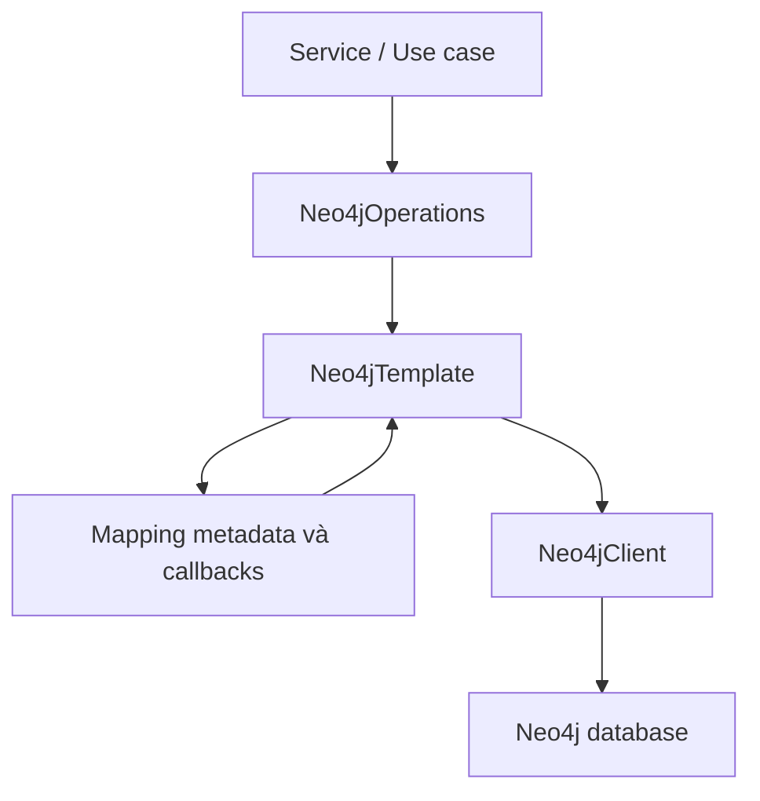

# Thực hiện CRUD mà không cần khai báo repository cho từng kiểu

Trong Spring Data Neo4j (SDN), repository là cách phổ biến để đóng gói thao tác dữ liệu theo từng domain type. Tuy nhiên, ứng dụng không bắt buộc phải khai báo một interface repository cho mọi lớp `@Node`. `Neo4jTemplate` cung cấp các thao tác CRUD trực tiếp trên entity đã được ánh xạ; interface `Neo4jOperations` định nghĩa API mà template triển khai. Nhờ vậy, một service dùng chung có thể lưu, đọc, đếm và xóa nhiều kiểu entity bằng cách truyền `Class<T>` tương ứng.

Bài học thuộc module **SPRING_DATA_NEO4J**, tập trung xây dựng tầng dữ liệu đồ thị qua node entity, relationship, repository và Cypher. Ta dùng `Person`, `Movie` và relationship `ACTED_IN` để thực hiện các thao tác CRUD qua `Neo4jOperations`, sau đó chọn lúc nào nên dùng truy vấn Cypher chuyên biệt.

## 1. Neo4jTemplate là gì?

`Neo4jTemplate` là lớp cung cấp các thao tác làm việc với domain object đã được SDN mapping. Template triển khai `Neo4jOperations` và các API fluent cho tìm kiếm, lưu dữ liệu. Các repository đơn giản của SDN cũng ủy quyền thao tác cho template này.



`Neo4jOperations` là abstraction nên thường là kiểu nên inject vào service. Bean thực tế trong application context là `Neo4jTemplate` hoặc implementation tương ứng do cấu hình SDN cung cấp. Cách này giúp code phụ thuộc vào API operations thay vì khởi tạo hoặc quản lý trực tiếp template.

Trong ứng dụng Spring Boot có cấu hình Spring Data Neo4j hợp lệ, hãy inject bean do Spring quản lý:

```java
import org.springframework.data.neo4j.core.Neo4jOperations;
import org.springframework.stereotype.Service;

@Service
public class GraphService {

    private final Neo4jOperations neo4jOperations;

    public GraphService(Neo4jOperations neo4jOperations) {
        this.neo4jOperations = neo4jOperations;
    }
}
```

Không cần tự gọi `new Neo4jTemplate(...)` trong service. Template cần Neo4j client, mapping context, entity callbacks và cấu hình transaction phù hợp; Spring quản lý các thành phần đó trong application context.

## 2. Không cần repository riêng, nhưng entity vẫn cần mapping metadata

Neo4jTemplate làm việc với các domain class đã được SDN ánh xạ. Việc bỏ repository không có nghĩa là bỏ `@Node`, `@Id`, `@Relationship` hoặc các quy tắc mapping.

Ví dụ node `Person`:

```java
import java.util.ArrayList;
import java.util.List;

import org.springframework.data.annotation.Id;
import org.springframework.data.neo4j.core.schema.Direction;
import org.springframework.data.neo4j.core.schema.GeneratedValue;
import org.springframework.data.neo4j.core.schema.Node;
import org.springframework.data.neo4j.core.schema.Relationship;

@Node("Person")
public class Person {

    @Id
    @GeneratedValue
    private Long id;

    private String personId;
    private String name;
    private Integer born;

    @Relationship(type = "ACTED_IN", direction = Direction.OUTGOING)
    private List<Movie> actedIn = new ArrayList<>();

    // Constructor, getter và setter được lược bỏ.
}
```

Node `Movie`:

```java
import org.springframework.data.annotation.Id;
import org.springframework.data.neo4j.core.schema.GeneratedValue;
import org.springframework.data.neo4j.core.schema.Node;

@Node("Movie")
public class Movie {

    @Id
    @GeneratedValue
    private Long id;

    private String movieId;
    private String title;
    private Integer released;

    // Constructor không tham số, getter và setter được lược bỏ.
}
```

`Person` và `Movie` vẫn là entity SDN bình thường. Điểm khác là service thao tác trực tiếp qua `Neo4jOperations` thay vì gọi `PersonRepository` hoặc `MovieRepository`.

## 3. Lưu một entity với save()

`save(T instance)` lưu entity được truyền vào và bao gồm các entity liên quan theo mapping graph của đối tượng. Kiểu trả về là chính kiểu entity đã lưu; hãy dùng đối tượng trả về vì quá trình persistence có thể gán ID, cập nhật version hoặc áp dụng entity callback.

```java
Person person = new Person();
person.setPersonId("P-1042");
person.setName("Keanu Reeves");
person.setBorn(1964);

Person savedPerson = neo4jOperations.save(person);
```

Không cần khai báo `PersonRepository` để thực hiện thao tác trên. `Neo4jOperations` suy ra domain type từ instance được truyền vào.

Khi entity chứa relationship, `save()` có thể lưu cả phần graph liên quan được ánh xạ. Vì vậy, cần kiểm tra object graph trước khi gọi save: collection quan hệ đang rỗng, chưa tải hoặc chỉ chứa một phần dữ liệu có thể ảnh hưởng đến trạng thái relationship được ghi. Nếu chỉ muốn cập nhật một phần graph, hãy xác định rõ property nào được lưu và cân nhắc `saveAs` hoặc Cypher chuyên biệt.

## 4. Lưu nhiều entity với saveAll()

`saveAll(Iterable<T> instances)` lưu một tập entity cùng kiểu và trả về danh sách các entity đã lưu:

```java
import java.util.List;

Movie matrix = new Movie();
matrix.setMovieId("MOV-001");
matrix.setTitle("The Matrix");
matrix.setReleased(1999);

Movie johnWick = new Movie();
johnWick.setMovieId("MOV-002");
johnWick.setTitle("John Wick");
johnWick.setReleased(2014);

List<Movie> movies = List.of(
    matrix,
    johnWick
);

List<Movie> savedMovies = neo4jOperations.saveAll(movies);
```

Mỗi lần gọi `saveAll` chỉ cần truyền collection entity; không cần `MovieRepository`. Phương thức có generic type `T`, do đó một lần gọi xử lý các instance cùng kiểu. Nếu cần lưu các loại node khác nhau, có thể gọi `saveAll` riêng theo từng loại hoặc thiết kế một transaction bao quanh nhiều thao tác.

`saveAll` cũng lưu các entity liên quan theo mapping. Đừng xem nó như lệnh chỉ ghi các property scalar của node gốc. Với dữ liệu lớn, hãy chia batch có kích thước hợp lý thay vì nạp một collection rất lớn vào bộ nhớ.

## 5. Đọc entity theo ID với findById()

`findById(Object id, Class<T> domainType)` trả về `Optional<T>`. Tham số `domainType` cho biết SDN cần ánh xạ kết quả thành kiểu entity nào:

```java
Optional<Person> person = neo4jOperations.findById(42L, Person.class);

person.ifPresent(value ->
    System.out.println(value.getName())
);
```

`Person.class` là thông tin cần thiết để mapping context xác định label, ID property và cấu trúc relationship. Kiểu ID truyền vào phải tương thích với property `@Id` của entity.

Có thể dùng cùng một API để đọc loại entity khác:

```java
Optional<Movie> movie = neo4jOperations.findById(7L, Movie.class);
```

Chỉ thay `id` và `Class<T>`; không cần tạo thêm repository interface.

## 6. Đọc nhiều entity theo ID hoặc theo domain type

`findAllById(ids, domainType)` đọc các entity có ID nằm trong danh sách:

```java
import java.util.List;

List<Person> people = neo4jOperations.findAllById(
    List.of(10L, 11L, 12L),
    Person.class
);
```

`findAll(domainType)` đọc tất cả entity của kiểu đã chỉ định:

```java
List<Movie> movies = neo4jOperations.findAll(Movie.class);
```

Hai phương thức đều trả về `List<T>`. `findAll(Movie.class)` có thể tải một lượng dữ liệu lớn nếu label có nhiều node. Không dùng nó cho endpoint danh sách lớn mà không có giới hạn; hãy dùng fluent find API hoặc Cypher có `SKIP`/`LIMIT` phù hợp.

## 7. Kiểm tra tồn tại và đếm entity

Template cung cấp `existsById(id, domainType)` và `count(domainType)`:

```java
boolean exists = neo4jOperations.existsById(42L, Person.class);

long personCount = neo4jOperations.count(Person.class);
long movieCount = neo4jOperations.count(Movie.class);
```

`existsById` kiểm tra entity theo ID trong phạm vi domain type. `count(Class<?>)` đếm số entity thuộc kiểu đó. Nếu cần đếm theo điều kiện graph phức tạp, hãy dùng `count(cypherQuery, parameters)` với Cypher trả về một giá trị đếm.

## 8. Xóa entity theo ID và theo domain type

`Neo4jOperations` cung cấp các thao tác xóa theo ID và theo kiểu entity:

```java
import java.util.List;

neo4jOperations.deleteById(42L, Person.class);

neo4jOperations.deleteAllById(
    List.of(10L, 11L),
    Movie.class
);
```

`deleteById` và `deleteAllById` được API mô tả là xóa entity cùng các entity liên quan. Do đó, hãy xem xét cẩn thận graph mapping và node dùng chung trước khi gọi. Một node `Movie` có thể được nhiều `Person` tham chiếu; không nên giả định thao tác xóa entity sẽ luôn chỉ xóa một node gốc và một cạnh.

`deleteAll(domainType)` xóa toàn bộ entity của domain type được truyền vào:

```java
neo4jOperations.deleteAll(Movie.class);
```

Đây là thao tác phạm vi rộng, cần được bảo vệ bởi quyền nghiệp vụ và kiểm tra dữ liệu. Không nhầm nó với xóa toàn bộ database hoặc xóa mọi loại node trong graph.

Nếu yêu cầu chỉ xóa một relationship cụ thể mà giữ lại hai node ở hai đầu, hãy dùng Cypher tường minh qua `Neo4jClient` hoặc một truy vấn chuyên biệt. API CRUD theo entity không thay thế mọi thao tác graph-level.

## 9. Một lớp CRUD dùng chung cho nhiều entity

Vì các phương thức của `Neo4jOperations` nhận kiểu entity qua generic hoặc `Class<T>`, ta có thể viết một lớp tiện ích dùng chung:

```java
import java.util.List;
import java.util.Optional;

import org.springframework.data.neo4j.core.Neo4jOperations;
import org.springframework.stereotype.Component;

@Component
public class GraphCrudOperations {

    private final Neo4jOperations neo4j;

    public GraphCrudOperations(Neo4jOperations neo4j) {
        this.neo4j = neo4j;
    }

    public <T> T save(T entity) {
        return neo4j.save(entity);
    }

    public <T> List<T> saveAll(Iterable<T> entities) {
        return neo4j.saveAll(entities);
    }

    public <T> Optional<T> findById(Object id, Class<T> domainType) {
        return neo4j.findById(id, domainType);
    }

    public <T> List<T> findAll(Class<T> domainType) {
        return neo4j.findAll(domainType);
    }

    public <T> List<T> findAllById(
            Iterable<?> ids, Class<T> domainType) {
        return neo4j.findAllById(ids, domainType);
    }

    public <T> boolean existsById(Object id, Class<T> domainType) {
        return neo4j.existsById(id, domainType);
    }

    public long count(Class<?> domainType) {
        return neo4j.count(domainType);
    }

    public <T> void deleteById(Object id, Class<T> domainType) {
        neo4j.deleteById(id, domainType);
    }

    public void deleteAll(Class<?> domainType) {
        neo4j.deleteAll(domainType);
    }
}
```

Service có thể dùng cùng bean cho nhiều loại entity:

```java
Person savedPerson = graphCrudOperations.save(person);
Optional<Movie> movie = graphCrudOperations.findById(7L, Movie.class);
long totalMovies = graphCrudOperations.count(Movie.class);
```

`Class<T>` giúp phương thức đọc biết rõ kiểu entity cần trả về. Đây là một điểm quan trọng khi dùng API tổng quát: Java không thể suy ra domain type chỉ từ ID vì generic type bị xóa ở runtime.

Lớp tiện ích này chỉ nên chứa thao tác CRUD thực sự dùng chung. Quy tắc nghiệp vụ như đăng ký người, kiểm tra quyền xóa phim hoặc cập nhật credit vẫn nên nằm trong service chuyên biệt theo use case.

## 10. Dùng Cypher tùy chỉnh và vẫn ánh xạ thành entity

Khi CRUD theo ID chưa đủ, `Neo4jOperations` có các phương thức nhận Cypher và tham số. `findAll(cypherQuery, parameters, domainType)` thực thi truy vấn rồi ánh xạ kết quả về domain type được chỉ định.

Ví dụ tìm người đã tham gia một phim:

```java
import java.util.Map;

String cypher = """
    MATCH (p:Person)-[:ACTED_IN]->(m:Movie)
    WHERE m.title = $title
    RETURN DISTINCT p
    ORDER BY p.name
    """;

List<Person> actors = neo4jOperations.findAll(
    cypher,
    Map.of("title", "The Matrix"),
    Person.class
);
```

`Person.class` yêu cầu SDN ánh xạ node được trả về thành `Person`. Vì vậy, truy vấn phải trả về node phù hợp, ví dụ `RETURN p`; nếu chỉ trả về `p.name`, kết quả là scalar chứ không còn là entity `Person`.

Nếu entity có relationship cần sử dụng, đừng mặc định `RETURN p` sẽ hydrate mọi node và relationship liên quan ở mọi độ sâu. Custom query phải trả về cấu trúc graph phù hợp với mapping mà entity yêu cầu; hãy kiểm thử kết quả quan hệ, hoặc dùng thao tác đọc chuẩn khi cần graph theo mapping mặc định.

Đọc một kết quả với `findOne`:

```java
Optional<Person> actor = neo4jOperations.findOne(
    """
    MATCH (p:Person {personId: $personId})
    RETURN p
    """,
    Map.of("personId", "P-1042"),
    Person.class
);
```

Đếm kết quả theo điều kiện:

```java
long actorCount = neo4jOperations.count(
    """
    MATCH (p:Person)-[:ACTED_IN]->(m:Movie)
    WHERE m.title = $title
    RETURN count(DISTINCT p)
    """,
    Map.of("title", "The Matrix")
);
```

Luôn dùng tham số Cypher thay vì nối trực tiếp dữ liệu đầu vào vào chuỗi query. `DISTINCT` hữu ích khi một node `Person` có nhiều relationship khớp và không được xuất hiện lặp trong kết quả.

## 11. Giao dịch khi một use case có nhiều thao tác

Nếu một nghiệp vụ cần nhiều lần đọc/ghi, hãy đặt ranh giới transaction ở service bằng `@Transactional`:

```java
import org.springframework.stereotype.Service;
import org.springframework.transaction.annotation.Transactional;
import java.util.Map;

@Service
public class PersonRegistrationService {

    private final Neo4jOperations neo4j;

    public PersonRegistrationService(Neo4jOperations neo4j) {
        this.neo4j = neo4j;
    }

    @Transactional
    public Person register(Person person) {
        if (person.getPersonId() == null || person.getPersonId().isBlank()) {
            throw new IllegalArgumentException("personId is required");
        }

        boolean alreadyRegistered = neo4j.count(
            "MATCH (p:Person {personId: $personId}) RETURN count(p)",
            Map.of("personId", person.getPersonId())
        ) > 0;

        if (alreadyRegistered) {
            throw new IllegalStateException("Person already exists");
        }

        return neo4j.save(person);
    }
}
```

Đây là ví dụ minh họa ranh giới transaction và kiểm tra nghiệp vụ; kiểu ID phải khớp với mapping thực tế của entity. Nếu hệ thống có nhiều request đồng thời cùng đăng ký một mã, thao tác kiểm tra rồi `save` không thay thế uniqueness constraint ở Neo4j. Hãy tạo constraint cho ID nghiệp vụ và xử lý xung đột ghi.

Khi một phương thức service được đánh dấu `@Transactional`, các thao tác Neo4j tham gia transaction manager tương ứng có thể cùng commit hoặc rollback. Đừng mở nhiều transaction độc lập nếu các bước cần tính nguyên tử.

## 12. Giới hạn dữ liệu và thao tác theo phần graph

`findAll(Class<T>)` tải toàn bộ entity của một loại vào `List`; phù hợp với tập dữ liệu nhỏ hoặc tác vụ quản trị có giới hạn, nhưng không phù hợp để trả toàn bộ dữ liệu lớn qua API. Có thể dùng `findAll` với Cypher chứa `ORDER BY`, `SKIP` và `LIMIT`:

```java
import java.util.List;
import java.util.Map;

List<Movie> movies = neo4jOperations.findAll(
    """
    MATCH (m:Movie)
    WHERE m.released >= $fromYear
    RETURN m
    ORDER BY m.released DESC, m.title ASC
    SKIP $skip
    LIMIT $limit
    """,
    Map.of(
        "fromYear", 2000,
        "skip", 0,
        "limit", 20
    ),
    Movie.class
);
```

Nếu cần kiểm soát property nào được lưu, API `saveAs` cho phép giới hạn graph theo predicate hoặc kiểu projection. Tuy nhiên, khi muốn cập nhật property của association, predicate phải bao gồm association đó. Đối tượng trả về có thể không được hydrate đầy đủ; không nên dùng nó làm input cho lần save tiếp theo nếu chưa hiểu rõ phần graph đã được chọn.

Nếu use case cần xóa riêng một relationship, cập nhật một property trên cạnh hoặc thao tác graph không tương ứng với toàn bộ entity mapping, hãy dùng Cypher qua `Neo4jClient`. Chọn API theo đơn vị dữ liệu thực sự cần thay đổi.

## 13. Neo4jOperations, Neo4jTemplate và repository

| Cách truy cập | Phù hợp khi | Đặc điểm |
|---|---|---|
| `Neo4jRepository<T, ID>` | Domain type có bộ truy vấn và CRUD riêng | Interface rõ theo aggregate; hỗ trợ derived query và custom query |
| `Neo4jOperations` | Nhiều loại entity cần CRUD chung hoặc service muốn dùng API mapping trực tiếp | API tổng quát; truyền `Class<T>` khi đọc, đếm hoặc xóa |
| `Neo4jTemplate` | Cần các fluent find/save operation do template triển khai | Lớp implementation kết hợp các operations và fluent API |
| `Neo4jClient` | Cần kiểm soát Cypher, kết quả và mapping chi tiết | Làm việc gần với truy vấn và kết quả driver hơn |

Không cần loại bỏ repository khỏi mọi ứng dụng. Repository vẫn hữu ích khi mỗi aggregate có truy vấn nghiệp vụ riêng, method name diễn đạt rõ use case hoặc cần custom repository. Neo4jTemplate là lựa chọn phù hợp khi CRUD tổng quát đã đủ và không muốn tạo nhiều interface chỉ để gọi các thao tác cơ bản.

## 14. Lỗi thường gặp

| Lỗi | Hệ quả | Cách xử lý |
|---|---|---|
| Nghĩ rằng không cần `@Node` hoặc `@Id` khi dùng template | SDN không có mapping metadata cần thiết | Giữ entity mapping như khi dùng repository |
| Truyền sai `Class<T>` vào `findById` | Mapping theo domain type không đúng | Dùng class tương ứng với node và ID |
| Truyền ID không đúng kiểu | Không tìm được entity hoặc truy vấn không khớp | Kiểm tra kiểu `@Id` và kiểu ID đầu vào |
| Gọi `findAll()` trên tập dữ liệu lớn | Tải quá nhiều dữ liệu vào bộ nhớ | Dùng Cypher có giới hạn hoặc fluent find phù hợp |
| Cho rằng `save()` chỉ ghi node gốc | Relationship và entity liên quan cũng có thể được lưu | Kiểm tra toàn bộ object graph trước khi save |
| Gọi `deleteById()` mà không xét node dùng chung | Có thể tác động tới các entity liên quan theo hợp đồng API | Kiểm tra mapping, shared node và thử nghiệm trên graph đại diện |
| Dùng `deleteAll(Class)` trong luồng nghiệp vụ thông thường | Xóa toàn bộ entity của domain type | Chỉ dùng trong tác vụ có phạm vi rõ và được bảo vệ |
| Nối chuỗi dữ liệu người dùng vào Cypher | Rủi ro injection và lỗi cú pháp | Dùng tham số có tên trong query |
| Dùng `existsById` như bảo đảm chống trùng | Hai request đồng thời vẫn có thể cùng vượt qua bước kiểm tra | Tạo uniqueness constraint ở Neo4j |
| Tự tạo `Neo4jTemplate` trong service | Bỏ qua cấu hình và bean lifecycle của Spring | Inject `Neo4jOperations` hoặc template do Spring quản lý |

## 15. Checklist sử dụng Neo4jTemplate

- Entity vẫn có `@Node`, `@Id` và mapping relationship phù hợp.
- Inject `Neo4jOperations` hoặc `Neo4jTemplate` từ Spring context.
- Dùng `save`/`saveAll` và kiểm tra các relationship có trong object graph.
- Truyền đúng ID và `Class<T>` cho `findById`, `findAllById`, `existsById`.
- Chỉ gọi `findAll(Class)` khi số lượng kết quả phù hợp với bộ nhớ.
- Dùng `count(Class)` cho tổng số entity theo domain type.
- Xác nhận phạm vi trước khi gọi `deleteById`, `deleteAllById` hoặc `deleteAll`.
- Dùng `@Transactional` khi một nghiệp vụ gồm nhiều thao tác cần commit/rollback cùng nhau.
- Dùng Cypher có tham số khi cần lọc theo relationship hoặc thao tác graph chuyên biệt.
- Tạo uniqueness constraint cho ID nghiệp vụ thay vì chỉ dựa vào `existsById`.
- Kiểm thử với node được nhiều entity khác tham chiếu trước khi dùng thao tác xóa.

## 16. Bài tập thực hành

1. Tạo entity `Person` và `Movie` có `@Node`, `@Id`, `@Relationship`; không khai báo repository cho hai kiểu này.
2. Inject `Neo4jOperations` vào một service và lưu một `Person` bằng `save()`.
3. Lưu một danh sách `Movie` bằng `saveAll()` và đọc lại bằng `findAllById()`.
4. Dùng `findById`, `existsById` và `count` cho cả `Person` lẫn `Movie` bằng cách truyền `Class<T>`.
5. Viết lớp `GraphCrudOperations` generic để dùng chung cho nhiều domain type.
6. Dùng `findAll(cypher, params, Person.class)` tìm người tham gia một phim và dùng `count(cypher, params)` đếm số người duy nhất.
7. Viết một service có `@Transactional` gồm bước kiểm tra ID và lưu entity; thêm uniqueness constraint để xử lý cạnh tranh ghi.
8. Kiểm tra tác động của `deleteById` với graph có node liên quan được chia sẻ; so sánh với truy vấn Cypher chỉ xóa một relationship.
9. Thay `findAll(Movie.class)` bằng truy vấn có `ORDER BY`, `SKIP`, `LIMIT` và so sánh số lượng kết quả tải về.

Khi hoàn thành, bạn cần biết dùng `Neo4jOperations` như một API CRUD tổng quát, truyền `Class<T>` để chọn domain type và tận dụng mapping của SDN mà không phải khai báo repository riêng cho từng kiểu. Bạn cũng cần xác định lúc nào thao tác template đủ dùng và lúc nào cần Cypher để kiểm soát chính xác relationship hoặc phạm vi dữ liệu.

## Tài liệu tham khảo

- [Spring Data Neo4j — FAQ: Do I have to create repositories for each domain class?](https://docs.spring.io/spring-data/neo4j/reference/faq.html)
- [Spring Data Neo4j — Neo4jTemplate API 8.1.x](https://docs.spring.io/spring-data/neo4j/reference/api/java/org/springframework/data/neo4j/core/Neo4jTemplate.html)
- [Spring Data Neo4j — Neo4jOperations API](https://docs.spring.io/spring-data/neo4j/reference/api/java/org/springframework/data/neo4j/core/Neo4jOperations.html)
