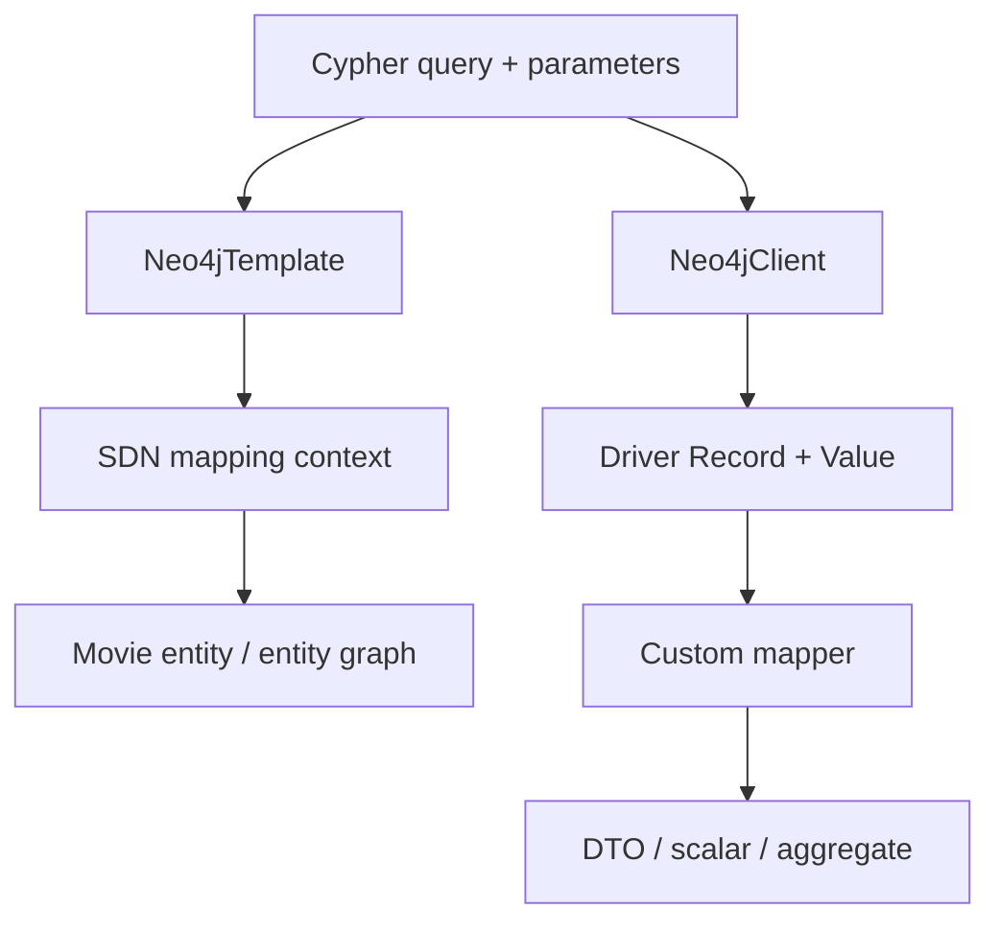

# Quyết định dùng template hay client cho kết quả ngoài mô hình miền

Spring Data Neo4j (SDN) cung cấp hai API thường dùng khi cần chạy Cypher tùy chỉnh: `Neo4jTemplate` và `Neo4jClient`. Cả hai đều thực thi truy vấn có tham số và có thể tham gia transaction do Spring quản lý, nhưng chúng phục vụ hai kiểu kết quả khác nhau.

`Neo4jTemplate` phù hợp khi kết quả là entity thuộc mô hình miền và cần SDN ánh xạ node, property cùng relationship theo metadata entity. `Neo4jClient` phù hợp khi kết quả có hình dạng riêng cho một use case: scalar, DTO, projection, dữ liệu tổng hợp hoặc các cột được trả về bằng alias. Với những kết quả này, ứng dụng chủ động ánh xạ từng record sang kiểu Java mong muốn.

Quyết định nên dựa vào **hình dạng kết quả và trách nhiệm mapping**, không chỉ dựa vào việc câu truy vấn đơn giản hay phức tạp.

## 1. Hai API và hai trách nhiệm mapping

Giả sử graph có node `Movie`, `Actor` và `Review`, được nối bằng relationship `ACTED_IN` và `REVIEWED`. Một màn hình chi tiết phim cần tải entity `Movie` để áp dụng quy tắc miền. Một màn hình báo cáo lại cần tiêu đề, số lượng review và điểm trung bình. Hai use case có thể cùng truy vấn graph nhưng không cần cùng kiểu kết quả.



| Tiêu chí | `Neo4jTemplate` | `Neo4jClient` |
|---|---|---|
| Mục tiêu chính | Làm việc với entity được SDN quản lý | Thực thi Cypher và đọc kết quả linh hoạt |
| Mapping | Dựa trên metadata entity, conversion và mapping của SDN | Ứng dụng định nghĩa cách đọc từng record |
| Kết quả phù hợp | `Movie`, `Actor`, entity graph | DTO, scalar, aggregate, map, projection tùy chỉnh |
| Relationship | Ánh xạ theo mô hình entity và dữ liệu truy vấn trả về | Tự đọc các cột, node hoặc relationship cần thiết |
| Mức kiểm soát | Cao ở cấp entity/domain mapping | Cao ở cấp record và từng cột kết quả |
| Mã mapping | Thường ít mã hơn khi trả entity | Cần mapper rõ ràng, đổi lại kiểm soát hình dạng kết quả |

`Neo4jTemplate` được xây dựng trên hạ tầng truy cập dữ liệu của SDN. `Neo4jClient` là abstraction gần với Neo4j Java Driver hơn, cung cấp cách bind tham số và ánh xạ kết quả mà không buộc kết quả phải là một entity miền.

## 2. Khi kết quả là entity: chọn Neo4jTemplate

Khi truy vấn trả về node `Movie` và ứng dụng muốn nhận một đối tượng `Movie`, `Neo4jTemplate` là lựa chọn tự nhiên:

```java
public Optional<Movie> findMovie(String movieId) {
    return neo4jTemplate.findOne(
            """
            MATCH (m:Movie {id: $id})
            RETURN m
            """,
            Map.of("id", movieId),
            Movie.class);
}
```

Template nhận câu Cypher, map tham số và kiểu domain `Movie`. SDN dùng metadata của entity để ánh xạ kết quả, bao gồm ID, property và các conversion đã cấu hình.

Khi cần nhiều entity cùng kiểu:

```java
public List<Movie> findPublishedMovies() {
    return neo4jTemplate.findAll(
            """
            MATCH (m:Movie {status: $status})
            RETURN m
            ORDER BY m.title
            """,
            Map.of("status", "PUBLISHED"),
            Movie.class);
}
```

Chọn template khi phần còn lại của ứng dụng cần entity miền thực sự: gọi phương thức nghiệp vụ trên entity, dùng repository tiếp tục thao tác, hoặc làm việc với graph đã được SDN ánh xạ. Nếu cần quan hệ, bảo đảm truy vấn trả về cấu trúc node/relationship mà mapping của SDN cần; `RETURN m` không có nghĩa mọi node có thể đi tới đều tự động được tải.

### Mapping entity không đồng nghĩa tải toàn bộ graph

Một entity có thể khai báo nhiều trường `@Relationship`. Truy vấn chỉ đọc một node hoặc chỉ trả một phần pattern không tự động tải tất cả relationship của node. Dữ liệu được ánh xạ phụ thuộc vào Cypher trả về và cách SDN xử lý kết quả.

Nếu use case cần `Movie` cùng các `Actor` tham gia, hãy thiết kế query và kết quả để SDN nhận được phần graph cần thiết. Kiểm thử mapping với Neo4j thật hoặc Testcontainers, đặc biệt khi có relationship properties. Không giả định một entity trả về luôn chứa toàn bộ graph.

## 3. Khi kết quả nằm ngoài entity: chọn Neo4jClient

Một báo cáo có thể cần dữ liệu tính toán mà không có entity tương ứng trong domain:

- Tổng số review của phim.
- Điểm đánh giá trung bình.
- Số lượng diễn viên tham gia.
- Một nhãn hiển thị được ghép từ nhiều property.
- Các giá trị được nhóm hoặc tổng hợp theo tháng.

Không cần tạo một entity giả chỉ để chứa kết quả báo cáo. Hãy khai báo DTO biểu diễn đúng dữ liệu truy vấn:

```java
public record MovieReviewSummary(
        String title,
        Long reviewCount,
        Double averageScore) {
}
```

Dùng `Neo4jClient` để lấy các cột có alias và ánh xạ trực tiếp sang DTO:

```java
public Optional<MovieReviewSummary> findReviewSummary(String movieId) {
    return neo4jClient.query("""
            MATCH (m:Movie {id: $id})
            OPTIONAL MATCH (m)<-[:REVIEWED]-(r:Review)
            RETURN m.title AS title,
                   count(r) AS reviewCount,
                   avg(r.score) AS averageScore
            """)
            .bind(movieId).to("id")
            .fetchAs(MovieReviewSummary.class)
            .mappedBy((typeSystem, record) -> new MovieReviewSummary(
                    record.get("title").asString(),
                    record.get("reviewCount").asLong(),
                    record.get("averageScore").isNull()
                            ? null
                            : record.get("averageScore").asDouble()))
            .one();
}
```

Kết quả là `Optional<MovieReviewSummary>` vì nếu không có node `Movie` phù hợp thì không có record. Nếu phim tồn tại nhưng chưa có review, `count(r)` là `0` và `avg(r.score)` là `null`. Mapper xử lý rõ trường hợp null trước khi chuyển sang `Double`.

`fetchAs(MovieReviewSummary.class)` khai báo kiểu kết quả mà client sẽ tạo. `mappedBy(...)` định nghĩa cách chuyển một `Record` của Driver thành DTO. Alias `title`, `reviewCount`, `averageScore` là hợp đồng giữa Cypher và mapper; đổi alias thì cần cập nhật mapper tương ứng.

## 4. Neo4jClient cho scalar và danh sách giá trị

Nếu kết quả chỉ là một giá trị, không cần khai báo entity hoặc DTO:

```java
public Optional<Long> countPublishedMovies() {
    return neo4jClient.query("""
            MATCH (m:Movie {status: $status})
            RETURN count(m) AS total
            """)
            .bind("PUBLISHED").to("status")
            .fetchAs(Long.class)
            .mappedBy((typeSystem, record) -> record.get("total").asLong())
            .one();
}
```

Với danh sách tiêu đề:

```java
public List<String> findMovieTitles(String status) {
    return neo4jClient.query("""
            MATCH (m:Movie {status: $status})
            RETURN m.title AS title
            ORDER BY title
            """)
            .bind(status).to("status")
            .fetchAs(String.class)
            .mappedBy((typeSystem, record) -> record.get("title").asString())
            .all();
}
```

Đây là các kết quả không cần SDN khởi tạo entity `Movie`. Dùng kiểu trả về trực tiếp giúp API của repository hoặc query service thể hiện rõ dữ liệu mà caller nhận được.

## 5. Đọc các kiểu dữ liệu từ Record

Mapper của `Neo4jClient` nhận `Record` và `TypeSystem`. Mỗi cột trong record được truy cập bằng alias trong `RETURN`, sau đó chuyển từ Neo4j `Value` sang kiểu Java phù hợp.

| Neo4j Value | Cách đọc thường dùng | Lưu ý |
|---|---|---|
| Chuỗi | `asString()` | Chỉ dùng khi cột có giá trị kiểu chuỗi và không null |
| Số nguyên | `asLong()` hoặc `asInt()` | Chọn kiểu phù hợp với miền giá trị |
| Số thực | `asDouble()` | Kiểm tra null với kết quả aggregate như `avg` |
| Boolean | `asBoolean()` | Kiểm tra alias và kiểu trả về |
| Ngày | `asLocalDate()` | Phù hợp property Neo4j `DATE` |
| Ngày giờ địa phương | `asLocalDateTime()` | Không mang thông tin múi giờ |
| Map | `asMap()` hoặc đọc từng key | Kiểm tra kiểu value lồng nhau |
| List | `asList(...)` | Cần mapper cho phần tử nếu là cấu trúc phức tạp |
| Node / Relationship | API chuyển đổi tương ứng của Driver | Không tự động trở thành entity SDN chỉ vì lấy được Node |

Với cột có thể null, dùng `Value.isNull()` trước khi gọi accessor chuyển kiểu:

```java
Double score = record.get("averageScore").isNull()
        ? null
        : record.get("averageScore").asDouble();
```

Không nên dùng `asString()` hoặc `asLong()` một cách mù quáng với mọi cột. Nếu Cypher trả `null`, kiểu khác dự kiến hoặc alias bị đổi, mapper có thể ném lỗi. Một mapper rõ ràng giúp lỗi xuất hiện gần ranh giới dữ liệu và dễ chẩn đoán.

## 6. DTO có cấu trúc lồng nhau

`Neo4jClient` hữu ích khi một truy vấn trả về cấu trúc không phải entity graph, ví dụ danh sách credit được gom thành một cột. Có thể dùng Cypher map projection:

```cypher
MATCH (m:Movie {id: $id})
OPTIONAL MATCH (a:Actor)-[credit:ACTED_IN]->(m)
RETURN m.title AS title,
       collect({
           actorName: a.name,
           characterName: credit.characterName,
           billingOrder: credit.billingOrder
       }) AS credits
```

DTO Java có thể biểu diễn cấu trúc:

```java
public record ActingCreditView(
        String actorName,
        String characterName,
        Integer billingOrder) {
}

public record MovieCastView(
        String title,
        List<ActingCreditView> credits) {
}
```

Mapper sẽ đọc `credits` như một list các map và chuyển từng phần tử thành `ActingCreditView`. Khi dùng kiểu kết quả lồng nhau, cần kiểm tra trường hợp `OPTIONAL MATCH` không tìm thấy actor: `collect` có thể chứa map với các giá trị null tùy biểu thức. Có thể lọc phần tử null ngay trong Cypher hoặc bỏ qua trong mapper để DTO có collection rỗng đúng nghĩa.

Đừng dùng DTO này làm entity `Movie` hoặc truyền nó vào `movieRepository.save(...)`. Nó là hình dạng đọc được thiết kế riêng cho một màn hình hoặc response API.

## 7. Cùng một use case: template hay client?

Có thể so sánh hai yêu cầu với cùng node `Movie`:

**Yêu cầu A — lấy phim để chỉnh sửa**

Ứng dụng cần entity `Movie`, kiểm tra quy tắc miền rồi thay đổi trạng thái. Dùng `Neo4jTemplate` hoặc repository:

```java
Movie movie = neo4jTemplate.findOne(
        "MATCH (m:Movie {id: $id}) RETURN m",
        Map.of("id", movieId),
        Movie.class)
    .orElseThrow(() -> new IllegalArgumentException("Movie not found"));

movie.publish();
movieRepository.save(movie);
```

Đây là luồng entity/domain. Entity cần được tải đủ cho quy tắc nghiệp vụ mà `publish()` thực hiện.

**Yêu cầu B — trả dữ liệu cho dashboard**

Dashboard chỉ cần tiêu đề, số review và điểm trung bình. Dùng `Neo4jClient` với DTO `MovieReviewSummary`. Truy vấn chỉ trả các cột cần thiết, mapper tạo DTO. Không tải toàn bộ `Movie`, `Review` hoặc relationship nếu dashboard không cần thao tác miền trên các entity đó.

| Câu hỏi | Nếu câu trả lời là “có” | Hướng chọn |
|---|---|---|
| Caller cần entity miền để tiếp tục thao tác? | Có | `Neo4jTemplate` |
| Cần SDN ánh xạ relationship theo metadata entity? | Có | `Neo4jTemplate`, với query trả đủ graph cần thiết |
| Kết quả là số, chuỗi hoặc boolean? | Có | `Neo4jClient` |
| Kết quả là aggregate, report hoặc DTO theo màn hình? | Có | `Neo4jClient` |
| Cypher trả các cột có alias khác với property entity? | Có | Thường chọn `Neo4jClient` |
| Cần kiểm soát mapper từng record hoặc cấu trúc lồng nhau? | Có | `Neo4jClient` |

## 8. Đặt API truy vấn ở đúng tầng

Không nên để controller tự gọi `Neo4jClient` và tự đọc từng cột. Đặt truy vấn trong repository fragment hoặc query service để giữ trách nhiệm truy cập dữ liệu tập trung.

Ví dụ interface cho báo cáo:

```java
public interface MovieReportRepository {
    Optional<MovieReviewSummary> findReviewSummary(String movieId);
}
```

Lớp triển khai fragment có thể nhận `Neo4jClient` qua constructor. Phương thức `findReviewSummary` đặt câu Cypher và mapper như ví dụ ở mục 3. Nếu fragment được gắn vào `MovieRepository`, khai báo `extends MovieReportRepository`. Nếu báo cáo không gắn chặt với aggregate `Movie`, một query service hoặc repository chuyên biệt cũng là lựa chọn hợp lý.

Quy tắc phân tầng:

- Controller nhận request và trả response DTO.
- Service điều phối nghiệp vụ và transaction.
- Repository/fragment hoặc query service thực thi Cypher, bind tham số và ánh xạ kết quả.
- DTO/projection thể hiện hình dạng dữ liệu đọc; entity thể hiện mô hình miền.

## 9. Parameter binding và an toàn truy vấn

`Neo4jClient` cung cấp API bind tham số:

```java
neo4jClient.query("""
        MATCH (m:Movie)
        WHERE m.title = $title
        RETURN m.title AS title
        """)
    .bind(title).to("title")
    .fetchAs(String.class)
    .mappedBy((typeSystem, record) -> record.get("title").asString())
    .all();
```

Không nối giá trị người dùng vào chuỗi Cypher. Parameter giúp tách cấu trúc query khỏi giá trị, tránh injection qua literal và cho phép database tái sử dụng query plan khi cấu trúc ổn định.

Parameter chỉ thay thế được giá trị, không thay thế trực tiếp tên label, relationship type hoặc property. Nếu cần chọn cấu trúc theo request, hãy dùng allowlist để ánh xạ lựa chọn sang một trong các biểu thức hoặc câu truy vấn đã được ứng dụng kiểm soát.

## 10. Transaction: cả hai API đều có thể tham gia Spring transaction

Khi dùng bean `Neo4jTemplate` hoặc `Neo4jClient` do Spring quản lý, thao tác có thể tham gia transaction Spring đang hoạt động. Đặt ranh giới transaction ở service khi một use case gồm nhiều truy vấn:

```java
@Transactional(readOnly = true)
public MovieReviewSummary loadSummary(String movieId) {
    return reportRepository.findReviewSummary(movieId)
            .orElseThrow(() -> new IllegalArgumentException("Movie not found"));
}
```

Với thao tác ghi, dùng `@Transactional` mặc định read/write. `readOnly = true` phù hợp cho luồng đọc; không đánh dấu một service có `CREATE`, `MERGE`, `SET`, `REMOVE` hoặc `DELETE` là read-only.

`Neo4jClient` không có nghĩa là transaction riêng tách khỏi Spring. Nó tích hợp với transaction infrastructure của SDN. Điều này khác với việc tự mở `Session` và gọi `executeRead`/`executeWrite` qua Driver API trực tiếp: transaction do Driver tự quản lý không tự tham gia transaction Spring.

## 11. Hiệu năng và lượng dữ liệu trả về

Chọn client hay template không tự quyết định hiệu năng. Điều quan trọng là query có đọc quá nhiều node, relationship hoặc property so với nhu cầu không.

- Dùng template khi thực sự cần entity và phần graph phục vụ quy tắc miền.
- Dùng client khi chỉ cần một số cột, aggregate hoặc DTO.
- Tránh tải entity graph lớn chỉ để lấy một số đếm hoặc giá trị trung bình.
- Tránh truy vấn N+1 khi DTO cần thông tin từ nhiều node; cân nhắc gom pattern và aggregate trong một query.
- Dùng index/constraint cho điều kiện tìm kiếm phù hợp.
- Kiểm tra Cypher và kế hoạch bằng `EXPLAIN`/`PROFILE` trên dữ liệu đại diện.
- Không trả về node/relationship thô cho tầng API nếu caller chỉ cần DTO có cấu trúc ổn định.

`Neo4jClient` cho phép chọn chính xác các cột trả về, nhưng đổi lại mapper là trách nhiệm của ứng dụng. `Neo4jTemplate` giảm mã mapping entity, nhưng không nên bị dùng để ép mọi báo cáo thành một entity miền.

## 12. Những lỗi thường gặp

| Lỗi | Hậu quả | Cách xử lý |
|---|---|---|
| Dùng `Neo4jTemplate` để ánh xạ aggregate thành entity không đúng mô hình | Entity có field không phản ánh dữ liệu miền, khó dùng và dễ bị lưu sai | Trả DTO bằng `Neo4jClient` |
| Tạo entity giả chỉ để chứa `count` hoặc `avg` | Trộn dữ liệu báo cáo với mô hình miền | Tạo DTO/projection riêng |
| Dùng `Neo4jClient` nhưng quên alias hoặc mapper đọc sai alias | Lỗi runtime hoặc dữ liệu sai cột | Đặt alias rõ ràng và test mapper |
| Gọi `asString()` trên giá trị có thể null | Lỗi chuyển đổi | Kiểm tra `Value.isNull()` trước |
| Nghĩ `Neo4jTemplate` tự tải mọi relationship | Entity graph thiếu dữ liệu cần thiết | Thiết kế query trả đủ graph và kiểm thử mapping |
| Dùng `Neo4jClient` rồi trả `Record` ra controller | Tầng API phụ thuộc Driver và cấu trúc query | Ánh xạ sang DTO trong repository/query service |
| Nối request vào Cypher | Nguy cơ injection và lỗi cú pháp | Bind parameter |
| Dùng Driver session trực tiếp trong Spring transaction và kỳ vọng cùng commit | Hai transaction không tự phối hợp | Dùng `Neo4jClient`/`Neo4jTemplate` hoặc quản lý Driver transaction riêng |
| Tải entity lớn chỉ để làm báo cáo | Tốn I/O và bộ nhớ | Chọn cột cần thiết bằng `Neo4jClient` |

## 13. Checklist chọn API

1. Kết quả có phải entity được khai báo bằng `@Node` không?
2. Caller có cần hành vi miền hoặc tiếp tục lưu entity không?
3. Query có trả đủ node/relationship mà mapping entity cần không?
4. Kết quả thực chất là scalar, count, average, report hoặc DTO không?
5. Các cột trả về đã có alias ổn định chưa?
6. Mapper đã xử lý `null`, kiểu số, ngày giờ và collection chưa?
7. Query có dùng parameter cho toàn bộ giá trị đầu vào không?
8. Truy vấn nằm trong repository/query service và transaction ở service chưa?
9. Có integration test xác nhận mapping và kết quả trên Neo4j thật không?
10. Query có tải đúng lượng dữ liệu caller cần không?

## 14. Tự kiểm tra

1. Khác biệt chính giữa mapping của `Neo4jTemplate` và `Neo4jClient` là gì?
2. Khi nào nên dùng `Neo4jTemplate.findOne` hoặc `findAll`?
3. Vì sao kết quả `count`, `avg` hoặc một DTO báo cáo phù hợp với `Neo4jClient`?
4. `fetchAs(...).mappedBy(...)` đảm nhiệm những bước nào?
5. Vì sao cần đặt alias rõ ràng trong `RETURN`?
6. Cách xử lý một cột có thể null trong `Record` là gì?
7. Vì sao không nên trả `Record` trực tiếp ra controller?
8. `Neo4jClient` có tham gia transaction Spring không? Nó khác Driver transaction thủ công ở điểm nào?
9. Khi query trả entity có relationship, vì sao phải xác minh cấu trúc graph được trả về?
10. Tiêu chí nào giúp chọn API theo nhu cầu thay vì chỉ theo độ dài câu Cypher?

Khi phân biệt được kết quả entity và kết quả ngoài mô hình miền, người học có thể dùng `Neo4jTemplate` để tận dụng mapping của SDN, dùng `Neo4jClient` để kiểm soát DTO và dữ liệu tổng hợp, đồng thời giữ transaction và truy vấn ở đúng tầng trong ứng dụng Spring Data Neo4j.

## Tài liệu tham khảo

- [Spring Data Neo4j Reference — Neo4jTemplate và Neo4jClient](https://docs.spring.io/spring-data/neo4j/reference/appendix/neo4j-client.html)
- [Neo4j Java Driver — Transactions](https://neo4j.com/docs/java-manual/current/transactions/)
- [Spring Data Neo4j Reference — Object mapping](https://docs.spring.io/spring-data/neo4j/reference/object-mapping.html)
