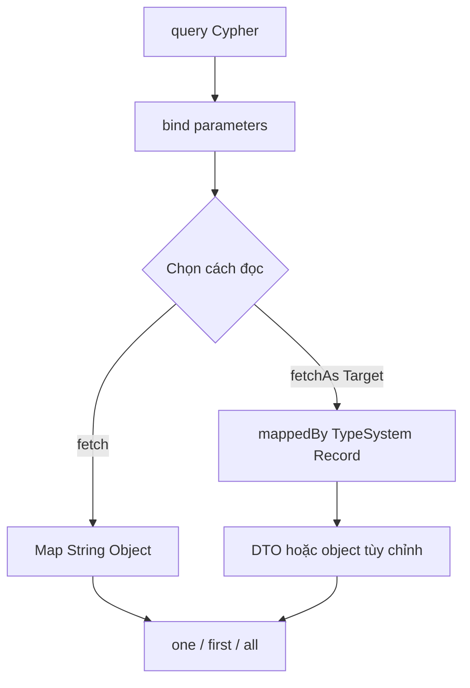

# `fetchAs` và `mappedBy` cho DTO hoặc kết quả tùy chỉnh

`Neo4jClient` cho phép chạy Cypher tùy chỉnh và tự quyết định cách chuyển từng dòng kết quả thành kiểu Java mà ứng dụng cần. Khi query trả về DTO, record Java, dữ liệu tổng hợp hoặc một cấu trúc không tương ứng với `@Node` entity, cặp API `fetchAs(...).mappedBy(...)` là điểm mở rộng quan trọng.

`fetchAs(Target.class)` khai báo kiểu kết quả mong muốn cho mỗi dòng. `mappedBy(...)` nhận một hàm ánh xạ để chuyển một `Record` của Neo4j Java Driver thành một object thuộc kiểu đó. Hàm ánh xạ nhận cả `TypeSystem` và `Record`, vì vậy có thể đọc giá trị scalar, danh sách, node hoặc relationship theo đúng kiểu dữ liệu mà driver cung cấp.

Nếu chỉ cần kết quả dạng map, có thể dùng `fetch()` mà không cần viết mapper. Nếu query trả về node entity đã được SDN quản lý, có thể tái sử dụng mapping function từ `Neo4jMappingContext`. Chọn cách phù hợp giúp tách rõ truy vấn, cấu trúc dữ liệu trả về và trách nhiệm tạo object.

## 1. Luồng xử lý của Neo4jClient

Một truy vấn đọc với `Neo4jClient` thường đi qua các bước:

1. Khai báo Cypher bằng `query(...)`.
2. Gắn giá trị cho các placeholder như `$personId` bằng `bind(...).to(...)` hoặc `bindAll(...)`.
3. Chọn cách đọc kết quả bằng `fetch()`, hoặc chọn kiểu đích bằng `fetchAs(Target.class)`.
4. Với `fetchAs`, định nghĩa `mappedBy(...)` để ánh xạ từng `Record` thành một object.
5. Kết thúc bằng `one()`, `first()` hoặc `all()` tùy số lượng kết quả mong đợi.



`Neo4jClient` là lớp tiện ích mỏng trên Neo4j Java Driver và tích hợp với transaction management của Spring. Bài viết sử dụng imperative `Neo4jClient`; `ReactiveNeo4jClient` có vocabulary tương tự nhưng trả publisher và có API type riêng.

## 2. Khi nào nên dùng `fetch()` và khi nào dùng `fetchAs()`?

| Cách đọc | Kiểu kết quả | Khi nên dùng |
| --- | --- | --- |
| `fetch()` | `Map<String, Object>` cho mỗi dòng | Cần đọc nhanh các alias và xử lý map ở tầng gọi |
| `fetchAs(Dto.class).mappedBy(...)` | DTO hoặc object tùy chỉnh | Muốn có kiểu Java rõ ràng, bất biến, dễ kiểm thử |
| `fetchAs(Entity.class).mappedBy(...)` với mapper tự viết | Entity do ứng dụng tự tạo | Cần kiểm soát hoàn toàn cách tạo entity |
| `fetchAs(Dto.class).mappedBy(...)` kết hợp mapping function SDN | DTO chứa các entity con được SDN ánh xạ | Query trả về node đã có mapping metadata và cần tái sử dụng quy tắc entity |

`fetchAs` không tự suy ra constructor của DTO chỉ từ alias. Với custom mapping, chính hàm `mappedBy` chịu trách nhiệm tạo object cho mỗi record. Đây là điểm khác với một số cơ chế DTO projection của repository, nơi Spring Data có thể tự dựng object theo constructor hoặc property metadata.

Ví dụ, nếu chỉ cần map, không cần tạo DTO:

```java
import java.util.Collection;
import java.util.Map;

Collection<Map<String, Object>> rows = neo4jClient.query("""
        MATCH (p:Person)
        RETURN p.personId AS personId, p.name AS name
        ORDER BY name
        """)
    .fetch()
    .all();

String firstName = (String) rows.iterator().next().get("name");
```

Key trong mỗi map là tên cột hoặc alias được trả về từ Cypher. Vì map không có kiểu compile-time cho từng field, cần cast hoặc kiểm tra kiểu khi sử dụng.

## 3. Ví dụ cơ bản: ánh xạ một record thành Java record

Giả sử API cần danh sách thông tin gọn của người dùng: mã, tên và số đơn hàng. Cypher trả về các scalar đã đặt alias:

```cypher
MATCH (p:Person {personId: $personId})
OPTIONAL MATCH (p)-[:PLACED]->(o:Order)
RETURN p.personId AS personId,
       p.name AS name,
       count(o) AS orderCount
```

DTO có thể là Java record:

```java
public record PersonSummary(
    String personId,
    String name,
    long orderCount
) {}
```

Ánh xạ bằng `fetchAs` và `mappedBy`:

```java
import java.util.Optional;

import org.neo4j.driver.Record;
import org.neo4j.driver.types.TypeSystem;
import org.springframework.data.neo4j.core.Neo4jClient;

public class PersonReadService {

    private final Neo4jClient neo4jClient;

    public PersonReadService(Neo4jClient neo4jClient) {
        this.neo4jClient = neo4jClient;
    }

    public Optional<PersonSummary> findSummary(String personId) {
        return neo4jClient.query("""
                MATCH (p:Person {personId: $personId})
                OPTIONAL MATCH (p)-[:PLACED]->(o:Order)
                RETURN p.personId AS personId,
                       p.name AS name,
                       count(o) AS orderCount
                """)
            .bind(personId).to("personId")
            .fetchAs(PersonSummary.class)
            .mappedBy((TypeSystem typeSystem, Record record) ->
                new PersonSummary(
                    record.get("personId").asString(),
                    record.get("name").asString(),
                    record.get("orderCount").asLong()
                )
            )
            .one();
    }
}
```

Trong ví dụ:

- `fetchAs(PersonSummary.class)` khai báo kiểu object mà mỗi dòng sẽ tạo ra.
- `mappedBy` nhận một `TypeSystem` và một `Record` của driver.
- `record.get("personId")` đọc cột có alias `personId`.
- `asString()` và `asLong()` chuyển `Value` thành kiểu Java tương ứng.
- `new PersonSummary(...)` tạo DTO cho đúng dòng hiện tại.

Tên trong `record.get(...)` phải khớp alias ở phần `RETURN`. Nếu query đổi `AS personId` thành `AS id` mà mapper vẫn đọc `personId`, mapping sẽ lỗi vì record không có key đó.

`TypeSystem` không bắt buộc phải dùng trong mọi mapper. Ví dụ trên nhận tham số này để thể hiện đúng chữ ký callback; khi chỉ đọc scalar bằng các phương thức `asString()`, `asLong()` thì có thể dùng lambda với kiểu tham số được compiler suy luận.

## 4. Ánh xạ nhiều record thành collection

Nếu query trả nhiều người, dùng `all()`:

```java
import java.util.List;

public List<PersonSummary> findSummaries(String status) {
    return neo4jClient.query("""
            MATCH (p:Person {status: $status})
            OPTIONAL MATCH (p)-[:PLACED]->(o:Order)
            RETURN p.personId AS personId,
                   p.name AS name,
                   count(o) AS orderCount
            ORDER BY name, personId
            """)
        .bind(status).to("status")
        .fetchAs(PersonSummary.class)
        .mappedBy((typeSystem, record) -> new PersonSummary(
            record.get("personId").asString(),
            record.get("name").asString(),
            record.get("orderCount").asLong()
        ))
        .all()
        .stream()
        .toList();
}
```

Mỗi `Record` tạo ra một `PersonSummary`; `all()` thu thập các object vào collection. Trong imperative client, `all()` trả collection đồng bộ. Nếu kết quả có thể rất lớn, cân nhắc giới hạn ở Cypher, phân trang hoặc dùng reactive client để xử lý luồng dữ liệu theo nhu cầu.

## 5. Ánh xạ dữ liệu lồng nhau bằng `collect`

Một ưu điểm của custom mapping là có thể gom dữ liệu liên quan thành một DTO mà không cần tạo entity graph hoàn chỉnh. Ví dụ, trả về một đạo diễn và danh sách tên phim:

```cypher
MATCH (p:Person {personId: $personId})-[:DIRECTED]->(m:Movie)
RETURN p.name AS directorName,
       collect(m.title) AS movieTitles
```

DTO:

```java
import java.util.List;

public record DirectorSummary(
    String directorName,
    List<String> movieTitles
) {}
```

Mapper đọc collection từ một cột:

```java
public Optional<DirectorSummary> findDirectorSummary(String personId) {
    return neo4jClient.query("""
            MATCH (p:Person {personId: $personId})-[:DIRECTED]->(m:Movie)
            RETURN p.name AS directorName,
                   collect(m.title) AS movieTitles
            """)
        .bind(personId).to("personId")
        .fetchAs(DirectorSummary.class)
        .mappedBy((typeSystem, record) -> {
            List<String> titles = record.get("movieTitles")
                .asList(value -> value.asString());

            return new DirectorSummary(
                record.get("directorName").asString(),
                titles
            );
        })
        .one();
}
```

Ở đây, `collect(m.title)` tạo một list trong một record. Mapper dùng `Value.asList(...)` để chuyển từng phần tử thành `String`. Nếu muốn danh sách DTO con, có thể trả về map projection trong Cypher hoặc node rồi đọc từng `Value` theo cấu trúc tương ứng.

Ví dụ trả về map cho mỗi phim:

```cypher
MATCH (p:Person {personId: $personId})-[:DIRECTED]->(m:Movie)
RETURN p.name AS directorName,
       collect({title: m.title, released: m.released}) AS movies
```

Mapper có thể đọc từng phần tử map:

```java
public record MovieItem(String title, int released) {}

List<MovieItem> movies = record.get("movies").asList(value ->
    new MovieItem(
        value.get("title").asString(),
        value.get("released").asInt()
    )
);
```

Tên key trong map (`title`, `released`) cũng là một phần hợp đồng giữa Cypher và mapper; thay đổi một bên cần cập nhật bên còn lại.

## 6. Xử lý null và kiểu dữ liệu

Neo4j không lưu property có giá trị `null`. Khi một property không tồn tại nhưng được trả về với alias, `Record` vẫn có key đó và `Value` biểu diễn null. Hãy kiểm tra trước khi gọi phương thức chuyển đổi:

```java
String email = record.get("email").isNull()
    ? null
    : record.get("email").asString();
```

Hoặc ánh xạ thẳng sang `Optional`:

```java
Optional<String> email = record.get("email").isNull()
    ? Optional.empty()
    : Optional.of(record.get("email").asString());
```

Nếu query không trả alias `email` nào cả, `record.get("email")` sẽ không tìm thấy key; điều này khác với alias có giá trị null. Vì vậy, hãy luôn giữ các cột mà mapper cần trong phần `RETURN`, kể cả khi giá trị có thể null.

Một số phép chuyển đổi thường dùng:

| Kiểu dữ liệu trong Neo4j | Cách đọc từ `Value` |
| --- | --- |
| String | `asString()` |
| Boolean | `asBoolean()` |
| Integer | `asInt()` hoặc `asLong()` |
| Float | `asDouble()` |
| Date | `asLocalDate()` |
| LocalTime | `asLocalTime()` |
| LocalDateTime | `asLocalDateTime()` |
| DateTime | `asZonedDateTime()` |
| List | `asList(...)` |
| Map | `asMap(...)` |

Chọn kiểu Java phù hợp với miền giá trị. Ví dụ, bộ đếm hoặc ID số có thể vượt giới hạn `int`, vì vậy `long` thường an toàn hơn. Với thời gian có múi giờ, đừng chuyển sang kiểu không giữ zone nếu nghiệp vụ cần thông tin đó.

## 7. Dùng `TypeSystem` trong mapper

`mappedBy` nhận `BiFunction<TypeSystem, Record, T>`. `TypeSystem` là metadata kiểu của Neo4j Java Driver đang dùng để đọc kết quả. Với scalar đơn giản, có thể gọi `asString()`, `asLong()` hoặc `asLocalDate()` trực tiếp trên `Value`. Khi cần chuyển đổi phức tạp hoặc sử dụng mapping function của SDN, `TypeSystem` là đầu vào cần thiết.

Không nên coi `TypeSystem` là metadata của entity Java. Nó mô tả hệ kiểu driver/Neo4j; metadata domain của SDN nằm trong `Neo4jMappingContext`. Hai đối tượng giải quyết hai lớp trách nhiệm khác nhau.

## 8. Tái sử dụng mapping metadata của SDN cho node entity

Đôi khi một DTO tùy chỉnh chứa cả entity đã được khai báo bằng `@Node`. Không cần viết lại toàn bộ logic chuyển `Node` thành entity nếu SDN đã có mapping metadata cho lớp đó. Có thể lấy mapping function từ `Neo4jMappingContext`:

```java
import java.util.List;
import java.util.function.BiFunction;

import org.neo4j.driver.types.MapAccessor;
import org.neo4j.driver.types.TypeSystem;
import org.springframework.data.neo4j.core.mapping.Neo4jMappingContext;
```

Ví dụ domain:

```java
import org.springframework.data.neo4j.core.schema.Id;
import org.springframework.data.neo4j.core.schema.Node;

@Node("Movie")
public class Movie {

    @Id
    private String movieId;

    private String title;
}
```

DTO bao gồm tên đạo diễn và danh sách entity phim:

```java
public record DirectorWithMovies(String name, List<Movie> movies) {}
```

Service dùng mapping function đã được SDN xây dựng:

```java
public class DirectorQueryService {

    private final Neo4jClient neo4jClient;
    private final Neo4jMappingContext mappingContext;

    public DirectorQueryService(
        Neo4jClient neo4jClient,
        Neo4jMappingContext mappingContext
    ) {
        this.neo4jClient = neo4jClient;
        this.mappingContext = mappingContext;
    }

    public Optional<DirectorWithMovies> findByName(String name) {
        BiFunction<TypeSystem, MapAccessor, Movie> movieMapper =
            mappingContext.getRequiredMappingFunctionFor(Movie.class);

        return neo4jClient.query("""
                MATCH (p:Person {name: $name})-[:DIRECTED]->(m:Movie)
                RETURN p.name AS directorName, collect(m) AS movies
                """)
            .bind(name).to("name")
            .fetchAs(DirectorWithMovies.class)
            .mappedBy((typeSystem, record) -> {
                List<Movie> movies = record.get("movies")
                    .asList(value -> movieMapper.apply(typeSystem, value));

                return new DirectorWithMovies(
                    record.get("directorName").asString(),
                    movies
                );
            })
            .one();
    }
}
```

Mapping function của SDN nhận `TypeSystem` và `MapAccessor`, rồi áp dụng mapping metadata của `Movie` lên từng phần tử node trong list. Cách này hữu ích khi query trả về graph object đã có entity mapping, nhưng kết quả tổng thể vẫn là DTO tùy chỉnh.

Chỉ tái sử dụng mapping function khi giá trị đầu vào có cấu trúc phù hợp với entity metadata. Nếu query chỉ trả scalar hoặc map tổng hợp, hãy ánh xạ thủ công theo alias thay vì cố chuyển chúng thành entity.

## 9. Phân biệt `one()`, `first()`, `all()` và `run()`

Sau `mappedBy`, chọn `one()`, `first()` hoặc `all()` theo cardinality và mục đích. `run()` là nhánh riêng: gọi trực tiếp sau `query(...)` và bind tham số khi không cần đọc record.

| Kết thúc | Ý nghĩa | Imperative client |
| --- | --- | --- |
| `one()` | Trả về kết quả duy nhất; nếu có nhiều hơn một record sẽ ném exception | `Optional<T>` |
| `first()` | Lấy dòng đầu tiên nếu có | `Optional<T>` |
| `all()` | Lấy tất cả dòng | `Collection<T>` |
| `run()` | Thực thi query và chỉ lấy summary, không map record | `ResultSummary` |

`one()` phù hợp với truy vấn theo ID hoặc khóa duy nhất. Nếu không có record, imperative client trả `Optional.empty()`; nếu có nhiều hơn một record, phương thức ném exception. Hãy bảo đảm Cypher thực sự chỉ có thể trả về tối đa một dòng; nếu query có relationship nhiều nhánh, có thể cần `DISTINCT`, `collect` hoặc aggregate để tạo một record duy nhất.

`first()` lấy dòng đầu tiên, nhưng nếu query không có `ORDER BY`, “đầu tiên” không phải một thứ tự nghiệp vụ được bảo đảm. Dùng `ORDER BY` khi kết quả đầu tiên có ý nghĩa.

`run()` không nằm sau `mappedBy`, vì nó không ánh xạ record. Gọi `client.query(...).bind(...).to(...).run()` cho lệnh ghi hoặc truy vấn không cần dữ liệu trả về, ví dụ `CREATE`, `SET`, `DELETE`. Kết quả là `ResultSummary`; nếu cần số node/relationship được tạo, sửa hoặc xóa, đọc counters từ summary.

## 10. Imperative và reactive mapping

`Neo4jClient` và `ReactiveNeo4jClient` có fluent API tương tự nhưng không cùng kiểu API. Với imperative client:

```java
Optional<PersonSummary> result = neo4jClient.query("""
        MATCH (p:Person {personId: $id})
        RETURN p.personId AS personId, p.name AS name, 0 AS orderCount
        """)
    .bind(id).to("id")
    .fetchAs(PersonSummary.class)
    .mappedBy((typeSystem, record) -> new PersonSummary(
        record.get("personId").asString(),
        record.get("name").asString(),
        record.get("orderCount").asLong()
    ))
    .one();
```

Với reactive client, mapper tương tự nhưng `one()` trả `Mono<T>` và `all()` trả `Flux<T>`:

Trong ví dụ dưới đây, `reactiveNeo4jClient` được inject từ Spring và `id` là tham số của phương thức service.

```java
Mono<PersonSummary> result = reactiveNeo4jClient.query("""
        MATCH (p:Person {personId: $id})
        RETURN p.personId AS personId, p.name AS name, 0 AS orderCount
        """)
    .bind(id).to("id")
    .fetchAs(PersonSummary.class)
    .mappedBy((typeSystem, record) -> new PersonSummary(
        record.get("personId").asString(),
        record.get("name").asString(),
        record.get("orderCount").asLong()
    ))
    .one();
```

Reactive query chỉ được thực thi khi publisher được subscribe. Không gọi blocking API bên trong `mappedBy` của reactive flow; mapper nên là phép chuyển đổi đồng bộ, nhanh và không có side effect. Không subscribe nhiều lần vào cùng một publisher đã tạo từ query.

## 11. Transaction và trách nhiệm của mapper

`Neo4jClient` tích hợp với Spring transaction management. Khi dùng transaction, hãy bảo đảm client dùng cùng `Driver` đã cấu hình cho `Neo4jTransactionManager` hoặc `ReactiveNeo4jTransactionManager`; nếu tự tạo một driver khác, client không thể đồng bộ transaction với manager đó.

Mapper chạy trên từng record và nên tập trung vào chuyển đổi dữ liệu. Tránh gọi repository hoặc `Neo4jClient` lần nữa trong `mappedBy` để lấy thêm dữ liệu cho từng dòng. Cách đó dễ tạo N+1 query, tăng độ trễ và làm transaction khó kiểm soát. Nếu cần dữ liệu liên quan, hãy đưa pattern, aggregation hoặc `collect` vào Cypher ban đầu.

Nếu mapper có thể ném exception do thiếu alias, null hoặc sai kiểu, lỗi sẽ làm hỏng quá trình đọc kết quả. Hãy kiểm tra null, giữ alias ổn định và viết integration test cho các nhánh dữ liệu thiếu.

## 12. Những lỗi thường gặp

| Biểu hiện | Nguyên nhân có thể | Cách xử lý |
| --- | --- | --- |
| `record.get("name")` không tìm thấy key | Cypher không trả alias `name` hoặc alias đã đổi | Đồng bộ `RETURN ... AS name` với mapper |
| Gọi `asString()` bị lỗi | Giá trị null hoặc kiểu Neo4j khác string | Kiểm tra `isNull()` và dùng conversion đúng kiểu |
| `one()` báo có nhiều kết quả | Query trả nhiều record dù ứng dụng kỳ vọng một | Sửa điều kiện, dùng `DISTINCT` hoặc aggregate đúng nghiệp vụ |
| DTO thiếu field | `RETURN` không có cột cần thiết hoặc mapper chưa đọc | Kiểm tra result shape và constructor DTO |
| Entity con không được ánh xạ đúng | Tự đọc node chưa theo metadata SDN hoặc đầu vào không phải MapAccessor phù hợp | Dùng mapping function từ `Neo4jMappingContext` khi dữ liệu là node entity |
| Query bị chạy nhiều lần | Gọi client bên trong mapper hoặc subscribe lặp | Giữ mapper thuần và tổ chức query một lần |
| Reactive code không trả kết quả | Publisher chưa được subscribe | Kết nối publisher vào reactive pipeline của ứng dụng |

## 13. Checklist thiết kế custom mapping

1. Đặt alias ổn định cho mọi cột mà mapper cần đọc.
2. Chọn `fetch()` nếu map là đủ; chọn `fetchAs()` khi cần DTO hoặc kiểu rõ ràng.
3. Dùng `mappedBy()` để chuyển từng record thành đúng một object.
4. Dùng các phương thức `Value` phù hợp với kiểu dữ liệu và kiểm tra null trước khi convert.
5. Dùng `collect` hoặc map projection trong Cypher để tạo cấu trúc lồng nhau thay vì truy vấn từng dòng.
6. Tái sử dụng `Neo4jMappingContext` khi cần ánh xạ node đã có entity metadata.
7. Chọn `one()`, `first()`, `all()` hoặc `run()` theo số lượng và mục đích kết quả.
8. Với reactive client, giữ mapper không blocking và subscribe đúng một lần.
9. Bảo đảm client dùng cùng driver với transaction manager nếu cần đồng bộ transaction.
10. Kiểm thử các trường hợp thiếu property, null, nhiều dòng và sai kiểu dữ liệu.

## Kết luận

`fetchAs(Target.class)` xác định kiểu kết quả mong muốn, còn `mappedBy((TypeSystem, Record) -> T)` chịu trách nhiệm biến từng dòng Neo4j thành object Java. Dùng alias trong Cypher làm hợp đồng với mapper; đọc giá trị qua `Record` và `Value`, kiểm tra null và chuyển kiểu tường minh. Với DTO chứa node entity đã được SDN quản lý, có thể tái sử dụng mapping function từ `Neo4jMappingContext`. Kết thúc bằng `one()`, `first()`, `all()` hoặc `run()` theo cardinality. Giữ mapper thuần, tránh truy vấn lồng nhau và tôn trọng transaction để custom result mapping rõ ràng, hiệu quả.

## Tài liệu tham khảo

- [Spring Data Neo4j 8.2.0 — Neo4jClient](https://docs.spring.io/spring-data/neo4j/reference/appendix/neo4j-client.html)
- [Spring Data Neo4j 8.1.2 API — Neo4jClient.MappingSpec](https://docs.spring.io/spring-data/neo4j/reference/api/java/org/springframework/data/neo4j/core/Neo4jClient.MappingSpec.html)
- [Spring Data Neo4j 8.1.2 FAQ — Transaction và Neo4jClient](https://docs.spring.io/spring-data/neo4j/reference/faq.html)
