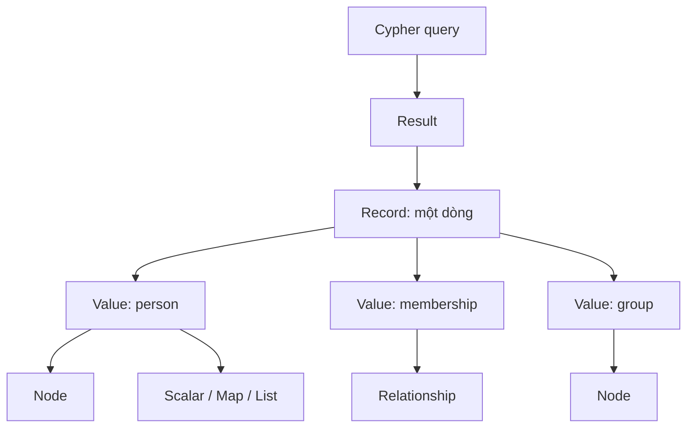

# Đọc Record, Value, Node, Relationship và Path của driver

## Mục tiêu bài học

`Neo4jClient` cho phép chạy Cypher và đọc kết quả ở mức record của Neo4j Java Driver. Đây là lựa chọn phù hợp khi truy vấn cần trả về cấu trúc linh hoạt, nhiều cột hoặc dữ liệu đồ thị không ánh xạ trực tiếp thành một entity Spring Data Neo4j (SDN).

Để đọc kết quả chính xác, cần hiểu các kiểu dữ liệu chính của driver:

- `Record` đại diện cho một dòng kết quả của câu truy vấn.
- `Value` đại diện cho một giá trị trong một cột của record.
- `Node` đại diện cho một node trong graph.
- `Relationship` đại diện cho một relationship nối hai node.
- `Path` đại diện cho một đường đi gồm các node và relationship theo thứ tự.

Bài học hướng dẫn cách lấy dữ liệu bằng `fetch()`, ánh xạ thủ công bằng `fetchAs(...).mappedBy(...)`, đọc scalar và property, duyệt node/relationship/path, xử lý null và chọn kiểu kết quả phù hợp cho tầng ứng dụng.

## 1. Neo4jClient và cấu trúc kết quả của driver

Một câu Cypher có thể trả về nhiều dòng. Mỗi dòng là một `Record`; trong mỗi record, các cột được định danh bằng tên alias trong mệnh đề `RETURN`.

Ví dụ:

```cypher
MATCH (p:Person)-[r:MEMBER_OF]->(g:Group)
RETURN p AS person, r AS membership, g AS group
```

Mỗi record chứa ba giá trị:

| Alias | Kiểu dữ liệu trong graph | Giá trị driver |
|---|---|---|
| `person` | Node `Person` | `Value` chứa `Node` |
| `membership` | Relationship `MEMBER_OF` | `Value` chứa `Relationship` |
| `group` | Node `Group` | `Value` chứa `Node` |

Luồng dữ liệu có thể hình dung như sau:



`Record` không phải entity Java và `Value` cũng không phải property Java. Chúng là kiểu dữ liệu của Neo4j Java Driver. Khi dùng `Neo4jClient`, ứng dụng có thể đọc trực tiếp những kiểu này rồi chuyển chúng thành DTO, projection hoặc mô hình dữ liệu riêng.

## 2. Lấy kết quả dạng Map bằng fetch()

Với truy vấn trả về các scalar đơn giản, có thể dùng `fetch()` để lấy kết quả dưới dạng collection các map:

```java
Collection<Map<String, Object>> rows = neo4jClient
        .query("MATCH (p:Person) " +
               "RETURN p.name AS name, p.age AS age")
        .fetch()
        .all();
```

Mỗi map tương ứng với một record. Key của map là alias trong `RETURN`; value là dữ liệu Java được chuyển đổi từ giá trị của driver.

Ví dụ đọc các cột:

```java
for (Map<String, Object> row : rows) {
    String name = (String) row.get("name");
    Number ageValue = (Number) row.get("age");
    Integer age = ageValue == null ? null : ageValue.intValue();

    // Chuyển dữ liệu sang DTO hoặc xử lý nghiệp vụ.
}
```

Kiểu Java cụ thể phụ thuộc kiểu property trong Neo4j và cơ chế chuyển đổi. Ví dụ số nguyên của driver thường được biểu diễn bằng kiểu số nguyên Java tương ứng; nếu cần an toàn với nhiều kiểu số, có thể đọc qua `Number` rồi chuyển đổi có chủ đích.

`fetch().all()` phù hợp khi cần một tập record đã được chuyển thành map. Nếu cần truy cập trực tiếp API của driver, chẳng hạn `Value.asNode()` hoặc `Value.asPath()`, dùng `fetchAs(...).mappedBy(...)` để nhận `Record` gốc trong mapper.

Đặt alias rõ ràng cho từng biểu thức trong `RETURN`. Alias giúp code đọc kết quả ổn định và tránh phụ thuộc vào tên biểu thức do Neo4j tự tạo.

## 3. Đọc Record và Value bằng fetchAs(...).mappedBy(...)

`fetchAs(ResultType.class)` khai báo kiểu kết quả mà ứng dụng muốn nhận. `mappedBy(...)` cung cấp hàm ánh xạ nhận `TypeSystem` và `Record` của driver, sau đó trả về object có kiểu đã chọn. Các kiểu driver dùng trong những ví dụ bên dưới nằm trong các package `org.neo4j.driver`, `org.neo4j.driver.types` và `org.springframework.data.neo4j.core`.

Các import thường dùng khi tự ánh xạ graph type:

```java
import org.neo4j.driver.Value;
import org.neo4j.driver.types.Node;
import org.neo4j.driver.types.Path;
import org.neo4j.driver.types.Relationship;
import org.springframework.data.neo4j.core.Neo4jClient;
```

`Record` có kiểu `org.neo4j.driver.Record`; nếu cần khai báo biến có kiểu này, có thể import tường minh. Trong các ví dụ, tham số `record` được suy luận kiểu từ hàm `mappedBy`.

Ví dụ DTO:

```java
public record PersonSummary(
        String name,
        long age
) {
}
```

Ánh xạ từ record:

```java
Collection<PersonSummary> people = neo4jClient
        .query("MATCH (p:Person) RETURN p.name AS name, p.age AS age")
        .fetchAs(PersonSummary.class)
        .mappedBy((typeSystem, record) -> new PersonSummary(
                record.get("name").asString(),
                record.get("age").asLong()
        ))
        .all();
```

Trong mapper:

- `record.get("name")` lấy `Value` của cột `name`.
- `asString()` chuyển giá trị sang chuỗi.
- `record.get("age")` lấy `Value` của cột `age`.
- `asLong()` đọc giá trị số nguyên 64-bit.
- Kết quả mapper là một `PersonSummary`.

Tham số `typeSystem` cung cấp thông tin kiểu của driver và hữu ích khi cần kiểm tra hoặc chuyển đổi theo kiểu Neo4j. Nếu mapper không cần dùng nó, có thể đặt tên biến theo quy ước của dự án và không tham chiếu đến biến đó.

Các hàm `asString()`, `asLong()`, `asBoolean()` và các hàm chuyển đổi có kiểu giúp code thể hiện rõ kiểu mong đợi. Nếu giá trị thực tế không thể chuyển sang kiểu yêu cầu, driver có thể ném lỗi chuyển đổi. Vì vậy, cần xác nhận kiểu dữ liệu trong Cypher phù hợp với mapper.

### Record là một dòng, Value là một ô

Ví dụ truy vấn:

```cypher
MATCH (p:Person)
RETURN p.name AS name, p.age AS age
```

Kết quả có thể gồm nhiều record:

| Record | `name` | `age` |
|---:|---|---:|
| 1 | An | 25 |
| 2 | Bình | 31 |
| 3 | Chi | 28 |

`record.get("name")` trả về một `Value` cho cột `name` của dòng hiện tại. Nếu muốn duyệt các record, dùng terminal operation như `all()`; nếu muốn đọc nhiều cột của cùng một dòng, lấy nhiều `Value` từ cùng record.

## 4. Đọc Value an toàn: kiểu dữ liệu, null và collection

`Value` là lớp truy cập thống nhất cho các giá trị Cypher. Một số thao tác thường dùng:

| API của Value | Mục đích |
|---|---|
| `asString()` | Đọc chuỗi |
| `asInt()`, `asLong()` | Đọc số nguyên |
| `asDouble()` | Đọc số thực |
| `asBoolean()` | Đọc boolean |
| `asNode()` | Đọc node |
| `asRelationship()` | Đọc relationship |
| `asPath()` | Đọc path |
| `asMap()` | Đọc map |
| `asList()` | Đọc danh sách |
| `asObject()` | Chuyển sang object Java tương ứng |
| `isNull()` | Kiểm tra giá trị null |

Nếu property có thể vắng mặt, không gọi trực tiếp `asString()` trước khi kiểm tra null:

```java
Value nicknameValue = record.get("nickname");

String nickname = nicknameValue.isNull()
        ? null
        : nicknameValue.asString();
```

Trong Cypher, truy cập property không tồn tại thường trả về `null`. Vì thế, projection như `RETURN p.nickname AS nickname` có thể đưa một Value null vào record.

Với danh sách hoặc map:

```java
List<Object> tags = record.get("tags").asList();
Map<String, Object> metadata = record.get("metadata").asMap();
```

Kiểu phần tử bên trong phụ thuộc dữ liệu được trả về. Nếu danh sách chứa giá trị có kiểu đồng nhất, có thể dùng overload nhận converter để ánh xạ từng phần tử sang kiểu mong muốn. Trước khi chuyển đổi, hãy kiểm tra query có thể trả về null hay không và xử lý theo hợp đồng của DTO.

`asObject()` hữu ích khi cần biểu diễn giá trị tổng quát, nhưng các hàm `asXxx()` có kiểu thường dễ đọc và kiểm tra hơn. Tránh ép kiểu tùy tiện nếu query có thể trả về nhiều kiểu hoặc giá trị null.

## 5. Đọc Node từ Value

Khi Cypher trả về biến node, `record.get(alias).asNode()` chuyển Value thành kiểu `org.neo4j.driver.types.Node`.

Ví dụ:

```java
Collection<PersonSnapshot> people = neo4jClient
        .query("MATCH (p:Person) RETURN p AS person")
        .fetchAs(PersonSnapshot.class)
        .mappedBy((typeSystem, record) -> {
            Node person = record.get("person").asNode();

            return new PersonSnapshot(
                    person.elementId(),
                    person.get("name").asString(),
                    person.get("age").asLong(),
                    person.labels()
            );
        })
        .all();
```

DTO minh họa:

```java
public record PersonSnapshot(
        String elementId,
        String name,
        long age,
        Iterable<String> labels
) {
}
```

Các thao tác thường dùng trên `Node`:

- `elementId()`: lấy element ID do Neo4j cấp.
- `labels()`: đọc các label gắn với node.
- `get("propertyName")`: lấy Value của property.
- `asMap()`: lấy các property của node dưới dạng map.

Node driver không phải entity được SDN hydrate. Nó là cấu trúc dữ liệu của Neo4j Java Driver. Nếu ứng dụng cần một domain entity có constructor, relationship mapping và lifecycle rõ ràng, hãy dùng repository hoặc mapping của SDN; nếu cần một snapshot riêng cho một truy vấn, chuyển Node thành DTO trong mapper.

Không nên dùng `elementId()` làm khóa nghiệp vụ lâu dài. Đây là định danh nội bộ do database cấp; ứng dụng nên có property ID nghiệp vụ ổn định nếu cần tham chiếu node từ API hoặc hệ thống khác. Cũng không nên phụ thuộc vào internal numeric ID cũ cho logic nghiệp vụ.

## 6. Đọc Relationship và thuộc tính của cạnh

Khi query trả về relationship, đọc bằng `Value.asRelationship()`. Relationship có kiểu, hai đầu cạnh và có thể có các property riêng.

Ví dụ:

```cypher
MATCH (p:Person)-[r:MEMBER_OF]->(g:Group)
RETURN p AS person, r AS membership, g AS group
```

Ánh xạ:

Ví dụ giả định property `joinedAt` được lưu dưới kiểu `DATE` của Neo4j; vì vậy mapper dùng `asLocalDate()`. Nếu property là `LOCAL DATETIME`, hãy dùng accessor tương ứng như `asLocalDateTime()` và đổi kiểu DTO cho phù hợp.

```java
public record MembershipSnapshot(
        String personElementId,
        String groupElementId,
        String relationshipType,
        String role,
        String joinedAt
) {
}
```

```java
Collection<MembershipSnapshot> memberships = neo4jClient
        .query("MATCH (p:Person)-[r:MEMBER_OF]->(g:Group) " +
               "RETURN p AS person, r AS membership, g AS group")
        .fetchAs(MembershipSnapshot.class)
        .mappedBy((typeSystem, record) -> {
            Node person = record.get("person").asNode();
            Relationship membership =
                    record.get("membership").asRelationship();
            Node group = record.get("group").asNode();

            Value roleValue = membership.get("role");
            Value joinedAtValue = membership.get("joinedAt");

            return new MembershipSnapshot(
                    person.elementId(),
                    group.elementId(),
                    membership.type(),
                    roleValue.isNull() ? null : roleValue.asString(),
                    joinedAtValue.isNull()
                            ? null
                            : joinedAtValue.asLocalDate().toString()
            );
        })
        .all();
```

Các thông tin thường cần đọc từ `Relationship`:

| API | Ý nghĩa |
|---|---|
| `elementId()` | Element ID của relationship |
| `type()` | Tên relationship type, ví dụ `MEMBER_OF` |
| `startNodeElementId()` | Element ID node ở đầu bắt đầu |
| `endNodeElementId()` | Element ID node ở đầu kết thúc |
| `get("role")` | Đọc một property của relationship |
| `asMap()` | Đọc tất cả property của relationship |

Hướng của relationship được xác định bởi start node và end node. Nếu query dùng pattern không hướng, điều đó không làm thay đổi hướng lưu trữ của cạnh. Hãy kiểm tra `startNodeElementId()` và `endNodeElementId()` nếu logic cần biết chiều thực tế của relationship.

Một cặp node có thể được nối bằng nhiều relationship khác nhau. Vì vậy, không khử trùng relationship chỉ dựa trên node nguồn và node đích nếu mỗi cạnh có ý nghĩa hoặc thuộc tính riêng. Nếu cần danh tính cạnh trong ứng dụng, có thể đưa element ID vào DTO để phục vụ đối chiếu trong phạm vi phù hợp; không dùng nó làm khóa nghiệp vụ lâu dài.

## 7. Đọc Path và các thành phần của đường đi

Cypher có thể trả về toàn bộ path thay vì từng node hoặc relationship riêng lẻ:

```cypher
MATCH path = (p:Person {id: $personId})-[:KNOWS*1..3]->(other:Person)
RETURN path
```

Trong mapper, dùng `Value.asPath()`:

```java
Collection<PathSnapshot> paths = neo4jClient
        .query("MATCH path = (p:Person {id: $personId})" +
               "-[:KNOWS*1..3]->(other:Person) " +
               "RETURN path")
        .bind(personId).to("personId")
        .fetchAs(PathSnapshot.class)
        .mappedBy((typeSystem, record) -> {
            Path path = record.get("path").asPath();

            List<String> nodeNames = new ArrayList<>();
            for (Node node : path.nodes()) {
                Value name = node.get("name");
                nodeNames.add(name.isNull() ? null : name.asString());
            }

            List<String> relationshipTypes = new ArrayList<>();
            for (Relationship relationship : path.relationships()) {
                relationshipTypes.add(relationship.type());
            }

            return new PathSnapshot(
                    path.length(),
                    nodeNames,
                    relationshipTypes
            );
        })
        .all();
```

DTO cho kết quả:

```java
public record PathSnapshot(
        int length,
        List<String> nodeNames,
        List<String> relationshipTypes
) {
}
```

Các thành phần quan trọng của `Path`:

- `start()`: node bắt đầu của path.
- `end()`: node kết thúc của path.
- `length()`: số relationship trong path.
- `nodes()`: các node theo thứ tự duyệt của path.
- `relationships()`: các relationship theo thứ tự xuất hiện trong path.
- `segments()`: các đoạn nối giữa node và relationship liên tiếp.

Path có thể chứa cùng một node nhiều lần nếu đường đi quay lại node đó. Đừng mặc định `path.nodes()` là tập node duy nhất. Nếu cần node duy nhất, hãy khử trùng theo danh tính phù hợp sau khi đọc hoặc ngay trong Cypher tùy yêu cầu.

Thứ tự duyệt path và hướng lưu trữ của relationship là hai thông tin liên quan nhưng không giống nhau. Khi duyệt một path theo chiều ngược với chiều lưu của relationship, thứ tự các node trên path vẫn theo hướng traversal; hướng cạnh vẫn có thể được xác định qua start/end node của relationship.

## 8. Kết hợp Record, Node, Relationship và Path trong cùng query

Một record có thể chứa nhiều kiểu giá trị khác nhau. Ví dụ, truy vấn trả node gốc, relationship và path:

```cypher
MATCH path = (p:Person {id: $personId})-[:KNOWS]->(friend:Person)
MATCH (friend)-[r:MEMBER_OF]->(g:Group)
RETURN p AS person,
       friend AS friend,
       r AS membership,
       g AS group,
       path AS connection
```

Mapper có thể đọc từng cột theo kiểu tương ứng:

```java
public record ConnectionView(
        String personName,
        String friendName,
        String groupName,
        String membershipRole,
        int pathLength
) {
}
```

```java
Collection<ConnectionView> connections = neo4jClient
        .query("MATCH path = (p:Person {id: $personId})-[:KNOWS]->(friend:Person) " +
               "MATCH (friend)-[r:MEMBER_OF]->(g:Group) " +
               "RETURN p AS person, friend AS friend, r AS membership, " +
               "g AS group, path AS connection")
        .bind(personId).to("personId")
        .fetchAs(ConnectionView.class)
        .mappedBy((typeSystem, record) -> {
            Node person = record.get("person").asNode();
            Node friend = record.get("friend").asNode();
            Relationship membership =
                    record.get("membership").asRelationship();
            Node group = record.get("group").asNode();
            Path connection = record.get("connection").asPath();

            Value role = membership.get("role");

            return new ConnectionView(
                    person.get("name").asString(),
                    friend.get("name").asString(),
                    group.get("name").asString(),
                    role.isNull() ? null : role.asString(),
                    connection.length()
            );
        })
        .all();
```

Một query có nhiều nhánh có thể tạo nhiều record cho cùng node gốc nếu có nhiều đường khớp. Nếu mục tiêu là một DTO cho mỗi node gốc, hãy xử lý cardinality bằng Cypher như `DISTINCT`, `collect()` hoặc subquery phù hợp trước khi ánh xạ. Đọc driver record không tự loại bỏ dòng trùng.

## 9. Chọn fetch() hay fetchAs(...).mappedBy(...)

| Nhu cầu | Cách đọc phù hợp | Lý do |
|---|---|---|
| Truy vấn trả scalar và map đơn giản | `fetch().all()` | Nhận danh sách `Map<String, Object>` thuận tiện |
| Cần đọc driver `Node` | `fetchAs(Dto.class).mappedBy(...)` | Dùng `Value.asNode()` và đọc property |
| Cần đọc `Relationship` và metadata của cạnh | `fetchAs(Dto.class).mappedBy(...)` | Dùng `Value.asRelationship()` |
| Cần duyệt toàn bộ đường đi | `fetchAs(Dto.class).mappedBy(...)` | Dùng `Value.asPath()` |
| Cần chuyển một record thành DTO có quy tắc riêng | `fetchAs(Dto.class).mappedBy(...)` | Mapper kiểm soát việc chuyển đổi |
| Cần domain entity và mapping relationship của SDN | Repository hoặc `Neo4jTemplate` | Tận dụng metadata mapping của SDN |

`fetch()` là lựa chọn gọn khi dữ liệu đã ở dạng scalar hoặc map và không cần truy cập API driver. `mappedBy` phù hợp khi cần kiểm soát chi tiết cách chuyển từng record, đặc biệt khi record chứa node, relationship hoặc path.

Không nên trả trực tiếp `Record`, `Value`, `Node`, `Relationship` hoặc `Path` của driver qua API HTTP. Chuyển chúng sang DTO hoặc kiểu domain phù hợp trước khi rời tầng truy cập dữ liệu. Điều này giữ cho controller và client không phụ thuộc trực tiếp vào API của Neo4j Java Driver.

## 10. Kiểu dữ liệu và các lỗi chuyển đổi thường gặp

Khi đọc giá trị, hãy đối chiếu kiểu Cypher trả về với accessor của driver:

| Giá trị Cypher | Accessor thường dùng | Lưu ý |
|---|---|---|
| Chuỗi | `asString()` | Kiểm tra null nếu property có thể vắng mặt |
| Số nguyên | `asLong()` hoặc `asInt()` | Chọn độ rộng phù hợp với miền giá trị |
| Số thực | `asDouble()` | Không đọc số nguyên bằng accessor số thực nếu không có chủ đích |
| Boolean | `asBoolean()` | Không nhầm chuỗi `"true"` với boolean |
| Date | `asLocalDate()` | Phù hợp với kiểu ngày không có thời gian |
| LocalDateTime | `asLocalDateTime()` | Không tự gắn timezone nếu dữ liệu không có |
| Node | `asNode()` | Cột phải trả về node |
| Relationship | `asRelationship()` | Cột phải trả về relationship |
| Path | `asPath()` | Cột phải trả về path |
| Map | `asMap()` | Kiểm tra kiểu các giá trị bên trong |
| List | `asList()` | Kiểm tra kiểu từng phần tử |

Một số lỗi phổ biến:

- Gọi `asNode()` trên cột chỉ trả về `p.name`: giá trị là scalar, không phải node.
- Gọi `asRelationship()` trên alias trả về node: sai kiểu dữ liệu.
- Gọi `asString()` khi property là null: cần kiểm tra `isNull()` trước.
- Đọc số nguyên bằng kiểu quá hẹp: có thể gây lỗi chuyển đổi hoặc tràn giá trị.
- Dùng sai alias: `record.get("person")` không tìm được nếu query trả về alias `p`.
- Giả định path không lặp node: một path có thể đi qua node nhiều lần.
- Giả định node element ID là khóa nghiệp vụ ổn định: element ID thuộc quản lý nội bộ của Neo4j.

Khi lỗi chuyển đổi xuất hiện, kiểm tra câu `RETURN` trước, sau đó kiểm tra kiểu accessor và dữ liệu null. Việc đặt alias tường minh và dùng DTO có constructor rõ ràng giúp giảm lỗi ánh xạ.

## 11. Kiểm thử mapper của Neo4jClient

Nên kiểm thử cả câu Cypher và mapper trên Neo4j thật hoặc Testcontainers/Test Harness phù hợp với dự án. Ví dụ bộ test nên bao gồm:

1. Record có các alias đúng như mapper mong đợi.
2. Node có đủ label và property cần đọc.
3. Relationship có đúng type, start/end node và property.
4. Path có số segment, node và relationship đúng thứ tự.
5. Property nullable được chuyển thành null mà không ném lỗi.
6. Query trả nhiều record và mapper tạo đúng số DTO.
7. Query không có kết quả trả collection rỗng.
8. Giá trị sai kiểu được phát hiện trong test thay vì đến runtime production.

Khung kiểm thử:

```java
@DataNeo4jTest
class Neo4jClientMappingTest {

    @Autowired
    private Neo4jClient neo4jClient;

    @Test
    void shouldMapNodeAndRelationshipToDto() {
        // Tạo Person, Group và relationship MEMBER_OF.
        // Query RETURN p AS person, r AS membership, g AS group.
        // Dùng fetchAs(...).mappedBy(...) để ánh xạ.
        // Kiểm tra tên node, type và property của relationship.
    }
}
```

Nếu mapper có logic chuyển đổi phức tạp, tách phần chuyển đổi thành phương thức riêng để unit test các trường hợp null, kiểu dữ liệu và path. Integration test vẫn cần thiết để xác nhận Neo4j trả đúng cấu trúc mà mapper mong đợi.

## 12. Lỗi thường gặp

| Lỗi | Nguyên nhân | Cách xử lý |
|---|---|---|
| Nhầm `Record` với entity | Record là một dòng kết quả driver, không phải node entity | Chọn entity mapping hoặc tự map Record sang DTO |
| Nhầm `Value` với Java Object trực tiếp | Value là wrapper kiểu dữ liệu driver | Dùng accessor `asXxx()` phù hợp |
| Gọi sai `asNode()`, `asRelationship()`, `asPath()` | Cột Cypher trả về kiểu khác | Kiểm tra biểu thức và alias trong `RETURN` |
| Không kiểm tra null | Property có thể không tồn tại | Dùng `isNull()` trước khi chuyển đổi |
| Dùng tên alias không khớp | Mapper yêu cầu key khác với query | Đồng bộ alias và `record.get(...)` |
| Dùng element ID như mã nghiệp vụ | Nhầm định danh nội bộ với ID ứng dụng | Dùng property ID ổn định do ứng dụng quản lý |
| Bỏ qua hướng relationship | Không kiểm tra start/end node | Đọc `startNodeElementId()` và `endNodeElementId()` khi cần |
| Giả định Path là tập node duy nhất | Path có thể đi qua cùng node nhiều lần | Giữ thứ tự path hoặc khử trùng theo yêu cầu |
| Trả driver type ra ngoài tầng dữ liệu | API bị phụ thuộc vào driver | Chuyển sang DTO/domain model |

## 13. Tự kiểm tra

1. Một `Record` đại diện cho điều gì trong kết quả Cypher?
2. `record.get("person")` trả về kiểu dữ liệu nào?
3. Khi nào nên dùng `fetch().all()` và khi nào nên dùng `fetchAs(...).mappedBy(...)`?
4. Accessor nào dùng để đọc node, relationship và path?
5. Làm thế nào đọc property nullable mà không gọi accessor trên null?
6. Có thể lấy label và property của node bằng những API nào?
7. Relationship cung cấp những thông tin nào để xác định kiểu và hướng cạnh?
8. `Path.nodes()` và `Path.relationships()` giữ thứ tự như thế nào?
9. Vì sao element ID của driver không nên được dùng làm mã nghiệp vụ lâu dài?
10. Vì sao nên chuyển driver type thành DTO trước khi trả dữ liệu qua API?

Hãy tạo graph gồm một `Person`, một `Group` và relationship `MEMBER_OF` có property `role`. Viết một query trả về node, relationship và một path. Dùng `fetchAs(...).mappedBy(...)` để đọc `Record`, lấy `Value` tương ứng rồi chuyển thành DTO. Tiếp tục thử property không tồn tại, kiểm tra null, và tạo path có nhiều segment để quan sát thứ tự node cùng relationship.

## Tài liệu tham khảo

- [Spring Data Neo4j — Neo4jClient API](https://docs.spring.io/spring-data/neo4j/reference/api/java/org/springframework/data/neo4j/core/Neo4jClient.html)
- [Neo4j Java Driver — Values and Types](https://neo4j.com/docs/api/java-driver/current/org.neo4j.driver/org/neo4j/driver/Value.html)
- [Neo4j Java Driver — Record](https://neo4j.com/docs/api/java-driver/current/org.neo4j.driver/org/neo4j/driver/Record.html)
- [Neo4j Java Driver — Node](https://neo4j.com/docs/api/java-driver/current/org.neo4j.driver/org/neo4j/driver/types/Node.html)
- [Neo4j Java Driver — Relationship](https://neo4j.com/docs/api/java-driver/current/org.neo4j.driver/org/neo4j/driver/types/Relationship.html)
- [Neo4j Java Driver — Path](https://neo4j.com/docs/api/java-driver/current/org.neo4j.driver/org/neo4j/driver/types/Path.html)
