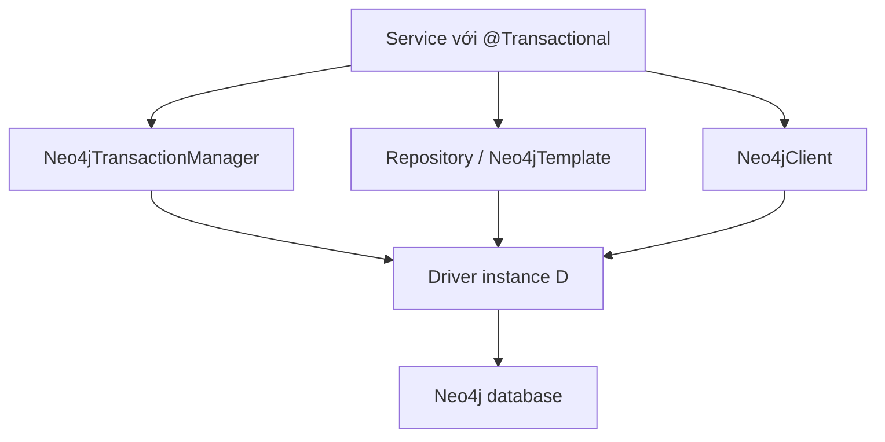

# Dùng cùng Driver với transaction manager để tham gia giao dịch Spring

`Neo4jClient` là lớp truy cập Cypher dựa trên Neo4j Java Driver, đồng thời tích hợp với cơ chế transaction của Spring. Nhờ đó, một phương thức service có thể gọi repository và `Neo4jClient` trong cùng một transaction: nếu một bước thất bại và transaction bị rollback, các thay đổi graph của cả hai bước được hoàn tác cùng nhau.

Điều kiện quan trọng là client và `Neo4jTransactionManager` phải dùng **cùng một instance `Driver`**. Hai driver kết nối tới cùng URI, database và tài khoản vẫn là hai instance khác nhau; client dùng driver khác sẽ không đồng bộ với transaction đang được Spring quản lý.

Bài học thuộc module **SPRING_DATA_NEO4J**, tập trung xây dựng tầng dữ liệu đồ thị qua node entity, relationship, repository và Cypher. Ta dùng `Person`, `Movie` và `ACTED_IN` để minh họa cách kết hợp thao tác repository với Cypher trong transaction Spring, cách cấu hình cùng Driver và cách kiểm tra rollback.

## 1. Vì sao cần Neo4jClient?

Neo4j Java Driver cung cấp API trực tiếp để mở session, chạy Cypher và đọc kết quả. Tuy nhiên, khi tự mở session/transaction bằng driver, thao tác đó không tự tham gia transaction ở cấp ứng dụng mà Spring đang quản lý.

`Neo4jClient` bổ sung một lớp API mỏng trên driver, với các mục tiêu:

- Tích hợp thao tác imperative và reactive với transaction Spring.
- Cho phép truy vấn Cypher bằng tham số có tên.
- Trả kết quả dưới dạng map hoặc cho phép ánh xạ thủ công sang kiểu Java.
- Cung cấp điểm mở rộng để thực hiện thao tác cấp thấp trong transaction được quản lý.

`Neo4jClient` không thay thế mapping entity của `Neo4jTemplate` hay repository. Nó phù hợp khi cần viết Cypher trực tiếp, điều khiển pattern graph, cập nhật relationship hoặc trả dữ liệu theo hình dạng tùy chỉnh.

## 2. Điều kiện cốt lõi: cùng một instance Driver

Trong ứng dụng imperative, `Neo4jTransactionManager` quản lý session và transaction Neo4j cho Spring. `Neo4jClient` cần dùng chính `Driver` mà transaction manager sử dụng để tìm và tham gia transaction hiện tại.



Điểm cần nhớ:

- Client và transaction manager phải nhận cùng bean `Driver`.
- Tạo hai `Driver` riêng dù cùng URI và thông tin xác thực không đáp ứng điều kiện này.
- Nếu ứng dụng dùng database được chọn theo cấu hình, client và transaction manager phải hướng tới cùng database.
- Trong ứng dụng Spring Boot dùng starter SDN, thường đã có bean client phù hợp; hãy ưu tiên dùng bean được cấu hình sẵn.

## 3. Cấu hình thủ công với cùng Driver

Nếu ứng dụng cần tự khai báo bean, hãy inject cùng tham số `Driver` vào cả client và transaction manager:

```java
import org.neo4j.driver.Driver;
import org.springframework.context.annotation.Bean;
import org.springframework.context.annotation.Configuration;
import org.springframework.data.neo4j.core.Neo4jClient;
import org.springframework.data.neo4j.core.transaction.Neo4jTransactionManager;
import org.springframework.transaction.PlatformTransactionManager;

@Configuration
public class Neo4jConfiguration {

    @Bean
    Neo4jClient neo4jClient(Driver driver) {
        return Neo4jClient.create(driver);
    }

    @Bean("neo4jTransactionManager")
    PlatformTransactionManager neo4jTransactionManager(Driver driver) {
        return new Neo4jTransactionManager(driver);
    }
}
```

Spring inject cùng bean `Driver` vào cả hai phương thức. Constructor một tham số của `Neo4jTransactionManager` dùng database mặc định. Nếu ứng dụng dùng `DatabaseSelectionProvider` để chọn database, hãy dùng constructor tương ứng và bảo đảm lựa chọn database nhất quán với truy vấn của client.

Đây là cấu hình thủ công để hiểu mối liên hệ giữa các bean. Nếu Spring Boot starter đã cung cấp `Neo4jClient` và transaction manager, không khai báo thêm bean trùng lặp. Việc tạo client mới bằng `Neo4jClient.create(driver)` chỉ cần thiết khi bạn chủ động thay thế cấu hình tự động.

Nếu ứng dụng có nhiều `PlatformTransactionManager`, hãy chỉ rõ manager Neo4j trên phương thức cần transaction graph:

```java
@Transactional(transactionManager = "neo4jTransactionManager")
public void updateGraph() {
    // Repository và Neo4jClient cùng tham gia transaction Neo4j.
}
```

Tên trong annotation phải khớp tên bean thực tế của transaction manager.

## 4. Đặt ranh giới transaction bằng @Transactional

`@Transactional` xác định phạm vi công việc mà Spring quản lý. Khi phương thức gọi `Neo4jClient` bằng đúng Driver, câu Cypher sẽ tham gia transaction hiện tại thay vì tự tạo một transaction độc lập.

```java
import org.springframework.data.neo4j.core.Neo4jClient;
import org.springframework.stereotype.Service;
import org.springframework.transaction.annotation.Transactional;

@Service
public class PersonGraphService {

    private final Neo4jClient neo4jClient;

    public PersonGraphService(Neo4jClient neo4jClient) {
        this.neo4jClient = neo4jClient;
    }

    @Transactional
    public void renamePerson(String personId, String newName) {
        neo4jClient.query("""
                MATCH (p:Person {personId: $personId})
                SET p.name = $newName
                """)
            .bind(personId).to("personId")
            .bind(newName).to("newName")
            .run();
    }
}
```

Ở ví dụ này, `run()` thực thi câu lệnh imperative và trả về `ResultSummary`. Vì câu lệnh cập nhật không cần đọc hàng kết quả, `run()` là lựa chọn phù hợp.

Với truy vấn có kết quả, dùng các terminal operation như `fetch().one()`, `fetch().first()` hoặc `fetch().all()`:

```java
import java.util.Optional;

Optional<String> name = neo4jClient.query("""
        MATCH (p:Person {personId: $personId})
        RETURN p.name AS name
        """)
    .bind(personId).to("personId")
    .fetchAs(String.class)
    .mappedBy((typeSystem, record) -> record.get("name").asString())
    .one();
```

Các terminal operation là thời điểm client thực sự tương tác với database trong imperative API. `one()` yêu cầu đúng một kết quả; `first()` lấy kết quả đầu tiên nếu có; `all()` thu thập toàn bộ kết quả.

## 5. Kết hợp repository và Neo4jClient trong một transaction

Một use case thường cần cả mapping entity lẫn truy vấn Cypher chuyên biệt. Ví dụ, lưu `Person` bằng repository rồi tạo một node audit và relationship bằng `Neo4jClient`:

```java
import org.springframework.stereotype.Service;
import org.springframework.transaction.annotation.Transactional;

@Service
public class PersonRegistrationService {

    private final PersonRepository personRepository;
    private final Neo4jClient neo4jClient;

    public PersonRegistrationService(
            PersonRepository personRepository,
            Neo4jClient neo4jClient) {
        this.personRepository = personRepository;
        this.neo4jClient = neo4jClient;
    }

    @Transactional
    public Person register(Person person) {
        Person saved = personRepository.save(person);

        neo4jClient.query("""
                MATCH (p:Person {personId: $personId})
                CREATE (event:AuditEvent {
                    eventType: 'PERSON_REGISTERED',
                    createdAt: datetime()
                })
                CREATE (event)-[:ABOUT]->(p)
                """)
            .bind(saved.getPersonId()).to("personId")
            .run();

        return saved;
    }
}
```

Khi repository và client dùng chung cấu hình Driver/transaction manager, hai thao tác cùng thuộc transaction do `@Transactional` mở. Nếu câu Cypher tạo audit thất bại, thay đổi do `personRepository.save()` cũng bị rollback. Ngược lại, nếu save thất bại, bước Cypher phía sau không được thực hiện.

Đảm bảo `personId` là khóa nghiệp vụ phù hợp và có uniqueness constraint nếu cần duy nhất. Ví dụ giả định `PersonRepository` và `Neo4jClient` cùng trỏ tới database đích.

## 6. Kiểm chứng rollback

Có thể kiểm tra transaction bằng cách cố ý phát sinh unchecked exception sau khi client đã ghi dữ liệu:

```java
@Transactional
public void createThenFail(String personId) {
    neo4jClient.query("""
            CREATE (:Person {personId: $personId})
            """)
        .bind(personId).to("personId")
        .run();

    throw new IllegalStateException("Simulated failure");
}
```

Với transaction manager phù hợp và lời gọi đi qua proxy Spring, `IllegalStateException` là unchecked exception nên mặc định đánh dấu transaction rollback. Sau khi phương thức kết thúc, node vừa tạo không còn trong database.

Quy tắc mặc định của Spring là rollback với `RuntimeException` và `Error`. Nếu cần rollback cho checked exception, khai báo rõ:

```java
@Transactional(rollbackFor = Exception.class)
public void importGraph() throws Exception {
    // Các thao tác Neo4jClient và repository.
}
```

Trong production, không để exception mô phỏng này trong luồng nghiệp vụ; dùng nó trong integration test để chứng minh rollback.

## 7. Tham số hóa Cypher

Neo4jClient hỗ trợ bind giá trị đơn giản theo tên tham số:

```java
neo4jClient.query("""
        MATCH (p:Person {personId: $personId})
        SET p.name = $name,
            p.born = $born
        """)
    .bind(personId).to("personId")
    .bind(name).to("name")
    .bind(born).to("born")
    .run();
```

Hoặc bind một map tham số:

```java
import java.util.Map;

Map<String, Object> parameters = Map.of(
    "personId", personId,
    "name", name,
    "born", born
);

neo4jClient.query("""
        MATCH (p:Person {personId: $personId})
        SET p.name = $name,
            p.born = $born
        """)
    .bindAll(parameters)
    .run();
```

Không nối trực tiếp dữ liệu đầu vào vào chuỗi Cypher. Tham số hóa giúp tránh lỗi escape và giảm nguy cơ Cypher injection. Tên tham số trong `.to("...")` phải khớp với placeholder `$...` trong query.

Với object phức tạp, cần chuyển thành map các giá trị mà Java Driver hiểu được bằng binder function; không mặc định driver tự chuyển một domain object bất kỳ thành map property Neo4j.

## 8. Chọn database và bảo đảm cùng transaction

Neo4j hỗ trợ nhiều database. Client mặc định dùng database mặc định, nhưng có thể chỉ định database trong fluent API:

```java
neo4jClient.query("MATCH (p:Person) RETURN p.name AS name")
    .in("people")
    .fetch()
    .all();
```

Khi đang trong transaction Spring, hãy bảo đảm truy vấn hướng tới cùng database mà transaction manager đã chọn. Nếu transaction manager dùng `DatabaseSelectionProvider` để định tuyến theo tenant hoặc request, việc gọi `.in(...)` sang database khác có thể không còn cùng phạm vi transaction mong muốn.

Ngoài database, SDN 8.1 cho phép transaction được xác định theo driver, database selection và user selection. Khi ứng dụng dùng cấu hình database/user tùy chỉnh, cần bảo đảm client và transaction manager sử dụng cùng lựa chọn tương ứng.

## 9. Không mở session driver độc lập bên trong @Transactional

Đoạn code sau mở session trực tiếp bằng driver:

```java
import org.neo4j.driver.Session;

try (Session session = driver.session()) {
    session.executeWrite(tx -> {
        tx.run("CREATE (:AuditEvent {eventType: 'PERSON_REGISTERED'})");
        return null;
    });
}
```

Đây là transaction do Java Driver quản lý trực tiếp. Nó không tự tham gia transaction Spring hiện tại chỉ vì code được gọi từ một phương thức có `@Transactional`. Kết quả có thể là hai transaction độc lập: một transaction do Spring quản lý và một transaction do session tự mở.

Nếu cần API mức thấp hơn nhưng vẫn dùng transaction Spring, `Neo4jClient` cung cấp `delegateTo(...)` với `StatementRunner`:

```java
import java.util.Optional;

Optional<Long> countPeople = neo4jClient
    .delegateTo(runner -> {
        long count = runner.run(
                "MATCH (p:Person) RETURN count(p) AS total")
            .single()
            .get("total")
            .asLong();

        return Optional.of(count);
    })
    .run();
```

`delegateTo` cho phép tự điều khiển cách gọi statement nhưng vẫn để client quản lý việc tham gia transaction. Chỉ dùng cách này khi API fluent thông thường không đủ; phần lớn truy vấn nên dùng `query(...).bind(...).fetch()` hoặc `run()`.

## 10. Phân biệt imperative và reactive client

SDN cung cấp hai API riêng:

| Imperative | Reactive |
|---|---|
| `Neo4jClient` | `ReactiveNeo4jClient` |
| `Neo4jTransactionManager` | `ReactiveNeo4jTransactionManager` |
| `Optional<T>`, `Collection<T>`, `ResultSummary` | `Mono<T>`, `Flux<T>` |
| Thực thi khi gọi terminal operation | Thực thi khi publisher được subscribe |
| Transaction imperative theo cơ chế Spring tương ứng | Transaction reactive được truyền qua Reactor context |

Hai client có từ vựng fluent tương tự nhưng không tương thích kiểu API. Không dùng `Neo4jClient` imperative trong chuỗi reactive rồi kỳ vọng transaction reactive được truyền tự động. Ứng dụng reactive cần dùng `ReactiveNeo4jClient`, `ReactiveNeo4jTransactionManager` và kiểu trả về reactive xuyên suốt use case.

Với imperative transaction, các thao tác cần chạy trong cùng lời gọi đồng bộ và luồng thực thi được Spring quản lý. Không chuyển phần ghi sang thread mới bằng `CompletableFuture` hoặc `@Async` rồi kỳ vọng nó tự tham gia transaction đang mở ở thread ban đầu.

## 11. Những lỗi thường gặp

| Lỗi | Hệ quả | Cách xử lý |
|---|---|---|
| Tạo hai instance `Driver` cho client và transaction manager | Client không đồng bộ với transaction Spring | Inject cùng bean Driver vào cả hai |
| Tự mở `driver.session()` bên trong `@Transactional` | Tạo transaction độc lập ngoài Spring | Dùng `Neo4jClient` hoặc `delegateTo` |
| Dùng sai transaction manager | `@Transactional` không mở transaction Neo4j mong muốn | Chỉ định đúng transaction manager nếu ứng dụng có nhiều manager |
| Client và transaction manager chọn database khác nhau | Truy vấn có thể chạy ngoài transaction mong đợi | Đồng bộ database selection và user selection |
| Gọi phương thức transactional qua self-invocation | Spring proxy có thể không áp dụng transaction | Gọi qua Spring bean/proxy khác hoặc tách service |
| Bắt exception rồi không đánh dấu rollback | Transaction có thể commit dù nghiệp vụ thất bại | Ném exception phù hợp hoặc đánh dấu rollback-only |
| Dùng checked exception nhưng không cấu hình rollback | Spring mặc định có thể commit | Dùng `rollbackFor` khi cần |
| Dùng imperative client trong reactive flow | Mất lợi ích non-blocking và transaction context reactive | Dùng `ReactiveNeo4jClient` và reactive transaction manager |
| Nối chuỗi input vào Cypher | Lỗi cú pháp và nguy cơ injection | Bind tham số có tên |

## 12. Checklist cấu hình và sử dụng

- Dùng bean `Neo4jClient` do Spring Boot starter cung cấp nếu đã có cấu hình tự động phù hợp.
- Nếu tự cấu hình, tạo client và `Neo4jTransactionManager` từ cùng một instance `Driver`.
- Xác định database selection nhất quán giữa client và transaction manager.
- Inject client vào service qua constructor.
- Đặt `@Transactional` ở phương thức service bao quanh toàn bộ use case.
- Gọi `run()`, `fetch().one()`, `fetch().first()` hoặc `fetch().all()` phù hợp với kết quả cần nhận.
- Bind tham số bằng `.bind(...).to(...)` hoặc `.bindAll(...)`.
- Kết hợp repository và Neo4jClient trong cùng transaction khi cần nhiều kiểu thao tác.
- Không mở session driver độc lập nếu mục tiêu là tham gia transaction Spring.
- Kiểm thử rollback sau khi đã có ít nhất một thao tác ghi.
- Chọn imperative hoặc reactive client đồng bộ với mô hình transaction của ứng dụng.

## 13. Bài tập thực hành

1. Inject `Driver` vào hai bean `Neo4jClient` và `Neo4jTransactionManager`; giải thích vì sao phải cùng instance.
2. Viết service `@Transactional` cập nhật tên `Person` bằng `Neo4jClient` với tham số bind.
3. Kết hợp `PersonRepository.save()` và một câu Cypher tạo `AuditEvent`; xác nhận cả hai thay đổi cùng commit.
4. Cố ý ném `IllegalStateException` sau thao tác ghi và viết integration test xác nhận rollback.
5. Thử dùng một `Driver` instance thứ hai cho client; giải thích vì sao client không tham gia transaction do manager quản lý.
6. Viết truy vấn trả kết quả bằng `fetchAs(...).mappedBy(...)` và phân biệt `one()`, `first()`, `all()`.
7. Dùng `delegateTo(StatementRunner)` để đọc `count(p)` trong transaction được quản lý.
8. So sánh `Neo4jClient` với `driver.session()` khi cùng được gọi bên trong phương thức `@Transactional`.
9. Mô tả cách thay imperative client bằng `ReactiveNeo4jClient` trong một use case reactive.

Khi hoàn thành, bạn cần giải thích được vì sao cùng một `Driver` instance là điều kiện để `Neo4jClient` tham gia transaction Spring, cách kết hợp repository và Cypher trong một transaction và cách kiểm chứng rollback. Đây là nền tảng để các thao tác mapping cấp cao và truy vấn graph tùy chỉnh cùng duy trì tính nhất quán dữ liệu.

## Tài liệu tham khảo

- [Spring Data Neo4j — Neo4jClient](https://docs.spring.io/spring-data/neo4j/reference/appendix/neo4j-client.html)
- [Spring Data Neo4j — Neo4jTransactionManager API 8.1.x](https://docs.spring.io/spring-data/neo4j/reference/api/java/org/springframework/data/neo4j/core/transaction/Neo4jTransactionManager.html)
- [Spring Data Neo4j — FAQ](https://docs.spring.io/spring-data/neo4j/reference/faq.html)
- [Spring Framework — Declarative Transaction Management](https://docs.spring.io/spring-framework/reference/data-access/transaction/declarative.html)
