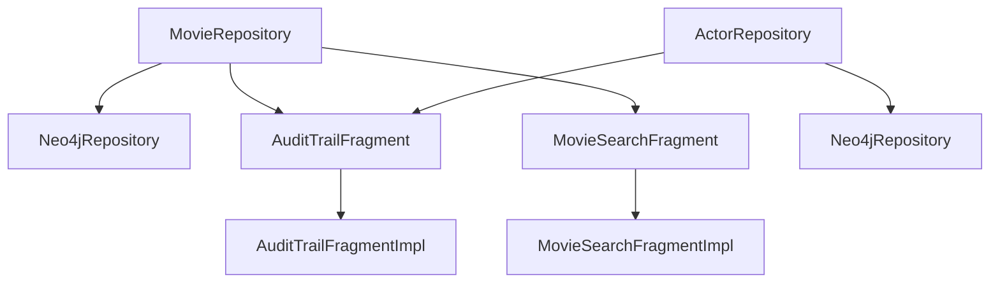

# Tái sử dụng fragment giữa nhiều repository

Khi nhiều repository cần cùng một nhóm hành vi, không nên sao chép các phương thức truy vấn và phần triển khai sang từng interface. Spring Data hỗ trợ ghép repository từ các thành phần nhỏ gọi là **repository fragments**. Mỗi fragment có interface riêng và implementation tương ứng; một repository có thể kết hợp fragment dùng chung với fragment chuyên biệt cho domain của nó.

Trong Spring Data Neo4j (SDN), cách tổ chức này hữu ích khi nhiều aggregate cùng cần một khả năng như tra cứu lịch sử thay đổi, tìm dữ liệu theo quy tắc chung hoặc thực thi một nhóm Cypher dùng chung. Fragment giữ phần hành vi tái sử dụng ở một nơi, trong khi repository vẫn giữ các thao tác đặc thù của từng entity.

## 1. Repository composition là gì?

Một repository Spring Data thường kết hợp nhiều phần:

- Interface repository khai báo kiểu entity và ID, đồng thời kế thừa các thao tác CRUD như phương thức tìm theo ID, lưu và xóa.
- Các repository fragment bổ sung hành vi tùy chỉnh.
- Spring Data ghép các thành phần này thành một proxy repository mà ứng dụng inject và sử dụng.

Ví dụ, MovieRepository có thể cần tìm phim theo tiêu chí riêng, trong khi cả MovieRepository và ActorRepository đều cần ghi và đọc lịch sử thay đổi. Fragment lịch sử có thể được dùng lại ở cả hai repository.



Repository composition cho phép một fragment được ghép vào nhiều repository. Fragment không cần kế thừa Neo4jRepository và cũng không cần biết toàn bộ cấu trúc của repository chứa nó.

Fragment khác với custom repository base class. Base class tùy chỉnh thường thay đổi nền tảng triển khai cho toàn bộ repository trong phạm vi cấu hình. Fragment được ghép có chọn lọc: repository nào kế thừa fragment interface thì nhận hành vi đó. Vì vậy, fragment phù hợp khi muốn chia sẻ một năng lực giữa một số repository mà không áp dụng nó cho mọi repository trong ứng dụng.

## 2. Tạo fragment interface dùng chung

Hãy bắt đầu bằng một hành vi có ý nghĩa giống nhau ở nhiều aggregate. Ví dụ, ứng dụng cần lưu lịch sử thay đổi cho phim và diễn viên. Mỗi lịch sử có loại aggregate, ID aggregate, hành động và thời điểm xảy ra.

Khai báo fragment interface:

```java
public interface AuditTrailFragment {

    String recordChange(
            String aggregateType,
            String aggregateId,
            String action);

    List<AuditEntry> findHistory(
            String aggregateType,
            String aggregateId);
}
```

DTO trả về:

```java
public record AuditEntry(
        String id,
        String aggregateType,
        String aggregateId,
        String action,
        ZonedDateTime occurredAt) {
}
```

AuditTrailFragment mô tả khả năng dùng chung, không mô tả một loại node nghiệp vụ cụ thể. aggregateType phân biệt Movie, Actor hoặc các loại aggregate khác; aggregateId xác định đối tượng cần xem lịch sử.

Trong ví dụ này, mỗi lịch sử được lưu thành node AuditEvent độc lập, chứa loại và ID aggregate. Nếu nghiệp vụ cần duyệt lịch sử bằng relationship trực tiếp từ node aggregate, có thể mở rộng mô hình bằng một fragment chuyên biệt hoặc một cơ chế liên kết phù hợp với từng loại node.

## 3. Cài đặt fragment một lần

Implementation của fragment sử dụng Neo4jClient để ghi và đọc các node AuditEvent. Cách này phù hợp vì kết quả đọc là DTO AuditEntry, không phải entity nghiệp vụ của repository gọi fragment.

```java
public class AuditTrailFragmentImpl implements AuditTrailFragment {

    private final Neo4jClient neo4jClient;

    public AuditTrailFragmentImpl(Neo4jClient neo4jClient) {
        this.neo4jClient = neo4jClient;
    }

    @Override
    public String recordChange(
            String aggregateType,
            String aggregateId,
            String action) {

        return neo4jClient.query("""
                CREATE (event:AuditEvent {
                    id: randomUUID(),
                    aggregateType: $aggregateType,
                    aggregateId: $aggregateId,
                    action: $action,
                    occurredAt: datetime()
                })
                RETURN event.id AS id
                """)
                .bind(aggregateType).to("aggregateType")
                .bind(aggregateId).to("aggregateId")
                .bind(action).to("action")
                .fetchAs(String.class)
                .mappedBy((typeSystem, record) -> record.get("id").asString())
                .one()
                .orElseThrow(() -> new IllegalStateException(
                        "Could not create audit event"));
    }

    @Override
    public List<AuditEntry> findHistory(
            String aggregateType,
            String aggregateId) {

        return neo4jClient.query("""
                MATCH (event:AuditEvent {
                    aggregateType: $aggregateType,
                    aggregateId: $aggregateId
                })
                RETURN event.id AS id,
                       event.aggregateType AS aggregateType,
                       event.aggregateId AS aggregateId,
                       event.action AS action,
                       event.occurredAt AS occurredAt
                ORDER BY occurredAt DESC
                """)
                .bind(aggregateType).to("aggregateType")
                .bind(aggregateId).to("aggregateId")
                .fetchAs(AuditEntry.class)
                .mappedBy((typeSystem, record) -> new AuditEntry(
                        record.get("id").asString(),
                        record.get("aggregateType").asString(),
                        record.get("aggregateId").asString(),
                        record.get("action").asString(),
                        record.get("occurredAt").asZonedDateTime()))
                .all();
    }
}
```

Implementation chỉ phụ thuộc vào Neo4jClient, không giữ trạng thái riêng của MovieRepository hay ActorRepository. Vì vậy cùng một fragment có thể phục vụ nhiều repository. randomUUID() tạo mã cho event; datetime() lưu thời điểm theo kiểu temporal của Neo4j.

Các tham số được bind riêng. Không nối aggregateType, aggregateId hoặc action vào chuỗi Cypher. aggregateType trong ví dụ là giá trị property, không phải label được chèn động vào cú pháp MATCH.

## 4. Ghép fragment vào nhiều repository

Repository chỉ cần kế thừa fragment interface:

```java
public interface MovieRepository
        extends Neo4jRepository<Movie, String>, AuditTrailFragment {
}
```

```java
public interface ActorRepository
        extends Neo4jRepository<Actor, String>, AuditTrailFragment {
}
```

Hai repository đều có các phương thức recordChange và findHistory, cùng được cung cấp bởi AuditTrailFragmentImpl. Mỗi repository vẫn có thể khai báo thêm fragment riêng cho hành vi đặc thù:

```java
public interface MovieRepository
        extends Neo4jRepository<Movie, String>,
                AuditTrailFragment,
                MovieSearchFragment {
}
```

Khi gọi qua repository, code sử dụng fragment như một phần của API repository:

```java
movieRepository.recordChange("Movie", movieId, "PUBLISHED");

actorRepository.recordChange("Actor", actorId, "RENAMED");

List<AuditEntry> history =
        movieRepository.findHistory("Movie", movieId);
```

Không cần viết lại truy vấn audit trong từng repository. Cả hai đều gọi cùng hợp đồng fragment và implementation.

## 5. Quy tắc đặt tên và vị trí implementation

Theo quy ước mặc định của Spring Data, implementation của fragment có tên interface cộng hậu tố Impl. Với fragment AuditTrailFragment, tên implementation là AuditTrailFragmentImpl.

Một số lưu ý khi tổ chức package:

- Đặt fragment interface ở package có thể được repository sử dụng.
- Đặt implementation theo quy ước discovery của Spring Data, thường cùng package hoặc package con phù hợp với repository scanning.
- Nếu cần dùng implementation được khai báo ở package khác, cấu hình bean và repository composition tường minh theo cách tổ chức của ứng dụng.
- Hậu tố mặc định là Impl, có thể thay đổi bằng cấu hình repository implementation postfix.

Ví dụ cấu trúc đơn giản:

```text
com.example.persistence
├── MovieRepository.java
├── ActorRepository.java
├── AuditTrailFragment.java
├── AuditTrailFragmentImpl.java
├── MovieSearchFragment.java
└── MovieSearchFragmentImpl.java
```

Đừng nhầm fragment implementation với một lớp MovieRepositoryImpl chứa tất cả custom method. Repository composition khuyến khích chia hành vi thành các phần nhỏ có hợp đồng riêng, giúp tái sử dụng và kiểm thử dễ hơn.

## 6. Transaction cho fragment dùng chung

Fragment có thể được gọi từ nhiều service khác nhau. Ranh giới transaction nên đặt theo nghiệp vụ ở service gọi fragment, đặc biệt khi thay đổi aggregate và ghi audit cần cùng commit hoặc rollback.

```java
@Service
public class MovieService {

    private final MovieRepository movieRepository;

    public MovieService(MovieRepository movieRepository) {
        this.movieRepository = movieRepository;
    }

    @Transactional
    public void publish(String movieId) {
        Movie movie = movieRepository.findById(movieId)
                .orElseThrow(() -> new IllegalArgumentException("Movie not found"));

        movie.publish();
        movieRepository.save(movie);
        movieRepository.recordChange("Movie", movieId, "PUBLISHED");
    }
}
```

Nếu save hoặc thao tác ghi audit thất bại và exception làm transaction rollback, cả hai thay đổi Neo4j trong cùng transaction đều được hoàn tác. Một service khác có thể dùng ActorRepository và gọi cùng fragment với aggregateType là Actor.

Không nên giả định chỉ vì method nằm trong fragment mà mọi lời gọi tự động có cùng transaction với caller. Hãy khai báo @Transactional ở service để thể hiện unit of work. Nếu fragment method được gọi độc lập, xác định rõ transaction policy cho trường hợp đó.

## 7. Fragment dùng chung và fragment chuyên biệt

Không phải mọi hành vi đều nên đưa vào fragment dùng chung. Một fragment nên được chia sẻ khi:

- Nhiều repository thực sự cần cùng một hợp đồng hành vi.
- Các phương thức có ý nghĩa nhất quán với mọi repository sử dụng.
- Implementation có thể hoạt động mà không dựa vào trạng thái ngầm của repository cụ thể.
- Kiểu dữ liệu đầu vào và kết quả có thể dùng chung hoặc được mô hình hóa rõ ràng.

Ví dụ:

| Hành vi | Phạm vi phù hợp |
|---|---|
| Ghi và đọc audit event cho nhiều loại aggregate | Fragment dùng chung |
| Tìm phim theo diễn viên và năm phát hành | Fragment riêng cho Movie |
| Tìm diễn viên theo vai diễn | Fragment riêng cho Actor hoặc Casting |
| Quy tắc phân trang chung cho cùng một kiểu dữ liệu | Có thể dùng fragment chung nếu hợp đồng thực sự giống nhau |
| Quy tắc nghiệp vụ chỉ có ý nghĩa với một aggregate | Đặt ở repository/service chuyên biệt |

Không tạo một fragment khổng lồ chứa mọi truy vấn của hệ thống. Fragment quá rộng sẽ làm các repository phụ thuộc vào nhiều API không liên quan và khó thay đổi độc lập.

## 8. Kết hợp nhiều fragment trong một repository

Một repository có thể kết hợp nhiều fragment:

```java
public interface MovieSearchFragment {
    List<Movie> searchByTitleAndYear(String title, Integer minYear);
}
```

```java
public interface MovieRepository
        extends Neo4jRepository<Movie, String>,
                AuditTrailFragment,
                MovieSearchFragment {
}
```

Implementation MovieSearchFragmentImpl có thể dùng Neo4jTemplate hoặc Cypher-DSL để xây truy vấn động. AuditTrailFragmentImpl tiếp tục phụ trách audit. Mỗi fragment tập trung vào một nhóm trách nhiệm, còn repository ghép chúng thành API phù hợp cho domain.

Khi nhiều fragment có phương thức cùng tên và cùng chữ ký, cần tránh xung đột. Hãy đặt tên method phản ánh rõ hành vi hoặc tổ chức interface để không tạo hai implementation cạnh tranh cho cùng một method. Với method trùng giữa fragment và base repository, cần kiểm tra quy tắc ưu tiên của Spring Data; không dựa vào thứ tự extends để mong có hành vi không tường minh.

## 9. Khi nào cần generic fragment?

Có thể tạo fragment generic khi cùng một hành vi áp dụng cho nhiều kiểu entity và implementation có cách xác định domain type rõ ràng. Tuy nhiên, generic fragment phức tạp hơn fragment không generic vì implementation cần biết entity class, metadata hoặc cách ánh xạ kết quả tương ứng.

Nếu method chỉ thao tác trên một mô hình dữ liệu chung như AuditEvent, không cần generic theo entity gốc. Ví dụ AuditTrailFragment nhận aggregateType và aggregateId, nên cùng implementation có thể làm việc cho nhiều repository mà không cần suy ra T.

Nếu thật sự cần generic entity fragment, hãy kiểm tra khả năng lấy domain type từ repository metadata của phiên bản Spring Data đang dùng và thiết kế rõ cách fragment được khởi tạo. Tránh lưu Class<T> theo cách dùng chung singleton nếu giá trị đó thực chất khác nhau giữa từng repository. Một fragment adapter riêng cho từng domain có thể kế thừa một base implementation dùng chung khi việc binding domain type cần được thực hiện lúc khởi tạo.

## 10. Kiểm thử fragment tái sử dụng

Nên kiểm tra rằng hai repository khác nhau gọi được cùng fragment implementation và dữ liệu được phân biệt theo aggregate type cùng ID.

```java
@DataNeo4jTest
class AuditTrailFragmentTest {

    @Autowired
    MovieRepository movieRepository;

    @Autowired
    ActorRepository actorRepository;

    @Test
    void sharesAuditFragmentAcrossRepositories() {
        String movieEventId = movieRepository.recordChange(
                "Movie", "movie-42", "PUBLISHED");

        String actorEventId = actorRepository.recordChange(
                "Actor", "actor-17", "RENAMED");

        List<AuditEntry> movieHistory =
                movieRepository.findHistory("Movie", "movie-42");
        List<AuditEntry> actorHistory =
                actorRepository.findHistory("Actor", "actor-17");

        assertThat(movieHistory)
                .extracting(AuditEntry::id)
                .contains(movieEventId);
        assertThat(actorHistory)
                .extracting(AuditEntry::id)
                .contains(actorEventId);
    }
}
```

Ví dụ giả định test context đã cấu hình Neo4j và các repository entity Movie, Actor. Test xác minh hai repository đều có fragment method và lịch sử được phân biệt theo cặp loại aggregate/ID.

Nên bổ sung kiểm thử:

- Gọi fragment từ nhiều repository trong cùng service transaction.
- Một thao tác ghi audit thất bại làm rollback thay đổi aggregate khi cùng transaction.
- Lịch sử của hai aggregate có cùng ID nhưng khác aggregateType không bị trộn.
- Alias và mapper trả đúng thời gian, action và ID.
- Repository có thể kết hợp fragment dùng chung với fragment riêng mà không xung đột method.

## 11. Những lỗi thường gặp

| Lỗi | Hậu quả | Cách xử lý |
|---|---|---|
| Sao chép cùng truy vấn sang từng repository | Logic bị phân tán, sửa một nơi dễ quên nơi khác | Đưa hành vi chung vào fragment |
| Fragment chứa logic chỉ phù hợp một aggregate | Repository khác có API khó hiểu hoặc không dùng được | Tách fragment chuyên biệt |
| Đặt sai tên implementation | Spring Data không tìm thấy fragment implementation theo quy ước | Dùng tên interface + postfix Impl hoặc cấu hình discovery rõ ràng |
| Fragment implementation giữ trạng thái riêng của một repository | Khi tái sử dụng, dữ liệu có thể bị dùng nhầm giữa repository | Giữ implementation stateless, inject dependency qua constructor |
| Dùng generic fragment nhưng không xác định được domain type | Mapping sai hoặc cần cấu hình phức tạp | Dùng fragment domain-independent hoặc adapter chuyên biệt |
| Đưa mọi custom method vào một RepositoryImpl lớn | Khó tái sử dụng và bảo trì | Chia thành các fragment theo trách nhiệm |
| Không xác định transaction ở service | Các bước nghiệp vụ có thể commit riêng | Đặt @Transactional ở unit of work |
| Dùng cùng ID cho nhiều loại aggregate mà không phân biệt type | Truy vấn audit có thể trả lịch sử của đối tượng khác | Lọc theo cả aggregateType và aggregateId |
| Ghép dữ liệu request trực tiếp vào Cypher | Rủi ro injection | Bind parameter cho mọi giá trị |

## 12. Checklist thiết kế fragment dùng chung

1. Có ít nhất hai repository cần cùng một hành vi thực sự không?
2. Hợp đồng fragment có ý nghĩa nhất quán ở mọi repository sử dụng không?
3. Fragment có thể hoạt động mà không lưu trạng thái riêng theo repository không?
4. Implementation có được đặt tên và package để Spring Data phát hiện đúng không?
5. Truy vấn có bind parameter thay vì nối chuỗi không?
6. Kiểu kết quả là entity, DTO hay scalar; mapping đã rõ chưa?
7. Transaction boundary có được đặt ở service theo nghiệp vụ không?
8. Các fragment có method trùng tên hoặc xung đột với base repository không?
9. Integration test đã xác minh cùng fragment hoạt động qua nhiều repository chưa?

## 13. Tự kiểm tra

1. Repository fragment khác gì một custom base repository class?
2. Một fragment interface được ghép vào nhiều repository bằng cách nào?
3. Quy ước đặt tên mặc định cho implementation của AuditTrailFragment là gì?
4. Vì sao implementation dùng chung nên tránh lưu trạng thái riêng của repository gọi nó?
5. Khi nào nên tạo fragment dùng chung và khi nào nên tạo fragment chuyên biệt?
6. Vì sao ví dụ audit cần lọc theo cả aggregateType và aggregateId?
7. Transaction boundary nên được đặt ở fragment hay service? Giải thích theo unit of work.
8. Generic fragment cần cân nhắc điều gì khi implementation cần biết domain type?
9. Làm thế nào kiểm thử cùng một fragment hoạt động qua MovieRepository và ActorRepository?

Khi biết chia repository thành các fragment theo trách nhiệm, người học có thể tái sử dụng hành vi dùng chung giữa nhiều repository SDN, giữ implementation độc lập với domain cụ thể và kết hợp các năng lực chung với truy vấn chuyên biệt mà không nhân bản mã.
