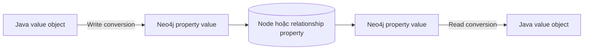

# Khi nào cần converter thay vì node hoặc relationship mới?

Trong Spring Data Neo4j (SDN), một kiểu Java tùy chỉnh không nhất thiết phải trở thành node hoặc relationship riêng trong graph. Nếu kiểu đó chỉ biểu diễn một giá trị thuộc về entity, chẳng hạn tiền tệ, mã định danh theo định dạng riêng hoặc một value object nhỏ, ta có thể dùng converter để chuyển nó thành kiểu property mà Neo4j hỗ trợ. Ngược lại, nếu đối tượng có danh tính riêng, được nhiều node tham chiếu, cần truy vấn độc lập hoặc tham gia traversal, nó thường nên được mô hình hóa thành node. Nếu thông tin mô tả chính mối liên kết giữa hai node, hãy dùng relationship hoặc `@RelationshipProperties`.

Chọn đúng cách biểu diễn giúp graph phản ánh đúng miền nghiệp vụ. Converter giữ một giá trị trong property; node biểu diễn một thực thể; relationship biểu diễn liên kết giữa các thực thể. Ba cách này giải quyết những nhu cầu khác nhau.

## 1. Phân biệt giá trị, thực thể và liên kết

Trước khi viết converter, hãy xác định kiểu dữ liệu Java đang đại diện cho điều gì.

| Bản chất dữ liệu | Cách biểu diễn phù hợp | Dấu hiệu nhận biết |
|---|---|---|
| Giá trị thuộc về một entity | Property với converter hoặc các property đơn giản | Không có danh tính độc lập; vòng đời phụ thuộc entity sở hữu |
| Thực thể trong miền nghiệp vụ | Node với `@Node` | Có định danh riêng, được tham chiếu từ nhiều nơi hoặc cần truy vấn/traversal độc lập |
| Mối liên kết giữa hai thực thể | Relationship với `@Relationship` | Thể hiện quan hệ và hướng giữa hai node |
| Liên kết có dữ liệu riêng | `@RelationshipProperties` và `@TargetNode` | Có thuộc tính như vai trò, thời điểm bắt đầu, số lượng hoặc trạng thái của chính liên kết |

Ví dụ trong hệ thống bán hàng:

- `Money` mô tả giá trị tiền của sản phẩm. Nếu chỉ cần lưu và đọc như một giá trị, có thể dùng converter.
- `Product` có SKU, tên và vòng đời riêng nên là node.
- `Category` có thể được nhiều sản phẩm tham chiếu nên cũng là node.
- `IN_CATEGORY` nối sản phẩm với danh mục nên là relationship.
- `OrderLine` có số lượng và đơn giá tại thời điểm mua nên là relationship properties hoặc một node riêng nếu dòng hàng có vòng đời và quan hệ độc lập phức tạp hơn.

Không nên tạo node chỉ vì một class Java có nhiều field. Cũng không nên dùng converter cho một đối tượng cần được truy vấn như một thực thể trong graph.

## 2. Converter làm gì trong Spring Data Neo4j?

Neo4j lưu property theo các kiểu dữ liệu được database hỗ trợ, chẳng hạn chuỗi, số, boolean, giá trị temporal, point và một số dạng danh sách tương ứng. Một kiểu Java tùy chỉnh như `Money`, `ColorCode` hoặc `ExternalReference` cần được chuyển đổi trước khi SDN ghi xuống database và chuyển ngược khi đọc lên.

Spring Data cung cấp cơ chế conversion. Trong SDN, ta có thể đăng ký converter đọc và ghi thông qua `Neo4jConversions`. Converter không tạo node hoặc relationship mới; nó chuyển một giá trị Java thành một kiểu property Neo4j có thể lưu.

Luồng ghi và đọc có thể hình dung như sau:



Một converter cần có chiều chuyển đổi rõ ràng:

- **Writing converter:** chuyển kiểu miền nghiệp vụ sang kiểu property được Neo4j hỗ trợ.
- **Reading converter:** chuyển giá trị property đọc từ Neo4j về kiểu miền nghiệp vụ.

Với converter hai chiều, cần bảo đảm hai chiều nhất quán để dữ liệu sau khi ghi có thể đọc lại mà không mất ý nghĩa.

Trước khi viết converter, hãy kiểm tra kiểu đó có được SDN hỗ trợ sẵn hay không. Các kiểu như `String`, `Long`, `Boolean`, `LocalDate`, `LocalDateTime`, `UUID`, `URI`, enum và các kiểu point phổ biến đã có mapping tích hợp trong các phiên bản SDN hiện hành. Converter tùy chỉnh dành cho kiểu miền nghiệp vụ mà mapping mặc định chưa xử lý theo cách ứng dụng cần.

## 3. Ví dụ value object Money được lưu thành một property

Giả sử ứng dụng có value object `Money` chứa mã tiền tệ và số tiền theo đơn vị nhỏ nhất. Đối tượng này không có ID riêng, không được các node khác tham chiếu và chỉ là một phần của giá sản phẩm.

```java
public record Money(String currency, long amountMinor) {

    public Money {
        if (currency == null || currency.isBlank()) {
            throw new IllegalArgumentException("Currency is required");
        }
    }

    public static Money parse(String source) {
        int separator = source.indexOf(':');
        if (separator <= 0 || separator == source.length() - 1) {
            throw new IllegalArgumentException("Invalid stored money value");
        }

        String currency = source.substring(0, separator);
        long amountMinor = Long.parseLong(source.substring(separator + 1));
        return new Money(currency, amountMinor);
    }
}
```

Ta chọn biểu diễn property dạng chuỗi có cấu trúc `CURRENCY:AMOUNT_MINOR`, ví dụ `VND:125000`. Đây là định dạng lưu trữ do ứng dụng quy ước; với hệ thống thực tế, cần cố định quy tắc mã tiền tệ, đơn vị và cách xử lý dữ liệu cũ.

Với property entity của SDN, custom converter toàn cục cần chuyển kiểu miền nghiệp vụ sang Neo4j Driver `Value` và chuyển `Value` ngược về kiểu miền nghiệp vụ. Có thể triển khai hai chiều trong một `GenericConverter`:

```java
import java.util.Set;

import org.neo4j.driver.Value;
import org.neo4j.driver.Values;
import org.springframework.core.convert.TypeDescriptor;
import org.springframework.core.convert.converter.GenericConverter;

public class MoneyValueConverter implements GenericConverter {

    @Override
    public Set<ConvertiblePair> getConvertibleTypes() {
        return Set.of(
                new ConvertiblePair(Money.class, Value.class),
                new ConvertiblePair(Value.class, Money.class)
        );
    }

    @Override
    public Object convert(Object source, TypeDescriptor sourceType,
                          TypeDescriptor targetType) {
        if (Money.class.isAssignableFrom(sourceType.getType())) {
            Money money = (Money) source;
            return Values.value(money.currency() + ":" + money.amountMinor());
        }

        Value value = (Value) source;
        return value.isNull() ? null : Money.parse(value.asString());
    }
}
```

`getConvertibleTypes()` khai báo cả hai chiều `Money` ↔ `Value`. Nhánh ghi dùng `Values.value(...)` để tạo giá trị Driver; nhánh đọc lấy chuỗi từ `Value` rồi khôi phục `Money`. Ví dụ tập trung vào giá trị không null; SDN xử lý property null theo quy tắc mapping của nó. Converter kiểm tra định dạng thông qua `Money.parse`, vì vậy dữ liệu cũ sai định dạng sẽ được báo lỗi thay vì âm thầm biến thành giá trị khác.

## 4. Đăng ký converter với Neo4jConversions

Đăng ký `GenericConverter` trong một bean `Neo4jConversions`:

```java
import java.util.Set;

import org.springframework.context.annotation.Bean;
import org.springframework.context.annotation.Configuration;
import org.springframework.core.convert.converter.GenericConverter;
import org.springframework.data.neo4j.core.convert.Neo4jConversions;

@Configuration
public class Neo4jConversionConfiguration {

    @Bean
    Neo4jConversions neo4jConversions() {
        Set<GenericConverter> additionalConverters =
                Set.of(new MoneyValueConverter());
        return new Neo4jConversions(additionalConverters);
    }
}
```

Spring Data Neo4j sử dụng các converter đã đăng ký trong quá trình mapping. Nếu ứng dụng đã có bean `Neo4jConversions`, hãy bổ sung converter vào cấu hình hiện tại thay vì khai báo nhiều bean cạnh tranh. Với Spring Boot, kiểm tra cách cấu hình bean conversion của phiên bản SDN đang dùng và bảo đảm converter được đăng ký trong application context.

### Chỉ chuyển đổi một thuộc tính bằng @ConvertWith

Nếu `Money` chỉ cần conversion ở một field cụ thể, SDN còn hỗ trợ `@ConvertWith` và `Neo4jPersistentPropertyConverter`. Converter theo thuộc tính nhận và trả trực tiếp Driver `Value`:

```java
import org.neo4j.driver.Value;
import org.neo4j.driver.Values;
import org.springframework.data.neo4j.core.convert.Neo4jPersistentPropertyConverter;

public class MoneyPropertyConverter
        implements Neo4jPersistentPropertyConverter<Money> {

    @Override
    public Value write(Money source) {
        return source == null
                ? Values.NULL
                : Values.value(source.currency() + ":" + source.amountMinor());
    }

    @Override
    public Money read(Value source) {
        return source == null || source.isNull()
                ? null
                : Money.parse(source.asString());
    }
}
```

Gắn converter vào đúng field:

```java
import org.springframework.data.neo4j.core.convert.ConvertWith;

@ConvertWith(converter = MoneyPropertyConverter.class)
private Money price;
```

`@ConvertWith` thích hợp khi một field cần cách biểu diễn riêng, hoặc cùng kiểu Java được lưu khác nhau ở các thuộc tính khác nhau. Nếu mọi thuộc tính `Money` trong ứng dụng đều cần cùng định dạng, converter toàn cục đăng ký trong `Neo4jConversions` thường dễ quản lý hơn. Với converter chỉ định theo field, không cần đăng ký lại converter đó trong `Neo4jConversions`.

## 5. Dùng value object trong entity

Sau khi đăng ký converter, có thể dùng `Money` như một thuộc tính của node `Product`:

```java
import org.springframework.data.annotation.Id;
import org.springframework.data.neo4j.core.schema.Node;

@Node("Product")
public class Product {

    @Id
    private String sku;

    private String name;

    private Money price;

    protected Product() {
    }

    public Product(String sku, String name, Money price) {
        this.sku = sku;
        this.name = name;
        this.price = price;
    }
}
```

Khi SDN lưu `Product`, converter chuyển `price` thành property chuỗi. Dữ liệu graph có thể có dạng:

```cypher
(:Product {
    sku: 'PRD-01',
    name: 'Keyboard',
    price: 'VND:125000'
})
```

Khi đọc node, converter ngược tạo lại `Money("VND", 125000)`. `Money` không trở thành node riêng và cũng không tạo relationship.

Lưu ý: cách mã hóa một value object thành một chuỗi giúp lưu và đọc gọn, nhưng Cypher không thể truy vấn riêng `currency` hoặc `amountMinor` như hai property độc lập. Nếu nghiệp vụ cần lọc theo khoảng giá, sắp xếp theo số tiền hoặc lập index cho mã tiền tệ, hãy lưu các thành phần thành property riêng có kiểu phù hợp, hoặc chọn mô hình dữ liệu khác. Không chọn chuỗi mã hóa chỉ vì converter viết nhanh hơn.

## 6. Khi nào nên tạo node thay vì converter?

Một kiểu Java nên được mô hình hóa thành node khi nó có danh tính và vai trò độc lập trong graph. Các dấu hiệu thường gặp:

1. Có định danh riêng như `customerId`, `warehouseId` hoặc `categoryCode`.
2. Nhiều node khác cùng tham chiếu đến nó.
3. Cần truy vấn hoặc cập nhật độc lập với entity sở hữu.
4. Có relationship riêng cần traversal hoặc phân tích.
5. Có vòng đời nghiệp vụ riêng, chẳng hạn tạo, kích hoạt, lưu trữ và xóa.

Ví dụ, `Address` có thể là value object nếu chỉ là địa chỉ giao hàng được snapshot trong một đơn hàng. Nhưng nếu địa chỉ được quản lý như một địa điểm độc lập, được nhiều khách hàng hoặc điểm giao nhận tham chiếu, cần xác thực và truy vấn riêng, nó có thể phù hợp với node `Address`.

Khi là node, ánh xạ bằng `@Node` và tham chiếu qua relationship:

```java
import org.springframework.data.annotation.Id;
import org.springframework.data.neo4j.core.schema.Node;

@Node("Warehouse")
public class Warehouse {

    @Id
    private String warehouseId;

    private String name;
}
```

```java
import java.util.List;

import org.springframework.data.annotation.Id;
import org.springframework.data.neo4j.core.schema.Direction;
import org.springframework.data.neo4j.core.schema.Node;
import org.springframework.data.neo4j.core.schema.Relationship;

@Node("Product")
public class Product {

    @Id
    private String sku;

    @Relationship(type = "STORED_AT", direction = Direction.OUTGOING)
    private List<Warehouse> warehouses;
}
```

Ở đây `Warehouse` có danh tính riêng và có thể được nhiều sản phẩm tham chiếu. Converter không phù hợp vì nó không tạo node để graph có thể traversal đến kho hàng.

## 7. Khi nào nên tạo relationship properties?

Nếu dữ liệu mô tả chính mối liên kết giữa hai node, hãy đặt nó trên relationship. Ví dụ một sản phẩm được lưu tại một kho với số lượng tồn và thời điểm kiểm kê:

```java
import java.time.LocalDate;

import org.springframework.data.neo4j.core.schema.RelationshipId;
import org.springframework.data.neo4j.core.schema.RelationshipProperties;
import org.springframework.data.neo4j.core.schema.TargetNode;

@RelationshipProperties
public class StockAtWarehouse {

    @RelationshipId
    private Long id;

    private long quantity;
    private LocalDate lastCountedOn;

    @TargetNode
    private Warehouse warehouse;
}
```

Trong entity `Product`, có thể thay thuộc tính `List<Warehouse>` trực tiếp bằng collection relationship properties:

```java
import java.util.List;

import org.springframework.data.annotation.Id;
import org.springframework.data.neo4j.core.schema.Direction;
import org.springframework.data.neo4j.core.schema.Node;
import org.springframework.data.neo4j.core.schema.Relationship;

@Node("Product")
public class Product {

    @Id
    private String sku;

    @Relationship(type = "STORED_AT", direction = Direction.OUTGOING)
    private List<StockAtWarehouse> stockLocations;
}
```

`quantity` và `lastCountedOn` phụ thuộc vào cặp sản phẩm-kho, nên thuộc relationship. Nếu `StockAtWarehouse` chỉ là thông tin của liên kết, không cần tạo node riêng. Nếu sau này bản ghi kiểm kê có ID, người thực hiện, nhiều lần kiểm kê và các quan hệ riêng, có thể mô hình hóa mỗi lần kiểm kê thành node `StockCount`.

## 8. Converter không thay thế mô hình hóa dữ liệu có thể truy vấn

Một converter có thể làm cho một kiểu Java phức tạp được lưu thành một property, nhưng việc mã hóa có thể làm mất khả năng truy vấn theo từng thành phần.

Ví dụ, nếu lưu `Money` thành chuỗi `VND:125000`, truy vấn sau chỉ có thể so khớp chuỗi hoàn chỉnh:

```cypher
MATCH (p:Product)
WHERE p.price = 'VND:125000'
RETURN p;
```

Truy vấn theo khoảng số tiền không thể so sánh `amountMinor` một cách tự nhiên vì nó không phải property riêng. Nếu cần tìm sản phẩm từ 100.000 đến 200.000 đồng, hãy lưu dữ liệu theo dạng có thể truy vấn:

```cypher
(:Product {
    sku: 'PRD-01',
    priceCurrency: 'VND',
    priceMinor: 125000
})
```

Khi đó Cypher có thể lọc và sắp xếp theo số tiền:

```cypher
MATCH (p:Product)
WHERE p.priceCurrency = $currency
  AND p.priceMinor >= $minimum
  AND p.priceMinor <= $maximum
RETURN p
ORDER BY p.priceMinor;
```

Nếu vẫn muốn giữ API miền nghiệp vụ `Money`, có thể dùng một mô hình persistence riêng hoặc các thuộc tính đơn giản trong entity rồi tạo value object ở tầng domain. Mục tiêu là giữ được cả tính rõ ràng của mô hình Java lẫn khả năng truy vấn của graph.

Nếu value object có nhiều thành phần cần lưu thành các property riêng trên cùng node hoặc relationship, nhưng không cần danh tính độc lập, hãy cân nhắc `@CompositeProperty`. SDN hỗ trợ ánh xạ `Map<String, Object>` thành nhiều property có chung prefix; với kiểu miền nghiệp vụ khác, có thể cung cấp `Neo4jPersistentPropertyToMapConverter` để tách và ghép object từ map. Đây vẫn là các property của node/relationship sở hữu, không tạo thêm node. Map lồng nhau không được hỗ trợ trong composite property mặc định.

## 9. Converter và relationship properties có thể kết hợp

Converter áp dụng cho giá trị property, nên một field kiểu tùy chỉnh trong lớp `@RelationshipProperties` cũng có thể cần conversion nếu kiểu đó không được SDN hỗ trợ trực tiếp.

Ví dụ, relationship `MEMBER_OF` có thể lưu `membershipFee` dưới dạng value object `Money`:

```java
import org.springframework.data.neo4j.core.schema.RelationshipId;
import org.springframework.data.neo4j.core.schema.RelationshipProperties;
import org.springframework.data.neo4j.core.schema.TargetNode;

// Giả sử Group là một entity @Node đã được khai báo trong domain.
@RelationshipProperties
public class Membership {

    @RelationshipId
    private Long id;

    private Money membershipFee;

    @TargetNode
    private Group group;
}
```

Converter chuyển `membershipFee` thành một giá trị property trên relationship. Nó không biến relationship thành node và không thay thế `@RelationshipProperties`. Nếu cần truy vấn theo số tiền hoặc tiền tệ, cân nhắc lưu thành nhiều property riêng như `feeCurrency` và `feeMinor`.

## 10. Thiết kế converter an toàn và có thể bảo trì

Khi tạo converter, cần xem xét các điểm sau:

1. **Định dạng ổn định:** xác định chính xác cách serialize và parse, tránh phụ thuộc vào `toString()` mặc định của class.
2. **Hai chiều nhất quán:** giá trị ghi xuống phải đọc lại được thành cùng ý nghĩa miền nghiệp vụ.
3. **Null:** xác định rõ cách SDN xử lý property null; Neo4j không lưu property có giá trị null, và converter không nên tự tạo chuỗi biểu diễn null nếu không có yêu cầu rõ ràng.
4. **Dữ liệu cũ:** khi đổi định dạng property, cần migration hoặc converter tương thích ngược trong giai đoạn chuyển đổi.
5. **Kiểu đích được hỗ trợ:** giá trị converter trả về phải là kiểu property Neo4j có thể lưu.
6. **Validation:** từ chối dữ liệu sai định dạng với lỗi có thể chẩn đoán, không âm thầm tạo giá trị mặc định làm sai nghiệp vụ.
7. **Khả năng truy vấn:** không serialize thành một chuỗi khó truy vấn nếu các thành phần cần được lọc, sắp xếp hoặc lập index.

Converter nên là thành phần chuyển đổi thuần, không gọi repository, không thực hiện truy vấn Neo4j và không chứa logic nghiệp vụ cần transaction. Điều này giúp converter dễ kiểm thử và tránh phát sinh truy vấn phụ trong quá trình mapping.

## 11. Kiểm thử converter và mapping

Trước tiên, kiểm thử riêng hai chiều chuyển đổi:

```java
import static org.assertj.core.api.Assertions.assertThat;

import org.neo4j.driver.Value;
import org.springframework.core.convert.TypeDescriptor;
import org.junit.jupiter.api.Test;

class MoneyConverterTest {

    @Test
    void convertsMoneyToDriverValueAndBack() {
        MoneyValueConverter converter = new MoneyValueConverter();
        Money original = new Money("VND", 125000);

        Value stored = (Value) converter.convert(
                original,
                TypeDescriptor.valueOf(Money.class),
                TypeDescriptor.valueOf(Value.class));

        Money restored = (Money) converter.convert(
                stored,
                TypeDescriptor.valueOf(Value.class),
                TypeDescriptor.valueOf(Money.class));

        assertThat(stored.asString()).isEqualTo("VND:125000");
        assertThat(restored).isEqualTo(original);
    }
}
```

Sau unit test, viết integration test với Neo4j để xác nhận converter được đăng ký và được SDN sử dụng khi lưu, tải entity:

1. Lưu `Product` với `Money("VND", 125000)`.
2. Đọc property `price` trực tiếp bằng Cypher và xác nhận giá trị được mã hóa đúng.
3. Tải lại `Product` bằng repository.
4. Xác nhận `price` được chuyển về đúng `Money`.
5. Kiểm tra property cũ sai định dạng và xác nhận ứng dụng xử lý theo chính sách đã chọn.

Unit test xác nhận logic converter; integration test xác nhận converter được wiring vào mapping context và tương thích với database thực tế.

## 12. Những lỗi thường gặp

| Lỗi | Hệ quả | Cách xử lý |
|---|---|---|
| Tạo converter cho đối tượng có danh tính riêng | Không thể traversal hoặc tham chiếu đối tượng như node | Mô hình hóa bằng `@Node` |
| Dùng converter cho dữ liệu mô tả liên kết | Mất cấu trúc relationship và hướng graph | Dùng `@Relationship` hoặc `@RelationshipProperties` |
| Serialize nhiều field thành một chuỗi dù cần truy vấn từng field | Khó lọc, sắp xếp và lập index | Lưu các thành phần thành property riêng hoặc chọn mô hình graph phù hợp |
| Chỉ khai báo chiều `Money -> Value` trong `GenericConverter` | Ghi được nhưng SDN không biết cách khôi phục `Money` khi đọc | Đăng ký cả hai `ConvertiblePair`: `Money -> Value` và `Value -> Money` |
| Dùng converter toàn cục dù chỉ một field cần định dạng riêng | Các thuộc tính cùng kiểu có thể bị chuyển đổi ngoài ý muốn | Dùng `@ConvertWith` cho đúng thuộc tính |
| Dùng `toString()` làm định dạng lưu trữ | Định dạng có thể thay đổi theo implementation | Định nghĩa format ổn định và có parser rõ ràng |
| Đổi format mà không xử lý dữ liệu cũ | Entity cũ có thể không đọc được | Migration dữ liệu hoặc hỗ trợ tương thích ngược |
| Converter gọi repository hoặc truy vấn database | Mapping phát sinh truy vấn phụ và phụ thuộc transaction | Giữ converter thuần chuyển đổi giá trị |

## 13. Bài tập thực hành

Xây dựng mô hình sản phẩm có giá trị tiền tệ:

1. Tạo value object `Money` gồm `currency` và `amountMinor`.
2. Viết `MoneyValueConverter` triển khai `GenericConverter`, hỗ trợ cả `Money -> Value` và `Value -> Money`.
3. Đăng ký converter trong `Neo4jConversions`.
4. Dùng `Money` làm property của node `Product` và lưu một sản phẩm thử nghiệm.
5. Dùng Cypher kiểm tra giá trị property đã được chuyển đổi.
6. Tải lại entity qua repository và xác nhận `Money` được khôi phục.
7. Thảo luận vì sao cách mã hóa thành chuỗi không phù hợp nếu cần tìm sản phẩm theo khoảng giá.
8. Mở rộng mô hình với `Warehouse` là node và `StockAtWarehouse` là relationship properties; giải thích vì sao quantity thuộc liên kết thay vì converter thành một chuỗi.

Sau bài tập, hãy giải thích được khi nào một kiểu Java là value object, khi nào nó cần node riêng, khi nào dữ liệu thuộc relationship và vì sao khả năng truy vấn phải ảnh hưởng đến lựa chọn converter.

## Kết luận

Converter phù hợp khi một kiểu Java là giá trị thuộc về entity hoặc relationship và có thể chuyển thành kiểu property Neo4j hỗ trợ. Với conversion toàn cục cho entity property, dùng `GenericConverter` để khai báo hai chiều giữa kiểu miền nghiệp vụ và Driver `Value`, rồi đăng ký trong `Neo4jConversions`; với một field riêng, cân nhắc `@ConvertWith`. Bảo đảm định dạng hai chiều ổn định và kiểm thử cả conversion lẫn mapping thực tế. Nếu đối tượng có danh tính, vòng đời hoặc cần traversal độc lập, hãy mô hình hóa thành node. Nếu dữ liệu mô tả chính mối liên kết, dùng relationship properties. Đừng để sự tiện lợi của converter làm mất khả năng truy vấn và ý nghĩa graph của miền nghiệp vụ.

## Tài liệu tham khảo

- [Spring Data Neo4j – Conversions](https://docs.spring.io/spring-data/neo4j/reference/appendix/conversions.html)
- [Neo4jConversions API](https://docs.spring.io/spring-data/neo4j/reference/api/java/org/springframework/data/neo4j/core/convert/Neo4jConversions.html)
- [Neo4jPersistentPropertyConverter API](https://docs.spring.io/spring-data/neo4j/reference/api/java/org/springframework/data/neo4j/core/convert/Neo4jPersistentPropertyConverter.html)
