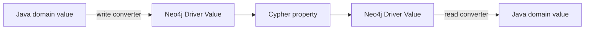

# Converter đọc và ghi giữa kiểu miền với Neo4j Value

## Mục tiêu bài học

Entity Java thường chứa kiểu dữ liệu theo ngôn ngữ nghiệp vụ, trong khi Neo4j lưu property bằng các kiểu giá trị mà Cypher và Neo4j Java Driver hỗ trợ. Một kiểu miền như `Money`, `EmailAddress` hoặc `ProductCode` có thể cần được chuyển thành chuỗi, số hoặc kiểu giá trị khác khi ghi xuống graph, rồi khôi phục thành object Java khi đọc.

Spring Data Neo4j (SDN) hỗ trợ các kiểu chuyển đổi mặc định và cho phép bổ sung converter tùy chỉnh. Bài học này giải thích hai phạm vi chính:

- **Converter toàn cục:** đăng ký với `Neo4jConversions`, áp dụng theo cặp kiểu nguồn/đích trong ứng dụng.
- **Converter cho một property:** dùng `@ConvertWith` để chỉ định cách chuyển đổi riêng cho một thuộc tính của node hoặc relationship properties.

Bạn sẽ triển khai chiều ghi từ kiểu miền sang Neo4j Driver `Value`, chiều đọc ngược lại, đăng ký converter, xử lý null, và kiểm thử việc lưu/đọc để bảo đảm dữ liệu không bị sai lệch.

## 1. Vì sao cần converter?

SDN đã hỗ trợ nhiều kiểu Java phổ biến mà không cần converter tự viết. Ví dụ:

| Kiểu Java | Kiểu Cypher thường dùng |
|---|---|
| `String` | `STRING` |
| `Boolean` | `BOOLEAN` |
| `Integer`, `Long` | `INTEGER` |
| `Double` | `FLOAT` |
| `LocalDate` | `DATE` |
| `LocalDateTime` | `LOCAL DATETIME` |
| `ZonedDateTime` | `DATETIME` |
| `Duration`, `Period` | `DURATION` |
| `UUID` | `STRING` |
| `URI`, `URL` | `STRING` |
| `Enum` | `STRING` |
| `BigDecimal`, `BigInteger` | `STRING` |

Danh sách kiểu được hỗ trợ và cách ánh xạ có thể thay đổi theo phiên bản SDN. Hãy kiểm tra bảng conversion của đúng phiên bản mà dự án sử dụng trước khi tự viết converter cho một kiểu đã được hỗ trợ.

Converter tùy chỉnh hữu ích khi:

- Domain model dùng value object thay vì kiểu primitive.
- Dữ liệu cần chuẩn hóa trước khi lưu, ví dụ mã sản phẩm hoặc địa chỉ email.
- Một kiểu Java cần được biểu diễn bằng định dạng riêng trong graph.
- Repository method cần chuyển tham số nghiệp vụ thành kiểu Neo4j Driver có thể ghi.
- Một property cần cách lưu khác với những property cùng kiểu ở nơi khác.

Ví dụ, domain model dùng `Money` gồm số tiền và đơn vị tiền tệ. Neo4j không lưu trực tiếp object Java `Money` như một property. Ta có thể mã hóa object thành chuỗi `VND|125000.00`, lưu chuỗi đó, rồi phân tích lại khi đọc.

## 2. Luồng chuyển đổi giữa Java và Neo4j Value

Trong SDN, Neo4j Java Driver biểu diễn giá trị property bằng `org.neo4j.driver.Value`. Converter tạo cầu nối giữa kiểu miền và kiểu này.



Hai chiều có ý nghĩa riêng:

- **Write:** chuyển object Java thành một `Value` mà driver có thể ghi thành property.
- **Read:** đọc một `Value` từ record/node rồi khôi phục object Java.

Với property entity, thường cần cả hai chiều để SDN có thể lưu và đọc entity. Nếu converter chỉ dùng để chuyển tham số đầu vào của custom repository query thành giá trị Cypher, chiều ghi từ Java sang `Value` có thể là đủ.

Không nên nhầm converter property với entity mapping. Converter xử lý một giá trị thuộc tính; SDN vẫn chịu trách nhiệm ánh xạ node, label, ID và relationship.

## 3. Xây dựng kiểu miền Money

Dùng một value object để minh họa. `Money` giữ số tiền dưới dạng `BigDecimal` và đơn vị tiền tệ dưới dạng `Currency`:

```java
import java.math.BigDecimal;
import java.util.Currency;
import java.util.Objects;

public record Money(BigDecimal amount, Currency currency) {

    public Money {
        Objects.requireNonNull(amount, "amount must not be null");
        Objects.requireNonNull(currency, "currency must not be null");
    }

    public String toStorageValue() {
        return currency.getCurrencyCode() + "|" + amount.toPlainString();
    }

    public static Money fromStorageValue(String value) {
        int separator = value.indexOf('|');

        if (separator != 3 || separator == value.length() - 1) {
            throw new IllegalArgumentException(
                    "Invalid Money value: " + value);
        }

        Currency currency =
                Currency.getInstance(value.substring(0, separator));
        BigDecimal amount =
                new BigDecimal(value.substring(separator + 1));

        return new Money(amount, currency);
    }
}
```

Định dạng lưu trữ có cấu trúc `MÃ_TIỀN_TỆ|SỐ_TIỀN`. Ví dụ:

| Object Java | Chuỗi lưu trong Neo4j |
|---|---|
| `Money(125000.00, VND)` | `VND|125000.00` |
| `Money(19.95, USD)` | `USD|19.95` |

Định dạng này chỉ là một lựa chọn minh họa. Khi chọn định dạng lưu trữ, cần bảo đảm:

- Có thể phân tích ngược một cách nhất quán.
- Có quy tắc rõ ràng cho scale, rounding và đơn vị tiền tệ.
- Dữ liệu cũ vẫn đọc được khi định dạng thay đổi.
- Không đưa dữ liệu không tin cậy vào parser mà không kiểm tra.

Trong ứng dụng thực tế, có thể thêm version vào chuỗi nếu định dạng sẽ phát triển, ví dụ `v1|VND|125000.00`. Nếu cần lọc hoặc sắp xếp theo số tiền trong Cypher, lưu toàn bộ object thành một chuỗi có thể không phù hợp vì database không thể so sánh phần số như một property số. Khi đó nên chọn mô hình property phù hợp hơn, chẳng hạn lưu amount và currency thành hai property riêng.

## 4. Converter toàn cục bằng GenericConverter

Khi cùng một kiểu miền được dùng ở nhiều entity hoặc nhiều repository method, có thể đăng ký converter toàn cục. SDN sử dụng `org.springframework.core.convert.converter.GenericConverter` để khai báo rõ các cặp kiểu có thể chuyển đổi.

Ví dụ converter hai chiều cho `Money` và Neo4j Driver `Value`:

```java
import java.util.Set;

import org.neo4j.driver.Value;
import org.neo4j.driver.Values;
import org.springframework.core.convert.TypeDescriptor;
import org.springframework.core.convert.converter.GenericConverter;
import org.springframework.core.convert.converter.GenericConverter.ConvertiblePair;

public class MoneyValueConverter implements GenericConverter {

    private static final Set<ConvertiblePair> CONVERTIBLE_TYPES = Set.of(
            new ConvertiblePair(Money.class, Value.class),
            new ConvertiblePair(Value.class, Money.class)
    );

    @Override
    public Set<ConvertiblePair> getConvertibleTypes() {
        return CONVERTIBLE_TYPES;
    }

    @Override
    public Object convert(
            Object source,
            TypeDescriptor sourceType,
            TypeDescriptor targetType) {

        if (source == null) {
            return null;
        }

        if (Money.class.isAssignableFrom(sourceType.getType())) {
            Money money = (Money) source;
            return Values.value(money.toStorageValue());
        }

        if (Value.class.isAssignableFrom(sourceType.getType())) {
            Value value = (Value) source;
            return value.isNull()
                    ? null
                    : Money.fromStorageValue(value.asString());
        }

        throw new IllegalArgumentException(
                "Unsupported conversion from " + sourceType
                        + " to " + targetType);
    }
}
```

Hai `ConvertiblePair` khai báo:

- `Money.class -> Value.class`: dùng khi ghi object miền thành property.
- `Value.class -> Money.class`: dùng khi đọc property thành object miền.

Trong chiều ghi, `Values.value(...)` tạo một driver `Value` chứa chuỗi. Trong chiều đọc, converter kiểm tra giá trị null rồi lấy chuỗi bằng `asString()` để tạo lại `Money`.

Nếu converter chỉ phục vụ tham số của custom query và không dùng để hydrate property entity, có thể chỉ đăng ký cặp `Money.class -> Value.class`. Khi cần đọc kiểu miền từ property entity, phải có chiều ngược lại.

## 5. Đăng ký converter trong Neo4jConversions

Converter toàn cục cần được đăng ký để SDN biết cách sử dụng. Khai báo bean `Neo4jConversions`:

```java
import java.util.Set;

import org.springframework.context.annotation.Bean;
import org.springframework.context.annotation.Configuration;
import org.springframework.data.neo4j.core.convert.Neo4jConversions;

@Configuration
public class Neo4jConversionConfiguration {

    @Bean
    Neo4jConversions neo4jConversions() {
        return new Neo4jConversions(
                Set.of(new MoneyValueConverter())
        );
    }
}
```

`Neo4jConversions` quản lý các conversion mặc định của SDN và tập converter bổ sung do ứng dụng cung cấp. Có thể đăng ký nhiều converter trong collection truyền vào constructor.

Nếu không cung cấp bean này, SDN sẽ tạo bộ conversion mặc định của nó và converter tùy chỉnh chưa đăng ký sẽ không được dùng. Vì vậy, khi kiểm thử converter mà kết quả không được áp dụng, hãy xác nhận application context thực sự dùng bean `Neo4jConversions` có converter đó.

Một converter toàn cục ảnh hưởng đến mọi property hoặc tham số có cặp kiểu tương ứng. Hãy khai báo các cặp kiểu đủ cụ thể, tránh đăng ký nhiều converter chồng lấn cho cùng một cặp khiến lựa chọn converter khó dự đoán.

## 6. Sử dụng converter toàn cục trong entity

Sau khi đăng ký, entity có thể dùng trực tiếp kiểu `Money`:

```java
import org.springframework.data.neo4j.core.schema.Id;
import org.springframework.data.neo4j.core.schema.Node;

@Node("Product")
public class Product {

    @Id
    private String id;

    private String name;

    private Money price;

    // Constructor, getter và setter được lược bỏ.
}
```

Khi lưu:

```java
Product product = new Product(
        "P-100",
        "Bàn phím",
        new Money(new BigDecimal("125000.00"),
                  Currency.getInstance("VND"))
);

productRepository.save(product);
```

SDN chuyển `price` qua converter đã đăng ký. Neo4j lưu property `price` dưới dạng chuỗi. Khi đọc lại entity, SDN nhận `Value` của property và gọi converter theo chiều ngược để tạo `Money`.

Cypher kiểm tra giá trị lưu trữ:

```cypher
MATCH (p:Product {id: 'P-100'})
RETURN p.price AS storedPrice
```

Kết quả mong đợi:

```text
VND|125000.00
```

Nếu converter chỉ dùng cho entity property, hãy kiểm tra cả vòng đời save và read. Kiểm tra riêng chuỗi Cypher trả về chỉ chứng minh chiều ghi; nó chưa chứng minh chiều đọc khôi phục đúng object miền.

## 7. Converter cho một property bằng @ConvertWith

Không phải lúc nào cũng muốn áp dụng conversion cho mọi property cùng kiểu. Nếu một trường cần cách lưu riêng, SDN cung cấp `@ConvertWith`.

Converter cho property cần triển khai `Neo4jPersistentPropertyConverter<T>`. Interface có hai phương thức:

- `write(T source)`: chuyển kiểu Java thành driver `Value`.
- `read(Value source)`: chuyển driver `Value` về kiểu Java.

Ví dụ:

```java
import org.neo4j.driver.Value;
import org.neo4j.driver.Values;
import org.springframework.data.neo4j.core.convert.Neo4jPersistentPropertyConverter;

public class MoneyPropertyConverter
        implements Neo4jPersistentPropertyConverter<Money> {

    @Override
    public Value write(Money source) {
        if (source == null) {
            return Values.NULL;
        }

        return Values.value(source.toStorageValue());
    }

    @Override
    public Money read(Value source) {
        if (source == null || source.isNull()) {
            return null;
        }

        return Money.fromStorageValue(source.asString());
    }
}
```

Gắn converter vào đúng trường:

```java
@Node("Product")
public class Product {

    @Id
    private String id;

    private String name;

    @ConvertWith(converter = MoneyPropertyConverter.class)
    private Money price;

    // Constructor, getter và setter được lược bỏ.
}
```

Import annotation:

```java
import org.springframework.data.neo4j.core.convert.ConvertWith;
```

Cách này phù hợp khi chỉ `Product.price` cần định dạng đặc biệt. Một property `Money` ở entity khác vẫn có thể dùng conversion toàn cục hoặc cách mapping khác.

Khi `write()` cần biểu diễn null, trả về `Values.NULL` thay vì trả về Java `null`. Khi đọc, converter có thể trả về `null` nếu driver value là null. Hãy thống nhất cách xử lý null với quy tắc domain của ứng dụng.

## 8. Dùng converterRef khi converter là Spring bean

Nếu converter cần dependency được Spring quản lý, có thể đăng ký nó thành bean rồi tham chiếu bằng `converterRef`. Đây là một cách triển khai thay thế cho converter class có constructor mặc định ở phần trước. Trong một property, hãy chọn cách tạo converter phù hợp với nhu cầu dependency; không cần khai báo đồng thời hai converter khác nhau cho cùng một trường.

```java
@Component("moneyPropertyConverter")
public class MoneyPropertyConverter
        implements Neo4jPersistentPropertyConverter<Money> {

    private final MoneyFormatPolicy formatPolicy;

    public MoneyPropertyConverter(MoneyFormatPolicy formatPolicy) {
        this.formatPolicy = formatPolicy;
    }

    @Override
    public Value write(Money source) {
        if (source == null) {
            return Values.NULL;
        }

        return Values.value(formatPolicy.format(source));
    }

    @Override
    public Money read(Value source) {
        if (source == null || source.isNull()) {
            return null;
        }

        return formatPolicy.parse(source.asString());
    }
}
```

Property tham chiếu bean:

```java
@ConvertWith(converterRef = "moneyPropertyConverter")
private Money price;
```

Bean được tham chiếu phải tồn tại trong application context và triển khai `Neo4jPersistentPropertyConverter`. Khi `converterRef` được đặt, SDN ưu tiên bean có tên đó hơn class được chỉ định qua thuộc tính `converter`.

Dùng `converter = SomeConverter.class` khi converter có thể được tạo bằng constructor mặc định và không cần dependency. Dùng `converterRef` khi cần constructor injection, cấu hình hoặc dịch vụ hỗ trợ.

## 9. Áp dụng cho relationship properties

Converter theo property không chỉ dùng cho trường của node entity. Nó cũng có thể dùng cho thuộc tính bên trong class được đánh dấu `@RelationshipProperties`.

```java
@RelationshipProperties
public class Membership {

    @RelationshipId
    private Long id;

    @ConvertWith(converter = MoneyPropertyConverter.class)
    private Money monthlyFee;

    @TargetNode
    private Group group;

    // Constructor, getter và setter được lược bỏ.
}
```

Ví dụ này dùng `Money` để biểu diễn phí thành viên trên relationship. Converter chỉ kiểm soát cách lưu/đọc `monthlyFee`; SDN vẫn quản lý identity của relationship, kiểu cạnh và node đích theo mapping đã khai báo.

Nếu cùng một kiểu `Money` xuất hiện ở nhiều nơi và cùng quy tắc lưu, converter toàn cục có thể giảm cấu hình lặp. Nếu từng property có quy tắc khác nhau, `@ConvertWith` giúp giới hạn phạm vi tác động.

## 10. Converter cho tham số repository query

Custom converter cũng hữu ích khi một repository method nhận kiểu miền làm tham số:

```java
@Query("MATCH (p:Product) " +
       "WHERE p.price = $price " +
       "RETURN p")
List<Product> findProductsByPrice(@Param("price") Money price);
```

Nếu SDN cần chuyển `Money` thành giá trị Cypher cho tham số `$price`, converter toàn cục có cặp `Money -> Value` cho phép chuyển đổi một chiều. Nếu query cũng trả về entity có property `Money`, cần có chiều đọc tương ứng cho property đó.

Với converter riêng gắn bằng `@ConvertWith`, conversion được áp dụng cho property và tham số repository method ánh xạ tới property đó trong derived queries và Query by Example. Cơ chế này không áp dụng theo cùng cách cho tham số của string-based query như `@Query`; với custom Cypher dạng chuỗi, hãy dùng converter toàn cục phù hợp hoặc tự chuyển tham số sang giá trị driver trước khi bind.

Không nên giả định converter cho entity property tự động chuyển mọi object lồng nhau trong bất kỳ câu Cypher tùy chỉnh nào. Hãy kiểm tra rõ kiểu tham số, đường thực thi query và test với đúng loại repository method.

## 11. Chọn converter toàn cục hay converter theo property?

| Tiêu chí | `Neo4jConversions` + `GenericConverter` | `@ConvertWith` |
|---|---|---|
| Phạm vi | Theo cặp kiểu trong toàn ứng dụng | Một property cụ thể |
| Interface | `GenericConverter` | `Neo4jPersistentPropertyConverter<T>` |
| Chiều chuyển đổi | Khai báo qua `ConvertiblePair` | Phương thức `write` và `read` |
| Đăng ký | Bean `Neo4jConversions` | Annotation trên property |
| Dependency injection | Converter có thể được quản lý như bean nếu cấu hình phù hợp | Dùng `converterRef` |
| Dùng cho custom query parameter | Có thể đăng ký cặp ghi `DomainType -> Value` | Không áp dụng cho string-based `@Query` theo cùng cơ chế |
| Trường hợp phù hợp | Một kiểu miền có quy tắc lưu thống nhất | Một trường cần quy tắc lưu riêng |

Quy tắc chọn:

- Dùng converter toàn cục nếu mọi property kiểu `Money` đều cần cùng định dạng.
- Dùng `@ConvertWith` nếu chỉ một trường cần định dạng đặc biệt.
- Dùng `converterRef` khi cần dependency từ Spring.
- Không viết converter nếu SDN đã hỗ trợ kiểu đó trực tiếp và quy tắc mặc định đáp ứng nhu cầu.

## 12. Null, dữ liệu sai định dạng và khả năng tương thích

Converter là ranh giới giữa dữ liệu miền và dữ liệu lưu trữ. Cần quyết định rõ cách xử lý các trường hợp biên.

**Null:** Một property không có giá trị có thể được biểu diễn bằng null/không có property trong graph. Với `Neo4jPersistentPropertyConverter`, trả `Values.NULL` ở chiều ghi và trả null ở chiều đọc khi nguồn null. Đừng biến null thành chuỗi `"null"` trừ khi đó là quy ước dữ liệu có chủ đích.

**Dữ liệu sai định dạng:** Nếu chuỗi không thể phân tích thành `Money`, hãy ném lỗi có thông tin đủ để xác định property và định dạng không hợp lệ. Không âm thầm trả về số tiền 0 hoặc một đơn vị tiền tệ mặc định vì sẽ che giấu dữ liệu hỏng.

**Độ chính xác:** Dùng `BigDecimal` cho tiền tệ. Không chuyển qua `double` nếu nghiệp vụ yêu cầu độ chính xác thập phân.

**Thay đổi định dạng:** Khi đổi từ `VND|125000.00` sang định dạng mới, phải có chiến lược đọc dữ liệu cũ hoặc migration graph. Converter mới chỉ được triển khai sau khi xác định cách xử lý những node đã lưu theo định dạng trước.

**Tính truy vấn:** Nếu dữ liệu được mã hóa thành một chuỗi, Cypher chỉ có thể lọc/sắp xếp theo chuỗi đó. Nếu nghiệp vụ cần lọc theo amount hoặc currency riêng, hãy cân nhắc lưu thành các property riêng bằng mô hình mapping phù hợp thay vì mã hóa tất cả vào một property.

**Kiểm tra kiểu:** Converter phải trả về kiểu driver có thể ghi thành property Neo4j. Neo4j không cho lưu tùy ý một object Java hoặc cấu trúc lồng nhau không được hỗ trợ như một property đơn.

Nếu một object miền cần được tách thành nhiều property riêng trên node hoặc relationship, converter một property sang một `Value` có thể không phải mô hình phù hợp. SDN có `@CompositeProperty` cho map và cho phép cung cấp `Neo4jPersistentPropertyToMapConverter` để phân rã một kiểu miền thành map rồi tái tạo object từ map. Các entry được lưu thành property riêng trên node/relationship, thay vì lưu cả map lồng nhau như một property đơn.

## 13. Kiểm thử converter và vòng đời entity

Nên kiểm thử converter ở hai cấp độ.

### Unit test cho quy tắc chuyển đổi

Kiểm tra round-trip:

```java
class MoneyPropertyConverterTest {

    private final MoneyPropertyConverter converter =
            new MoneyPropertyConverter();

    @Test
    void shouldRoundTripMoney() {
        Money original = new Money(
                new BigDecimal("125000.00"),
                Currency.getInstance("VND")
        );

        Value stored = converter.write(original);
        Money restored = converter.read(stored);

        assertEquals(original, restored);
    }

    @Test
    void shouldRepresentNullWithDriverNullValue() {
        assertTrue(converter.write(null).isNull());
        assertNull(converter.read(Values.NULL));
    }
}
```

Test round-trip giúp phát hiện trường hợp write tạo định dạng mà read không phân tích được. Cần bổ sung trường hợp số âm, scale thập phân, mã tiền tệ không hợp lệ và chuỗi bị thiếu dấu phân cách nếu các trường hợp đó có thể xuất hiện.

### Integration test với Neo4j

Unit test không chứng minh SDN đã đăng ký và sử dụng converter. Cần kiểm tra qua repository:

```java
@DataNeo4jTest
class ProductMoneyConversionTest {

    @Autowired
    private ProductRepository productRepository;

    @Test
    void shouldPersistAndReadMoneyProperty() {
        Money price = new Money(
                new BigDecimal("125000.00"),
                Currency.getInstance("VND")
        );

        Product product = new Product("P-100", "Bàn phím", price);
        productRepository.save(product);

        Product loaded = productRepository.findById("P-100")
                .orElseThrow();

        assertEquals(price, loaded.getPrice());
    }
}
```

Nếu dùng converter toàn cục, test cần khởi tạo application context có bean `Neo4jConversions` chứa converter. Nếu dùng `@ConvertWith`, kiểm tra annotation và bean reference nếu có.

Bộ test nên bao gồm:

1. Lưu entity có property kiểu miền.
2. Đọc entity và xác nhận object miền khôi phục chính xác.
3. Kiểm tra giá trị property thực tế trong Neo4j bằng Cypher.
4. Lưu và đọc giá trị null.
5. Kiểm tra dữ liệu sai định dạng.
6. Kiểm tra repository method nhận kiểu miền làm tham số.
7. Kiểm tra property trên `@RelationshipProperties` nếu có dùng.
8. Xác nhận các converter không làm thay đổi property cùng kiểu nhưng không nằm trong phạm vi cấu hình riêng.

## 14. Lỗi thường gặp

| Lỗi | Nguyên nhân | Cách xử lý |
|---|---|---|
| Entity ghi được nhưng đọc không được | Chỉ đăng ký converter chiều `DomainType -> Value` | Thêm chiều `Value -> DomainType` |
| Converter không được SDN gọi | Chưa đăng ký vào `Neo4jConversions` hoặc annotation sai property | Kiểm tra bean và cấu hình `@ConvertWith` |
| Giá trị lưu thành chuỗi không đúng định dạng | Write và read dùng quy tắc khác nhau | Tập trung định dạng vào một hàm dùng chung và test round-trip |
| Null gây lỗi khi lưu | Converter trả Java null thay vì driver null value | Dùng `Values.NULL` trong property converter |
| Property sai kiểu khi đọc | Cypher property không khớp kiểu mà converter mong đợi | Kiểm tra kiểu thực tế và accessor của `Value` |
| Converter áp dụng rộng hơn mong muốn | Đăng ký converter toàn cục cho một kiểu dùng ở nhiều nơi | Dùng `@ConvertWith` cho property cần quy tắc riêng |
| ConverterRef không được tìm thấy | Bean name sai hoặc bean không triển khai đúng interface | Kiểm tra tên bean và kiểu `Neo4jPersistentPropertyConverter` |
| Custom `@Query` không chuyển tham số như kỳ vọng | Nhầm conversion theo property với string-based query parameter conversion | Đăng ký converter toàn cục hoặc chuyển giá trị rõ ràng trước khi bind |
| Đổi định dạng làm dữ liệu cũ không đọc được | Không có chiến lược tương thích/migration | Hỗ trợ đọc nhiều version hoặc migrate dữ liệu trước |
| Mã hóa nhiều trường vào một chuỗi khiến khó lọc | Biểu diễn lưu trữ không phù hợp truy vấn | Lưu thành property riêng hoặc dùng composite mapping |

## 15. Tự kiểm tra

1. Vì sao một kiểu miền như `Money` cần converter trước khi lưu thành Neo4j property?
2. `GenericConverter` khai báo những cặp kiểu nào cho chuyển đổi hai chiều?
3. Vì sao converter dùng cho entity property cần cả chiều ghi và chiều đọc?
4. `Neo4jConversions` có vai trò gì trong việc đăng ký converter toàn cục?
5. Khác biệt giữa converter toàn cục và `@ConvertWith` là gì?
6. `Neo4jPersistentPropertyConverter<T>` cần triển khai hai phương thức nào?
7. Khi nào nên dùng `converterRef` thay cho `converter = SomeClass.class`?
8. Vì sao custom query parameter có thể chỉ cần conversion một chiều?
9. Vì sao `@ConvertWith` không tự áp dụng cho string-based `@Query`?
10. Cần kiểm thử điều gì ngoài unit test để xác nhận SDN thật sự sử dụng converter?

Hãy triển khai `Money` và một converter chuyển đổi sang chuỗi Neo4j. Đăng ký một lần bằng `Neo4jConversions`, lưu và đọc entity qua repository, rồi kiểm tra giá trị lưu trong graph. Sau đó tạo một property khác dùng `@ConvertWith` để thấy cách giới hạn converter theo trường. Cuối cùng kiểm thử null, dữ liệu sai định dạng và repository method nhận `Money` làm tham số.

## Tài liệu tham khảo

- [Spring Data Neo4j — Conversions](https://docs.spring.io/spring-data/neo4j/reference/appendix/conversions.html)
- [Spring Data Neo4j — Neo4jConversions API](https://docs.spring.io/spring-data/neo4j/reference/api/java/org/springframework/data/neo4j/core/convert/Neo4jConversions.html)
- [Spring Data Neo4j — Neo4jPersistentPropertyConverter API](https://docs.spring.io/spring-data/neo4j/reference/api/java/org/springframework/data/neo4j/core/convert/Neo4jPersistentPropertyConverter.html)
- [Spring Data Neo4j — ConvertWith API](https://docs.spring.io/spring-data/neo4j/reference/api/java/org/springframework/data/neo4j/core/convert/ConvertWith.html)
