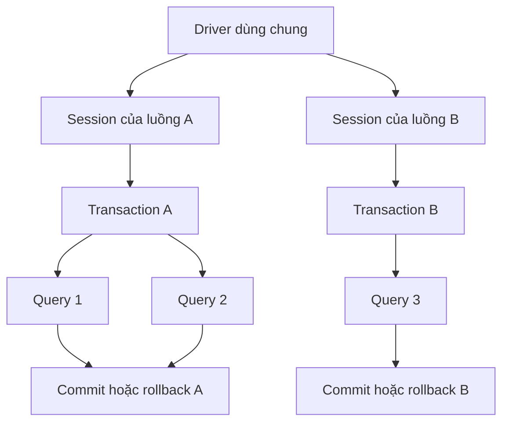
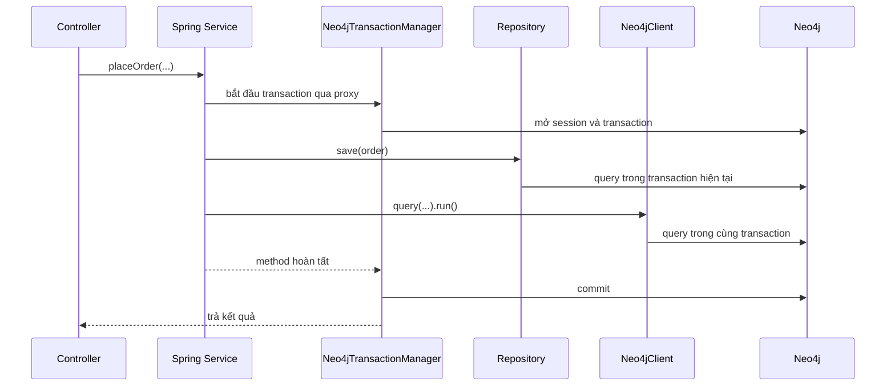

# Ranh giới giao dịch của Neo4j và của ứng dụng Spring

Một nghiệp vụ trong ứng dụng thường gồm nhiều thao tác trên graph: tạo đơn hàng, nối đơn hàng với khách hàng, thêm các dòng sản phẩm và cập nhật trạng thái. Nếu chỉ một thao tác thành công còn các thao tác khác thất bại, dữ liệu có thể rơi vào trạng thái dở dang. Transaction giúp gom những thao tác thuộc cùng một nghiệp vụ thành một đơn vị commit hoặc rollback.

Trong Spring Data Neo4j (SDN), cần phân biệt hai lớp ranh giới. Neo4j quản lý transaction thực thi trên database; Spring quản lý ranh giới transaction ở cấp phương thức hoặc use case của ứng dụng. `Neo4jTransactionManager` nối hai lớp này để các repository và `Neo4jClient` cùng tham gia một transaction Neo4j khi được cấu hình đúng.

## 1. Transaction của Neo4j là gì?

Transaction là một đơn vị công việc trên database. Một transaction có thể chứa nhiều câu Cypher và bảo đảm các thay đổi được commit cùng nhau hoặc bị rollback cùng nhau. Neo4j cung cấp các thuộc tính ACID:

- **Atomicity:** hoặc tất cả thay đổi trong transaction được ghi nhận, hoặc không thay đổi nào được giữ lại khi rollback.
- **Consistency:** transaction phải đưa graph từ một trạng thái hợp lệ sang trạng thái hợp lệ khác theo các quy tắc của database.
- **Isolation:** các transaction đồng thời được kiểm soát để tránh nhìn thấy những thay đổi chưa commit; mức cô lập mặc định của Neo4j là read committed.
- **Durability:** sau khi commit thành công, dữ liệu được lưu bền vững theo cơ chế phục hồi của database.

Ví dụ, một thao tác đặt hàng cần tạo node `Order`, liên kết với `Customer` và thêm relationship tới các `Product`. Nếu việc thêm dòng hàng cuối cùng thất bại, ứng dụng không nên để lại một đơn hàng chỉ có một phần sản phẩm.

```cypher
CREATE (o:Order {orderNumber: $orderNumber, status: "NEW"})
WITH o
MATCH (c:Customer {customerId: $customerId})
CREATE (c)-[:PLACED]->(o)
```

Đoạn Cypher trên là một query. Khi nghiệp vụ gồm nhiều query tách biệt và có logic Java xen giữa, cần một transaction bao quanh tất cả query đó để chúng cùng commit hoặc rollback.

## 2. Phân biệt Driver, Session và Transaction

Neo4j Java Driver có ba khái niệm liên quan nhưng không đồng nghĩa:

| Thành phần | Vai trò |
| --- | --- |
| `Driver` | Đối tượng quản lý cấu hình kết nối và connection pool; thường được dùng chung trong ứng dụng |
| `Session` | Ngữ cảnh giao tiếp với database, duy trì causal consistency và tạo các transaction |
| `Transaction` | Đơn vị công việc thực tế trên server, chứa một hoặc nhiều câu query và được commit/rollback |

Một `Session` không phải là một transaction. Một session có thể chạy nhiều transaction tuần tự, nhưng chỉ có tối đa một transaction đang hoạt động tại một thời điểm. Session không thread-safe; có thể chia sẻ `Driver` giữa các thread nhưng mỗi thread cần session riêng.



Luôn đóng session khi hoàn tất. Với Java Driver, dùng try-with-resources để session được trả lại connection pool ngay cả khi có exception.

## 3. Các cách tạo transaction bằng Neo4j Java Driver

Driver cung cấp ba cách phổ biến để chạy query:

| Cách chạy | Đặc điểm | Khi phù hợp |
| --- | --- | --- |
| Implicit/auto-commit (`Session.run`) | Một query chạy trong transaction tự động; cần consume kết quả để bảo đảm hoàn tất | Query đơn giản hoặc các trường hợp đặc biệt như `CALL { ... } IN TRANSACTIONS` |
| Managed transaction (`executeRead`, `executeWrite`) | Driver quản lý begin/commit/rollback và có thể retry lỗi transient | Nhiều query trong một đơn vị công việc ở ứng dụng dùng Driver trực tiếp |
| Explicit transaction (`beginTransaction`) | Ứng dụng tự gọi `commit()` hoặc `rollback()` | Cần điều khiển vòng đời transaction chi tiết |

### Managed transaction với `executeWrite`

```java
import java.util.Map;

import org.neo4j.driver.Driver;
import org.neo4j.driver.Session;
import org.neo4j.driver.SessionConfig;

public class DriverOrderWriter {

    private final Driver driver;

    public DriverOrderWriter(Driver driver) {
        this.driver = driver;
    }

    public void createOrder(String orderNumber, String customerId) {
        try (Session session = driver.session(
                SessionConfig.builder().withDatabase("neo4j").build())) {

            session.executeWrite(tx -> {
                tx.run("""
                    CREATE (o:Order {orderNumber: $orderNumber})
                    """, Map.of("orderNumber", orderNumber)).consume();

                tx.run("""
                    MATCH (c:Customer {customerId: $customerId})
                    RETURN c.customerId AS customerId
                    """, Map.of("customerId", customerId)).single();

                tx.run("""
                    MATCH (c:Customer {customerId: $customerId})
                    MATCH (o:Order {orderNumber: $orderNumber})
                    CREATE (c)-[:PLACED]->(o)
                    """, Map.of(
                        "customerId", customerId,
                        "orderNumber", orderNumber
                    )).consume();

                return null;
            });
        }
    }
}
```

Callback của `executeWrite` chứa ba query. Lệnh `.single()` yêu cầu phải có một record khách hàng; nếu không tìm thấy khách hàng, nó ném exception và làm transaction rollback, bao gồm cả node đơn hàng đã tạo ở query đầu. Nếu callback hoàn tất bình thường, Driver commit transaction. Driver cũng có thể chạy lại transaction function khi gặp một số lỗi transient.

Vì callback có thể được thực thi nhiều lần, nó phải an toàn khi retry. Không gửi email, gọi dịch vụ thanh toán hoặc thay đổi trạng thái bên ngoài database ngay trong callback nếu các tác vụ đó không có cơ chế idempotency. Hãy chỉ thực hiện thao tác database trong callback; xử lý side effect sau commit hoặc dùng outbox/event pattern.

### Explicit transaction

```java
import java.util.Map;

import org.neo4j.driver.Session;
import org.neo4j.driver.Transaction;

try (Session session = driver.session();
     Transaction tx = session.beginTransaction()) {

    tx.run("CREATE (:AuditEvent {eventId: $id})", Map.of("id", eventId))
        .consume();

    if (shouldKeepEvent) {
        tx.commit();
    } else {
        tx.rollback();
    }
}
```

Nếu explicit transaction được đóng mà chưa commit, Driver rollback transaction. Cách này cho phép điều khiển rõ thời điểm commit, nhưng ứng dụng phải tự quản lý lỗi, đóng tài nguyên và retry phù hợp.

## 4. Ranh giới transaction ở cấp ứng dụng Spring

Một nghiệp vụ thường trải qua nhiều repository và service. Nếu mỗi repository tự mở và đóng transaction riêng, ứng dụng khó bảo đảm toàn bộ use case là nguyên tử. Spring giải quyết điều này bằng transaction abstraction: service khai báo ranh giới bằng `@Transactional`, còn một `PlatformTransactionManager` cụ thể thực hiện begin, commit và rollback trên resource tương ứng.

Với SDN imperative, transaction manager là `Neo4jTransactionManager`. Đây là implementation của `PlatformTransactionManager`, đồng bộ một cặp native Neo4j session/transaction với Spring transaction. `@Transactional` vì thế mô tả ranh giới ở cấp ứng dụng, còn Neo4j thực hiện transaction thật trên database.



Các thao tác qua repository và `Neo4jClient` có thể dùng chung transaction Spring nếu chúng được cấu hình với cùng `Driver` instance và cùng transaction context.

## 5. Dùng `@Transactional` ở service boundary

Đặt `@Transactional` ở phương thức service đại diện cho một nghiệp vụ hoàn chỉnh. Ví dụ:

```java
import org.springframework.stereotype.Service;
import org.springframework.transaction.annotation.Transactional;
import org.springframework.data.neo4j.core.Neo4jClient;

@Service
public class OrderService {

    private final OrderRepository orderRepository;
    private final Neo4jClient neo4jClient;

    public OrderService(
        OrderRepository orderRepository,
        Neo4jClient neo4jClient
    ) {
        this.orderRepository = orderRepository;
        this.neo4jClient = neo4jClient;
    }

    @Transactional
    public String placeOrder(PurchaseOrder order, String customerId) {
        orderRepository.save(order);

        neo4jClient.query("""
                MATCH (c:Customer {customerId: $customerId})
                MATCH (o:Order {orderNumber: $orderNumber})
                MERGE (c)-[:PLACED]->(o)
                RETURN o.orderNumber AS orderNumber
                """)
            .bind(customerId).to("customerId")
            .bind(order.getOrderNumber()).to("orderNumber")
            .fetch().one()
            .orElseThrow(() -> new IllegalStateException(
                "Customer or order was not found"
            ));

        return order.getOrderNumber();
    }
}
```

Nếu `save(order)` thành công nhưng query trong `Neo4jClient` thất bại với exception khiến transaction rollback, thay đổi của cả hai thao tác sẽ bị rollback cùng nhau. Điều này chỉ đúng khi repository và client tham gia cùng transaction Neo4j; tạo một Driver riêng hoặc tự mở transaction độc lập có thể phá vỡ sự đồng bộ đó.

Query không tìm thấy node thường chỉ trả về không có record, chứ không tự ném exception. Vì vậy, ví dụ gọi `.fetch().one().orElseThrow(...)` để biến trường hợp không tìm thấy khách hàng hoặc đơn hàng thành lỗi nghiệp vụ, từ đó kích hoạt rollback.

Nếu ứng dụng chỉ có một transaction manager, `@Transactional` mặc định dùng manager đó. Khi có nhiều manager, chỉ rõ manager phù hợp bằng `@Transactional(transactionManager = "neo4jTransactionManager")` hoặc qualifier tương ứng.

## 6. Cấu hình `Neo4jTransactionManager`

Spring Boot với starter SDN thường tự cấu hình các bean cần thiết. Nếu ứng dụng tự cấu hình hoặc cần chỉ định rõ database selection, có thể khai báo transaction manager:

```java
import org.neo4j.driver.Driver;
import org.springframework.context.annotation.Bean;
import org.springframework.context.annotation.Configuration;
import org.springframework.data.neo4j.core.DatabaseSelectionProvider;
import org.springframework.data.neo4j.core.transaction.Neo4jTransactionManager;
import org.springframework.transaction.PlatformTransactionManager;

@Configuration
public class Neo4jTransactionConfiguration {

    @Bean("neo4jTransactionManager")
    PlatformTransactionManager neo4jTransactionManager(
        Driver driver,
        DatabaseSelectionProvider databaseSelectionProvider
    ) {
        return new Neo4jTransactionManager(driver, databaseSelectionProvider);
    }
}
```

Bean transaction manager phải nhận cùng `Driver` mà SDN dùng để tạo repository và `Neo4jClient`. Nếu tự tạo `Neo4jClient` từ một Driver khác, client đó không thể đồng bộ với transaction do manager quản lý.

Khi chỉ định database động hoặc nhiều database, transaction manager và client cần dùng cùng quy tắc lựa chọn database. Nếu transaction đang mở cho một database nhưng query chạy sang database khác, không nên kỳ vọng hai thao tác nằm trong cùng native transaction.

## 7. `Neo4jClient` và Driver thuần có tham gia Spring transaction không?

Không phải mọi cách truy cập Neo4j đều tự động tham gia Spring transaction.

| Cách truy cập | Tích hợp với transaction Spring |
| --- | --- |
| SDN repository | Có; dùng transaction manager SDN đang cấu hình |
| `Neo4jClient` / `ReactiveNeo4jClient` | Có; client phải dùng cùng Driver với transaction manager tương ứng |
| Neo4j Java Driver tự mở `Session` và gọi `executeWrite` | Tự quản lý transaction của Driver; không tự động tham gia transaction Spring đang mở |
| Một Driver instance khác được tạo thủ công | Không đồng bộ với transaction manager dùng Driver khác |

SDN `Neo4jClient` được thiết kế để tích hợp transaction cấp ứng dụng của Spring. Driver thuần vẫn hữu ích khi cần kiểm soát thấp tầng, nhưng `session.executeWrite(...)` tự mở managed transaction riêng. Không gọi cách này bên trong `@Transactional` rồi giả định nó là transaction con của Spring. Nếu cần query thấp tầng trong transaction Spring, hãy dùng `Neo4jClient` hoặc cơ chế lấy transaction đã đồng bộ theo hướng dẫn SDN.

## 8. Ranh giới method và cơ chế proxy của Spring

Trong proxy mode mặc định, Spring tạo proxy quanh bean có `@Transactional`. Khi lời gọi từ bean khác đi qua proxy, transaction advice mới được áp dụng.

```java
@Service
public class ImportService {

    public void importAll() {
        importOneBatch(); // self-invocation
    }

    @Transactional
    public void importOneBatch() {
        // Các thao tác database ở đây
    }
}
```

Trong ví dụ, `importAll()` gọi trực tiếp method cùng object. Lời gọi nội bộ này không đi qua proxy nên `@Transactional` trên `importOneBatch()` không tự tạo transaction mới. Cách đơn giản là đặt transaction ở method public được gọi từ bên ngoài hoặc chuyển logic transaction sang một Spring bean khác.

Đặt annotation trên concrete service class/method để dễ kiểm soát. Với proxy interface, method cần public và nằm trong interface được proxy. Đừng gọi method transactional trong constructor hoặc `@PostConstruct`, vì proxy chưa sẵn sàng.

Imperative transaction của Spring được gắn với luồng thực thi hiện tại. Không chuyển một phần công việc sang `@Async`, thread pool hoặc parallel stream rồi mong thao tác ở thread khác tự tham gia transaction đang mở. Nếu công việc chạy trên thread khác, cần thiết kế một transaction riêng và truyền dữ liệu cần thiết qua ranh giới đó.

## 9. Quy tắc commit và rollback của `@Transactional`

Khi method transactional hoàn tất bình thường, Spring yêu cầu transaction manager commit. Khi exception phù hợp với rollback rule thoát khỏi method, Spring rollback transaction.

Mặc định của Spring:

- `RuntimeException` và `Error` làm transaction rollback.
- Checked exception không tự động làm rollback.
- `rollbackFor` bổ sung loại exception cần rollback.
- `noRollbackFor` chỉ định loại exception không làm rollback.

Ví dụ yêu cầu rollback cả checked exception:

```java
@Transactional(rollbackFor = Exception.class)
public void placeOrder(PurchaseOrder order) throws OrderValidationException {
    orderRepository.save(order);

    if (!inventoryIsValid(order)) {
        throw new OrderValidationException("Inventory is not valid");
    }
}
```

Nếu bắt exception bên trong method rồi không ném lại, Spring có thể coi method đã hoàn tất bình thường và commit. Nếu muốn rollback sau khi đã bắt lỗi, hãy ném lại exception hoặc đánh dấu transaction rollback-only bằng API phù hợp. Không nuốt exception rồi kỳ vọng transaction tự rollback.

## 10. Transaction propagation: các method tham gia cùng use case

Propagation quyết định cách một method transactional xử lý khi đã có transaction hiện tại:

| Propagation | Hành vi |
| --- | --- |
| `REQUIRED` | Tham gia transaction hiện tại; nếu chưa có thì tạo mới. Đây là mặc định. |
| `REQUIRES_NEW` | Tạm treo transaction hiện tại và tạo transaction mới độc lập. |
| `MANDATORY` | Yêu cầu phải có transaction hiện tại; nếu không có thì báo lỗi. |
| `SUPPORTS` | Tham gia transaction nếu có; nếu không thì chạy không có transaction được mở bởi method này. |
| `NOT_SUPPORTED` | Tạm treo transaction hiện tại và chạy ngoài transaction. |

Ví dụ hai service cùng tham gia một nghiệp vụ:

```java
@Service
public class OrderService {

    private final AuditService auditService;

    @Transactional
    public void placeOrder(PurchaseOrder order) {
        orderRepository.save(order);
        auditService.recordOrderCreated(order.getOrderNumber());
    }
}

@Service
public class AuditService {

    @Transactional(propagation = Propagation.REQUIRED)
    public void recordOrderCreated(String orderNumber) {
        auditRepository.save(new AuditEvent(orderNumber, "ORDER_CREATED"));
    }
}
```

Vì `REQUIRED` tham gia transaction hiện tại, thao tác ghi audit và lưu đơn hàng cùng commit hoặc rollback. Nếu audit cần tồn tại độc lập ngay cả khi đơn hàng thất bại, đó là một yêu cầu khác; có thể cân nhắc `REQUIRES_NEW`, nhưng cần hiểu rằng transaction mới commit độc lập và không bị rollback cùng transaction ngoài.

Không mặc định `NESTED` tạo savepoint bên trong Neo4j transaction. Khả năng nested/savepoint phụ thuộc transaction manager và resource; hãy dùng propagation được manager hỗ trợ và kiểm thử hành vi thực tế.

## 11. Isolation, locking và cập nhật đồng thời

Neo4j dùng read committed làm mức isolation mặc định. Một transaction đọc node không giữ khóa đọc ngăn transaction khác cập nhật node đó. Vì vậy, nếu hai transaction cùng đọc một giá trị, tính toán ở Java rồi ghi lại sau đó, có thể xảy ra lost update.

Ví dụ không an toàn khi hai request cùng cập nhật số dư:

```java
Account account = accountRepository.findById(accountId).orElseThrow();
account.setBalance(account.getBalance() + amount);
accountRepository.save(account);
```

Hai transaction có thể cùng đọc số dư cũ trước khi một transaction commit. Tùy cách query được tạo và khóa được lấy, kết quả cuối có thể không phản ánh cả hai lần cộng.

Với phép cộng trực tiếp trên property, hãy để phép đọc và ghi diễn ra trong cùng Cypher:

```cypher
MATCH (a:Account {accountId: $accountId})
SET a.balance = a.balance + $amount
RETURN a.balance AS balance
```

Khi biểu thức ghi phụ thuộc trực tiếp vào property đang đọc, Cypher có thể tự lấy write lock trước khi đọc giá trị, giúp tránh lost update cho trường hợp này. Với logic phức tạp qua nhiều query, cần đánh giá khóa tường minh hoặc thiết kế cập nhật phù hợp. `@Transactional` bảo đảm ranh giới nguyên tử, nhưng không tự biến mọi thao tác đọc-sửa-ghi thành serializable.

Neo4j tự quản lý write lock trên node và relationship khi cần. Transaction giữ lock đến khi commit hoặc rollback. Khi nhiều transaction ghi cùng node/relationship, chúng có thể phải chờ nhau; deadlock cũng có thể xảy ra nếu các transaction lấy lock theo thứ tự khác nhau. Có thể giảm contention bằng cách cập nhật theo thứ tự ổn định, tránh transaction dài và không giữ transaction trong lúc gọi dịch vụ bên ngoài.

## 12. Giữ transaction ngắn và không trộn side effect bên ngoài

Transaction nên bao trọn phần công việc cần tính nguyên tử trên Neo4j, nhưng không nên kéo dài qua các thao tác chậm không thuộc database:

- Không gọi HTTP service hoặc gửi email trong lúc đang giữ transaction nếu có thể tránh.
- Không chờ người dùng nhập dữ liệu hoặc xác nhận trong transaction.
- Không thực hiện tác vụ tính toán lớn trong khi đang giữ lock.
- Không dùng transaction callback có retry để gọi dịch vụ bên ngoài mà không có idempotency.
- Đưa các sự kiện cần phát sau commit vào outbox hoặc cơ chế xử lý đáng tin cậy.

Nếu ứng dụng vừa ghi Neo4j vừa ghi một database quan hệ, một `@Transactional` đơn giản không tự động tạo atomic transaction xuyên hai hệ thống. Spring chọn transaction manager theo cấu hình/qualifier; một manager Neo4j và một manager JDBC riêng là hai ranh giới khác nhau. Chỉ dùng global transaction khi toàn bộ resource và coordinator được cấu hình hỗ trợ; nếu không, thiết kế saga, outbox hoặc quy trình bù trừ phù hợp với nghiệp vụ.

## 13. Dùng `TransactionTemplate` khi cần điều khiển bằng code

Nếu không muốn đặt annotation trên service method, có thể dùng `TransactionTemplate` để tạo ranh giới Spring-managed transaction tường minh:

```java
import org.springframework.transaction.PlatformTransactionManager;
import org.springframework.stereotype.Service;
import org.springframework.transaction.support.TransactionTemplate;

@Service
public class OrderBatchService {

    private final TransactionTemplate transactionTemplate;
    private final OrderRepository orderRepository;

    public OrderBatchService(
        PlatformTransactionManager transactionManager,
        OrderRepository orderRepository
    ) {
        this.transactionTemplate = new TransactionTemplate(transactionManager);
        this.orderRepository = orderRepository;
    }

    public String createOrder(PurchaseOrder order) {
        return transactionTemplate.execute(status -> {
            orderRepository.save(order);
            return order.getOrderNumber();
        });
    }
}
```

`TransactionTemplate` dùng transaction manager được inject. Khi callback trả về bình thường, Spring commit; khi exception thoát ra, Spring áp dụng rollback rule của transaction manager. Cách này hữu ích khi ranh giới transaction chỉ bao quanh một đoạn code nhỏ hoặc cần điều khiển programmatic.

## 14. Reactive transaction khác imperative transaction

Bài này tập trung vào giao dịch đồng bộ/imperative. SDN có hai transaction manager riêng:

| Mô hình | Transaction manager | Client |
| --- | --- | --- |
| Imperative | `Neo4jTransactionManager` | `Neo4jClient` |
| Reactive | `ReactiveNeo4jTransactionManager` | `ReactiveNeo4jClient` |

Không trộn `Neo4jTransactionManager` với `ReactiveNeo4jClient` và kỳ vọng transaction context được chia sẻ. Reactive transaction gắn với Reactor context và cần method trả về reactive type như `Mono` hoặc `Flux`; imperative transaction gắn với luồng gọi đồng bộ của Spring. Dùng đúng cặp client/manager cho mô hình ứng dụng.

## 15. Những lỗi thường gặp

| Biểu hiện | Nguyên nhân có thể | Cách xử lý |
| --- | --- | --- |
| Repository đã ghi nhưng query qua client không rollback cùng | Client dùng Driver khác hoặc tự mở transaction riêng | Dùng cùng Driver và `Neo4jClient` được Spring quản lý |
| `@Transactional` không có tác dụng | Self-invocation hoặc method không đi qua proxy | Gọi qua bean proxy; đặt transaction ở service boundary bên ngoài |
| Checked exception nhưng dữ liệu vẫn commit | Mặc định Spring không rollback checked exception | Khai báo `rollbackFor` hoặc cấu hình rollback rule phù hợp |
| Bắt exception nhưng dữ liệu vẫn commit | Exception bị nuốt, method kết thúc bình thường | Ném lại exception hoặc đánh dấu rollback-only |
| Hai lần cập nhật đồng thời làm mất một thay đổi | Read-modify-write tách rời dưới read committed | Dùng Cypher atomic update hoặc khóa phù hợp |
| Transaction giữ lock quá lâu | Gọi HTTP, chờ hoặc xử lý nặng trong transaction | Rút ngắn transaction và chuyển side effect ra ngoài |
| Deadlock khi cập nhật nhiều node | Các transaction lấy lock theo thứ tự khác nhau | Cập nhật theo thứ tự ổn định, retry có giới hạn |
| Dùng annotation cho cả Neo4j và JDBC nhưng không rollback cùng nhau | Có nhiều transaction manager độc lập | Chọn global transaction có hỗ trợ hoặc dùng outbox/saga |

## 16. Checklist thiết kế transaction boundary

1. Xác định use case nào cần commit/rollback như một đơn vị.
2. Đặt `@Transactional` ở service method đại diện cho use case đó.
3. Bảo đảm transaction manager là `Neo4jTransactionManager` cho imperative SDN.
4. Bảo đảm repository, `Neo4jClient` và manager dùng cùng Driver instance.
5. Dùng propagation `REQUIRED` mặc định để các service con tham gia transaction hiện tại khi phù hợp.
6. Xác định rollback rule cho checked exception và tránh nuốt exception.
7. Không trộn Driver-managed transaction độc lập vào Spring transaction nếu không chủ ý.
8. Kiểm tra concurrency, lost update, lock contention và deadlock cho các node được ghi thường xuyên.
9. Giữ transaction ngắn; đưa side effect bên ngoài ra sau commit hoặc dùng outbox.
10. Kiểm thử rollback thực tế bằng integration test với Neo4j, không chỉ kiểm tra annotation tồn tại.

## Kết luận

Neo4j transaction là đơn vị ACID thực thi trên database; Spring transaction là ranh giới nghiệp vụ do ứng dụng khai báo. `Neo4jTransactionManager` nối hai lớp này để repository và `Neo4jClient` dùng cùng transaction khi cùng chia sẻ Driver và transaction context. Đặt `@Transactional` ở service boundary giúp nhiều thao tác graph cùng commit hoặc rollback. Hiểu rõ propagation, rollback rule, proxy, read-committed isolation và locking sẽ giúp tránh dữ liệu dở dang, lost update và deadlock. Với thao tác Driver thuần, nhiều resource hoặc reactive flow, cần chọn đúng transaction model thay vì giả định mọi lệnh truy cập database đều tự tham gia cùng một transaction.

## Tài liệu tham khảo

- [Spring Data Neo4j 8.1.2 — Neo4jTransactionManager API](https://docs.spring.io/spring-data/neo4j/reference/api/java/org/springframework/data/neo4j/core/transaction/Neo4jTransactionManager.html)
- [Spring Data Neo4j 8.1 — Neo4jClient and Spring transaction integration](https://docs.spring.io/spring-data/neo4j/reference/8.1/appendix/neo4j-client.html)
- [Spring Framework 6.2 — Using `@Transactional`](https://docs.spring.io/spring/reference/6.2/data-access/transaction/declarative/annotations.html)
- [Neo4j Java Driver Manual — Run your own transactions](https://neo4j.com/docs/java-manual/current/transactions/)
- [Neo4j Operations Manual — Database internals and transactional behavior](https://neo4j.com/docs/operations-manual/current/database-internals/)
- [Neo4j Operations Manual — Concurrent data access](https://neo4j.com/docs/operations-manual/current/database-internals/concurrent-data-access/)
