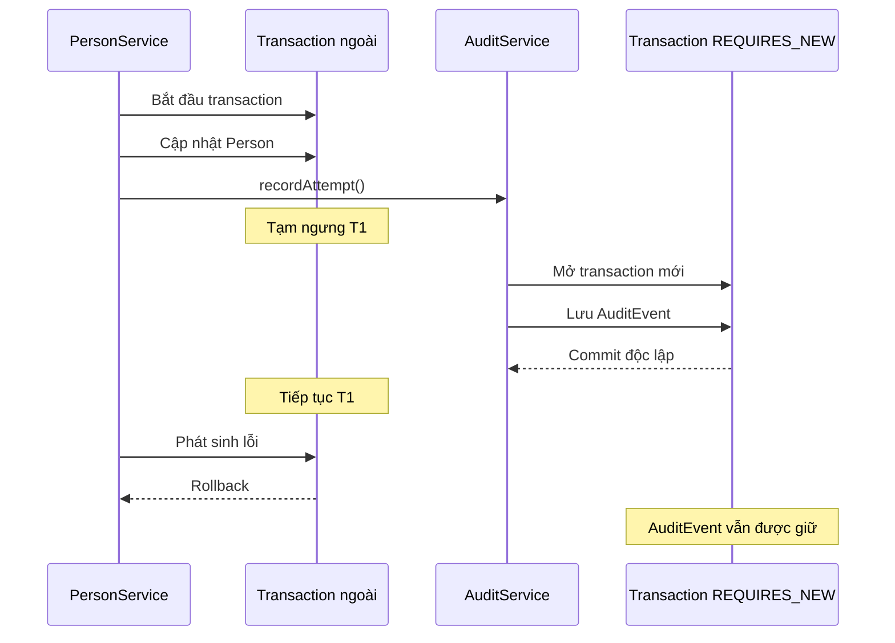

# Propagation, timeout và isolation trong giới hạn hỗ trợ của Neo4j

`@Transactional` của Spring cung cấp nhiều lựa chọn về propagation, timeout và isolation. Tuy nhiên, transaction manager của Spring Data Neo4j (SDN) không thể ánh xạ mọi lựa chọn đó thành khả năng tương ứng trong Neo4j. Với `Neo4jTransactionManager`, hai propagation được hỗ trợ là `REQUIRED` và `REQUIRES_NEW`; isolation phải để ở `DEFAULT`; timeout được chuyển thành timeout của transaction Neo4j. Hiểu đúng các giới hạn này giúp tránh cấu hình tưởng hợp lệ nhưng thất bại khi mở transaction hoặc tạo ra hành vi khác kỳ vọng.

Bài học thuộc module **SPRING_DATA_NEO4J**, tập trung xây dựng tầng dữ liệu đồ thị qua node entity, relationship, repository và Cypher. Ví dụ dùng `Person`, `Movie`, `ACTED_IN` và `AuditEvent` để giải thích cách lồng các service trong transaction đồng bộ, khi nào cần transaction độc lập, cách đặt giới hạn thời gian và cách xử lý cạnh tranh dữ liệu với cơ chế khóa của Neo4j.

## 1. Ba thuộc tính điều khiển ba khía cạnh khác nhau

Các thuộc tính của `@Transactional` không thay thế cho nhau:

| Thuộc tính | Câu hỏi được trả lời | Ví dụ |
|---|---|---|
| `propagation` | Lời gọi hiện tại tham gia transaction đang có hay cần một transaction riêng? | `REQUIRED`, `REQUIRES_NEW` |
| `timeout` | Transaction được phép chạy tối đa bao lâu trước khi database chấm dứt nó? | `timeout = 5` giây |
| `isolation` | Các transaction đồng thời nhìn thấy và khóa dữ liệu của nhau theo quy tắc nào? | Neo4j mặc định `READ_COMMITTED` |

Propagation là quy tắc phối hợp transaction giữa các method. Timeout là giới hạn thời gian cho transaction. Isolation liên quan tới cách Neo4j bảo vệ dữ liệu trước các thao tác đồng thời. Thay đổi một thuộc tính không tự làm thay đổi hai thuộc tính còn lại.

## 2. Giới hạn thực tế của Neo4jTransactionManager

`Neo4jTransactionManager` triển khai `PlatformTransactionManager` của Spring và mở transaction native qua Neo4j Java Driver. SDN ánh xạ `TransactionDefinition` của Spring sang cấu hình transaction của Driver.

Trong SDN hiện hành, phần chuyển đổi transaction definition chỉ chấp nhận:

- `Propagation.REQUIRED`.
- `Propagation.REQUIRES_NEW`.
- `Isolation.DEFAULT`.
- Timeout dương, nếu được khai báo hoặc cấu hình làm timeout mặc định.

Các propagation khác như `SUPPORTS`, `MANDATORY`, `NOT_SUPPORTED`, `NEVER` và `NESTED` không thuộc hợp đồng được hỗ trợ của transaction manager. Isolation khác `DEFAULT`, kể cả khi đặt tường minh `Isolation.READ_COMMITTED`, cũng không được `Neo4jTransactionUtils` ánh xạ khi mở transaction vật lý mới.

| Cấu hình Spring | Hỗ trợ với Neo4jTransactionManager | Kết quả cần hiểu |
|---|---|---|
| `REQUIRED` | Có | Tham gia transaction hiện tại hoặc mở transaction mới |
| `REQUIRES_NEW` | Có | Tạm ngưng transaction hiện tại và mở transaction Neo4j độc lập |
| `SUPPORTS` | Không thuộc hợp đồng SDN | Không dựa vào hành vi tùy chọn tham gia/không tham gia transaction |
| `MANDATORY` | Không thuộc hợp đồng SDN | Không dùng để yêu cầu transaction có sẵn |
| `NOT_SUPPORTED` | Không thuộc hợp đồng SDN | Không dùng để tạm ngưng transaction và chạy ngoài transaction |
| `NEVER` | Không thuộc hợp đồng SDN | Không dùng để cấm transaction đang tồn tại |
| `NESTED` | Không | Neo4j không cung cấp savepoint để rollback một phần transaction |
| `Isolation.DEFAULT` | Có | Dùng isolation mặc định của Neo4j |
| `READ_COMMITTED`, `REPEATABLE_READ`, `SERIALIZABLE` khai báo tường minh | Không được ánh xạ khi mở transaction mới | Khi tham gia transaction ngoài, Spring mặc định dùng đặc tính của transaction ngoài |

Đây là giới hạn của transaction manager SDN, không phải danh sách đầy đủ propagation/isolation mà Spring Framework hỗ trợ cho mọi loại database. Nếu ứng dụng chuyển từ JPA/JDBC sang SDN, không nên sao chép nguyên các annotation transaction cũ mà chưa kiểm tra khả năng tương thích.

## 3. REQUIRED: tham gia transaction hiện tại

`Propagation.REQUIRED` là giá trị mặc định của `@Transactional`. Nếu chưa có transaction, Spring mở một transaction Neo4j mới. Nếu đã có transaction do một service bên ngoài mở, method được gọi tham gia transaction đó.

```java
@Service
public class PersonService {

    private final PersonRepository personRepository;
    private final AuditService auditService;

    public PersonService(
            PersonRepository personRepository,
            AuditService auditService) {
        this.personRepository = personRepository;
        this.auditService = auditService;
    }

    @Transactional
    public Person renameAndAudit(String personId, String newName) {
        Person person = personRepository.findByPersonId(personId)
            .orElseThrow();

        person.setName(newName);
        Person saved = personRepository.save(person);

        auditService.recordRename(personId, newName);
        return saved;
    }
}
```

Method `recordRename()` có thể cũng được đánh dấu `@Transactional` với mặc định `REQUIRED`:

```java
@Service
public class AuditService {

    private final AuditRepository auditRepository;

    public AuditService(AuditRepository auditRepository) {
        this.auditRepository = auditRepository;
    }

    @Transactional
    public void recordRename(String personId, String newName) {
        auditRepository.save(new AuditEvent(
            "PERSON_RENAMED",
            personId,
            newName
        ));
    }
}
```

Hai method tạo hai logical transaction scope ở tầng Spring nhưng cùng dùng một physical Neo4j transaction. Nếu ghi audit thất bại và transaction bị đánh dấu rollback-only, thay đổi tên người cũng bị rollback.

Nếu method bên trong thất bại, exception bị bắt ở method bên ngoài rồi method bên ngoài vẫn cố commit, ứng dụng có thể nhận `UnexpectedRollbackException`. Đây là cách Spring báo cho caller biết physical transaction đã rollback dù method ngoài đã đi đến cuối bình thường.

## 4. REQUIRES_NEW: mở transaction độc lập

`Propagation.REQUIRES_NEW` yêu cầu Spring tạm ngưng transaction hiện tại và mở một physical transaction mới cho method bên trong. SDN thực hiện việc này bằng cách tách resource holder hiện tại khỏi thread, tạo session/transaction Neo4j mới rồi khôi phục resource cũ khi transaction bên trong kết thúc.

Ví dụ ghi audit độc lập:

```java
@Service
public class AuditService {

    private final AuditRepository auditRepository;

    public AuditService(AuditRepository auditRepository) {
        this.auditRepository = auditRepository;
    }

    @Transactional(propagation = Propagation.REQUIRES_NEW)
    public void recordAttempt(String personId, String action) {
        auditRepository.save(new AuditEvent(
            action,
            personId,
            "ATTEMPTED"
        ));
    }
}
```

Nếu `recordAttempt()` commit thành công, bản ghi audit vẫn tồn tại ngay cả khi transaction bên ngoài sau đó rollback. Nếu transaction bên trong rollback, transaction bên ngoài vẫn có thể tiếp tục theo logic của nó.



Chỉ dùng `REQUIRES_NEW` khi nghiệp vụ thực sự muốn lần ghi bên trong có kết quả độc lập. Ví dụ audit ghi nhận một lần thử, kể cả khi nghiệp vụ chính thất bại. Nếu audit phải chỉ tồn tại khi cập nhật nghiệp vụ chính thành công, hãy dùng `REQUIRED` để cả hai cùng commit/rollback.

### 4.1. REQUIRES_NEW không phải NESTED

`REQUIRES_NEW` tạo một transaction độc lập có thể commit riêng. `NESTED` theo mô hình Spring thường dùng savepoint trong cùng một physical transaction, cho phép rollback một phần rồi tiếp tục transaction ngoài. Neo4j không cung cấp savepoint transaction tương ứng, và SDN không hỗ trợ `Propagation.NESTED`.

Không thay `NESTED` bằng `REQUIRES_NEW` một cách máy móc. Hai lựa chọn có ngữ nghĩa khác nhau: transaction mới có thể commit vĩnh viễn dù transaction ngoài thất bại.

### 4.2. Tài nguyên và khóa khi dùng REQUIRES_NEW

Khi transaction ngoài bị tạm ngưng, session và các khóa mà nó đang giữ vẫn tồn tại cho tới khi transaction đó kết thúc. Transaction `REQUIRES_NEW` cần session/connection riêng. Vì vậy:

- Cần đủ năng lực connection/session pool cho transaction ngoài và transaction bên trong cùng tồn tại.
- Nếu transaction bên trong cần ghi node hoặc relationship mà transaction ngoài đang khóa, nó có thể phải chờ.
- Nếu transaction ngoài chờ method bên trong hoàn thành trong khi transaction bên trong chờ khóa do transaction ngoài giữ, luồng xử lý có thể bị chặn tới khi lock hoặc transaction timeout xảy ra.
- Ghi độc lập vào một node audit khác thường ít xung đột hơn việc sửa cùng node mà transaction ngoài đang giữ.

Không nên dùng `REQUIRES_NEW` cho mọi lời gọi repository. Hãy giữ `REQUIRED` làm mặc định và chỉ tách transaction khi yêu cầu commit độc lập thực sự tồn tại.

## 5. Các propagation khác bị từ chối

Những cấu hình dưới đây là hợp lệ trong Spring Framework nói chung, nhưng không nằm trong tập propagation được `Neo4jTransactionManager` hỗ trợ:

```java
@Transactional(propagation = Propagation.NESTED)
public void updatePartOfGraph() {
    // Không được hỗ trợ bởi Neo4jTransactionManager.
}
```

Các propagation này không thuộc tập mà `Neo4jTransactionManager` hỗ trợ. Khi SDN chuyển một transaction definition không được hỗ trợ để mở transaction mới, `Neo4jTransactionUtils` ném `IllegalTransactionStateException`. Riêng `NESTED` trong lúc đã có transaction còn cần savepoint; transaction manager không cung cấp cơ chế đó nên Spring từ chối nested scope.

Nếu cần logic tùy chọn có thể gọi từ nhiều ngữ cảnh, hãy tổ chức ranh giới service để caller luôn gọi method có transaction `REQUIRED`, hoặc tách phần không truy cập Neo4j ra khỏi transaction. Nếu cần transaction độc lập, dùng `REQUIRES_NEW` và xác nhận rõ ngữ nghĩa commit riêng.

Không đặt propagation không được hỗ trợ ở class-level rồi kỳ vọng chỉ những method được gọi trong một số tình huống mới gặp lỗi. Annotation class-level được áp dụng cho các method chịu ảnh hưởng; hãy đặt cấu hình phù hợp trên từng method cần thiết.

## 6. Timeout của @Transactional

Thuộc tính `timeout` của Spring được tính bằng giây và phải là số dương nếu được khai báo:

```java
@Transactional(timeout = 5)
public void importPersonGraph() {
    // Các thao tác Neo4j trong transaction này.
}
```

Với SDN, timeout được chuyển sang `TransactionConfig.withTimeout(Duration.ofSeconds(...))` của Neo4j Java Driver. Khi transaction chạy quá thời gian cho phép, Neo4j có thể chấm dứt transaction. Các thay đổi chưa commit sẽ không được giữ lại.

Timeout này áp dụng cho transaction database, không phải một bộ đếm thời gian tổng quát cho toàn bộ request HTTP hoặc toàn bộ CPU work trong service. Nếu service gọi API ngoài, xử lý file hoặc chờ người dùng, cần cấu hình timeout riêng cho những hệ thống đó.

### 6.1. Timeout khi transaction được tham gia

Với `REQUIRED`, nếu method bên trong tham gia transaction đã được method bên ngoài mở, các đặc tính của transaction ngoài được dùng. Mặc định, timeout khai báo ở method bên trong không thay đổi timeout đã chọn cho transaction đang chạy.

```java
@Transactional(timeout = 20)
public void processOrder() {
    auditService.writeStep();
}

@Transactional(timeout = 3)
public void writeStep() {
    // Tham gia transaction ngoài: timeout hiệu lực vẫn là 20 giây.
}
```

Nếu `writeStep()` dùng `REQUIRES_NEW`, transaction mới có timeout riêng 3 giây:

```java
@Transactional(propagation = Propagation.REQUIRES_NEW, timeout = 3)
public void writeStep() {
    // Transaction độc lập, timeout 3 giây.
}
```

Điều này phù hợp với quy tắc propagation của Spring: transaction tham gia kế thừa đặc tính của transaction ngoài; transaction độc lập có thể có timeout riêng.

### 6.2. Timeout mặc định ở Spring và Neo4j

Nếu không đặt timeout trên method, SDN dùng timeout mặc định của transaction manager nếu đã được cấu hình. Nếu transaction manager không có timeout tùy chỉnh, Driver sử dụng cấu hình timeout mặc định phía Neo4j.

Neo4j cung cấp cấu hình server `db.transaction.timeout`. Giá trị `0` mặc định có nghĩa là tắt timeout transaction mặc định. Có thể đặt ví dụ `10s` để database chấm dứt các transaction vượt quá giới hạn mặc định này.

```properties
# Cấu hình trên Neo4j server, không phải application.properties của Spring Boot.
db.transaction.timeout=10s
```

Nếu ứng dụng gửi custom timeout qua Java Driver, cấu hình transaction cụ thể sẽ ghi đè timeout mặc định của server theo quy tắc của phiên bản Neo4j đang chạy. Hãy kiểm tra phiên bản server/driver khi cần dựa vào timeout tùy chỉnh lớn hơn giá trị mặc định phía database.

### 6.3. Transaction timeout và lock acquisition timeout khác nhau

Neo4j có thêm `db.lock.acquisition.timeout`, giới hạn thời gian một transaction chờ lấy khóa. Đây là cấu hình khác với `db.transaction.timeout`:

| Cấu hình | Ý nghĩa |
|---|---|
| `@Transactional(timeout = 5)` | Giới hạn thời gian của transaction do Spring mở, được truyền tới Neo4j Driver |
| `db.transaction.timeout` | Timeout mặc định phía database nếu transaction không gửi timeout riêng |
| `db.lock.acquisition.timeout` | Giới hạn thời gian chờ lấy một khóa đang bị transaction khác giữ |

Một transaction có thể bị chấm dứt vì vượt transaction timeout hoặc thất bại khi không lấy được khóa trong thời gian cho phép. Hai lỗi có nguyên nhân và cách xử lý khác nhau.

## 7. Cấu hình timeout bằng TransactionTemplate

Khi cần điều khiển transaction bằng code, có thể dùng `TransactionTemplate`:

```java
import org.springframework.stereotype.Service;
import org.springframework.transaction.PlatformTransactionManager;
import org.springframework.transaction.TransactionDefinition;
import org.springframework.transaction.support.TransactionTemplate;

@Service
public class ImportService {

    private final TransactionTemplate transactionTemplate;

    public ImportService(PlatformTransactionManager transactionManager) {
        this.transactionTemplate = new TransactionTemplate(transactionManager);
        this.transactionTemplate.setPropagationBehavior(
            TransactionDefinition.PROPAGATION_REQUIRED
        );
        this.transactionTemplate.setTimeout(10);
    }

    public void importGraph() {
        transactionTemplate.execute(status -> {
            // Lưu node và relationship bằng repository/Neo4jTemplate.
            return null;
        });
    }
}
```

Nếu ứng dụng có nhiều `PlatformTransactionManager`, cần inject đúng bean `Neo4jTransactionManager`. Chỉ cấu hình propagation được SDN hỗ trợ: `PROPAGATION_REQUIRED` hoặc `PROPAGATION_REQUIRES_NEW`. Không đặt `PROPAGATION_NESTED` trong `TransactionTemplate` với Neo4j.

## 8. Isolation mặc định của Neo4j

Neo4j dùng isolation mặc định `READ_COMMITTED`. Một transaction đọc node hoặc relationship không tự ngăn transaction khác ghi vào dữ liệu đó trước khi transaction đọc kết thúc. Vì vậy, cùng một transaction có thể đọc lại property và nhận giá trị khác nếu transaction khác đã commit thay đổi ở giữa.

Neo4j sử dụng write lock ở cấp node và relationship khi thực hiện các thao tác ghi phù hợp. Khóa được giữ tới khi transaction commit hoặc rollback. Cơ chế này bảo vệ các thay đổi ghi và cấu trúc graph, nhưng không biến mọi lần đọc thành snapshot bất biến trong suốt transaction.

Không khai báo isolation tùy chỉnh trong `@Transactional`:

```java
// Sai với Neo4jTransactionManager: SDN từ chối isolation khác DEFAULT.
@Transactional(isolation = Isolation.SERIALIZABLE)
public void updateGraph() {
}
```

Ngay cả khi muốn ghi rõ `Isolation.READ_COMMITTED`, cấu hình tường minh đó cũng khác `ISOLATION_DEFAULT`. Nếu method cần mở physical transaction mới, SDN từ chối isolation không mặc định bằng `InvalidIsolationLevelException`. Nếu method `REQUIRED` tham gia transaction ngoài, Spring mặc định bỏ qua isolation cục bộ và dùng đặc tính của transaction ngoài. Hãy bỏ thuộc tính `isolation` để sử dụng isolation mặc định của Neo4j.

## 9. Neo4j không cung cấp các isolation level JDBC qua Spring

Spring có các hằng số `READ_UNCOMMITTED`, `READ_COMMITTED`, `REPEATABLE_READ` và `SERIALIZABLE`. Các mức này không thể được yêu cầu trực tiếp qua `Neo4jTransactionManager` bằng `@Transactional(isolation = ...)`.

| Isolation của Spring | Cách dùng với SDN |
|---|---|
| `DEFAULT` | Được hỗ trợ; dùng isolation mặc định của Neo4j |
| `READ_UNCOMMITTED` | Bị từ chối |
| `READ_COMMITTED` | Bị từ chối nếu khai báo tường minh; đây là isolation mặc định native của Neo4j |
| `REPEATABLE_READ` | Bị từ chối |
| `SERIALIZABLE` | Bị từ chối |

Neo4j có thể đạt hiệu ứng tuần tự hóa một số thao tác bằng cách lấy write lock tường minh trên node hoặc relationship chung. Đó là kỹ thuật kiểm soát cạnh tranh ở mức graph, không phải việc đổi isolation level của toàn transaction qua Spring.

## 10. Xử lý lost update bằng thao tác ghi nguyên tử

Với thao tác tăng bộ đếm, nên để Cypher thực hiện phép đọc và ghi trong cùng biểu thức:

```cypher
MATCH (counter:Counter {name: $name})
SET counter.value = counter.value + 1
RETURN counter.value AS value;
```

Do biểu thức bên phải phụ thuộc trực tiếp vào giá trị property đang cập nhật, Neo4j tự lấy write lock trước khi đọc property trong trường hợp này. Điều đó giúp tránh lost update cho mẫu cập nhật tăng trực tiếp này.

Một cách dễ gặp lỗi hơn là đọc giá trị ở một bước trước, xử lý trong ứng dụng, rồi ghi giá trị tuyệt đối:

```text
Transaction A đọc value = 10
Transaction B đọc value = 10
Transaction A ghi value = 11
Transaction B ghi value = 11
```

Kết quả cuối là 11 dù có hai lần tăng. Để tránh tình huống này, hãy:

- Thực hiện phép cập nhật phụ thuộc giá trị trong một câu Cypher nguyên tử.
- Dùng `@Version`/optimistic locking khi cập nhật entity từ trạng thái đã đọc và cần phát hiện phiên bản cũ.
- Dùng uniqueness constraint và điều kiện cập nhật phù hợp cho quy tắc dữ liệu quan trọng.
- Chỉ dùng khóa tường minh khi nghiệp vụ yêu cầu tuần tự hóa các thao tác phức tạp.

`@Version` phát hiện một số cập nhật dựa trên entity cũ; nó không thay thế isolation serializable cho toàn bộ graph traversal hoặc mọi lần đọc.

## 11. Lấy write lock tường minh cho quy tắc phức tạp

Cypher không có một clause chung tên `LOCK` để khóa node tùy ý. Tài liệu Neo4j mô tả một workaround: ghi tạm property trên node để lấy write lock, xóa property đó ngay sau khi khóa được lấy, rồi mới đọc và tính toán dữ liệu cần cập nhật.

```cypher
MATCH (counter:Counter {name: $name})
SET counter.__lock__ = true
REMOVE counter.__lock__
WITH counter, counter.value AS currentValue
SET counter.value = currentValue + $delta
RETURN counter.value AS value;
```

Write lock được giữ đến khi transaction commit hoặc rollback dù property tạm đã bị xóa trong cùng transaction. Cách này có thể dùng để tuần tự hóa thao tác trên cùng node khi logic tính toán phức tạp hơn một biểu thức cập nhật trực tiếp.

Chỉ dùng kỹ thuật này sau khi đã hiểu rõ tác động:

- Tên property tạm phải được dành riêng, không xung đột với dữ liệu nghiệp vụ.
- Khóa chỉ bảo vệ tài nguyên được khóa; các node khác không tự động được bảo vệ.
- Các transaction khác cùng cập nhật node sẽ phải chờ, làm tăng lock contention.
- Giữ transaction ngắn để khóa được giải phóng sớm.
- Kiểm thử deadlock và lock timeout trong tình huống nhiều transaction.

Nếu logic có thể diễn đạt bằng một phép cập nhật nguyên tử, ưu tiên cách đó vì đơn giản hơn và thường có chi phí thấp hơn.

## 12. Propagation, timeout và isolation phối hợp ra sao?

Ba thuộc tính có thể được kết hợp, nhưng mỗi thuộc tính vẫn tuân theo giới hạn riêng:

```java
@Transactional(
    propagation = Propagation.REQUIRES_NEW,
    timeout = 5
)
public void writeIndependentAudit() {
    // Isolation mặc định của Neo4j.
}
```

Ví dụ này hợp lệ vì:

- `REQUIRES_NEW` thuộc tập propagation SDN hỗ trợ.
- `timeout = 5` được chuyển thành transaction timeout 5 giây.
- Không khai báo `isolation`, nên Neo4j sử dụng isolation mặc định.

Ví dụ sau không hợp lệ:

```java
@Transactional(
    propagation = Propagation.NESTED,
    isolation = Isolation.SERIALIZABLE,
    timeout = 5
)
public void updatePartOfGraph() {
}
```

`NESTED` không được hỗ trợ và isolation `SERIALIZABLE` cũng bị từ chối. Thêm timeout không làm cho hai thuộc tính không được hỗ trợ trở nên hợp lệ.

## 13. Lỗi thường gặp

| Lỗi | Nguyên nhân | Cách xử lý |
|---|---|---|
| Dùng `Propagation.NESTED` | Neo4j không có savepoint transaction mà SDN cần | Dùng `REQUIRED` hoặc thiết kế transaction độc lập `REQUIRES_NEW` nếu đúng nghiệp vụ |
| Dùng `SUPPORTS`, `NOT_SUPPORTED`, `MANDATORY` hoặc `NEVER` | `Neo4jTransactionManager` chỉ chấp nhận `REQUIRED` và `REQUIRES_NEW` | Tổ chức lại service boundary theo propagation được hỗ trợ |
| Khai báo `Isolation.SERIALIZABLE` | SDN không ánh xạ isolation tùy chỉnh | Bỏ thuộc tính isolation; dùng khóa Cypher khi thật sự cần |
| Khai báo tường minh `Isolation.READ_COMMITTED` | SDN không ánh xạ isolation này khi mở transaction mới; khi tham gia transaction ngoài, Spring mặc định dùng cấu hình ngoài | Không truyền isolation để dùng mặc định native |
| Nghĩ `REQUIRES_NEW` là nested savepoint | Transaction trong có thể commit độc lập | Chỉ dùng khi chấp nhận kết quả bên trong tồn tại dù transaction ngoài rollback |
| Dùng `REQUIRES_NEW` ghi cùng node đang bị transaction ngoài khóa | Transaction trong chờ khóa do transaction ngoài giữ | Tránh ghi trùng tài nguyên; rút ngắn transaction ngoài hoặc đổi thiết kế |
| Đặt timeout nhỏ cho method bên trong `REQUIRED` | Method tham gia transaction ngoài nên timeout cục bộ bị bỏ qua theo mặc định | Đặt timeout ở transaction mở ngoài hoặc dùng `REQUIRES_NEW` khi cần độc lập |
| Nhầm transaction timeout với lock timeout | Hai cấu hình kiểm soát hai loại chờ khác nhau | Phân biệt `db.transaction.timeout` và `db.lock.acquisition.timeout` |
| Dùng read-modify-write qua nhiều bước | Có thể gặp lost update dưới read committed | Dùng cập nhật Cypher nguyên tử, optimistic locking hoặc khóa tường minh |
| Giữ transaction quá lâu | Khóa và tài nguyên được giữ lâu, tăng contention | Giảm thời gian xử lý trong transaction và chia batch hợp lý |

## 14. Checklist trước khi khai báo transaction

- Xác định method cần tham gia transaction ngoài hay commit độc lập.
- Dùng `REQUIRED` cho luồng nghiệp vụ chung mặc định.
- Chỉ dùng `REQUIRES_NEW` khi chấp nhận transaction trong commit/rollback độc lập.
- Không dùng `NESTED`, `SUPPORTS`, `MANDATORY`, `NOT_SUPPORTED` hoặc `NEVER` với `Neo4jTransactionManager`.
- Để `isolation` ở `DEFAULT`; không khai báo các isolation level JDBC.
- Đặt `timeout` ở method thực sự mở transaction và tính bằng giây.
- Phân biệt timeout của transaction với timeout chờ khóa.
- Dùng phép cập nhật Cypher nguyên tử để tránh lost update khi có thể.
- Dùng `@Version` khi cần phát hiện cập nhật dựa trên entity cũ.
- Chỉ lấy write lock tường minh khi quy tắc nghiệp vụ đòi hỏi và đã đánh giá lock contention.
- Giữ transaction ngắn và tránh gọi dịch vụ bên ngoài trong lúc đang giữ khóa Neo4j.
- Kiểm thử commit, rollback, timeout, deadlock và hành vi khi transaction trong dùng `REQUIRES_NEW`.

## 15. Bài tập thực hành

1. Viết hai service method dùng `REQUIRED`; xác nhận thay đổi ở method trong rollback cùng transaction ngoài.
2. Đổi method ghi audit sang `REQUIRES_NEW`; cố ý rollback transaction ngoài và xác nhận audit vẫn được giữ.
3. Thử khai báo `NESTED`, `SUPPORTS` và `NOT_SUPPORTED`; quan sát lỗi transaction tương ứng. Thử `NESTED` bên trong một transaction đang chạy để thấy giới hạn savepoint.
4. Thử `@Transactional(isolation = Isolation.READ_COMMITTED)` và `SERIALIZABLE`; quan sát `InvalidIsolationLevelException`.
5. Đặt timeout 3 giây cho transaction và chạy một truy vấn có thời gian thực thi vượt giới hạn; xác nhận transaction bị chấm dứt.
6. Cấu hình `db.transaction.timeout` phía server và so sánh với custom timeout từ annotation.
7. Viết hai transaction đồng thời tăng một property; so sánh read-modify-write ở ứng dụng với `SET n.value = n.value + 1`.
8. Thử workaround dummy-property để khóa node trước khi đọc giá trị; xác nhận các transaction khác phải đợi tới khi transaction đầu kết thúc.
9. Tạo tình huống `REQUIRES_NEW` cập nhật cùng node mà transaction ngoài đang giữ lock; quan sát lock wait và đánh giá lại thiết kế.

Khi hoàn thành, bạn cần biết `Neo4jTransactionManager` chỉ hỗ trợ `REQUIRED` và `REQUIRES_NEW`, dùng isolation mặc định của Neo4j và chuyển timeout Spring sang timeout transaction của Driver. Với yêu cầu đồng thời cao hơn, hãy xử lý ở mức truy vấn và khóa của Neo4j thay vì khai báo một isolation level mà SDN không hỗ trợ.

## Tài liệu tham khảo

- [Spring Data Neo4j — Neo4jTransactionManager API 8.1.2](https://docs.spring.io/spring-data/neo4j/reference/api/java/org/springframework/data/neo4j/core/transaction/Neo4jTransactionManager.html)
- [Spring Data Neo4j — Neo4jTransactionUtils source](https://github.com/spring-projects/spring-data-neo4j/blob/bb97a751d7384b8b00764ac71d0023f469508fc4/src/main/java/org/springframework/data/neo4j/core/transaction/Neo4jTransactionUtils.java)
- [Spring Framework — Transaction Propagation](https://docs.spring.io/spring-framework/reference/data-access/transaction/declarative/tx-propagation.html)
- [Neo4j Operations Manual — Concurrent data access and isolation](https://neo4j.com/docs/operations-manual/current/database-internals/concurrent-data-access/)
- [Neo4j Operations Manual — Transaction timeout](https://neo4j.com/docs/operations-manual/current/database-internals/transaction-management/)
- [Neo4j Java Driver — TransactionConfig](https://neo4j.com/docs/api/java-driver/current/org.neo4j.driver/org/neo4j/driver/TransactionConfig.html)
