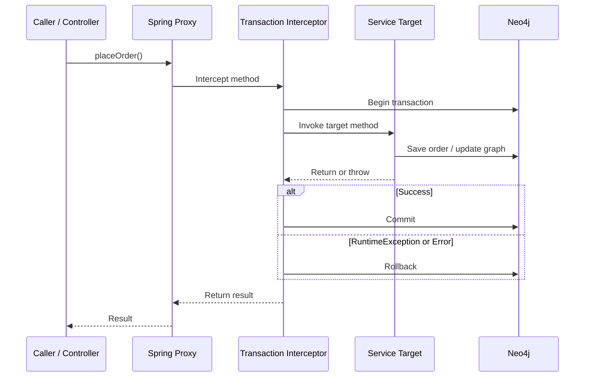

# Proxy, self-invocation và nguyên nhân giao dịch không được áp dụng

## Mục tiêu bài học

Trong ứng dụng Spring Data Neo4j (SDN), `@Transactional` thường được đặt ở service để gom nhiều thao tác đọc/ghi graph thành một đơn vị công việc. Tuy nhiên, có trường hợp method đã được gắn annotation nhưng transaction không được mở, propagation không chạy như mong đợi hoặc dữ liệu không rollback khi xảy ra lỗi.

Một nguyên nhân quan trọng là cơ chế proxy của Spring AOP. Ở chế độ proxy mặc định, transaction chỉ được áp dụng khi lời gọi đi qua proxy do Spring tạo. Khi một method trong bean gọi method khác của chính bean đó bằng `this.method()`, lời gọi nội bộ không đi qua proxy nên interceptor transaction không được kích hoạt cho method được gọi.

Bài học này giải thích cách proxy hoạt động, phân tích self-invocation, nhận diện những giới hạn của JDK proxy và class-based proxy, đồng thời trình bày cách tổ chức service và transaction để các thao tác Neo4j có ranh giới rõ ràng.

## 1. Spring áp dụng @Transactional bằng proxy như thế nào?

Spring quản lý transaction khai báo thông qua transaction interceptor. Với cấu hình proxy mode, container tạo một proxy bao quanh bean có phương thức transactional. Khi một bean khác gọi phương thức thông qua proxy, interceptor sẽ:

1. Đọc metadata của `@Transactional`.
2. Tìm transaction manager phù hợp.
3. Mở transaction mới hoặc tham gia transaction đang tồn tại theo propagation.
4. Gọi method thật trên object đích.
5. Commit hoặc rollback theo kết quả thực thi và quy tắc rollback.

Có thể hình dung luồng gọi:



Điểm quan trọng là caller nhận được proxy từ Spring container, không trực tiếp gọi object đích. Proxy là nơi transaction interceptor có cơ hội chạy trước khi method thật được thực thi.

Ví dụ một service:

```java
@Service
public class OrderService {

    private final OrderRepository orderRepository;

    public OrderService(OrderRepository orderRepository) {
        this.orderRepository = orderRepository;
    }

    @Transactional
    public void placeOrder(Order order) {
        orderRepository.save(order);
    }
}
```

Khi controller inject `OrderService` từ Spring và gọi `placeOrder()`, lời gọi đi qua proxy. Nếu transaction manager của Neo4j được cấu hình đúng, thao tác lưu được thực hiện trong transaction do interceptor quản lý.

Với ứng dụng Spring Boot dùng SDN, auto-configuration thường cung cấp hạ tầng transaction cho Neo4j. Nếu tự cấu hình, cần có `Neo4jTransactionManager` và bật transaction management bằng `@EnableTransactionManagement` khi cấu hình ứng dụng yêu cầu. Nếu ứng dụng có nhiều transaction manager, cần chỉ rõ manager dành cho Neo4j để tránh method dùng nhầm tài nguyên.

## 2. Self-invocation là gì?

Self-invocation xảy ra khi một method gọi một method khác trong cùng object. Ví dụ:

```java
@Service
public class OrderService {

    @Transactional
    public void placeOrder(Order order) {
        saveOrder(order);
    }

    @Transactional(propagation = Propagation.REQUIRES_NEW)
    public void saveOrder(Order order) {
        // Lưu đơn hàng.
    }
}
```

Khi một controller gọi `placeOrder()` từ bean được inject, lời gọi bên ngoài đi qua proxy và transaction của `placeOrder()` được áp dụng. Nhưng bên trong `placeOrder()`, lời gọi `saveOrder(order)` là lời gọi trực tiếp trên cùng object đích. Nó không quay lại proxy.

Vì vậy, annotation trên `saveOrder()` không được interceptor đọc ở lần gọi nội bộ đó. Cấu hình `Propagation.REQUIRES_NEW` không được áp dụng: method không tạo transaction độc lập như tên annotation gợi ý.

Đây là điểm thường bị hiểu nhầm: self-invocation không nhất thiết khiến toàn bộ thao tác bên trong chạy ngoài transaction. Trong ví dụ trên, `placeOrder()` đã mở transaction qua proxy, nên `saveOrder()` vẫn chạy trong transaction đang tồn tại. Điều bị bỏ qua là metadata transaction riêng của `saveOrder()`, chẳng hạn `REQUIRES_NEW`, `readOnly`, isolation hoặc timeout.

Nếu method bên ngoài không có transaction, lời gọi nội bộ cũng không tự mở transaction chỉ vì method bên trong có `@Transactional`. Các thao tác repository bên dưới có thể có transaction riêng theo cấu hình mặc định của repository, nhưng điều đó không tạo ra một transaction service bao trùm toàn bộ logic.

## 3. So sánh external call và self-invocation

Xét hai tình huống:

```java
@Service
public class CustomerService {

    @Transactional
    public void updateProfile(String id) {
        // Lời gọi từ bean khác vào qua proxy.
        updateGraph(id);
    }

    @Transactional(propagation = Propagation.REQUIRES_NEW)
    public void updateGraph(String id) {
        // Lời gọi nội bộ từ updateProfile().
    }
}
```

| Cách gọi | Có đi qua proxy? | Transaction annotation của method được gọi |
|---|---:|---|
| Controller gọi `customerService.updateProfile(id)` | Có | Được áp dụng |
| Bean khác gọi `customerService.updateGraph(id)` qua dependency injection | Có | Được áp dụng |
| `updateProfile()` gọi `this.updateGraph(id)` | Không | Bị bỏ qua ở lời gọi này |
| Method gọi `updateGraph(id)` không có tiền tố `this` | Không | Cũng là self-invocation |

Việc viết tường minh `this.updateGraph(id)` hay chỉ viết `updateGraph(id)` không làm thay đổi bản chất. Cả hai đều gọi trực tiếp trên object hiện tại.

Để transaction interceptor chạy, lời gọi cần xuất phát từ bên ngoài object đích và đi qua proxy. Vì vậy, việc method có annotation không đủ để kết luận transaction đã được áp dụng.

## 4. Điều gì bị bỏ qua khi self-invocation xảy ra?

Khi một method transactional được gọi nội bộ, interceptor không xử lý metadata của method đó. Hệ quả phụ thuộc vào transaction context đang tồn tại.

### Không áp dụng propagation riêng

Ví dụ method bên ngoài và bên trong đều có transaction:

```java
@Transactional
public void checkout() {
    // Đã có transaction T1.
    this.writeAuditRecord();
}

@Transactional(propagation = Propagation.REQUIRES_NEW)
public void writeAuditRecord() {
    // Mong muốn tạo transaction T2 độc lập.
}
```

Vì lời gọi `writeAuditRecord()` không qua proxy, Spring không tạm ngưng T1 và không mở T2. Phần code bên trong chạy trong transaction T1 hiện có. Nếu `checkout()` rollback, thay đổi audit cũng rollback cùng transaction.

Nếu nghiệp vụ thực sự cần audit tồn tại độc lập kể cả khi checkout thất bại, phải bảo đảm `REQUIRES_NEW` được áp dụng qua một lời gọi đi qua proxy hoặc dùng ranh giới transaction tường minh.

### Không áp dụng readOnly, isolation và timeout riêng

Các thuộc tính như:

- `readOnly = true`
- `isolation = ...`
- `timeout = ...`
- `rollbackFor = ...`
- `noRollbackFor = ...`

đều là metadata được transaction interceptor xử lý. Khi self-invocation bỏ qua interceptor, các thuộc tính riêng trên method được gọi không tạo hiệu lực ở lần gọi đó.

Ví dụ, nếu method ngoài đang chạy trong transaction ghi, method nội bộ có `@Transactional(readOnly = true)` không tự chuyển transaction hiện tại thành read-only. Ngược lại, nếu method ngoài không có transaction, annotation read-only trên method nội bộ cũng không mở transaction.

### Các propagation yêu cầu transaction có thể không được kiểm tra

`MANDATORY` và `NEVER` là những ví dụ dễ thấy. Khi gọi qua proxy, Spring kiểm tra sự hiện diện của transaction theo propagation. Khi self-invocation, interceptor không chạy nên các kiểm tra này cũng bị bỏ qua.

Không nên dùng annotation trên method nội bộ như một cơ chế kiểm tra bắt buộc nếu mọi đường gọi đều nằm trong cùng class.

## 5. Tách service thành bean riêng là cách sửa rõ ràng nhất

Một cách thiết kế phổ biến là đưa công việc cần transaction riêng sang một Spring bean khác. Khi đó, service gọi qua dependency được inject và lời gọi đi qua proxy của bean cộng tác.

```java
@Service
public class OrderService {

    private final OrderRepository orderRepository;
    private final InventoryService inventoryService;

    public OrderService(
            OrderRepository orderRepository,
            InventoryService inventoryService) {
        this.orderRepository = orderRepository;
        this.inventoryService = inventoryService;
    }

    @Transactional
    public void checkout(Order order) {
        orderRepository.save(order);
        inventoryService.reserve(order);
    }
}
```

Bean xử lý tồn kho:

```java
@Service
public class InventoryService {

    private final InventoryRepository inventoryRepository;

    public InventoryService(InventoryRepository inventoryRepository) {
        this.inventoryRepository = inventoryRepository;
    }

    @Transactional
    public void reserve(Order order) {
        // Kiểm tra và cập nhật tồn kho.
        inventoryRepository.reserveFor(order);
    }
}
```

Với propagation mặc định `REQUIRED`, `InventoryService.reserve()` tham gia transaction của `OrderService.checkout()` nếu cả hai dùng cùng transaction manager Neo4j. Nếu một thao tác thất bại và exception làm transaction rollback, các thay đổi trong cùng transaction được rollback cùng nhau.

Nếu nghiệp vụ cần transaction độc lập, có thể đặt `REQUIRES_NEW` trên method của bean cộng tác:

```java
@Transactional(propagation = Propagation.REQUIRES_NEW)
public void writeIndependentAudit(Order order) {
    auditRepository.save(AuditRecord.from(order));
}
```

Lúc này, lời gọi từ bean khác đi qua proxy của `InventoryService` hoặc `AuditService`, nên propagation được xử lý. Cần nhớ rằng transaction độc lập có thể commit dù transaction bên ngoài rollback. Chỉ dùng `REQUIRES_NEW` khi nghiệp vụ thực sự cần tính độc lập đó; nếu mọi thay đổi phải nguyên tử cùng nhau, hãy dùng `REQUIRED`.

Việc tách bean cũng làm rõ trách nhiệm: service điều phối use case, service cộng tác sở hữu một nhóm thao tác nghiệp vụ riêng. Đây thường là cách dễ đọc và dễ kiểm thử nhất.

## 6. Dùng TransactionTemplate khi cần ranh giới tường minh

Nếu không muốn tách một đoạn xử lý thành bean riêng, có thể dùng `TransactionTemplate`. Đây là API lập trình cho transaction; callback được chạy trong transaction do template quản lý nên không phụ thuộc vào self-invocation.

Cấu hình template với transaction manager Neo4j:

```java
@Configuration
public class TransactionConfiguration {

    @Bean
    TransactionTemplate neo4jTransactionTemplate(
            PlatformTransactionManager transactionManager) {
        return new TransactionTemplate(transactionManager);
    }
}
```

Nếu ứng dụng có nhiều transaction manager, hãy inject đúng bean quản lý Neo4j thay vì dùng một tham số không phân biệt. Trong ví dụ trên giả định chỉ có một `PlatformTransactionManager` phù hợp.

Sử dụng trong service:

```java
@Service
public class OrderService {

    private final TransactionTemplate transactionTemplate;
    private final OrderRepository orderRepository;
    private final InventoryRepository inventoryRepository;

    public OrderService(
            TransactionTemplate transactionTemplate,
            OrderRepository orderRepository,
            InventoryRepository inventoryRepository) {
        this.transactionTemplate = transactionTemplate;
        this.orderRepository = orderRepository;
        this.inventoryRepository = inventoryRepository;
    }

    public void checkout(Order order) {
        transactionTemplate.executeWithoutResult(status -> {
            orderRepository.save(order);
            inventoryRepository.reserveFor(order);
        });
    }
}
```

Các thao tác trong callback tham gia cùng transaction được template mở. Nếu callback ném unchecked exception hoặc đánh dấu rollback-only, transaction được rollback theo quy tắc của Spring.

Có thể cấu hình propagation, isolation hoặc timeout trên chính template trước khi thực thi. Cách này phù hợp khi transaction boundary là một phần của thuật toán và cần được điều khiển ngay tại vị trí gọi.

## 7. Self-injection và AopContext: biết để đánh giá, không phải lựa chọn đầu tiên

Có những cách buộc lời gọi nội bộ quay qua proxy, nhưng chúng làm code phụ thuộc mạnh hơn vào cơ chế AOP.

### Inject proxy của chính bean

Một số ứng dụng inject proxy của chính bean qua một tham chiếu lazy hoặc provider rồi gọi method trên tham chiếu đó. Khi lời gọi đi qua proxy, interceptor có thể chạy.

Tuy nhiên, self-injection tạo quan hệ phụ thuộc vòng về mặt khái niệm, dễ gây nhầm lẫn giữa object đích và proxy, và làm khó kiểm thử. Constructor self-injection còn có thể gây vấn đề khởi tạo vòng. Nếu cần tách ranh giới transaction, một collaborator bean riêng thường dễ hiểu hơn.

### Dùng AopContext.currentProxy()

Spring có thể expose proxy hiện tại để code lấy proxy rồi gọi lại:

```java
@EnableAspectJAutoProxy(exposeProxy = true)
@Configuration
class AopConfiguration {
}
```

```java
public void checkout(Order order) {
    OrderService proxy = (OrderService) AopContext.currentProxy();
    proxy.writeAuditRecord(order);
}
```

Cách này gắn business code với Spring AOP và chỉ hoạt động khi proxy được expose trong lời gọi hiện tại. Nếu method không được gọi qua proxy, `currentProxy()` không có proxy để trả về. Vì vậy, đây thường là giải pháp cuối cùng khi không thể thay đổi cấu trúc bean.

Không nên dùng `AopContext.currentProxy()` như cách mặc định để sửa mọi self-invocation. Hãy ưu tiên tách trách nhiệm hoặc dùng `TransactionTemplate`.

## 8. AspectJ mode có thể intercept self-invocation

Proxy mode chỉ intercept lời gọi đi qua proxy. Spring cũng hỗ trợ transaction aspect dùng AspectJ weaving. Khi aspect được weave vào bytecode, advice có thể áp dụng cho lời gọi nội bộ trong cùng object.

Cấu hình transaction management có thể chọn AspectJ mode:

```java
@Configuration
@EnableTransactionManagement(mode = AdviceMode.ASPECTJ)
public class TransactionConfiguration {
}
```

Cách này cần dependency và cấu hình weaving tương ứng, chẳng hạn Spring Aspects cùng compile-time weaving hoặc load-time weaving. Chỉ đổi thuộc tính `mode` mà không cấu hình weaving sẽ không tự làm self-invocation hoạt động.

AspectJ mode phù hợp với hệ thống đã sử dụng weaving hoặc có yêu cầu AOP áp dụng cả lời gọi nội bộ trên diện rộng. Với ứng dụng SDN thông thường, proxy mode và thiết kế bean rõ ràng thường đơn giản hơn.

## 9. JDK proxy, class-based proxy và visibility của method

Spring AOP có thể tạo proxy theo hai cách chính:

| Loại proxy | Cách hoạt động | Điều cần chú ý |
|---|---|---|
| JDK dynamic proxy | Tạo object proxy triển khai các interface của bean | Lời gọi cần đi qua method được khai báo trên interface |
| Class-based proxy (CGLIB) | Tạo lớp con của class bean để override method | Class và method cần được phép override; private/final method không thể được intercept theo cách này |

Với JDK proxy, caller cần gọi method được expose trên interface thông qua proxy interface. Có thể đặt `@Transactional` trên method của implementation; Spring transaction infrastructure có thể tra metadata trên class đích. Để tương thích tốt giữa proxy mode và AspectJ mode, nên đặt annotation trên method của class implementation thay vì chỉ đặt trên interface.

Với class-based proxy, class không được `final`; method không được `final` hoặc `private`. Các phiên bản Spring hiện đại hỗ trợ thêm method protected và package-visible trong class-based proxy, nhưng public method vẫn là lựa chọn dễ tương thích nhất giữa các cấu hình proxy và phiên bản.

Để tránh khác biệt giữa môi trường, hãy ưu tiên:

- Đặt `@Transactional` trên method public của service.
- Gọi service qua bean được Spring inject.
- Không tạo service bằng `new`.
- Không gọi method transactional từ constructor hoặc phương thức khởi tạo trước khi proxy sẵn sàng.
- Không đánh dấu class/method final nếu cấu hình cần class-based proxy.

Annotation đặt trên private method hoặc method final không thể tự làm cho lời gọi nội bộ đi qua proxy. Thay đổi visibility cũng không giải quyết được bản chất self-invocation.

## 10. Những nguyên nhân khác khiến transaction không được áp dụng

Self-invocation là nguyên nhân phổ biến, nhưng không phải nguyên nhân duy nhất.

| Dấu hiệu | Nguyên nhân có thể | Cách kiểm tra |
|---|---|---|
| Method có annotation nhưng không mở transaction | Bean không được Spring quản lý | Kiểm tra bean được inject từ container hay được tạo bằng `new` |
| Chỉ lời gọi từ class khác có transaction | Self-invocation | Kiểm tra lời gọi có đi qua proxy không |
| Method private/final không được intercept | Giới hạn proxy | Dùng method có thể proxy và gọi qua bean |
| Annotation không có hiệu lực ở ứng dụng tự cấu hình | Chưa bật transaction management | Kiểm tra `@EnableTransactionManagement` hoặc auto-configuration |
| Transaction mở nhưng query chạy ở database khác | Chọn sai transaction manager | Chỉ rõ transaction manager quản lý Neo4j |
| Một số thao tác commit riêng lẻ | Repository operation có transaction riêng hoặc service boundary không bao trùm | Kiểm tra transaction context và nơi đặt annotation |
| Exception xảy ra nhưng dữ liệu vẫn commit | Exception không kích hoạt rollback theo mặc định hoặc đã bị bắt | Kiểm tra loại exception và rollback rules |
| Annotation class-level không như mong muốn | Method-level override hoặc proxy type | Kiểm tra metadata trên class và method |

Với SDN, transaction manager cần quản lý đúng tài nguyên Neo4j. Nếu ứng dụng chỉ có một transaction manager, `@Transactional` thường đủ để Spring chọn manager đó. Nếu có thêm JPA/JDBC hoặc nhiều database, hãy chỉ định manager theo tên bean thực tế, ví dụ thuộc tính `transactionManager` của `@Transactional`.

## 11. Transaction không rollback: kiểm tra rollback rules

Mặc định, Spring rollback transaction khi method ném `RuntimeException` hoặc `Error` ra khỏi ranh giới được interceptor quản lý. Checked exception không tự động kích hoạt rollback theo quy tắc mặc định; ứng dụng có thể thay đổi chính sách mặc định ở cấp transaction management trong các phiên bản Spring hỗ trợ cấu hình rollback cho mọi exception.

Ví dụ:

```java
@Transactional
public void createOrder(Order order) throws IOException {
    orderRepository.save(order);
    throw new IOException("External validation failed");
}
```

Với checked exception như `IOException`, transaction mặc định có thể commit thay vì rollback. Nếu nghiệp vụ yêu cầu rollback, khai báo rõ:

```java
@Transactional(rollbackFor = IOException.class)
public void createOrder(Order order) throws IOException {
    orderRepository.save(order);
    throw new IOException("External validation failed");
}
```

Cũng cần lưu ý rằng nếu method bắt exception rồi không ném tiếp, interceptor nhìn thấy method kết thúc bình thường và có thể commit. Nếu muốn rollback sau khi đã bắt lỗi, có thể ném lại exception phù hợp hoặc đánh dấu transaction rollback-only qua cơ chế transaction status tương ứng.

Phân biệt hai nhóm nguyên nhân:

- **Transaction không được mở:** thường liên quan proxy, self-invocation, bean lifecycle hoặc transaction manager.
- **Transaction có mở nhưng không rollback:** thường liên quan loại exception, rollback rule, exception bị bắt hoặc transaction đã bị đánh dấu trạng thái khác.

## 12. Kiểm thử self-invocation và transaction boundary

Một unit test gọi trực tiếp `new OrderService(...)` không kiểm tra được proxy transaction của Spring. Cần integration test khởi tạo application context để lời gọi đi qua bean proxy và có transaction manager thật hoặc test infrastructure tương ứng.

Có thể kiểm tra self-invocation bằng cách quan sát propagation. Ví dụ, outer method mở transaction, inner method được đánh dấu `REQUIRES_NEW` và gọi nội bộ. Nếu inner method thực sự đi qua proxy, transaction bên ngoài sẽ bị suspend trong thời gian inner method chạy. Nếu self-invocation bypass proxy, cả hai thao tác dùng transaction ngoài.

Khung kiểm thử:

```java
@SpringBootTest
class TransactionProxyTest {

    @Autowired
    private OrderService orderService;

    @Test
    void shouldInvokeServiceThroughSpringProxy() {
        assertTrue(AopUtils.isAopProxy(orderService));

        // Gọi use case từ bean đã inject.
        // Xác nhận trạng thái graph sau commit hoặc rollback.
    }
}
```

Để kiểm thử hành vi rollback thực tế với Neo4j:

1. Tạo dữ liệu ban đầu trong test.
2. Gọi service method qua bean đã inject.
3. Cho method ném unchecked exception sau khi đã ghi nhiều thay đổi.
4. Đọc lại graph bằng một transaction mới.
5. Xác nhận tất cả thay đổi thuộc transaction đã rollback.
6. Viết test riêng cho checked exception có và không có `rollbackFor`.
7. Viết test riêng cho `REQUIRES_NEW` để xác nhận transaction độc lập có commit khi transaction ngoài rollback, nếu đó là hành vi mong muốn.

Nếu cần kiểm tra self-invocation cụ thể, có thể ghi lại transaction identity hoặc dùng callback/hook test để quan sát transaction context trong outer và inner method. Tránh chỉ assert rằng method đã chạy; điều cần chứng minh là interceptor áp dụng đúng propagation và graph có trạng thái đúng sau commit/rollback.

## 13. Quy trình chẩn đoán khi @Transactional không có hiệu lực

Khi thấy dữ liệu commit từng phần hoặc propagation không đúng, hãy kiểm tra theo trình tự:

1. **Xác nhận bean:** service có được tạo bởi Spring và được inject từ container không?
2. **Xác nhận proxy:** bean có phải proxy trong cấu hình đang chạy không?
3. **Xác nhận đường gọi:** caller có gọi qua proxy hay method đang tự gọi bằng `this`?
4. **Xác nhận method:** method có visibility và modifier phù hợp với loại proxy không?
5. **Xác nhận transaction manager:** manager được chọn có phải manager Neo4j không?
6. **Xác nhận propagation:** transaction hiện có là gì, và method cần tham gia, tạo mới hay từ chối transaction?
7. **Xác nhận rollback rule:** exception là checked hay unchecked, có bị bắt trong method không?
8. **Xác nhận repository:** repository method có transaction mặc định riêng khiến quan sát bên ngoài dễ gây nhầm không?
9. **Xác nhận test:** trạng thái graph có được đọc lại sau khi transaction kết thúc không?

Không nên sửa bằng cách thêm `@Transactional` lên mọi method. Hãy xác định đúng ranh giới nghiệp vụ cần atomicity, sau đó đặt annotation tại method được gọi qua proxy hoặc dùng API transaction tường minh.

## 14. Lỗi thường gặp

| Lỗi | Nguyên nhân | Cách xử lý |
|---|---|---|
| Gọi `this.inner()` rồi mong `REQUIRES_NEW` hoạt động | Self-invocation bypass proxy | Tách inner method sang bean khác hoặc dùng TransactionTemplate |
| Method bên trong có annotation nhưng không mở transaction | Không có lời gọi qua proxy | Gọi từ bean khác hoặc chuyển ranh giới transaction ra ngoài |
| Nghĩ self-invocation luôn chạy ngoài mọi transaction | Bỏ qua transaction đang tồn tại | Phân biệt interceptor của inner method với transaction context của outer method |
| Dùng `@Transactional` trên private method | Proxy không intercept private method | Đặt transaction boundary trên method phù hợp được gọi qua proxy |
| Service tạo bằng `new` | Object không được Spring proxy | Inject bean từ application context |
| Dùng `REQUIRES_NEW` nhưng muốn mọi thay đổi rollback cùng nhau | Transaction độc lập có thể commit riêng | Dùng `REQUIRED` nếu cần atomicity chung |
| Bắt exception rồi trả về bình thường | Interceptor không thấy lỗi để rollback theo mặc định | Ném lại exception hoặc đánh dấu rollback-only |
| Checked exception không rollback | Quy tắc mặc định chủ yếu rollback RuntimeException/Error | Khai báo `rollbackFor` phù hợp |
| Có nhiều transaction manager nhưng không chỉ định | Method có thể dùng manager không quản lý Neo4j | Chỉ rõ manager Neo4j theo cấu hình ứng dụng |
| Chỉ đổi sang AspectJ mode mà không bật weaving | Aspect không được weave vào class | Cấu hình dependency và compile/load-time weaving đầy đủ |

## 15. Tự kiểm tra

1. Spring dùng thành phần nào để áp dụng `@Transactional` trong proxy mode?
2. Vì sao lời gọi từ controller qua bean được inject có thể mở transaction?
3. Self-invocation là gì và vì sao `this.method()` bỏ qua transaction interceptor?
4. Khi method ngoài đã mở transaction, method trong bị self-invocation sẽ chạy trong transaction nào?
5. Vì sao `Propagation.REQUIRES_NEW` trên method được gọi nội bộ không có tác dụng?
6. JDK proxy và class-based proxy khác nhau ở cách intercept method nào?
7. Vì sao method private hoặc final không phù hợp với class-based proxy?
8. Khi nào nên tách method sang bean khác?
9. `TransactionTemplate` giải quyết self-invocation bằng cách nào?
10. AspectJ mode khác proxy mode ở điểm nào?
11. Vì sao checked exception có thể không làm transaction rollback theo mặc định?
12. Khi ứng dụng có nhiều transaction manager, cần kiểm tra điều gì?

Hãy tạo hai service cho nghiệp vụ đặt hàng và ghi audit. Cho service đặt hàng mở transaction, sau đó gọi service audit với propagation `REQUIRES_NEW`. Kiểm thử trường hợp transaction đặt hàng rollback nhưng audit vẫn commit. Tiếp theo chuyển lời gọi audit thành self-invocation trong cùng class và quan sát rằng `REQUIRES_NEW` không còn được áp dụng. Cuối cùng thử dùng `TransactionTemplate` để xác định ranh giới transaction tường minh.

## Tài liệu tham khảo

- [Spring Framework — Declarative Transaction Management](https://docs.spring.io/spring-framework/reference/data-access/transaction/declarative.html)
- [Spring Framework — Understanding the Spring Transaction Abstraction](https://docs.spring.io/spring-framework/reference/data-access/transaction/strategies.html)
- [Spring Framework — @Transactional Annotation](https://docs.spring.io/spring-framework/reference/data-access/transaction/declarative/annotations.html)
- [Spring Framework — Proxying Mechanisms](https://docs.spring.io/spring-framework/reference/core/aop/proxying.html)
- [Spring Data Neo4j — Transactions](https://docs.spring.io/spring-data/neo4j/reference/faq.html)
