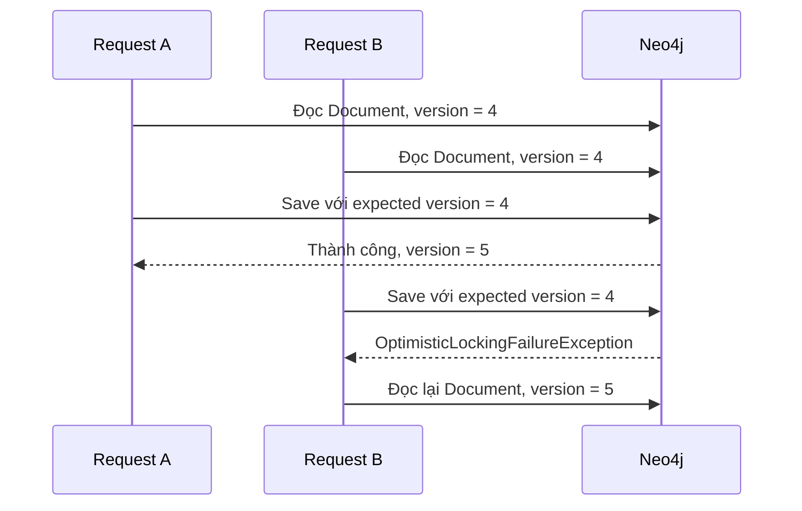
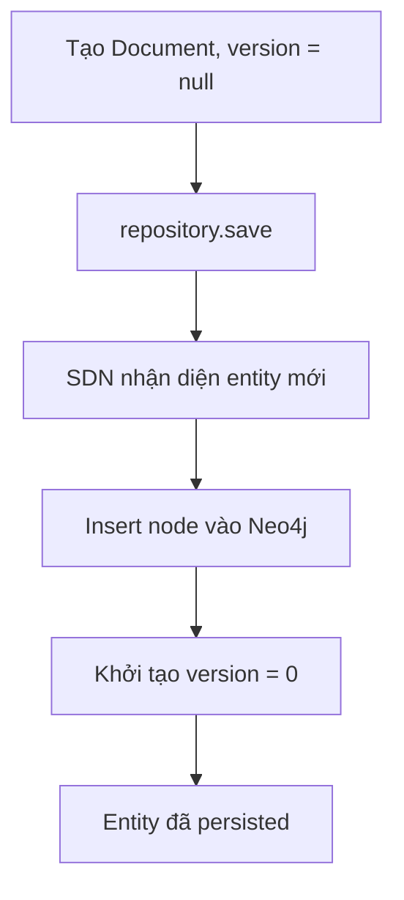

# Version khởi tạo, phát hiện entity mới và cập nhật version

Khi nhiều request cùng đọc và sửa một node Neo4j, request ghi sau có thể đang giữ một bản entity cũ. Nếu cứ lưu bản cũ đó, thay đổi mới hơn của request khác có thể bị ghi đè. Spring Data Neo4j (SDN) hỗ trợ optimistic locking bằng annotation `@Version`: mỗi entity mang một số version, SDN kiểm tra version khi cập nhật và tăng version sau khi ghi thành công.

`@Version` còn tham gia vào việc xác định entity mới hay đã tồn tại. Điều này đặc biệt quan trọng khi ứng dụng dùng business ID được gán ngay lúc tạo object: ID đã có giá trị không chứng minh node đã tồn tại trong graph. Với một trường version kiểu `Long`, giá trị `null` biểu thị entity mới; sau lần insert đầu tiên, SDN khởi tạo version bằng `0`. Các lần cập nhật tiếp theo tăng version lên `1`, `2` và tiếp tục như vậy.

## 1. `@Version` giải quyết vấn đề gì?

Giả sử hai người dùng cùng mở một tài liệu có version `4`:

1. Người dùng A đổi tiêu đề và lưu thành công. Version trong database tăng từ `4` lên `5`.
2. Người dùng B vẫn giữ object đã đọc trước đó, trong đó version vẫn là `4`.
3. Khi B lưu, SDN phát hiện version `4` không còn là version hiện tại trong database và từ chối cập nhật.

Nếu không có kiểm tra version, B có thể ghi đè dữ liệu mới của A bằng một bản cũ. Với optimistic locking, ứng dụng phát hiện xung đột và có thể yêu cầu tải lại dữ liệu trước khi người dùng chỉnh sửa tiếp.



`@Version` không khóa node trong suốt thời gian người dùng chỉnh sửa. Nó kiểm tra rằng dữ liệu vẫn ở phiên bản mà entity đã đọc khi ứng dụng gửi thao tác cập nhật.

## 2. Khai báo trường version trong entity

SDN sử dụng `@Version` của Spring Data Commons. Với SDN, trường này nên có kiểu `Long` (wrapper), không dùng `long` primitive:

```java
import org.springframework.data.annotation.Version;
import org.springframework.data.neo4j.core.schema.Id;
import org.springframework.data.neo4j.core.schema.Node;

@Node("Document")
public class Document {

    @Id
    private final String documentId;

    @Version
    private Long version;

    private String title;

    public Document(String documentId, String title) {
        this.documentId = documentId;
        this.title = title;
        // version để null trước lần save đầu tiên
    }

    public String getDocumentId() {
        return documentId;
    }

    public Long getVersion() {
        return version;
    }

    public String getTitle() {
        return title;
    }

    public void rename(String title) {
        this.title = title;
    }
}
```

Các điểm cần nhớ:

- `@Id` xác định danh tính entity; `@Version` xác định phiên bản dữ liệu đã đọc.
- Hai trường có nhiệm vụ khác nhau và không thay thế cho nhau.
- Trường `version` nên là `Long` để biểu diễn được trạng thái `null` trước insert.
- Không tự gán hoặc tăng version trong logic nghiệp vụ. SDN quản lý giá trị này.
- Entity cần một trường `@Version` được ánh xạ để SDN có thể dùng optimistic locking và state detection.

## 3. Vì sao giá trị ban đầu là `null`, sau insert là `0`?

Với `Long`, Java khởi tạo trường instance chưa được gán giá trị thành `null`. SDN sử dụng giá trị này để nhận diện entity mới khi có `@Version`:

| Thời điểm | Giá trị `version` trong entity | Ý nghĩa |
| --- | ---: | --- |
| Vừa tạo object trong Java | `null` | Entity mới, chưa được lưu |
| Sau lần insert đầu tiên | `0` | Entity đã tồn tại trong graph |
| Sau lần update thành công đầu tiên | `1` | Phiên bản dữ liệu mới |
| Sau lần update tiếp theo | `2` | Phiên bản dữ liệu mới hơn |

Giá trị version được lưu trên node như một property. Có thể kiểm tra trạng thái bằng Cypher:

```cypher
MATCH (d:Document {documentId: $documentId})
RETURN d.version AS version
```

Vì vậy, không nên khai báo `private Long version = 0L;` cho entity mới nếu muốn SDN nhận diện nó bằng version. Một giá trị `Long` version khác `null` được xem là trạng thái đã tồn tại; khi dùng business ID, điều này có thể khiến SDN đi vào nhánh update thay vì insert.

Không nên dùng `long` primitive cho trường version. Primitive không thể biểu diễn `null`, trong khi SDN cần trạng thái chưa khởi tạo rõ ràng; tài liệu SDN yêu cầu trường `@Version` có kiểu `Long`.

## 4. Phát hiện entity mới: `@Id` và `@Version`

Spring Data cần biết `save(entity)` phải insert hay update. Nếu không có version property, cách mặc định thường là kiểm tra identifier: ID chưa được gán (hoặc `0` với một số kiểu primitive) thì entity được coi là mới; ID đã có giá trị thì được coi là đã tồn tại.

Khi có `@Version`, Spring Data dùng version property để xác định trạng thái mới:

- `version == null` với kiểu `Long`: entity mới.
- `version` đã có giá trị: entity được coi là đã tồn tại.
- Nếu không có version property, cơ chế phát hiện quay về kiểm tra ID.

Điều này giải quyết tình huống business ID được ứng dụng gán trước khi lưu:

```java
Document document = new Document("DOC-2026-001", "Bản nháp");
// documentId đã có giá trị, nhưng version vẫn null.
Document saved = documentRepository.save(document);
```

Vì `version` là `null`, SDN có thể nhận diện object là mới dù `documentId` đã được gán. Sau insert, version được khởi tạo thành `0` và entity được đánh dấu là đã tồn tại.

### So sánh hai chiến lược ID

| Kiểu ID | Trước khi lưu | Cách nhận diện entity mới |
| --- | --- | --- |
| ID do Neo4j/SDN sinh (`@Id @GeneratedValue Long`) | ID là `null`, version là `null` | ID chưa có giá trị đã chỉ ra entity mới; version bổ sung optimistic locking |
| Business ID do ứng dụng gán (`@Id String`) | ID đã có giá trị, version là `null` | `@Version` cần thiết để phân biệt object mới với object đã đọc từ database |

Với business ID, tài liệu SDN nêu rõ `@Version` là bắt buộc để framework biết entity đã được persist hay chưa. Nếu chỉ gán ID và không cung cấp version, SDN không thể suy ra một object có ID đó là object mới hay entity đã tồn tại; nó có thể coi object là mới.

Business ID vẫn cần tính duy nhất. `@Version` không tạo unique constraint và không ngăn hai request cùng tạo hai node có cùng business ID. Hãy tạo uniqueness constraint trong Neo4j cho key nghiệp vụ và xử lý xung đột tạo mới theo quy tắc của ứng dụng.

Ví dụ constraint cho `Document`:

```cypher
CREATE CONSTRAINT document_id_unique IF NOT EXISTS
FOR (d:Document)
REQUIRE d.documentId IS UNIQUE
```

## 5. Lần insert đầu tiên: SDN khởi tạo version

Repository có thể khai báo bình thường:

```java
import org.springframework.data.neo4j.repository.Neo4jRepository;

public interface DocumentRepository
        extends Neo4jRepository<Document, String> {
}
```

Service tạo entity mới và lưu:

```java
import org.springframework.stereotype.Service;
import org.springframework.transaction.annotation.Transactional;

@Service
public class DocumentService {

    private final DocumentRepository documentRepository;

    public DocumentService(DocumentRepository documentRepository) {
        this.documentRepository = documentRepository;
    }

    @Transactional
    public Document create(String documentId, String title) {
        Document document = new Document(documentId, title);

        if (document.getVersion() != null) {
            throw new IllegalStateException("New document must have null version");
        }

        return documentRepository.save(document);
    }
}
```

Sau khi lưu thành công, object trả về từ `save` có version ban đầu `0`. Hãy sử dụng object được trả về để tiếp tục thao tác, đặc biệt khi entity có field bất biến hoặc có wither; không nên giả định mọi kiểu entity đều được cập nhật tại chỗ.

Trạng thái có thể hình dung như sau:



Giá trị version là metadata kỹ thuật để kiểm soát cập nhật. Không dùng nó làm mã đơn hàng, số thứ tự nghiệp vụ hoặc dấu thời gian.

## 6. Cập nhật entity: kiểm tra version cũ và tăng version mới

Khi đọc entity từ repository, SDN nạp giá trị version đang lưu trong graph. Khi `save` entity đó, SDN dùng version trong object làm expected version:

1. Tìm node theo định danh và version mà entity đang giữ.
2. Nếu version khớp, ghi các thay đổi và tăng version.
3. Nếu version không còn khớp, từ chối update và ném `OptimisticLockingFailureException`.

Ví dụ:

```java
@Transactional
public Document rename(String documentId, String newTitle) {
    Document document = documentRepository.findById(documentId)
        .orElseThrow(() -> new IllegalArgumentException("Document not found"));

    document.rename(newTitle);

    return documentRepository.save(document);
}
```

Nếu version trước khi lưu là `0`, sau update thành công entity trả về có version `1`. Nếu version là `7`, sau update thành công version mới là `8`. Ứng dụng không cần tự tăng trường version.

Version được tăng khi SDN cập nhật entity qua cơ chế persistence có hỗ trợ `@Version`. Không tăng version trong getter, setter hoặc service trước khi gọi `save`, vì điều đó làm sai giá trị mà SDN cần dùng để kiểm tra bản dữ liệu đã đọc.

## 7. Hai request cập nhật cùng một entity

Giả sử node `Document` đang có `version = 3`:

| Bước | Request A | Request B | Version trong Neo4j |
| --- | --- | --- | ---: |
| 1 | Đọc entity, version 3 | Đọc entity, version 3 | 3 |
| 2 | Sửa tiêu đề | Sửa nội dung | 3 |
| 3 | Save thành công | Chưa lưu | 4 |
| 4 | Hoàn tất | Save với version 3 bị từ chối | 4 |

Request B nhận `OptimisticLockingFailureException` của Spring Data. Điều đó cho biết entity đã thay đổi kể từ khi B đọc nó. Ứng dụng không nên bỏ qua lỗi rồi tiếp tục dùng object cũ.

Một cách xử lý thường gặp là:

1. Kết thúc transaction đã gặp optimistic locking failure.
2. Tải lại entity để nhận version mới nhất.
3. Kiểm tra thay đổi của người dùng có còn hợp lệ với dữ liệu mới không.
4. Áp dụng lại ý định nghiệp vụ trên object mới và lưu trong transaction mới.
5. Giới hạn số lần retry; nếu vẫn xung đột, trả lỗi phù hợp để người dùng quyết định.

Không retry bằng cách gọi `save` lặp lại trên cùng object stale. Version của object đó vẫn cũ và lần ghi tiếp theo sẽ tiếp tục thất bại.

## 8. Ví dụ retry có giới hạn

Retry chỉ phù hợp khi nghiệp vụ có thể đọc lại và áp dụng lại một cách an toàn. Ví dụ đổi tiêu đề có thể tải bản mới nhất rồi thử lại:

```java
import org.springframework.dao.OptimisticLockingFailureException;
import org.springframework.stereotype.Service;

@Service
public class DocumentRenameService {

    private final DocumentRenameAttemptService attemptService;

    public DocumentRenameService(DocumentRenameAttemptService attemptService) {
        this.attemptService = attemptService;
    }

    public Document renameWithRetry(String id, String newTitle) {
        int maxAttempts = 3;

        for (int attempt = 1; attempt <= maxAttempts; attempt++) {
            try {
                return attemptService.renameInNewTransaction(id, newTitle);
            } catch (OptimisticLockingFailureException ex) {
                if (attempt == maxAttempts) {
                    throw ex;
                }
            }
        }

        throw new IllegalStateException("Unreachable retry state");
    }

}
```

```java
import org.springframework.stereotype.Service;
import org.springframework.transaction.annotation.Transactional;

@Service
public class DocumentRenameAttemptService {

    private final DocumentRepository documentRepository;

    public DocumentRenameAttemptService(DocumentRepository documentRepository) {
        this.documentRepository = documentRepository;
    }

    @Transactional
    public Document renameInNewTransaction(String id, String newTitle) {
        Document current = documentRepository.findById(id)
            .orElseThrow(() -> new IllegalArgumentException("Document not found"));

        current.rename(newTitle);
        return documentRepository.save(current);
    }
}
```

Trong ví dụ, đặt hai class trong hai file Java riêng. `DocumentRenameService` gọi `DocumentRenameAttemptService` thông qua bean được inject, nên mỗi lần thử đi qua Spring proxy và có transaction riêng. Nếu gọi method `@Transactional` bằng self-invocation trong cùng object, proxy mặc định sẽ không mở transaction mới như mong muốn.

Đây chỉ là ví dụ cơ chế. Nếu hai người dùng thay đổi cùng một field theo hai ý định khác nhau, tự động áp dụng lại thay đổi cuối có thể không đúng nghiệp vụ. Khi đó nên trả conflict cho client hoặc dùng quy tắc merge rõ ràng. Retry không thay thế quyết định nghiệp vụ.

## 9. Version và custom Cypher

`@Version` được SDN áp dụng trong quy trình persistence entity. Một câu Cypher tự viết bằng `Neo4jClient`, `@Query` hoặc Driver không tự động nhận optimistic locking chỉ vì entity class có field `@Version`.

Nếu tự viết lệnh cập nhật, query phải tự kiểm tra expected version và tăng version một cách nguyên tử. Ví dụ minh họa:

```cypher
MATCH (d:Document {documentId: $documentId})
SET d._version_lock = true
REMOVE d._version_lock
WITH d
WHERE d.version = $expectedVersion
SET d.title = $title,
    d.version = d.version + 1
RETURN d.version AS newVersion
```

Nếu không có record trả về, có thể entity không tồn tại hoặc version đã thay đổi. Ứng dụng cần phân biệt hai trường hợp nếu API nghiệp vụ yêu cầu, ví dụ kiểm tra tồn tại riêng hoặc trả một lỗi conflict phù hợp. Không được bỏ điều kiện `WHERE d.version = $expectedVersion` rồi chỉ tăng version; như vậy không còn kiểm tra bản dữ liệu cũ.

Neo4j không có cú pháp Cypher tường minh để yêu cầu write lock. Hai dòng `SET`/`REMOVE` trên dùng một property tạm để lấy write lock trước khi đọc version; lock được giữ đến khi transaction kết thúc, còn property tạm được xóa ngay trong query. Cách này dựa trên cơ chế locking được mô tả trong Operations Manual và cần được kiểm thử trên phiên bản Neo4j đang triển khai. Chỉ đặt `WHERE d.version = ...` trước một lệnh `SET` trong cùng query chưa chắc đủ để đảm bảo kiểm tra diễn ra sau khi đã lấy lock.

## 10. Dữ liệu cũ chưa có property version

Nếu ứng dụng bật `@Version` cho label đã tồn tại từ trước, cần kiểm tra các node hiện có đã có property version hay chưa. Một node thiếu property `version` sẽ được ánh xạ thành `null`; với entity có `@Version`, `null` biểu thị entity mới. Nếu đưa code mới vào mà không chuẩn bị dữ liệu cũ, SDN có thể phân loại nhầm entity đã tồn tại thành entity mới.

Hãy lên kế hoạch backfill trước khi triển khai mapping mới. Ví dụ, nếu toàn bộ node `Document` hiện tại là dữ liệu đã tồn tại và chưa có version:

```cypher
MATCH (d:Document)
WHERE d.version IS NULL
SET d.version = 0
RETURN count(d) AS initializedCount
```

Chỉ chạy migration sau khi xác nhận phạm vi label và ý nghĩa dữ liệu. Nếu một số node thực sự là bản ghi mới hoặc có quy tắc version riêng, cần điều chỉnh điều kiện thay vì gán hàng loạt. Với graph lớn, chia migration thành các batch phù hợp và theo dõi số node được cập nhật.

## 11. Các lỗi thường gặp

| Biểu hiện | Nguyên nhân có thể | Cách xử lý |
| --- | --- | --- |
| Entity mới bị xử lý như entity đã tồn tại | `Long version` đã được gán giá trị trước lần save đầu | Để version `null` trước insert |
| Business ID đã có nhưng entity không insert | SDN dùng version khác null để nhận diện entity cũ | Không tự khởi tạo version; kiểm tra trạng thái entity |
| Save entity stale thất bại | Một transaction khác đã tăng version | Tải lại entity và xử lý xung đột |
| Version không tăng như mong đợi | Cập nhật bằng custom Cypher không quản lý version | Tự kiểm tra expected version và tăng trong cùng query |
| Entity cũ bị nhận diện là mới sau khi bật `@Version` | Node cũ chưa có property version | Backfill version trước khi triển khai |
| Version bị nhảy hoặc sai | Ứng dụng tự thay đổi trường version | Để SDN quản lý trường này |
| Hai node trùng business ID | Không có uniqueness constraint hoặc xử lý insert đồng thời chưa đúng | Tạo constraint và xử lý lỗi vi phạm uniqueness |
| Retry liên tục vẫn thất bại | Retry object cũ hoặc cạnh tranh ghi liên tục | Fetch lại trong transaction mới, giới hạn retry và trả conflict khi cần |

## 12. Checklist khi dùng `@Version`

1. Entity có một trường `@Version` kiểu `Long`.
2. Trường version để `null` trước lần insert đầu tiên.
3. Không gán hoặc tăng version thủ công trong code nghiệp vụ.
4. Với business ID đã gán sẵn, dùng version để phân biệt entity mới và entity đã persist.
5. Sau `save`, sử dụng entity trả về với version hiện tại.
6. Khi cập nhật, xử lý `OptimisticLockingFailureException` bằng cách tải lại và đánh giá thay đổi.
7. Retry toàn bộ use case trong transaction mới; không lưu lại object stale.
8. Với custom Cypher, tự thêm expected-version predicate và tăng version nguyên tử.
9. Khi bật version cho graph cũ, backfill property version trước khi dùng mapping mới.
10. Tạo uniqueness constraint cho business ID; version không thay thế ràng buộc định danh.

## Kết luận

Trong SDN, `@Version` vừa hỗ trợ optimistic locking vừa tham gia phát hiện entity mới. Với trường `Long`, giá trị `null` trước lần save đầu tiên cho biết entity chưa được persist; sau insert, SDN khởi tạo version bằng `0`, rồi tăng sau mỗi lần update thành công. Khi hai request lưu cùng một version, request đầu có thể cập nhật; request sau dùng version cũ sẽ nhận `OptimisticLockingFailureException`. Hãy để SDN quản lý version, tải lại entity trước khi retry và tự triển khai kiểm tra version nếu dùng custom Cypher. Với business ID hoặc graph cũ, đặc biệt chú ý state detection và migration property version.

## Tài liệu tham khảo

- [Spring Data Neo4j 8.1.2 — Metadata-based Mapping: Optimistic locking `@Version`](https://docs.spring.io/spring-data/neo4j/reference/object-mapping/metadata-based-mapping.html)
- [Spring Data Neo4j 8.1.2 — Handling and provisioning of unique IDs](https://docs.spring.io/spring-data/neo4j/reference/8.1/object-mapping/mapping-ids.html)
- [Spring Data Commons — Entity State Detection Strategies](https://docs.spring.io/spring-data/commons/reference/is-new-state-detection.html)
- [Neo4j Operations Manual — Concurrent data access and write locks](https://neo4j.com/docs/operations-manual/current/database-internals/concurrent-data-access/)
