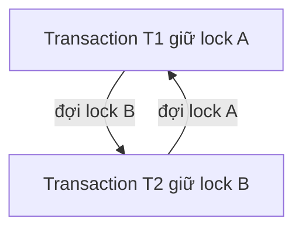

# Khóa ghi, deadlock và thứ tự cập nhật các node

Khi nhiều request cùng cập nhật một graph Neo4j, database phải điều phối quyền ghi để giữ dữ liệu nhất quán. Neo4j tự động lấy write lock cho các thao tác sửa node, relationship và một số cấu trúc nội bộ; lock được giữ đến khi transaction commit hoặc rollback. Nếu các transaction cùng sửa một tài nguyên, chúng có thể phải chờ nhau. Nếu mỗi transaction giữ một lock và tiếp tục chờ lock mà transaction kia đang giữ, deadlock xảy ra.

Trong ứng dụng Spring Data Neo4j (SDN), cần thiết kế transaction ngắn, cập nhật các node theo thứ tự nhất quán, xử lý xung đột bằng optimistic locking khi phù hợp và retry có giới hạn đối với lỗi transient. Các biện pháp này giải quyết những khía cạnh khác nhau của concurrency; không có một annotation đơn lẻ nào loại bỏ mọi deadlock.

## 1. Isolation mặc định và write lock trong Neo4j

Neo4j sử dụng isolation level `read-committed` mặc định. Một transaction đọc node hoặc relationship không giữ read lock để ngăn transaction khác sửa tài nguyên đó trước khi transaction đọc kết thúc. Vì vậy, cùng một transaction có thể đọc lại property và thấy giá trị mới do transaction khác commit xen giữa; đây là non-repeatable read.

Khi ghi dữ liệu, Neo4j tự động lấy write lock để bảo vệ tài nguyên bị thay đổi. Lock được giữ đến khi transaction kết thúc. Nếu transaction rollback, các lock cũng được giải phóng.

| Thao tác | Hành vi lock ở mức khái quát |
|---|---|
| Thêm, sửa hoặc xóa property của node | Lấy write lock trên node |
| Thêm, sửa hoặc xóa property của relationship | Lấy write lock trên relationship |
| Xóa node | Lấy `NODE` lock trên node bị xóa |
| Tạo hoặc xóa relationship | Có thể cần lock trên relationship và các node ở hai đầu để bảo vệ cấu trúc graph |

Việc tạo node mới không giống cập nhật property trên node đã tồn tại; Neo4j không lấy exclusive `NODE` lock cho node mới theo bảng lock thao tác. Chi tiết lock nội bộ còn phụ thuộc loại thao tác, mật độ relationship và phiên bản Neo4j. Ứng dụng nên dựa vào hợp đồng ở mức transaction thay vì phụ thuộc vào tên hoặc thứ tự của các lock nội bộ.

### Lock contention không đồng nghĩa với deadlock

Lock contention xảy ra khi transaction phải chờ một lock đang được transaction khác giữ. Ví dụ hai request cùng cập nhật số dư của một tài khoản: request thứ hai chờ request thứ nhất commit hoặc rollback rồi mới có thể tiếp tục.

Đây là trạng thái chờ có thể kết thúc bình thường. Deadlock chỉ xảy ra khi tồn tại vòng chờ: transaction A giữ tài nguyên mà B cần, trong khi B giữ tài nguyên mà A cần. Neo4j phát hiện vòng chờ và hủy một transaction để giải phóng hệ thống.

## 2. Vì sao deadlock xảy ra?

Giả sử hai tài khoản `A-01` và `B-02` cần được cập nhật trong cùng một nghiệp vụ chuyển tiền. Hai request đồng thời có thể thực hiện theo thứ tự ngược nhau:

| Thời điểm | Transaction T1 | Transaction T2 |
|---|---|---|
| 1 | Lấy lock trên A | Lấy lock trên B |
| 2 | Chờ lock trên B | Chờ lock trên A |
| 3 | Không thể tiếp tục | Không thể tiếp tục |



Hai transaction tạo thành vòng chờ. Neo4j phát hiện deadlock, hủy một transaction và rollback các thay đổi của transaction đó. Transaction còn lại có thể tiếp tục sau khi lock được giải phóng.

Deadlock thường xuất hiện khi:

- Nhiều transaction sửa cùng một tập node hoặc relationship nhưng theo thứ tự khác nhau.
- Một transaction sửa node A rồi B, transaction khác sửa B rồi A.
- Một thao tác tạo hoặc xóa relationship đụng đến các node đầu cuối đang được transaction khác cập nhật.
- Các câu lệnh `MERGE` cạnh tranh trên dữ liệu có ràng buộc duy nhất và cần lấy lock để bảo đảm uniqueness.
- Transaction giữ lock quá lâu do thực hiện nhiều thao tác hoặc làm công việc bên ngoài database trong cùng transaction.

Neo4j trả lỗi transient có mã `Neo.TransientError.Transaction.DeadlockDetected` khi phát hiện deadlock. Từ Neo4j 5.25, lỗi còn có GQLSTATUS `50N05`. Transaction bị chọn làm nạn nhân sẽ bị rollback; ứng dụng có thể retry toàn bộ đơn vị công việc nếu nghiệp vụ cho phép.

## 3. Cập nhật nhiều node theo cùng một thứ tự

Cách phòng tránh deadlock quan trọng nhất là bảo đảm mọi transaction lấy lock trên cùng tập tài nguyên theo cùng một thứ tự. Nếu một nghiệp vụ phải sửa nhiều tài khoản, hãy sắp xếp theo khóa ổn định trước khi cập nhật.

Ví dụ, một câu lệnh cập nhật một nhóm tài khoản theo `accountId`:

```cypher
UNWIND $accountIds AS accountId
MATCH (a:Account {accountId: accountId})
WITH DISTINCT a
ORDER BY a.accountId
SET a.lastReconciledAt = datetime()
RETURN collect(a.accountId) AS updatedAccounts;
```

`WITH ... ORDER BY` sắp xếp các hàng trước khi chuyển chúng đến mệnh đề ghi. Các transaction chạy cùng loại nghiệp vụ sẽ tiếp cận các node theo thứ tự `accountId`, thay vì theo thứ tự ngẫu nhiên của request đầu vào.

Đối với một thao tác liên quan đúng hai node, xác định thứ tự từ một khóa ổn định:

```cypher
MATCH (a:Account {accountId: $fromId})
MATCH (b:Account {accountId: $toId})
WITH CASE WHEN a.accountId < b.accountId THEN a ELSE b END AS first,
     CASE WHEN a.accountId < b.accountId THEN b ELSE a END AS second
SET first.lastTouchedAt = datetime()
SET second.lastTouchedAt = datetime();
```

Dù request chuyển tiền theo hướng nào, hai node vẫn được cập nhật theo cùng thứ tự định danh. Trong code thực tế, cần kiểm tra hai ID tồn tại, khác nhau và bảo đảm câu lệnh chuyển tiền có quy tắc nghiệp vụ đầy đủ.

### Sắp xếp phải dựa trên khóa ổn định

Không sắp xếp theo giá trị có thể thay đổi trong chính transaction, timestamp ngẫu nhiên hoặc thứ tự phần tử nhận từ client. Hãy chọn business key duy nhất hoặc ID ổn định, đồng thời dùng cùng quy tắc ở mọi luồng ghi có thể xung đột.

Thứ tự nhất quán giúp giảm deadlock nhưng không bảo đảm loại bỏ mọi deadlock. Một transaction có thể còn sửa relationship, index hoặc tài nguyên khác theo thứ tự khác. Cần xem xét toàn bộ tập node và relationship mà mỗi use case thay đổi.

## 4. Lưu ý khi dùng MERGE

`MERGE` bảo đảm pattern được tìm thấy hoặc tạo mới, nhưng để bảo đảm uniqueness, Neo4j có thể phải lấy lock theo thứ tự khác với thứ tự cập nhật mà ứng dụng mong muốn. Tài liệu Neo4j lưu ý `MERGE` có thể lấy lock out of order và làm tăng khả năng deadlock trong các luồng ghi cạnh tranh.

Khi dữ liệu chắc chắn chưa tồn tại và nghiệp vụ cho phép tạo mới trực tiếp, `CREATE` có thể tránh một phần chi phí kiểm tra và lock liên quan đến `MERGE`:

```cypher
CREATE (:AuditEvent {
    eventId: $eventId,
    createdAt: datetime(),
    action: $action
});
```

Không thay `MERGE` bằng `CREATE` một cách máy móc. Nếu cần tính chất tìm-hoặc-tạo hoặc chống tạo trùng, hãy giữ `MERGE`, đặt uniqueness constraint phù hợp và thiết kế lại thứ tự cập nhật hoặc phân luồng ghi để giảm cạnh tranh.

## 5. Neo4j tự động khóa khi cập nhật property phụ thuộc trực tiếp

Một trường hợp quan trọng là cập nhật dựa trên giá trị hiện tại của chính property đó. Với biểu thức có dependency trực tiếp, Cypher tự động lấy write lock trước khi đọc property để tránh lost update:

```cypher
MATCH (c:Counter {counterId: $counterId})
SET c.value = c.value + $delta
RETURN c.value AS value;
```

Nếu nhiều transaction đồng thời tăng `value`, biểu thức bên phải phụ thuộc trực tiếp vào `c.value`. Neo4j lấy write lock trước khi đọc giá trị đó, sau đó tính và ghi kết quả. Đây là cách tốt để thực hiện phép tăng/giảm nguyên tử trong một câu Cypher.

Tương tự, cập nhật bằng map literal có dependency trực tiếp cũng có thể tự động lấy lock:

```cypher
MATCH (c:Counter {counterId: $counterId})
SET c += {value: c.value + $delta};
```

Không phải mọi kiểu đọc rồi ghi đều được bảo vệ tự động. Nếu ứng dụng đọc property trong một câu lệnh trước, tính toán ở Java hoặc qua các bước Cypher trung gian, rồi ghi kết quả sau, lock có thể chưa được lấy tại thời điểm đọc ban đầu.

## 6. Lost update khi đọc và ghi ở các bước tách rời

Ví dụ không an toàn:

1. Transaction T1 đọc `balance = 100`.
2. Transaction T2 cũng đọc `balance = 100`.
3. T1 tính `100 + 20` và ghi `120`.
4. T2 tính `100 - 10` và ghi `90`.

Kết quả cuối cùng là `90`, làm mất phần cập nhật `+20`. Đây là lost update: các lần ghi có thể được tuần tự hóa bằng write lock, nhưng giá trị mới được tính từ một lần đọc cũ bên ngoài vùng được khóa.

Ưu tiên biểu diễn phép cập nhật thành một biểu thức Cypher có dependency trực tiếp:

```cypher
MATCH (a:Account {accountId: $accountId})
SET a.balanceMinor = a.balanceMinor + $deltaMinor
RETURN a.balanceMinor AS balanceMinor;
```

Nếu nghiệp vụ cần đọc dữ liệu trước rồi mới quyết định giá trị ghi, hãy dùng optimistic locking với `@Version` hoặc chủ động lấy write lock trước khi đọc trong cùng transaction.

## 7. Chủ động lấy write lock trong trường hợp cần thiết

Cypher không có cú pháp `LOCK NODE` tổng quát. Neo4j hướng dẫn một cách lấy write lock tường minh bằng cách ghi rồi xóa một property tạm trên node. Write lock được giữ đến khi transaction commit hoặc rollback, kể cả sau khi property tạm đã bị xóa.

```cypher
MATCH (c:Counter {counterId: $counterId})
SET c.__lock__ = true
REMOVE c.__lock__
WITH c, c.value AS currentValue
// Các bước tính toán tiếp theo sử dụng currentValue.
SET c.value = currentValue + $delta
RETURN c.value AS value;
```

Property `__lock__` chỉ dùng để buộc Neo4j lấy write lock trước khi đọc `c.value`. Sau `REMOVE`, lock vẫn được giữ đến cuối transaction. Hãy chọn tên property tạm không trùng dữ liệu nghiệp vụ và bảo đảm thao tác nằm trong một transaction.

Đây là kỹ thuật mức thấp, chỉ nên dùng khi có lý do rõ ràng và đã kiểm thử concurrency. Trước tiên, hãy thử biểu diễn phép cập nhật thành một câu Cypher có dependency trực tiếp hoặc dùng `@Version`. Không dùng dummy property như một khóa toàn cục cho mọi request vì nó có thể làm tăng contention.

## 8. Optimistic locking với @Version trong Spring Data Neo4j

Write lock của Neo4j điều phối các thao tác ghi đang diễn ra. Optimistic locking của SDN giải quyết một vấn đề khác: phát hiện entity đã bị transaction khác sửa kể từ lúc ứng dụng đọc nó.

Thêm field `Long` có `@Version` vào entity:

```java
import org.springframework.data.annotation.Id;
import org.springframework.data.annotation.Version;
import org.springframework.data.neo4j.core.schema.Node;

@Node("InventoryItem")
public class InventoryItem {

    @Id
    private String sku;

    private long quantity;

    @Version
    private Long version;

    protected InventoryItem() {
    }

    public void reserve(long amount) {
        if (amount <= 0 || quantity < amount) {
            throw new IllegalArgumentException("Invalid reservation amount");
        }
        quantity -= amount;
    }
}
```

Repository tương ứng:

```java
import org.springframework.data.neo4j.repository.Neo4jRepository;

public interface InventoryItemRepository
        extends Neo4jRepository<InventoryItem, String> {
}
```

SDN quản lý version và tự tăng version khi cập nhật thành công. Không tự gán hoặc sửa field `version` trong code nghiệp vụ.

Giả sử hai request cùng tải entity với `version = 4`:

- Request A lưu thành công, SDN cập nhật version lên `5`.
- Request B vẫn giữ entity cũ có version `4`; khi lưu, SDN phát hiện version không còn khớp và ném `OptimisticLockingFailureException`.
- Request B phải tải lại entity mới, kiểm tra lại điều kiện nghiệp vụ rồi quyết định có thể thực hiện thay đổi hay không.

Ví dụ service:

```java
import org.springframework.stereotype.Service;
import org.springframework.transaction.annotation.Transactional;

@Service
public class InventoryService {

    private final InventoryItemRepository items;

    public InventoryService(InventoryItemRepository items) {
        this.items = items;
    }

    @Transactional
    public void reserve(String sku, long amount) {
        InventoryItem item = items.findById(sku)
                .orElseThrow(() -> new IllegalArgumentException("Item not found"));

        item.reserve(amount);
        items.save(item);
    }
}
```

`@Version` phù hợp với các entity có khả năng được nhiều request đọc, chỉnh sửa và lưu lại. Nó không thay thế write lock của database, không ngăn mọi deadlock và không tự giải quyết xung đột nghiệp vụ. Khi xung đột xảy ra, cần tải lại trạng thái mới và đánh giá lại điều kiện thay vì lưu lại object cũ.

## 9. Transaction ngắn và thứ tự cập nhật trong service

Đặt ranh giới transaction ở service để các bước đọc, kiểm tra và ghi của một use case được quản lý cùng nhau:

```java
@Transactional
public void transfer(String fromId, String toId, long amount) {
    if (amount <= 0 || fromId.equals(toId)) {
        throw new IllegalArgumentException("Invalid transfer");
    }

    // Tải và xác thực các tài khoản trong transaction.
    // Thực hiện cập nhật theo một thứ tự khóa thống nhất.
    // Ghi audit cùng transaction nếu audit nằm trong cùng Neo4j database.
}
```

Các nguyên tắc thiết kế:

- Giữ transaction chỉ bao quanh thao tác database cần tính nguyên tử.
- Không gọi HTTP service, gửi email, chờ người dùng hoặc ngủ giữa lúc transaction đang giữ lock.
- Không giữ transaction mở trong khi xử lý dữ liệu lớn ở Java nếu có thể chuyển xử lý về Cypher hoặc chia thành batch.
- Cập nhật node và relationship theo thứ tự ổn định trong mọi use case liên quan.
- Đặt điều kiện kiểm tra và ghi trong cùng transaction để giảm khoảng thời gian dữ liệu có thể thay đổi giữa hai bước.
- Không chạy song song các thao tác ghi có thể đụng cùng node nếu thứ tự lock giữa các nhánh không được kiểm soát.

`@Transactional` quản lý ranh giới transaction; nó không tự sắp xếp các node theo thứ tự an toàn và cũng không tự retry mọi lỗi deadlock.

## 10. Retry deadlock và lỗi transient

Khi Neo4j phát hiện deadlock, một transaction bị rollback và lỗi được trả về ứng dụng. Có thể retry toàn bộ use case nếu lỗi thuộc nhóm transient và nghiệp vụ có thể thực hiện lại an toàn.

Quy tắc retry:

1. Chỉ retry các lỗi transient có thể phục hồi, không retry lỗi validation, constraint hoặc lỗi nghiệp vụ cố định.
2. Giới hạn số lần thử và tổng thời gian retry.
3. Có khoảng nghỉ tăng dần (backoff) giữa các lần thử để transaction cạnh tranh có thời gian hoàn tất.
4. Mỗi lần thử phải chạy trong transaction mới và đọc lại dữ liệu cần thiết.
5. Thiết kế thao tác idempotent hoặc dùng idempotency key để không ghi nhận nghiệp vụ hai lần.
6. Ghi log số lần retry, mã lỗi và định danh nghiệp vụ để điều tra deadlock thường xuyên.

Với Neo4j Java Driver, các managed transaction như `Session.executeWrite(...)` tự retry một số lỗi transient theo chính sách của Driver. Callback có thể được chạy lại, vì vậy không đặt side effect bên ngoài database như gửi email hoặc gọi API thanh toán trực tiếp trong callback. Nếu ứng dụng dùng SDN với `@Transactional`, hãy cấu hình retry ở lớp bao ngoài transaction để mỗi lần thử tạo một transaction mới; không giả định annotation `@Transactional` tự thực hiện retry.

Không retry mù quáng một entity cũ sau `OptimisticLockingFailureException`. Trước hết phải tải lại version mới, xác thực lại số dư/số lượng và tính lại quyết định nghiệp vụ.

## 11. Theo dõi lock và điều tra deadlock

Khi hệ thống có lock contention kéo dài hoặc deadlock lặp lại, cần xác định query và transaction đang giữ tài nguyên.

Liệt kê transaction đang hoạt động:

```cypher
SHOW TRANSACTIONS
YIELD transactionId, currentQueryId, currentQuery, elapsedTime, status
RETURN transactionId, currentQueryId, currentQuery, elapsedTime, status;
```

Nếu có `currentQueryId`, quản trị viên có thể xem các lock mà query đang giữ bằng procedure quản trị:

```cypher
CALL dbms.listActiveLocks($queryId)
YIELD mode, resourceType, resourceId
RETURN mode, resourceType, resourceId;
```

Procedure này cần quyền quản trị phù hợp. Kết quả giúp nhận biết tài nguyên nào đang bị khóa, nhưng cần đối chiếu transaction và query log để hiểu thứ tự truy cập.

Có thể cấu hình `db.lock.acquisition.timeout` để transaction thất bại nếu không lấy được lock trong khoảng thời gian quy định, ví dụ `10s`. Giá trị mặc định `0s` nghĩa là không bật timeout lock acquisition. Timeout giúp tránh một transaction chờ lock quá lâu, nhưng không sửa nguyên nhân deadlock; ứng dụng vẫn cần xử lý lỗi tương ứng.

Khi điều tra, hãy ghi nhận:

- Mã lỗi deadlock và thời điểm xảy ra.
- Các query đang cạnh tranh và tập node/relationship bị cập nhật.
- Thứ tự các node được truy cập trong mỗi transaction.
- Thời lượng transaction và số lần retry.
- Tác động của batch size, concurrency và các câu lệnh `MERGE`.

## 12. Những lỗi thường gặp

| Lỗi | Hệ quả | Cách xử lý |
|---|---|---|
| Các transaction cập nhật cùng node theo thứ tự ngược nhau | Tạo vòng chờ và deadlock | Sắp xếp theo business key ổn định trước khi ghi |
| Nghĩ read-committed giữ snapshot cho cả transaction | Có thể đọc thấy giá trị thay đổi giữa hai lần đọc | Đọc mỗi property một lần hoặc dùng lock/version khi cần |
| Đọc giá trị ở Java rồi ghi lại sau | Có nguy cơ lost update | Dùng biểu thức Cypher phụ thuộc trực tiếp hoặc optimistic locking |
| Dùng `MERGE` cho mọi thao tác dù dữ liệu chắc chắn mới | Tăng công việc kiểm tra và có thể lấy lock out of order | Dùng `CREATE` khi semantics cho phép; giữ constraint cho uniqueness |
| Retry không giới hạn | Tăng tải và kéo dài sự cố | Giới hạn số lần, backoff và theo dõi lỗi |
| Retry entity cũ sau lỗi version | Ghi lại dữ liệu stale hoặc lặp xung đột | Tải lại entity, kiểm tra lại nghiệp vụ rồi mới thử lại |
| Giữ transaction trong lúc gọi dịch vụ ngoài | Lock bị giữ lâu và tăng contention | Tách side effect ngoài transaction hoặc dùng outbox |
| Dùng dummy property cho mọi lần ghi | Tăng contention trên node | Chỉ lấy explicit lock khi thật sự cần read-modify-write phức tạp |
| Coi lock timeout là cách sửa deadlock | Transaction chỉ thất bại sớm hơn | Sửa thứ tự truy cập và phạm vi transaction |

## 13. Bài tập thực hành

Tạo hai node tài khoản:

```cypher
CREATE
  (:Account {accountId: 'A-01', balanceMinor: 100000}),
  (:Account {accountId: 'B-02', balanceMinor: 80000});
```

Thực hiện các yêu cầu:

1. Viết hai câu lệnh chuyển tiền theo hai hướng A → B và B → A; quan sát vì sao cập nhật hai node theo thứ tự khác nhau có thể tạo deadlock khi chạy đồng thời.
2. Sửa truy vấn để xác định `first` và `second` theo `accountId`, bảo đảm mọi transaction cập nhật theo cùng thứ tự.
3. Viết truy vấn tăng `Counter.value` bằng `SET c.value = c.value + $delta` và giải thích dependency trực tiếp giúp Neo4j lấy write lock trước khi đọc.
4. Tách thao tác đọc và ghi thành hai statement, sau đó thử kỹ thuật dummy property trong một transaction để so sánh.
5. Thêm `@Version` vào entity `InventoryItem`, chạy hai request cùng cập nhật và quan sát `OptimisticLockingFailureException`.
6. Thiết kế retry có giới hạn, mỗi lần thử tải lại entity và kiểm tra lại điều kiện nghiệp vụ.
7. Dùng `SHOW TRANSACTIONS` và `dbms.listActiveLocks` trong môi trường test có quyền phù hợp để quan sát lock.

Sau bài tập, hãy giải thích được sự khác nhau giữa lock contention, deadlock, lost update và optimistic locking; đồng thời nêu được vì sao thứ tự cập nhật nhất quán giúp giảm deadlock.

## Kết luận

Neo4j tự động dùng write lock để bảo vệ node và relationship khi ghi; lock được giữ đến khi transaction kết thúc. Deadlock xuất hiện khi các transaction giữ lock theo thứ tự khác nhau và tạo vòng chờ. Hãy cập nhật các node theo cùng thứ tự ổn định, giữ transaction ngắn, ưu tiên biểu thức Cypher có dependency trực tiếp cho phép tăng/giảm nguyên tử và dùng `@Version` khi cần phát hiện entity stale. Khi lỗi transient xảy ra, retry toàn bộ transaction có giới hạn và đọc lại dữ liệu ở mỗi lần thử. Theo dõi query, lock và log để xử lý nguyên nhân contention thay vì chỉ tăng timeout.

## Tài liệu tham khảo

- [Neo4j Operations Manual – Concurrent data access](https://neo4j.com/docs/operations-manual/current/database-internals/concurrent-data-access/)
- [Neo4j Operations Manual – Transaction management](https://neo4j.com/docs/operations-manual/current/database-internals/transaction-management/)
- [Neo4j Java Driver Manual – Transactions](https://neo4j.com/docs/java-manual/current/transactions/)
- [Spring Data Neo4j – Optimistic locking with @Version](https://docs.spring.io/spring-data/neo4j/reference/object-mapping/metadata-based-mapping.html)
