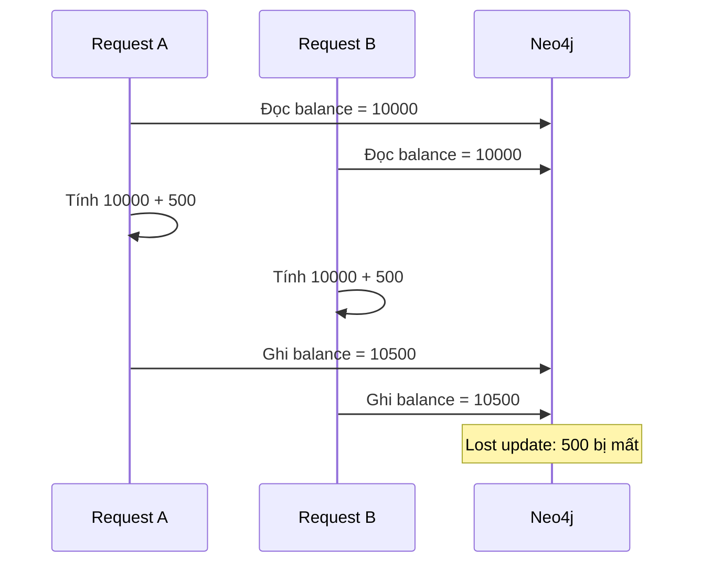
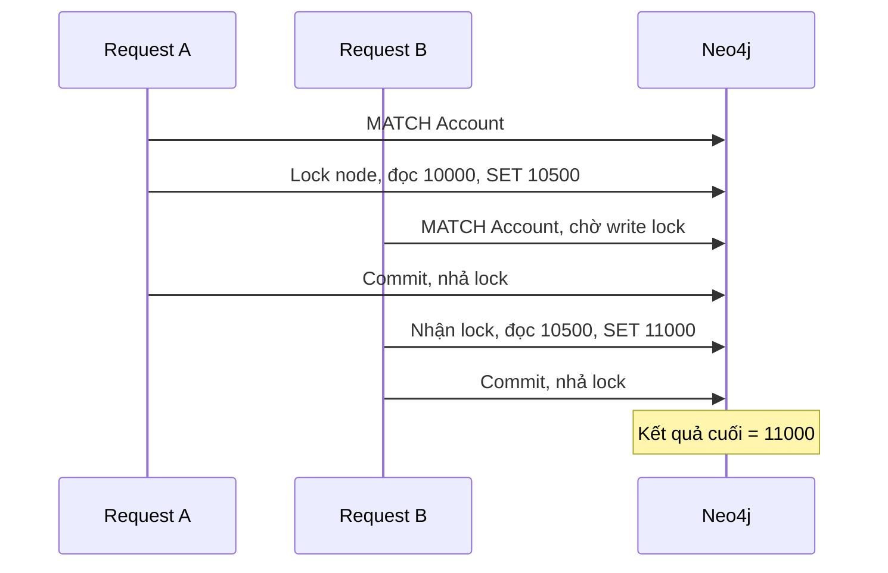

# Cập nhật nguyên tử bằng Cypher thay cho đọc–sửa–ghi thiếu kiểm soát

Khi nhiều request cùng cập nhật một node, cách đọc entity về Java, sửa giá trị trong bộ nhớ rồi lưu lại có thể làm mất thay đổi của request khác. Đây là lỗi *lost update*. Với các phép cập nhật đơn giản như tăng bộ đếm hoặc cộng số dư, hãy để Cypher đọc và thay đổi property trong cùng một biểu thức `SET`. Neo4j có thể tự lấy write lock trước khi đọc property được cập nhật, nhờ đó các phép tăng đồng thời được tuần tự hóa và không ghi đè kết quả của nhau.

Trong module `SPRING_DATA_NEO4J`, bài này nối mô hình node entity và relationship với repository, truy vấn Cypher và transaction để kiểm soát các cập nhật graph đồng thời. Cập nhật nguyên tử bằng Cypher phù hợp với những thao tác cần tính toán trực tiếp từ giá trị hiện tại trong graph. Khi nghiệp vụ cần đọc nhiều property, kiểm tra điều kiện phức tạp hoặc thay đổi entity qua repository, có thể dùng explicit locking hoặc optimistic locking với `@Version`. Điều quan trọng là nhận biết trường hợp nào được Cypher bảo vệ tự động và trường hợp nào vẫn có thể dùng dữ liệu cũ.

## 1. Vấn đề đọc–sửa–ghi khi có nhiều request

Giả sử tài khoản có `balanceMinor = 10000`. Hai request cùng muốn cộng thêm `500`:

1. Transaction A đọc số dư `10000`.
2. Transaction B cũng đọc số dư `10000`.
3. A cộng `500` trong Java và lưu `10500`.
4. B cộng `500` từ giá trị đã đọc trước đó và cũng lưu `10500`.

Kết quả cuối cùng là `10500`, trong khi kết quả đúng phải là `11000`. Phép cộng của B đã ghi đè thay đổi của A.



Đoạn code dễ mắc lỗi:

```java
@Transactional
public void deposit(String accountId, long amountMinor) {
    Account account = accountRepository.findById(accountId)
        .orElseThrow(() -> new AccountNotFoundException(accountId));

    account.setBalanceMinor(account.getBalanceMinor() + amountMinor);
    accountRepository.save(account);
}
```

`@Transactional` bảo đảm các thao tác trong cùng transaction được commit hoặc rollback cùng nhau. Tuy nhiên, transaction mặc định của Neo4j dùng isolation `READ_COMMITTED`; việc đọc node không ngăn transaction khác cập nhật node đó trước khi transaction hiện tại ghi. Vì vậy, chỉ thêm `@Transactional` không tự sửa lỗi lost update của quy trình đọc–sửa–ghi trên.

## 2. Cập nhật trực tiếp bằng một biểu thức SET

Với phép tăng số dư, hãy viết thao tác đọc giá trị hiện tại và cộng thêm delta ngay trong cùng câu Cypher:

```cypher
MATCH (a:Account {id: $accountId})
SET a.balanceMinor = a.balanceMinor + $delta
RETURN a.balanceMinor AS balanceMinor;
```

Điểm quan trọng nằm ở vế phải của `SET`: biểu thức `a.balanceMinor + $delta` phụ thuộc trực tiếp vào property đang được cập nhật. Trong trường hợp này, Cypher tự lấy write lock trên node `a` trước khi đọc `a.balanceMinor`. Lock được giữ đến khi transaction kết thúc. Một transaction khác muốn cập nhật cùng node phải đợi, sau đó đọc giá trị mới nhất và thực hiện phép cộng tiếp theo.

Property `balanceMinor` cần được khởi tạo bằng giá trị số trước khi dùng phép cộng. Nếu property chưa tồn tại, biểu thức số học có thể cho kết quả `null`; gán `null` trong Cypher sẽ gỡ property thay vì tạo số dư mong muốn. Hãy khởi tạo giá trị khi tạo tài khoản và xác thực delta theo quy tắc domain.

Với hai request cộng `500`, các lần cập nhật sẽ diễn ra tuần tự:



Không cần tải `Account` về Java chỉ để cộng một giá trị. Neo4j thực hiện phép tính trên giá trị hiện tại trong transaction ghi.

### Gọi Cypher qua Neo4jClient

`Neo4jClient` cho phép bind tham số và lấy giá trị sau cập nhật:

```java
import java.util.Optional;

import org.springframework.data.neo4j.core.Neo4jClient;
import org.springframework.stereotype.Service;

@Service
public class AccountBalanceService {

    private final Neo4jClient neo4jClient;

    public AccountBalanceService(Neo4jClient neo4jClient) {
        this.neo4jClient = neo4jClient;
    }

    public Optional<Long> addFunds(String accountId, long delta) {
        return neo4jClient.query("""
                MATCH (a:Account {id: $accountId})
                SET a.balanceMinor = a.balanceMinor + $delta
                RETURN a.balanceMinor AS balanceMinor
                """)
            .bind(accountId).to("accountId")
            .bind(delta).to("delta")
            .fetchAs(Long.class)
            .mappedBy((typeSystem, record) ->
                record.get("balanceMinor").asLong()
            )
            .one();
    }
}
```

Nếu `MATCH` không tìm thấy tài khoản, query không trả record và phương thức trả `Optional.empty()`. Nếu tìm thấy, giá trị trả về là số dư sau cập nhật. Tham số `$delta` được bind riêng, không nối chuỗi đầu vào vào Cypher.

Đoạn code chỉ minh họa một thao tác ghi. Nếu nó là một phần của use case gồm nhiều thay đổi cần commit cùng nhau, hãy đặt transaction ở service:

```java
@Transactional
public void placeOrder(PlaceOrderCommand command) {
    // Cập nhật số dư/tồn kho và ghi các node, relationship liên quan.
    // Các thao tác dữ liệu tham gia cùng transaction do Spring quản lý.
}
```

## 3. Vì sao không nên tách giá trị cũ qua WITH?

Write lock tự động chỉ được lấy trước khi đọc property khi vế phải của `SET` có phụ thuộc trực tiếp vào property được cập nhật. Nếu đọc property ở một mệnh đề trước, giữ nó trong biến rồi dùng biến đó để ghi, Cypher không còn thấy dependency trực tiếp trong biểu thức `SET`.

Ví dụ có nguy cơ lost update:

```cypher
MATCH (a:Account {id: $accountId})
WITH a, a.balanceMinor AS oldBalance
SET a.balanceMinor = oldBalance + $delta
RETURN a.balanceMinor AS balanceMinor;
```

`oldBalance` được đọc trước khi write lock được lấy. Hai transaction có thể cùng đọc một giá trị, rồi lần lượt ghi kết quả được tính từ giá trị cũ đó. Việc `SET` cuối cùng có lấy lock để ghi node không làm cho lần đọc trước đó trở nên mới hơn.

So sánh hai cách:

| Cách viết | Giá trị dùng để tính | Write lock trước khi đọc property? | Rủi ro lost update |
|---|---|---|---|
| `SET a.balanceMinor = a.balanceMinor + $delta` | Property hiện tại trong biểu thức `SET` | Có, vì có dependency trực tiếp | Tránh được lost update cho phép tăng này |
| `WITH a.balanceMinor AS oldBalance ... SET a.balanceMinor = oldBalance + $delta` | Giá trị đã materialize trước đó | Không tự động theo dependency này | Có |
| Đọc entity về Java rồi `save()` | Snapshot entity đã đọc | Không bảo đảm khóa trước lần đọc | Có nếu không có cơ chế concurrency khác |

Quy tắc thực hành: giữ phép đọc property cần cập nhật ngay trong biểu thức ghi nếu muốn tận dụng cơ chế lấy lock tự động của Cypher.

## 4. Cập nhật nhiều property phụ thuộc vào giá trị hiện tại

Cypher cũng có thể dùng map literal khi property ở vế phải phụ thuộc trực tiếp vào property được cập nhật:

```cypher
MATCH (a:Account {id: $accountId})
SET a += {
    balanceMinor: a.balanceMinor + $delta,
    updatedAt: datetime()
}
RETURN a.balanceMinor AS balanceMinor, a.updatedAt AS updatedAt;
```

Với `balanceMinor`, biểu thức đọc property nằm trực tiếp trong map literal của `SET`, nên Neo4j lấy write lock trước khi đọc property đó. `updatedAt` được đặt trong cùng câu lệnh. Cần nhớ `SET a += {...}` chỉ cập nhật các key trong map; property khác của node không bị xóa.

Nếu một biểu thức phụ thuộc vào kết quả đã tính ở một `WITH` trước đó, đừng giả định nó được bảo vệ giống biểu thức trực tiếp. Với logic nhiều bước, hãy dùng chiến lược locking tường minh hoặc optimistic locking phù hợp.

## 5. Cập nhật có điều kiện: kiểm tra tồn kho trước khi trừ

Một tình huống phổ biến là trừ số lượng hàng khi đặt chỗ. Điều kiện nghiệp vụ là không cho tồn kho xuống âm.

Một cách viết dễ thấy nhưng chưa đủ an toàn dưới cạnh tranh là:

```cypher
MATCH (p:Product {id: $productId})
WHERE p.stock >= $quantity
SET p.stock = p.stock - $quantity
RETURN p.stock AS remainingStock;
```

Điều kiện `WHERE` có thể được đánh giá trước khi thao tác `SET` lấy write lock. Hai transaction có thể cùng vượt qua điều kiện dựa trên một giá trị tồn kho cũ. Vì vậy, không nên coi riêng cặp `WHERE` rồi `SET` này là bảo đảm nguyên tử cho quy tắc không âm.

### Lấy lock trước khi kiểm tra điều kiện phức tạp

Neo4j chưa cung cấp cú pháp Cypher tổng quát `SELECT ... FOR UPDATE`. Tài liệu Neo4j mô tả một cách lấy write lock tường minh: ghi rồi xóa ngay một property tạm trên node. Lock được giữ đến khi transaction kết thúc, dù property tạm đã được gỡ.

```cypher
MATCH (p:Product {id: $productId})
SET p._lock = true
REMOVE p._lock
WITH p, p.stock AS currentStock
WHERE currentStock >= $quantity
SET p.stock = currentStock - $quantity
RETURN currentStock AS previousStock,
       p.stock AS remainingStock;
```

Trình tự ở đây có chủ đích:

1. `MATCH` tìm đúng sản phẩm.
2. `SET p._lock` lấy write lock trên node; `REMOVE` dọn property tạm ngay sau đó.
3. Lock vẫn được giữ đến hết transaction.
4. `WITH` đọc `p.stock` sau khi đã có lock.
5. `WHERE` kiểm tra số lượng trên giá trị đã đọc trong lúc không transaction khác có thể cập nhật node đó.
6. Nếu đủ hàng, `SET` trừ tồn kho và trả số lượng trước/sau cập nhật. Nếu không đủ, query không trả record và không trừ hàng.

Ví dụ gọi từ `Neo4jClient`:

```java
public record StockChange(long previousStock, long remainingStock) {
}
```

```java
import java.util.Optional;

import org.springframework.data.neo4j.core.Neo4jClient;

// Phương thức nằm trong service đã inject Neo4jClient.
Optional<StockChange> reserveStock(String productId, long quantity) {
    if (quantity <= 0) {
        throw new IllegalArgumentException("Quantity must be positive");
    }

    return neo4jClient.query("""
            MATCH (p:Product {id: $productId})
            SET p._lock = true
            REMOVE p._lock
            WITH p, p.stock AS currentStock
            WHERE currentStock >= $quantity
            SET p.stock = currentStock - $quantity
            RETURN currentStock AS previousStock,
                   p.stock AS remainingStock
            """)
        .bind(productId).to("productId")
        .bind(quantity).to("quantity")
        .fetchAs(StockChange.class)
        .mappedBy((typeSystem, record) -> new StockChange(
            record.get("previousStock").asLong(),
            record.get("remainingStock").asLong()
        ))
        .one();
}
```

Kết quả `Optional.empty()` có thể có nghĩa là không tìm thấy sản phẩm hoặc tồn kho không đủ; nếu nghiệp vụ cần phân biệt hai trường hợp, hãy truy vấn/biểu diễn trạng thái rõ ràng trong cùng một chiến lược khóa. Không đọc lại tồn kho ngoài transaction rồi dùng kết quả đó để quyết định ghi.

Property `_lock` chỉ là ví dụ về property tạm. Hãy chọn một tên được quy ước và chắc chắn không đụng property nghiệp vụ. Kỹ thuật này làm phát sinh thao tác ghi bổ sung và tăng lock contention; chỉ dùng khi không thể diễn đạt logic thành một biểu thức cập nhật có dependency trực tiếp.

## 6. Khi nên dùng @Version thay cho cập nhật Cypher trực tiếp

Không phải mọi thay đổi đều là phép cộng đơn giản. Nếu nghiệp vụ cần tải một entity, kiểm tra nhiều quy tắc trong Java, thay đổi nhiều field rồi lưu qua repository, Spring Data Neo4j hỗ trợ optimistic locking bằng `@Version` trên field kiểu `Long`.

```java
import org.springframework.data.annotation.Version;
import org.springframework.data.neo4j.core.schema.Id;
import org.springframework.data.neo4j.core.schema.Node;

@Node("Account")
public class Account {

    @Id
    private String id;

    private long balanceMinor;

    @Version
    private Long version;

    protected Account() {
    }

    public void deposit(long amountMinor) {
        this.balanceMinor += amountMinor;
    }
}
```

Spring Data Neo4j tự quản lý và tăng `version` khi cập nhật. Nếu hai transaction cùng tải entity ở version `x`, transaction đầu tiên lưu thành công và tăng version lên `x + 1`. Transaction còn lại đang giữ version cũ sẽ thất bại với `OptimisticLockingFailureException` thay vì âm thầm ghi đè dữ liệu mới.

```java
import org.springframework.transaction.annotation.Transactional;

// Phương thức nằm trong service đã inject AccountRepository.
@Transactional
public void depositWithVersion(String accountId, long amountMinor) {
    Account account = accountRepository.findById(accountId)
        .orElseThrow(() -> new AccountNotFoundException(accountId));

    account.deposit(amountMinor);
    accountRepository.save(account);
}
```

Khi gặp optimistic locking failure, hãy tải lại entity với version mới và đánh giá lại quy tắc nghiệp vụ trước khi thử lại. Không lặp lại thao tác save với cùng snapshot cũ vì version đó vẫn lỗi thời.

`@Version` phù hợp khi muốn phát hiện xung đột trên entity được quản lý qua Spring Data Neo4j. Nó không tự bảo vệ mọi câu Cypher viết tay. Nếu trộn custom Cypher và repository trên cùng entity, cần bảo đảm câu Cypher cũng duy trì version theo một quy ước nhất quán, hoặc chọn một đường ghi duy nhất.

## 7. Một câu lệnh nguyên tử và transaction nhiều bước

Mỗi câu Cypher được thực thi trong transaction của Neo4j; nếu không có transaction tường minh bao ngoài, driver có thể chạy query bằng auto-commit transaction. Dùng một câu lệnh để cập nhật property phụ thuộc vào giá trị hiện tại giúp phép tính đó diễn ra trong cùng thao tác ghi.

Nếu use case gồm nhiều câu lệnh, chẳng hạn:

- Trừ tồn kho sản phẩm.
- Tạo node `Order`.
- Tạo relationship `CONTAINS`.
- Ghi nhận sự kiện thanh toán.

thì cần transaction bao ngoài để tất cả cùng commit hoặc cùng rollback. Trong Spring, có thể đặt `@Transactional` ở service và thực hiện các lời gọi `Neo4jClient` hoặc repository trong cùng transaction manager.

```java
import org.springframework.transaction.annotation.Transactional;

// Phương thức nằm trong service điều phối đơn hàng.
@Transactional
public void placeOrder(PlaceOrderCommand command) {
    // 1. Cập nhật tồn kho bằng query có khóa và kiểm tra điều kiện.
    // 2. Tạo Order và relationship tới Product.
    // 3. Trả kết quả sau khi các thao tác trong transaction hoàn tất.
}
```

Không nhầm hai khái niệm:

| Khái niệm | Bảo đảm |
|---|---|
| Atomic property update | Một phép cập nhật property dựa trên giá trị hiện tại không bị mất do hai transaction cùng đọc rồi ghi đè |
| Transaction | Nhóm nhiều thao tác dữ liệu thành một đơn vị commit/rollback |
| `@Version` | Phát hiện entity đã thay đổi kể từ lúc được đọc |
| Write lock tường minh | Giữ node/relationship không bị transaction khác ghi trong khi thực hiện logic nhiều bước |

Một câu `SET n.counter = n.counter + 1` không tự làm cho những thao tác khác trong service trở thành một transaction nghiệp vụ lớn hơn. Ngược lại, một transaction nhiều câu lệnh cũng không tự loại bỏ lost update nếu logic đọc–sửa–ghi không có cơ chế concurrency phù hợp.

## 8. Lock contention và deadlock

Write lock bảo vệ tính nhất quán nhưng có thể làm transaction phải chờ khi nhiều request cập nhật cùng node. Đây là lock contention. Với bộ đếm hoặc tài khoản có tần suất cập nhật cao, node đó có thể trở thành điểm nóng và giới hạn thông lượng ghi.

Deadlock có thể xảy ra khi hai transaction giữ các lock khác nhau rồi chờ lock mà transaction còn lại đang giữ. Ví dụ, transaction A cập nhật node X rồi Y, trong khi transaction B cập nhật Y rồi X.

Một số cách giảm rủi ro:

1. Cập nhật nhiều node theo thứ tự ổn định, chẳng hạn sắp xếp theo ID trước khi ghi.
2. Giữ transaction ngắn và tránh chờ network hoặc gọi dịch vụ ngoài khi đang giữ lock.
3. Chỉ cập nhật những node/relationship cần thiết.
4. Hạn chế nhiều request ghi cùng một node nếu domain cho phép phân vùng hoặc chia nhỏ counter.
5. Với lỗi deadlock hoặc transient error, chỉ retry có giới hạn và thực hiện lại toàn bộ transaction theo cách an toàn.

Nếu retry một lệnh cộng tiền sau khi client mất kết nối và không biết transaction đã commit hay chưa, có nguy cơ cộng hai lần. Với thao tác không idempotent, hãy gắn idempotency key hoặc mã giao dịch duy nhất để một request được nhận diện và xử lý đúng một lần theo quy tắc ứng dụng.

## 9. Những lỗi thường gặp

| Biểu hiện | Nguyên nhân | Cách xử lý |
|---|---|---|
| Bộ đếm tăng thiếu sau nhiều request | Đọc property về Java rồi ghi giá trị tính từ snapshot cũ | Dùng `SET n.counter = n.counter + $delta` |
| Đã dùng `@Transactional` nhưng vẫn lost update | READ_COMMITTED không ngăn transaction khác ghi sau khi đọc | Dùng atomic Cypher, explicit lock hoặc `@Version` |
| Cypher có `WITH n.value AS oldValue` rồi `SET` vẫn mất cập nhật | Property đã được đọc trước khi write lock được lấy | Giữ dependency trực tiếp trong `SET` hoặc lấy lock tường minh trước khi đọc |
| Tồn kho âm dù có `WHERE stock >= quantity` | Điều kiện được đánh giá trước khi thao tác ghi lấy lock | Lấy lock trước khi đọc và kiểm tra, hoặc thiết kế update có dependency trực tiếp được bảo vệ |
| `Optional.empty()` sau khi cập nhật | `MATCH` không tìm thấy node hoặc điều kiện không thỏa | Phân biệt hai trường hợp nếu nghiệp vụ cần thông báo riêng |
| `OptimisticLockingFailureException` | Entity được lưu với version cũ | Reload entity, đánh giá lại nghiệp vụ và retry có giới hạn |
| Custom Cypher bỏ qua kiểm soát version | Câu query ghi không duy trì `@Version` | Đồng bộ version hoặc không trộn hai đường ghi trên cùng entity |
| Deadlock khi cập nhật nhiều node | Các transaction lấy lock theo thứ tự khác nhau | Sắp xếp thao tác theo thứ tự ổn định và retry transient failure |
| Request retry làm tăng số dư hai lần | Client không biết lần ghi trước đã commit hay chưa | Dùng idempotency key hoặc transaction identifier duy nhất |

## 10. Tự kiểm tra

1. Lost update xảy ra như thế nào khi hai request cùng đọc một giá trị rồi ghi kết quả tính toán?
2. Vì sao `@Transactional` không tự ngăn lost update trong isolation `READ_COMMITTED`?
3. Vì sao `SET a.balanceMinor = a.balanceMinor + $delta` có thể lấy write lock trước khi đọc property?
4. Điều gì thay đổi khi chuyển `a.balanceMinor` thành biến `oldBalance` qua `WITH` trước khi `SET`?
5. Vì sao kiểm tra tồn kho trong `WHERE` rồi mới `SET` có thể không đủ an toàn khi có request đồng thời?
6. Kỹ thuật property tạm giúp lấy write lock trước khi đọc như thế nào?
7. `@Version` phát hiện xung đột bằng cách nào và ứng dụng cần làm gì sau `OptimisticLockingFailureException`?
8. Vì sao retry một phép cộng sau khi mất kết nối cần idempotency key?

Với phép cập nhật đơn giản dựa trên giá trị hiện tại, hãy để Cypher thực hiện phép đọc và ghi trong cùng biểu thức `SET` có dependency trực tiếp. Khi logic cần nhiều bước, hãy lấy lock trước khi đọc hoặc dùng optimistic locking `@Version` cho entity workflow. Đặt transaction theo ranh giới nghiệp vụ, giữ transaction ngắn và thiết kế retry/idempotency để các cập nhật graph vẫn đúng khi nhiều request chạy đồng thời.

## Tài liệu tham khảo

- [Neo4j Operations Manual — Concurrent data access, lost updates and locks](https://neo4j.com/docs/operations-manual/current/database-internals/concurrent-data-access/)
- [Spring Data Neo4j — Optimistic locking with `@Version`](https://docs.spring.io/spring-data/neo4j/reference/object-mapping/metadata-based-mapping.html)
- [Spring Data Neo4j — Transaction management](https://docs.spring.io/spring-data/neo4j/reference/transactions.html)
