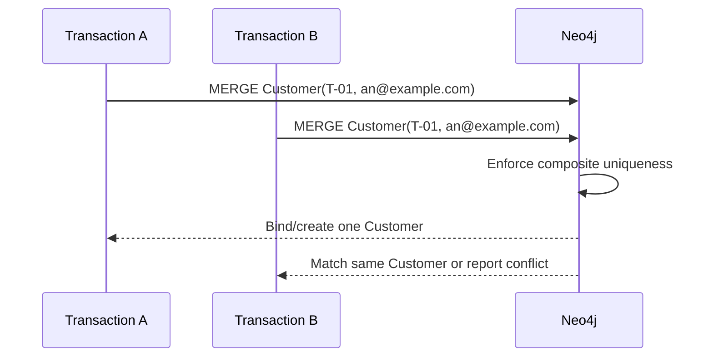

# MERGE, uniqueness constraint và yêu cầu ghi đồng thời

## Mục tiêu bài học

Trong ứng dụng dùng Spring Data Neo4j (SDN), nhiều request có thể cùng tạo hoặc cập nhật một node. Ví dụ, hai request đăng ký cùng một tài khoản, hai worker nhập cùng một khách hàng từ nguồn dữ liệu ngoài, hoặc nhiều giao dịch cùng cập nhật số lượng tồn kho. Nếu chỉ kiểm tra dữ liệu trước khi ghi, các transaction chạy đồng thời có thể cùng nhìn thấy trạng thái chưa tồn tại rồi tạo dữ liệu trùng.

Cypher cung cấp `MERGE` để tìm một pattern hoặc tạo pattern nếu chưa có. Tuy nhiên, `MERGE` không tự thay thế các ràng buộc dữ liệu và cơ chế kiểm soát đồng thời. Muốn bảo đảm một định danh chỉ xuất hiện một lần, cần kết hợp pattern `MERGE` đúng với uniqueness constraint. Với thao tác cập nhật cùng một node, cần hiểu thêm lock, lost update, optimistic locking và deadlock.

Bài học này trình bày cách thiết kế khóa định danh, tạo constraint, viết `MERGE` an toàn, xử lý nhiều transaction đồng thời và kiểm thử các tình huống tranh chấp trong ứng dụng SDN.

## 1. Vì sao MERGE cần uniqueness constraint?

`MERGE` kết hợp hành vi của `MATCH` và `CREATE`:

- Nếu pattern chính xác đã tồn tại, `MERGE` khớp pattern đó và gán vào biến.
- Nếu pattern không tồn tại, `MERGE` tạo pattern rồi gán vào biến.
- `ON CREATE` và `ON MATCH` cho phép thực hiện các cập nhật khác nhau tùy kết quả khớp hay tạo mới.

Ví dụ, tìm hoặc tạo khách hàng theo email:

```cypher
MERGE (c:Customer {email: $email})
RETURN c
```

Khi chạy tuần tự, lần đầu có thể tạo node; lần tiếp theo với cùng email sẽ tìm thấy node đã có. Nhưng trong tải đồng thời, hai transaction có thể cùng kiểm tra khi node chưa tồn tại. Nếu không có uniqueness constraint, cả hai có thể tạo hai node cùng email.

Vì vậy, cần phân biệt hai yêu cầu:

- `MERGE` mô tả cách tìm hoặc tạo pattern.
- Uniqueness constraint buộc database không chấp nhận dữ liệu vi phạm quy tắc duy nhất, kể cả khi nhiều transaction ghi cùng lúc.

Neo4j khuyến nghị tạo constraint trên các property định danh trước khi dùng `MERGE` cho dữ liệu cần duy nhất. Constraint vừa bảo vệ tính toàn vẹn, vừa được hỗ trợ bởi index để tăng hiệu quả tìm kiếm khi merge.

## 2. Xác định property định danh ổn định

Không nên đưa mọi property của entity vào pattern `MERGE`. Pattern nên chứa các property xác định danh tính của node theo nghiệp vụ và không thay đổi trong vòng đời của nó.

Ví dụ, khách hàng được nhận diện bởi email trong phạm vi tenant:

```cypher
MERGE (c:Customer {
    tenantId: $tenantId,
    email: $email
})
ON CREATE SET c.createdAt = datetime()
SET c.name = $name,
    c.updatedAt = datetime()
RETURN c
```

Trong ví dụ:

- `tenantId` và `email` xác định danh tính khách hàng.
- `name` là dữ liệu có thể thay đổi nên được cập nhật bằng `SET`.
- `createdAt` chỉ được đặt khi node được tạo.
- `updatedAt` được cập nhật khi query chạy.

Nếu đưa `name` vào pattern:

```cypher
MERGE (c:Customer {
    tenantId: $tenantId,
    email: $email,
    name: $name
})
RETURN c
```

khi tên thay đổi, pattern không còn khớp node cũ. Neo4j có thể tạo node khác thay vì cập nhật khách hàng hiện có. Đây là lỗi mô hình hóa identity thường gặp.

Quy tắc thực hành:

1. Chọn property hoặc tổ hợp property đại diện cho định danh nghiệp vụ.
2. Bảo đảm các giá trị định danh được cung cấp và không null.
3. Tạo uniqueness constraint tương ứng.
4. Chỉ đưa các property định danh vào pattern `MERGE`.
5. Đưa property có thể thay đổi vào `ON CREATE`, `ON MATCH` hoặc `SET`.

Trong entity SDN, `@Id` xác định identity mà mapping sử dụng, nhưng không nên giả định annotation này tự tạo uniqueness constraint trong Neo4j. Constraint là quy tắc schema của database; hãy triển khai nó bằng migration hoặc lệnh Cypher quản lý schema. Nếu dùng ID do ứng dụng cấp làm khóa merge, hãy tạo constraint cho property ID đó.

`MERGE` không chấp nhận giá trị property `null` trong pattern. Nếu `email` hoặc `tenantId` có thể thiếu, hãy xác thực đầu vào trước khi chạy query và xác định rõ chính sách định danh cho trường hợp đó.

## 3. Tạo uniqueness constraint cho node

Với email duy nhất trên toàn bộ label `Customer`, tạo constraint:

```cypher
CREATE CONSTRAINT customer_email_unique IF NOT EXISTS
FOR (c:Customer)
REQUIRE c.email IS UNIQUE;
```

Với hệ thống multi-tenant, email có thể trùng giữa hai tenant nhưng không được trùng trong cùng tenant. Khi đó dùng composite uniqueness constraint:

```cypher
CREATE CONSTRAINT customer_tenant_email_unique IF NOT EXISTS
FOR (c:Customer)
REQUIRE (c.tenantId, c.email) IS UNIQUE;
```

Constraint composite bảo đảm tổ hợp `tenantId + email` là duy nhất trong các node mang label `Customer`. Cùng một email ở hai tenant khác nhau vẫn có thể tồn tại.

Có thể kiểm tra constraint đã được tạo:

```cypher
SHOW CONSTRAINTS;
```

Các lệnh tạo constraint thường được quản lý qua migration hoặc quy trình triển khai schema. Không nên để mỗi request nghiệp vụ tự tạo constraint trong lúc chạy.

### Uniqueness constraint không tự bắt buộc property phải tồn tại

Property uniqueness constraint bảo đảm giá trị không trùng khi property có mặt, nhưng không yêu cầu mọi node mang label phải có property đó. Node thiếu một property trong tập constraint có thể nằm ngoài phạm vi bảo đảm duy nhất.

Nếu cần vừa bắt buộc property tồn tại vừa duy nhất, hãy xem xét key constraint khi edition và phiên bản Neo4j hỗ trợ. Key constraint là tính năng Enterprise; property existence constraint cũng phụ thuộc edition. Nếu không có loại constraint phù hợp, cần xác thực bắt buộc ở tầng ứng dụng và kiểm tra dữ liệu trong quy trình nhập.

Ví dụ key constraint trên node:

```cypher
CREATE CONSTRAINT customer_external_id_key IF NOT EXISTS
FOR (c:Customer)
REQUIRE c.externalId IS NODE KEY;
```

Trước khi dùng cú pháp này, xác nhận Neo4j edition có hỗ trợ node key constraint. Với nhiều hệ thống, property uniqueness constraint kết hợp validation đầu vào đã đáp ứng yêu cầu.

### Xử lý dữ liệu trùng trước khi tạo constraint

Nếu graph đã có dữ liệu trùng, việc tạo uniqueness constraint sẽ thất bại. Hãy phát hiện các nhóm trùng trước:

```cypher
MATCH (c:Customer)
WHERE c.tenantId IS NOT NULL
  AND c.email IS NOT NULL
WITH c.tenantId AS tenantId,
     c.email AS email,
     count(*) AS occurrences
WHERE occurrences > 1
RETURN tenantId, email, occurrences
ORDER BY occurrences DESC;
```

Sau khi phát hiện, cần quyết định node nào được giữ, node nào cần hợp nhất relationship và dữ liệu nào cần di chuyển. Không xóa node trùng một cách máy móc vì các node đó có thể đang có những relationship khác nhau.

Tạo constraint là thao tác schema có thể phải quét dữ liệu hiện có và mất thời gian. Hãy chạy migration trong cửa sổ triển khai phù hợp và xác minh kết quả sau khi tạo.

## 4. MERGE cùng uniqueness constraint khi có request đồng thời

Giả sử hai request cùng đăng ký khách hàng có `tenantId = T-01` và `email = an@example.com`.



Khi composite uniqueness constraint tồn tại, Neo4j bảo vệ tổ hợp định danh khỏi việc tạo hai node trùng. Database phối hợp các thao tác cạnh tranh dựa trên constraint/index; transaction có thể phải chờ hoặc nhận lỗi xung đột tùy tình huống và trạng thái commit.

Điểm quan trọng là ứng dụng không được tự giả định hai request luôn nhận cùng một kết quả ngay lập tức. Cần xử lý kết quả hoặc lỗi theo hợp đồng nghiệp vụ: đọc lại node theo khóa duy nhất nếu cần, hoặc retry transaction khi lỗi được xác định là transient và có thể retry an toàn.

Nếu không có constraint, `MERGE` một mình không đủ để bảo đảm node duy nhất dưới tải ghi đồng thời. Đây là lý do cần bảo vệ định danh ngay ở database thay vì chỉ kiểm tra ở service.

## 5. Viết MERGE với ON CREATE và ON MATCH

Một mẫu upsert thường dùng:

```cypher
MERGE (c:Customer {
    tenantId: $tenantId,
    email: $email
})
ON CREATE SET
    c.createdAt = datetime(),
    c.registrationSource = $source
ON MATCH SET
    c.lastSeenAt = datetime()
SET
    c.name = $name,
    c.updatedAt = datetime()
RETURN c
```

Ý nghĩa:

- `ON CREATE SET` chỉ chạy khi node mới được tạo.
- `ON MATCH SET` chỉ chạy khi pattern đã khớp.
- `SET` sau hai nhánh chạy cho cả node mới và node đã có.

Không nên đặt property mutable vào pattern định danh. Nếu cần cập nhật chúng, dùng `SET` sau `MERGE` hoặc nhánh `ON MATCH`.

Cũng cần phân biệt idempotency của việc tạo node với idempotency của toàn bộ nghiệp vụ. `MERGE` cùng constraint giúp tránh tạo node trùng, nhưng `ON MATCH SET c.lastSeenAt = datetime()` vẫn thay đổi dữ liệu ở mỗi lần retry. Nếu nghiệp vụ cần một thao tác có thể chạy lại mà không tạo side effect lặp, hãy thiết kế các cập nhật và event đi kèm theo khóa idempotency riêng.

## 6. MERGE trên full pattern và nguy cơ tạo node ngoài ý muốn

Khi dùng `MERGE` trên một pattern gồm nhiều node và relationship, Neo4j tìm hoặc tạo toàn bộ pattern. Nó không tự ghép một phần pattern đã có với phần còn thiếu theo cách người viết có thể mong đợi.

Ví dụ:

```cypher
MERGE (c:Customer {email: $email})
      -[:PLACED]->
      (o:Order {externalId: $orderId})
RETURN c, o
```

Nếu node Customer đã tồn tại nhưng Order chưa tồn tại, toàn bộ pattern không khớp nên `MERGE` có thể cố tạo cả pattern mới. Khi đã có uniqueness constraint trên email, phần Customer mới xung đột với node cũ và query có thể thất bại thay vì tự ghép node cũ vào pattern. Để kiểm soát rõ từng thực thể, tách thành các bước:

```cypher
MERGE (c:Customer {email: $email})
MERGE (o:Order {externalId: $orderId})
MERGE (c)-[:PLACED]->(o)
RETURN c, o
```

Mỗi node có khóa định danh riêng và cần uniqueness constraint tương ứng. Relationship được merge sau khi hai endpoint đã được bind.

Cách tách này giúp query rõ ràng hơn và tránh dùng thuộc tính của node khác làm một phần của pattern identity. Nếu nhiều transaction cùng thao tác với nhiều node, hãy thống nhất thứ tự xử lý để giảm khả năng deadlock.

## 7. MERGE relationship giữa hai node đã được MATCH

Có một điểm quan trọng cần phân biệt giữa merge node và merge relationship.

Với node, hãy dùng uniqueness constraint trên property định danh để bảo vệ trước concurrent creation.

Với relationship giữa hai endpoint đã được tìm và bind trước, Neo4j có cơ chế locking riêng cho `MERGE`. Ví dụ:

```cypher
MATCH (c:Customer {externalId: $customerId})
MATCH (g:Group {externalId: $groupId})
MERGE (c)-[r:MEMBER_OF]->(g)
ON CREATE SET r.createdAt = datetime()
RETURN r
```

Trong trường hợp này, hai endpoint `c` và `g` đã được MATCH trước khi merge relationship. Khi chưa có relationship, Neo4j lấy exclusive lock trên hai node đầu cuối rồi kiểm tra lại pattern để xử lý race condition. Cơ chế đó tuần tự hóa các thao tác merge relationship đồng thời trên cùng hai endpoint.

Đây là hành vi riêng của mẫu relationship MERGE với hai endpoint đã bind. Không suy rộng rằng mọi pattern MERGE phức tạp đều tự bảo đảm uniqueness của tất cả node bên trong.

Cypher không có constraint tổng quát chỉ giới hạn một relationship theo cặp endpoint và type. Nếu domain cần định danh riêng cho từng relationship, có thể gán một property ID cho relationship và tạo uniqueness constraint trên property đó nếu phiên bản Neo4j hỗ trợ relationship uniqueness constraints:

```cypher
CREATE CONSTRAINT membership_link_id_unique IF NOT EXISTS
FOR ()-[r:MEMBER_OF]-()
REQUIRE r.linkId IS UNIQUE;
```

Constraint này bảo đảm `linkId` duy nhất trong các relationship type `MEMBER_OF`; nó không tự diễn đạt quy tắc duy nhất theo cặp node nguồn/đích nếu không có một ID đại diện cho cặp đó. Nếu cùng hai node được phép có nhiều relationship `MEMBER_OF` mang ý nghĩa khác nhau, hãy mô hình hóa rõ từng loại quan hệ và định danh của chúng.

Nếu graph đã có relationship trùng, `MERGE` không tự xóa hoặc hợp nhất các cạnh trùng đó. Cần kiểm tra và làm sạch dữ liệu hiện tại riêng.

## 8. Uniqueness constraint không thay thế kiểm soát lost update

Constraint ngăn dữ liệu vi phạm quy tắc duy nhất. Nó không giải quyết mọi xung đột khi nhiều transaction cùng cập nhật property trên một node đã tồn tại.

Ví dụ, tồn kho hiện là 10. Hai request cùng đọc giá trị 10, mỗi request giảm 3, rồi ghi lại 7. Nếu cả hai ghi dựa trên giá trị đã đọc trước đó, kết quả cuối có thể là 7 thay vì 4. Đây là lost update.

Với một phép cập nhật số học trực tiếp trên cùng property, Cypher có thể lấy write lock trước khi đọc giá trị bên phải của phép gán:

```cypher
MATCH (i:Inventory {sku: $sku})
SET i.reserved = i.reserved + $quantity
RETURN i.reserved AS reserved
```

Biểu thức `i.reserved + $quantity` có phụ thuộc trực tiếp vào property đang cập nhật, cho phép Neo4j áp dụng locking để tránh lost update cho kiểu cập nhật này.

Ngược lại, nếu query đọc property ở một mệnh đề trước rồi đưa giá trị đó vào biến, sau đó mới ghi, lock tự động có thể không được lấy trước khi đọc. Khi đó, cần thiết kế lại thao tác hoặc dùng cơ chế khóa/optimistic locking phù hợp.

Đừng thay thế một phép cập nhật nguyên tử bằng quy trình “đọc entity vào Java, tính giá trị mới, rồi save” khi nhiều request có thể cập nhật cùng một bản ghi. Hãy xác định rõ invariant cần giữ và chọn cách cập nhật phù hợp.

## 9. Optimistic locking với @Version trong SDN

Spring Data Neo4j hỗ trợ optimistic locking qua `@Version`. Cách này hữu ích khi ứng dụng đọc entity, xử lý trong Java rồi lưu lại, đồng thời muốn phát hiện một transaction khác đã cập nhật entity trong lúc đó.

```java
import org.springframework.data.annotation.Version;
import org.springframework.data.neo4j.core.schema.Id;
import org.springframework.data.neo4j.core.schema.Node;

@Node("Inventory")
public class Inventory {

    @Id
    private String sku;

    @Version
    private Long version;

    private long available;

    // Constructor, getter và setter được lược bỏ.
}
```

SDN quản lý version khi lưu entity. Nếu hai transaction đọc cùng một version, transaction lưu trước cập nhật version. Khi transaction còn lại cố lưu một bản entity cũ, SDN phát hiện version không còn khớp và báo lỗi optimistic locking, thường được biểu diễn bằng `OptimisticLockingFailureException`.

Ứng dụng có thể xử lý bằng cách đọc lại entity mới nhất, tính lại thay đổi và thử lại nếu nghiệp vụ cho phép. Không nên tự động ghi đè bản mới bằng dữ liệu cũ vì như vậy sẽ loại bỏ mục đích của optimistic locking.

Phân biệt:

| Cơ chế | Bảo vệ điều gì? |
|---|---|
| Uniqueness constraint | Không cho phép hai node/relationship có cùng property định danh trong phạm vi constraint |
| `MERGE` | Tìm hoặc tạo pattern; kết hợp constraint để bảo vệ node identity khi ghi đồng thời |
| `@Version` | Phát hiện entity đã bị thay đổi kể từ lúc được đọc trước khi SDN lưu |
| Transaction | Gom thao tác thành đơn vị commit/rollback |
| Lock | Điều phối các thao tác ghi cạnh tranh trên cùng dữ liệu |

`@Version` áp dụng cho luồng persistence entity được SDN quản lý. Custom Cypher tự ghi entity không tự động được bảo vệ theo cùng cách; nếu query custom cần optimistic locking, phải tự đưa version mong đợi vào điều kiện và tăng version trong cùng câu lệnh.

Ví dụ ý tưởng cho custom Cypher:

```cypher
MATCH (i:Inventory {sku: $sku})
WHERE i.version = $expectedVersion
SET i.available = $available,
    i.version = i.version + 1
RETURN i
```

Nếu không có record trả về, service cần phân biệt entity không tồn tại với version đã thay đổi, thường bằng một bước đọc kiểm tra hoặc một quy tắc lỗi thống nhất.

## 10. Transaction trong ứng dụng SDN

`@Transactional` ở service giúp các thao tác repository hoặc `Neo4jClient` tham gia cùng transaction Neo4j khi dùng đúng transaction manager.

```java
import org.springframework.stereotype.Service;
import org.springframework.transaction.annotation.Transactional;

@Service
public class CustomerRegistrationService {

    private final CustomerRepository customerRepository;

    public CustomerRegistrationService(
            CustomerRepository customerRepository) {
        this.customerRepository = customerRepository;
    }

    @Transactional
    public Customer register(
            String tenantId,
            String email,
            String name) {
        return customerRepository.upsert(
                tenantId, email, name);
    }
}
```

Repository có custom query:

```java
import org.springframework.data.neo4j.repository.query.Query;
import org.springframework.data.neo4j.repository.Neo4jRepository;
import org.springframework.data.repository.query.Param;

public interface CustomerRepository
        extends Neo4jRepository<Customer, String> {

    @Query("MERGE (c:Customer {tenantId: $tenantId, email: $email}) " +
           "ON CREATE SET c.createdAt = datetime() " +
           "SET c.name = $name, c.updatedAt = datetime() " +
           "RETURN c")
    Customer upsert(
            @Param("tenantId") String tenantId,
            @Param("email") String email,
            @Param("name") String name);
}
```

Đảm bảo uniqueness constraint composite trên `Customer(tenantId, email)` đã được triển khai. Nếu không, transaction annotation không tự ngăn hai request tạo node trùng.

Neo4j mặc định dùng read-committed isolation. Một transaction đọc node không tự động ngăn transaction khác ghi node đó trước khi transaction đầu kết thúc. Do đó:

- Transaction bảo đảm nhóm thao tác commit/rollback theo ranh giới đã chọn.
- Constraint bảo vệ quy tắc dữ liệu như uniqueness.
- Lock và optimistic locking giải quyết các dạng tranh chấp cập nhật cụ thể.
- Không nên giả định chỉ cần thêm `@Transactional` là mọi thao tác đồng thời đã được tuần tự hóa.

Khi ứng dụng có nhiều transaction manager, cần bảo đảm service dùng manager quản lý Neo4j. Cũng cần nhớ lời gọi nội bộ trong cùng bean có thể bỏ qua proxy transaction ở proxy mode; hãy đặt ranh giới transaction tại method được gọi qua Spring proxy hoặc dùng API transaction tường minh.

## 11. Deadlock, lock contention và retry

Khi nhiều transaction cập nhật cùng node hoặc relationship, một transaction có thể phải chờ lock do transaction khác giữ. Nếu các transaction giữ lock theo thứ tự khác nhau và chờ lẫn nhau, deadlock có thể xảy ra.

Ví dụ:

- Transaction A khóa node Customer rồi chờ node Account.
- Transaction B khóa node Account rồi chờ node Customer.
- Không transaction nào có thể tiếp tục cho đến khi Neo4j phát hiện deadlock và hủy một transaction.

Để giảm deadlock:

1. Giữ transaction ngắn, không thực hiện gọi mạng hoặc xử lý lâu khi đang giữ lock.
2. Cập nhật nhiều node theo cùng một thứ tự ổn định.
3. Tránh để nhiều request cùng ghi một node nóng nếu có thể phân vùng hoặc tuần tự hóa nghiệp vụ.
4. Chỉ dùng `MERGE` ở nơi cần ngữ nghĩa tìm-hoặc-tạo; tránh dùng nó tràn lan cho các thao tác luôn tạo mới và đã có quy tắc định danh khác.
5. Theo dõi lock wait, deadlock và các transaction bị hủy.

Neo4j phát hiện deadlock và hủy một transaction với lỗi transient. Ứng dụng có thể retry công việc đã bị hủy, nhưng nên:

- Giới hạn số lần retry.
- Chờ một khoảng thời gian ngắn có backoff giữa các lần thử.
- Retry toàn bộ transaction từ đầu, không tiếp tục dùng transaction đã bị rollback.
- Chỉ retry khi thao tác có thể chạy lại an toàn.
- Không retry vô hạn một lỗi dữ liệu cố định như vi phạm uniqueness do đầu vào sai.

Với lỗi uniqueness khi hai request cạnh tranh tạo cùng định danh, hãy đọc lại node theo khóa duy nhất hoặc trả kết quả phù hợp với nghiệp vụ. Đừng xử lý mọi constraint violation như deadlock transient.

## 12. Các lỗi thiết kế thường gặp

| Lỗi | Hệ quả | Cách xử lý |
|---|---|---|
| Nghĩ `MERGE` tự bảo đảm node duy nhất trong mọi concurrent write | Có thể tạo node trùng khi thiếu constraint | Tạo uniqueness constraint trên property định danh |
| Chỉ kiểm tra bằng `MATCH` rồi mới `CREATE` | Hai transaction có thể cùng thấy chưa có node | Dùng `MERGE` cùng constraint |
| Đưa tên hoặc trạng thái vào pattern định danh | Thay đổi thuộc tính có thể tạo node mới | Chỉ dùng khóa identity bất biến trong pattern |
| Không xử lý null trong khóa `MERGE` | Query có thể thất bại | Validate khóa trước khi gọi Cypher |
| Dùng uniqueness constraint nhưng không kiểm tra dữ liệu cũ | Migration constraint thất bại do dữ liệu trùng | Phát hiện và hợp nhất dữ liệu trước |
| Cho rằng constraint bắt buộc mọi node có property | Node thiếu property có thể nằm ngoài uniqueness constraint | Dùng key/existence constraint nếu được hỗ trợ hoặc validation |
| Merge full pattern khi các node cần identity độc lập | Có thể tạo pattern mới ngoài ý muốn | Tách các node thành từng `MERGE` rồi merge relationship |
| Merge relationship với endpoint chưa được bind rõ | Khó dự đoán phạm vi match và locking | MATCH endpoint trước, rồi MERGE relationship |
| Dùng `@Transactional` để ngăn mọi lost update | Transaction không tự bảo đảm serializable isolation | Dùng atomic Cypher update, @Version hoặc locking |
| Retry toàn bộ request không có idempotency | Tạo side effect lặp | Dùng idempotency key và thao tác có thể chạy lại |
| Retry lỗi constraint như lỗi transient | Lặp lại lỗi dữ liệu cố định | Phân loại exception trước khi retry |
| Cập nhật nhiều node theo thứ tự ngẫu nhiên | Tăng nguy cơ deadlock | Chuẩn hóa thứ tự lock/update |

## 13. Kiểm thử concurrent write

Một test repository thông thường chỉ chạy một transaction tại một thời điểm sẽ không phát hiện được mọi race condition. Cần có integration test dùng hai hoặc nhiều transaction độc lập thực thi gần như đồng thời trên cùng khóa định danh.

### Kiểm thử node identity

Tạo uniqueness constraint trước, sau đó:

1. Chuẩn bị một email và tenant chưa tồn tại.
2. Khởi chạy hai worker với hai transaction độc lập.
3. Cả hai cùng gọi upsert với cùng `tenantId` và `email`.
4. Chờ cả hai transaction hoàn tất.
5. Đếm node Customer theo tổ hợp định danh.
6. Xác nhận chỉ có một node.
7. Xác nhận kết quả hoặc lỗi của mỗi request được xử lý theo hợp đồng service.

Query kiểm tra:

```cypher
MATCH (c:Customer {
    tenantId: $tenantId,
    email: $email
})
RETURN count(c) AS customerCount
```

Kỳ vọng `customerCount = 1`.

### Kiểm thử relationship merge

Tạo trước hai endpoint node, sau đó cho hai transaction cùng chạy:

```cypher
MATCH (c:Customer {externalId: $customerId})
MATCH (g:Group {externalId: $groupId})
MERGE (c)-[:MEMBER_OF]->(g)
```

Sau khi hoàn tất, kiểm tra số relationship `MEMBER_OF` giữa hai endpoint. Test cần dùng endpoint đã tồn tại và bind trước để kiểm tra đúng cơ chế locking merge của Neo4j.

### Kiểm thử optimistic locking và lost update

1. Đọc cùng một entity Inventory ở hai transaction.
2. Thay đổi cả hai bản entity độc lập.
3. Lưu bản thứ nhất.
4. Thử lưu bản thứ hai với version cũ.
5. Xác nhận SDN phát hiện optimistic locking conflict.
6. Đọc lại entity mới nhất và kiểm tra version cùng giá trị.

Nếu test cập nhật counter bằng custom Cypher, chạy nhiều transaction tăng giá trị và xác nhận tổng cuối đúng với số lần tăng. So sánh cách cập nhật trực tiếp `SET n.value = n.value + $delta` với cách đọc giá trị ra ứng dụng rồi ghi lại.

Không nên dùng một transaction test bao ngoài toàn bộ test method nếu mục tiêu là kiểm tra hai transaction độc lập. Cần bảo đảm các worker thực sự dùng connection/transaction riêng và dữ liệu test được dọn dẹp sau khi kiểm thử.

## 14. Quy trình triển khai an toàn

Khi thêm một luồng ghi đồng thời vào hệ thống:

1. Xác định identity của node hoặc relationship.
2. Kiểm tra identity có thể null hay thay đổi không.
3. Dọn dữ liệu trùng hiện có.
4. Tạo uniqueness constraint hoặc key constraint phù hợp với edition.
5. Viết `MERGE` chỉ dựa trên khóa identity.
6. Đưa thuộc tính mutable vào các nhánh cập nhật.
7. Chọn transaction boundary cho toàn bộ nghiệp vụ.
8. Chọn cơ chế xử lý lost update: atomic Cypher update, `@Version` hoặc locking.
9. Thiết kế retry giới hạn cho lỗi transient và deadlock.
10. Kiểm thử nhiều transaction độc lập cùng ghi một định danh.
11. Theo dõi constraint violation, deadlock và lock wait trong môi trường chạy thật.

Hãy ghi rõ quy tắc sở hữu dữ liệu. Ví dụ, service đăng ký khách hàng có thể sở hữu node Customer và email identity, còn service nhóm sở hữu relationship MEMBER_OF. Việc xác định nơi ghi chính thức giúp tránh nhiều luồng cùng cập nhật một property theo các quy tắc khác nhau.

## 15. Tự kiểm tra

1. Vì sao `MERGE` không tự bảo đảm uniqueness của node trong mọi concurrent write?
2. Uniqueness constraint bảo vệ điều gì khi hai transaction cùng tạo một node?
3. Vì sao property mutable như `name` không nên nằm trong pattern identity của `MERGE`?
4. Composite uniqueness constraint phù hợp với mô hình multi-tenant như thế nào?
5. Property uniqueness constraint có bắt buộc mọi node phải có property không?
6. Vì sao cần tách từng node thành các `MERGE` riêng khi full pattern có thể khớp một phần?
7. Cơ chế locking nào được áp dụng khi MERGE relationship giữa hai endpoint đã MATCH?
8. `@Version` khác uniqueness constraint ở mục tiêu bảo vệ như thế nào?
9. Vì sao `@Transactional` không tự giải quyết mọi lost update?
10. Làm thế nào để retry deadlock mà không lặp side effect?
11. Vì sao test concurrency cần nhiều transaction độc lập?
12. Khi nào nên dùng atomic Cypher update thay vì đọc entity rồi save?

Hãy xây dựng `Customer` với định danh composite `tenantId + email`. Tạo uniqueness constraint, viết repository upsert bằng `MERGE` và cập nhật `name` ngoài pattern identity. Chạy hai transaction độc lập cùng đăng ký một khách hàng và xác nhận graph chỉ có một node. Tiếp theo, tạo hai node endpoint rồi merge cùng relationship `MEMBER_OF` đồng thời. Cuối cùng, thêm `@Version` vào entity Inventory và kiểm thử hai transaction cùng cập nhật một bản entity để quan sát optimistic locking.

## Tài liệu tham khảo

- [Neo4j Cypher Manual — MERGE](https://neo4j.com/docs/cypher-manual/current/clauses/merge/)
- [Neo4j Cypher Manual — Constraints](https://neo4j.com/docs/cypher-manual/current/schema/constraints/)
- [Neo4j Cypher Manual — Create constraints](https://neo4j.com/docs/cypher-manual/current/schema/syntax/)
- [Neo4j Operations Manual — Concurrent data access](https://neo4j.com/docs/operations-manual/current/database-internals/concurrent-data-access/)
- [Spring Data Neo4j — Object mapping and version properties](https://docs.spring.io/spring-data/neo4j/reference/object-mapping.html)
