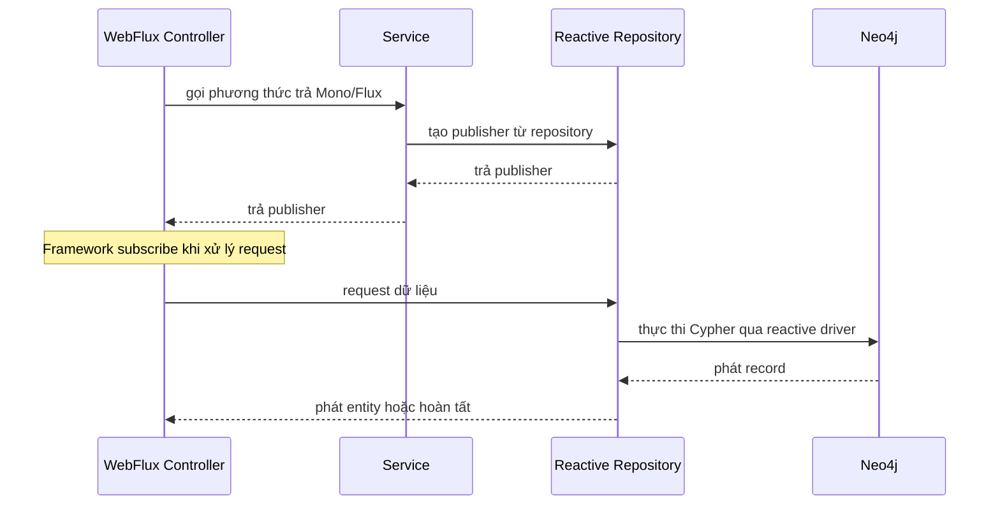

# Tránh block, subscribe thủ công và lẫn API đồng bộ trong chuỗi reactive

Spring Data Neo4j (SDN) hỗ trợ truy cập Neo4j theo kiểu reactive thông qua Reactor, reactive repositories, ReactiveNeo4jTemplate và ReactiveNeo4jClient. Các API này trả về Mono hoặc Flux, cho phép ứng dụng mô tả một luồng thao tác bất đồng bộ mà không phải chặn thread để đợi kết quả.

Để giữ được lợi ích đó, toàn bộ luồng cần được nối với nhau và trả về cho framework quản lý. Nếu gọi block(), tự subscribe() ở giữa service hoặc gọi repository đồng bộ trong một toán tử reactive, ứng dụng có thể chặn event-loop, làm mất transaction context và khiến lỗi hoặc vòng đời xử lý khó kiểm soát.

Bài học tập trung vào ba lỗi dễ gặp: chặn luồng bằng block(), tách luồng bằng subscribe() thủ công và trộn API imperative vào reactive pipeline.

## 1. Reactive access hoạt động như thế nào?

Trong mô hình imperative, một lời gọi repository thường đợi database trả kết quả rồi mới trả Movie hoặc List<Movie>. Trong mô hình reactive, phương thức trả về một publisher mô tả công việc sẽ thực hiện khi có subscriber.

| Kiểu Reactor | Ý nghĩa | Ví dụ trong SDN |
|---|---|---|
| Mono<T> | Không có hoặc có một phần tử kiểu T | Tìm một phim, lưu một entity |
| Flux<T> | Không có, một hoặc nhiều phần tử kiểu T | Tìm nhiều phim, stream danh sách kết quả |
| Mono<Void> | Chỉ báo hiệu hoàn tất hoặc lỗi, không phát dữ liệu | Xóa entity, ghi thao tác không cần kết quả |

Khi gọi một reactive repository hoặc client, thường mới chỉ tạo publisher. Truy vấn được thực thi khi subscriber yêu cầu dữ liệu. Vì vậy, nếu một method tạo Mono<Movie> nhưng không trả nó cho caller, cũng không có thành phần nào subscribe, thao tác database có thể chưa bao giờ xảy ra.



Reactive không có nghĩa mọi thao tác Java tự động trở nên bất đồng bộ. Chỉ các API được thiết kế reactive mới thực hiện I/O theo cách đó. Một lời gọi đồng bộ đặt bên trong map vẫn chặn thread đang chạy pipeline.

## 2. Dùng ReactiveNeo4jRepository thay cho repository đồng bộ

Khai báo repository reactive bằng ReactiveNeo4jRepository:

```java
import org.springframework.data.neo4j.repository.ReactiveNeo4jRepository;
import reactor.core.publisher.Flux;
import reactor.core.publisher.Mono;

public interface MovieRepository
        extends ReactiveNeo4jRepository<Movie, String> {

    Flux<Movie> findByStatus(String status);

    Mono<Movie> findOneByTitle(String title);
}
```

Các phương thức tìm một entity trả Mono<Movie>, còn phương thức có thể trả nhiều entity trả Flux<Movie>. Các thao tác CRUD cũng dùng kiểu reactive, ví dụ findById trả Mono<Movie>, save trả Mono<Movie> và deleteById trả Mono<Void>.

Một service chỉ cần trả tiếp publisher:

```java
@Service
public class MovieQueryService {

    private final MovieRepository movieRepository;

    public MovieQueryService(MovieRepository movieRepository) {
        this.movieRepository = movieRepository;
    }

    public Mono<Movie> findById(String id) {
        return movieRepository.findById(id);
    }

    public Flux<Movie> findPublishedMovies() {
        return movieRepository.findByStatus("PUBLISHED");
    }
}
```

Service không cần tự subscribe hoặc chờ kết quả. Caller quyết định cách kết hợp publisher; WebFlux có thể nhận trực tiếp Mono hoặc Flux từ controller.

## 3. Không gọi block() trong reactive pipeline

block() đăng ký subscriber và chờ kết quả đồng bộ. Khi gọi nó trên thread xử lý reactive, thread đó bị giữ lại cho đến khi publisher hoàn tất hoặc timeout. Nếu thread bị chặn là event-loop của WebFlux, các request khác có thể phải chờ cùng event-loop đó.

Ví dụ sai:

```java
public Movie findMovie(String id) {
    return movieRepository.findById(id).block();
}
```

Method này biến thao tác reactive thành đồng bộ. Nó cũng buộc caller phải nhận Movie ngay lập tức, làm mất khả năng nối luồng với các thao tác bất đồng bộ khác.

Phiên bản đúng:

```java
public Mono<Movie> findMovie(String id) {
    return movieRepository.findById(id);
}
```

Nếu cần biến đổi entity:

```java
public Mono<MovieDetails> findDetails(String id) {
    return movieRepository.findById(id)
            .map(movie -> new MovieDetails(
                    movie.getId(),
                    movie.getTitle(),
                    movie.getStatus()));
}
```

map thực hiện phép biến đổi đồng bộ trên phần tử đã phát. Không cần chặn thread để lấy entity trước rồi mới tạo DTO.

Những lời gọi sau cũng có tác dụng chặn hoặc chờ đồng bộ và cần tránh trong event-loop:

- block(), blockOptional(), blockFirst() và blockLast().
- Future.get() hoặc join() trên một tác vụ chưa hoàn tất.
- Thread.sleep(...).
- Gọi API JDBC, file I/O hoặc HTTP client đồng bộ trong map/flatMap.
- Chuyển publisher thành collection bằng một thao tác chờ đồng bộ.

Đừng dùng Mono.just(repository.findById(id)) để biến lời gọi repository đồng bộ thành reactive. Lời gọi đồng bộ đã chạy trước khi Mono.just được tạo; publisher lúc này chỉ chứa kết quả có sẵn.

## 4. Không subscribe() thủ công giữa service

subscribe() khởi động một luồng xử lý tách khỏi luồng mà caller đang quản lý. Khi service tự subscribe, caller không còn nhận được publisher đại diện cho toàn bộ công việc đó.

Ví dụ sai:

```java
public void publish(String movieId) {
    movieRepository.findById(movieId)
            .flatMap(movie -> {
                movie.publish();
                return movieRepository.save(movie);
            })
            .subscribe();
}
```

Đoạn code trên có một số vấn đề:

- Method trả về ngay, không cho caller biết database đã lưu xong hay chưa.
- Lỗi xảy ra sau subscribe() không đi theo error signal của request đang xử lý.
- Transaction được mở ở tầng service gọi bên ngoài có thể kết thúc trước khi publisher con hoàn tất.
- Caller không thể ghép thao tác này với bước tiếp theo một cách có kiểm soát.

Hãy trả publisher ra ngoài:

```java
public Mono<Movie> publish(String movieId) {
    return movieRepository.findById(movieId)
            .switchIfEmpty(Mono.error(
                    new IllegalArgumentException("Movie not found")))
            .flatMap(movie -> {
                movie.publish();
                return movieRepository.save(movie);
            });
}
```

Publisher trả về biểu diễn cả chuỗi tìm, thay đổi và lưu. Caller có thể nối thêm bước audit, trả response hoặc xử lý lỗi mà không mất tín hiệu hoàn tất.

subscribe() vẫn có chỗ dùng ở ranh giới ứng dụng, chẳng hạn một chương trình độc lập tự quản lý vòng đời hoặc một thành phần tiêu thụ event được thiết kế rõ ràng. Trong WebFlux controller, service và repository thông thường, hãy để framework subscribe.

## 5. Để WebFlux quản lý subscription ở ranh giới HTTP

Controller reactive trả trực tiếp Mono hoặc Flux:

```java
@RestController
@RequestMapping("/movies")
public class MovieController {

    private final MovieQueryService movieQueryService;

    public MovieController(MovieQueryService movieQueryService) {
        this.movieQueryService = movieQueryService;
    }

    @GetMapping("/{id}")
    public Mono<Movie> getMovie(@PathVariable String id) {
        return movieQueryService.findById(id);
    }

    @GetMapping
    public Flux<Movie> getPublishedMovies() {
        return movieQueryService.findPublishedMovies();
    }
}
```

WebFlux quản lý subscription và ghi dữ liệu ra response theo publisher. Nếu Mono rỗng, có thể ánh xạ thành HTTP 404 bằng một lớp xử lý lỗi hoặc switchIfEmpty phù hợp. Không gọi subscribe() trong controller rồi trả về void, vì khi đó framework không còn publisher để theo dõi kết quả.

Trong ứng dụng Spring MVC đồng bộ, kiểu trả về và vòng đời request khác WebFlux. Không nên lấy controller MVC rồi thêm block() vào reactive repository để làm cho chữ ký có vẻ đồng bộ. Hãy chọn mô hình truy cập dữ liệu nhất quán với stack web của ứng dụng.

## 6. Phân biệt map, flatMap và các toán tử nối luồng

Một lỗi thường gặp là dùng map khi hàm bên trong trả về một publisher. Kết quả sẽ thành Mono<Mono<T>> hoặc Flux<Mono<T>>, thay vì một luồng đã được làm phẳng.

**Dùng map cho phép biến đổi đồng bộ:**

```java
Mono<MovieSummary> summary =
        movieRepository.findById(movieId)
                .map(movie -> new MovieSummary(
                        movie.getId(),
                        movie.getTitle()));
```

**Dùng flatMap khi bước tiếp theo trả về Mono:**

```java
Mono<MovieDetails> details =
        movieRepository.findById(movieId)
                .flatMap(movie ->
                        reviewRepository.findAverageScore(movieId)
                                .map(score -> new MovieDetails(
                                        movie.getId(),
                                        movie.getTitle(),
                                        score)));
```

**Dùng flatMapMany khi từ một Mono chuyển sang Flux:**

```java
Flux<Review> reviews =
        movieRepository.findById(movieId)
                .flatMapMany(movie ->
                        reviewRepository.findByMovieId(movie.getId()));
```

**Dùng then khi cần đợi thao tác trước hoàn tất rồi mới chạy thao tác sau:**

```java
Mono<Void> removeMovie(String movieId) {
    return reviewRepository.deleteByMovieId(movieId)
            .then(movieRepository.deleteById(movieId));
}
```

then bỏ qua phần tử từ publisher trước và chỉ tiếp tục sau khi publisher đó hoàn tất. Điều này thể hiện thứ tự phụ thuộc rõ ràng.

**Dùng concatMap khi cần xử lý từng phần tử tuần tự:**

```java
Flux<Movie> saved =
        Flux.fromIterable(movies)
                .concatMap(movieRepository::save);
```

flatMap có thể cho phép nhiều publisher con chạy đồng thời; concatMap giữ thứ tự xử lý lần lượt. Khi các thao tác phụ thuộc nhau hoặc cần thứ tự ghi rõ ràng, concatMap thường dễ kiểm soát hơn.

## 7. Kết hợp các truy vấn độc lập mà không block

Nếu hai truy vấn độc lập, có thể kết hợp kết quả bằng Mono.zip:

```java
public Mono<MovieDashboard> loadDashboard(String movieId) {
    Mono<Movie> movie = movieRepository.findById(movieId);
    Mono<Long> reviewCount = reviewRepository.countByMovieId(movieId);

    return Mono.zip(movie, reviewCount)
            .map(tuple -> new MovieDashboard(
                    tuple.getT1().getId(),
                    tuple.getT1().getTitle(),
                    tuple.getT2()));
}
```

zip đợi cả hai publisher phát kết quả rồi tạo một tuple. Nếu một nguồn rỗng hoặc lỗi, cần quyết định rõ hành vi mong muốn: trả rỗng, dùng giá trị mặc định hay chuyển lỗi. Không dùng zip cho bước phụ thuộc kết quả của bước trước; trường hợp đó dùng flatMap.

Trong một transaction ghi, tránh phát nhiều truy vấn ghi đồng thời trên cùng một transaction nếu thứ tự hoặc tính phụ thuộc quan trọng. Dùng then, concatMap hoặc flatMap theo quan hệ phụ thuộc để biểu diễn thứ tự.

## 8. ReactiveNeo4jTemplate và ReactiveNeo4jClient

Khi không cần repository riêng cho từng entity, ReactiveNeo4jTemplate cung cấp thao tác CRUD và mapping entity dưới dạng publisher:

```java
public Mono<Movie> findMovie(String id) {
    return reactiveNeo4jTemplate.findById(id, Movie.class);
}

public Flux<Movie> findAllMovies() {
    return reactiveNeo4jTemplate.findAll(Movie.class);
}

public Mono<Movie> saveMovie(Movie movie) {
    return reactiveNeo4jTemplate.save(movie);
}
```

Các method trên trả Mono hoặc Flux, vì vậy có thể được nối trực tiếp vào service reactive.

Với truy vấn Cypher tùy chỉnh hoặc kết quả DTO, dùng ReactiveNeo4jClient:

```java
public record MovieCard(String id, String title) {
}

public Flux<MovieCard> findMovieCards(String status) {
    return reactiveNeo4jClient.query("""
            MATCH (m:Movie {status: $status})
            RETURN m.id AS id, m.title AS title
            ORDER BY m.title
            """)
            .bind(status).to("status")
            .fetchAs(MovieCard.class)
            .mappedBy((typeSystem, record) -> new MovieCard(
                    record.get("id").asString(),
                    record.get("title").asString()))
            .all();
}
```

all() trả Flux<MovieCard>. Với kết quả đơn, có thể dùng one() để nhận Mono<T>; với thao tác không cần record, dùng run() và giữ publisher kết quả. Reactive client chỉ thực thi truy vấn khi publisher được subscribe.

Không thay ReactiveNeo4jClient bằng Neo4jClient trong pipeline reactive. Hai API có cú pháp gần nhau nhưng khác nhau về execution model và kiểu kết quả.

## 9. Không trộn repository đồng bộ vào reactive stream

Giả sử ứng dụng có cả hai repository:

```java
interface MovieRepository
        extends ReactiveNeo4jRepository<Movie, String> {
}

interface LegacyMovieRepository
        extends Neo4jRepository<Movie, String> {
}
```

Gọi repository đồng bộ bên trong một toán tử reactive vẫn là thao tác đồng bộ:

```java
public Mono<Movie> findMovie(String id) {
    return reactiveMovieRepository.findById(id)
            .map(movie -> legacyMovieRepository.findById(id)
                    .orElse(movie));
}
```

legacyMovieRepository.findById(id) chặn thread ngay trong map. Nó cũng sử dụng transaction manager imperative nếu có transaction, không tự tham gia reactive transaction đang được truyền qua Reactor Context.

Trong cùng một luồng nghiệp vụ, hãy chọn một mô hình truy cập thống nhất:

| Thành phần | Imperative | Reactive |
|---|---|---|
| Repository | Neo4jRepository | ReactiveNeo4jRepository |
| Template | Neo4jTemplate | ReactiveNeo4jTemplate |
| Client | Neo4jClient | ReactiveNeo4jClient |
| Kết quả | Entity, Optional, List | Mono, Flux |
| Transaction manager | Neo4jTransactionManager | ReactiveNeo4jTransactionManager |

Nếu ứng dụng còn một hệ thống legacy đồng bộ, hãy đặt nó ở một boundary riêng và xác định rõ cách phối hợp. Không đưa nó vào reactive transaction rồi kỳ vọng hai transaction manager tự đồng bộ.

## 10. Cô lập API blocking khi chưa thể thay thế

Đôi khi ứng dụng phải gọi một thư viện cũ chưa có API bất đồng bộ. Có thể cô lập lời gọi blocking bằng Mono.fromCallable và chạy nó trên Schedulers.boundedElastic():

```java
public Mono<LegacyProfile> loadLegacyProfile(String userId) {
    return Mono.fromCallable(() -> legacyProfileClient.load(userId))
            .subscribeOn(Schedulers.boundedElastic());
}
```

fromCallable trì hoãn lời gọi đến lúc subscribe; boundedElastic chuyển phần blocking sang scheduler dành cho công việc có thể chặn. Cách này giúp tránh chặn event-loop, nhưng thao tác bên trong vẫn là blocking và vẫn tiêu thụ thread.

Chỉ dùng giải pháp này ở ranh giới tích hợp legacy khi chưa có lựa chọn non-blocking. Không dùng nó để bọc repository Neo4j đồng bộ trong một luồng reactive cần transaction Neo4j thống nhất. Thay vào đó, chuyển sang reactive repository, template hoặc client.

Lưu ý: Mono.just(legacyClient.load(id)) không trì hoãn lời gọi; biểu thức load(id) được thực thi ngay khi tạo Mono. Mono.fromCallable(...) mới trì hoãn việc gọi cho đến khi subscribe.

## 11. Reactive transaction phải theo cùng publisher chain

Reactive transaction của Spring được truyền qua Reactor Context, không dựa vào thread-local như transaction imperative thông thường. Vì vậy, các thao tác database cần cùng transaction phải nằm trong publisher chain mà Spring quản lý.

Ví dụ một nghiệp vụ xuất bản phim và ghi audit:

```java
@Service
public class MovieService {

    private final MovieRepository movieRepository;
    private final AuditRepository auditRepository;

    public MovieService(
            MovieRepository movieRepository,
            AuditRepository auditRepository) {
        this.movieRepository = movieRepository;
        this.auditRepository = auditRepository;
    }

    @Transactional
    public Mono<Movie> publish(String movieId) {
        return movieRepository.findById(movieId)
                .switchIfEmpty(Mono.error(
                        new IllegalArgumentException("Movie not found")))
                .flatMap(movie -> {
                    movie.publish();
                    return movieRepository.save(movie);
                })
                .flatMap(saved -> auditRepository
                        .recordChange(movieId, "PUBLISHED")
                        .thenReturn(saved));
    }
}
```

Method được đánh dấu @Transactional và trả Mono<Movie>. Spring reactive transaction interceptor giữ transaction mở theo vòng đời publisher. Nếu bước lưu audit phát lỗi làm transaction rollback, thay đổi phim trong cùng transaction cũng được hoàn tác.

Không viết:

```java
@Transactional
public void publish(String movieId) {
    movieRepository.findById(movieId)
            .flatMap(movieRepository::save)
            .subscribe();
}
```

Method void kết thúc trước khi publisher hoàn tất; subscription tự tạo không nằm trong vòng đời reactive mà interceptor quản lý. Cũng không gọi subscribe() ở giữa một method transactional rồi mong các bước sau dùng lại transaction đó.

Để transaction hoạt động, ứng dụng cần ReactiveNeo4jTransactionManager. Khi dùng cấu hình SDN không có Spring Boot, hạ tầng reactive có thể được thiết lập bằng AbstractReactiveNeo4jConfig cùng @EnableReactiveNeo4jRepositories và transaction management. Với Spring Boot, kiểm tra bean và cấu hình thực tế theo phiên bản đang dùng; không giả định một Neo4jTransactionManager imperative có thể thay thế reactive manager.

Nếu tự tạo ReactiveNeo4jClient và transaction manager, hãy dùng cùng một Driver instance để client tham gia transaction do Spring quản lý.

## 12. Backpressure và xử lý danh sách lớn

Flux hỗ trợ backpressure: subscriber có thể yêu cầu số phần tử mà nó sẵn sàng xử lý. Hãy giữ dữ liệu ở dạng stream khi caller có thể xử lý từng phần tử:

```java
public Flux<MovieSummary> streamSummaries() {
    return movieRepository.findAll()
            .map(movie -> new MovieSummary(
                    movie.getId(),
                    movie.getTitle()));
}
```

Không chuyển một kết quả lớn thành List chỉ để dùng lại một toán tử:

```java
// Chỉ dùng collectList khi thật sự cần toàn bộ tập kết quả trong bộ nhớ.
public Mono<List<Movie>> loadAllMovies() {
    return movieRepository.findAll().collectList();
}
```

collectList() đợi toàn bộ Flux hoàn tất và giữ tất cả phần tử trong bộ nhớ. Với graph lớn, nên phân trang hoặc xử lý theo lô, giới hạn số kết quả ở Cypher và chỉ gom danh sách khi kích thước đã được kiểm soát.

Backpressure không thay thế thiết kế truy vấn tốt. Hãy chọn property cần trả về, dùng index phù hợp, tránh tải entity graph quá lớn và không tạo một truy vấn trả về số lượng node không giới hạn nếu caller không cần.

## 13. Xử lý empty và error bằng tín hiệu reactive

Reactive pipeline biểu diễn ba tình huống khác nhau:

- Có phần tử: publisher phát dữ liệu.
- Không có phần tử: Mono hoàn tất mà không phát dữ liệu.
- Có lỗi: publisher phát error signal.

Dùng switchIfEmpty để xử lý trường hợp không tìm thấy entity:

```java
public Mono<Movie> requireMovie(String id) {
    return movieRepository.findById(id)
            .switchIfEmpty(Mono.error(
                    new MovieNotFoundException(id)));
}
```

Dùng onErrorMap để chuyển lỗi ở boundary:

```java
public Mono<Movie> save(Movie movie) {
    return movieRepository.save(movie)
            .onErrorMap(
                    DataAccessException.class,
                    MoviePersistenceException::new);
}
```

Dùng onErrorResume khi có phương án dự phòng thực sự:

```java
public Mono<MovieCard> loadCard(String id) {
    return movieRepository.findById(id)
            .map(this::toCard)
            .onErrorResume(
                    MovieNotAvailableException.class,
                    error -> Mono.empty());
}
```

Không dùng onErrorResume chung để nuốt mọi lỗi rồi trả Mono.empty(). Cách đó có thể biến lỗi kết nối, lỗi mapping hoặc lỗi dữ liệu thành kết quả “không tìm thấy” và làm mất thông tin cần cho vận hành.

## 14. Kiểm thử reactive pipeline với StepVerifier

Không cần gọi block() để kiểm thử kết quả reactive. Project Reactor cung cấp StepVerifier để subscribe, yêu cầu dữ liệu và xác minh các tín hiệu được phát ra.

Ví dụ kiểm thử service trả một entity:

```java
@Test
void publishReturnsSavedMovie() {
    StepVerifier.create(movieService.publish("movie-42"))
            .assertNext(movie -> {
                assertThat(movie.getId()).isEqualTo("movie-42");
                assertThat(movie.getStatus()).isEqualTo("PUBLISHED");
            })
            .verifyComplete();
}
```

Kiểm thử trường hợp không tìm thấy:

```java
@Test
void publishFailsWhenMovieDoesNotExist() {
    StepVerifier.create(movieService.publish("missing"))
            .expectError(IllegalArgumentException.class)
            .verify();
}
```

Kiểm thử publisher không phát dữ liệu:

```java
@Test
void deleteCompletesWithoutValue() {
    StepVerifier.create(movieService.delete("movie-42"))
            .verifyComplete();
}
```

Đối với integration test, dùng Neo4j thật hoặc Testcontainers để xác minh reactive driver, mapping và transaction. Đừng chỉ mock mọi repository rồi kết luận transaction reactive hoạt động đúng; transaction rollback cần được kiểm tra ở database.

## 15. Những lỗi thường gặp

| Lỗi | Hậu quả | Cách xử lý |
|---|---|---|
| Gọi block() trong service/controller WebFlux | Chặn event-loop, giảm khả năng phục vụ đồng thời | Trả Mono hoặc Flux |
| Gọi subscribe() trong service | Tách công việc khỏi caller, khó theo dõi lỗi và hoàn tất | Trả publisher cho caller |
| Dùng Mono.just(blockingCall()) | Lời gọi blocking chạy ngay khi tạo publisher | Dùng API reactive hoặc cô lập legacy bằng fromCallable |
| Gọi repository đồng bộ trong map | Chặn thread và không tham gia reactive transaction | Dùng reactive repository/template/client |
| Dùng map cho hàm trả publisher | Tạo publisher lồng nhau | Dùng flatMap hoặc flatMapMany |
| Dùng flatMap khi cần thứ tự ghi tuần tự | Các thao tác con có thể chạy đồng thời | Dùng concatMap hoặc then |
| Dùng imperative transaction manager cho reactive chain | Transaction context không được truyền đúng | Cấu hình ReactiveNeo4jTransactionManager |
| Đặt @Transactional trên method trả void nhưng tự subscribe | Interceptor không quản lý vòng đời publisher con | Trả Mono/Flux từ method transactional |
| collectList() với kết quả rất lớn | Tăng bộ nhớ và chờ toàn bộ luồng | Stream hoặc chia lô |
| Nuốt mọi lỗi bằng onErrorResume | Mất phân biệt lỗi nghiệp vụ và lỗi hạ tầng | Chỉ xử lý lỗi cụ thể |
| Kiểm thử bằng block() ở mọi nơi | Test không xác minh rõ tín hiệu reactive và backpressure | Dùng StepVerifier |

## 16. Checklist trước khi đưa reactive code vào production

1. Repository có kế thừa ReactiveNeo4jRepository khi use case cần reactive không?
2. Service trả Mono hoặc Flux thay vì chặn để lấy kết quả không?
3. Controller WebFlux trả publisher cho framework xử lý không?
4. Có block(), subscribe(), Future.get() hoặc API I/O đồng bộ nằm giữa pipeline không?
5. Mọi truy vấn Neo4j trong luồng có dùng reactive repository, template hoặc client không?
6. Các bước phụ thuộc nhau dùng flatMap, then hoặc concatMap đúng mục đích không?
7. Reactive transaction manager có được cấu hình khi cần transaction không?
8. Method transactional có trả publisher và được gọi qua Spring proxy không?
9. Luồng lớn có giữ backpressure và tránh collectList() không cần thiết không?
10. Error và empty signal có được phân biệt rõ không?
11. Có kiểm thử bằng StepVerifier và integration test transaction không?

## 17. Tự kiểm tra

1. Mono<T> và Flux<T> khác nhau như thế nào?
2. Vì sao một reactive repository có thể chưa thực thi truy vấn ngay khi method được gọi?
3. block() ảnh hưởng event-loop như thế nào?
4. Vì sao subscribe() thủ công trong service làm caller khó kiểm soát transaction và lỗi?
5. Khi nào dùng map, flatMap, flatMapMany, then và concatMap?
6. Vì sao không nên gọi Neo4jRepository imperative bên trong ReactiveNeo4jRepository pipeline?
7. Reactive transaction được truyền qua cơ chế nào và vì sao cần giữ cùng publisher chain?
8. Khi nào có thể cô lập một API blocking bằng Mono.fromCallable và boundedElastic?
9. collectList() có ảnh hưởng gì khi Flux chứa nhiều kết quả?
10. StepVerifier giúp kiểm thử reactive pipeline mà không cần block() như thế nào?

Khi giữ toàn bộ thao tác trong một reactive pipeline, người học có thể để WebFlux quản lý subscription, để SDN quản lý reactive transaction và để Reactor truyền dữ liệu, lỗi cùng tín hiệu hoàn tất xuyên suốt luồng. Điều đó giúp ứng dụng tránh chặn event-loop, giữ đúng thứ tự nghiệp vụ và tận dụng truy cập Neo4j reactive một cách nhất quán.

## Tài liệu tham khảo

- [Spring Data Neo4j — FAQ: reactive repositories và reactive transaction configuration](https://docs.spring.io/spring-data/neo4j/reference/faq.html)
- [Spring Data Neo4j API — ReactiveNeo4jTemplate](https://docs.spring.io/spring-data/neo4j/docs/current/api/org/springframework/data/neo4j/core/ReactiveNeo4jTemplate.html)
- [Spring Data Neo4j API — ReactiveNeo4jClient](https://docs.spring.io/spring-data/neo4j/reference/api/java/org/springframework/data/neo4j/core/ReactiveNeo4jClient.html)
- [Project Reactor — Reference Guide](https://projectreactor.io/docs/core/release/reference/)
- [Spring Framework — Reactive Transactions](https://docs.spring.io/spring-framework/reference/data-access/transaction/declarative/tx-decl-explained.html)
