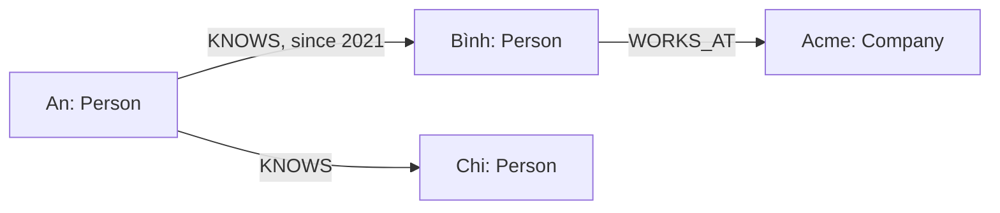

# Đọc mẫu node và relationship trong câu Cypher

## Mục tiêu bài học

Sau bài này, bạn có thể:

- Đọc và nhận diện node pattern qua biến, label và property.
- Phân tích relationship pattern qua biến, kiểu quan hệ, property và hướng kết nối.
- Diễn giải một mẫu Cypher gồm nhiều node và relationship thành đường đi trong đồ thị.
- Hiểu cách `MATCH`, `WHERE` và `RETURN` phối hợp để tìm và trình bày kết quả.
- Đọc được truy vấn Cypher đặt trong repository của Spring Data Neo4j.

## 1. Cypher mô tả hình dạng dữ liệu cần tìm

Neo4j lưu dữ liệu dưới dạng đồ thị gồm node, relationship và property. Cypher là ngôn ngữ dùng để mô tả mẫu đồ thị cần tìm hoặc thay đổi. Khi đọc một câu truy vấn, hãy chú ý đến các dấu ngoặc và mũi tên: chúng cho biết thực thể nào được tìm, các thực thể nối với nhau ra sao và hướng của liên kết.

Một mẫu đồ thị thường có dạng:

```cypher
MATCH (person:Person)-[relationship:KNOWS]->(friend:Person)
RETURN person.name, friend.name
```

Có thể đọc câu lệnh theo thứ tự:

1. `MATCH` yêu cầu Neo4j tìm các phần đồ thị khớp với mẫu.
2. `(person:Person)` là node có biến `person` và label `Person`.
3. `-[relationship:KNOWS]->` là relationship có biến `relationship`, kiểu `KNOWS` và hướng từ node bên trái sang node bên phải.
4. `(friend:Person)` là node đích, cũng có label `Person`.
5. `RETURN` chọn các giá trị được trả về cho mỗi kết quả khớp.

Điểm quan trọng là phần nằm trong `MATCH` mô tả cấu trúc đồ thị, không phải một chuỗi ký tự cần tìm. Neo4j tìm node và relationship thực tế có cấu trúc phù hợp với mẫu đó.

## 2. Đọc node pattern

Node được viết trong cặp ngoặc tròn `()`. Bên trong có thể có tên biến, label và property.

### 2.1. Biến node

```cypher
MATCH (person)
RETURN person
```

`person` là biến đại diện cho node được tìm thấy. Tên biến do người viết truy vấn đặt và có thể được sử dụng ở những phần sau như `WHERE` hoặc `RETURN`.

Một node không cần có biến nếu truy vấn không cần tham chiếu đến nó:

```cypher
MATCH (:Person)-[:KNOWS]->(:Person)
RETURN count(*) AS numberOfConnections
```

Hai node trong mẫu vẫn được tìm và kiểm tra, nhưng không có biến để truy cập từng node. Cách viết này phù hợp khi chỉ cần đếm hoặc kiểm tra sự tồn tại của mẫu.

### 2.2. Label của node

Label đứng sau dấu hai chấm và dùng để phân loại node:

```cypher
MATCH (person:Person)
RETURN person
```

Mẫu trên chỉ khớp với node mang label `Person`. Một node có thể có nhiều label. Ví dụ:

```cypher
MATCH (employee:Person:Employee)
RETURN employee.name
```

Node phải mang cả hai label `Person` và `Employee` mới khớp với mẫu này.

Label giúp truy vấn diễn đạt rõ loại thực thể và thường kết hợp với index hoặc constraint để tìm node hiệu quả hơn. Label là thành phần của mẫu node, còn tên biến là bí danh để tham chiếu đến node trong truy vấn.

### 2.3. Property của node

Property được đặt trong một map nằm bên trong ngoặc tròn:

```cypher
MATCH (person:Person {name: 'An', active: true})
RETURN person
```

Mẫu này tìm node có label `Person`, property `name` bằng `An` và property `active` bằng `true`. Các cặp khóa và giá trị trong map được ngăn cách bằng dấu phẩy.

Một số cách viết thường gặp:

| Mẫu | Ý nghĩa |
| --- | --- |
| `(n)` | Node bất kỳ, gán vào biến `n` |
| `(n:Person)` | Node có label `Person` |
| `(n {name: 'An'})` | Node có property `name` bằng `An` |
| `(n:Person {name: 'An'})` | Node có label `Person` và property tương ứng |
| `(:Person)` | Node có label `Person`, không gán biến |

Có thể truy cập property của node thông qua dấu chấm:

```cypher
MATCH (person:Person)
WHERE person.age >= 18
RETURN person.name AS name, person.age AS age
```

Ở đây, `person.age` là property `age` của node đang được gán cho biến `person`. Điều kiện lọc nằm trong `WHERE`; phần `RETURN` đặt tên cột kết quả bằng alias `AS`.

Trong ứng dụng, giá trị đầu vào nên được truyền bằng tham số thay vì ghép chuỗi truy vấn:

```cypher
MATCH (person:Person {name: $name})
RETURN person
```

`$name` là tham số của truy vấn. Cách viết này giúp tái sử dụng câu truy vấn với các giá trị khác nhau và tránh đưa dữ liệu đầu vào trực tiếp vào chuỗi Cypher.

## 3. Đọc relationship pattern

Relationship được đặt trong cặp ngoặc vuông `[]`, nằm giữa hai node. Dấu gạch ngang và mũi tên bên ngoài cặp ngoặc vuông thể hiện hướng kết nối.

### 3.1. Kiểu relationship

```cypher
MATCH (person:Person)-[:KNOWS]->(friend:Person)
RETURN person, friend
```

`KNOWS` là kiểu relationship. Theo ngữ nghĩa của ví dụ, nó biểu diễn việc một người biết một người khác. Kiểu relationship được viết sau dấu hai chấm bên trong ngoặc vuông.

Nếu không cần dùng relationship ở phần khác của truy vấn, có thể bỏ tên biến như trong ví dụ. Nếu cần đọc property hoặc kiểm tra kiểu quan hệ, hãy đặt biến cho relationship.

### 3.2. Biến relationship

```cypher
MATCH (person:Person)-[r:KNOWS]->(friend:Person)
RETURN person.name, type(r), friend.name
```

`r` là biến tham chiếu đến relationship được khớp. Hàm `type(r)` trả về kiểu của relationship, trong ví dụ là `KNOWS`.

Biến relationship hữu ích khi cần đọc property, lọc theo property hoặc trả về thông tin về chính mối liên kết. Tên biến có thể tùy chọn, nhưng nên đặt tên gợi ý nghĩa như `friendship`, `membership` hoặc `purchase` để truy vấn dễ hiểu.

### 3.3. Hướng của relationship

Trong mẫu Cypher, hướng được xác định bằng vị trí của mũi tên:

```cypher
// Từ person sang friend
MATCH (person:Person)-[:KNOWS]->(friend:Person)
RETURN person, friend
```

```cypher
// Từ person ở bên phải đi đến company ở bên trái
MATCH (company:Company)<-[:WORKS_AT]-(person:Person)
RETURN person, company
```

```cypher
// Khớp relationship theo cả hai hướng
MATCH (a:Person)-[:KNOWS]-(b:Person)
RETURN a, b
```

Mũi tên `->` chỉ hướng từ trái sang phải; `<-` chỉ hướng từ phải sang trái. Khi không có mũi tên, mẫu relationship khớp theo cả hai hướng.

Neo4j vẫn lưu relationship có hướng. Việc bỏ mũi tên trong một mẫu đọc chỉ có nghĩa là truy vấn chấp nhận relationship theo một trong hai chiều; nó không biến relationship đã lưu thành quan hệ vô hướng. Khi dùng mẫu không chỉ rõ hướng, hãy kiểm tra kết quả có lặp theo cách ứng dụng mong muốn hay không và cân nhắc `DISTINCT` nếu cần danh sách node duy nhất.

### 3.4. Property của relationship

Relationship cũng có thể chứa property. Property map được đặt bên trong ngoặc vuông:

```cypher
MATCH (person:Person)-[r:KNOWS {since: 2021}]->(friend:Person)
RETURN person.name, friend.name, r.since
```

Mẫu này chỉ khớp relationship `KNOWS` có property `since` bằng `2021`. Property của relationship thường mô tả chính mối liên kết, chẳng hạn thời điểm bắt đầu, vai trò, điểm số hoặc trạng thái.

Có thể lọc property bằng `WHERE` thay vì đặt điều kiện bằng trong pattern:

```cypher
MATCH (person:Person)-[r:KNOWS]->(friend:Person)
WHERE r.since >= 2020
RETURN person.name, friend.name, r.since
```

Hai cách viết phục vụ mục đích khác nhau: property map trong pattern biểu diễn các giá trị cần khớp trực tiếp; `WHERE` cho phép dùng biểu thức điều kiện như so sánh, kết hợp nhiều điều kiện hoặc kiểm tra giá trị.

## 4. Ghép node và relationship thành một đường đi

Một pattern hoàn chỉnh thường gồm nhiều node nối tiếp qua relationship. Khi đọc, hãy đi từ trái sang phải và xác định từng node, từng relationship, rồi kiểm tra hướng của từng mũi tên.

Giả sử đồ thị có cấu trúc sau:



Truy vấn tìm đồng nghiệp của những người mà An biết:

```cypher
MATCH (an:Person {name: 'An'})
      -[:KNOWS]->(friend:Person)
      -[:WORKS_AT]->(company:Company)
RETURN friend.name AS friend,
       company.name AS company
```

Có thể đọc pattern theo từng đoạn:

1. `(an:Person {name: 'An'})`: bắt đầu tại node `Person` có tên An.
2. `-[:KNOWS]->`: đi theo relationship `KNOWS` từ An đến node kế tiếp.
3. `(friend:Person)`: node kế tiếp được gán vào biến `friend` và phải có label `Person`.
4. `-[:WORKS_AT]->`: từ người bạn đi theo relationship `WORKS_AT`.
5. `(company:Company)`: node đích phải có label `Company` và được gán vào biến `company`.

Truy vấn chỉ trả về các đường đi thỏa mãn toàn bộ pattern. Nếu An biết Bình và Bình làm việc tại Acme, kết quả có một dòng chứa Bình và Acme. Nếu một người bạn không có relationship `WORKS_AT` đến node `Company`, người đó không tạo ra kết quả cho pattern này.

### 4.1. Một pattern có thể tạo nhiều dòng kết quả

Giả sử An biết Bình và Chi; cả hai đều làm việc tại Acme. Khi chạy truy vấn trên, kết quả có thể có hai dòng:

| friend | company |
| --- | --- |
| Bình | Acme |
| Chi | Acme |

Mỗi dòng tương ứng với một tổ hợp node và relationship khớp với pattern. Vì vậy, một node có thể xuất hiện trong nhiều dòng nếu có nhiều đường đi phù hợp.

Nếu chỉ cần mỗi tên công ty một lần, có thể dùng:

```cypher
MATCH (an:Person {name: 'An'})
      -[:KNOWS]->(:Person)
      -[:WORKS_AT]->(company:Company)
RETURN DISTINCT company.name AS company
```

`DISTINCT` loại bỏ các dòng trùng nhau trong tập kết quả. Nó không thay đổi dữ liệu được lưu trong Neo4j.

### 4.2. Các pattern dùng chung biến

Một câu truy vấn có thể mô tả nhiều đoạn pattern và liên kết chúng thông qua cùng một biến:

```cypher
MATCH (person:Person)-[:KNOWS]->(friend:Person),
      (person)-[:WORKS_AT]->(company:Company)
RETURN person.name, friend.name, company.name
```

Biến `person` xuất hiện ở cả hai đoạn, nên cả hai pattern cùng tham chiếu một node. Kết quả gồm người, những người họ biết và công ty nơi chính người đó làm việc.

Khi hai pattern không dùng chung biến, chúng có thể tạo tích Descartes giữa các kết quả khớp. Điều này có thể làm số dòng tăng mạnh. Khi đọc truy vấn nhiều pattern, hãy kiểm tra biến nào được dùng chung để hiểu các phần của truy vấn được kết nối ra sao.

## 5. Đọc một câu truy vấn từ đầu đến cuối

Các thành phần thường xuất hiện cùng nhau trong một truy vấn đọc là `MATCH`, `WHERE` và `RETURN`:

```cypher
MATCH (person:Person)-[r:KNOWS]->(friend:Person)
WHERE person.name = $name
  AND r.since >= 2020
RETURN friend.name AS friendName,
       r.since AS connectedSince
ORDER BY friendName
```

Ý nghĩa từng phần:

| Thành phần | Cách đọc |
| --- | --- |
| `MATCH` | Tìm pattern gồm một người, relationship `KNOWS` và người được kết nối |
| `WHERE` | Chỉ giữ kết quả có tên người bằng giá trị tham số `$name` và relationship có `since` từ năm 2020 trở đi |
| `RETURN` | Trả về tên người được kết nối và năm bắt đầu quan hệ |
| `AS` | Đặt tên dễ hiểu cho cột kết quả |
| `ORDER BY` | Sắp xếp kết quả theo tên người được kết nối |

Cần phân biệt ba thao tác:

- `MATCH` mô tả cấu trúc cần tìm trong đồ thị.
- `WHERE` lọc những tổ hợp đã khớp theo điều kiện.
- `RETURN` quyết định dữ liệu nào được gửi về phía gọi truy vấn.

Một truy vấn có thể khớp nhiều node và relationship nhưng chỉ trả về một vài property. Vì thế, không nên suy luận rằng dữ liệu xuất hiện trong `RETURN` là toàn bộ dữ liệu đã được truy vấn hoặc ánh xạ.

## 6. Đọc Cypher trong Spring Data Neo4j

Spring Data Neo4j cho phép đặt Cypher trong repository bằng annotation `@Query`. Cách đọc pattern vẫn giống truy vấn Cypher thông thường:

```java
import java.util.List;

import org.springframework.data.neo4j.repository.Neo4jRepository;
import org.springframework.data.neo4j.repository.query.Query;
import org.springframework.data.repository.query.Param;

public interface PersonRepository
        extends Neo4jRepository<Person, String> {

    @Query("""
        MATCH (person:Person {personId: $personId})
              -[:KNOWS]->(friend:Person)
        RETURN friend
        ORDER BY friend.name
        """)
    List<Person> findFriends(@Param("personId") String personId);
}
```

Trong ví dụ:

- `@Query` chứa câu Cypher mà Neo4j sẽ thực thi.
- `$personId` là tham số được lấy từ đối số `personId` của phương thức repository.
- Pattern tìm node người có `personId` tương ứng, sau đó đi theo relationship `KNOWS` đến các node bạn bè.
- `RETURN friend` trả về node đích để Spring Data Neo4j ánh xạ thành các đối tượng `Person`.
- Kiểu trả về `List<Person>` thể hiện phương thức có thể nhận nhiều node phù hợp.

Khi thay đổi phần `RETURN`, cần bảo đảm kiểu kết quả Java tương thích với dữ liệu Cypher trả về. Nếu trả về các property như `friend.name` hoặc biểu thức có alias, kết quả có thể cần kiểu scalar, projection hoặc DTO thay vì entity `Person`.

Việc dùng tham số cũng giúp truy vấn có thể tái sử dụng mà không ghép dữ liệu đầu vào vào chuỗi Cypher. Đây là cách nên dùng cho các giá trị đến từ request hoặc từ logic nghiệp vụ.

## 7. Những lỗi thường gặp khi đọc pattern

| Cách hiểu sai | Cách hiểu đúng |
| --- | --- |
| `Person` trong `(p:Person)` là tên biến | `p` là biến; `Person` là label |
| `KNOWS` trong `[:KNOWS]` là tên property | `KNOWS` là kiểu relationship |
| `-` và `->` có ý nghĩa giống nhau | Mũi tên xác định hướng; thiếu mũi tên nghĩa là khớp theo cả hai hướng |
| Node bên phải luôn là node đích nghiệp vụ | Hướng thực tế phụ thuộc mũi tên của relationship |
| `MATCH` tạo node và relationship mới | `MATCH` tìm dữ liệu đã tồn tại; `CREATE` tạo mới, còn `MERGE` tìm hoặc tạo nếu chưa có |
| Một pattern khớp một node thì chỉ có một dòng | Mỗi tổ hợp node và relationship khớp có thể tạo một dòng |
| `RETURN friend` và `RETURN friend.name` trả cùng một dạng dữ liệu | Một biểu thức trả về node; biểu thức còn lại trả về property của node |

Một số câu hỏi hữu ích khi đọc bất kỳ pattern nào:

1. Những node nào được yêu cầu? Chúng có biến và label gì?
2. Mỗi relationship có kiểu nào, có biến hay property nào?
3. Mũi tên đi theo hướng nào?
4. Các đoạn pattern được nối với nhau bằng biến nào?
5. Điều kiện lọc nằm ở pattern hay trong `WHERE`?
6. `RETURN` trả về node, relationship hay property?

## 8. Bài tập tự kiểm tra

Cho pattern sau:

```cypher
MATCH (buyer:Person {name: 'An'})
      -[purchase:PURCHASED]->(product:Product)
WHERE purchase.quantity >= 2
RETURN buyer.name AS buyer,
       product.name AS product,
       purchase.quantity AS quantity
```

Hãy tự trả lời:

1. Có bao nhiêu node trong pattern và mỗi node có label gì?
2. Biến `purchase` đại diện cho thành phần nào?
3. Relationship `PURCHASED` đi từ node nào đến node nào?
4. Điều kiện `purchase.quantity >= 2` kiểm tra property của node hay relationship?
5. Kết quả trả về những property nào?
6. Nếu An mua cùng một sản phẩm trong nhiều relationship khác nhau, vì sao sản phẩm đó có thể xuất hiện ở nhiều dòng?

**Gợi ý:** Đọc từng cặp ngoặc tròn trước, sau đó đọc phần ngoặc vuông nằm giữa hai node. Cuối cùng đối chiếu `WHERE` và `RETURN` để xác định điều kiện và hình dạng kết quả.

## Kết luận

Node pattern trong Cypher được viết bằng ngoặc tròn và có thể gồm biến, label cùng property. Relationship pattern nằm trong ngoặc vuông, thể hiện kiểu quan hệ, biến, property và được bao quanh bởi ký hiệu chỉ hướng. Ghép các phần này lại tạo thành đường đi mà `MATCH` cần tìm trong đồ thị.

Khi đọc một truy vấn, hãy lần theo pattern từ node đầu tiên qua từng relationship đến node tiếp theo, xác định các biến được dùng chung, rồi đọc `WHERE` và `RETURN`. Cách phân tích này giúp hiểu chính xác truy vấn đang tìm mối liên hệ nào và dữ liệu nào sẽ được Spring Data Neo4j ánh xạ về ứng dụng.
