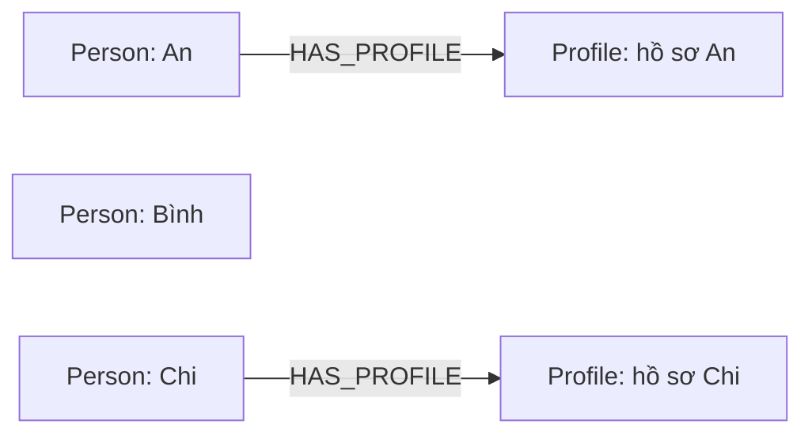

# OPTIONAL MATCH, dữ liệu thiếu và cách xử lý null

Trong Neo4j, một truy vấn `MATCH` chỉ giữ lại những dòng mà pattern đồ thị tìm được. Tuy nhiên, nhiều nghiệp vụ cần hiển thị một đối tượng ngay cả khi nó chưa có dữ liệu liên quan: danh sách người dùng chưa có hồ sơ, dự án chưa có thành viên hoặc đơn hàng chưa được gán người giao. Cypher cung cấp `OPTIONAL MATCH` để xử lý tình huống này.

`OPTIONAL MATCH` hoạt động gần giống phép nối ngoài trái (left outer join) trong SQL: nếu pattern tùy chọn không khớp, dòng đầu vào vẫn được giữ và các biến mới trong pattern nhận giá trị `null`. Muốn dùng đúng, cần hiểu cách `OPTIONAL MATCH` tương tác với `WHERE`, cách Cypher xử lý `null`, và ảnh hưởng của nhiều quan hệ tùy chọn đến số dòng kết quả.

## 1. Khác biệt giữa MATCH và OPTIONAL MATCH

Giả sử đồ thị có các node `Person` và `Profile`. Một người có thể có hồ sơ, nhưng hồ sơ chưa bắt buộc phải tồn tại.



Truy vấn sau chỉ trả về những người có hồ sơ:

```cypher
MATCH (p:Person)-[:HAS_PROFILE]->(profile:Profile)
RETURN p.name AS person, profile.bio AS bio
```

Nếu `Bình` chưa có relationship `HAS_PROFILE`, người này không xuất hiện trong kết quả. `MATCH` yêu cầu toàn bộ pattern phải khớp.

Thay bằng `OPTIONAL MATCH`:

```cypher
MATCH (p:Person)
OPTIONAL MATCH (p)-[:HAS_PROFILE]->(profile:Profile)
RETURN p.name AS person, profile.bio AS bio
ORDER BY person
```

Kết quả minh họa:

| person | bio |
|---|---|
| An | Thích đọc sách |
| Bình | `null` |
| Chi | Thích chạy bộ |

Dòng của `Bình` vẫn được giữ. Vì không tìm thấy node `Profile` phù hợp, biến `profile` có giá trị `null`; biểu thức `profile.bio` cũng trả về `null`.

Điểm cần nhớ:

- `MATCH` loại dòng đầu vào nếu pattern không khớp.
- `OPTIONAL MATCH` giữ dòng đầu vào nếu pattern tùy chọn không khớp.
- Các biến đã được tạo ở những clause trước vẫn giữ nguyên giá trị.
- Những biến mới được giới thiệu trong pattern tùy chọn nhận `null` khi không có kết quả phù hợp.

`OPTIONAL MATCH` không thể khôi phục dòng đã bị loại ở một `MATCH` trước đó. Ví dụ, nếu không có node `Person` nào khớp `MATCH (p:Person {id: $id})`, clause tùy chọn phía sau không tạo ra một người giả để trả về.

## 2. null biểu thị dữ liệu không có hoặc chưa xác định

Trong Cypher, `null` biểu thị giá trị không có hoặc chưa xác định. Nó thường xuất hiện khi một pattern tùy chọn không khớp hoặc khi node có tồn tại nhưng không có property được truy cập.

Hai tình huống dưới đây đều có thể làm `profile.bio` trả về `null`:

1. Không có node `Profile` phù hợp, nên `profile` là `null`.
2. Có node `Profile`, nhưng node đó không có property `bio`.

Vì vậy, chỉ kiểm tra `profile.bio IS NULL` thì chưa phân biệt được thiếu cả node với thiếu riêng property. Nếu cần phân biệt, hãy kiểm tra biến node trước:

```cypher
MATCH (p:Person)
OPTIONAL MATCH (p)-[:HAS_PROFILE]->(profile:Profile)
RETURN p.name AS person,
       profile IS NULL AS missingProfile,
       profile.bio IS NULL AS missingBio
```

Khi `profile IS NULL` là `true`, không có node hồ sơ khớp. Khi `profile IS NULL` là `false` nhưng `profile.bio IS NULL` là `true`, node hồ sơ có tồn tại nhưng property `bio` đang thiếu hoặc có giá trị `null`.

### Kiểm tra null đúng cách

Dùng `IS NULL` và `IS NOT NULL` để kiểm tra:

```cypher
MATCH (p:Person)
OPTIONAL MATCH (p)-[:HAS_PROFILE]->(profile:Profile)
RETURN p.name AS person,
       profile IS NULL AS noProfile,
       profile IS NOT NULL AS hasProfile
```

Không dùng `= null` hoặc `<> null` để kiểm tra. Phép so sánh với `null` thường cho kết quả `null`, không phải `true` hay `false`:

```cypher
RETURN null = null AS equality,
       null <> 'An' AS inequality,
       null IS NULL AS nullCheck
```

Hai biểu thức đầu trả về `null`; biểu thức cuối trả về `true`.

### Logic ba giá trị

Cypher sử dụng logic ba giá trị: `true`, `false` và `null` (không xác định). Khi một toán hạng cần thiết bị thiếu, các phép so sánh và nhiều biểu thức logic có thể cho ra `null`.

| Biểu thức | Kết quả | Giải thích |
|---|---|---|
| `5 = 5` | `true` | Hai giá trị bằng nhau |
| `5 = 7` | `false` | Hai giá trị khác nhau |
| `null = 5` | `null` | Không thể xác định phép so sánh |
| `NOT null` | `null` | Đảo một giá trị chưa xác định vẫn chưa xác định |
| `null IS NULL` | `true` | Đây là phép kiểm tra sự hiện diện |

Trong `WHERE`, chỉ dòng có điều kiện là `true` được giữ lại. Điều kiện `false` hoặc `null` đều khiến dòng bị loại. Đây là lý do một điều kiện kiểm tra property có thể vô tình loại các dòng mà `OPTIONAL MATCH` vừa giữ lại.

## 3. WHERE gắn với OPTIONAL MATCH

Vị trí của `WHERE` có ý nghĩa quan trọng. Khi `WHERE` đứng ngay sau một `MATCH` hoặc `OPTIONAL MATCH`, nó là phần điều kiện của pattern đó.

Ví dụ, chỉ ghép hồ sơ có trạng thái `PUBLIC`:

```cypher
MATCH (p:Person)
OPTIONAL MATCH (p)-[:HAS_PROFILE]->(profile:Profile)
WHERE profile.status = 'PUBLIC'
RETURN p.name AS person, profile.bio AS bio
```

Điều kiện `WHERE` ở đây giới hạn những hồ sơ được phép khớp. Nếu một người không có hồ sơ công khai, dòng của người đó vẫn được giữ với `profile = null`. Điều này cũng xảy ra khi người đó có hồ sơ nhưng không có hồ sơ nào thỏa mãn trạng thái `PUBLIC`.

Có thể đặt điều kiện ngay trong pattern để làm rõ ý định:

```cypher
MATCH (p:Person)
OPTIONAL MATCH (p)-[:HAS_PROFILE]->(profile:Profile {status: 'PUBLIC'})
RETURN p.name AS person, profile.bio AS bio
```

Ngược lại, nếu muốn chỉ giữ người có hồ sơ công khai, hãy lọc sau khi đã chuyển sang phạm vi `WITH`:

```cypher
MATCH (p:Person)
OPTIONAL MATCH (p)-[:HAS_PROFILE]->(profile:Profile)
WITH p, profile
WHERE profile.status = 'PUBLIC'
RETURN p.name AS person, profile.bio AS bio
```

Ở truy vấn này, `WHERE` sau `WITH` lọc các dòng đã tạo. Với người không có hồ sơ, `profile.status = 'PUBLIC'` là `null`, nên dòng bị loại. Kết quả vì thế chỉ còn người có hồ sơ công khai.

Hãy chọn vị trí điều kiện theo ý nghĩa nghiệp vụ:

- Điều kiện thuộc về việc tìm đối tượng liên quan nào: đặt `WHERE` ngay sau `OPTIONAL MATCH` hoặc đưa điều kiện vào pattern.
- Điều kiện dùng để quyết định có giữ dòng kết quả hay không: đặt `WHERE` sau `WITH` hoặc trong bước lọc tiếp theo.

## 4. Thay thế giá trị null bằng giá trị mặc định

Khi hiển thị dữ liệu, ứng dụng thường cần một giá trị thay thế dễ đọc thay vì `null`. Hàm `coalesce()` trả về biểu thức đầu tiên khác `null`:

```cypher
MATCH (p:Person)
OPTIONAL MATCH (p)-[:HAS_PROFILE]->(profile:Profile)
RETURN p.name AS person,
       coalesce(profile.bio, 'Chưa cập nhật tiểu sử') AS bio
```

Nếu `profile` không tồn tại hoặc `bio` bị thiếu, cột `bio` sẽ nhận chuỗi mặc định. Nếu `bio` có giá trị, giá trị đó được giữ nguyên.

Có thể dùng `CASE` khi cần nhiều nhánh xử lý:

```cypher
MATCH (p:Person)
OPTIONAL MATCH (p)-[:HAS_PROFILE]->(profile:Profile)
RETURN p.name AS person,
       CASE
           WHEN profile IS NULL THEN 'Chưa có hồ sơ'
           WHEN profile.bio IS NULL THEN 'Chưa cập nhật tiểu sử'
           ELSE profile.bio
       END AS profileDescription
```

`coalesce()` phù hợp với trường hợp chỉ cần chọn giá trị dự phòng. `CASE` phù hợp khi kết quả phụ thuộc vào nhiều điều kiện hoặc cần phân biệt các dạng dữ liệu thiếu.

Không nên thay mọi `null` bằng một giá trị mặc định một cách máy móc. Trong một số nghiệp vụ, `null` thể hiện trạng thái quan trọng như chưa được phân công, chưa xác minh hoặc chưa có dữ liệu. Hãy giữ thông tin đó nếu tầng ứng dụng cần phân biệt với một giá trị thực.

## 5. Kết hợp nhiều OPTIONAL MATCH

Một truy vấn có thể cần nhiều nhánh quan hệ tùy chọn. Ví dụ, một người có thể có hồ sơ và có thể thuộc một hoặc nhiều nhóm:

```cypher
MATCH (p:Person)
OPTIONAL MATCH (p)-[:HAS_PROFILE]->(profile:Profile)
OPTIONAL MATCH (p)-[:MEMBER_OF]->(team:Team)
RETURN p.name AS person,
       profile.bio AS bio,
       team.name AS team
ORDER BY person, team
```

Nếu người đó không có hồ sơ, `profile` là `null`. Nếu người đó không thuộc nhóm nào, `team` là `null`. Các nhánh tùy chọn được đánh giá trên những dòng đã có, nên số dòng có thể tăng theo số tổ hợp kết quả.

Ví dụ, một người có hai hồ sơ phù hợp và ba nhóm sẽ tạo ra sáu dòng kết hợp giữa hồ sơ và nhóm. Đây là hệ quả của việc mỗi lần mở rộng pattern tạo thêm các dòng cho từng kết quả khớp. Khi truy vấn nhiều nhánh một-nhiều, hãy kiểm tra cardinality để tránh đếm hoặc tổng hợp dữ liệu bị nhân lên.

### Gom từng nhánh trước khi mở rộng nhánh tiếp theo

Nếu mục tiêu là lấy danh sách nhóm và danh sách hồ sơ độc lập, có thể tổng hợp nhánh đầu trước khi truy vấn nhánh tiếp theo:

```cypher
MATCH (p:Person)
OPTIONAL MATCH (p)-[:HAS_PROFILE]->(profile:Profile)
WITH p, collect(DISTINCT profile.bio) AS bios
OPTIONAL MATCH (p)-[:MEMBER_OF]->(team:Team)
RETURN p.name AS person,
       bios,
       collect(DISTINCT team.name) AS teams
ORDER BY person
```

`WITH` tạo ranh giới giữa hai bước. Các hồ sơ được gom thành danh sách `bios` theo từng người trước khi truy vấn nhóm; nhờ vậy hai tập hợp không nhân chéo với nhau. `DISTINCT` loại giá trị trùng trong danh sách.

Trong Cypher, `collect()` bỏ qua giá trị `null`. Do đó, nếu không có hồ sơ phù hợp, `collect(profile.bio)` trả về danh sách rỗng thay vì danh sách có một phần tử `null`. Tương tự, `collect(team.name)` trả về `[]` khi không có nhóm phù hợp.

## 6. Đếm và tổng hợp khi có dữ liệu thiếu

Khi dùng `OPTIONAL MATCH` cùng hàm tổng hợp, cần phân biệt số dòng với số đối tượng thực sự được tìm thấy:

```cypher
MATCH (p:Person)
OPTIONAL MATCH (p)-[:HAS_PROFILE]->(profile:Profile)
RETURN p.name AS person,
       p.id AS personId,
       count(*) AS rowCount,
       count(profile) AS profileCount,
       collect(profile) AS profiles
ORDER BY person
```

Với một người không có hồ sơ, dòng tùy chọn vẫn tồn tại:

| Biểu thức | Giá trị khi không có hồ sơ | Ý nghĩa |
|---|---:|---|
| `count(*)` | `1` | Đếm dòng kết quả còn lại |
| `count(profile)` | `0` | Đếm giá trị `profile` khác `null` |
| `collect(profile)` | `[]` | Gom các giá trị khác `null` thành danh sách |

Nếu cần đếm số hồ sơ, dùng `count(profile)` hoặc đếm biến relationship phù hợp. `count(*)` đếm dòng, nên không thể thay thế cho số đối tượng liên quan khi dùng `OPTIONAL MATCH`.

Nếu một người có nhiều relationship dẫn đến cùng một node hồ sơ, hoặc nhiều nhánh truy vấn tạo ra dòng lặp, cân nhắc `count(DISTINCT profile)` và `collect(DISTINCT profile)` để đếm/gom đối tượng duy nhất. Chỉ dùng `DISTINCT` khi loại trùng đúng với yêu cầu nghiệp vụ.

## 7. Các lỗi thường gặp

### Vô tình biến OPTIONAL MATCH thành MATCH

```cypher
MATCH (p:Person)
OPTIONAL MATCH (p)-[:HAS_PROFILE]->(profile:Profile)
WITH p, profile
WHERE profile.status = 'PUBLIC'
RETURN p, profile
```

Điều kiện sau `WITH` loại các dòng có `profile = null`. Nếu mục tiêu là giữ mọi người và chỉ lấy hồ sơ công khai khi có, hãy chuyển điều kiện về ngay sau `OPTIONAL MATCH`.

### So sánh trực tiếp với null

```cypher
// Không dùng cách này để tìm người chưa có hồ sơ
MATCH (p:Person)
OPTIONAL MATCH (p)-[:HAS_PROFILE]->(profile:Profile)
WHERE profile = null
RETURN p
```

Phép so sánh `profile = null` cho kết quả `null`, nên không chọn được các dòng cần tìm. Dùng:

```cypher
MATCH (p:Person)
OPTIONAL MATCH (p)-[:HAS_PROFILE]->(profile:Profile)
WHERE profile IS NULL
RETURN p
```

### Đếm dòng thay vì đếm node

`count(*)` vẫn đếm dòng có biến `profile` là `null`. Nếu đang đếm số node hồ sơ, hãy dùng `count(profile)` hoặc `count(DISTINCT profile)` tùy trường hợp.

### Không nhận ra hiệu ứng nhân dòng

Khi ghép nhiều nhánh một-nhiều, tổng số dòng có thể là tích số kết quả của các nhánh. Nếu cần các danh sách độc lập, hãy tổng hợp từng nhánh bằng `WITH` trước khi mở rộng nhánh kế tiếp.

### Giả định null chỉ đến từ OPTIONAL MATCH

Một property không tồn tại cũng được đọc như `null`. Vì vậy, khi nghiệp vụ cần phân biệt node không tồn tại với property không tồn tại, hãy kiểm tra cả node lẫn property thay vì chỉ kiểm tra biểu thức property.

## 8. Áp dụng trong Spring Data Neo4j

Spring Data Neo4j cho phép dùng Cypher với `@Query` trong repository. Ví dụ, một màn hình cần danh sách người cùng thông tin hồ sơ nếu có:

```java
public interface PersonProfileView {
    String getPerson();
    String getBio();
}

public interface PersonRepository extends Neo4jRepository<Person, String> {

    @Query("""
        MATCH (p:Person)
        OPTIONAL MATCH (p)-[:HAS_PROFILE]->(profile:Profile)
        RETURN p.name AS person, profile.bio AS bio
        ORDER BY p.name
        """)
    List<PersonProfileView> findPeopleWithOptionalProfile();
}
```

Ở ví dụ này, `PersonProfileView` là kiểu projection do ứng dụng định nghĩa để nhận dữ liệu trả về. Projection có thể là interface hoặc DTO phù hợp với cách ánh xạ kết quả của phiên bản Spring Data Neo4j đang dùng. Cần khai báo các thuộc tính/alias tương ứng và kiểm tra việc ánh xạ node, relationship hoặc scalar theo kiểu projection đã chọn.

Nếu repository trả về entity `Person`, câu truy vấn cần trả về cấu trúc đồ thị mà SDN cần để ánh xạ entity đó. `OPTIONAL MATCH` có thể bổ sung node liên quan khi tồn tại; khi không có node, phần dữ liệu liên quan là `null`. Nếu chỉ cần các trường như tên người và tiểu sử, projection thường diễn đạt mục đích rõ hơn việc ánh xạ một entity đầy đủ.

Khi dữ liệu thiếu là trạng thái nghiệp vụ, hãy quyết định rõ tầng nào chịu trách nhiệm chuyển nó thành giá trị hiển thị. Cypher có thể dùng `coalesce()` hoặc `CASE`; service hoặc DTO cũng có thể xử lý giá trị `null`. Chọn một nơi xử lý nhất quán để tránh cùng một trường hợp nhưng API này trả chuỗi rỗng, API khác trả `null`.

## 9. Quy trình chọn cách truy vấn

Khi viết truy vấn có dữ liệu tùy chọn, có thể lần lượt tự hỏi:

1. Đối tượng chính nào phải luôn xuất hiện? Dùng `MATCH` để chọn đối tượng chính.
2. Quan hệ nào có thể chưa tồn tại? Dùng `OPTIONAL MATCH` cho nhánh đó.
3. Điều kiện lọc áp dụng cho pattern hay cho toàn bộ dòng kết quả? Đặt `WHERE` đúng vị trí.
4. Cần phân biệt thiếu node với thiếu property không? Kiểm tra biến node và property riêng biệt.
5. Kết quả cần `null`, giá trị mặc định hay danh sách rỗng? Chọn `IS NULL`, `coalesce()`, `CASE` hoặc `collect()` phù hợp.
6. Có nhiều nhánh một-nhiều không? Kiểm tra số dòng và tổng hợp từng nhánh bằng `WITH` khi cần.
7. Đang đếm dòng hay đếm node/relationship? Chọn `count(*)`, `count(variable)` hoặc `count(DISTINCT variable)` đúng mục tiêu.

## 10. Bài tập tự kiểm tra

Giả sử đồ thị có ba người: An có một hồ sơ công khai; Bình chưa có hồ sơ; Chi có một hồ sơ ở trạng thái `PRIVATE`.

1. Truy vấn `MATCH (p:Person)-[:HAS_PROFILE]->(profile:Profile) RETURN p` trả về những ai?
2. Nếu đổi `MATCH` thành `OPTIONAL MATCH`, kết quả có bao nhiêu dòng khi mỗi người có tối đa một hồ sơ?
3. Với `WHERE profile.status = 'PUBLIC'` đặt ngay sau `OPTIONAL MATCH`, người nào vẫn xuất hiện?
4. Nếu chuyển điều kiện đó xuống sau `WITH p, profile`, người nào còn xuất hiện?
5. Vì sao `profile = null` không phải cách đúng để tìm người chưa có hồ sơ?
6. Khi không có hồ sơ, `count(*)`, `count(profile)` và `collect(profile)` lần lượt trả về gì?
7. Một người có hai hồ sơ và ba nhóm. Vì sao hai `OPTIONAL MATCH` liên tiếp có thể tạo sáu dòng?

Khi trả lời được các câu hỏi này, người học có thể chủ động chọn `MATCH` hay `OPTIONAL MATCH`, đặt điều kiện đúng chỗ và xử lý `null` mà không vô tình làm mất đối tượng hoặc đếm sai dữ liệu.
