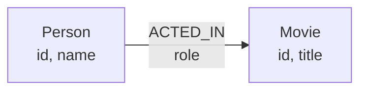

# CREATE, MERGE, SET và REMOVE

Trong Cypher, bốn mệnh đề `CREATE`, `MERGE`, `SET` và `REMOVE` là nhóm thao tác cơ bản để tạo cấu trúc đồ thị và thay đổi dữ liệu đã lưu trong Neo4j. Khi dùng Spring Data Neo4j, ta có thể đưa các câu lệnh này vào `@Query` của repository hoặc thực thi bằng các API như `Neo4jClient`. Chọn đúng mệnh đề giúp thao tác có thể dự đoán, tránh tạo node trùng và giữ trạng thái node, relationship nhất quán.

Module `SPRING_DATA_NEO4J` tập trung xây dựng tầng dữ liệu đồ thị qua node entity, relationship, repository và truy vấn Cypher. Vì vậy, bài học dùng một mô hình xuyên suốt: `Person` và `Movie` là hai loại node; quan hệ `ACTED_IN` nối một người với một bộ phim. Các ví dụ dùng tham số như `$personId` và `$name` để có thể tái sử dụng trong ứng dụng.

## 1. Mô hình đồ thị dùng trong ví dụ

Một phần đồ thị có dạng:



Ví dụ Cypher giả định node có các property định danh `id`. Trong ứng dụng thực tế, nên tạo unique constraint cho khóa định danh để Neo4j bảo đảm mỗi label chỉ có một node mang giá trị ID đó:

```cypher
CREATE CONSTRAINT person_id_unique IF NOT EXISTS
FOR (p:Person)
REQUIRE p.id IS UNIQUE;

CREATE CONSTRAINT movie_id_unique IF NOT EXISTS
FOR (m:Movie)
REQUIRE m.id IS UNIQUE;
```

Cú pháp constraint ở đây theo phong cách Cypher của Neo4j 5. Unique constraint vừa bảo vệ tính duy nhất vừa tạo backing index để tìm node theo ID hiệu quả. `MERGE` vẫn cần constraint phù hợp nếu nhiều transaction có thể đồng thời tạo cùng một thực thể.

## 2. CREATE: tạo node và relationship mới

`CREATE` luôn tạo phần tử đồ thị được mô tả trong pattern. Nó không kiểm tra xem một node hay relationship tương tự đã tồn tại hay chưa. Vì vậy, chạy lại cùng câu lệnh có thể tạo thêm node hoặc cạnh trùng về mặt nghiệp vụ.

Tạo một node `Person` với các property ban đầu:

```cypher
CREATE (p:Person {id: $personId, name: $name})
RETURN p;
```

`Person` là label, còn `id` và `name` là property. Các giá trị có dấu `$` được truyền vào dưới dạng parameter. `RETURN p` trả node vừa tạo để Neo4j Browser hiển thị hoặc để tầng truy cập dữ liệu ánh xạ kết quả.

Có thể tạo nhiều node và relationship trong cùng một pattern:

```cypher
CREATE (p:Person {id: $personId, name: $personName})
       -[:ACTED_IN {role: $role}]->
       (m:Movie {id: $movieId, title: $movieTitle})
RETURN p, m;
```

Câu lệnh trên luôn tạo một `Person`, một `Movie` và một relationship `ACTED_IN`. Property `role` thuộc về relationship vì nó mô tả vai trò của người đó trong bộ phim. Nếu node đã có sẵn, `CREATE` vẫn tạo node mới; do đó chỉ dùng mẫu này khi nghiệp vụ thực sự yêu cầu tạo mới toàn bộ phần đồ thị.

Có thể tạo một relationship giữa các node đã tồn tại bằng cách tìm node trước rồi dùng `CREATE`:

```cypher
MATCH (p:Person {id: $personId})
MATCH (m:Movie {id: $movieId})
CREATE (p)-[r:ACTED_IN {role: $role}]->(m)
RETURN r;
```

Nếu chạy lại câu lệnh, một relationship mới lại được tạo giữa cùng hai node. Đây có thể là hành vi mong muốn nếu mỗi lần là một sự kiện riêng, nhưng thường không phù hợp với quan hệ mà nghiệp vụ chỉ cho phép tồn tại một lần.

## 3. MERGE: tìm hoặc tạo theo pattern

`MERGE` tìm một pattern đã cho. Nếu pattern khớp với dữ liệu hiện có, Cypher sử dụng phần tử tìm được; nếu không, nó tạo pattern đó. Đây là lựa chọn hữu ích cho thao tác kiểu *upsert* — tạo khi chưa có và cập nhật khi đã có.

Ví dụ, tìm người theo ID và tạo nếu chưa tồn tại:

```cypher
MERGE (p:Person {id: $personId})
ON CREATE SET p.name = $name,
              p.createdAt = datetime()
ON MATCH SET p.name = $name,
             p.updatedAt = datetime()
RETURN p;
```

Trình tự xử lý:

1. Neo4j tìm node `Person` có `id` bằng `$personId`.
2. Nếu chưa có, `ON CREATE SET` đặt tên và thời điểm tạo.
3. Nếu đã có, `ON MATCH SET` cập nhật tên và thời điểm sửa.
4. `RETURN p` trả node được tìm thấy hoặc vừa tạo.

Hãy chọn thuộc tính ổn định để nhận diện trong `MERGE`, thường là ID hoặc khóa nghiệp vụ có unique constraint. Không nên đưa thuộc tính thường xuyên thay đổi như `name` vào điều kiện nhận diện:

```cypher
// Dễ tạo node mới khi tên thay đổi
MERGE (p:Person {id: $personId, name: $name})
RETURN p;
```

Nếu ID đã tồn tại nhưng tên khác, toàn bộ pattern trên không khớp. Khi không có unique constraint, truy vấn có thể tạo thêm node mang cùng ID; khi đã có constraint, thao tác tạo đó sẽ bị từ chối vì vi phạm tính duy nhất. Cách dùng ID làm khóa và cập nhật tên bằng `SET` thể hiện đúng ý định cập nhật cùng một người.

### MERGE relationship

Để tạo relationship nếu chưa có, trước tiên tìm hoặc bảo đảm hai node đầu cuối, sau đó `MERGE` relationship:

```cypher
MERGE (p:Person {id: $personId})
MERGE (m:Movie {id: $movieId})
MERGE (p)-[r:ACTED_IN]->(m)
ON CREATE SET r.role = $role,
              r.createdAt = datetime()
ON MATCH SET r.role = $role
RETURN p, r, m;
```

Việc tách thành ba `MERGE` giúp xác định rõ hai node và cạnh được xử lý riêng. Nếu chỉ `MERGE` toàn bộ pattern có node ở hai đầu, Neo4j xét sự tồn tại của cả pattern như một đơn vị; khi pattern đầy đủ chưa tồn tại, các phần chưa khớp có thể được tạo mới. Trong hệ thống có dữ liệu dùng chung, điều đó có thể dẫn đến node trùng nếu không có ràng buộc định danh.

`MERGE` relationship có hướng. `(p)-[:ACTED_IN]->(m)` và `(m)-[:ACTED_IN]->(p)` là hai pattern khác nhau. Nếu cần phân biệt vai trò, thời điểm hoặc loại sự kiện, hãy xác định rõ property nào thuộc relationship và property nào dùng để nhận diện cạnh. Các constraint duy nhất trên node vẫn rất quan trọng khi có nhiều transaction ghi đồng thời.

## 4. SET: thêm hoặc cập nhật property và label

`SET` thay đổi property hoặc bổ sung label cho node. Nó thường đi cùng `MATCH` hoặc `MERGE` để xác định phần tử cần sửa.

### Cập nhật property

```cypher
MATCH (p:Person {id: $personId})
SET p.name = $newName,
    p.updatedAt = datetime()
RETURN p;
```

Có thể cập nhật property của relationship theo cách tương tự:

```cypher
MATCH (p:Person {id: $personId})-[r:ACTED_IN]->(m:Movie {id: $movieId})
SET r.role = $newRole
RETURN p, r, m;
```

### Cập nhật từ map

Cypher hỗ trợ gán property từ một map parameter. Hai toán tử `=` và `+=` có ý nghĩa khác nhau:

```cypher
MATCH (p:Person {id: $personId})
SET p += $changes
RETURN p;
```

- `SET p += $changes` thêm property mới và cập nhật property có trong map; các property khác đang có trên node được giữ lại.
- `SET p = $replacement` thay toàn bộ tập property hiện tại bằng map mới. Property cũ không có trong map sẽ bị loại bỏ.

Ví dụ, nếu node có `{id, name, email, createdAt}` và `$changes` chỉ có `{name, email}`, phép `+=` giữ lại `id` và `createdAt`. Nếu dùng `=`, node chỉ còn các property có trong `$replacement`. Vì vậy, khi thay toàn bộ map, cần chắc chắn map chứa mọi property muốn bảo toàn, đặc biệt là khóa định danh.

### Bổ sung label

`SET` cũng có thể thêm label cho node:

```cypher
MATCH (p:Person {id: $personId})
SET p:Verified:Member
RETURN p;
```

Sau câu lệnh, node có thêm hai label `Verified` và `Member` bên cạnh label `Person`. Label giúp phân loại node và có thể được dùng trong pattern truy vấn, index hoặc constraint.

Một giá trị property được gán `null` sẽ làm property đó biến mất khỏi node:

```cypher
MATCH (p:Person {id: $personId})
SET p.nickname = null
RETURN p;
```

Đây là một cách loại bỏ property; có thể dùng `REMOVE p.nickname` để thể hiện ý định rõ hơn.

## 5. REMOVE: bỏ property hoặc label

`REMOVE` xóa một property khỏi node hoặc relationship, hoặc bỏ label khỏi node. Nó không xóa node hay relationship khỏi đồ thị.

Bỏ property khỏi node:

```cypher
MATCH (p:Person {id: $personId})
REMOVE p.nickname
RETURN p;
```

Bỏ property khỏi relationship:

```cypher
MATCH (p:Person {id: $personId})-[r:ACTED_IN]->(m:Movie {id: $movieId})
REMOVE r.legacyRole
RETURN r;
```

Bỏ một label phụ:

```cypher
MATCH (p:Person {id: $personId})
REMOVE p:Legacy
RETURN p;
```

Sau lệnh cuối, node vẫn mang label `Person` và các label khác; chỉ `Legacy` bị gỡ. Nếu mục tiêu là xóa node hoặc relationship, cần dùng các mệnh đề xóa tương ứng như `DELETE` hoặc `DETACH DELETE`, không dùng `REMOVE`.

## 6. Kết hợp các mệnh đề trong một thao tác

Một câu truy vấn có thể xác định node bằng `MATCH`, cập nhật bằng `SET`, bỏ thuộc tính hoặc label bằng `REMOVE`, rồi trả kết quả:

```cypher
MATCH (p:Person {id: $personId})
SET p.name = $name,
    p:Verified
REMOVE p.temporaryCode,
       p:PendingReview
RETURN p;
```

Ví dụ này đổi tên, thêm label `Verified`, đồng thời bỏ property `temporaryCode` và label `PendingReview`. Việc gom các thay đổi liên quan vào một câu lệnh giúp mô tả rõ trạng thái cuối cần đạt được.

### So sánh nhanh

| Mệnh đề | Tác dụng | Có kiểm tra pattern tồn tại? | Trường hợp thường dùng |
|---|---|---|---|
| `CREATE` | Tạo node hoặc relationship | Không | Tạo mới khi chắc chắn phần tử chưa tồn tại |
| `MERGE` | Tìm pattern hoặc tạo nếu chưa có | Có | Upsert node hoặc relationship theo khóa/pattern |
| `SET` | Gán property hoặc thêm label | Thường đi sau `MATCH`/`MERGE` | Cập nhật dữ liệu, trạng thái hoặc phân loại node |
| `REMOVE` | Bỏ property hoặc label | Thường đi sau `MATCH` | Gỡ dữ liệu tùy chọn hoặc nhãn phân loại |

Quy tắc chọn nhanh:

- Dữ liệu chắc chắn mới và việc tạo lặp lại là sai nghiệp vụ: dùng `CREATE`.
- Cần bảo đảm phần tử theo khóa đã chọn tồn tại sau truy vấn: dùng `MERGE`, kèm unique constraint thích hợp.
- Phần tử đã được xác định và cần thay đổi giá trị hoặc label: dùng `SET`.
- Cần bỏ property hoặc label mà vẫn giữ node: dùng `REMOVE`.

## 7. Đưa Cypher vào Spring Data Neo4j

Với Spring Data Neo4j, truy vấn tùy chỉnh có thể được khai báo bằng `@Query`. Các tham số trong Cypher được liên kết với tham số phương thức qua tên, có thể dùng `@Param` để nêu rõ ánh xạ. Ví dụ sau giả định ứng dụng đã có entity `Person` được ánh xạ tới label `Person`, với property `id` và `name`:

```java
import org.springframework.data.neo4j.repository.Neo4jRepository;
import org.springframework.data.neo4j.repository.query.Query;
import org.springframework.data.repository.query.Param;

public interface PersonRepository extends Neo4jRepository<Person, String> {

    @Query("""
        MERGE (p:Person {id: $personId})
        ON CREATE SET p.name = $name,
                      p.createdAt = datetime()
        ON MATCH SET p.name = $name,
                     p.updatedAt = datetime()
        RETURN p
        """)
    Person createOrUpdate(
        @Param("personId") String personId,
        @Param("name") String name
    );

    @Query("""
        MATCH (p:Person {id: $personId})
        SET p.name = $name
        REMOVE p:PendingReview
        RETURN p
        """)
    Person updateAndApprove(
        @Param("personId") String personId,
        @Param("name") String name
    );
}
```

Trong hai phương thức trên, `RETURN p` cung cấp node để Spring Data Neo4j ánh xạ thành `Person`. Nếu truy vấn chỉ trả về một scalar, map hoặc projection thì kiểu trả về của phương thức phải phù hợp với dữ liệu đó. Một truy vấn chạy thành công trong Neo4j Browser vẫn có thể không ánh xạ đúng nếu `RETURN` không cung cấp cấu trúc mà kiểu Java yêu cầu.

Giả sử `MovieRepository` có một phương thức upsert tương tự để lưu node phim:

```java
import org.springframework.data.neo4j.repository.Neo4jRepository;
import org.springframework.data.neo4j.repository.query.Query;
import org.springframework.data.repository.query.Param;

public interface MovieRepository extends Neo4jRepository<Movie, String> {

    @Query("""
        MERGE (m:Movie {id: $movieId})
        SET m.title = $title
        RETURN m
        """)
    Movie createOrUpdate(
        @Param("movieId") String movieId,
        @Param("title") String title
    );
}
```

Khi một use case cần ghi cả hai node, hãy đặt ranh giới transaction ở service để hai thao tác cùng commit hoặc rollback:

```java
import org.springframework.stereotype.Service;
import org.springframework.transaction.annotation.Transactional;

@Service
public class PersonService {

    private final PersonRepository people;
    private final MovieRepository movies;

    public PersonService(PersonRepository people, MovieRepository movies) {
        this.people = people;
        this.movies = movies;
    }

    @Transactional
    public void updatePersonAndMovie(
        String personId, String personName,
        String movieId, String movieTitle
    ) {
        people.createOrUpdate(personId, personName);
        movies.createOrUpdate(movieId, movieTitle);
    }
}
```

Nếu một thao tác phát sinh lỗi và transaction bị đánh dấu rollback, các thay đổi thuộc cùng transaction sẽ không được commit riêng lẻ. Với ứng dụng reactive, cần dùng API và cơ chế transaction reactive tương ứng.

Luôn truyền dữ liệu đầu vào bằng parameter binding như `$personId` và `$name`. Không nối chuỗi từ dữ liệu người dùng vào Cypher. Parameter binding giúp tránh injection và cho phép database tái sử dụng kế hoạch truy vấn trong nhiều trường hợp. Tên label, loại relationship và cấu trúc câu lệnh thường phải được xác định trong Cypher; nếu cần lựa chọn động, hãy thiết kế và kiểm soát danh sách giá trị cho phép thay vì coi tên cấu trúc là một parameter thông thường.

## 8. Lỗi thường gặp và cách phòng tránh

| Biểu hiện | Nguyên nhân | Cách xử lý |
|---|---|---|
| Mỗi lần chạy lại đều có thêm node | Dùng `CREATE` cho dữ liệu cần được nhận diện theo khóa | Dùng `MERGE` theo khóa ổn định và tạo unique constraint |
| Cùng một người xuất hiện dưới nhiều node | `MERGE` dùng cả thuộc tính thường xuyên thay đổi như tên | Chỉ dùng khóa ổn định trong pattern; cập nhật thuộc tính khác bằng `SET` |
| Relationship bị tạo lặp | Dùng `CREATE` cho cạnh chỉ nên tồn tại một lần | Dùng `MERGE` relationship sau khi xác định hai node đầu cuối |
| Relationship có hướng ngược | Pattern trong `MERGE` hoặc `CREATE` đảo node nguồn và node đích | Đối chiếu hướng với `@Relationship(direction = ...)` và mô hình nghiệp vụ |
| Một số property biến mất sau cập nhật | Dùng `SET n = $map` với map không đầy đủ | Dùng `+=` khi muốn cập nhật một phần; chỉ dùng `=` khi muốn thay toàn bộ property |
| Label không còn như mong đợi | Dùng `REMOVE` nhầm label chính hoặc hiểu nhầm nó là xóa node | Chỉ bỏ label cần thiết; dùng `DELETE`/`DETACH DELETE` cho thao tác xóa phần tử |
| Truy vấn chậm khi dữ liệu lớn | Thiếu index/constraint, pattern rộng hoặc tìm kiếm trên property không chọn lọc | Tạo index phù hợp, kiểm tra `EXPLAIN`/`PROFILE` và giới hạn dữ liệu cần trả về |
| Kết quả repository không ánh xạ được | `RETURN` không khớp entity, DTO hoặc projection khai báo | Kiểm tra cột trả về, alias và kiểu trả về Java |

Khi một truy vấn không cho kết quả mong đợi, hãy kiểm tra lần lượt pattern có khớp node nào, `MERGE` đang xét những property nào, `SET` hoặc `REMOVE` tác động lên phần tử nào, rồi xác nhận phần `RETURN` phù hợp với kiểu Java. Với truy vấn ghi trên dữ liệu thật, nên kiểm tra điều kiện `MATCH` trước và chạy thử trên dữ liệu kiểm thử để tránh cập nhật nhầm nhiều node.

## 9. Tự kiểm tra

1. Nếu cần tạo một `Person` mới mỗi lần nhập một sự kiện, nhưng cần bảo đảm một `Person` duy nhất theo ID, trường hợp nào dùng `CREATE` và trường hợp nào dùng `MERGE`?
2. Vì sao `MERGE (p:Person {id: $id, name: $name})` có thể tạo node mới khi tên của người đã thay đổi?
3. Khi cập nhật một map chỉ chứa `name` và `email`, khác biệt giữa `SET p = $map` và `SET p += $map` là gì?
4. `REMOVE p:Legacy` có xóa node `p` khỏi Neo4j không? Hãy giải thích phần dữ liệu nào thay đổi.
5. Vì sao nên tạo unique constraint cho `Person.id` dù truy vấn đã dùng `MERGE`?
6. Trong repository Spring Data Neo4j, vì sao kiểu trả về Java phải tương thích với dữ liệu ở mệnh đề `RETURN`?

Khi nắm rõ ý nghĩa của bốn mệnh đề, ta có thể chủ động mô tả thao tác dữ liệu ở mức đồ thị: tạo phần tử mới bằng `CREATE`, bảo đảm một pattern bằng `MERGE`, thay đổi property hoặc label bằng `SET`, và gỡ property hoặc label bằng `REMOVE`. Đây là nền tảng để viết repository query an toàn, dễ bảo trì và phù hợp với mô hình node/relationship của ứng dụng Neo4j.
