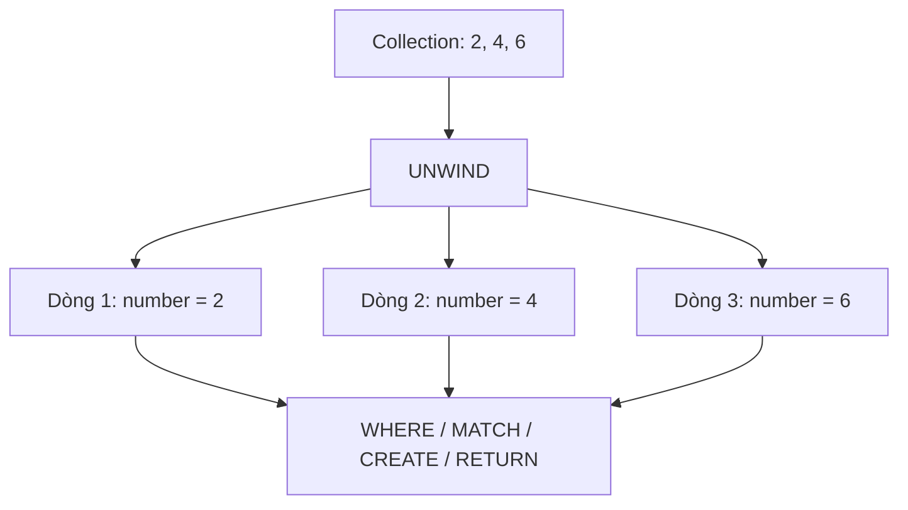

# UNWIND, collection, map và xử lý dữ liệu theo lô

Trong Cypher, dữ liệu thường được xử lý theo từng dòng kết quả. `UNWIND` chuyển các phần tử của một collection thành nhiều dòng để bạn có thể lọc, biến đổi, nối với node hoặc ghi dữ liệu. Collection giúp gom nhiều giá trị trong một lần truyền tham số; map giúp biểu diễn một bản ghi có tên trường rõ ràng. Kết hợp ba cơ chế này, ứng dụng Spring Data Neo4j có thể gửi một danh sách dữ liệu vào một câu lệnh Cypher để tạo hoặc cập nhật nhiều node và relationship.

Bài học này tập trung vào cách đọc và biến đổi collection, truy cập map, dùng `UNWIND` để xử lý nhiều bản ghi và áp dụng các kỹ thuật đó trong ứng dụng Spring Data Neo4j. Ví dụ sử dụng cú pháp Cypher phổ biến trong Neo4j hiện đại.

## 1. Collection trong Cypher

Collection là một danh sách có thứ tự gồm các giá trị. Bạn có thể tạo list trực tiếp bằng dấu ngoặc vuông:

```cypher
RETURN ["An", "Bình", "Chi"] AS names,
       [10, 20, 30] AS scores
```

Một số thao tác thường dùng:

| Biểu thức | Ý nghĩa |
|---|---|
| `size(names)` | Số phần tử trong list |
| `names[0]` | Phần tử ở vị trí đầu tiên (index bắt đầu từ 0) |
| `names[-1]` | Phần tử cuối cùng |
| `head(names)` | Phần tử đầu tiên |
| `last(names)` | Phần tử cuối cùng |
| `'An' IN names` | Kiểm tra một giá trị có nằm trong list |
| `names[1..3]` | Lấy một lát cắt của list, từ index 1 đến trước index 3 |

Ví dụ lọc và biến đổi phần tử bằng list comprehension:

```cypher
WITH ["neo4j", "spring", "cypher", "java"] AS topics
RETURN [topic IN topics
        WHERE topic <> "spring"
        | toUpper(topic)] AS selectedTopics
```

Phần `WHERE` giữ lại các phần tử thỏa điều kiện; biểu thức sau dấu `|` xác định giá trị đưa vào list kết quả. List comprehension hữu ích khi chỉ cần biến đổi collection thành một collection mới mà không cần tạo dòng kết quả riêng cho từng phần tử.

Bạn cũng có thể tạo list từ các dòng bằng hàm tổng hợp `collect`:

```cypher
MATCH (p:Person)
RETURN collect(p.name) AS names
```

`collect` gom các giá trị thành một list. Khi cần xử lý từng giá trị trong list đó ở bước tiếp theo, bạn có thể kết hợp với `UNWIND`.

## 2. UNWIND chuyển collection thành các dòng

`UNWIND` nhận một list và tạo một dòng cho mỗi phần tử. Cú pháp cơ bản:

```cypher
UNWIND expression AS variable
```

Ví dụ:

```cypher
UNWIND [2, 4, 6] AS number
RETURN number, number * number AS squared
```

Kết quả gồm ba dòng, mỗi dòng chứa một phần tử và bình phương của nó. Sau `UNWIND`, biến `number` đại diện cho phần tử hiện tại và có thể được dùng trong `WHERE`, `WITH`, `MATCH`, `CREATE`, `MERGE` hoặc các biểu thức khác.



`UNWIND` không tự sắp xếp kết quả. Nếu thứ tự quan trọng, hãy chỉ định `ORDER BY`:

```cypher
UNWIND ["Chi", "An", "Bình"] AS name
RETURN name
ORDER BY name
```

Một vài hành vi cần nhớ:

- List rỗng `[]` tạo ra không dòng nào. Những bước phía sau trong cùng pipeline vì thế cũng không được thực hiện.
- Các phần tử trùng lặp vẫn tạo ra các dòng riêng. Dùng `DISTINCT` nếu nghiệp vụ yêu cầu loại trùng.
- `UNWIND` một giá trị `null` không tạo dòng; ngược lại, `UNWIND [null] AS value` tạo một dòng mà `value` là `null`.
- Nếu cần thứ tự ổn định, hãy dùng `ORDER BY` sau `UNWIND` hoặc ở bước trả kết quả phù hợp.

## 3. Dùng UNWIND với tham số truyền từ ứng dụng

Trong ứng dụng thực tế, list thường đến từ request hoặc một service Java. Hãy truyền list dưới dạng tham số Cypher thay vì ghép dữ liệu trực tiếp vào chuỗi truy vấn.

```cypher
UNWIND $names AS name
RETURN name, toUpper(name) AS normalizedName
```

Ở đây `$names` là tham số. Ứng dụng truyền một list, ví dụ `List.of("An", "Bình", "Chi")`. Neo4j nhận list và tạo một dòng cho mỗi tên.

Ví dụ dùng `Neo4jClient` trong Spring Data Neo4j:

```java
import java.util.List;

import org.springframework.data.neo4j.core.Neo4jClient;
import org.springframework.stereotype.Repository;

@Repository
public class PersonQueryRepository {

    private final Neo4jClient neo4jClient;

    public PersonQueryRepository(Neo4jClient neo4jClient) {
        this.neo4jClient = neo4jClient;
    }

    public List<String> normalizeNames(List<String> names) {
        return neo4jClient.query("""
                UNWIND $names AS name
                RETURN toUpper(name) AS normalizedName
                ORDER BY normalizedName
                """)
            .bind(names).to("names")
            .fetchAs(String.class)
            .mappedBy((typeSystem, record) ->
                record.get("normalizedName").asString())
            .all();
    }
}
```

`bind(names).to("names")` gắn danh sách Java vào tham số `$names`. `mappedBy` ánh xạ từng record thành một chuỗi. Với collection lớn, nên kiểm tra đầu vào và giới hạn kích thước mỗi lần gọi để kiểm soát bộ nhớ, thời gian thực thi và lượng dữ liệu truyền qua mạng.

## 4. Map biểu diễn một bản ghi

Map là tập hợp các cặp key-value. Trong Cypher, map literal dùng dấu ngoặc nhọn:

```cypher
RETURN {
    externalId: "person-101",
    name: "An",
    age: 28,
    active: true
} AS person
```

Truy cập giá trị trong map bằng dấu chấm:

```cypher
WITH {name: "An", age: 28} AS person
RETURN person.name AS name, person.age AS age
```

Map đặc biệt hữu ích khi truyền dữ liệu theo lô, vì mỗi phần tử có thể chứa nhiều trường. Ví dụ tham số `$people` có dạng list các map:

```json
[
  {"externalId": "p-101", "name": "An", "age": 28},
  {"externalId": "p-102", "name": "Bình", "age": 31},
  {"externalId": "p-103", "name": "Chi", "age": 25}
]
```

Trong Cypher, `UNWIND $people AS person` đưa từng map vào biến `person`. Bạn có thể đọc các trường như `person.externalId`, `person.name` và `person.age`.

## 5. Map projection tạo kết quả có cấu trúc

Map projection cho phép tạo một map từ node hoặc map hiện có. Cú pháp thường dùng là `node { .property }`:

```cypher
MATCH (p:Person)
RETURN p {
    .externalId,
    .name,
    .age,
    displayName: p.name
} AS personView
```

Các mục bắt đầu bằng dấu chấm lấy property cùng tên từ node. Mục `displayName: p.name` tạo một trường mới từ biểu thức. Map projection phù hợp khi API chỉ cần trả một phần dữ liệu của node, hoặc cần đổi tên và bổ sung trường cho kết quả.

Bạn cũng có thể tạo map từ các dòng đã tổng hợp:

```cypher
MATCH (p:Person)
WITH p
ORDER BY p.name
RETURN collect(p {
    .externalId,
    .name
}) AS people
```

Kết quả là một list các map. Cách này thường tiện cho việc tạo response hoặc dữ liệu trung gian, nhưng không có nghĩa map lồng nhau có thể được lưu trực tiếp thành property của node.

## 6. Kết hợp UNWIND và map để ghi dữ liệu theo lô

Một mẫu phổ biến là gửi list các map vào một câu lệnh, sau đó dùng `MERGE` để tạo hoặc tìm node theo khóa nghiệp vụ và `SET +=` để cập nhật các property:

```cypher
UNWIND $people AS person
MERGE (p:Person {externalId: person.externalId})
SET p += person
RETURN count(*) AS rowsProcessed
```

Giải thích:

1. `UNWIND` biến từng map trong `$people` thành một dòng.
2. `MERGE` tìm hoặc tạo node `Person` theo `externalId`.
3. `SET p += person` gộp các property từ map vào node. Những property khác không có trong map được giữ nguyên.
4. `count(*)` đếm số dòng đã đi qua pipeline và trả về số bản ghi được xử lý trong câu lệnh.

`SET p = person` có ý nghĩa khác: thay toàn bộ tập property hiện có của node bằng các property trong map. Vì vậy, khi chỉ muốn cập nhật một số trường, `SET p += person` thường phù hợp hơn. Với phép gán map bằng `+=`, một giá trị `null` có thể làm property tương ứng bị xóa; hãy xác định rõ ý nghĩa của `null` trong dữ liệu đầu vào.

Ví dụ trên giả định mỗi map có `externalId` hợp lệ và duy nhất. Trong ứng dụng thực tế, hãy tạo uniqueness constraint cho khóa nghiệp vụ phù hợp và kiểm tra các bản ghi đầu vào trước khi ghi.

## 7. Tạo relationship từ danh sách map

Collection map cũng có thể mô tả các cạnh cần tạo. Ví dụ mỗi phần tử chứa mã người gửi và người nhận:

```json
[
  {"from": "p-101", "to": "p-102"},
  {"from": "p-101", "to": "p-103"},
  {"from": "p-102", "to": "p-103"}
]
```

Cypher dùng `UNWIND` để tìm hai node và tạo relationship:

```cypher
UNWIND $connections AS connection
MATCH (source:Person {externalId: connection.from})
MATCH (target:Person {externalId: connection.to})
MERGE (source)-[:KNOWS]->(target)
RETURN count(*) AS relationshipsProcessed
```

`MATCH` yêu cầu cả hai node tồn tại. Nếu thiếu một đầu mút, dòng đó không tiếp tục tới `MERGE`, do đó relationship không được tạo. Nếu cần báo cáo các mã không tìm thấy, hãy thiết kế truy vấn kiểm tra riêng hoặc dùng `OPTIONAL MATCH` và phân loại kết quả trước khi ghi.

## 8. Kết hợp UNWIND với WITH, WHERE và collect

Các mệnh đề Cypher có thể nối tiếp để tạo pipeline xử lý dữ liệu. Ví dụ lọc danh sách map trước khi ghi:

```cypher
UNWIND $people AS person
WITH person
WHERE person.externalId IS NOT NULL
  AND person.name IS NOT NULL
MERGE (p:Person {externalId: person.externalId})
SET p.name = person.name,
    p.age = person.age
RETURN count(*) AS rowsProcessed
```

`WITH` chuyển các biến cần thiết sang phần tiếp theo của truy vấn và cho phép lọc bằng `WHERE`. Những dòng bị loại bởi `WHERE` không đi tới thao tác ghi. Nếu cần biết có bao nhiêu bản ghi bị loại, có thể kiểm tra dữ liệu ở ứng dụng trước khi gửi hoặc xây dựng một truy vấn thống kê riêng.

Ví dụ gom các tên theo nhóm rồi trả về từng nhóm:

```cypher
UNWIND $people AS person
WITH person.city AS city, collect(person.name) AS names
RETURN city, names, size(names) AS memberCount
ORDER BY city
```

Ở đây `collect` gom các tên theo từng giá trị `city`. Kết quả có một dòng cho mỗi nhóm thành phố.

## 9. Gọi truy vấn theo lô từ Spring Data Neo4j

Bạn có thể đặt câu lệnh ghi theo lô trong repository bằng `@Query`. Ví dụ dưới đây nhận danh sách map từ Java:

```java
import java.util.List;
import java.util.Map;

import org.springframework.data.neo4j.repository.query.Query;
import org.springframework.data.repository.query.Param;
import org.springframework.data.neo4j.repository.Neo4jRepository;

public interface PersonRepository extends Neo4jRepository<Person, Long> {

    @Query("""
        UNWIND $people AS person
        MERGE (p:Person {externalId: person.externalId})
        SET p += person
        RETURN count(*) AS rowsProcessed
        """)
    Long upsertPeople(@Param("people") List<Map<String, Object>> people);
}
```

Phương thức nhận một `List<Map<String, Object>>`; mỗi map là một bản ghi. Tham số `@Param("people")` liên kết với `$people` trong Cypher. Kết quả `count(*)` được ánh xạ thành `Long`. Khi dùng truy vấn ghi tùy chỉnh, hãy kiểm tra kiểu trả về và mapping theo phiên bản Spring Data Neo4j đang dùng.

Nếu cần điều khiển việc ánh xạ kết quả chi tiết hơn, có thể dùng `Neo4jClient` như ví dụ sau:

```java
public long upsertPeople(List<Map<String, Object>> people) {
    return neo4jClient.query("""
            UNWIND $people AS person
            MERGE (p:Person {externalId: person.externalId})
            SET p += person
            RETURN count(*) AS rowsProcessed
            """)
        .bind(people).to("people")
        .fetchAs(Long.class)
        .mappedBy((typeSystem, record) ->
            record.get("rowsProcessed").asLong())
        .one()
        .orElse(0L);
}
```

Đoạn mã này giả định `neo4jClient` đã được inject vào lớp chứa phương thức. Trong cả hai cách, tham số được bind riêng nên dữ liệu đầu vào không bị ghép trực tiếp vào câu lệnh Cypher.

## 10. Transaction và kích thước lô

Một câu lệnh `UNWIND` thông thường chạy trong transaction của câu lệnh đó. Nếu một thao tác ghi trong transaction thất bại, transaction có thể rollback toàn bộ thay đổi thuộc transaction. `UNWIND` không tự chia dữ liệu thành nhiều transaction và cũng không tự chạy song song.

Khi xử lý dữ liệu lớn, hãy cân nhắc:

- Chia danh sách ở tầng ứng dụng thành các chunk có kích thước phù hợp, sau đó gọi truy vấn cho từng chunk.
- Đo thời gian thực thi, lượng bộ nhớ, số node/relationship được ghi và kích thước transaction để chọn kích thước chunk.
- Xác định rõ mỗi chunk có transaction riêng hay nhiều chunk nằm trong một transaction nghiệp vụ lớn. Nếu service bao toàn bộ vòng lặp trong một `@Transactional`, các lần gọi có thể cùng nằm trong một transaction.
- Thiết kế thao tác có thể chạy lại an toàn khi phù hợp, thường bằng khóa nghiệp vụ ổn định và `MERGE`.
- Kiểm tra dữ liệu đầu vào, trường bắt buộc và node đầu mút trước khi ghi relationship.

Với các kịch bản nạp dữ liệu rất lớn, Neo4j còn có cơ chế subquery chạy theo transaction như `CALL { ... } IN TRANSACTIONS`. Cơ chế này có điều kiện thực thi riêng và thường cần chạy bằng implicit transaction; không nên đưa nguyên xi vào một phương thức đang tham gia transaction tường minh qua `@Transactional`. Hãy đối chiếu phiên bản Neo4j, cách gọi driver và ranh giới transaction trước khi sử dụng.

## 11. Những lỗi thường gặp

| Vấn đề | Nguyên nhân | Cách xử lý |
|---|---|---|
| Truy vấn không trả dòng nào | Tham số list rỗng hoặc các dòng bị lọc hết | Kiểm tra dữ liệu đầu vào và điều kiện `WHERE` |
| Một bản ghi bị ghi nhiều lần | List có phần tử trùng hoặc truy vấn tạo node mới mỗi lần | Dùng khóa nghiệp vụ, uniqueness constraint và `MERGE` |
| Kết quả thay đổi thứ tự | `UNWIND` không bảo đảm thứ tự | Thêm `ORDER BY` |
| Node mất property sau cập nhật | Dùng `SET p = map` thay vì `SET p += map` | Chọn phép gán theo ý định cập nhật hoặc thay thế |
| Relationship không được tạo | Một trong hai node không khớp `MATCH` | Kiểm tra khóa đầu mút hoặc xử lý trường hợp thiếu node |
| Transaction quá lớn | Gửi quá nhiều bản ghi trong một lần hoặc gom nhiều chunk vào cùng transaction | Giảm kích thước chunk và xác định lại ranh giới transaction |
| Property không nhận được map lồng nhau | Neo4j property không lưu trực tiếp map hoặc cấu trúc collection lồng tùy ý | Mô hình hóa dữ liệu thành node/relationship hoặc chuyển thành chuỗi theo định dạng có chủ đích |

Map là cấu trúc dữ liệu trung gian rất hữu ích trong truy vấn, nhưng Neo4j không lưu một map tùy ý làm property của node hoặc relationship. Property của Neo4j dùng các kiểu giá trị được hỗ trợ như số, chuỗi, boolean, giá trị temporal/spatial và list hợp lệ của các kiểu property. Nếu dữ liệu có cấu trúc lồng nhau, hãy cân nhắc mô hình hóa thành các node và relationship.

## 12. Tự kiểm tra

1. `UNWIND` biến một list thành dạng dữ liệu nào trong pipeline Cypher?
2. Vì sao `UNWIND` không bảo đảm thứ tự dòng kết quả và cần `ORDER BY` khi thứ tự quan trọng?
3. Khác biệt giữa `SET p = person` và `SET p += person` là gì?
4. Vì sao nên truyền list map qua tham số `$people` thay vì nối dữ liệu vào chuỗi Cypher?
5. Một câu lệnh `UNWIND` có tự động chia dữ liệu thành nhiều transaction không?

Khi nắm được collection, map và `UNWIND`, bạn có thể chuyển dữ liệu từ ứng dụng Java sang Cypher theo cấu trúc rõ ràng, xử lý từng bản ghi trong cùng một pipeline và xây dựng thao tác ghi theo lô có kiểm soát. Đây là kỹ thuật nền tảng để làm việc hiệu quả với node, relationship và repository trong Spring Data Neo4j.
