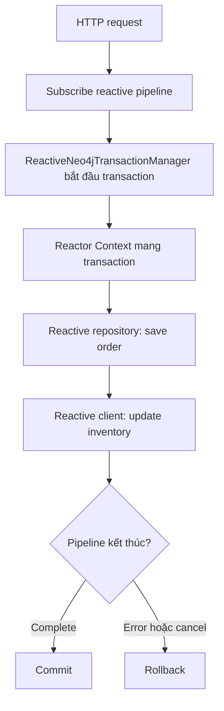

# ReactiveNeo4jTransactionManager và phạm vi Reactor Context

Trong ứng dụng Spring Data Neo4j reactive, một nghiệp vụ có thể gồm nhiều thao tác đọc và ghi được ghép thành `Mono` hoặc `Flux`. Nếu các thao tác phải cùng thành công hoặc cùng rollback, cần đặt chúng trong một reactive transaction. `ReactiveNeo4jTransactionManager` kết nối transaction infrastructure của Spring với Neo4j Driver; Spring giữ trạng thái transaction trong Reactor `Context` để các thao tác database trong cùng reactive pipeline có thể tham gia cùng transaction.

Khác với transaction imperative gắn với thread, reactive transaction gắn với subscription và Reactor Context. Vì vậy, cách ghép publisher quyết định phạm vi transaction. Nếu tự subscribe, block hoặc tạo một luồng reactive độc lập, thao tác có thể rời khỏi context đang mang transaction.

## 1. Reactive transaction khác transaction imperative như thế nào?

Trong mô hình imperative, `PlatformTransactionManager` thường gắn tài nguyên và trạng thái transaction với thread thông qua `ThreadLocal`. Các lệnh repository chạy trên cùng thread có thể tham gia transaction đang hoạt động.

Trong mô hình reactive, một pipeline có thể tiếp tục trên nhiều thread khác nhau do scheduler và cơ chế thực thi của Reactor. Dựa vào `ThreadLocal` sẽ không bảo đảm các thao tác vẫn nhìn thấy cùng transaction. Spring dùng Reactor `Context` để gắn transaction state và tài nguyên với subscription.

| Đặc điểm | Imperative | Reactive |
|---|---|---|
| Transaction manager | `PlatformTransactionManager` | `ReactiveTransactionManager` |
| Transaction context | Thường gắn với thread | Gắn với Reactor Context của subscription |
| Kiểu trả về phù hợp với `@Transactional` | Giá trị thường, `void` | `Mono`, `Flux` hoặc `Publisher` |
| Data access | Repository/client imperative | Reactive repository, `ReactiveNeo4jClient` |
| Thực thi | Thường diễn ra ngay khi gọi | Lazy, thường bắt đầu khi subscribe |

`ReactiveNeo4jTransactionManager` triển khai `ReactiveTransactionManager` cho Neo4j. Nó quản lý việc bắt đầu, commit, rollback và giải phóng reactive transaction dùng Neo4j Driver.

## 2. Reactor Context là nơi giữ trạng thái transaction

Một reactive transaction được gắn với Reactor Context của subscription. Các publisher tham gia phải được ghép trong cùng pipeline để tiếp tục nhìn thấy context đó.



Reactor Context là dữ liệu gắn với subscription, không phải biến toàn cục và không phải `ThreadLocal`. Khi pipeline chuyển scheduler bằng `publishOn` hoặc `subscribeOn`, Reactor vẫn duy trì context theo cơ chế của nó. Vấn đề xuất hiện khi code tạo subscription mới, thoát khỏi pipeline hoặc gọi API imperative không tham gia Reactor Context.

Ví dụ, `flatMap`, `then`, `zip` và các toán tử Reactor thông thường giúp ghép các publisher vào cùng pipeline. Một lời gọi `subscribe()` bên trong callback lại tạo subscription riêng, không tự động kế thừa transaction đang quản lý theo cách mà ứng dụng mong đợi.

Context có phạm vi theo từng subscriber. Nếu cùng một publisher được subscribe hai lần, mỗi subscription có thể tạo một transaction riêng. Context cũng không tự động biến thành `ThreadLocal` cho MDC hoặc thư viện logging; nếu cần đưa dữ liệu context sang logging, hãy dùng tích hợp context-propagation phù hợp. Không tự ghi hoặc sửa key nội bộ mà Spring dùng để lưu transaction.

## 3. Cấu hình ReactiveNeo4jTransactionManager

`ReactiveNeo4jTransactionManager` nhận Neo4j `Driver`. Có thể dùng constructor chỉ nhận Driver cho database mặc định, hoặc constructor nhận thêm `ReactiveDatabaseSelectionProvider` để chọn database theo cấu hình của ứng dụng.

```java
import org.neo4j.driver.Driver;
import org.springframework.context.annotation.Bean;
import org.springframework.context.annotation.Configuration;
import org.springframework.data.neo4j.core.ReactiveDatabaseSelectionProvider;
import org.springframework.data.neo4j.core.transaction.ReactiveNeo4jTransactionManager;
import org.springframework.transaction.annotation.EnableTransactionManagement;

@Configuration(proxyBeanMethods = false)
@EnableTransactionManagement
public class ReactiveNeo4jTransactionConfiguration {

    @Bean
    ReactiveNeo4jTransactionManager reactiveTransactionManager(
            Driver driver,
            ReactiveDatabaseSelectionProvider databaseSelectionProvider) {
        return new ReactiveNeo4jTransactionManager(
                driver,
                databaseSelectionProvider);
    }
}
```

Bean `Driver` và `ReactiveDatabaseSelectionProvider` được inject từ cấu hình Neo4j của ứng dụng. Nếu chỉ dùng database mặc định, có thể khai báo constructor `new ReactiveNeo4jTransactionManager(driver)`.

Transaction manager, `ReactiveNeo4jClient` và reactive template/repository phải dùng cùng `Driver` instance và cùng database selection phù hợp. Nếu tự tạo một Driver khác cho client hoặc transaction manager, Spring có thể không nhận ra đó là cùng tài nguyên transaction để các thao tác tham gia chung.

Ví dụ repository reactive có method giữ hàng tồn trả về node đã cập nhật hoặc `Mono.empty()` nếu không đủ số lượng:

```java
import org.springframework.data.neo4j.repository.ReactiveNeo4jRepository;
import org.springframework.data.neo4j.repository.query.Query;
import org.springframework.data.repository.query.Param;
import reactor.core.publisher.Mono;

public interface ReactiveInventoryRepository
        extends ReactiveNeo4jRepository<InventoryItem, String> {

    @Query("""
        MATCH (i:InventoryItem {sku: $sku})
        WHERE i.available >= $quantity
        SET i.available = i.available - $quantity
        RETURN i
        """)
    Mono<InventoryItem> reserve(
            @Param("sku") String sku,
            @Param("quantity") long quantity);
}
```

Vì `reserve` trả về entity khi cập nhật được và không trả record khi không đủ tồn, `switchIfEmpty` trong service có thể phát lỗi để rollback đơn hàng đã lưu trước đó.

### Lưu ý khi dùng Spring Boot

Khi Project Reactor có trên classpath, Spring Boot có thể tự cấu hình reactive repositories và `ReactiveNeo4jTemplate`. Tuy nhiên, theo hướng dẫn Spring Boot hiện hành, reactive `ReactiveTransactionManager` không được tự cấu hình; ứng dụng cần khai báo bean `ReactiveNeo4jTransactionManager` như ví dụ trên để bật transaction reactive.

Nếu không dùng Spring Boot, SDN cung cấp `AbstractReactiveNeo4jConfig` cùng `@EnableReactiveNeo4jRepositories` để cấu hình reactive infrastructure. Trong cấu hình Spring thuần, bật transaction annotation bằng `@EnableTransactionManagement`.

Nếu ứng dụng có cả `Neo4jTransactionManager` imperative và `ReactiveNeo4jTransactionManager`, hãy đặt tên bean rõ ràng và chỉ định manager trong `@Transactional` để tránh chọn nhầm. Reactive transaction manager và imperative transaction manager phục vụ hai mô hình thực thi khác nhau.

## 4. Dùng @Transactional trên reactive service

Đặt transaction boundary ở service để các thao tác repository thuộc cùng một use case. Method được đánh dấu `@Transactional` cần trả về reactive type như `Mono` hoặc `Flux` để Spring sử dụng reactive transaction management.

Ví dụ một use case tạo đơn hàng, giữ hàng tồn và lưu sự kiện nghiệp vụ:

```java
import org.springframework.stereotype.Service;
import org.springframework.transaction.annotation.Transactional;
import reactor.core.publisher.Mono;

@Service
public class ReactiveOrderService {

    private final ReactiveOrderRepository orders;
    private final ReactiveInventoryRepository inventory;
    private final ReactiveOutboxRepository outbox;

    public ReactiveOrderService(
            ReactiveOrderRepository orders,
            ReactiveInventoryRepository inventory,
            ReactiveOutboxRepository outbox) {
        this.orders = orders;
        this.inventory = inventory;
        this.outbox = outbox;
    }

    @Transactional(transactionManager = "reactiveTransactionManager")
    public Mono<PurchaseOrder> createOrder(
            PurchaseOrder order,
            String sku,
            long quantity) {

        return orders.save(order)
                .flatMap(saved -> inventory.reserve(sku, quantity)
                        .switchIfEmpty(Mono.error(
                                new IllegalStateException("Insufficient stock")))
                        .thenReturn(saved))
                .flatMap(saved -> outbox.save(OrderCreated.from(saved))
                        .thenReturn(saved));
    }
}
```

Các repository trong ví dụ là reactive repository và các method `save`/`reserve` trả về `Mono`. Nếu không đủ hàng, pipeline phát ra lỗi. Transaction manager nhận tín hiệu lỗi và rollback việc tạo đơn hàng cùng các thay đổi Neo4j khác trong transaction.

`ReactiveOutboxRepository` trong ví dụ lưu outbox event vào cùng Neo4j database. Nếu cần gửi message đến broker bên ngoài, hãy ghi outbox trong transaction rồi để publisher riêng gửi sau commit; transaction Neo4j không tự bao trùm broker.

`@Transactional` không làm cho các thao tác chạy ngay khi method được gọi. Spring bọc publisher; transaction được bắt đầu khi publisher được subscribe và được commit khi pipeline hoàn tất thành công. Nếu pipeline kết thúc bằng error, transaction được rollback theo quy tắc rollback.

### Tránh self-invocation

Transaction annotation hoạt động qua Spring proxy. Nếu một method trong cùng class gọi trực tiếp method khác được đánh dấu `@Transactional`, lời gọi nội bộ đó không đi qua proxy nên không tạo transaction boundary mới như mong đợi. Đặt ranh giới transaction ở method public được gọi từ bean khác hoặc dùng `TransactionalOperator` khi cần kiểm soát rõ trong pipeline.

## 5. Phạm vi transaction nằm trong cùng reactive pipeline

Các thao tác sau có thể tham gia cùng transaction khi được ghép trong publisher mà method transactional trả về:

```java
@Transactional(transactionManager = "reactiveTransactionManager")
public Mono<Void> updateGraph(String customerId, String status) {
    return customers.updateStatus(customerId, status)
            .then(orders.updateCustomerOrders(customerId, status))
            .then(auditEvents.recordStatusChange(customerId, status));
}
```

Các thao tác được nối bằng `then`, nên bước sau chỉ chạy sau khi bước trước hoàn tất. Chúng vẫn nằm trong pipeline mà Spring transaction interceptor quản lý.

Transaction reactive không phụ thuộc mọi thao tác chạy trên cùng thread. Việc đổi scheduler không tự làm mất Reactor Context:

```java
import reactor.core.scheduler.Schedulers;

@Transactional(transactionManager = "reactiveTransactionManager")
public Mono<Void> updateGraph(String customerId, String status) {
    return customers.updateStatus(customerId, status)
            .publishOn(Schedulers.parallel())
            .then(orders.updateCustomerOrders(customerId, status));
}
```

Ví dụ trên vẫn là một pipeline Reactor. Dù vậy, không nên chuyển công việc blocking sang scheduler chỉ để cố đưa nó vào reactive transaction; blocking data access vẫn là blocking và không tự tham gia transaction reactive.

## 6. Tạo transaction bằng TransactionalOperator

Khi cần xác định phạm vi transaction ngay trong một phương thức mà không dùng annotation, tạo `TransactionalOperator` từ reactive transaction manager:

```java
import org.springframework.stereotype.Service;
import org.springframework.transaction.ReactiveTransactionManager;
import org.springframework.transaction.reactive.TransactionalOperator;
import reactor.core.publisher.Mono;

@Service
public class ReactiveGraphWriter {

    private final ReactiveCustomerRepository customers;
    private final ReactiveOrderRepository orders;
    private final TransactionalOperator transactionalOperator;

    public ReactiveGraphWriter(
            ReactiveCustomerRepository customers,
            ReactiveOrderRepository orders,
            ReactiveTransactionManager transactionManager) {
        this.customers = customers;
        this.orders = orders;
        this.transactionalOperator = TransactionalOperator.create(transactionManager);
    }

    public Mono<Void> createCustomerAndOrder(Customer customer, PurchaseOrder order) {
        Mono<Void> writes = customers.save(customer)
                .then(orders.save(order))
                .then();

        return writes.as(transactionalOperator::transactional);
    }

    public Mono<Void> saveThenFail(Customer customer) {
        return transactionalOperator.execute(status ->
                customers.save(customer)
                        .then(Mono.error(new IllegalStateException("Force rollback")))
        ).then();
    }
}
```

`TransactionalOperator` có hai kiểu sử dụng:

- **Operator style:** bọc một `Mono` hoặc `Flux` bằng `.as(transactionalOperator::transactional)`.
- **Callback style:** dùng `transactionalOperator.execute(...)` để nhận `ReactiveTransaction` và điều khiển trạng thái transaction khi cần.

Operator style thuận tiện khi toàn bộ pipeline đã được xây dựng. Transaction chỉ bao quanh publisher được bọc và các publisher upstream thuộc pipeline đó.

### Callback style và rollback-only

Nếu nghiệp vụ bắt lỗi và chuyển thành kết quả bình thường, transaction có thể không nhìn thấy error signal để rollback tự động. Trong trường hợp cần nuốt lỗi nhưng vẫn rollback, đánh dấu transaction là rollback-only:

```java
public Mono<Void> createWithRollbackOnBusinessError(Customer customer) {
    return transactionalOperator.execute(status ->
            customers.save(customer)
                    .then(validateBusinessRule(customer))
                    .onErrorResume(BusinessRuleException.class, error -> {
                        status.setRollbackOnly();
                        return Mono.empty();
                    })
    ).then();
}
```

Nếu không cần chuyển lỗi thành kết quả bình thường, cách đơn giản hơn là để lỗi đi tiếp qua pipeline. Transaction manager sẽ nhận error signal và rollback theo quy tắc đã cấu hình.

## 7. Commit, rollback và tín hiệu kết thúc

Reactive transaction có vòng đời gắn với tín hiệu của publisher:

| Kết quả pipeline | Hành vi transaction |
|---|---|
| Hoàn tất thành công (`onComplete`) | Commit |
| Phát sinh lỗi (`onError`) | Rollback theo rollback rules |
| Bị hủy subscription (`cancel`) | Rollback |
| Được đánh dấu rollback-only | Rollback dù callback kết thúc bình thường |

Một `Mono.empty()` là hoàn tất bình thường; tự nó không có nghĩa rollback. Một `Mono.error(...)` truyền đến ranh giới transaction là tín hiệu lỗi. Nếu code dùng `onErrorResume` để thay lỗi bằng giá trị khác, cần quyết định rõ có tiếp tục commit hay phải gọi `setRollbackOnly()`.

### Cancellation có thể làm rollback

Trong Reactive Streams, downstream có thể hủy subscription. Một số toán tử như `next()`, `take(1)` hoặc `timeout(...)` có thể phát sinh cancellation. Spring xem cancellation của transactional publisher là tín hiệu rollback vì transaction không thể biết subscriber hủy do lỗi hay vì không còn quan tâm kết quả.

Đặc biệt, nếu một `Flux` ghi dữ liệu được bọc trong transaction rồi downstream chỉ tiêu thụ một phần bằng `take(...)`, transaction có thể bị hủy và rollback. Với nghiệp vụ ghi, thường nên tạo một publisher hoàn tất rõ ràng như `Mono<Void>` hoặc tiêu thụ đầy đủ kết quả trước khi kết thúc transaction.

## 8. Reactor Context và các anti-pattern

### Không tự gọi subscribe() trong service

Sai:

```java
@Transactional(transactionManager = "reactiveTransactionManager")
public Mono<Void> createOrder(PurchaseOrder order) {
    orders.save(order).subscribe();
    return Mono.empty();
}
```

`subscribe()` tạo một subscription độc lập. Spring có thể thấy publisher trả về đã hoàn tất và commit transaction, trong khi lệnh `save` chạy ở subscription khác, không nằm trong transaction context ban đầu.

Đúng:

```java
@Transactional(transactionManager = "reactiveTransactionManager")
public Mono<Void> createOrder(PurchaseOrder order) {
    return orders.save(order).then();
}
```

Trả publisher cho caller. Web framework, message listener hoặc tầng điều phối bên ngoài sẽ subscribe tại điểm thích hợp.

### Không dùng block() trong reactive transaction

Sai:

```java
@Transactional(transactionManager = "reactiveTransactionManager")
public Mono<Void> updateCustomer(Customer customer) {
    Customer saved = customers.save(customer).block();
    return orders.updateCustomerName(saved.id(), saved.name()).then();
}
```

`block()` phá vỡ luồng non-blocking và có thể tạo execution path không còn nằm trong reactive transaction context như mong muốn. Hãy nối publisher bằng `flatMap`, `map` hoặc `then`.

Đúng:

```java
@Transactional(transactionManager = "reactiveTransactionManager")
public Mono<Void> updateCustomer(Customer customer) {
    return customers.save(customer)
            .flatMap(saved -> orders.updateCustomerName(saved.id(), saved.name()))
            .then();
}
```

### Không trộn imperative repository vào reactive transaction

Imperative repository dùng `PlatformTransactionManager` và thread-bound transaction. Reactive transaction dùng Reactor Context. Gọi imperative repository bên trong reactive pipeline không khiến thao tác đó tự tham gia transaction Neo4j reactive. Hãy dùng reactive repository hoặc `ReactiveNeo4jClient` xuyên suốt use case.

Nếu ứng dụng phải truy cập một hệ thống blocking, hãy thiết kế ranh giới riêng và cân nhắc outbox, saga hoặc cơ chế phối hợp phù hợp. Một reactive transaction Neo4j không tự tạo distributed transaction với HTTP service, JDBC hoặc message broker.

## 9. Chọn đúng transaction manager khi có cả hai mô hình

Một ứng dụng có thể chứa cả:

- `Neo4jTransactionManager` cho repository/client imperative.
- `ReactiveNeo4jTransactionManager` cho reactive repository/client.

Khi có nhiều manager, chỉ định tên manager tường minh:

```java
@Transactional(transactionManager = "reactiveTransactionManager")
public Mono<Void> reactiveUseCase() {
    // Reactive repository operations
    return Mono.empty();
}
```

Method imperative dùng manager imperative tương ứng và trả về kiểu đồng bộ. Không dùng `@Transactional` reactive trên method trả `void` hoặc object thường; Spring xác định mô hình transaction dựa trên kiểu trả về và transaction manager.

Nếu method reactive cần propagation hoặc timeout riêng, có thể cấu hình thuộc tính của `@Transactional`, chẳng hạn `propagation`, `timeout` hoặc `readOnly`. Các thiết lập phải phù hợp với transaction manager và khả năng của Neo4j; `readOnly = true` không phải cam kết database sẽ tự tối ưu mọi câu lệnh.

## 10. Kiểm thử reactive transaction

Kiểm thử cần xác nhận cả hai tình huống: pipeline hoàn tất thì dữ liệu được commit; pipeline lỗi thì thay đổi trong transaction được rollback. Dùng `StepVerifier` để subscribe và xác minh tín hiệu reactive.

Service `ReactiveGraphWriter` ở mục 6 đã có method `saveThenFail()` để lưu entity rồi phát sinh lỗi trong cùng `TransactionalOperator`. Test dưới đây gọi chính method đó và xác nhận dữ liệu không tồn tại sau rollback.

Test rollback:

```java
import org.junit.jupiter.api.Test;
import org.springframework.beans.factory.annotation.Autowired;
import org.springframework.boot.test.context.SpringBootTest;
import reactor.test.StepVerifier;

@SpringBootTest
class ReactiveTransactionIntegrationTest {

    @Autowired
    ReactiveCustomerRepository customers;

    @Autowired
    ReactiveGraphWriter writer;

    @Test
    void rollsBackWhenPipelineFails() {
        Customer customer = new Customer("C-901", "Lan");

        StepVerifier.create(writer.saveThenFail(customer))
                .expectError(IllegalStateException.class)
                .verify();

        StepVerifier.create(customers.existsById("C-901"))
                .expectNext(false)
                .verifyComplete();
    }
}
```

Ví dụ minh họa cấu trúc test; hãy điều chỉnh constructor, repository và method service theo domain thực tế. Integration test phải chạy với Neo4j thật hoặc Testcontainers có cấu hình tương thích với SDN.

Khi kiểm thử transaction, tránh tự subscribe bên trong code được kiểm thử. `StepVerifier.verify()` là điểm subscribe của test và giúp quan sát chính publisher mà transaction manager bọc.

Đối với nhánh commit, gọi một use case hoàn tất bình thường rồi xác nhận dữ liệu tồn tại:

```java
@Test
void commitsWhenPipelineCompletes() {
    Customer customer = new Customer("C-902", "Minh");
    PurchaseOrder order = new PurchaseOrder("O-902", customer.id());

    StepVerifier.create(writer.createCustomerAndOrder(customer, order))
            .verifyComplete();

    StepVerifier.create(customers.existsById("C-902"))
            .expectNext(true)
            .verifyComplete();
}
```

## 11. Những lỗi thường gặp

| Lỗi | Hệ quả | Cách xử lý |
|---|---|---|
| Không khai báo `ReactiveNeo4jTransactionManager` | `@Transactional` reactive không có manager phù hợp | Khai báo bean từ Driver và database selection provider |
| Dùng imperative transaction manager cho reactive method | Transaction không được gắn vào Reactor Context | Chỉ định `ReactiveNeo4jTransactionManager` |
| Method transactional trả kiểu thường hoặc `void` | Spring không nhận diện đây là reactive transaction | Trả `Mono`, `Flux` hoặc `Publisher` |
| Gọi `.subscribe()` trong service | Tạo subscription riêng, có thể chạy ngoài transaction | Trả publisher và ghép bằng `flatMap`/`then` |
| Gọi `.block()` giữa pipeline | Chặn thread và phá vỡ mô hình reactive | Dùng Reactor operators |
| Bắt lỗi rồi `onErrorResume` thành success | Transaction có thể commit nếu không còn error signal | Để lỗi truyền tiếp hoặc gọi `setRollbackOnly()` |
| Dùng `take(1)` trên transactional Flux | Cancellation có thể làm transaction rollback | Tiêu thụ đầy đủ kết quả hoặc thiết kế `Mono` hoàn tất |
| Trộn reactive và imperative repositories | Các thao tác không cùng transaction context | Dùng một mô hình data access nhất quán trong use case |
| Nghĩ `publishOn` làm mất transaction context | Hiểu sai vai trò của Reactor Context | Dùng các toán tử Reactor trong cùng pipeline; tránh subscription mới |
| Gọi method transactional qua self-invocation | Spring proxy không áp dụng transaction advice | Gọi qua bean proxy hoặc dùng `TransactionalOperator` |

## 12. Quy trình thiết kế một reactive transaction

Khi triển khai use case có nhiều thao tác Neo4j, hãy đi theo trình tự:

1. Xác định các thao tác phải commit hoặc rollback cùng nhau.
2. Dùng reactive repository hoặc `ReactiveNeo4jClient` cho toàn bộ thao tác trong phạm vi đó.
3. Khai báo `ReactiveNeo4jTransactionManager` và database selection phù hợp.
4. Đặt ranh giới ở service bằng `@Transactional` hoặc `TransactionalOperator`.
5. Ghép mọi thao tác bằng các Reactor operator và trả publisher ra ngoài.
6. Quyết định rõ lỗi nào phải rollback; không nuốt error signal ngoài ý muốn.
7. Kiểm tra cancellation, timeout và các toán tử có thể dừng tiêu thụ publisher sớm.
8. Viết integration test cho commit, rollback và trường hợp lỗi giữa các bước.

## 13. Bài tập thực hành

Xây dựng một use case tạo đơn hàng và trừ tồn kho bằng reactive repository:

1. Khai báo bean `ReactiveNeo4jTransactionManager` từ `Driver` và `ReactiveDatabaseSelectionProvider`.
2. Tạo `ReactiveOrderRepository` và `ReactiveInventoryRepository`.
3. Viết service `createOrder()` trả về `Mono<PurchaseOrder>` và đánh dấu `@Transactional` với reactive transaction manager.
4. Ghép thao tác lưu đơn hàng và trừ tồn kho bằng `flatMap`/`then`.
5. Khi tồn kho không đủ, phát `Mono.error(...)` và xác nhận đơn hàng được rollback.
6. Viết phiên bản tương đương bằng `TransactionalOperator`.
7. Thử thêm `onErrorResume` để chuyển lỗi thành kết quả; quan sát commit và sau đó thêm `setRollbackOnly()` để xác nhận rollback.
8. Thử đặt `.subscribe()` bên trong service trong môi trường test để thấy vì sao thao tác tách khỏi transaction pipeline.
9. Viết test bằng `StepVerifier` cho commit, rollback và cancellation.

Sau bài tập, hãy giải thích được vì sao transaction state nằm trong Reactor Context, cách `ReactiveNeo4jTransactionManager` quản lý transaction và vì sao mọi thao tác cần cùng tham gia một reactive pipeline.

## Kết luận

`ReactiveNeo4jTransactionManager` cung cấp transaction management reactive cho Spring Data Neo4j. Spring gắn transaction state vào Reactor Context của subscription, nên các thao tác reactive trong cùng pipeline có thể dùng chung transaction dù pipeline chuyển qua nhiều thread. Dùng `@Transactional` trên method trả `Mono`/`Flux` hoặc dùng `TransactionalOperator` để xác định phạm vi. Trả publisher thay vì tự subscribe hoặc block, xử lý rõ error và cancellation, đồng thời dùng reactive repository/client nhất quán để bảo đảm các thao tác thực sự tham gia cùng transaction.

## Tài liệu tham khảo

- [Spring Data Neo4j – ReactiveNeo4jTransactionManager API](https://docs.spring.io/spring-data/data-neo4j/reference/api/java/org/springframework/data/neo4j/core/transaction/ReactiveNeo4jTransactionManager.html)
- [Spring Boot – Working with Neo4j](https://docs.spring.io/spring-boot/reference/data/nosql.html#data.nosql.neo4j)
- [Spring Framework – Understanding reactive transaction implementation](https://docs.spring.io/spring/reference/7.0/data-access/transaction/declarative/tx-decl-explained.html)
- [Spring Framework – Programmatic transaction management and TransactionalOperator](https://docs.spring.io/spring-framework/reference/data-access/transaction/programmatic.html)
- [Spring Data Neo4j – FAQ and reactive configuration](https://docs.spring.io/spring-data/neo4j/reference/faq.html)
