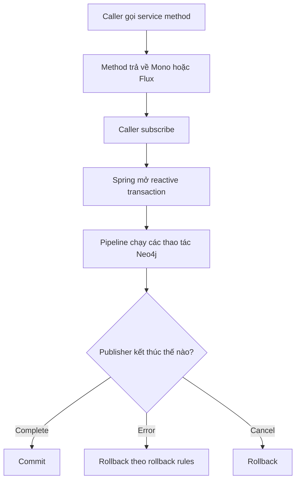
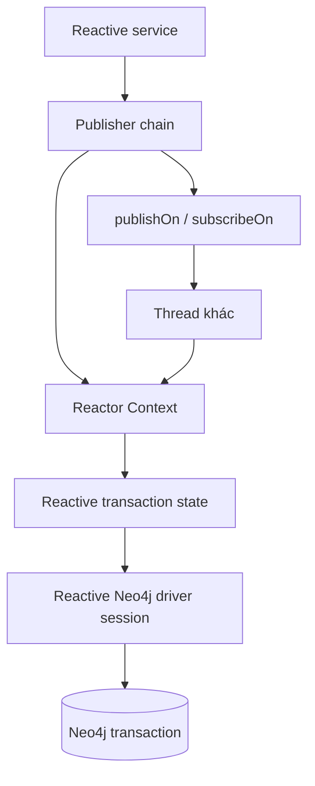

# @Transactional trên phương thức trả về Publisher

Trong ứng dụng Spring Data Neo4j reactive, một phương thức service thường trả về `Mono<T>` hoặc `Flux<T>` thay vì chờ kết quả ngay lập tức. Khi gắn `@Transactional` lên phương thức trả về reactive publisher, Spring mở transaction reactive cho quá trình subscribe và giữ transaction trong suốt pipeline cho đến khi publisher hoàn tất, phát lỗi hoặc bị hủy.

Với `SPRING_DATA_NEO4J`, cơ chế này cho phép nhiều thao tác repository hoặc `ReactiveNeo4jClient` tham gia cùng một transaction mà không chặn thread. Transaction reactive được truyền qua Reactor Context, không dựa vào `ThreadLocal` như transaction imperative. Vì vậy, toàn bộ thao tác database phải nằm trong publisher được trả về; tự gọi `subscribe()` hoặc `block()` bên trong service có thể làm thao tác chạy ngoài transaction dự kiến.

## 1. Publisher là ranh giới thực thi của transaction reactive

`Mono<T>` mô tả một pipeline có thể phát tối đa một phần tử hoặc hoàn tất rỗng; `Flux<T>` mô tả pipeline có thể phát nhiều phần tử. Cả hai đều là `Publisher` của Reactive Streams. Việc tạo publisher thường chỉ mô tả công việc, còn công việc được thực thi khi có subscriber.

Với một phương thức được Spring quản lý bằng `@Transactional` và trả về reactive type, transaction được gắn với subscription:



Điểm cần nhớ:

- Gọi phương thức và nhận `Mono` chưa có nghĩa transaction đã mở hoặc dữ liệu đã được ghi.
- Transaction bắt đầu khi publisher được subscribe và được bao bởi transactional interceptor.
- Các thao tác reactive trong pipeline chia sẻ transaction context.
- Khi pipeline hoàn tất bình thường, Spring commit transaction.
- Khi pipeline phát lỗi, Spring áp dụng rollback rules.
- Khi subscription bị cancel trước khi hoàn tất, transaction reactive được rollback.

Một publisher thường có thể được subscribe nhiều lần. Mỗi subscription là một lần thực thi riêng và có thể tạo một transaction mới. Vì vậy, không trả một publisher ghi dữ liệu cho nhiều nơi cùng subscribe nếu không chủ ý muốn thực hiện thao tác nhiều lần.

## 2. Cấu hình ReactiveNeo4jTransactionManager

Reactive transaction cần `ReactiveTransactionManager`. Spring Data Neo4j cung cấp `ReactiveNeo4jTransactionManager`, làm việc với reactive Neo4j driver và transaction context của Reactor.

Ứng dụng cần có cấu hình reactive Neo4j phù hợp, bao gồm reactive driver, mapping/repository reactive và reactive transaction manager. Spring Boot có thể tự cấu hình các bean này khi dependency và cấu hình kết nối reactive được khai báo phù hợp; với cấu hình thủ công, cần đăng ký `ReactiveNeo4jTransactionManager` theo driver và database selection đang dùng.

Không nhầm hai transaction manager:

| Transaction manager | Mô hình | Dùng với |
|---|---|---|
| `Neo4jTransactionManager` | Imperative, transaction gắn với thread | `Neo4jRepository`, `Neo4jTemplate`, `Neo4jClient` imperative |
| `ReactiveNeo4jTransactionManager` | Reactive, transaction gắn với Reactor Context | Reactive repository, `ReactiveNeo4jTemplate`, `ReactiveNeo4jClient` |

Nếu ứng dụng chỉ có một transaction manager reactive, Spring có thể chọn manager phù hợp cho phương thức trả về reactive type. Nếu có nhiều transaction manager, hãy chỉ rõ manager trong annotation để tránh chọn nhầm:

```java
import org.springframework.transaction.annotation.Transactional;
import reactor.core.publisher.Mono;

@Transactional(transactionManager = "reactiveNeo4jTransactionManager")
public Mono<Void> deletePerson(Long id) {
    return people.deleteById(id);
}
```

Tên `reactiveNeo4jTransactionManager` trong ví dụ là tên bean do ứng dụng cấu hình. Hãy thay bằng tên bean thực tế trong application context. Việc thêm annotation không tự tạo transaction manager nếu ứng dụng chưa cấu hình reactive transaction infrastructure.

## 3. Repository reactive và entity minh họa

Entity `Person` dùng ID do Neo4j cấp:

```java
import org.springframework.data.neo4j.core.schema.GeneratedValue;
import org.springframework.data.neo4j.core.schema.Id;
import org.springframework.data.neo4j.core.schema.Node;

@Node("Person")
public class Person {

    @Id
    @GeneratedValue
    private Long id;

    private String name;
    private String email;

    protected Person() {
    }

    public Person(String name, String email) {
        this.name = name;
        this.email = email;
    }

    public Long getId() {
        return id;
    }

    public String getName() {
        return name;
    }

    public String getEmail() {
        return email;
    }

    public void rename(String name) {
        this.name = name;
    }
}
```

Reactive repository trả về publisher thay vì kết quả đồng bộ:

```java
import org.springframework.data.neo4j.repository.ReactiveNeo4jRepository;

public interface PersonRepository
        extends ReactiveNeo4jRepository<Person, Long> {
}
```

Các thao tác đọc và ghi của repository trả về `Mono` hoặc `Flux`, nhờ đó có thể compose vào pipeline. Không gọi repository imperative trong một phương thức reactive chỉ để lấy entity đồng bộ; việc đó có thể block thread và không tham gia reactive transaction context.

## 4. @Transactional trên phương thức trả về Mono

Ví dụ đổi tên một người:

```java
import org.springframework.stereotype.Service;
import org.springframework.transaction.annotation.Transactional;
import reactor.core.publisher.Mono;

@Service
public class PersonService {

    private final PersonRepository people;

    public PersonService(PersonRepository people) {
        this.people = people;
    }

    @Transactional
    public Mono<Person> renamePerson(Long id, String newName) {
        return people.findById(id)
            .switchIfEmpty(Mono.error(
                new PersonNotFoundException(id)
            ))
            .flatMap(person -> {
                person.rename(newName);
                return people.save(person);
            });
    }
}
```

Khi caller subscribe vào `renamePerson(...)`, Spring mở reactive transaction. `findById` và `save` nằm trong cùng pipeline nên sử dụng cùng transaction context. Nếu lưu thành công và pipeline complete, transaction commit. Nếu `Person` không tồn tại, `switchIfEmpty` phát lỗi và transaction rollback theo rollback rules.

`switchIfEmpty(Mono.error(...))` rất quan trọng khi không tìm thấy entity là lỗi nghiệp vụ. `Mono.empty()` tự nó là hoàn tất bình thường, không phải lỗi; nếu service trả empty mà không chuyển thành error, transaction có thể commit các thao tác trước đó.

## 5. @Transactional trên phương thức trả về Flux

`Flux` có thể phát nhiều entity trong cùng một pipeline:

```java
import org.springframework.stereotype.Service;
import org.springframework.transaction.annotation.Transactional;
import reactor.core.publisher.Flux;

@Service
public class PersonReadService {

    private final PersonRepository people;

    public PersonReadService(PersonRepository people) {
        this.people = people;
    }

    @Transactional(readOnly = true)
    public Flux<Person> findPeople() {
        return people.findAll();
    }
}
```

Transaction đọc được giữ trong lúc `Flux` được consume. Khi nguồn hoàn tất, transaction kết thúc. Nếu subscriber hủy trước khi nguồn hoàn tất, transaction reactive có thể rollback vì publisher chưa hoàn thành đầy đủ.

Không nên mở transaction cho một `Flux` không giới hạn hoặc stream kéo dài vô thời hạn nếu không cần giữ một transaction lâu như vậy. Transaction dài làm tăng thời gian giữ resource và có thể giữ lock lâu hơn cần thiết. Với dữ liệu lớn, hãy cân nhắc phân trang hoặc xử lý theo batch với transaction ngắn cho từng batch.

`readOnly = true` thể hiện ý định chỉ đọc và cho phép transaction infrastructure áp dụng tối ưu phù hợp. Không xem thuộc tính này như một cơ chế phân quyền hoặc một bảo đảm thay thế việc không gọi thao tác ghi trong pipeline.

## 6. Nhiều thao tác Neo4j trong cùng một reactive transaction

Một use case có thể cần lưu entity rồi tạo thêm relationship bằng `ReactiveNeo4jClient`. Hãy nối các thao tác bằng Reactor operator để chúng vẫn thuộc cùng pipeline:

```java
import org.springframework.data.neo4j.core.ReactiveNeo4jClient;
import org.springframework.stereotype.Service;
import org.springframework.transaction.annotation.Transactional;
import reactor.core.publisher.Mono;

@Service
public class PersonGraphService {

    private final PersonRepository people;
    private final ReactiveNeo4jClient neo4jClient;

    public PersonGraphService(
        PersonRepository people,
        ReactiveNeo4jClient neo4jClient
    ) {
        this.people = people;
        this.neo4jClient = neo4jClient;
    }

    @Transactional
    public Mono<Person> createAndConnect(
        String name,
        String email,
        String friendEmail
    ) {
        Person person = new Person(name, email);

        return people.save(person)
            .flatMap(saved -> neo4jClient.query("""
                    MATCH (p:Person {email: $personEmail})
                    MATCH (friend:Person {email: $friendEmail})
                    CREATE (p)-[:KNOWS]->(friend)
                    """)
                .bind(saved.getEmail()).to("personEmail")
                .bind(friendEmail).to("friendEmail")
                .run()
                .thenReturn(saved));
    }
}
```

`people.save(person)` và lệnh tạo relationship đều được compose trong một publisher trả về. Khi `run()` hoàn tất, `thenReturn(saved)` phát entity đã lưu; Spring chỉ commit khi toàn bộ pipeline complete. Nếu lệnh tạo relationship phát lỗi, transaction có thể rollback cả thao tác lưu `Person` trước đó.

Ví dụ giả định `email` là business key duy nhất của `Person`; nếu dùng cách này trong ứng dụng, hãy bảo vệ tính duy nhất bằng constraint:

```cypher
CREATE CONSTRAINT person_email_unique IF NOT EXISTS
FOR (p:Person)
REQUIRE p.email IS UNIQUE;
```

Nếu `friendEmail` không tồn tại, `MATCH` không tạo relationship nhưng cũng không phát lỗi. Nếu đó là điều kiện nghiệp vụ bắt buộc, hãy thiết kế query để báo rõ trường hợp không tìm thấy đích, hoặc kiểm tra kết quả trước khi hoàn tất pipeline để chủ động phát lỗi và rollback.

## 7. Transaction reactive dùng Reactor Context

Transaction imperative của Spring thường gắn resource vào `ThreadLocal`. Reactive pipeline có thể chuyển qua nhiều thread do `publishOn`, `subscribeOn` hoặc scheduler; vì vậy transaction reactive không thể dựa vào thread hiện tại.

Spring lưu transaction state trong Reactor Context. Các operator Reactor chuẩn truyền context qua pipeline, giúp các thao tác reactive ở những thread khác nhau vẫn tham gia cùng transaction.



Do transaction được gắn với context:

- Không tự lưu transaction/session vào biến `ThreadLocal`.
- Không giả định hai operator chạy cùng thread.
- Dùng reactive repository, reactive template hoặc reactive client xuyên suốt pipeline.
- Không chuyển sang API imperative và mong nó tự tham gia reactive transaction.
- Các thao tác bất đồng bộ phải được trả về hoặc compose vào publisher đang được quản lý.

Việc đổi scheduler không tự làm mất transaction context nếu dùng các operator Reactor chuẩn. Tuy nhiên, tự tạo thread hoặc gọi API không tích hợp Reactor có thể làm mất liên kết với context và tách thao tác khỏi transaction.

## 8. Không gọi subscribe() hoặc block() bên trong transactional service

Đây là lỗi phổ biến:

```java
@Transactional
public Mono<Void> updatePerson(Long id, String newName) {
    people.findById(id)
        .flatMap(person -> {
            person.rename(newName);
            return people.save(person);
        })
        .subscribe();

    return Mono.empty();
}
```

Lời gọi `subscribe()` tạo subscription độc lập. Spring transactional interceptor chỉ quản lý publisher được phương thức trả về, ở đây là `Mono.empty()`. Pipeline lưu entity chạy tách rời và có thể không tham gia transaction của phương thức.

Một lỗi khác là chặn pipeline:

```java
@Transactional
public Person updatePerson(Long id, String newName) {
    return people.findById(id)
        .map(person -> {
            person.rename(newName);
            return person;
        })
        .flatMap(people::save)
        .block();
}
```

`block()` chờ kết quả đồng bộ, chiếm thread và làm mất lợi ích của reactive execution. Phương thức cũng không còn trả về Publisher để Spring áp dụng reactive transaction semantics.

Hãy trả trực tiếp pipeline:

```java
@Transactional
public Mono<Person> updatePerson(Long id, String newName) {
    return people.findById(id)
        .switchIfEmpty(Mono.error(new PersonNotFoundException(id)))
        .flatMap(person -> {
            person.rename(newName);
            return people.save(person);
        });
}
```

Caller ở ranh giới ứng dụng (ví dụ WebFlux runtime hoặc test subscriber) sẽ subscribe. Service chỉ mô tả công việc và trả Publisher cho Spring quản lý.

## 9. Rollback khi có error, empty và cancellation

Reactive transaction kết thúc dựa trên tín hiệu của publisher. Cần phân biệt ba trường hợp:

| Tín hiệu | Ý nghĩa | Hành vi transaction thường gặp |
|---|---|---|
| `onComplete` | Pipeline hoàn tất bình thường | Commit |
| `onError` | Pipeline kết thúc bằng lỗi | Rollback theo rollback rules |
| `cancel` | Subscriber không muốn nhận thêm dữ liệu | Rollback transaction reactive chưa hoàn tất |
| `Mono.empty()` rồi complete | Không phát phần tử nhưng không có lỗi | Commit nếu không có rollback-only marker |

Spring áp dụng rollback rules của `@Transactional`: mặc định rollback với `RuntimeException` và `Error`; checked exception không tự động rollback trừ khi cấu hình `rollbackFor`. Trong reactive pipeline, exception thường được truyền thành `onError` signal, nhưng loại exception vẫn quyết định rollback theo quy tắc đã cấu hình.

Ví dụ yêu cầu rollback với một checked exception:

```java
@Transactional(rollbackFor = ImportValidationException.class)
public Mono<Void> importPerson(PersonInput input) {
    return people.save(toPerson(input))
        .flatMap(saved -> validateImport(input, saved));
}
```

Nếu dùng `onErrorResume` để biến lỗi thành kết quả bình thường ngay bên trong transactional pipeline, transaction interceptor có thể chỉ nhìn thấy `onComplete` và commit. Nếu muốn rollback, hãy để lỗi đi qua ranh giới transaction hoặc đánh dấu rollback-only bằng cơ chế transaction phù hợp trước khi phục hồi lỗi.

Với `Flux`, các operator như `take(1)`, `next()` hoặc subscriber hủy sớm có thể cancel upstream. Nếu transaction bao quanh một chuỗi ghi và bị cancel, transaction có thể rollback dù một vài phần tử đã được phát ra trước đó. Đừng xem phần tử đã emit là bằng chứng dữ liệu đã commit.

## 10. Khi cần điều khiển transaction bằng TransactionalOperator

`@Transactional` phù hợp khi ranh giới transaction trùng với một method service. Khi cần áp dụng transaction cho một publisher được tạo ở nơi khác, hoặc muốn compose transaction một cách tường minh, dùng `TransactionalOperator`.

```java
import org.springframework.stereotype.Service;
import org.springframework.transaction.ReactiveTransactionManager;
import org.springframework.transaction.reactive.TransactionalOperator;
import reactor.core.publisher.Mono;

@Service
public class PersonImportService {

    private final PersonRepository people;
    private final TransactionalOperator transactionalOperator;

    public PersonImportService(
        PersonRepository people,
        ReactiveTransactionManager transactionManager
    ) {
        this.people = people;
        this.transactionalOperator = TransactionalOperator.create(transactionManager);
    }

    public Mono<Person> importPerson(String name, String email) {
        return people.save(new Person(name, email))
            .flatMap(saved -> validate(saved).thenReturn(saved))
            .as(transactionalOperator::transactional);
    }

    private Mono<Void> validate(Person person) {
        return Mono.empty();
    }
}
```

`TransactionalOperator` nhận reactive transaction manager và bọc publisher qua `.as(transactionalOperator::transactional)`. Pipeline được subscribe sẽ chạy trong transaction do operator quản lý. Nếu ứng dụng có nhiều transaction manager, hãy inject đúng `ReactiveNeo4jTransactionManager` thay vì một manager không xác định.

Không cần dùng cả `@Transactional` và `TransactionalOperator` để bọc cùng một công việc nếu không có lý do về propagation hoặc ranh giới lồng nhau. Chọn một cách quản lý rõ ràng để tránh transaction lồng ngoài ý muốn.

## 11. Proxy và self-invocation

Trong chế độ proxy mặc định của Spring, `@Transactional` được áp dụng khi lời gọi đi qua Spring proxy. Gọi một method transactional từ method khác trong cùng object bằng `this.method()` không đi qua proxy, nên annotation trên method được gọi có thể không được áp dụng như mong đợi.

Ví dụ:

```java
import reactor.core.publisher.Mono;

public Mono<Void> process(Long id) {
    return this.updateInTransaction(id, "New name");
}

@Transactional
public Mono<Void> updateInTransaction(Long id, String newName) {
    return people.findById(id)
        .flatMap(person -> {
            person.rename(newName);
            return people.save(person);
        })
        .then();
}
```

Nếu `process()` và `updateInTransaction()` nằm trong cùng bean, self-invocation bỏ qua transactional proxy. Cách rõ ràng hơn là đặt ranh giới transaction trên method public được gọi từ bean khác, hoặc tách thao tác transactional sang một service riêng được inject qua Spring.

## 12. Kiểm thử reactive transaction

Trong test, hãy subscribe và xác minh Publisher bằng Reactor Test thay vì gọi `block()` trong service. Ví dụ:

```java
import org.junit.jupiter.api.Test;
import reactor.test.StepVerifier;

@Test
void renamePersonEmitsUpdatedEntity() {
    StepVerifier.create(personService.renamePerson(existingId, "An Nguyen"))
        .expectNextMatches(person -> "An Nguyen".equals(person.getName()))
        .verifyComplete();
}
```

Đối với kiểm thử rollback, tạo một pipeline thực hiện thay đổi rồi phát lỗi, subscribe bằng `StepVerifier`, sau đó đọc lại dữ liệu trong transaction mới để xác nhận thay đổi đã rollback. Dùng test database cô lập và bảo đảm assertion chạy sau khi subscription kết thúc.

Một test chỉ gọi method và kiểm tra object `Mono` đã được tạo không chứng minh query đã chạy hoặc transaction đã commit. Reactive test phải subscribe để kích hoạt pipeline.

## 13. Những lỗi thường gặp

| Biểu hiện | Nguyên nhân | Cách xử lý |
|---|---|---|
| Các thao tác trong method không cùng transaction | Dùng imperative transaction manager cho reactive publisher | Cấu hình `ReactiveNeo4jTransactionManager` |
| Query chạy nhưng transaction service không bao quanh | Gọi `subscribe()` bên trong method | Trả publisher và để caller subscribe |
| Thread bị block hoặc lỗi khi gọi `block()` | Chặn pipeline reactive | Compose bằng `flatMap`, `then`, `map` và trả Publisher |
| Không rollback khi entity không tồn tại | Trả `Mono.empty()` như hoàn tất bình thường | Dùng `switchIfEmpty(Mono.error(...))` nếu đây là lỗi nghiệp vụ |
| Lỗi đã xảy ra nhưng transaction vẫn commit | `onErrorResume` nuốt lỗi trước transactional boundary | Để lỗi truyền ra hoặc đánh dấu rollback-only |
| Transaction bị rollback khi client ngắt kết nối | Subscription bị cancel trước khi publisher complete | Xác định rõ hành vi cancel và tránh cancel pipeline ghi giữa chừng |
| Annotation không có tác dụng khi gọi method nội bộ | Self-invocation bỏ qua Spring proxy | Gọi qua bean proxy hoặc chuyển method sang service khác |
| Dùng nhiều transaction manager nhưng chọn nhầm | Không chỉ rõ manager trong annotation hoặc operator | Chỉ định bean `ReactiveNeo4jTransactionManager` phù hợp |
| Transaction giữ resource quá lâu | Một `Flux` dài hoặc không kết thúc nằm trong transaction | Chia batch và dùng transaction ngắn theo từng đơn vị công việc |
| Test không thấy dữ liệu được cập nhật | Test chưa subscribe Publisher | Dùng `StepVerifier` hoặc subscriber ở test boundary |

## 14. Tự kiểm tra

1. Khi một phương thức `@Transactional` trả về `Mono`, transaction bắt đầu ở thời điểm gọi method hay khi publisher được subscribe?
2. Reactive transaction state được Spring truyền qua `ThreadLocal` hay Reactor Context?
3. Vì sao `subscribe()` bên trong transactional service có thể làm thao tác ghi chạy ngoài transaction dự kiến?
4. Khác biệt giữa `Mono.empty()` và `Mono.error(...)` đối với rollback là gì?
5. Điều gì xảy ra nếu một `Flux` transactional bị cancel trước khi hoàn tất?
6. Khi nào cần chỉ rõ `transactionManager` trong `@Transactional`?
7. Vì sao `@Transactional` không được áp dụng như mong đợi khi method tự gọi một method khác trong cùng bean?
8. Khi nào `TransactionalOperator` phù hợp hơn annotation?
9. Vì sao một Publisher được subscribe hai lần có thể thực hiện thao tác ghi hai lần?

Với phương thức trả về `Mono` hoặc `Flux`, `@Transactional` quản lý transaction theo subscription và Reactor Context. Hãy dùng `ReactiveNeo4jTransactionManager`, giữ toàn bộ thao tác database trong pipeline được trả về, để lỗi truyền qua transaction boundary khi cần rollback và tránh tự subscribe hoặc block. Khi cần ranh giới tường minh ở cấp publisher, dùng `TransactionalOperator`; khi transaction là trách nhiệm của một service method, annotation thường dễ đọc và dễ duy trì hơn.

## Tài liệu tham khảo

- [Spring Framework — Reactive transaction management](https://docs.spring.io/spring-framework/reference/data-access/transaction/declarative/tx-decl-explained.html)
- [Spring Framework — Using `@Transactional` with reactive return types](https://docs.spring.io/spring-framework/reference/data-access/transaction/declarative/annotations.html)
- [Spring Data Neo4j — Reactive transactions](https://docs.spring.io/spring-data/neo4j/reference/transactions.html)
- [Spring Data Neo4j — `ReactiveNeo4jTransactionManager` API](https://docs.spring.io/spring-data/neo4j/docs/current/api/org/springframework/data/neo4j/core/transaction/ReactiveNeo4jTransactionManager.html)
- [Spring Framework — `TransactionalOperator` API](https://docs.spring.io/spring-framework/docs/current/javadoc-api/org/springframework/transaction/reactive/TransactionalOperator.html)
