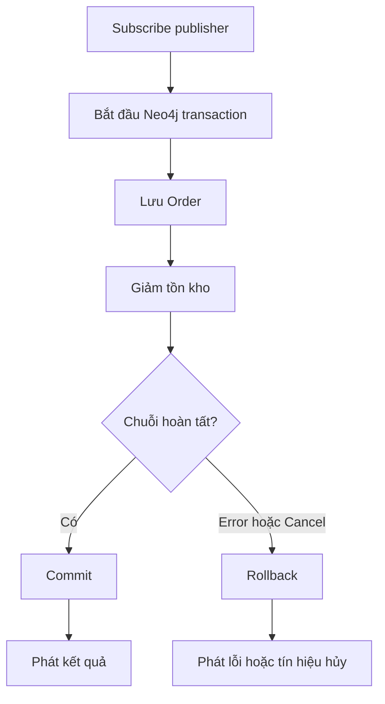
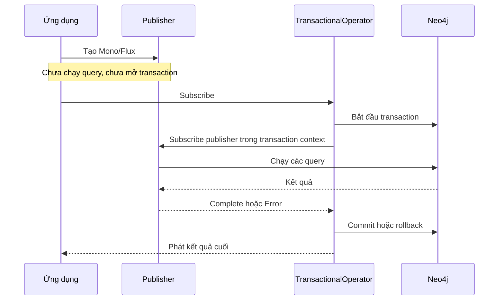

# Quản lý giao dịch bằng `TransactionalOperator`

Trong một nghiệp vụ reactive, nhiều thao tác Neo4j có thể cần thành công hoặc thất bại cùng nhau. Ví dụ, khi đặt hàng, ứng dụng tạo đơn hàng rồi trừ tồn kho. Nếu đơn hàng đã được lưu nhưng thao tác trừ tồn kho thất bại, graph sẽ ở trạng thái không nhất quán. `TransactionalOperator` của Spring cho phép bao một chuỗi `Mono` hoặc `Flux` trong cùng một transaction mà không phải tự mở session, commit hay rollback.

Với Spring Data Neo4j (SDN), transaction manager tương ứng là `ReactiveNeo4jTransactionManager`. Manager này quản lý transaction reactive của Neo4j và đưa transaction context vào Reactor Context. `TransactionalOperator` sử dụng manager để bắt đầu transaction khi publisher được subscribe, giữ transaction trong suốt chuỗi xử lý, rồi commit khi hoàn tất hoặc rollback khi có lỗi hay bị cancel.

## 1. Vì sao cần `TransactionalOperator`?

Reactive repository và `ReactiveNeo4jClient` trả về các kiểu publisher như `Mono<T>` và `Flux<T>`. Những publisher này mô tả công việc sẽ thực hiện; chúng thường chưa chạy ngay tại thời điểm được tạo.

Giả sử quy trình đặt hàng gồm:

1. Lưu node `Order`.
2. Tìm `Product` tương ứng.
3. Kiểm tra và giảm số lượng tồn kho.
4. Trả về đơn hàng đã tạo.

Nếu mỗi thao tác tự chạy trong transaction riêng, bước 1 có thể commit trước khi bước 3 thất bại. `TransactionalOperator` bao toàn bộ publisher thành một đơn vị:



Mục tiêu là bảo đảm các thao tác tham gia cùng transaction Neo4j được commit hoặc rollback như một đơn vị. `TransactionalOperator` không tự làm cho các dịch vụ bên ngoài như HTTP, email hoặc message broker trở thành một phần của transaction Neo4j.

## 2. Các thành phần tham gia

| Thành phần | Vai trò |
| --- | --- |
| `Driver` | Kết nối tới Neo4j và cung cấp tài nguyên cho các transaction |
| `ReactiveNeo4jTransactionManager` | Triển khai `ReactiveTransactionManager` cho Neo4j |
| `TransactionalOperator` | Bao publisher hoặc chạy callback trong transaction |
| `ReactiveNeo4jRepository` | Thực hiện thao tác entity theo kiểu reactive |
| `ReactiveNeo4jClient` | Chạy Cypher tùy chỉnh theo kiểu reactive |
| Reactor Context | Mang transaction context xuyên suốt reactive pipeline |

`ReactiveNeo4jTransactionManager` được SDN cung cấp từ phiên bản 6.0. Manager và các thành phần SDN cần dùng cùng `Driver` bean để repository và client có thể tham gia transaction đang được Spring quản lý.

## 3. Cấu hình `ReactiveNeo4jTransactionManager`

Spring Boot có thể tự cấu hình reactive repositories khi Project Reactor có trên classpath. Tuy nhiên, với reactive Neo4j, cần khai báo bean `ReactiveTransactionManager` để bật transaction management.

Ví dụ cấu hình dùng `Driver` và `ReactiveDatabaseSelectionProvider` do Spring cung cấp:

```java
import org.neo4j.driver.Driver;
import org.springframework.context.annotation.Bean;
import org.springframework.context.annotation.Configuration;
import org.springframework.data.neo4j.core.ReactiveDatabaseSelectionProvider;
import org.springframework.data.neo4j.core.transaction.ReactiveNeo4jTransactionManager;

@Configuration(proxyBeanMethods = false)
public class ReactiveNeo4jConfiguration {

    @Bean
    ReactiveNeo4jTransactionManager reactiveTransactionManager(
        Driver driver,
        ReactiveDatabaseSelectionProvider databaseSelectionProvider
    ) {
        return new ReactiveNeo4jTransactionManager(
            driver,
            databaseSelectionProvider
        );
    }
}
```

Constructor này dùng database được xác định bởi `ReactiveDatabaseSelectionProvider`. Nếu ứng dụng luôn dùng database mặc định, có thể dùng constructor chỉ nhận `Driver`:

```java
new ReactiveNeo4jTransactionManager(driver)
```

Không tạo một `Driver` mới chỉ dành cho transaction manager nếu repositories hoặc `ReactiveNeo4jClient` đang dùng Driver khác. Transaction manager phải quản lý cùng tài nguyên mà các thao tác dữ liệu sử dụng.

## 4. Tạo `TransactionalOperator`

`TransactionalOperator.create(...)` tạo operator từ một `ReactiveTransactionManager`:

```java
import org.springframework.context.annotation.Bean;
import org.springframework.context.annotation.Configuration;
import org.springframework.transaction.ReactiveTransactionManager;
import org.springframework.transaction.reactive.TransactionalOperator;

@Configuration(proxyBeanMethods = false)
public class TransactionOperatorConfiguration {

    @Bean
    TransactionalOperator transactionalOperator(
        ReactiveTransactionManager transactionManager
    ) {
        return TransactionalOperator.create(transactionManager);
    }
}
```

Nếu ứng dụng có nhiều transaction manager, hãy dùng `@Qualifier` để inject đúng `ReactiveNeo4jTransactionManager`. Một operator có thể được chia sẻ giữa nhiều method trong service vì bản thân nó giữ cấu hình transaction, không giữ trạng thái của một lần thực thi cụ thể.

Có thể inject operator trực tiếp vào service:

```java
import org.springframework.stereotype.Service;
import org.springframework.transaction.reactive.TransactionalOperator;

@Service
public class OperatorHolder {

    private final TransactionalOperator transactionalOperator;

    public OperatorHolder(TransactionalOperator transactionalOperator) {
        this.transactionalOperator = transactionalOperator;
    }
}
```

## 5. Cách dùng operator-style: `transactional(publisher)`

Đây là cách dùng trực tiếp nhất. Tạo chuỗi `Mono` hoặc `Flux`, sau đó bọc toàn bộ chuỗi bằng `transactional(...)`:

```java
Mono<Order> work = orderRepository.save(order)
    .flatMap(savedOrder -> inventoryService.reserve(
        savedOrder.getProductId(),
        savedOrder.getQuantity()
    ).thenReturn(savedOrder));

return work.as(transactionalOperator::transactional);
```

`as(transactionalOperator::transactional)` tương đương với:

```java
return transactionalOperator.transactional(work);
```

Toàn bộ publisher `work` chạy trong cùng transaction. Nếu `reserve(...)` phát error, thao tác `save(order)` cũng bị rollback nếu cả hai thao tác đã tham gia transaction Neo4j đó.

### Ví dụ service hoàn chỉnh

Giả sử service lưu đơn hàng rồi cập nhật tồn kho qua `ReactiveNeo4jClient`:

```java
import org.springframework.data.neo4j.core.ReactiveNeo4jClient;
import org.springframework.stereotype.Service;
import org.springframework.transaction.reactive.TransactionalOperator;
import reactor.core.publisher.Mono;

@Service
public class OrderService {

    private final OrderRepository orderRepository;
    private final ReactiveNeo4jClient neo4jClient;
    private final TransactionalOperator transactionalOperator;

    public OrderService(
        OrderRepository orderRepository,
        ReactiveNeo4jClient neo4jClient,
        TransactionalOperator transactionalOperator
    ) {
        this.orderRepository = orderRepository;
        this.neo4jClient = neo4jClient;
        this.transactionalOperator = transactionalOperator;
    }

    public Mono<Order> placeOrder(Order order) {
        Mono<Order> work = orderRepository.save(order)
            .flatMap(saved -> reserveInventory(
                saved.getProductId(),
                saved.getQuantity()
            ).thenReturn(saved));

        return work.as(transactionalOperator::transactional);
    }

    private Mono<Void> reserveInventory(String productId, int quantity) {
        return neo4jClient.query("""
                MATCH (p:Product {productId: $productId})
                WHERE p.available >= $quantity
                SET p.available = p.available - $quantity
                RETURN p.productId AS productId
                """)
            .bind(productId).to("productId")
            .bind(quantity).to("quantity")
            .fetch()
            .one()
            .switchIfEmpty(Mono.error(
                new IllegalStateException("Product not found or insufficient stock")
            ))
            .then();
    }
}
```

Repository reactive được khai báo bằng `ReactiveNeo4jRepository`:

```java
import org.springframework.data.neo4j.repository.ReactiveNeo4jRepository;

public interface OrderRepository extends ReactiveNeo4jRepository<Order, String> {
}
```

Nếu sản phẩm không tồn tại hoặc không đủ tồn kho, query không trả record. `switchIfEmpty(...)` chuyển trường hợp đó thành error signal; error đi ngược qua transaction operator và khiến transaction rollback. Nếu bỏ kiểm tra này, `reserveInventory` có thể hoàn tất rỗng mà không báo lỗi, khiến đơn hàng vẫn được commit dù không có hàng được giữ.

Điểm cần nhớ: các thao tác repository và client phải tham gia cùng transaction context. Nếu bên trong service tự tạo session/transaction độc lập bằng Driver thuần, thao tác đó không tự động tham gia transaction do operator quản lý.

## 6. Cách dùng callback-style: `execute(...)`

Khi cần truy cập trạng thái transaction, dùng `execute(...)`. Callback nhận một `ReactiveTransaction` để có thể đánh dấu rollback-only:

```java
import org.springframework.transaction.reactive.TransactionalOperator;
import reactor.core.publisher.Mono;

public Mono<Void> updateProfile(Profile profile) {
    return transactionalOperator.execute(status ->
        profileRepository.save(profile)
            .then(preferenceRepository.save(profile.getPreference()))
    ).then();
}
```

`execute(...)` trả về `Flux<T>` vì callback có thể trả về một publisher nhiều phần tử. Khi callback chỉ trả về `Mono`, có thể dùng `.singleOrEmpty()` hoặc `.then()` tùy kiểu kết quả mong muốn. `.then()` phù hợp khi chỉ quan tâm hoàn tất thành công hay thất bại.

### Đánh dấu rollback-only

Nếu callback bắt lỗi và chuyển thành kết quả bình thường, transaction operator có thể nhìn thấy publisher đã hoàn tất thành công. Khi nghiệp vụ vẫn yêu cầu rollback, hãy gọi `status.setRollbackOnly()` trước khi khôi phục thành kết quả:

```java
public Mono<Void> updateWithBusinessRule(Profile profile) {
    return transactionalOperator.execute(status ->
        profileRepository.save(profile)
            .then(validateProfile(profile))
            .onErrorResume(BusinessRuleException.class, error -> {
                status.setRollbackOnly();
                return Mono.empty();
            })
    ).then();
}
```

Trong ví dụ, lỗi nghiệp vụ được chuyển thành hoàn tất rỗng, nhưng transaction vẫn được đánh dấu rollback-only. Nếu không gọi `setRollbackOnly()`, việc nuốt lỗi bằng `onErrorResume` có thể khiến transaction commit.

Nếu lỗi không cần được khôi phục thành kết quả bình thường, hãy để error signal tiếp tục truyền ra ngoài. `TransactionalOperator` sẽ rollback và chuyển lỗi tới subscriber.

## 7. Error signal và vị trí của `onErrorResume`

Vị trí đặt operator phục hồi lỗi ảnh hưởng trực tiếp đến kết quả transaction.

**Phục hồi lỗi bên trong transaction:**

```java
Mono<Void> work = updateOne()
    .then(updateTwo())
    .onErrorResume(error -> Mono.empty());

return transactionalOperator.transactional(work);
```

Transaction operator chỉ nhìn thấy publisher hoàn tất bình thường. Nếu không đánh dấu rollback-only, transaction có thể commit dù một thao tác đã thất bại.

**Phục hồi lỗi bên ngoài transaction:**

```java
return transactionalOperator.transactional(
        updateOne().then(updateTwo())
    )
    .onErrorResume(error -> fallbackResult());
```

Ở đây, error đi qua transaction operator trước. Operator rollback transaction, sau đó `onErrorResume` phía ngoài mới tạo kết quả thay thế cho caller.

Quy tắc thực tế: nếu muốn lỗi làm rollback, đừng nuốt lỗi trước khi nó đi qua ranh giới `TransactionalOperator`, trừ khi đã gọi `setRollbackOnly()`.

## 8. Transaction chỉ bắt đầu khi publisher được subscribe

Reactor publisher thường lazy. Việc gọi repository hoặc tạo `Mono` không đồng nghĩa query đã chạy:

```java
Mono<Order> result = transactionalOperator.transactional(
    orderRepository.save(order)
);
```

Ở thời điểm gán `result`, transaction chưa được mở. Transaction bắt đầu khi subscriber subscribe vào publisher. Khi chuỗi hoàn tất, operator commit hoặc rollback rồi phát tín hiệu kết quả.



Nếu không có subscriber, không có thao tác database nào được thực thi và không có transaction nào được mở. Nếu cùng một publisher được subscribe hai lần, chuỗi có thể chạy hai lần và mỗi subscription tạo một lần thực thi transaction riêng. Hãy tránh subscribe thủ công nhiều lần vào cùng publisher nếu không chủ ý.

## 9. Reactor Context thay cho ThreadLocal

Imperative transaction thường gắn với thread hiện tại. Reactive transaction không dựa vào thread-local; Spring lưu transaction context trong Reactor Context để nó đi theo reactive pipeline.

Điều này có nghĩa:

- Các thao tác repository/client nằm trong cùng pipeline có thể tham gia transaction dù scheduler chuyển việc sang thread khác.
- Không cần giữ nguyên một thread vật lý từ đầu tới cuối.
- Không tự gọi `subscribe()` bên trong service để chạy một nhánh tách rời; subscription mới không tự kế thừa transaction context của pipeline bên ngoài.
- Không gọi `block()` để lấy kết quả rồi tiếp tục bằng một pipeline mới; việc block có thể tách rời execution và làm mất lợi ích reactive.

Ví dụ không nên làm:

```java
public Mono<Void> createOrder(Order order) {
    orderRepository.save(order).subscribe(); // Tách subscription
    return Mono.empty();
}
```

`subscribe()` ở đây khởi chạy một luồng thực thi độc lập. Method trả về ngay một `Mono.empty()` khác, nên transaction operator bao quanh publisher trả về không bao trùm thao tác lưu đơn hàng.

Hãy compose publisher bằng `flatMap`, `then`, `zip` hoặc các operator phù hợp rồi trả về toàn bộ chuỗi cho caller:

```java
public Mono<Order> createOrder(Order order) {
    return orderRepository.save(order)
        .flatMap(saved -> createAudit(saved).thenReturn(saved))
        .as(transactionalOperator::transactional);
}
```

## 10. Cancel signal cũng có thể rollback

Trong Reactive Streams, subscriber có thể hủy subscription. Một số operator như `next()`, `take(n)` hoặc `timeout(...)` có thể phát cancel signal lên upstream. Spring Framework quy định cancel signal đối với publisher nằm trong `TransactionalOperator` dẫn tới rollback.

Ví dụ:

```java
return transactionalOperator.transactional(
        eventRepository.saveAll(events)
    )
    .take(1);
```

`take(1)` nằm phía sau transaction publisher. Sau khi nhận một phần tử, nó hủy subscription upstream. Transaction có thể bị rollback thay vì commit toàn bộ batch.

Với `Flux` nhiều phần tử, cần để subscriber tiêu thụ toàn bộ output nếu muốn transaction hoàn tất bình thường. Nếu chỉ cần một kết quả, hãy thiết kế query và kiểu trả về thành `Mono` ngay từ đầu thay vì cắt ngắn một `Flux` đang nằm trong transaction.

`timeout(...)` cũng cần được xem xét cẩn thận. Khi timeout hủy publisher bên trong transaction, transaction rollback; nếu có fallback, đặt fallback sau transaction boundary khi muốn transaction rollback trước rồi mới trả kết quả thay thế.

## 11. Cấu hình propagation và timeout

`TransactionalOperator.create(transactionManager)` sử dụng transaction definition mặc định của Spring. Khi cần propagation hoặc timeout khác, tạo operator với `TransactionDefinition`:

```java
import org.springframework.context.annotation.Bean;
import org.springframework.context.annotation.Configuration;
import org.springframework.transaction.ReactiveTransactionManager;
import org.springframework.transaction.TransactionDefinition;
import org.springframework.transaction.support.DefaultTransactionDefinition;
import org.springframework.transaction.reactive.TransactionalOperator;

@Configuration(proxyBeanMethods = false)
public class TransactionSettingsConfiguration {

    @Bean
    TransactionalOperator transactionalOperator(
        ReactiveTransactionManager transactionManager
    ) {
        DefaultTransactionDefinition definition = new DefaultTransactionDefinition();
        definition.setPropagationBehavior(TransactionDefinition.PROPAGATION_REQUIRED);
        definition.setTimeout(20);

        return TransactionalOperator.create(transactionManager, definition);
    }
}
```

Trong ví dụ, `PROPAGATION_REQUIRED` tham gia transaction hiện có nếu có, hoặc tạo transaction mới nếu chưa có. Timeout được tính bằng giây. Các thiết lập khác như isolation và read-only cần được đối chiếu với khả năng của transaction manager và database; không phải mọi resource đều hỗ trợ mọi mức cấu hình giống nhau.

Một số propagation thường gặp:

| Propagation | Ý nghĩa |
| --- | --- |
| `REQUIRED` | Tham gia transaction hiện tại hoặc tạo mới nếu chưa có; mặc định |
| `REQUIRES_NEW` | Tạm treo transaction hiện tại và mở transaction mới |
| `MANDATORY` | Yêu cầu phải có transaction hiện tại |
| `SUPPORTS` | Tham gia transaction nếu có, nếu không thì chạy không có transaction mới |
| `NOT_SUPPORTED` | Tạm treo transaction hiện tại và chạy ngoài transaction |

Hãy chọn propagation theo ranh giới nghiệp vụ. Không dùng `REQUIRES_NEW` chỉ để né lỗi; transaction mới có thể commit độc lập với transaction bên ngoài.

## 12. Dùng `TransactionalOperator` cùng reactive repository và client

Các repository SDN reactive và `ReactiveNeo4jClient` được thiết kế để tham gia transaction do `ReactiveNeo4jTransactionManager` quản lý, miễn là cùng dùng Driver và transaction context đó.

Ví dụ kết hợp hai repository:

```java
public Mono<PurchaseResult> purchase(PurchaseCommand command) {
    Mono<PurchaseResult> work = orderRepository.save(command.toOrder())
        .flatMap(order -> paymentRecordRepository.save(
            PaymentRecord.forOrder(order, command.paymentReference())
        ).thenReturn(new PurchaseResult(order.getOrderNumber())));

    return work.as(transactionalOperator::transactional);
}
```

Hai lệnh `save` được compose trong cùng publisher và cùng transaction. Nếu thao tác lưu payment record phát lỗi, thao tác lưu order bị rollback.

Với custom Cypher, dùng `ReactiveNeo4jClient` được inject từ Spring:

```java
Mono<Void> markProcessed(String eventId) {
    return reactiveNeo4jClient.query("""
            MATCH (e:Event {eventId: $eventId})
            SET e.processed = true
            RETURN e.eventId AS eventId
            """)
        .bind(eventId).to("eventId")
        .fetch()
        .one()
        .switchIfEmpty(Mono.error(
            new IllegalArgumentException("Event not found")
        ))
        .then();
}
```

Nếu method này được gọi trong publisher đã được bọc bởi `TransactionalOperator`, query có thể tham gia transaction hiện tại. Nếu tự tạo Driver/session hoặc dùng client không được cấu hình với cùng transaction manager, thao tác có thể chạy ngoài transaction đó.

## 13. Phân biệt `TransactionalOperator` và `@Transactional`

Spring cũng hỗ trợ `@Transactional` với `ReactiveTransactionManager`. Cả hai cách đều dùng Reactor Context và yêu cầu method trả về reactive type.

| Tiêu chí | `TransactionalOperator` | `@Transactional` reactive |
| --- | --- | --- |
| Cách khai báo | Bao trực tiếp publisher hoặc dùng callback | Đánh dấu method/service |
| Ranh giới | Hiển thị ngay tại vị trí compose pipeline | Do Spring proxy/interceptor áp dụng |
| Truy cập trạng thái | Callback nhận `ReactiveTransaction` | Dùng cơ chế transaction status phù hợp hoặc để lỗi truyền ra |
| Phù hợp | Một phần pipeline cụ thể, xử lý programmatic | Ranh giới nghiệp vụ ổn định ở method service |
| Kiểm soát khi compose | Rõ vị trí publisher nằm trong transaction | Dựa vào method được gọi qua proxy và publisher trả về |

Ví dụ khai báo:

```java
import org.springframework.stereotype.Service;
import org.springframework.transaction.annotation.Transactional;
import reactor.core.publisher.Mono;

@Service
public class ReactiveDocumentService {

    private final ReactiveDocumentRepository documentRepository;

    public ReactiveDocumentService(ReactiveDocumentRepository documentRepository) {
        this.documentRepository = documentRepository;
    }

    @Transactional
    public Mono<Document> rename(String id, String title) {
        return documentRepository.findById(id)
            .switchIfEmpty(Mono.error(new IllegalArgumentException("Not found")))
            .flatMap(document -> {
                document.setTitle(title);
                return documentRepository.save(document);
            });
    }
}
```

`ReactiveDocumentRepository` kế thừa `ReactiveNeo4jRepository<Document, String>`. Nếu ứng dụng có nhiều transaction manager, chỉ rõ bean reactive bằng thuộc tính `transactionManager` của `@Transactional`.

Khi dùng reactive transaction manager, method phải trả `Mono`, `Flux` hoặc publisher reactive phù hợp. Một method `void` hoặc trả object đồng bộ không thể dùng reactive transaction manager theo cách này; nó cần transaction manager imperative.

Chọn `TransactionalOperator` khi cần nhìn rõ một đoạn publisher nào thuộc transaction, đặc biệt khi compose nhiều thao tác. Chọn `@Transactional` khi ranh giới transaction trùng với một method service và muốn dùng declarative transaction management.

## 14. Những việc không nên làm bên trong transaction

Transaction nên bao quanh các thao tác cần tính nguyên tử trên Neo4j. Tránh kéo dài transaction bằng những công việc không thuộc database:

- Không gọi HTTP service chậm trong khi transaction đang giữ tài nguyên Neo4j.
- Không gửi email hoặc message không thể rollback cùng Neo4j trước khi commit.
- Không dùng `block()` hoặc `subscribe()` lồng nhau để điều khiển pipeline.
- Không giữ một `Flux` transaction mở trong khi chờ thao tác từ người dùng.
- Không tạo nhiều transaction lồng nhau nếu không hiểu propagation.
- Không thực hiện side effect không idempotent trong publisher có thể được retry hoặc subscribe nhiều lần.

Nếu cần phát sự kiện sau khi dữ liệu được commit, cân nhắc outbox pattern hoặc cơ chế đồng bộ phù hợp. Transaction Neo4j chỉ bảo đảm atomicity cho resource Neo4j; nó không tự rollback một HTTP request hoặc email đã gửi.

## 15. Kiểm thử rollback với Reactor Test

Khi kiểm thử transaction, cần subscribe publisher và xác nhận dữ liệu sau khi chuỗi hoàn tất. Ví dụ dùng `StepVerifier`:

```java
import static org.assertj.core.api.Assertions.assertThat;

import org.junit.jupiter.api.Test;
import reactor.core.publisher.Mono;
import reactor.test.StepVerifier;

@Test
void rollsBackWhenSecondOperationFails() {
    Mono<Void> work = orderRepository.save(order)
        .then(Mono.error(new IllegalStateException("Simulated failure")))
        .as(transactionalOperator::transactional)
        .then();

    StepVerifier.create(work)
        .expectErrorMessage("Simulated failure")
        .verify();

    StepVerifier.create(orderRepository.existsById(order.getOrderNumber()))
        .assertNext(exists -> assertThat(exists).isFalse())
        .verifyComplete();
}
```

Test này cần chạy với Neo4j test instance thật hoặc Testcontainers phù hợp, vì mock repository không thể chứng minh database đã rollback. Dữ liệu kiểm thử cần được cô lập để không ảnh hưởng test khác.

## 16. Lỗi thường gặp

| Biểu hiện | Nguyên nhân có thể | Cách xử lý |
| --- | --- | --- |
| Không thấy transaction bắt đầu | Publisher chưa được subscribe | Đưa publisher vào WebFlux pipeline hoặc subscribe tại boundary của ứng dụng |
| Một thao tác không rollback cùng thao tác khác | Tự tạo Driver/session hoặc transaction độc lập | Dùng cùng Driver và SDN reactive client/repository |
| `onErrorResume` nhưng dữ liệu vẫn commit | Lỗi bị nuốt trước khi đi qua transaction operator | Đặt recovery phía ngoài hoặc gọi `setRollbackOnly()` |
| Transaction rollback khi chỉ lấy một phần Flux | Operator như `take(1)` phát cancel upstream | Tiêu thụ toàn bộ Flux hoặc đổi query thành Mono |
| Query chạy hai lần | Publisher bị subscribe nhiều lần | Chỉ compose một pipeline và quản lý subscription ở boundary phù hợp |
| `@Transactional` không có tác dụng | Method không trả reactive type hoặc lời gọi không qua proxy | Trả `Mono`/`Flux`, gọi qua Spring bean proxy |
| Transaction không được cấu hình | Thiếu `ReactiveNeo4jTransactionManager` | Khai báo bean manager reactive |
| Transaction context bị mất | Tự subscribe pipeline mới hoặc block sang luồng xử lý độc lập | Compose bằng Reactor operators trong cùng pipeline |
| Timeout làm mất cập nhật | Cancel signal khiến transaction rollback | Thiết kế timeout theo nghiệp vụ và xử lý retry/fallback ngoài transaction |

## 17. Checklist sử dụng `TransactionalOperator`

1. Có `ReactiveNeo4jTransactionManager` dùng cùng Driver với SDN reactive client/repository.
2. Tạo `TransactionalOperator` từ đúng `ReactiveTransactionManager`.
3. Compose toàn bộ thao tác cần atomicity thành một `Mono` hoặc `Flux`.
4. Bao toàn bộ chuỗi bằng `transactional(...)` hoặc `execute(...)`.
5. Không gọi `subscribe()` hoặc `block()` bên trong service để chạy nhánh độc lập.
6. Không nuốt error bên trong transaction nếu vẫn muốn rollback; dùng `setRollbackOnly()` khi cần phục hồi lỗi thành kết quả bình thường.
7. Cân nhắc cancel signal từ `take`, `next` và `timeout`; tiêu thụ đầy đủ Flux khi cần commit.
8. Chọn propagation và timeout theo use case.
9. Đưa HTTP, email và side effect bên ngoài ra sau commit hoặc dùng outbox.
10. Integration test cả trường hợp thành công, lỗi giữa chừng và cancellation.

## Kết luận

`TransactionalOperator` là cách quản lý transaction programmatic phù hợp với reactive pipeline. `transactional(Mono/Flux)` bao một chuỗi publisher; `execute(...)` cung cấp callback và `ReactiveTransaction` để điều khiển rollback-only. Với SDN, operator cần dùng `ReactiveNeo4jTransactionManager` và các thao tác repository/client phải tham gia cùng Reactor Context. Transaction chỉ bắt đầu khi publisher được subscribe, commit khi chuỗi hoàn tất bình thường và rollback khi có error hoặc cancel. Compose toàn bộ thao tác trong một pipeline, tránh tự subscribe/block, chú ý `onErrorResume` và cancellation để transaction phản ánh đúng ranh giới nghiệp vụ.

## Tài liệu tham khảo

- [Spring Framework 6.2 — Programmatic Transaction Management: `TransactionalOperator`](https://docs.spring.io/spring-framework/reference/6.2/data-access/transaction/programmatic.html)
- [Spring Framework 6.2 — Declarative Transaction Management and Reactor Context](https://docs.spring.io/spring-framework/reference/6.2/data-access/transaction/declarative/annotations.html)
- [Spring Data Neo4j 8.1.2 — `ReactiveNeo4jTransactionManager` API](https://docs.spring.io/spring-data/neo4j/reference/api/java/org/springframework/data/neo4j/core/transaction/ReactiveNeo4jTransactionManager.html)
- [Spring Data Neo4j 8.1 — `Neo4jClient` and transaction integration](https://docs.spring.io/spring-data/neo4j/reference/8.1/appendix/neo4j-client.html)
- [Spring Boot — Working with Neo4j and reactive transaction configuration](https://docs.spring.io/spring-boot/reference/data/nosql.html)
