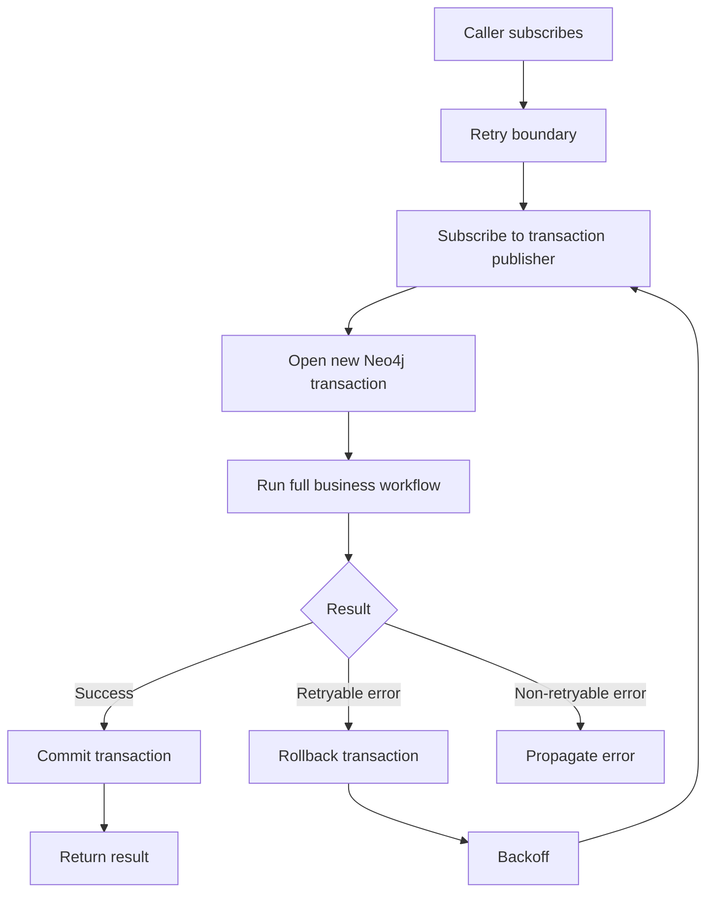

# Đặt retry đúng ranh giới để chạy lại trọn đơn vị công việc

## Mục tiêu bài học

Trong ứng dụng Spring Data Neo4j (SDN) dùng reactive repository hoặc `ReactiveNeo4jTemplate`, một nghiệp vụ thường gồm nhiều bước đọc và ghi graph. Ví dụ, đặt hàng cần đọc khách hàng, kiểm tra tồn kho, giữ số lượng và tạo đơn hàng. Nếu một lỗi tạm thời xảy ra giữa chừng, ứng dụng có thể cần chạy lại nghiệp vụ.

Điểm quyết định là vị trí đặt `retryWhen` so với ranh giới transaction. Retry đúng phải chạy lại toàn bộ đơn vị công việc trong một transaction mới sau khi transaction trước đã rollback. Nếu đặt retry bên trong một transaction, các lần thử có thể dùng chung transaction context; transaction đã gặp lỗi không phải lúc nào cũng còn ở trạng thái an toàn để tiếp tục.

Bài học này hướng dẫn cách kết hợp Reactor, `TransactionalOperator`, `@Transactional` và reactive transaction manager; phân loại lỗi có thể retry; thiết kế backoff, idempotency và outbox; đồng thời kiểm thử để xác nhận mỗi lần thử có ranh giới transaction riêng.

## 1. Reactive transaction được gắn với subscription

Trong reactive stack, một thao tác trả về `Mono<T>` hoặc `Flux<T>` mô tả một chuỗi xử lý sẽ thực thi khi có subscription. Chỉ tạo publisher chưa có nghĩa query đã chạy hoặc transaction đã mở.

SDN cung cấp các thành phần reactive như:

- Reactive repository, trả về `Mono` hoặc `Flux`.
- `ReactiveNeo4jTemplate`, dùng cho thao tác mapping và truy vấn reactive.
- `ReactiveNeo4jTransactionManager`, quản lý transaction reactive của Neo4j.
- `TransactionalOperator`, dùng để bao một publisher trong transaction.

Transaction reactive được truyền qua Reactor Context thay vì dựa vào thread-local như transaction imperative truyền thống. Vì vậy, các thao tác cần tham gia cùng transaction phải nằm trong cùng reactive chain và subscription.

Ví dụ, hai thao tác repository được nối bằng `flatMap` hoặc `then` sẽ tiếp tục trong reactive context hiện tại:

```java
Mono<Order> createOrder(Order order) {
    return orderRepository.save(order)
            .flatMap(saved ->
                    inventoryRepository.reserve(saved.getSku(), saved.getQuantity())
                            .thenReturn(saved));
}
```

Khi publisher này được đặt trong reactive transaction, các repository operation có thể tham gia cùng transaction Neo4j nếu chúng dùng cùng reactive transaction manager.

Không gọi `subscribe()` bên trong service để khởi chạy một nhánh độc lập. Cũng không dùng `block()` để chờ kết quả trong reactive flow. Những cách đó tách công việc ra khỏi subscription do caller quản lý, khiến transaction context, lỗi và cancellation khó được phối hợp đúng.

## 2. Xác định đơn vị công việc cần retry

Retry cần bao phủ đơn vị nghiệp vụ hoàn chỉnh. Giả sử quy trình đặt hàng gồm:

1. Tìm khách hàng và xác nhận khách hàng hợp lệ.
2. Đọc tồn kho hiện tại.
3. Kiểm tra số lượng có thể đặt.
4. Cập nhật tồn kho.
5. Tạo đơn hàng.
6. Trả về biên nhận.

Nếu bước 5 gặp lỗi transient, chỉ retry câu lệnh tạo đơn hàng có thể không đủ. Các bước trước đó có thể đã đọc dữ liệu cũ hoặc transaction có thể đã bị đánh dấu rollback. Khi retry, ứng dụng cần bắt đầu lại từ bước 1 để đọc trạng thái mới nhất và đánh giá lại điều kiện nghiệp vụ.

Một transaction nên chứa tất cả thao tác graph cần commit hoặc rollback cùng nhau. Ví dụ:

```java
private Mono<Receipt> persistOnce(PlaceOrderCommand command) {
    return customerRepository.findById(command.customerId())
            .switchIfEmpty(Mono.error(
                    new CustomerNotFoundException(command.customerId())))
            .flatMap(customer ->
                    inventoryRepository.findBySku(command.sku())
                            .switchIfEmpty(Mono.error(
                                    new InventoryNotFoundException(command.sku())))
                            .flatMap(inventory -> {
                                if (inventory.getAvailable() < command.quantity()) {
                                    return Mono.error(
                                            new InsufficientStockException());
                                }

                                inventory.reserve(command.quantity());

                                return inventoryRepository.save(inventory)
                                        .flatMap(savedInventory ->
                                                orderRepository.save(
                                                        Order.from(command, customer, savedInventory)))
                                        .map(Receipt::from);
                            }));
}
```

Đây là phần xử lý một lần thử. Nó chưa tự quyết định retry hay mở transaction. Việc tách phần công việc này giúp đặt transaction boundary và retry boundary rõ ràng ở tầng service.

Không phải lỗi nào cũng nên chạy lại toàn bộ nghiệp vụ. Lỗi nghiệp vụ như không đủ tồn kho hoặc khách hàng không tồn tại cần trả về cho caller. Retry chỉ dành cho lỗi tạm thời mà lần thử tiếp theo có cơ hội thành công.

## 3. Đặt transaction bên trong retry boundary

Với `TransactionalOperator`, thứ tự operator quan trọng. Mẫu nên dùng là bao publisher bằng transaction trước, sau đó đặt retry ở phía ngoài transaction:

```java
@Service
public class CheckoutService {

    private final TransactionalOperator transactionalOperator;
    private final CustomerRepository customerRepository;
    private final InventoryRepository inventoryRepository;
    private final OrderRepository orderRepository;

    public CheckoutService(
            TransactionalOperator transactionalOperator,
            CustomerRepository customerRepository,
            InventoryRepository inventoryRepository,
            OrderRepository orderRepository) {
        this.transactionalOperator = transactionalOperator;
        this.customerRepository = customerRepository;
        this.inventoryRepository = inventoryRepository;
        this.orderRepository = orderRepository;
    }

    public Mono<Receipt> placeOrder(PlaceOrderCommand command) {
        return Mono.defer(() -> persistOnce(command))
                .as(transactionalOperator::transactional)
                .retryWhen(retrySpec());
    }

    private Mono<Receipt> persistOnce(PlaceOrderCommand command) {
        // Đọc customer, kiểm tra inventory, lưu inventory và order.
        // Trả về Mono<Receipt> của toàn bộ nghiệp vụ.
        return buildOrderWorkflow(command);
    }
}
```

Trong chuỗi này:

- `Mono.defer(...)` tạo publisher công việc khi có subscription và gọi lại phần xây dựng workflow khi có lần subscribe mới.
- `transactionalOperator.transactional(...)` mở transaction cho subscription đó.
- `retryWhen(...)` nằm ngoài transaction publisher. Khi có lỗi được phép retry, Reactor subscribe lại publisher đã được bọc transaction.
- Mỗi lần subscribe lại đi qua transaction operator, transaction cũ đã kết thúc bằng rollback và lần thử tiếp theo nhận transaction mới.

Có thể hình dung thứ tự:



Nếu lần đầu đọc tồn kho rồi gặp deadlock hoặc lỗi transient, transaction đó được rollback. Lần thử kế tiếp đọc lại dữ liệu trong transaction mới, đánh giá lại tồn kho và chạy lại toàn bộ thao tác.

## 4. Đặt retry bên trong transaction là sai ranh giới

Xét chuỗi sau:

```java
public Mono<Receipt> placeOrder(PlaceOrderCommand command) {
    return Mono.defer(() -> persistOnce(command))
            .retryWhen(retrySpec())
            .as(transactionalOperator::transactional);
}
```

Ở đây, transaction operator bao toàn bộ chuỗi đã có retry. Các lỗi từ `persistOnce` bị `retryWhen` xử lý trước khi đến transaction boundary. Transaction operator có thể chỉ nhìn thấy kết quả cuối cùng của cả chuỗi retry.

Hệ quả là:

- Lần thử sau có thể chạy trong cùng transaction context với lần thử trước.
- Transaction đã gặp lỗi từ database có thể không còn dùng được cho các query tiếp theo.
- Các thao tác đã đọc hoặc ghi ở lần trước không được bảo đảm đã rollback trước khi retry.
- Không đạt mục tiêu “một lần thử = một transaction độc lập”.

Khi một thao tác ghi Neo4j thất bại, database hoặc driver có thể đã đánh dấu transaction lỗi hoặc hủy transaction. Bắt lỗi ở bên trong rồi tiếp tục dùng cùng transaction không phải cách khôi phục transaction đó.

Hãy nhớ quy tắc: **retry bao quanh transaction publisher**. Mỗi lần thử cần bắt đầu một transaction, thực hiện toàn bộ workflow, rồi commit hoặc rollback trước khi quyết định thử lại.

## 5. Cấu hình TransactionalOperator cho Neo4j

Có thể tạo `TransactionalOperator` từ reactive transaction manager của Neo4j:

```java
@Configuration
public class ReactiveTransactionConfiguration {

    @Bean
    TransactionalOperator neo4jTransactionalOperator(
            ReactiveNeo4jTransactionManager transactionManager) {
        return TransactionalOperator.create(transactionManager);
    }
}
```

Nếu Spring Boot hoặc cấu hình SDN đã cung cấp reactive transaction manager, hãy inject bean đó. Không tạo thêm một manager khác trỏ đến driver/database khác với reactive repositories đang sử dụng.

Nếu ứng dụng có nhiều reactive transaction manager, cần chọn đúng manager khi tạo operator. Một publisher dùng reactive repository Neo4j nhưng được bao bởi transaction manager của một database khác sẽ không có transaction Neo4j như mong muốn.

Dùng `TransactionalOperator` khi cần thấy rõ transaction boundary ngay trong reactive chain hoặc cần nhiều kiểu ranh giới khác nhau. Nếu use case đơn giản và transaction boundary trùng với public service method, `@Transactional` reactive cũng có thể phù hợp.

## 6. Dùng @Transactional với reactive method

Spring hỗ trợ khai báo transaction cho method trả về reactive type. Với SDN, method cần chạy dưới reactive transaction manager của Neo4j và trả về publisher như `Mono` hoặc `Flux`.

Ví dụ, tách một lần thử vào bean riêng:

```java
@Service
public class OrderAttemptService {

    @Transactional(transactionManager = "reactiveNeo4jTransactionManager")
    public Mono<Receipt> persistOnce(PlaceOrderCommand command) {
        return Mono.defer(() -> buildOrderWorkflow(command));
    }
}
```

Một service điều phối đặt retry ở bên ngoài lời gọi transactional:

```java
@Service
public class CheckoutFacade {

    private final OrderAttemptService orderAttemptService;

    public CheckoutFacade(OrderAttemptService orderAttemptService) {
        this.orderAttemptService = orderAttemptService;
    }

    public Mono<Receipt> placeOrder(PlaceOrderCommand command) {
        return Mono.defer(() -> orderAttemptService.persistOnce(command))
                .retryWhen(retrySpec());
    }
}
```

Mỗi lần retry resubscribe vào `Mono.defer`, lời gọi được thực hiện qua Spring proxy của `OrderAttemptService`. Transaction interceptor áp dụng transaction cho publisher của lần thử đó. Việc tách bean cũng tránh self-invocation bỏ qua proxy.

Tên transaction manager trong ví dụ chỉ là tên minh họa; dùng đúng bean name trong ứng dụng. Nếu chỉ có một reactive transaction manager phù hợp, có thể không cần chỉ rõ tên.

Không đặt `retryWhen` bên trong method `@Transactional` nếu mục tiêu là rollback và mở transaction mới cho từng lần thử. Nếu method transactional tự chứa retry, interceptor nhìn thấy một publisher duy nhất và transaction boundary bao toàn bộ chuỗi đó.

## 7. Chỉ retry lỗi transient

Không nên retry mọi exception. Nhiều lỗi sẽ không biến mất khi chạy lại:

| Nhóm lỗi | Có nên retry tự động? | Lý do |
|---|---|---|
| Deadlock hoặc transient transaction failure | Thường có, với giới hạn | Lần thử mới có thể lấy lock theo tình trạng mới |
| Tạm thời mất kết nối hoặc leader chuyển đổi | Có thể, tùy trạng thái commit và khả năng retry an toàn | Hạ tầng có thể phục hồi |
| Vi phạm uniqueness constraint do dữ liệu đầu vào | Không | Lặp lại cùng dữ liệu sẽ tiếp tục thất bại |
| Cypher syntax error hoặc sai tên property | Không | Cần sửa query |
| Authentication/authorization failure | Không | Retry không sửa được quyền truy cập |
| Validation error hoặc không đủ tồn kho | Không | Đây là kết quả nghiệp vụ |
| Optimistic locking conflict | Không retry mù | Cần đọc lại và tính lại theo trạng thái mới |
| Timeout | Chỉ khi có chính sách rõ ràng | Kết quả commit có thể không chắc chắn với caller |

Khi dùng Spring exception translation, có thể lọc theo `TransientDataAccessException` nếu các lỗi transient từ Neo4j được ánh xạ vào hierarchy đó trong phiên bản ứng dụng. Nếu driver exception được truyền ra trực tiếp, predicate cần kiểm tra mã lỗi và khả năng retry theo Neo4j Java Driver. Không dùng một điều kiện rộng như “mọi `RuntimeException` đều retry”.

Ví dụ với Spring transient exception:

```java
import org.springframework.dao.TransientDataAccessException;
import reactor.core.Exceptions;

private boolean isRetryable(Throwable error) {
    Throwable cause = Exceptions.unwrap(error);
    return cause instanceof TransientDataAccessException;
}
```

Đây là predicate minh họa cho ứng dụng đã xác nhận exception translation của mình. Nếu lỗi được bọc nhiều lớp hoặc driver exception không được dịch thành Spring exception, hãy bổ sung logic duyệt cause và nhận diện đúng mã lỗi transient. Không coi mọi `DataAccessException` là transient.

## 8. Thiết kế backoff, jitter và giới hạn lần thử

Nếu nhiều request cùng gặp lỗi transient, retry ngay lập tức có thể khiến chúng tiếp tục tranh chấp lock cùng lúc. Exponential backoff tăng khoảng chờ giữa các lần thử; jitter thêm độ ngẫu nhiên để các request không đồng loạt retry ở cùng thời điểm.

Ví dụ:

```java
private Retry retrySpec() {
    return Retry.backoff(3, Duration.ofMillis(100))
            .maxBackoff(Duration.ofSeconds(2))
            .jitter(0.5)
            .filter(this::isRetryable)
            .onRetryExhaustedThrow(
                    (spec, signal) -> signal.failure());
}
```

Ý nghĩa:

- `Retry.backoff(3, ...)` cho phép tối đa ba lần retry sau lần thực thi ban đầu, tức tối đa bốn lần thực thi.
- Khoảng chờ bắt đầu ở 100 ms và tăng theo exponential backoff.
- `maxBackoff` giới hạn thời gian chờ tối đa.
- `jitter(0.5)` phân tán thời điểm retry giữa các request.
- `filter(...)` chỉ cho phép retry lỗi được xác định là transient.
- `onRetryExhaustedThrow(...)` giữ lỗi cuối cùng làm nguyên nhân khi hết số lần thử.

Giá trị backoff và số lần retry cần dựa trên SLA, thời gian timeout của request và khả năng phục hồi của Neo4j. Không đặt số lần thử quá cao khiến một request giữ tài nguyên quá lâu. Nếu tổng thời gian backoff vượt timeout của HTTP request, caller có thể đã hủy subscription trước khi retry hoàn tất.

Cần phân biệt số lần thử với số lần retry. Với cấu hình trên, lần đầu không được tính là retry; ba retry bổ sung tạo tối đa bốn lần chạy workflow.

## 9. Dùng Mono.defer để mỗi lần thử thực sự tạo lại công việc

Publisher reactive thường là lazy và cold, nhưng khi workflow được tạo từ lời gọi có side effect ở thời điểm assembly, cần bọc bằng `Mono.defer` để tạo lại phần công việc mỗi lần subscribe.

Ví dụ:

```java
return Mono.defer(() -> {
    logAttempt();
    return persistOnce(command);
})
.as(transactionalOperator::transactional)
.retryWhen(retrySpec());
```

Mỗi lần subscribe vào publisher này gọi lại supplier của `Mono.defer`. Đây là nơi phù hợp để tạo query publisher hoặc đọc trạng thái cần làm mới cho lần thử.

Tránh tạo một publisher nóng hoặc khởi chạy side effect bên ngoài reactive chain rồi kỳ vọng `retryWhen` có thể chạy lại công việc đó. Retry chỉ resubscribe vào publisher upstream; nó không tự khôi phục một thao tác imperative đã chạy một lần ở thời điểm assembly.

Cũng không tạo một ID nghiệp vụ mới bên trong `defer` cho mỗi lần thử nếu các lần thử phải đại diện cho cùng một yêu cầu. Hãy tạo command ID/idempotency key một lần ở đầu request rồi truyền cùng giá trị qua mọi lần retry.

## 10. Idempotency khi kết quả commit không chắc chắn

Có tình huống transaction đã commit ở Neo4j nhưng kết nối bị ngắt trước khi ứng dụng nhận được xác nhận. Caller chỉ nhìn thấy lỗi và có thể retry, dù lần thử trước thực tế đã ghi thành công.

Nếu mỗi lần retry tạo một đơn hàng mới với ID ngẫu nhiên, nghiệp vụ có thể sinh dữ liệu trùng. Dùng idempotency key ổn định cho cùng một yêu cầu giúp nhận diện lần thực hiện đã tồn tại.

Ví dụ constraint:

```cypher
CREATE CONSTRAINT order_operation_id_unique IF NOT EXISTS
FOR (o:Order)
REQUIRE o.operationId IS UNIQUE;
```

Upsert theo idempotency key:

```cypher
MERGE (o:Order {operationId: $operationId})
ON CREATE SET
    o.customerId = $customerId,
    o.sku = $sku,
    o.quantity = $quantity,
    o.createdAt = datetime()
RETURN o
```

Cùng một `operationId` được dùng cho mọi lần thử của cùng yêu cầu. Nếu lần trước đã commit, lần sau có thể tìm thấy đơn hàng đã tạo thay vì tạo node mới.

Trong thực tế, cần xác minh payload của yêu cầu trùng idempotency key có giống lần đầu hay không. Có thể lưu request hash hoặc các trường bất biến để từ chối trường hợp cùng key nhưng nội dung khác. Idempotency key không nên được tái sử dụng cho hai thao tác nghiệp vụ độc lập.

Idempotency không thay thế transaction. Nó xử lý việc cùng một yêu cầu được gửi lại; transaction bảo đảm các thay đổi graph trong một lần thử được commit hoặc rollback cùng nhau.

## 11. Không retry side effect bên ngoài transaction một cách mù quáng

Transaction Neo4j có thể rollback các thay đổi trong graph. Nó không thể tự rollback email đã gửi, HTTP request đã gọi sang dịch vụ thanh toán hoặc message đã publish đến broker bên ngoài.

Ví dụ nguy hiểm:

```java
return orderRepository.save(order)
        .flatMap(saved ->
                paymentClient.charge(saved).thenReturn(saved))
        .as(transactionalOperator::transactional)
        .retryWhen(retrySpec());
```

Nếu thanh toán thành công nhưng transaction Neo4j thất bại sau đó, lần retry có thể tính tiền lần thứ hai. Việc rollback graph không hoàn tác giao dịch ở payment service.

Một cách thiết kế thường dùng là transactional outbox:

1. Trong transaction Neo4j, lưu đơn hàng và một node/event outbox có ID ổn định.
2. Commit cả đơn hàng và outbox event cùng nhau.
3. Một publisher riêng đọc các event chưa xử lý và gửi ra hệ thống ngoài.
4. Đánh dấu event đã gửi hoặc lưu trạng thái xử lý.
5. Consumer bên ngoài dùng event ID làm khóa deduplication để xử lý message lặp.

Tạo uniqueness constraint cho event ID để hai lần ghi cùng một sự kiện không tạo hai outbox node:

```cypher
CREATE CONSTRAINT outbox_event_id_unique IF NOT EXISTS
FOR (e:OutboxEvent)
REQUIRE e.eventId IS UNIQUE;
```

Ví dụ ghi outbox trong cùng transaction:

```cypher
MERGE (o:Order {operationId: $operationId})
ON CREATE SET
    o.status = 'CREATED',
    o.createdAt = datetime()
MERGE (e:OutboxEvent {eventId: $eventId})
ON CREATE SET
    e.type = 'ORDER_CREATED',
    e.orderOperationId = $operationId,
    e.status = 'PENDING',
    e.createdAt = datetime()
RETURN o, e
```

Nếu transaction rollback, cả Order và OutboxEvent đều rollback. Nếu commit, publisher có thể tiếp tục gửi event sau đó. Publisher vẫn cần retry và deduplicate vì gửi thành công nhưng mất acknowledgement cũng có thể tạo delivery lặp.

## 12. Retry, timeout và cancellation

`retryWhen` xử lý tín hiệu lỗi (`onError`). Nó không tự retry khi subscriber chủ động hủy subscription (`cancel`).

Trong reactive transaction:

- Khi publisher hoàn tất thành công, transaction được commit.
- Khi publisher kết thúc bằng lỗi, transaction được rollback theo transaction manager.
- Khi subscriber cancel, transaction manager thực hiện cleanup/rollback theo lifecycle reactive transaction.
- Khi timeout phát ra lỗi, retry có thể chạy nếu predicate cho phép lỗi đó.

Timeout cần được xử lý cẩn thận. Nếu timeout xảy ra trước khi transaction commit, việc cancel upstream thường dẫn đến cleanup transaction. Nhưng nếu kết nối bị mất trong lúc commit, caller có thể không biết commit đã thành công hay chưa. Đây là một lý do khác để dùng idempotency key ổn định.

Không retry cancellation như thể đó là transient failure. Nếu người dùng đã rời trang hoặc HTTP client đã ngắt kết nối, tiếp tục chạy lại toàn bộ nghiệp vụ có thể tiêu tốn tài nguyên mà không còn caller nhận kết quả.

## 13. Kết hợp retry với @Transactional và TransactionalOperator

| Cách tổ chức | Vị trí retry | Ranh giới transaction |
|---|---|---|
| `TransactionalOperator` | Sau `.as(transactionalOperator::transactional)` | Mỗi lần retry subscribe transaction publisher mới |
| `@Transactional` trên method một lần thử ở bean riêng | Ở caller bên ngoài lời gọi qua proxy | Mỗi lần gọi/resubscribe vào method transactional có transaction riêng |
| Retry nằm trong method `@Transactional` | Bên trong method | Retry nằm trong transaction boundary của method |
| Retry nằm trước transaction operator | Upstream của transaction operator | Một transaction bao cả chuỗi retry |

Nên chọn một cách quản lý transaction cho một boundary cụ thể để tránh lồng operator và annotation không cần thiết. Nếu cần transaction lồng nhau, hãy hiểu propagation và hỗ trợ thực tế của reactive transaction manager trước khi áp dụng.

Nếu gọi Neo4j Java Driver trực tiếp bằng managed transaction function như `executeRead` hoặc `executeWrite`, driver có cơ chế retry cho các lỗi retryable của transaction function. Luồng đó khác với transaction được mở tường minh qua Spring `ReactiveNeo4jTransactionManager`. Hãy xác định tầng nào đang chịu trách nhiệm retry để tránh vô tình nhân số lần thử do lồng retry của driver và Reactor.

Với `@Transactional`, cần tránh self-invocation. Nếu method retry gọi một method transactional khác trong cùng class bằng `this.method()`, lời gọi đó không đi qua proxy trong proxy mode. Tách method một lần thử sang bean khác để caller retry bên ngoài proxy là cách dễ kiểm soát.

## 14. Kiểm thử retry và transaction boundary

Một test chỉ xác nhận kết quả cuối cùng thành công chưa đủ. Cần kiểm tra cả số lần thử, số transaction, trạng thái rollback và việc các thao tác graph được chạy lại từ đầu.

Các tình huống nên kiểm thử:

1. Lần đầu ném transient exception, lần sau thành công.
2. Mỗi lần thử mở một transaction mới.
3. Các thay đổi ở lần thử thất bại không còn trong graph sau rollback.
4. Lần thử tiếp theo đọc lại dữ liệu mới nhất.
5. Lỗi validation hoặc constraint violation không bị retry.
6. Hết số lần retry thì lỗi cuối được truyền cho caller.
7. Idempotency key giữ nguyên giữa các lần thử.
8. Cancellation không kích hoạt retry.
9. Side effect ngoài graph không bị thực hiện lặp trong transaction retry.
10. Outbox event được lưu cùng transaction với đơn hàng.

Ví dụ kiểm thử hành vi retry bằng Reactor Test:

```java
@Test
void shouldRetryWholeWorkflowAfterTransientFailure() {
    AtomicInteger attempts = new AtomicInteger();

    Mono<String> workflow = Mono.defer(() -> {
        int attempt = attempts.incrementAndGet();

        if (attempt == 1) {
            return Mono.error(new TransientDataAccessResourceException(
                    "Temporary database failure"));
        }

        return Mono.just("created");
    });

    StepVerifier.create(
                    workflow.retryWhen(Retry.max(1)))
            .expectNext("created")
            .verifyComplete();

    assertEquals(2, attempts.get());
}
```

Test này chỉ chứng minh Reactor resubscribe workflow. Để xác nhận transaction boundary, cần integration test với reactive Neo4j transaction manager và Neo4j thật/Testcontainers:

- Bao workflow bằng `TransactionalOperator`.
- Tạo một thay đổi graph rồi cố ý phát sinh lỗi transient trước khi kết thúc lần thử đầu.
- Cho lần thử tiếp theo chạy thành công.
- Xác nhận transaction đầu rollback, transaction thứ hai commit.
- Quan sát transaction lifecycle bằng test instrumentation hoặc transaction synchronization phù hợp với phiên bản Spring.
- Đọc lại graph sau khi toàn bộ publisher kết thúc.

Không nên bọc toàn bộ test trong một transaction test duy nhất nếu mục tiêu là xác minh nhiều transaction độc lập. Mỗi lần thử phải được quan sát như một subscription transaction riêng.

## 15. Lỗi thường gặp

| Lỗi | Hệ quả | Cách xử lý |
|---|---|---|
| Đặt `retryWhen` trước transaction operator | Retry có thể chạy bên trong cùng transaction boundary | Đặt retry sau transaction publisher |
| Chỉ retry query cuối của workflow | Dùng lại quyết định dựa trên dữ liệu đã đọc trước lỗi | Retry toàn bộ đơn vị nghiệp vụ |
| Retry mọi `RuntimeException` | Lặp lỗi validation, syntax hoặc constraint | Lọc đúng transient failure |
| Không giới hạn số lần thử | Request kéo dài và giữ tài nguyên | Đặt max attempts và timeout |
| Retry ngay lập tức | Các request tiếp tục tranh chấp cùng lúc | Dùng exponential backoff và jitter |
| Tạo ID mới trong mỗi lần thử | Một yêu cầu có thể tạo nhiều node nghiệp vụ | Giữ idempotency key ổn định |
| Gửi email hoặc gọi payment trong transaction retry | Side effect ngoài graph có thể lặp | Dùng outbox và consumer idempotent |
| Gọi `subscribe()` bên trong service | Tách nhánh khỏi transaction context của caller | Trả publisher để caller điều khiển |
| Dùng `block()` trong reactive chain | Chặn thread và làm đứt mô hình reactive | Nối publisher bằng Reactor operators |
| Dùng imperative transaction manager cho reactive repository | Transaction context không được truyền đúng | Dùng ReactiveNeo4jTransactionManager |
| Đặt retry bên trong method `@Transactional` | Các lần thử nằm trong cùng transaction boundary | Retry bên ngoài proxy transactional |
| Nghĩ cancellation cũng được retry | `retryWhen` không xử lý tín hiệu cancel | Thiết kế cleanup và cancellation riêng |
| Không xử lý commit outcome không chắc chắn | Retry có thể tạo side effect trùng | Dùng idempotency key và đọc lại kết quả |

## 16. Tự kiểm tra

1. Vì sao reactive transaction gắn với subscription và Reactor Context?
2. Đơn vị công việc nào nên được chạy lại khi một bước giữa workflow gặp transient failure?
3. Vì sao retry phải bao quanh transaction publisher?
4. Điều gì có thể xảy ra khi đặt `retryWhen` trước `TransactionalOperator`?
5. `Mono.defer` giúp ích gì khi Reactor resubscribe?
6. Khi nào nên dùng `TransactionalOperator` và khi nào có thể dùng `@Transactional`?
7. Vì sao reactive `@Transactional` cần method trả về `Mono` hoặc `Flux`?
8. Những lỗi nào không nên retry tự động?
9. Exponential backoff và jitter giảm vấn đề gì khi nhiều request cùng retry?
10. Vì sao idempotency key phải giữ nguyên giữa các lần thử?
11. Transaction Neo4j có thể rollback email hoặc payment đã gửi không?
12. Transactional outbox giúp phối hợp graph write và event publishing như thế nào?
13. Vì sao cancellation khác với error trong Reactor?
14. Cần kiểm tra gì để chứng minh mỗi lần retry có transaction mới?

Hãy xây dựng workflow đặt hàng gồm đọc khách hàng, kiểm tra tồn kho, cập nhật tồn kho và tạo đơn hàng. Bao workflow bằng `TransactionalOperator`, đặt `retryWhen` bên ngoài và mô phỏng lỗi transient ở lần đầu. Xác nhận thay đổi lần đầu rollback, lần thứ hai chạy lại từ đầu và commit. Sau đó đảo thứ tự operator để quan sát khác biệt về transaction boundary. Cuối cùng thêm idempotency key và outbox event để kiểm tra trường hợp commit đã xảy ra nhưng acknowledgement bị mất.

## Tài liệu tham khảo

- [Spring Framework — Reactive Transaction Management](https://docs.spring.io/spring-framework/reference/data-access/transaction/programmatic.html)
- [Spring Framework — Declarative Transaction Management](https://docs.spring.io/spring-framework/reference/data-access/transaction/declarative.html)
- [Spring Data Neo4j — Reactive repositories and transactions](https://docs.spring.io/spring-data/neo4j/reference/faq.html)
- [Spring Data Neo4j — ReactiveNeo4jTransactionManager API](https://docs.spring.io/spring-data/neo4j/reference/api/java/org/springframework/data/neo4j/core/transaction/ReactiveNeo4jTransactionManager.html)
- [Reactor Core — Handling Errors and Retry](https://projectreactor.io/docs/core/release/reference/coreFeatures/error-handling.html)
- [Reactor Core — Retry API](https://projectreactor.io/docs/core/release/api/reactor/util/retry/Retry.html)
- [Neo4j Java Driver — Transactions](https://neo4j.com/docs/java-manual/current/transactions/)
