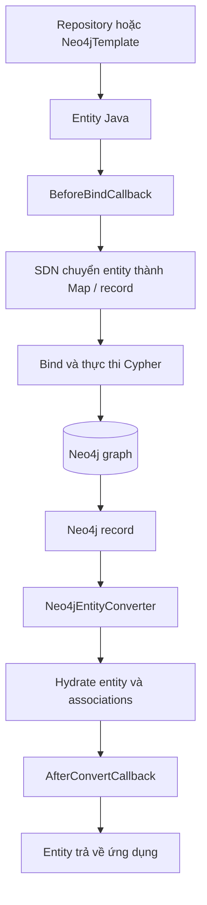

# Vai trò của EntityCallback trong quy trình ánh xạ SDN

`EntityCallback` là điểm móc mà Spring Data Neo4j (SDN) cung cấp để ứng dụng can thiệp vào entity tại những thời điểm xác định của quy trình lưu và đọc graph. Callback có thể kiểm tra hoặc trả về một phiên bản entity đã được điều chỉnh trước khi lưu, hoặc bổ sung dữ liệu sau khi Neo4j record đã được ánh xạ thành entity Java.

Trong `SPRING_DATA_NEO4J`, callback kết nối domain object với quy trình ánh xạ node và relationship. `BeforeBindCallback` chạy trước khi SDN chuyển entity thành dữ liệu để bind vào câu lệnh ghi; `AfterConvertCallback` chạy sau khi record cùng các association đã được hydrate. Đây là các hook hữu ích cho chuẩn hóa dữ liệu, thiết lập giá trị mặc định và tạo dữ liệu dẫn xuất không cần lưu trong graph.

## 1. EntityCallback nằm ở đâu trong mapping pipeline?

SDN không chỉ gửi một object Java thẳng xuống Neo4j. Framework đọc metadata từ `@Node`, `@Id`, `@Relationship` và các mapping annotation khác để chuyển entity thành dữ liệu phù hợp với Cypher. Khi đọc, framework chuyển record Neo4j thành entity và dựng các association theo mapping metadata.

Hai điểm callback quan trọng trong quy trình này:



| Callback | Thời điểm | Đầu vào chính | Mục đích |
|---|---|---|---|
| `BeforeBindCallback<T>` | Trước khi entity được chuyển thành record để ghi | Domain object sắp lưu | Chuẩn hóa hoặc bổ sung giá trị trước persistence |
| `ReactiveBeforeBindCallback<T>` | Cùng điểm trước bind trong pipeline reactive | Domain object sắp lưu | Điều chỉnh entity bằng một `Publisher<T>` |
| `AfterConvertCallback<T>` | Sau khi record và các association đã được ánh xạ thành entity | Entity đã hydrate, metadata entity và record nguồn | Bổ sung hoặc điều chỉnh dữ liệu sau mapping |

Tên callback phản ánh chính xác vị trí của nó: `BeforeBind` là trước bước bind, còn `AfterConvert` là sau bước convert record thành entity. Không nên tự suy diễn rằng SDN có toàn bộ callback kiểu `BeforeConvert`, `BeforeSave` hay `AfterSave` giống một số Spring Data module khác; hãy dùng các API callback mà SDN thực sự cung cấp.

## 2. BeforeBindCallback: chỉnh entity trước khi ghi

`BeforeBindCallback<T>` thuộc package `org.springframework.data.neo4j.core.mapping.callback`. Đây là callback imperative, được gọi trước khi domain object được lưu và trước khi SDN chuyển object thành `Map<String, Object>` để tạo record. Callback có thể trả về chính entity đầu vào hoặc một instance đã sửa đổi; instance được trả về sẽ tiếp tục đi qua quá trình mapping và được dùng để ghi.

Generic type `T` gắn callback với domain type mà nó xử lý, ví dụ `BeforeBindCallback<Person>`. API này ổn định từ Spring Data Neo4j 6.0.2.

Ví dụ entity `Person`:

```java
import org.springframework.data.annotation.Transient;
import org.springframework.data.neo4j.core.schema.GeneratedValue;
import org.springframework.data.neo4j.core.schema.Id;
import org.springframework.data.neo4j.core.schema.Node;

@Node("Person")
public class Person {

    @Id
    @GeneratedValue
    private Long id;

    private String name;
    private String email;

    @Transient
    private String displayLabel;

    protected Person() {
    }

    public Person(String name, String email) {
        this.name = name;
        this.email = email;
    }

    public Long getId() {
        return id;
    }

    public String getName() {
        return name;
    }

    public void setName(String name) {
        this.name = name;
    }

    public String getEmail() {
        return email;
    }

    public void setEmail(String email) {
        this.email = email;
    }

    public String getDisplayLabel() {
        return displayLabel;
    }

    public void setDisplayLabel(String displayLabel) {
        this.displayLabel = displayLabel;
    }
}
```

Callback chuẩn hóa email trước khi SDN tạo dữ liệu ghi:

```java
import java.util.Locale;

import org.springframework.data.neo4j.core.mapping.callback.BeforeBindCallback;
import org.springframework.stereotype.Component;

@Component
public class NormalizePersonBeforeBind
        implements BeforeBindCallback<Person> {

    @Override
    public Person onBeforeBind(Person person) {
        if (person.getEmail() != null) {
            person.setEmail(
                person.getEmail().trim().toLowerCase(Locale.ROOT)
            );
        }
        return person;
    }
}
```

Khi ứng dụng gọi `personRepository.save(person)`, SDN gọi callback trước khi bind entity. Nếu email đầu vào là `" An@Example.com "`, callback đổi thành `"an@example.com"`; giá trị đã chuẩn hóa được đưa vào record ghi xuống Neo4j.

Callback này phù hợp với quy tắc chuẩn hóa nhất quán ở ranh giới persistence. Nếu email cần được chuẩn hóa ở mọi luồng nghiệp vụ, kể cả trước khi lưu hoặc khi xác thực, hãy đặt quy tắc cốt lõi trong domain/service và xem callback như một lớp bảo vệ bổ sung. Không dùng callback để thay thế validation nghiệp vụ ở API.

## 3. Callback có thể trả về instance mới

Không bắt buộc phải sửa object đầu vào. Callback có thể tạo và trả về instance mới chứa dữ liệu đã điều chỉnh; cách này đặc biệt hữu ích với entity immutable:

```java
import java.util.Locale;

import org.springframework.data.neo4j.core.mapping.callback.BeforeBindCallback;
import org.springframework.stereotype.Component;

@Component
public class NormalizePersonBeforeBind
        implements BeforeBindCallback<Person> {

    @Override
    public Person onBeforeBind(Person person) {
        String normalizedEmail = person.getEmail() == null
            ? null
            : person.getEmail().trim().toLowerCase(Locale.ROOT);

        return new Person(person.getName(), normalizedEmail);
    }
}
```

Ví dụ tạo object mới cần bảo toàn mọi property có ý nghĩa persistence, kể cả ID và association nếu entity có chúng. Đoạn minh họa trên chỉ phù hợp với entity mới đơn giản chưa có ID hoặc association. Trong ứng dụng thực tế, với immutable entity nhiều trường, hãy dùng constructor/factory đầy đủ để không vô tình làm mất dữ liệu.

Callback có thể trả về entity cùng kiểu hoặc một instance đã biến đổi. Hãy giữ kiểu trả về nhất quán với generic type `T` mà callback khai báo.

## 4. AfterConvertCallback: điều chỉnh entity sau khi đọc

`AfterConvertCallback<T>` được gọi sau khi SDN đã xử lý Neo4j record và hydrate entity cùng các association của entity đó. Callback nhận ba thông tin:

- `instance`: entity Java đã được `Neo4jEntityConverter` ánh xạ.
- `entity`: metadata `Neo4jPersistentEntity<T>` mô tả domain type.
- `source`: record Neo4j nguồn dưới dạng `MapAccessor`.

Ví dụ tạo `displayLabel` để giao diện sử dụng nhưng không lưu property này trong graph:

```java
import org.neo4j.driver.types.MapAccessor;
import org.springframework.data.neo4j.core.mapping.Neo4jPersistentEntity;
import org.springframework.data.neo4j.core.mapping.callback.AfterConvertCallback;
import org.springframework.stereotype.Component;

@Component
public class PersonDisplayLabelAfterConvert
        implements AfterConvertCallback<Person> {

    @Override
    public Person onAfterConvert(
        Person instance,
        Neo4jPersistentEntity<Person> entity,
        MapAccessor source
    ) {
        String label = instance.getName();
        if (instance.getEmail() != null) {
            label = label + " <" + instance.getEmail() + ">";
        }
        instance.setDisplayLabel(label);
        return instance;
    }
}
```

`displayLabel` được đánh dấu `@Transient`, do đó nó không trở thành property persistence của node `Person`. Callback chỉ bổ sung giá trị cho object sau khi đọc. Khi cần tạo DTO hoặc response API, ứng dụng cũng có thể chuyển đổi ở service/mapper riêng; `AfterConvertCallback` phù hợp khi giá trị dẫn xuất này cần có nhất quán mỗi khi entity được hydrate.

`AfterConvertCallback` đã ổn định từ Spring Data Neo4j 6.3.0. API này không có reactive variant riêng và có thể dùng cho cả workload imperative lẫn reactive.

## 5. ReactiveBeforeBindCallback trong ứng dụng reactive

SDN tách callback trước bind cho imperative và reactive API. Khi lưu bằng `ReactiveNeo4jRepository` hoặc `ReactiveNeo4jTemplate`, hãy triển khai `ReactiveBeforeBindCallback<T>` thay cho `BeforeBindCallback<T>`.

Reactive callback trả về `Publisher<T>` để thay đổi entity nằm trong pipeline reactive:

```java
import java.util.Locale;

import org.reactivestreams.Publisher;
import org.springframework.data.neo4j.core.mapping.callback.ReactiveBeforeBindCallback;
import org.springframework.stereotype.Component;

import reactor.core.publisher.Mono;

@Component
public class NormalizePersonReactiveBeforeBind
        implements ReactiveBeforeBindCallback<Person> {

    @Override
    public Publisher<Person> onBeforeBind(Person person) {
        if (person.getEmail() != null) {
            person.setEmail(
                person.getEmail().trim().toLowerCase(Locale.ROOT)
            );
        }
        return Mono.just(person);
    }
}
```

Callback reactive được thực thi khi pipeline reactive được subscribe. Nó có thể trả `Mono.just(entity)` sau khi điều chỉnh hoặc compose thêm thao tác bất đồng bộ cần thiết. Không gọi `subscribe()` hoặc `block()` bên trong callback; hãy trả publisher để SDN điều phối thứ tự và transaction context.

Quy tắc chọn callback:

| Đường truy cập | Callback trước bind |
|---|---|
| `Neo4jRepository` / `Neo4jTemplate` imperative | `BeforeBindCallback<T>` |
| `ReactiveNeo4jRepository` / `ReactiveNeo4jTemplate` | `ReactiveBeforeBindCallback<T>` |
| Đọc và hydrate entity | `AfterConvertCallback<T>` dùng được cho cả hai |

Spring Data tách callback theo API type: đường imperative xét callback imperative, đường reactive xét callback reactive. Không chỉ đăng ký callback đồng bộ rồi kỳ vọng nó tự chạy trong reactive save.

## 6. Đăng ký callback trong ApplicationContext

SDN tự tìm các bean `EntityCallback` đã đăng ký trong Spring `ApplicationContext`. Cách đơn giản là dùng `@Component` như các ví dụ trên:

```java
@Component
public class NormalizePersonBeforeBind
        implements BeforeBindCallback<Person> {

    @Override
    public Person onBeforeBind(Person person) {
        // Chuẩn hóa entity
        return person;
    }
}
```

Hoặc đăng ký bằng `@Bean`:

```java
import org.springframework.context.annotation.Bean;
import org.springframework.context.annotation.Configuration;
import org.springframework.data.neo4j.core.mapping.callback.BeforeBindCallback;

@Configuration
public class PersonCallbackConfiguration {

    @Bean
    BeforeBindCallback<Person> personBeforeBindCallback() {
        return person -> {
            if (person.getName() != null) {
                person.setName(person.getName().trim());
            }
            return person;
        };
    }
}
```

Không cần tự gọi callback từ service và cũng không cần tự tạo `EntityCallbacks` cho trường hợp cấu hình Spring thông thường. Khi callback là bean trong context, hạ tầng SDN sẽ gọi đúng callback tại checkpoint mapping tương ứng.

## 7. Thứ tự khi có nhiều callback

Một domain type có thể có nhiều callback cùng loại. Ví dụ, ứng dụng có callback trim khoảng trắng và callback chuẩn hóa chữ thường. Khi thứ tự xử lý có ý nghĩa, hãy khai báo thứ tự rõ ràng bằng `@Order` hoặc triển khai `Ordered`:

```java
import org.springframework.core.annotation.Order;
import org.springframework.data.neo4j.core.mapping.callback.BeforeBindCallback;
import org.springframework.stereotype.Component;

@Component
@Order(10)
public class TrimPersonEmail implements BeforeBindCallback<Person> {

    @Override
    public Person onBeforeBind(Person person) {
        if (person.getEmail() != null) {
            person.setEmail(person.getEmail().trim());
        }
        return person;
    }
}
```

```java
import java.util.Locale;

import org.springframework.core.annotation.Order;
import org.springframework.data.neo4j.core.mapping.callback.BeforeBindCallback;
import org.springframework.stereotype.Component;

@Component
@Order(20)
public class LowercasePersonEmail implements BeforeBindCallback<Person> {

    @Override
    public Person onBeforeBind(Person person) {
        if (person.getEmail() != null) {
            person.setEmail(person.getEmail().toLowerCase(Locale.ROOT));
        }
        return person;
    }
}
```

Giá trị order nhỏ hơn được ưu tiên trước theo quy tắc ordering của Spring. Trong ví dụ, trim chạy trước lowercase. Nếu callback phụ thuộc thứ tự, hãy ghi rõ order và kiểm thử kết quả tổng hợp; đừng dựa vào thứ tự khởi tạo bean không được khai báo.

Callback dùng lambda qua `@Bean` vẫn hoạt động, nhưng class implementation thể hiện generic domain type rõ hơn cho cơ chế lọc callback. Với callback dùng chung cho nhiều entity type, hãy cân nhắc chi phí lọc và giữ logic đủ đơn giản để dễ dự đoán.

## 8. EntityCallback và ApplicationEvent khác nhau thế nào?

`EntityCallback` và Spring `ApplicationEvent` đều cho phép phản ứng với một thời điểm trong vòng đời persistence, nhưng mục tiêu và bảo đảm thực thi khác nhau.

| Tiêu chí | `EntityCallback` | Spring `ApplicationEvent` |
|---|---|---|
| Mục tiêu phù hợp | Kiểm tra hoặc sửa entity tại checkpoint mapping | Thông báo cho thành phần khác rằng một sự kiện đã xảy ra |
| Thứ tự | Được gọi trong processing chain; có thể sắp xếp bằng `@Order` / `Ordered` | Phụ thuộc event multicaster và cấu hình listener |
| Reactive | Có callback reactive tương ứng ở điểm before bind; callback chạy trong pipeline | Event listener không tự trở thành reactive chỉ vì publisher gọi nó |
| Sửa entity trước khi lưu | Phù hợp, vì callback trả entity tiếp tục được persistence | Không nên dựa vào event listener để sửa entity trong luồng ghi |
| Tác vụ phụ sau thay đổi | Không phải lựa chọn mặc định cho side effect bên ngoài | Phù hợp để phát thông báo hoặc kích hoạt xử lý tách biệt |

Spring ApplicationEvent có thể được dispatch bất đồng bộ thông qua `ApplicationEventMulticaster`. Điều đó khiến event listener không phù hợp để thực hiện thay đổi entity cần hoàn tất đồng bộ trong transaction persistence. Quy tắc thực hành của SDN: dùng EntityCallback để sửa entity trước khi lưu; dùng ApplicationEvent cho thông báo và phản ứng khác. Nếu cần phản ứng domain gắn với aggregate root và transaction, hãy xem xét Spring Data `@DomainEvents`.

## 9. Auditing là một ứng dụng thực tế của callback

Auditing là trường hợp sử dụng có sẵn của callback. SDN hỗ trợ các annotation Spring Data như:

- `@CreatedBy`: người tạo entity.
- `@CreatedDate`: thời điểm tạo.
- `@LastModifiedBy`: người sửa gần nhất.
- `@LastModifiedDate`: thời điểm sửa gần nhất.

Các field entity có thể khai báo như sau:

```java
import java.time.Instant;

import org.springframework.data.annotation.CreatedBy;
import org.springframework.data.annotation.CreatedDate;
import org.springframework.data.annotation.LastModifiedBy;
import org.springframework.data.annotation.LastModifiedDate;

@CreatedBy
private String createdBy;

@CreatedDate
private Instant createdAt;

@LastModifiedBy
private String lastModifiedBy;

@LastModifiedDate
private Instant lastModifiedAt;
```

Khi bật auditing bằng `@EnableNeo4jAuditing`, SDN đăng ký `AuditingBeforeBindCallback` để điền các trường tương ứng trước khi entity được bind. Với reactive workload, bật `@EnableReactiveNeo4jAuditing`; SDN có `ReactiveAuditingBeforeBindCallback` và ứng dụng cung cấp `ReactiveAuditorAware<T>` để việc lấy auditor nằm trong reactive flow. Các API auditing này sử dụng cùng điểm mở rộng before-bind đã trình bày ở trên.

Ví dụ cấu hình imperative:

```java
import java.util.Optional;

import org.springframework.context.annotation.Bean;
import org.springframework.context.annotation.Configuration;
import org.springframework.data.domain.AuditorAware;
import org.springframework.data.neo4j.config.EnableNeo4jAuditing;

@Configuration
@EnableNeo4jAuditing(auditorAwareRef = "auditorProvider")
public class Neo4jAuditingConfiguration {

    @Bean
    AuditorAware<String> auditorProvider() {
        return () -> Optional.of("system");
    }
}
```

Giá trị `"system"` chỉ minh họa. Trong ứng dụng thực, auditor thường được lấy từ security context hoặc ngữ cảnh người dùng phù hợp. Không hard-code người thực hiện trong môi trường production.

Auditing giúp theo dõi ai tạo/sửa và khi nào. Nó không thay thế audit log nghiệp vụ cần lưu lịch sử thay đổi chi tiết, giá trị trước/sau hoặc yêu cầu bất biến của hệ thống.

## 10. Những điều không nên đặt trong EntityCallback

Callback nằm ngay trong processing chain của persistence, do đó logic trong callback nên ngắn, xác định và tập trung vào entity. Tránh biến callback thành một service orchestration ẩn.

Không nên:

- Gọi API bên ngoài hoặc gửi email đồng bộ trong callback.
- Gọi repository để lưu lặp lại cùng entity từ chính callback, dễ tạo vòng lặp persistence.
- Tự mở transaction hoặc tự quản lý session Neo4j bên trong callback.
- Gọi `subscribe()` hoặc `block()` trong reactive callback.
- Đặt quy tắc nghiệp vụ quan trọng chỉ trong callback mà không thể hiện ở domain/service.
- Dựa vào `AfterConvertCallback` để ghi ngược entity trở lại Neo4j; callback này thuộc đường đọc và kết quả của nó được dùng tiếp trong ứng dụng.

Nếu callback ném exception, thao tác persistence hoặc mapping hiện tại sẽ thất bại. Trong một transaction, exception được xử lý theo quy tắc transaction đang áp dụng. Hãy validate đầu vào sớm ở service để lỗi nghiệp vụ được trả về rõ ràng và tránh phát sinh lỗi bất ngờ sâu trong mapping pipeline.

## 11. Các lỗi thường gặp

| Biểu hiện | Nguyên nhân | Cách xử lý |
|---|---|---|
| Callback không chạy khi save | Bean không nằm trong `ApplicationContext` hoặc dùng sai callback type | Đăng ký bằng `@Component` / `@Bean` và kiểm tra imperative hay reactive API |
| Reactive save không gọi callback đồng bộ | SDN tách callback theo API type | Triển khai `ReactiveBeforeBindCallback<T>` |
| Giá trị callback sửa không được lưu | Callback trả về instance cũ hoặc sửa nhầm instance khác | Trả về entity đã điều chỉnh và bảo toàn mọi field persistence |
| Entity immutable bị mất dữ liệu sau callback | Instance mới không copy đầy đủ property/ID/association | Dùng constructor/factory đầy đủ khi tạo instance mới |
| `AfterConvertCallback` không thấy association mong muốn | Query không trả đủ graph để SDN hydrate | Kiểm tra Cypher `RETURN` và mapping relationship trước callback |
| `displayLabel` xuất hiện thành property trong Neo4j | Field dẫn xuất chưa được đánh dấu transient | Dùng `@Transient` hoặc DTO riêng |
| Nhiều callback chạy sai thứ tự mong muốn | Không khai báo order tường minh | Dùng `@Order` hoặc `Ordered` và kiểm thử thứ tự |
| Event listener sửa entity nhưng giá trị không được lưu | Event được phát sau hoặc xử lý bất đồng bộ | Dùng `BeforeBindCallback` cho sửa đổi trước persistence |
| Callback làm request chậm | Thực hiện I/O hoặc xử lý nặng trong processing chain | Chuyển side effect sang event/outbox hoặc xử lý ngoài callback |

## 12. Tự kiểm tra

1. `BeforeBindCallback` được gọi trước hay sau khi SDN chuyển entity thành `Map`?
2. Vì sao callback cần trả về entity thay vì chỉ sửa một biến cục bộ?
3. `AfterConvertCallback` nhận ba tham số nào và được gọi tại thời điểm nào?
4. Vì sao reactive save cần `ReactiveBeforeBindCallback` thay cho `BeforeBindCallback`?
5. `AfterConvertCallback` có reactive variant riêng không?
6. SDN tìm các callback bean trong đâu và làm thế nào để quy định thứ tự khi có nhiều callback?
7. Khi nào nên dùng EntityCallback thay cho ApplicationEvent?
8. Vì sao không nên gọi repository hoặc API ngoài từ callback?
9. Auditing của SDN sử dụng callback để làm nhiệm vụ gì?

`EntityCallback` cung cấp các checkpoint có thứ tự trong mapping pipeline của Spring Data Neo4j. Dùng `BeforeBindCallback` để điều chỉnh entity trước khi ghi, `ReactiveBeforeBindCallback` cho đường reactive và `AfterConvertCallback` để bổ sung dữ liệu sau khi record cùng association đã được hydrate. Đăng ký callback như Spring bean, đặt thứ tự khi cần và giữ logic tập trung vào entity; dùng ApplicationEvent hoặc domain event cho các phản ứng tách biệt khỏi nhiệm vụ sửa entity trong quá trình mapping.

## Tài liệu tham khảo

- [Spring Data Neo4j — FAQ: auditing and entity callbacks](https://docs.spring.io/spring-data/neo4j/reference/faq.html)
- [Spring Data Neo4j — `BeforeBindCallback` API](https://docs.spring.io/spring-data/neo4j/reference/api/java/org/springframework/data/neo4j/core/mapping/callback/BeforeBindCallback.html)
- [Spring Data Neo4j — `ReactiveBeforeBindCallback` API](https://docs.spring.io/spring-data/neo4j/reference/api/java/org/springframework/data/neo4j/core/mapping/callback/ReactiveBeforeBindCallback.html)
- [Spring Data Neo4j — `AfterConvertCallback` API](https://docs.spring.io/spring-data/neo4j/reference/api/java/org/springframework/data/neo4j/core/mapping/callback/AfterConvertCallback.html)
- [Spring Data Neo4j — Callback package summary](https://docs.spring.io/spring-data/neo4j/reference/api/java/org/springframework/data/neo4j/core/mapping/callback/package-summary.html)
- [Spring Data Commons — Entity callbacks](https://docs.spring.io/spring-data/commons/reference/entity-callbacks.html)
