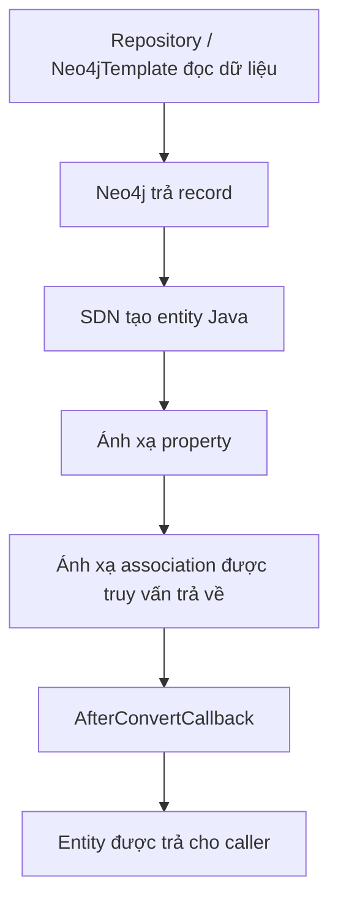

# Callback sau chuyển đổi và phạm vi hỗ trợ theo phiên bản

Khi Spring Data Neo4j (SDN) đọc một bản ghi từ Neo4j và ánh xạ nó thành entity Java, đôi khi ứng dụng cần hoàn thiện đối tượng sau khi quá trình ánh xạ kết thúc. Ví dụ, một `Movie` cần tính số diễn viên từ danh sách relationship đã được nạp, hoặc cần tạo một giá trị chỉ phục vụ hiển thị mà không lưu vào graph.

SDN cung cấp `AfterConvertCallback<T>` cho điểm mở rộng này. Callback được gọi sau khi record đã được chuyển thành entity và các association của entity đã được xử lý. API này ổn định từ SDN 6.3.0; không có interface reactive riêng, nhưng cùng callback có thể dùng trong cả luồng imperative và reactive.

Điều quan trọng là phân biệt callback sau chuyển đổi với callback trước khi ghi, application event sau thao tác lưu và lifecycle API của Neo4j-OGM ở các phiên bản cũ. Chúng chạy ở những thời điểm khác nhau và không thay thế lẫn nhau.

## 1. Vòng đời chuyển đổi entity

Khi repository hoặc template đọc dữ liệu, SDN lấy record từ Neo4j, tạo entity, ánh xạ property và xử lý các relationship mà kết quả truy vấn cung cấp. Sau khi entity đã được hydrate đầy đủ theo kết quả đó, `AfterConvertCallback` có thể chỉnh sửa instance và trả lại đối tượng sẽ tiếp tục được dùng trong ứng dụng.



Callback này chạy sau bước chuyển đổi. Nó không phải hook trước khi lưu và cũng không có nghĩa entity vừa được ghi xuống database. Một truy vấn đọc có thể kích hoạt callback dù không có thao tác ghi nào.

Ví dụ, truy vấn tải một `Movie` cùng danh sách `Actor` liên quan. Callback có thể tính `castSize` từ danh sách diễn viên đã ánh xạ. Giá trị này phục vụ response hoặc logic trong bộ nhớ; nếu không muốn lưu nó thành property Neo4j, hãy đánh dấu trường là `@Transient`.

Lưu ý: “đã xử lý tất cả association” nghĩa là các association thuộc graph được SDN chuyển đổi cho kết quả đó đã được xử lý. Điều này không đảm bảo toàn bộ graph có thể đi tới từ node gốc đều được tải. Phạm vi dữ liệu phụ thuộc query và cách SDN xây dựng entity graph.

## 2. Hợp đồng của AfterConvertCallback

Interface nằm trong package:

```java
org.springframework.data.neo4j.core.mapping.callback.AfterConvertCallback
```

Chữ ký callback:

```java
import org.neo4j.driver.types.MapAccessor;
import org.springframework.data.mapping.callback.EntityCallback;
import org.springframework.data.neo4j.core.mapping.Neo4jPersistentEntity;

public interface AfterConvertCallback<T> extends EntityCallback<T> {

    T onAfterConvert(
            T instance,
            Neo4jPersistentEntity<T> entity,
            MapAccessor source);
}
```

Ba tham số có vai trò khác nhau:

| Tham số | Nội dung | Khi nào cần dùng |
|---|---|---|
| `instance` | Entity vừa được SDN hydrate | Tham số chính để tính toán hoặc hoàn thiện đối tượng |
| `entity` | Metadata mô tả persistent entity | Khi cần biết metadata mapping hoặc loại entity |
| `source` | Record nguồn thông qua Neo4j Driver `MapAccessor` | Khi cần đọc giá trị gốc từ record đã dùng để ánh xạ |

Phương thức trả về `T`. Callback có thể sửa instance mutable rồi trả lại chính nó, hoặc tạo một instance mới nếu domain model bất biến. Đối tượng được trả về sẽ được dùng tiếp trong luồng mapping.

`source` không phải một repository hay một API để truy vấn database. Nó là dữ liệu nguồn đã được dùng cho lần chuyển đổi hiện tại. Chỉ đọc từ `source` khi thật sự cần; phần lớn callback chỉ cần entity đã ánh xạ.

## 3. Đăng ký callback bằng Spring bean

Ví dụ domain model `Movie` có một danh sách diễn viên và một trường tính toán chỉ dùng trong bộ nhớ:

```java
import java.util.List;

import org.springframework.data.annotation.Id;
import org.springframework.data.annotation.Transient;
import org.springframework.data.neo4j.core.schema.Node;
import org.springframework.data.neo4j.core.schema.Relationship;

@Node("Movie")
public class Movie {

    @Id
    private String id;

    private String title;

    @Relationship(type = "ACTED_IN", direction = Relationship.Direction.INCOMING)
    private List<Actor> actors;

    @Transient
    private int castSize;

    public List<Actor> getActors() {
        return actors;
    }

    public int getCastSize() {
        return castSize;
    }

    public void setCastSize(int castSize) {
        this.castSize = castSize;
    }
}
```

Đăng ký callback trong configuration:

```java
import org.springframework.context.annotation.Bean;
import org.springframework.context.annotation.Configuration;
import org.springframework.data.neo4j.core.mapping.callback.AfterConvertCallback;

@Configuration(proxyBeanMethods = false)
class MovieCallbackConfiguration {

    @Bean
    AfterConvertCallback<Movie> calculateCastSize() {
        return (movie, persistentEntity, source) -> {
            int count = movie.getActors() == null
                    ? 0
                    : movie.getActors().size();

            movie.setCastSize(count);
            return movie;
        };
    }
}
```

Không cần một annotation bật riêng cho `AfterConvertCallback`; SDN phát hiện callback được đăng ký trong Spring application context. Callback chỉ áp dụng cho kiểu entity tương ứng với generic type `Movie`.

Khi ứng dụng đọc phim qua repository:

```java
Optional<Movie> result = movieRepository.findById(movieId);

result.ifPresent(movie -> {
    System.out.println(movie.getCastSize());
});
```

Nếu query trả về graph có hai diễn viên và association đó được SDN ánh xạ, `castSize` sẽ có giá trị `2`. Nếu query không trả association hoặc không có diễn viên, logic ví dụ trả `0`.

## 4. Callback có thể trả instance mới

Không bắt buộc phải sửa trực tiếp object đầu vào. Với entity bất biến, tạo một instance mới giữ các giá trị đã hydrate và bổ sung kết quả tính toán:

```java
@Bean
AfterConvertCallback<Movie> immutableMovieCallback() {
    return (movie, persistentEntity, source) ->
            new Movie(
                    movie.getId(),
                    movie.getTitle(),
                    movie.getActors(),
                    movie.getActors() == null ? 0 : movie.getActors().size());
}
```

Ví dụ giả định `Movie` có constructor bất biến nhận các giá trị đó. Khi dùng entity immutable, cần bảo đảm instance mới giữ nguyên các property cần thiết và vẫn đúng kiểu `T`.

Đừng trả về `null`. Callback phải trả về domain object sẽ tiếp tục đi qua luồng đọc.

## 5. Khi nào nên dùng AfterConvertCallback?

Callback sau chuyển đổi phù hợp với công việc phụ thuộc vào dữ liệu đã được hydrate:

- Tính số lượng hoặc giá trị tổng hợp từ các association đã được tải.
- Tạo thuộc tính hiển thị trong bộ nhớ, được đánh dấu `@Transient`.
- Chuẩn hóa một giá trị dẫn xuất để các caller đọc entity có cùng kết quả.
- Hoàn thiện một đối tượng sau khi SDN đã tạo đủ các phần của entity graph trong kết quả truy vấn.

Ví dụ khác: ứng dụng muốn tạo `displayName` từ `firstName` và `lastName`. Có thể tính giá trị này sau khi entity được hydrate và lưu vào trường transient, thay vì lặp lại phép ghép chuỗi ở nhiều controller.

Không nên dùng callback để:

- Thực hiện truy vấn Neo4j bổ sung cho từng entity. Điều đó dễ tạo N+1 query và kéo dài thời gian mapping.
- Gọi HTTP, gửi email, ghi file hoặc thực hiện I/O blocking.
- Gửi message hoặc tạo side effect bên ngoài khi chỉ đọc entity.
- Thay thế validation nghiệp vụ cần trả lỗi rõ ràng tại service boundary.
- Cập nhật graph và mong callback tự lưu thay đổi đó.

`AfterConvertCallback` được gọi trong quá trình mapping. Giữ phần xử lý ngắn, xác định và không có side effect để việc đọc entity có thể dự đoán được.

## 6. Thay đổi trong callback có tự lưu xuống Neo4j không?

Không. Callback sửa instance trong bộ nhớ và trả instance cho caller. Việc này không tự phát sinh một lệnh `save` hoặc `UPDATE` trong Neo4j.

Nếu callback thay đổi một property persistent, entity trong bộ nhớ đã khác dữ liệu vừa đọc. Nếu caller sau đó lưu entity, thay đổi đó có thể được ghi xuống database như một phần của thao tác save tiếp theo. Điều này dễ tạo cập nhật ngoài ý muốn.

Với dữ liệu tính toán chỉ dùng để đọc:

1. Đánh dấu field là `@Transient`.
2. Chỉ tính từ dữ liệu đã có trong entity.
3. Không gọi `save` bên trong callback.
4. Kiểm thử để bảo đảm giá trị không xuất hiện thành property trong Neo4j.

Nếu mục tiêu là thay đổi entity trước khi ghi, hãy chọn callback trước khi bind thay vì callback sau chuyển đổi.

## 7. Phân biệt AfterConvertCallback và BeforeBindCallback

Hai callback chạy ở hai điểm khác nhau:

| Tiêu chí | `AfterConvertCallback` | `BeforeBindCallback` |
|---|---|---|
| Thời điểm | Sau khi record được chuyển thành entity | Trước khi entity được bind thành dữ liệu ghi |
| Hướng xử lý | Đọc và hoàn thiện entity trong bộ nhớ | Chuẩn bị hoặc chỉnh entity trước khi lưu |
| Dữ liệu chính | Entity đã hydrate, metadata và record nguồn | Entity sắp được persist |
| Biến thể reactive | Không có reactive interface riêng | Có `ReactiveBeforeBindCallback` |
| Ví dụ | Tính `castSize` từ danh sách actor đã tải | Chuẩn hóa tên hoặc điền giá trị trước khi lưu |

Ví dụ callback trước khi ghi:

```java
@Bean
BeforeBindCallback<Movie> normalizeMovieTitle() {
    return movie -> {
        movie.setTitle(movie.getTitle().trim());
        return movie;
    };
}
```

Nếu cần hỗ trợ reactive persistence, dùng `ReactiveBeforeBindCallback<T>` cho luồng reactive. Không tự tạo một interface `ReactiveAfterConvertCallback`: SDN không cung cấp interface đó.

## 8. Không nhầm EntityCallback với Spring application event

SDN có hai cơ chế khác nhau:

- **Entity callbacks** là hook đồng bộ với các checkpoint trong quá trình mapping hoặc persistence. Callback trả về entity được xử lý tiếp.
- **Spring application events** phát thông báo cho listener trong application context. Listener có thể được cấu hình chạy bất đồng bộ.

Với công việc sửa entity trước khi persist, dùng entity callback. Với thông báo về một sự kiện trong ứng dụng, application event có thể phù hợp hơn. Tuy nhiên, listener bất đồng bộ không phù hợp nếu nghiệp vụ yêu cầu side effect phải nằm chắc chắn trong cùng transaction.

Nếu cần phát sự kiện domain gắn với thay đổi của aggregate theo cách transactional, cân nhắc cơ chế `DomainEvents` trên aggregate root. Không dùng `AfterConvertCallback` như một event “sau khi lưu thành công”: nó được gọi sau khi đọc và chuyển đổi entity.

## 9. Hỗ trợ trong reactive và imperative

`AfterConvertCallback<T>` có một phương thức đồng bộ trả về `T`; nó không trả `Mono<T>` hoặc `Flux<T>`. Tuy vậy, tài liệu API của SDN ghi rõ callback này an toàn để dùng cho cả imperative và reactive workloads.

Ví dụ đọc bằng reactive repository:

```java
public Mono<Movie> findMovie(String movieId) {
    return reactiveMovieRepository.findById(movieId);
}
```

Khi SDN hydrate một `Movie` cho kết quả reactive này, `AfterConvertCallback<Movie>` vẫn được áp dụng. Không cần đăng ký thêm một callback reactive khác.

Điều này không biến thân callback thành một tác vụ bất đồng bộ. Code trong callback vẫn chạy đồng bộ tại checkpoint chuyển đổi. Vì vậy:

- Không gọi `block()` hoặc chờ `Future` trong callback.
- Không gọi một reactive query rồi bỏ publisher.
- Không thực hiện I/O blocking hoặc công việc kéo dài.
- Nếu cần dữ liệu từ một nguồn bất đồng bộ khác, nối thao tác đó trong service bằng `flatMap` sau khi repository phát entity.

## 10. Phạm vi hỗ trợ theo phiên bản SDN

Tên API và package thay đổi đáng kể giữa SDN native và SDN dựa trên Neo4j-OGM. Cần kiểm tra phiên bản `spring-data-neo4j` thực tế trước khi copy ví dụ.

| Phiên bản | Phạm vi callback sau chuyển đổi |
|---|---|
| SDN 5.x dựa trên Neo4j-OGM | Dùng lifecycle API của Neo4j-OGM, ví dụ `@PostLoad` và các event `PRE_SAVE`/`POST_SAVE`. Đây là API cũ, package và cơ chế khác SDN native. |
| SDN 6.0 đến 6.2 | Có `BeforeBindCallback` và `ReactiveBeforeBindCallback`; package callback chưa có `AfterConvertCallback`. |
| SDN 6.3 trở lên | `AfterConvertCallback<T>` và annotation SDN `@PostLoad` được giới thiệu và đánh dấu stable từ 6.3.0. |
| SDN 7.x và 8.x | Tiếp tục cung cấp `AfterConvertCallback<T>`; API hiện hành không có `ReactiveAfterConvertCallback`. |

Trong SDN 6.3+, import đúng package:

```java
import org.springframework.data.neo4j.core.mapping.callback.AfterConvertCallback;
import org.springframework.data.neo4j.core.schema.PostLoad;
```

Không nhầm `org.springframework.data.neo4j.core.schema.PostLoad` với annotation `@PostLoad` của Neo4j-OGM trong ứng dụng SDN 5.x. Cùng tên không có nghĩa cùng implementation hoặc cùng lifecycle.

Nếu dự án đang dùng SDN 6.0–6.2 và cần hành vi sau khi load, không thể chỉ thêm import `AfterConvertCallback`. Hãy nâng cấp lên phiên bản có API này theo Spring Data release train tương thích, hoặc thiết kế việc hoàn thiện entity tại service sau khi repository trả kết quả. Tránh gọi API nội bộ của mapping context để tự mô phỏng callback.

## 11. Lựa chọn giữa AfterConvertCallback và @PostLoad

Từ SDN 6.3.0, có thêm annotation `@PostLoad` trong package `org.springframework.data.neo4j.core.schema`. Annotation đánh dấu một method của entity sẽ chạy khi object được tải và hydrate đầy đủ.

Ví dụ:

```java
@Node("Movie")
public class Movie {

    @Relationship(type = "ACTED_IN", direction = Relationship.Direction.INCOMING)
    private List<Actor> actors;

    @Transient
    private int castSize;

    @PostLoad
    void calculateCastSize() {
        castSize = actors == null ? 0 : actors.size();
    }
}
```

Hai cách có mục tiêu gần nhau nhưng cách tổ chức khác nhau:

| Tiêu chí | `AfterConvertCallback` | `@PostLoad` |
|---|---|---|
| Vị trí logic | Spring bean bên ngoài entity | Method nằm trong entity |
| Phù hợp | Logic dùng chung hoặc cần dependency/configuration từ Spring | Logic đơn giản gắn chặt với chính entity |
| Tham số metadata/record | Có `Neo4jPersistentEntity` và `MapAccessor` | Method không nhận các tham số callback đó |
| Tổ chức domain | Giữ entity ít phụ thuộc vào hạ tầng hơn | Entity biết về annotation SDN |
| Phiên bản tối thiểu | 6.3.0 | 6.3.0 |

Không cần dùng cả hai để thực hiện cùng một phép tính. Chọn một điểm duy nhất để tránh logic chạy hai lần hoặc tạo kết quả khó giải thích.

## 12. Phạm vi callback khi dùng query tùy chỉnh

Callback gắn với quá trình SDN chuyển đổi record thành entity. Nếu repository hoặc template trả về entity được SDN mapping, callback có thể tham gia vào quá trình đó.

Nếu ứng dụng dùng `Neo4jClient` hoặc Neo4j Java Driver để lấy `Record`, sau đó tự viết mapper tạo DTO hoặc object Java, đừng kỳ vọng `AfterConvertCallback` tự chạy. Trong trường hợp này, mapping do code ứng dụng điều khiển.

Ví dụ:

```java
public record MovieCard(String title, long reviewCount) {
}

public Mono<MovieCard> findMovieCard(String movieId) {
    return reactiveNeo4jClient.query("""
            MATCH (m:Movie {id: $id})
            OPTIONAL MATCH (m)<-[:REVIEWS]-(r:Review)
            RETURN m.title AS title, count(r) AS reviewCount
            """)
            .bind(movieId).to("id")
            .fetchAs(MovieCard.class)
            .mappedBy((typeSystem, record) -> new MovieCard(
                    record.get("title").asString(),
                    record.get("reviewCount").asLong()))
            .one();
}
```

`MovieCard` được tạo bởi mapper tùy chỉnh. Nếu cần hậu xử lý cho kiểu DTO này, thực hiện trực tiếp trong mapper hoặc trong service reactive tiếp theo, không dựa vào callback entity của SDN.

## 13. Kiểm thử callback

Nên kiểm tra callback bằng integration test với Neo4j thật hoặc Testcontainers. Một test cần xác nhận cả hai điều:

1. Callback được gọi khi entity được hydrate.
2. Trường transient đã tính không được ghi thành property trong graph.

Ví dụ kiểm tra qua repository imperative:

```java
@DataNeo4jTest
class MovieAfterConvertCallbackTest {

    @Autowired
    MovieRepository movieRepository;

    @Test
    void calculatesCastSizeAfterMovieWasHydrated() {
        Movie loaded = movieRepository.findById("movie-42")
                .orElseThrow();

        assertThat(loaded.getCastSize()).isEqualTo(2);
    }
}
```

Test giả định dữ liệu fixture có hai actor được liên kết và query trả association đó. Có thể kiểm tra property graph bằng `Neo4jClient` riêng để bảo đảm `castSize` không được lưu.

Với repository reactive, dùng `StepVerifier` để xác minh callback chạy trong luồng reactive:

```java
StepVerifier.create(reactiveMovieRepository.findById("movie-42"))
        .assertNext(movie ->
                assertThat(movie.getCastSize()).isEqualTo(2))
        .verifyComplete();
```

Ngoài ra, nên kiểm tra:

- Entity không có association vẫn được xử lý đúng.
- Callback không thực hiện truy vấn phụ hoặc I/O.
- Entity immutable được trả về đúng instance mới.
- Callback chỉ được áp dụng cho domain type dự kiến.
- Nếu có nhiều callback, thứ tự được khai báo và kiểm thử rõ ràng bằng cơ chế ordering của Spring Data.
- Các truy vấn tự map DTO bằng `Neo4jClient` không bị hiểu nhầm là đã chạy entity callback.

## 14. Những lỗi thường gặp

| Lỗi | Hậu quả | Cách xử lý |
|---|---|---|
| Nghĩ callback chạy sau save | Gắn side effect vào sai thời điểm | Nhớ callback chạy sau chuyển đổi khi đọc |
| Dùng callback để ghi thêm dữ liệu | Có thể tạo N+1 query và side effect khi đọc | Dùng service hoặc cơ chế nghiệp vụ phù hợp |
| Mong callback tự persist thay đổi | Database không thay đổi chỉ vì callback sửa object | Gọi save tường minh ở luồng nghiệp vụ nếu thực sự cần |
| Không đánh dấu field dẫn xuất là `@Transient` | Field có thể bị mapping như property persistent | Dùng `@Transient` cho dữ liệu chỉ tồn tại trong bộ nhớ |
| Tìm `ReactiveAfterConvertCallback` | Không biên dịch vì SDN không cung cấp interface này | Dùng `AfterConvertCallback` chung cho cả imperative/reactive |
| Dùng callback trước bind cho hậu xử lý sau đọc | Logic chạy khi lưu, không chạy khi load | Chọn `AfterConvertCallback` hoặc `@PostLoad` |
| Dùng `@PostLoad` OGM trong SDN native | Sai package hoặc sai cơ chế lifecycle | Dùng annotation SDN từ 6.3.0 nếu phù hợp |
| Copy API vào SDN 6.0–6.2 | Không tìm thấy class hoặc method | Kiểm tra phiên bản và nâng cấp có kiểm soát |
| Gọi HTTP hoặc `block()` trong callback | Tăng latency, chặn luồng reactive | Giữ callback ngắn, nối I/O ở service |
| Giả định mọi relationship đều đã được tải | Tính toán dựa trên graph không có trong kết quả | Xác minh query trả đủ association cần dùng |
| Kỳ vọng callback chạy khi tự map DTO bằng Driver | Callback không được kích hoạt | Hậu xử lý trong mapper hoặc service |

## 15. Checklist triển khai

1. Use case cần xử lý sau khi entity đã được hydrate hay trước khi entity được lưu?
2. Phiên bản SDN có từ 6.3.0 trở lên không?
3. Logic phù hợp hơn với bean `AfterConvertCallback` hay method `@PostLoad` trong entity?
4. Query có trả các association mà callback cần không?
5. Giá trị được tính có phải transient hay cần được persist theo một luồng save rõ ràng?
6. Callback có ngắn, xác định và không thực hiện I/O không?
7. Ứng dụng có dùng reactive access không, và callback có tránh blocking không?
8. Đường đọc có đi qua SDN entity mapping hay tự map record bằng Driver/client?
9. Có integration test cho entity đã hydrate và cho trường hợp association rỗng không?
10. Package import có khớp phiên bản SDN, không nhầm API Neo4j-OGM không?

## 16. Tự kiểm tra

1. `AfterConvertCallback` được gọi ở giai đoạn nào của quá trình đọc entity?
2. Vì sao callback chỉ thấy các association thuộc graph được chuyển đổi cho kết quả truy vấn?
3. Ba tham số `instance`, `entity` và `source` có vai trò gì?
4. Callback có thể trả về instance mới trong trường hợp entity immutable không?
5. Vì sao thay đổi trong callback không tự động ghi xuống Neo4j?
6. Khi nào nên chọn `BeforeBindCallback` thay cho `AfterConvertCallback`?
7. Vì sao SDN không cần `ReactiveAfterConvertCallback` riêng?
8. Phiên bản tối thiểu hỗ trợ `AfterConvertCallback` và SDN `@PostLoad` là phiên bản nào?
9. Khác biệt giữa lifecycle API của Neo4j-OGM và callback của SDN native là gì?
10. Vì sao callback không được kỳ vọng chạy khi ứng dụng tự map record thành DTO bằng `Neo4jClient`?

Khi nắm rõ thời điểm và phạm vi hỗ trợ của callback sau chuyển đổi, người học có thể hoàn thiện entity sau khi SDN hydrate graph, giữ dữ liệu dẫn xuất ngoài persistence model và chọn đúng API theo phiên bản, loại truy cập imperative/reactive cũng như mục tiêu nghiệp vụ.

## Tài liệu tham khảo

- [Spring Data Neo4j API — AfterConvertCallback](https://docs.spring.io/spring-data/neo4j/reference/api/java/org/springframework/data/neo4j/core/mapping/callback/AfterConvertCallback.html)
- [Spring Data Neo4j API — PostLoad](https://docs.spring.io/spring-data/neo4j/reference/api/java/org/springframework/data/neo4j/core/schema/PostLoad.html)
- [Spring Data Neo4j — FAQ: auditing và entity callbacks](https://docs.spring.io/spring-data/neo4j/reference/faq.html)
- [Spring Data Neo4j 6.2.7 API — callback package](https://docs.spring.io/spring-data/neo4j/docs/6.2.7/api/org/springframework/data/neo4j/core/mapping/callback/package-summary.html)
- [Spring Data Neo4j 7.5 API — callback package](https://docs.spring.io/spring-data/neo4j/reference/7.5/api/java/org/springframework/data/neo4j/core/mapping/callback/package-summary.html)
- [Spring Data Commons — Entity Callbacks](https://docs.spring.io/spring-data/commons/reference/entity-callbacks.html)
