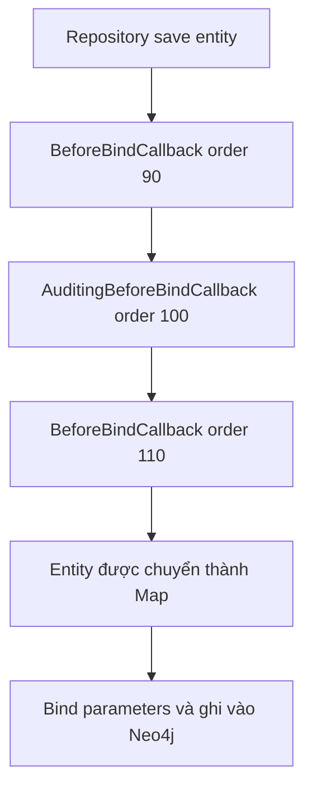

# Thứ tự callback tùy chỉnh với callback auditing

Spring Data Neo4j (SDN) cho phép đăng ký nhiều entity callback để chuẩn hóa, bổ sung hoặc kiểm tra entity ngay trước khi ghi xuống Neo4j. Khi bật auditing, SDN cũng đăng ký một callback nội bộ để điền các trường như người tạo, ngày tạo, người sửa và ngày sửa. Nếu ứng dụng có callback riêng, thứ tự chạy giữa callback tùy chỉnh và callback auditing quyết định callback nào nhìn thấy dữ liệu đã được xử lý ở bước trước.

SDN cung cấp thứ tự mặc định cho callback auditing. Callback auditing imperative có `NEO4J_AUDITING_ORDER = 100`; callback auditing reactive có `NEO4J_REACTIVE_AUDITING_ORDER = 100`. Callback có order nhỏ hơn chạy trước callback auditing; callback có order lớn hơn chạy sau. Có thể khai báo thứ tự bằng `@Order` hoặc triển khai `Ordered`.

## 1. Callback auditing nằm ở đâu trong vòng đời lưu entity?

Trong SDN, `BeforeBindCallback<T>` được gọi ngay trước khi entity được chuyển thành map record để bind vào câu lệnh ghi. Callback nhận entity và trả về entity sẽ tiếp tục được dùng để tạo dữ liệu lưu trữ. Callback có thể trả lại cùng object đã sửa hoặc một instance mới.

Auditing cũng tham gia tại điểm này. Khi bật auditing, SDN dùng `AuditingBeforeBindCallback` để điền metadata auditing trước khi entity được bind. Callback tùy chỉnh có thể chạy trước hoặc sau bước đó, tùy theo order.



Ví dụ trong sơ đồ:

- Callback order `90` chuẩn hóa dữ liệu nghiệp vụ trước khi auditing chạy.
- Callback auditing order `100` điền `createdBy`, `createdDate`, `lastModifiedBy` và `lastModifiedDate` theo trạng thái entity.
- Callback order `110` có thể đọc metadata vừa được auditing điền để tạo thêm trường dẫn xuất.

`BeforeBindCallback` không phải callback duy nhất của SDN. `AfterConvertCallback` chạy sau khi dữ liệu đã được đọc và ánh xạ thành entity. Thứ tự `@Order` không biến một callback ở giai đoạn đọc thành callback trước khi lưu; hãy chọn đúng lifecycle interface trước khi điều chỉnh order.

## 2. Bật auditing cho entity

SDN hỗ trợ các annotation auditing của Spring Data Commons:

- `@CreatedBy`: người tạo entity.
- `@CreatedDate`: thời điểm tạo entity.
- `@LastModifiedBy`: người sửa gần nhất.
- `@LastModifiedDate`: thời điểm sửa gần nhất.

Ví dụ entity `Product`:

```java
import java.time.Instant;

import org.springframework.data.annotation.CreatedBy;
import org.springframework.data.annotation.CreatedDate;
import org.springframework.data.annotation.LastModifiedBy;
import org.springframework.data.annotation.LastModifiedDate;
import org.springframework.data.neo4j.core.schema.GeneratedValue;
import org.springframework.data.neo4j.core.schema.Id;
import org.springframework.data.neo4j.core.schema.Node;

@Node("Product")
public class Product {

    @Id
    @GeneratedValue
    private Long id;

    private String name;

    private String normalizedName;

    @CreatedBy
    private String createdBy;

    @CreatedDate
    private Instant createdAt;

    @LastModifiedBy
    private String lastModifiedBy;

    @LastModifiedDate
    private Instant lastModifiedAt;

    private String auditSummary;

    public String getName() { return name; }
    public void setName(String name) { this.name = name; }
    public String getNormalizedName() { return normalizedName; }
    public void setNormalizedName(String value) { this.normalizedName = value; }
    public String getCreatedBy() { return createdBy; }
    public Instant getCreatedAt() { return createdAt; }
    public String getLastModifiedBy() { return lastModifiedBy; }
    public Instant getLastModifiedAt() { return lastModifiedAt; }
    public String getAuditSummary() { return auditSummary; }
    public void setAuditSummary(String value) { this.auditSummary = value; }
}
```

Kích hoạt auditing bằng `@EnableNeo4jAuditing` và cung cấp `AuditorAware`:

```java
import java.util.Optional;

import org.springframework.context.annotation.Bean;
import org.springframework.context.annotation.Configuration;
import org.springframework.data.domain.AuditorAware;
import org.springframework.data.neo4j.config.EnableNeo4jAuditing;

@Configuration
@EnableNeo4jAuditing(
    modifyOnCreate = true,
    auditorAwareRef = "auditorProvider"
)
public class Neo4jAuditingConfiguration {

    @Bean
    AuditorAware<String> auditorProvider() {
        return () -> Optional.of("catalog-service");
    }
}
```

Trong ví dụ, `catalog-service` là auditor cố định để minh họa. Ứng dụng thực tế thường lấy tên người dùng hoặc service account từ security context. `modifyOnCreate = true` yêu cầu các trường sửa đổi cũng được điền khi entity được tạo mới; nếu không cần hành vi đó, có thể dùng `false`.

Auditing callback được SDN đăng ký khi auditing được bật. Không cần tự tạo thêm một `AuditingBeforeBindCallback` khác.

## 3. Quy tắc sắp xếp callback

Entity callback của Spring Data có thể nhận thứ tự qua annotation `@Order` hoặc interface `Ordered`. Số càng nhỏ thì callback càng được gọi sớm:

| Callback | Order | Thời điểm |
| --- | ---: | --- |
| Custom callback chạy trước auditing | `90` | Trước callback auditing |
| `AuditingBeforeBindCallback` của SDN | `100` | Điền metadata auditing |
| Custom callback chạy sau auditing | `110` | Sau khi metadata auditing được điền |

SDN công khai hai hằng số để tham chiếu thứ tự auditing:

```java
AuditingBeforeBindCallback.NEO4J_AUDITING_ORDER
ReactiveAuditingBeforeBindCallback.NEO4J_REACTIVE_AUDITING_ORDER
```

Cả hai có giá trị `100` trong tài liệu API SDN 8.1.x. Dùng hằng số giúp callback thể hiện rõ quan hệ với auditing callback thay vì lặp lại số `100` trong code.

Ví dụ, nếu callback chuẩn hóa dữ liệu phải chạy trước auditing, dùng:

```java
@Order(AuditingBeforeBindCallback.NEO4J_AUDITING_ORDER - 10)
```

Nếu callback cần đọc `createdBy` hoặc `lastModifiedAt` do auditing vừa điền, dùng:

```java
@Order(AuditingBeforeBindCallback.NEO4J_AUDITING_ORDER + 10)
```

Không đặt cùng order với auditing callback nếu logic phụ thuộc vào callback nào chạy trước. Khi hai callback có cùng order, ứng dụng không nên dựa vào thứ tự tương đối giữa chúng.

## 4. Callback tùy chỉnh chạy trước auditing

Một callback trước auditing phù hợp với công việc chuẩn hóa dữ liệu nghiệp vụ: trim chuỗi, chuẩn hóa mã, tính khóa tìm kiếm hoặc áp dụng giá trị mặc định. Các trường này sẽ có sẵn khi auditing và mapping chạy.

```java
import java.util.Locale;

import org.springframework.core.annotation.Order;
import org.springframework.data.neo4j.core.mapping.callback.AuditingBeforeBindCallback;
import org.springframework.data.neo4j.core.mapping.callback.BeforeBindCallback;
import org.springframework.stereotype.Component;

@Component
@Order(AuditingBeforeBindCallback.NEO4J_AUDITING_ORDER - 10)
public class NormalizeProductCallback implements BeforeBindCallback<Product> {

    @Override
    public Product onBeforeBind(Product product) {
        String normalized = product.getName().trim();
        product.setName(normalized);
        product.setNormalizedName(normalized.toLowerCase(Locale.ROOT));
        return product;
    }
}
```

Với order `90`, callback chuẩn hóa chạy trước auditing callback order `100`. Auditing sẽ xử lý cùng instance `Product` sau khi tên đã được chuẩn hóa. Entity cuối cùng được chuyển thành map sau khi tất cả callback hoàn tất.

### Vì sao nên chuẩn hóa trước auditing?

Auditing tập trung vào metadata tạo/sửa. Callback nghiệp vụ nên chuẩn hóa dữ liệu domain trước khi metadata được ghi. Ví dụ, nếu ứng dụng lưu cả `name` và `normalizedName`, việc tính `normalizedName` trước bước auditing giúp tất cả callback phía sau và mapping cùng nhìn thấy giá trị nhất quán.

Không dùng callback trước auditing để tự ghi đè `createdBy`, `createdAt`, `lastModifiedBy` hoặc `lastModifiedAt` nếu các trường đó do auditing quản lý. Hãy để `AuditorAware` và `DateTimeProvider` cung cấp giá trị chính thức.

## 5. Callback tùy chỉnh chạy sau auditing

Một callback sau auditing có thể đọc metadata đã được điền để tạo dữ liệu dẫn xuất. Ví dụ, ứng dụng tạo một chuỗi `auditSummary` dùng trong màn hình quản trị:

```java
import java.time.Instant;

import org.springframework.core.annotation.Order;
import org.springframework.data.neo4j.core.mapping.callback.AuditingBeforeBindCallback;
import org.springframework.data.neo4j.core.mapping.callback.BeforeBindCallback;
import org.springframework.stereotype.Component;

@Component
@Order(AuditingBeforeBindCallback.NEO4J_AUDITING_ORDER + 10)
public class ProductAuditSummaryCallback implements BeforeBindCallback<Product> {

    @Override
    public Product onBeforeBind(Product product) {
        String actor = product.getLastModifiedBy() != null
            ? product.getLastModifiedBy()
            : product.getCreatedBy();

        Instant changedAt = product.getLastModifiedAt() != null
            ? product.getLastModifiedAt()
            : product.getCreatedAt();

        if (actor != null && changedAt != null) {
            product.setAuditSummary(actor + " @ " + changedAt);
        }

        return product;
    }
}
```

Callback có order `110`, nên `createdBy`, `createdAt`, `lastModifiedBy` và `lastModifiedAt` đã được auditing callback xử lý trước khi `ProductAuditSummaryCallback` chạy. Nếu auditing không cung cấp auditor hoặc date, callback cần xử lý trường hợp null như ví dụ.

Đây là dữ liệu dẫn xuất. Không dùng `auditSummary` thay thế cho các trường auditing có cấu trúc vì sẽ khó truy vấn theo người tạo hoặc thời gian sửa. Nếu summary chỉ phục vụ giao diện, cân nhắc tính ở tầng đọc thay vì lưu trùng dữ liệu.

## 6. Đăng ký callback bằng `@Component` hoặc `@Bean`

SDN phát hiện callback bean từ Spring `ApplicationContext`. Có thể dùng `@Component` trên lớp callback như ví dụ trên, hoặc khai báo bean trong cấu hình:

```java
import org.springframework.context.annotation.Bean;
import org.springframework.context.annotation.Configuration;
import org.springframework.core.annotation.Order;
import org.springframework.data.neo4j.core.mapping.callback.AuditingBeforeBindCallback;
import org.springframework.data.neo4j.core.mapping.callback.BeforeBindCallback;

@Configuration(proxyBeanMethods = false)
public class ProductCallbackConfiguration {

    @Bean
    @Order(AuditingBeforeBindCallback.NEO4J_AUDITING_ORDER - 10)
    BeforeBindCallback<Product> normalizeProduct() {
        return product -> {
            product.setName(product.getName().trim());
            return product;
        };
    }
}
```

Không cần đăng ký callback thủ công vào `Neo4jTemplate`. Chỉ cần callback là bean trong application context mà SDN sử dụng. Hãy tránh đăng ký cùng một callback hai lần bằng cả `@Component` và `@Bean`, vì khi đó nó có thể chạy lặp.

### Dùng `Ordered` thay cho `@Order`

Có thể khai báo thứ tự ngay trong class:

```java
import org.springframework.core.Ordered;
import org.springframework.data.neo4j.core.mapping.callback.AuditingBeforeBindCallback;
import org.springframework.data.neo4j.core.mapping.callback.BeforeBindCallback;

public class NormalizeProductCallback implements BeforeBindCallback<Product>, Ordered {

    @Override
    public Product onBeforeBind(Product product) {
        product.setName(product.getName().trim());
        return product;
    }

    @Override
    public int getOrder() {
        return AuditingBeforeBindCallback.NEO4J_AUDITING_ORDER - 10;
    }
}
```

Chọn một cách để xác định order. `@Order` tiện khi thứ tự là cấu hình bean; `Ordered` phù hợp khi class tự sở hữu quy tắc thứ tự. Tránh định nghĩa cả hai với giá trị khác nhau trong cùng callback vì gây khó hiểu khi bảo trì.

## 7. Chuỗi callback khi lưu một entity

Khi cả hai callback tùy chỉnh được đăng ký, chuỗi xử lý có thể được hình dung như sau:

| Thứ tự | Thành phần | Thay đổi trên `Product` |
| ---: | --- | --- |
| 90 | `NormalizeProductCallback` | Chuẩn hóa `name`, tạo `normalizedName` |
| 100 | `AuditingBeforeBindCallback` | Điền thông tin người tạo/người sửa và timestamp |
| 110 | `ProductAuditSummaryCallback` | Tạo `auditSummary` từ metadata auditing |
| Sau cùng | SDN mapping | Chuyển entity đã hoàn thiện thành map và ghi xuống Neo4j |

Điều quan trọng là callback trả về entity sẽ được chuyển tiếp cho callback tiếp theo. Nếu callback tạo instance mới nhưng quên sao chép một số field, các field đó có thể biến mất khỏi object được ghi. Với entity bất biến, hãy tạo instance mới đầy đủ các field cần giữ.

## 8. Callback imperative và reactive là hai loại riêng

SDN tách callback đồng bộ và callback reactive. Repository imperative gọi `BeforeBindCallback<T>`. Repository reactive gọi `ReactiveBeforeBindCallback<T>`, trong đó method trả về `Publisher<T>`.

| API sử dụng | Callback tùy chỉnh | Callback auditing nội bộ | Auditor provider |
| --- | --- | --- | --- |
| `Neo4jRepository` / `Neo4jTemplate` | `BeforeBindCallback<T>` | `AuditingBeforeBindCallback` | `AuditorAware<T>` |
| `ReactiveNeo4jRepository` / `ReactiveNeo4jTemplate` | `ReactiveBeforeBindCallback<T>` | `ReactiveAuditingBeforeBindCallback` | `ReactiveAuditorAware<T>` |

Callback imperative không được dùng thay cho callback reactive. Khi lưu bằng reactive repository, hãy cung cấp callback reactive nếu cần thực hiện cùng logic. Thứ tự auditing reactive dùng `ReactiveAuditingBeforeBindCallback.NEO4J_REACTIVE_AUDITING_ORDER`, cũng có giá trị `100` trong SDN 8.1.x.

### Ví dụ reactive callback chạy trước auditing

```java
import java.util.Locale;

import org.reactivestreams.Publisher;
import org.springframework.core.annotation.Order;
import org.springframework.data.neo4j.core.mapping.callback.ReactiveAuditingBeforeBindCallback;
import org.springframework.data.neo4j.core.mapping.callback.ReactiveBeforeBindCallback;
import org.springframework.stereotype.Component;
import reactor.core.publisher.Mono;

@Component
@Order(ReactiveAuditingBeforeBindCallback.NEO4J_REACTIVE_AUDITING_ORDER - 10)
public class ReactiveNormalizeProductCallback
        implements ReactiveBeforeBindCallback<Product> {

    @Override
    public Publisher<Product> onBeforeBind(Product product) {
        return Mono.fromSupplier(() -> {
            String normalized = product.getName().trim();
            product.setName(normalized);
            product.setNormalizedName(normalized.toLowerCase(Locale.ROOT));
            return product;
        });
    }
}
```

Reactive auditing được bật bằng `@EnableReactiveNeo4jAuditing` và `ReactiveAuditorAware`. Không dùng `@EnableNeo4jAuditing` cùng `AuditorAware` cho reactive repository rồi kỳ vọng SDN tự chuyển chúng thành reactive implementation.

Ví dụ cấu hình reactive auditing:

```java
import reactor.core.publisher.Mono;

import org.springframework.context.annotation.Bean;
import org.springframework.context.annotation.Configuration;
import org.springframework.data.domain.ReactiveAuditorAware;
import org.springframework.data.neo4j.config.EnableReactiveNeo4jAuditing;

@Configuration
@EnableReactiveNeo4jAuditing(
    modifyOnCreate = true,
    auditorAwareRef = "reactiveAuditorProvider"
)
public class ReactiveAuditingConfiguration {

    @Bean
    ReactiveAuditorAware<String> reactiveAuditorProvider() {
        return () -> Mono.just("catalog-service");
    }
}
```

## 9. Auditing và callback khác nhau thế nào?

Auditing là một chức năng dựng sẵn để điền metadata về ai tạo/sửa và thời điểm tạo/sửa. Custom callback là extension point cho logic riêng của ứng dụng. Callback auditing cũng được triển khai như một entity callback, vì vậy có thể sắp xếp chung với callback `BeforeBindCallback` tương ứng.

| Tiêu chí | Auditing | Custom `BeforeBindCallback` |
| --- | --- | --- |
| Mục đích | Điền `@CreatedBy`, `@CreatedDate`, `@LastModifiedBy`, `@LastModifiedDate` | Chuẩn hóa hoặc bổ sung dữ liệu theo quy tắc nghiệp vụ |
| Bật/cấu hình | `@EnableNeo4jAuditing` hoặc `@EnableReactiveNeo4jAuditing` | Đăng ký callback bean |
| Nguồn dữ liệu | `AuditorAware`/`ReactiveAuditorAware`, `DateTimeProvider` | Logic trong callback hoặc bean được inject |
| Thứ tự SDN | `100` | Do `@Order` hoặc `Ordered` quyết định |
| Kiểu callback | `AuditingBeforeBindCallback` hoặc reactive counterpart | `BeforeBindCallback<T>` hoặc `ReactiveBeforeBindCallback<T>` |

Không nên tự viết callback để làm lại chức năng auditing nếu các annotation có sẵn đáp ứng yêu cầu. Dùng auditing giúp thống nhất cách xử lý entity mới/cũ và tránh nhiều callback cùng ghi đè timestamp hoặc auditor.

## 10. Phân biệt EntityCallback với ApplicationEvent

Spring Data có cả store-specific application events và entity callbacks. Với nhu cầu thay đổi entity tại một checkpoint của quá trình persistence, entity callback thường phù hợp hơn:

- Entity callback có generic domain type và trả về entity đã sửa để pipeline tiếp tục sử dụng.
- Callback được thực thi theo thứ tự đã xác định bằng `Ordered` hoặc `@Order`.
- Reactive callback trả publisher để thay đổi entity nằm trong reactive flow.
- Application event là cơ chế thông báo; nếu event multicaster chạy bất đồng bộ, thứ tự xử lý có thể không còn đồng bộ với bước ghi entity.

Không dùng `@Order` trên event listener để thay thế order của `BeforeBindCallback`. Thứ tự của hai cơ chế thuộc hai pipeline khác nhau. Nếu mục tiêu là chạy trước hoặc sau `AuditingBeforeBindCallback`, hãy triển khai đúng interface callback và đặt order tương ứng.

## 11. Các lưu ý khi thiết kế thứ tự

**Chạy trước auditing khi cần chuẩn hóa dữ liệu.** Ví dụ, trim tên, chuẩn hóa email, tạo slug hoặc áp dụng giá trị mặc định trước khi entity được bind.

**Chạy sau auditing khi cần đọc metadata audit.** Ví dụ, tạo một trường hiển thị dẫn xuất từ `lastModifiedBy` và `lastModifiedAt`. Chỉ làm vậy khi thực sự cần lưu trường dẫn xuất.

**Không ghi đè trường auditing.** Nếu callback chạy sau auditing tự thay đổi `createdBy` hoặc `lastModifiedAt`, dữ liệu audit sẽ không còn phản ánh auditor/date provider đã cấu hình.

**Không dựa vào thứ tự khi order bằng nhau.** Hãy chọn các giá trị khác nhau và dùng hằng số SDN để xác định quan hệ trước/sau auditing.

**Dùng callback có kiểu cụ thể.** Callback class như `BeforeBindCallback<Product>` giúp Spring Data lọc theo domain type. Lambda callback không cung cấp thông tin generic ở runtime đầy đủ như class/enum; callback lambda không có order thường được xử lý cuối cùng và có thể ảnh hưởng throughput khi có nhiều loại entity.

**Giữ callback ngắn và không có side effect bên ngoài.** Callback chạy trong quá trình persistence. Tránh gọi HTTP, gửi email hoặc phát message trực tiếp; nếu thao tác ghi thất bại hoặc retry, side effect bên ngoài có thể không đồng bộ với database.

**Với entity bất biến, trả về instance mới.** Không bỏ qua giá trị trả về của callback. Instance trả về mới là dữ liệu SDN tiếp tục dùng để bind.

## 12. Kiểm thử thứ tự callback

Có thể kiểm thử riêng thứ tự bằng một danh sách trace trong test, hoặc kiểm thử kết quả cuối cùng sau khi gọi repository. Ví dụ đơn giản dùng một collector trong test:

```java
import java.util.ArrayList;
import java.util.List;

public class CallbackTrace {
    private final List<String> steps = new ArrayList<>();

    public void add(String step) {
        steps.add(step);
    }

    public List<String> steps() {
        return List.copyOf(steps);
    }
}
```

Đăng ký collector trong test context:

```java
import org.springframework.boot.test.context.TestConfiguration;
import org.springframework.context.annotation.Bean;

@TestConfiguration(proxyBeanMethods = false)
class CallbackTestConfiguration {

    @Bean
    CallbackTrace callbackTrace() {
        return new CallbackTrace();
    }
}
```

Trong integration test, inject trace vào hai callback tùy chỉnh:

```java
@Component
@Order(AuditingBeforeBindCallback.NEO4J_AUDITING_ORDER - 10)
class TraceBeforeAudit implements BeforeBindCallback<Product> {

    private final CallbackTrace trace;

    TraceBeforeAudit(CallbackTrace trace) {
        this.trace = trace;
    }

    @Override
    public Product onBeforeBind(Product product) {
        trace.add("before-audit");
        return product;
    }
}
```

```java
@Component
@Order(AuditingBeforeBindCallback.NEO4J_AUDITING_ORDER + 10)
class TraceAfterAudit implements BeforeBindCallback<Product> {

    private final CallbackTrace trace;

    TraceAfterAudit(CallbackTrace trace) {
        this.trace = trace;
    }

    @Override
    public Product onBeforeBind(Product product) {
        trace.add("after-audit");
        return product;
    }
}
```

Sau khi gọi `productRepository.save(product)` trong integration test, xác minh trace có `before-audit` trước `after-audit`, đồng thời kiểm tra các trường `createdBy`, `createdAt`, `lastModifiedBy` và `lastModifiedAt` đã được điền. Callback auditing là callback nội bộ của SDN nên không cần tự thêm nó vào trace; kiểm tra kết quả entity hoặc dữ liệu đọc lại để xác nhận auditing đã chạy.

Trong test song song, không dùng một mutable trace singleton dùng chung giữa các test. Dùng test fixture riêng hoặc collector an toàn luồng để tránh kết quả bị xen kẽ.

## 13. Lỗi thường gặp

| Biểu hiện | Nguyên nhân | Cách xử lý |
| --- | --- | --- |
| Custom callback chạy trước khi có `createdBy` | Order nhỏ hơn `100` | Tăng order lên lớn hơn auditing nếu cần đọc metadata |
| Callback sau auditing không thấy timestamp | `modifyOnCreate` đang tắt khi entity mới, hoặc DateTimeProvider không trả giá trị | Cấu hình `modifyOnCreate` phù hợp và kiểm tra date provider |
| Auditing field bị ghi đè | Callback custom chạy sau auditing và tự gán field audit | Để auditing quản lý các field đó; dùng field riêng cho dữ liệu dẫn xuất |
| Thứ tự không ổn định | Nhiều callback dùng cùng order | Chọn order khác nhau |
| Callback không được gọi | Bean chưa nằm trong ApplicationContext hoặc sai domain type | Đăng ký `@Component`/`@Bean` và dùng generic type đúng |
| Reactive save không gọi callback imperative | SDN tách callback theo API imperative/reactive | Triển khai `ReactiveBeforeBindCallback<T>` |
| Callback chạy hai lần | Cùng implementation được đăng ký bằng nhiều bean | Chỉ đăng ký một bean cho mỗi callback |
| Entity mất field sau callback | Callback tạo object mới nhưng không sao chép đầy đủ field | Trả về instance mới có đủ dữ liệu cần giữ |
| Event listener không chạy đúng trước auditing | Dùng application event để điều khiển callback order | Dùng `BeforeBindCallback` và `@Order` |

## 14. Checklist triển khai

1. Entity có các annotation auditing phù hợp với yêu cầu nghiệp vụ.
2. Bật `@EnableNeo4jAuditing` hoặc `@EnableReactiveNeo4jAuditing` đúng loại API.
3. Cấu hình `AuditorAware` hoặc `ReactiveAuditorAware` để xác định actor.
4. Chọn đúng callback lifecycle: `BeforeBindCallback` hoặc `ReactiveBeforeBindCallback`.
5. Đăng ký callback thành Spring bean.
6. Dùng `@Order` hoặc `Ordered` với order nhỏ hơn `100` nếu callback phải chạy trước auditing.
7. Dùng order lớn hơn `100` nếu callback cần đọc metadata auditing đã được điền.
8. Không dựa vào thứ tự giữa hai callback có cùng order.
9. Không ghi đè các field audit trong callback tùy chỉnh.
10. Integration test thứ tự và giá trị cuối cùng được lưu trong Neo4j.

## Kết luận

Trong SDN, callback auditing là một `BeforeBindCallback` nội bộ có order `100`; callback tùy chỉnh có thể chạy trước hoặc sau bằng `@Order` hoặc `Ordered`. Chọn order nhỏ hơn `NEO4J_AUDITING_ORDER` để chuẩn hóa dữ liệu trước auditing; chọn order lớn hơn nếu cần đọc metadata auditing vừa được điền. Với reactive repositories, dùng `ReactiveBeforeBindCallback` và hằng số `NEO4J_REACTIVE_AUDITING_ORDER` riêng. Đăng ký callback như Spring bean, trả về entity đã sửa, tránh ghi đè field audit và kiểm thử thứ tự trên repository thực tế.

## Tài liệu tham khảo

- [Spring Data Neo4j 8.1.2 — FAQ: Auditing and custom callbacks](https://docs.spring.io/spring-data/neo4j/reference/faq.html)
- [Spring Data Neo4j 8.1.2 API — `BeforeBindCallback`](https://docs.spring.io/spring-data/neo4j/reference/api/java/org/springframework/data/neo4j/core/mapping/callback/BeforeBindCallback.html)
- [Spring Data Neo4j 8.1.2 API — `AuditingBeforeBindCallback`](https://docs.spring.io/spring-data/neo4j/reference/api/java/org/springframework/data/neo4j/core/mapping/callback/AuditingBeforeBindCallback.html)
- [Spring Data Neo4j 8.1.2 API — `ReactiveBeforeBindCallback`](https://docs.spring.io/spring-data/neo4j/reference/api/java/org/springframework/data/neo4j/core/mapping/callback/ReactiveBeforeBindCallback.html)
- [Spring Data Neo4j 8.1.2 API — `ReactiveAuditingBeforeBindCallback`](https://docs.spring.io/spring-data/neo4j/reference/api/java/org/springframework/data/neo4j/core/mapping/callback/ReactiveAuditingBeforeBindCallback.html)
- [Spring Data Neo4j 8.1.x API — Constant Field Values](https://docs.spring.io/spring-data/neo4j/docs/8.1.x/api/constant-values.html)
- [Spring Data Commons 4.2 — Entity Callbacks and Ordering](https://docs.spring.io/spring-data/commons/reference/entity-callbacks.html)
