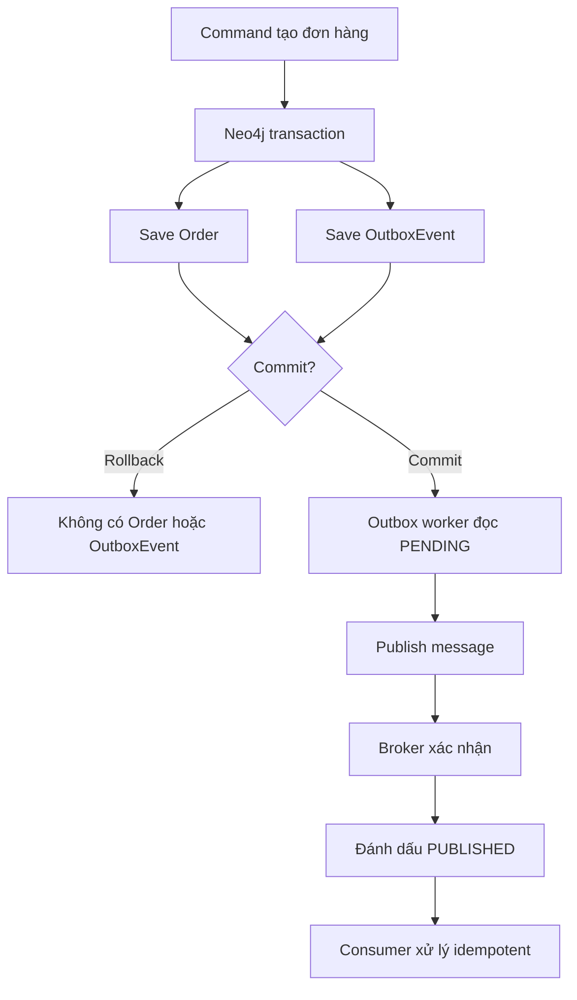

# Thiết kế xử lý sự kiện có thể thử lại mà không lặp tác động phụ

Trong ứng dụng Spring Data Neo4j, một lần lưu entity có thể kích hoạt callback, phát domain event hoặc làm phát sinh công việc bên ngoài như gửi email, cập nhật hệ thống khác và publish message. Khi transaction bị retry, message được giao lại hoặc worker khởi động lại sau sự cố, cùng một nghiệp vụ có thể được xử lý nhiều lần. Nếu mỗi lần xử lý đều gửi email, trừ tiền hoặc tạo bản ghi mới, hệ thống sẽ tạo tác động phụ trùng lặp.

Muốn xử lý sự kiện có thể thử lại an toàn, cần tách việc thay đổi graph khỏi việc thực hiện side effect, gán định danh ổn định cho sự kiện, ghi nhận sự kiện cùng transaction với dữ liệu nghiệp vụ và thiết kế consumer idempotent. Với tích hợp bên ngoài, transactional outbox kết hợp inbox/idempotency là mẫu thiết kế thực tế để đạt delivery at-least-once nhưng không lặp tác động nghiệp vụ.

## 1. Vì sao callback và event có thể được gọi nhiều lần?

Callback của Spring Data Neo4j (SDN) phục vụ các bước trong vòng đời mapping và persistence, chẳng hạn trước khi entity được bind vào graph hoặc sau khi entity được đọc. Chúng phù hợp cho việc chuẩn hóa dữ liệu, bổ sung giá trị dẫn xuất hoặc chuyển đổi trạng thái của object trong quá trình mapping.

Application event và domain event biểu diễn một điều đã xảy ra trong nghiệp vụ, ví dụ `OrderCreated` hoặc `InventoryReserved`. Listener có thể phản ứng bằng cách gửi thông báo hoặc khởi tạo công việc khác.

Các cơ chế này có vòng đời khác nhau:

| Cơ chế | Thời điểm | Nên dùng cho |
|---|---|---|
| Entity callback như `BeforeBindCallback` hoặc `AfterConvertCallback` | Trong quá trình mapping/persistence | Chuẩn hóa entity, thiết lập field dẫn xuất, kiểm tra dữ liệu cục bộ |
| Application event | Khi ứng dụng publish event | Thông báo giữa các thành phần trong cùng application |
| `@TransactionalEventListener` | Theo phase của transaction, thường là sau commit | Phản ứng sau khi thay đổi graph đã commit |
| Transactional outbox | Event được lưu cùng dữ liệu nghiệp vụ | Giao tiếp bền vững với broker hoặc hệ thống bên ngoài |

Không giả định callback hay listener chỉ chạy đúng một lần. Một transaction có thể rollback rồi được chạy lại; repository có thể được gọi lại; listener có thể nhận message trùng; worker có thể crash ở giữa quy trình. Vì vậy, callback cần thuần và có thể chạy lặp, còn event handler phải có chiến lược idempotency.

## 2. Giữ entity callback thuần và có thể lặp

Callback persistence nên tập trung vào entity đang được mapping. Ví dụ, callback có thể chuẩn hóa mã sản phẩm trước khi bind:

```java
import org.springframework.data.neo4j.core.mapping.callback.BeforeBindCallback;
import org.springframework.stereotype.Component;

@Component
public class ProductCodeCallback implements BeforeBindCallback<Product> {

    @Override
    public Product onBeforeBind(Product product) {
        product.setSku(product.getSku().trim().toUpperCase());
        return product;
    }
}
```

Thao tác `trim()` và chuẩn hóa chữ hoa có thể thực hiện lại mà vẫn cho cùng kết quả. Đây là đặc tính quan trọng của callback: cùng một entity đầu vào sẽ cho cùng một trạng thái chuẩn hóa, không tạo thêm tác động bên ngoài.

Không gửi email, gọi HTTP, publish message, trừ tiền hoặc ghi log nghiệp vụ không thể đảo ngược từ `BeforeBindCallback`, `AfterSaveCallback` hay callback mapping khác. Callback có thể được gọi trong transaction chưa commit; nếu transaction rollback, side effect bên ngoài không tự rollback theo Neo4j.

Nếu cần thông báo rằng một đơn hàng đã được tạo thành công, hãy phát domain event trong use case và xử lý theo transaction phase phù hợp. Không dùng callback persistence làm cơ chế phát message bền vững.

## 3. @TransactionalEventListener(AFTER_COMMIT) giải quyết điều gì?

Spring application event mặc định được listener xử lý ngay khi event được publish. Nếu publish event bên trong transaction, listener thông thường có thể chạy trước khi transaction commit. Nếu sau đó transaction rollback, side effect của listener đã xảy ra nhưng dữ liệu Neo4j lại không tồn tại.

`@TransactionalEventListener` cho phép gắn listener với phase của transaction. Với `TransactionPhase.AFTER_COMMIT`, listener chỉ được gọi sau khi transaction commit thành công:

```java
public record OrderCreatedEvent(
        String eventId,
        String orderId,
        String customerEmail) {
}
```

```java
import org.springframework.context.ApplicationEventPublisher;
import org.springframework.stereotype.Service;
import org.springframework.transaction.annotation.Transactional;

@Service
public class OrderService {

    private final OrderRepository orders;
    private final ApplicationEventPublisher events;

    public OrderService(OrderRepository orders,
                        ApplicationEventPublisher events) {
        this.orders = orders;
        this.events = events;
    }

    @Transactional
    public Order create(CreateOrder command) {
        Order order = orders.save(Order.from(command));

        events.publishEvent(new OrderCreatedEvent(
                command.commandId() + ":order-created",
                order.getOrderId(),
                order.getCustomerEmail()));

        return order;
    }
}
```

```java
import org.springframework.stereotype.Component;
import org.springframework.transaction.event.TransactionPhase;
import org.springframework.transaction.event.TransactionalEventListener;

@Component
public class OrderNotificationListener {

    private final MailGateway mailGateway;

    public OrderNotificationListener(MailGateway mailGateway) {
        this.mailGateway = mailGateway;
    }

    @TransactionalEventListener(phase = TransactionPhase.AFTER_COMMIT)
    public void onOrderCreated(OrderCreatedEvent event) {
        mailGateway.sendOrderConfirmation(
                event.customerEmail(),
                event.orderId());
    }
}
```

Nếu transaction rollback, listener `AFTER_COMMIT` không được gọi. Nếu không có transaction đang hoạt động, transactional listener mặc định không chạy; `fallbackExecution = true` có thể thay đổi hành vi này nhưng cần cân nhắc kỹ vì event khi đó không còn được bảo vệ bởi transaction phase.

Nếu listener cần ghi thêm dữ liệu Neo4j sau commit, hãy mở transaction mới cho phần ghi đó, ví dụ bằng `@Transactional(propagation = Propagation.REQUIRES_NEW)` trên một service được gọi qua Spring proxy. Transaction gốc đã commit; các thao tác ghi phát sinh sau commit không thể dựa vào nó để commit thêm thay đổi.

### AFTER_COMMIT không phải hàng đợi bền vững

`@TransactionalEventListener(AFTER_COMMIT)` giải quyết thứ tự: side effect chỉ bắt đầu sau commit. Nó không bảo đảm event được lưu để xử lý lại nếu process dừng ngay sau commit nhưng trước khi listener hoàn thành. Listener đồng bộ có thể ném lỗi sau khi dữ liệu đã commit; lỗi đó không thể rollback transaction vừa hoàn tất. Listener chạy bất đồng bộ cũng không tự có retry bền vững.

Vì vậy, AFTER_COMMIT phù hợp với tác vụ phụ trong cùng application khi chấp nhận rủi ro mất event hoặc có cơ chế phục hồi khác. Với email quan trọng, thanh toán, message broker hoặc tích hợp cần giao nhận bền vững, nên dùng outbox.

## 4. Transactional outbox: ghi sự kiện cùng dữ liệu nghiệp vụ

Outbox giải quyết khoảng trống giữa hai thao tác không thể commit nguyên tử cùng nhau: ghi dữ liệu vào Neo4j và publish message đến broker.

Thay vì publish trực tiếp trong transaction, ứng dụng ghi một node outbox cùng transaction với thay đổi nghiệp vụ. Một worker riêng đọc các event chưa gửi, publish ra broker và đánh dấu đã gửi sau khi broker xác nhận.



Nếu transaction tạo đơn hàng rollback, outbox event cũng rollback. Nếu transaction commit, event vẫn còn trong graph để worker có thể gửi lại sau khi ứng dụng khởi động lại.

### Mô hình node OutboxEvent

Có thể lưu event như một node độc lập:

```java
import java.time.Instant;

import org.springframework.data.annotation.Id;
import org.springframework.data.neo4j.core.schema.Node;

@Node("OutboxEvent")
public class OutboxEvent {

    @Id
    private String eventId;

    private String eventType;
    private String aggregateId;
    private String payloadJson;
    private String status;
    private int attempts;
    private Instant createdAt;
    private Instant nextAttemptAt;
    private Instant publishedAt;
    private String lastError;

    protected OutboxEvent() {
    }

    public OutboxEvent(String eventId,
                       String eventType,
                       String aggregateId,
                       String payloadJson,
                       Instant now) {
        this.eventId = eventId;
        this.eventType = eventType;
        this.aggregateId = aggregateId;
        this.payloadJson = payloadJson;
        this.status = "PENDING";
        this.attempts = 0;
        this.createdAt = now;
        this.nextAttemptAt = now;
    }

    public String getEventId() { return eventId; }
    public String getEventType() { return eventType; }
    public String getAggregateId() { return aggregateId; }
    public String getPayloadJson() { return payloadJson; }
}
```

`payloadJson` là chuỗi JSON đã serialize. Neo4j property không lưu trực tiếp map lồng nhau tùy ý; nếu cần lưu payload có cấu trúc, hãy serialize thành chuỗi hoặc thiết kế các property đơn giản riêng. Không lưu thông tin bí mật như token hoặc dữ liệu thanh toán nhạy cảm trong outbox nếu worker không cần dùng.

Tạo uniqueness constraint để mỗi event ID chỉ có một bản ghi outbox:

```cypher
CREATE CONSTRAINT outbox_event_id IF NOT EXISTS
FOR (e:OutboxEvent)
REQUIRE e.eventId IS UNIQUE;
```

### Ghi Order và OutboxEvent trong cùng transaction

```java
import java.time.Instant;

import com.fasterxml.jackson.core.JsonProcessingException;
import com.fasterxml.jackson.databind.ObjectMapper;
import org.springframework.stereotype.Service;
import org.springframework.transaction.annotation.Transactional;

record OrderCreatedPayload(String orderId, String customerEmail) {
}

@Service
public class OrderCommandService {

    private final OrderRepository orders;
    private final OutboxEventRepository outbox;
    private final ObjectMapper objectMapper;

    public OrderCommandService(OrderRepository orders,
                               OutboxEventRepository outbox,
                               ObjectMapper objectMapper) {
        this.orders = orders;
        this.outbox = outbox;
        this.objectMapper = objectMapper;
    }

    @Transactional
    public Order create(CreateOrder command) {
        Order order = orders.save(Order.from(command));

        String eventId = command.commandId() + ":order-created";
        String payload = serialize(new OrderCreatedPayload(
                order.getOrderId(),
                order.getCustomerEmail()));

        outbox.save(new OutboxEvent(
                eventId,
                "OrderCreated",
                order.getOrderId(),
                payload,
                Instant.now()));

        return order;
    }

    private String serialize(Object value) {
        try {
            return objectMapper.writeValueAsString(value);
        } catch (JsonProcessingException ex) {
            throw new IllegalStateException("Cannot serialize outbox event", ex);
        }
    }
}
```

Repository outbox tối thiểu:

```java
import org.springframework.data.neo4j.repository.Neo4jRepository;

public interface OutboxEventRepository
        extends Neo4jRepository<OutboxEvent, String> {
}
```

`OrderRepository` và `OutboxEventRepository` cần dùng cùng Neo4j `Driver` và transaction manager để hai lần `save` tham gia cùng transaction. Nếu serialize thất bại hoặc lưu outbox lỗi, transaction rollback cả đơn hàng. Trong ví dụ, `commandId` được tạo ở biên nhận request và giữ nguyên qua mọi lần retry; không tạo event ID ngẫu nhiên mới trong mỗi lần thực thi lại cùng command.

Idempotency của command và idempotency của event là hai lớp riêng. Nếu client gửi lại cùng command, hệ thống cũng cần khóa/constraint theo `commandId` hoặc một request idempotency key để không tạo đơn hàng thứ hai trước khi tạo outbox.

## 5. Worker publish outbox và retry có giới hạn

Worker đọc các event đến hạn, gửi message đến broker và chỉ đánh dấu `PUBLISHED` sau khi nhận xác nhận thành công. Không đánh dấu đã gửi trước khi publish; nếu process dừng giữa hai thao tác, event sẽ bị mất khỏi hàng chờ dù broker chưa nhận được.

Luồng xử lý một event:

```java
public void dispatch(OutboxEvent event) {
    try {
        broker.publish(
                event.getEventId(),
                event.getEventType(),
                event.getPayloadJson());

        outboxWriter.markPublished(event.getEventId(), Instant.now());
    } catch (TransientBrokerException ex) {
        outboxWriter.scheduleRetry(
                event.getEventId(),
                nextAttempt(event),
                ex.getMessage());
    }
}
```

Đây là phác thảo orchestration; `broker.publish` cần chờ broker acknowledgment theo API thực tế. `markPublished` và `scheduleRetry` nên chạy trong transaction Neo4j ngắn riêng, không giữ transaction database mở trong khi chờ network.

Trạng thái phổ biến:

| Status | Ý nghĩa |
|---|---|
| `PENDING` | Chờ publish |
| `PROCESSING` | Worker đã nhận xử lý, có lease nếu hỗ trợ nhiều worker |
| `PUBLISHED` | Broker đã xác nhận nhận message |
| `FAILED` | Vượt quá chính sách retry, cần dead-letter hoặc can thiệp |

Khi có nhiều worker hoặc nhiều instance ứng dụng, không chỉ đọc `PENDING` rồi xử lý mà không có cơ chế claim. Hai worker có thể lấy cùng event. Cần claim nguyên tử bằng transaction/lease, đặt `leaseUntil`, kiểm tra worker sở hữu claim trước khi cập nhật và cho phép thu hồi lease hết hạn. Thiết kế claim phải được kiểm thử cạnh tranh trên phiên bản Neo4j thực tế; không giả định một truy vấn `MATCH ... LIMIT` tự cung cấp cơ chế `SKIP LOCKED` như một số relational database.

### Backoff và dead-letter

Không retry liên tục không nghỉ. Dùng exponential backoff có jitter:

```java
import java.time.Duration;
import java.util.concurrent.ThreadLocalRandom;

Duration nextAttempt(int attempts) {
    long baseSeconds = 2L;
    long maxSeconds = 15 * 60L;
    long exponential = Math.min(maxSeconds,
            baseSeconds * (1L << Math.min(attempts, 20)));
    long jitter = ThreadLocalRandom.current().nextLong(0, 4);
    return Duration.ofSeconds(exponential + jitter);
}
```

Sau số lần thử tối đa, chuyển event sang `FAILED` hoặc dead-letter để điều tra. Phân loại lỗi: lỗi tạm thời như timeout/network có thể retry; lỗi dữ liệu không hợp lệ hoặc schema không tương thích cần sửa payload/consumer, không nên retry vô hạn.

## 6. Vì sao outbox vẫn có thể publish trùng?

Outbox bảo đảm event không bị mất giữa commit Neo4j và lúc worker bắt đầu gửi. Nhưng nó không thể commit nguyên tử cùng broker trong một transaction thông thường.

Giả sử worker thực hiện:

1. Gửi event `E-100` đến broker.
2. Broker xác nhận đã nhận.
3. Process crash trước khi cập nhật outbox thành `PUBLISHED`.
4. Worker khởi động lại, thấy event vẫn `PENDING` và gửi lại `E-100`.

Đây là duplicate delivery. Vì vậy outbox thường cung cấp semantics at-least-once. Mỗi lần retry phải dùng cùng `eventId`; consumer dựa vào ID đó để bỏ qua lần xử lý lặp. Không tạo event ID mới mỗi lần publish.

Không nên tuyên bố hệ thống có exactly-once side effect chỉ vì dùng outbox. Exactly-once xuyên qua Neo4j, broker và hệ thống ngoài cần một giao thức phân tán rất khác; thiết kế thực tế thường là at-least-once delivery cùng idempotent processing.

## 7. Inbox pattern: chống xử lý cùng event nhiều lần

Consumer có thể lưu ID event đã xử lý trong một inbox. Tạo uniqueness constraint:

```cypher
CREATE CONSTRAINT inbox_event_id IF NOT EXISTS
FOR (i:InboxEvent)
REQUIRE i.eventId IS UNIQUE;
```

Với consumer cập nhật cùng Neo4j database, thao tác ghi inbox và thay đổi nghiệp vụ phải nằm trong cùng transaction. Có thể dùng `MERGE` cùng một token riêng cho lần nhận để chỉ lần tạo inbox mới được đi tiếp:

```cypher
MATCH (o:Order {orderId: $orderId})
MERGE (i:InboxEvent {eventId: $eventId})
ON CREATE SET i.claimToken = $claimToken,
              i.receivedAt = datetime()
WITH o, i
WHERE i.claimToken = $claimToken
SET o.status = 'CONFIRMED'
REMOVE i.claimToken
RETURN o.orderId AS orderId;
```

`claimToken` là UUID mới cho mỗi lần consumer nhận message. Với uniqueness constraint trên `eventId`, lần đầu tạo inbox và thực hiện cập nhật trong cùng transaction; khi transaction commit, token được xóa nhưng inbox event vẫn tồn tại. Khi message được giao lại, `MERGE` tìm thấy inbox cũ, không đặt token mới nên không vượt qua `WHERE` và không cập nhật đơn hàng lần nữa.

Nếu thao tác nghiệp vụ thất bại, toàn bộ transaction rollback, bao gồm việc tạo inbox; broker có thể giao lại message. Đây là lý do inbox record và cập nhật nghiệp vụ phải cùng transaction. Cần kiểm tra kết quả rỗng để biết event đã được xử lý trước đó hay order không tồn tại; hai trường hợp có thể cần metric/log khác nhau.

Nếu consumer cập nhật một hệ thống khác ngoài Neo4j, inbox trong Neo4j không thể atomically commit cùng side effect ở hệ thống đó. Hãy dùng idempotency key mà API đích hỗ trợ, inbox/outbox ở hệ thống đích hoặc một quy trình reconciliation. Không dựa vào kiểm tra inbox rồi gọi API bên ngoài như thể hai thao tác nguyên tử.

## 8. Idempotency cho side effect bên ngoài

Với email, thanh toán hoặc HTTP API, tạo một idempotency key ổn định từ event ID:

```java
paymentGateway.capture(
        paymentRequest,
        event.eventId());
```

Nếu payment provider hỗ trợ idempotency key, nhiều request cùng key sẽ được provider xử lý như một yêu cầu logic. Hãy dùng cùng key qua mọi lần retry; không sinh UUID mới mỗi lần thử.

Với email provider không hỗ trợ idempotency, có thể lưu delivery record theo `eventId` để tránh gửi lặp do retry nội bộ, nhưng vẫn còn cửa sổ crash giữa lúc provider nhận email và lúc ứng dụng đánh dấu đã gửi. Không thể bảo đảm tuyệt đối không gửi trùng nếu provider không cung cấp cơ chế idempotency hoặc tra cứu kết quả. Cần cân nhắc provider có idempotency, webhook/receipt, hoặc quy trình reconciliation.

Đối với các side effect không thể đảo ngược, hãy phân biệt:

- **Idempotent operation:** gọi nhiều lần với cùng khóa vẫn tạo cùng một kết quả logic.
- **Deduplication:** nhận biết event ID đã xử lý và bỏ qua lần sau.
- **Compensation:** thực hiện hành động nghiệp vụ bù khi không thể rollback side effect đã xảy ra.

Ba kỹ thuật này có thể phối hợp nhưng không thay thế lẫn nhau.

## 9. Callback, domain event và outbox nên phối hợp ra sao?

Một luồng xử lý điển hình:

1. Service nhận command và kiểm tra idempotency key.
2. Trong transaction Neo4j, lưu aggregate và outbox event với event ID ổn định.
3. Transaction commit; dữ liệu nghiệp vụ và outbox cùng tồn tại.
4. Worker đọc outbox và publish message; chỉ đánh dấu `PUBLISHED` sau broker acknowledgment.
5. Consumer nhận message, kiểm tra inbox/event ID và áp dụng thay đổi trong cùng transaction đích.
6. Nếu gửi lại, consumer nhận diện event cũ và bỏ qua side effect đã hoàn tất.
7. Nếu lỗi tạm thời, retry với backoff; nếu vượt ngưỡng, đưa vào dead-letter để điều tra.

Entity callback chỉ thực hiện biến đổi cục bộ, lặp an toàn. `@TransactionalEventListener(AFTER_COMMIT)` có thể đánh thức worker hoặc cập nhật cache không quan trọng, nhưng outbox vẫn là nguồn sự thật bền vững để khôi phục sau crash.

## 10. Những lỗi thường gặp

| Lỗi | Hệ quả | Cách xử lý |
|---|---|---|
| Gửi email trong `BeforeBindCallback` hoặc `AfterSaveCallback` | Email có thể gửi dù transaction rollback hoặc callback chạy lại | Giữ callback thuần; phát event/outbox ở service |
| Dùng `@EventListener` thường cho event trong transaction | Listener có thể chạy trước commit | Dùng `@TransactionalEventListener(AFTER_COMMIT)` hoặc outbox |
| Nghĩ AFTER_COMMIT là durable queue | Process crash sau commit có thể làm mất công việc | Ghi outbox trong cùng transaction |
| Publish rồi đánh dấu PUBLISHED trước broker acknowledgment | Message có thể mất nếu publish thất bại | Chờ acknowledgment rồi mới đánh dấu |
| Publish thành công nhưng crash trước khi đánh dấu | Broker nhận message trùng khi retry | Giữ event ID ổn định và làm consumer idempotent |
| Tạo UUID mới mỗi lần retry | Deduplication không nhận ra cùng một event | Sinh ID ổn định từ command/event gốc |
| Chỉ dùng `existsById()` rồi mới ghi inbox | Hai consumer đồng thời có thể cùng thấy chưa tồn tại | Dùng uniqueness constraint và claim/merge nguyên tử |
| Ghi inbox trong transaction khác với cập nhật nghiệp vụ | Có thể đánh dấu đã xử lý dù side effect rollback | Ghi inbox và business state cùng transaction |
| Retry vô hạn với lỗi dữ liệu cố định | Hàng đợi bị kẹt và tạo tải liên tục | Phân loại lỗi, giới hạn retry và dead-letter |
| Giữ transaction Neo4j mở trong lúc gọi broker | Lock lâu, tăng contention và không tạo distributed transaction | Publish ngoài transaction; cập nhật trạng thái trong transaction ngắn |
| Cho rằng outbox tạo exactly-once delivery | Vẫn có cửa sổ duplicate sau broker acknowledgment | Thiết kế at-least-once + idempotent consumer |

## 11. Kiểm thử retry và idempotency

Kiểm thử nên mô phỏng các điểm crash và giao message trùng, không chỉ kiểm tra happy path.

| Tình huống | Kỳ vọng |
|---|---|
| Transaction tạo Order rollback | Không có Order và không có OutboxEvent |
| Transaction commit | Có đúng một Order và một event theo event ID |
| Worker publish lỗi tạm thời | Event vẫn chờ retry với `nextAttemptAt` mới |
| Broker nhận message nhưng worker crash trước khi đánh dấu PUBLISHED | Event có thể publish lại với cùng event ID |
| Consumer nhận cùng event hai lần | Business state chỉ thay đổi một lần |
| Consumer lỗi trước commit | Inbox và business update cùng rollback; message có thể retry |
| Vượt quá số lần retry | Event chuyển trạng thái FAILED/dead-letter và có thông tin điều tra |

Ví dụ kiểm tra consumer idempotent bằng cách gửi cùng event hai lần:

```java
import static org.assertj.core.api.Assertions.assertThat;

import org.junit.jupiter.api.Test;
import org.springframework.beans.factory.annotation.Autowired;
import org.springframework.boot.test.context.SpringBootTest;
import reactor.test.StepVerifier;

@SpringBootTest
class ConsumerIdempotencyTest {

    @Autowired Consumer consumer;
    @Autowired ReactiveOrderRepository orderRepository;
    @Autowired ReactiveInboxEventRepository inboxRepository;

    @Test
    void processesSameEventOnlyOnce() {
        OrderCreatedEvent event = new OrderCreatedEvent(
                "CMD-901:order-created",
                "O-901",
                "customer@example.test");

        StepVerifier.create(consumer.handle(event).then(consumer.handle(event)))
                .verifyComplete();

        StepVerifier.create(orderRepository.findById("O-901"))
                .assertNext(order -> assertThat(order.getStatus()).isEqualTo("CONFIRMED"))
                .verifyComplete();

        StepVerifier.create(inboxRepository.countByEventId(event.eventId()))
                .expectNext(1L)
                .verifyComplete();
    }
}
```

Đoạn test minh họa consumer reactive; nếu dùng imperative repository, dùng test tương ứng với kiểu trả về. Ngoài kết quả cuối, cần kiểm tra số lần gọi fake gateway hoặc broker để xác nhận side effect không bị lặp trong phạm vi mà ứng dụng kiểm soát.

Với API bên ngoài, dùng stub hỗ trợ idempotency key và mô phỏng timeout sau khi phía đích đã xử lý nhưng trước khi client nhận response. Đây là tình huống dễ bộc lộ lỗi tạo key mới khi retry.

## 12. Bài tập thực hành

Xây dựng luồng tạo đơn hàng và gửi thông báo:

1. Tạo uniqueness constraint cho `OutboxEvent.eventId`.
2. Tạo service `@Transactional` lưu `Order` và `OutboxEvent` trong cùng transaction.
3. Dùng `commandId` làm cơ sở tạo event ID ổn định.
4. Tạo worker đọc event `PENDING`, publish và chỉ đánh dấu `PUBLISHED` sau broker acknowledgment.
5. Mô phỏng crash sau khi broker nhận nhưng trước khi cập nhật trạng thái outbox; xác nhận message có thể được gửi lại.
6. Tạo `InboxEvent` với uniqueness constraint và xử lý message trong cùng transaction với thay đổi nghiệp vụ.
7. Gửi cùng event hai lần và xác nhận consumer chỉ cập nhật business state một lần.
8. Thêm exponential backoff, jitter, số lần retry tối đa và trạng thái dead-letter.
9. Viết test cho rollback, retry, duplicate delivery và lỗi sau khi external API đã thực hiện side effect.

Sau bài tập, hãy giải thích được vì sao `AFTER_COMMIT` không thay thế outbox, vì sao outbox vẫn có thể giao message trùng, cách inbox/idempotency key ngăn lặp tác động nghiệp vụ và giới hạn của exactly-once khi gọi hệ thống bên ngoài.

## Kết luận

Để xử lý sự kiện có thể thử lại an toàn, giữ entity callback thuần và lặp được, dùng `@TransactionalEventListener(AFTER_COMMIT)` khi chỉ cần phản ứng sau commit và dùng transactional outbox khi event cần được lưu bền vững. Gán event ID ổn định, publish với at-least-once semantics, chờ broker acknowledgment rồi mới đánh dấu đã gửi. Consumer ghi inbox cùng transaction với thay đổi nghiệp vụ, còn API bên ngoài cần idempotency key hoặc quy trình reconciliation. Retry có giới hạn, backoff và dead-letter giúp hệ thống phục hồi mà không nhân đôi tác động phụ.

## Tài liệu tham khảo

- [Spring Framework – Transaction-bound Events](https://docs.spring.io/spring-framework/reference/data-access/transaction/event.html)
- [Spring Data Neo4j – Lifecycle Events](https://docs.spring.io/spring-data/neo4j/reference/lifecycle-events.html)
- [Spring Data Commons – Publishing Events from Aggregate Roots](https://docs.spring.io/spring-data/commons/reference/repositories/core-domain-events.html)
- [Martin Fowler – Transactional Outbox](https://microservices.io/patterns/data/transactional-outbox.html)
- [Idempotent Consumer pattern](https://microservices.io/post/microservices/patterns/2020/10/16/idempotent-consumer.html)
