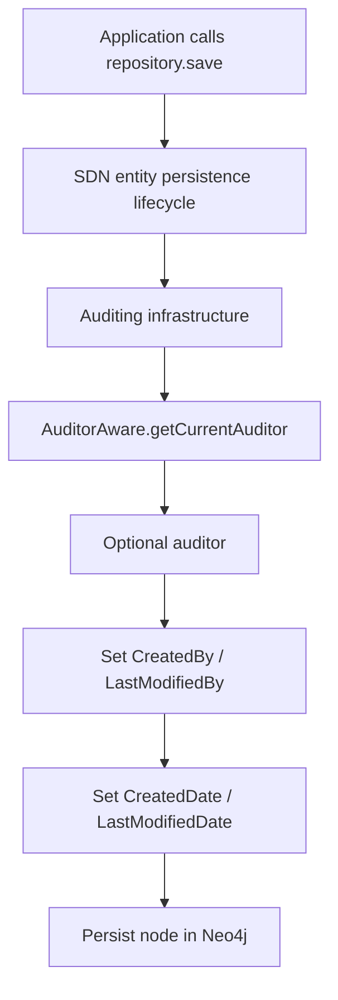

# Cung cấp người thao tác bằng AuditorAware

## Mục tiêu bài học

Trong ứng dụng dùng Spring Data Neo4j (SDN), auditing giúp lưu lại ai đã tạo hoặc cập nhật một node và thời điểm thao tác xảy ra. Các thông tin này hữu ích cho lịch sử nghiệp vụ, truy vết thay đổi, hỗ trợ vận hành và hiển thị dữ liệu như “được tạo bởi” hoặc “cập nhật lần cuối bởi”.

SDN tích hợp auditing của Spring Data. Các annotation `@CreatedBy` và `@LastModifiedBy` đánh dấu property chứa người thao tác; `AuditorAware<T>` cung cấp giá trị người dùng hoặc hệ thống hiện tại cho hạ tầng auditing. Kiểu `T` phải phù hợp với kiểu property được đánh dấu.

Bài học này hướng dẫn cách bật auditing cho Neo4j, triển khai `AuditorAware`, lấy principal từ Spring Security, xử lý request ẩn danh và tác vụ nền, kiểm tra kiểu dữ liệu, và xác minh auditor được ghi đúng khi lưu entity qua repository.

## 1. Auditing lưu lại thông tin gì?

Spring Data cung cấp bốn annotation thường dùng:

| Annotation | Ý nghĩa | Ví dụ property |
|---|---|---|
| `@CreatedBy` | Người tạo entity | `createdBy` |
| `@LastModifiedBy` | Người sửa entity gần nhất | `lastModifiedBy` |
| `@CreatedDate` | Thời điểm tạo entity | `createdAt` |
| `@LastModifiedDate` | Thời điểm sửa gần nhất | `updatedAt` |

Có thể dùng riêng từng annotation. Nếu ứng dụng chỉ cần ngày giờ tạo và cập nhật, không cần triển khai `AuditorAware`. `AuditorAware` chỉ cần khi muốn điền người tạo hoặc người sửa.

Ví dụ entity `Document`:

```java
@Node("Document")
public class Document {

    @Id
    @GeneratedValue
    private Long id;

    private String title;

    @CreatedBy
    private String createdBy;

    @LastModifiedBy
    private String lastModifiedBy;

    @CreatedDate
    private Instant createdAt;

    @LastModifiedDate
    private Instant updatedAt;

    // Constructor, getter và setter được lược bỏ.
}
```

Trong ví dụ này, auditor được lưu dưới dạng chuỗi, chẳng hạn username hoặc user ID. Đây là lựa chọn đơn giản, tránh phụ thuộc trực tiếp vào object Spring Security hoặc một entity người dùng trong property audit.

`@CreatedBy` phản ánh người tạo entity; `@LastModifiedBy` phản ánh người thao tác ở lần ghi gần nhất. Hai property này có mục đích khác nhau, không nên dùng chung một trường nếu ứng dụng cần phân biệt lịch sử tạo và sửa.

## 2. Luồng hoạt động của AuditorAware

Auditing được kích hoạt trong quá trình SDN quản lý việc lưu entity. Hạ tầng auditing yêu cầu `AuditorAware` cung cấp auditor hiện tại, sau đó đặt giá trị vào các property được đánh dấu trước khi entity được persist.



Các bước chính:

1. Service gọi `repository.save(entity)` hoặc một thao tác lưu entity qua SDN.
2. Auditing infrastructure xác định property nào cần điền.
3. Nếu có `@CreatedBy` hoặc `@LastModifiedBy`, hạ tầng gọi `getCurrentAuditor()`.
4. Giá trị auditor được gán vào property có kiểu tương thích.
5. Nếu có `@CreatedDate` hoặc `@LastModifiedDate`, thời gian được lấy từ `DateTimeProvider`.
6. SDN ghi entity vào Neo4j.

`AuditorAware` không tự xác thực người dùng và không quyết định quyền truy cập. Nó chỉ cung cấp danh tính đã được xác lập ở tầng bảo mật hoặc tầng thực thi để ghi metadata.

## 3. Bật auditing bằng @EnableNeo4jAuditing

Để SDN đăng ký hạ tầng auditing, thêm `@EnableNeo4jAuditing` vào class cấu hình:

```java
import org.springframework.context.annotation.Configuration;
import org.springframework.data.neo4j.config.EnableNeo4jAuditing;

@Configuration
@EnableNeo4jAuditing(auditorAwareRef = "auditorProvider")
public class Neo4jAuditingConfiguration {
}
```

Thuộc tính `auditorAwareRef` là tên bean cung cấp auditor. Trong ví dụ, bean có tên `auditorProvider`.

Nếu không chỉ định `auditorAwareRef`, Spring Data sẽ tìm bean `AuditorAware` phù hợp trong application context. Khai báo tường minh giúp dễ nhận diện bean được dùng, đặc biệt khi ứng dụng có nhiều nguồn danh tính.

Các cấu hình liên quan:

| Thuộc tính | Tác dụng |
|---|---|
| `auditorAwareRef` | Chọn bean cung cấp người thao tác |
| `dateTimeProviderRef` | Chọn bean cung cấp thời điểm audit |
| `modifyOnCreate` | Quy định metadata sửa đổi có được điền ngay khi tạo hay không |
| `setDates` | Bật hoặc tắt việc điền các trường thời gian |

Mặc định, `modifyOnCreate` và `setDates` là `true`. Vì vậy, khi tạo mới entity, `@LastModifiedBy` và `@LastModifiedDate` cũng có thể được điền cùng metadata tạo. Nếu nghiệp vụ muốn trường sửa đổi chỉ có sau lần cập nhật đầu tiên, có thể cấu hình `modifyOnCreate = false`.

## 4. Triển khai AuditorAware<T>

`AuditorAware<T>` là SPI interface của Spring Data. Interface có một phương thức:

```java
Optional<T> getCurrentAuditor();
```

Kiểu generic `T` phải tương thích với kiểu property được đánh dấu `@CreatedBy` và `@LastModifiedBy`.

Ví dụ, entity dùng hai trường kiểu `String`, vì vậy triển khai `AuditorAware<String>`:

```java
import java.util.Optional;

import org.springframework.data.domain.AuditorAware;
import org.springframework.stereotype.Component;

@Component("auditorProvider")
public class CurrentAuditorProvider
        implements AuditorAware<String> {

    @Override
    public Optional<String> getCurrentAuditor() {
        return Optional.of("system");
    }
}
```

Đây là implementation đơn giản cho một tiến trình chỉ có một người thao tác hệ thống. Trong ứng dụng nhiều người dùng, giá trị thường được lấy từ security context của request hiện tại.

Không nên trả về một giá trị cố định như `"system"` cho mọi request người dùng. Khi đó lịch sử sẽ mất thông tin ai thực sự tạo hoặc sửa dữ liệu.

## 5. Lấy auditor từ Spring Security

Trong ứng dụng Spring Security, danh tính hiện tại thường nằm trong `SecurityContextHolder`. Có thể lấy tên người dùng từ `Authentication`:

```java
import java.util.Optional;

import org.springframework.data.domain.AuditorAware;
import org.springframework.security.authentication.AnonymousAuthenticationToken;
import org.springframework.security.core.Authentication;
import org.springframework.security.core.context.SecurityContext;
import org.springframework.security.core.context.SecurityContextHolder;
import org.springframework.stereotype.Component;

@Component("auditorProvider")
public class SpringSecurityAuditorAware
        implements AuditorAware<String> {

    @Override
    public Optional<String> getCurrentAuditor() {
        return Optional.ofNullable(SecurityContextHolder.getContext())
                .map(SecurityContext::getAuthentication)
                .filter(Authentication::isAuthenticated)
                .filter(authentication ->
                        !(authentication instanceof AnonymousAuthenticationToken))
                .map(Authentication::getName);
    }
}
```

Cách hoạt động:

- `SecurityContextHolder.getContext()` lấy security context hiện tại.
- `getAuthentication()` lấy thông tin xác thực.
- `isAuthenticated()` loại bỏ authentication chưa xác thực.
- Kiểm tra `AnonymousAuthenticationToken` để không ghi username giả như `anonymousUser`.
- `getName()` trả về định danh người dùng mà Spring Security cung cấp.

Ví dụ, nếu request được xác thực bởi người dùng `alice`, `getCurrentAuditor()` trả về `Optional.of("alice")`. Khi lưu entity, SDN có thể ghi `createdBy = "alice"` hoặc `lastModifiedBy = "alice"`.

Nếu ứng dụng dùng custom principal, có thể lấy principal và chuyển thành user ID ổn định thay vì username:

```java
.map(Authentication::getPrincipal)
.filter(AppUserPrincipal.class::isInstance)
.map(AppUserPrincipal.class::cast)
.map(AppUserPrincipal::userId)
```

Hãy chọn một định danh ổn định, không phụ thuộc vào tên hiển thị có thể đổi. Nếu user đổi username, audit theo ID vẫn giúp truy vết cùng một người qua thời gian.

## 6. Kiểu dữ liệu của AuditorAware phải khớp với entity

Giả sử entity khai báo:

```java
@CreatedBy
private String createdBy;

@LastModifiedBy
private String lastModifiedBy;
```

Auditor provider tương ứng nên là `AuditorAware<String>`.

Nếu entity lưu mã người dùng dưới dạng UUID string, có thể dùng `AuditorAware<String>` và trả về `principal.userId().toString()`. Nếu property có kiểu miền riêng, cần bảo đảm SDN có mapping/converter phù hợp cho kiểu đó.

Không nên triển khai `AuditorAware<User>` rồi gán vào property `String createdBy` mà không có conversion phù hợp. Generic type mô tả kiểu auditor mà auditing infrastructure cung cấp; nó phải tương thích với các property được đánh dấu.

Một quy ước phổ biến:

| Kiểu property audit | Kiểu AuditorAware |
|---|---|
| `String createdBy` | `AuditorAware<String>` |
| `UUID createdBy` | `AuditorAware<UUID>` |
| `Long createdBy` | `AuditorAware<Long>` |

Nên lưu một giá trị định danh đơn giản như user ID hoặc username. Nếu cần truy vấn thông tin người dùng đầy đủ, có thể dùng ID đó để tra cứu user ở service riêng.

## 7. Xử lý trường hợp không có người dùng hiện tại

Không phải mọi thao tác lưu đều xuất phát từ request có người dùng đăng nhập. Ví dụ:

- Job đồng bộ dữ liệu chạy theo lịch.
- Worker xử lý message từ queue.
- Script nhập dữ liệu.
- Tác vụ bảo trì hoặc migration.
- Service nội bộ gọi nhau mà không có security context người dùng.

Trong các trường hợp đó, `getCurrentAuditor()` có thể trả về `Optional.empty()`. Khi không có auditor, auditing infrastructure không có giá trị người thao tác để điền. Nếu trường audit bắt buộc có giá trị, hãy định nghĩa rõ chính sách thay thế.

Ví dụ fallback cho tác vụ nền:

```java
@Override
public Optional<String> getCurrentAuditor() {
    return Optional.ofNullable(SecurityContextHolder.getContext())
            .map(SecurityContext::getAuthentication)
            .filter(Authentication::isAuthenticated)
            .filter(authentication ->
                    !(authentication instanceof AnonymousAuthenticationToken))
            .map(Authentication::getName)
            .or(() -> Optional.of("system:scheduled-job"));
}
```

Cần cẩn trọng với fallback toàn cục: nó sẽ gán `system:scheduled-job` cả khi một request người dùng bị mất security context do lỗi cấu hình. Một cách khác là dùng một security principal rõ ràng cho batch job hoặc một cơ chế context nghiệp vụ riêng.

Không nên ghi `anonymousUser` làm auditor cho request chưa đăng nhập nếu điều đó không có ý nghĩa nghiệp vụ. Nếu ứng dụng cho phép thao tác ẩn danh, hãy chọn rõ có lưu `null`, một actor như `anonymous`, hay từ chối thao tác.

## 8. Security context trong tác vụ bất đồng bộ

Mặc định, ứng dụng imperative thường dùng security context gắn với thread. Khi công việc được chuyển sang executor hoặc thread khác, context có thể không tự được truyền sang thread mới.

Ví dụ, request thread có user `alice`, nhưng một tác vụ chạy trong thread pool có thể không nhìn thấy authentication đó. Khi ấy `AuditorAware` trả về empty hoặc dùng fallback.

Nếu cần giữ danh tính của người khởi tạo công việc, hãy truyền actor ID như một phần của command/message hoặc dùng cơ chế truyền security context được Spring Security hỗ trợ cho executor. Với tác vụ chạy độc lập, nên ghi actor của hệ thống thực thi thay vì giả vờ đó là request thread ban đầu.

Không lưu tham chiếu trực tiếp đến object `Authentication` trong entity. Hãy trích xuất một định danh ổn định rồi lưu vào property audit.

## 9. Phân biệt AuditorAware và DateTimeProvider

`AuditorAware` cung cấp người thao tác; `DateTimeProvider` cung cấp thời điểm hiện tại cho các trường ngày giờ. Hai SPI này có mục đích riêng.

Ví dụ dùng `Clock` để có thể kiểm thử thời gian:

```java
import java.time.Clock;
import java.time.Instant;
import java.util.Optional;

import org.springframework.context.annotation.Bean;
import org.springframework.data.auditing.DateTimeProvider;

@Bean
Clock auditClock() {
    return Clock.systemUTC();
}

@Bean
DateTimeProvider auditDateTimeProvider(Clock auditClock) {
    return () -> Optional.of(Instant.now(auditClock));
}
```

Đăng ký provider trong cấu hình:

```java
@Configuration
@EnableNeo4jAuditing(
        auditorAwareRef = "auditorProvider",
        dateTimeProviderRef = "auditDateTimeProvider",
        modifyOnCreate = true
)
public class Neo4jAuditingConfiguration {
}
```

Nếu không khai báo `dateTimeProviderRef`, Spring Data dùng provider thời gian mặc định. Chỉ cần tùy chỉnh khi muốn dùng clock cố định trong test, chuẩn hóa timezone hoặc tích hợp một nguồn thời gian riêng.

Các property ngày giờ nên dùng kiểu được Spring Data auditing hỗ trợ, thường là `Instant`, `LocalDateTime`, `OffsetDateTime`, `Date`, `Calendar` hoặc kiểu số thời gian phù hợp. Trong ứng dụng phân tán, `Instant` thường thuận tiện vì biểu diễn một thời điểm UTC độc lập với timezone máy chủ.

## 10. Đưa auditing vào entity và repository

Ví dụ entity hoàn chỉnh hơn:

```java
@Node("Article")
public class Article {

    @Id
    @GeneratedValue
    private Long id;

    private String title;

    private String body;

    @CreatedBy
    private String createdBy;

    @LastModifiedBy
    private String lastModifiedBy;

    @CreatedDate
    private Instant createdAt;

    @LastModifiedDate
    private Instant updatedAt;

    // Constructor, getter và setter được lược bỏ.
}
```

Repository:

```java
public interface ArticleRepository
        extends Neo4jRepository<Article, Long> {
}
```

Service lưu entity:

```java
@Service
public class ArticleService {

    private final ArticleRepository articleRepository;

    public ArticleService(ArticleRepository articleRepository) {
        this.articleRepository = articleRepository;
    }

    public Article create(String title, String body) {
        Article article = new Article();
        article.setTitle(title);
        article.setBody(body);

        return articleRepository.save(article);
    }

    public Article update(Long id, String title, String body) {
        Article article = articleRepository.findById(id)
                .orElseThrow(() -> new ArticleNotFoundException(id));

        article.setTitle(title);
        article.setBody(body);

        return articleRepository.save(article);
    }
}
```

Nếu người dùng hiện tại là `alice`:

- Khi tạo mới, `createdBy` được điền `alice`.
- Khi cập nhật, `lastModifiedBy` được điền auditor của lần cập nhật.
- `createdAt` ghi thời điểm tạo.
- `updatedAt` ghi thời điểm cập nhật gần nhất.

Theo cấu hình mặc định `modifyOnCreate = true`, trường sửa đổi cũng có thể được điền ngay lần tạo đầu. Nếu muốn trường đó chỉ phản ánh cập nhật sau tạo mới, đặt `modifyOnCreate = false`.

## 11. Auditing và cách xác định entity mới

Để phân biệt tạo mới với cập nhật, Spring Data cần xác định entity đang ở trạng thái mới hay đã tồn tại. Cách xác định phụ thuộc metadata của entity, đặc biệt là ID và version.

Với ví dụ dùng `@GeneratedValue`, ID thường chưa có trước khi lưu lần đầu, nên SDN có thể nhận diện entity mới. Nếu ứng dụng tự gán ID trước khi gọi `save()`, cần chú ý chiến lược xác định trạng thái mới. Một ID đã có giá trị có thể khiến Spring Data xem entity là đã tồn tại, tùy cấu hình và metadata version.

Nếu cần dùng assigned ID, hãy thiết kế newness detection rõ ràng, ví dụ dùng property `@Version` có kiểu wrapper và trạng thái null khi entity mới, hoặc triển khai cơ chế nhận diện entity mới phù hợp. Kiểm thử riêng `@CreatedBy` và `@CreatedDate` trong trường hợp assigned ID; đừng giả định các trường creation luôn được điền chỉ vì repository gọi `save()`.

`@CreatedBy` không phải cơ chế ghi audit cho mọi câu lệnh Cypher trong database. Nó thuộc lifecycle mapping entity do SDN quản lý. Nếu custom Cypher hoặc Neo4j Driver ghi node trực tiếp, hãy tự cập nhật property audit trong query hoặc dùng một callback thích hợp cho luồng persistence.

## 12. Reactive application dùng ReactiveAuditorAware

`AuditorAware<T>` là SPI đồng bộ. Nếu ứng dụng dùng reactive repository và reactive security, Spring Data cung cấp SPI riêng là `ReactiveAuditorAware<T>`, trả về `Mono<T>`.

Ví dụ:

```java
@Component("reactiveAuditorProvider")
public class SpringSecurityReactiveAuditorAware
        implements ReactiveAuditorAware<String> {

    @Override
    public Mono<String> getCurrentAuditor() {
        return ReactiveSecurityContextHolder.getContext()
                .mapNotNull(SecurityContext::getAuthentication)
                .filter(Authentication::isAuthenticated)
                .filter(authentication ->
                        !(authentication instanceof AnonymousAuthenticationToken))
                .mapNotNull(Authentication::getName);
    }
}
```

Cấu hình reactive auditing dùng bean `ReactiveAuditorAware` tương ứng. Reactive security context được đọc bằng `ReactiveSecurityContextHolder`, không dùng `SecurityContextHolder` theo thread-local imperative.

Không gọi `block()` để chuyển `Mono` auditor thành `Optional` trong reactive flow. Làm vậy có thể chặn thread và làm mất lợi ích của reactive context. Chọn đúng SPI theo stack đang sử dụng:

| Ứng dụng | SPI |
|---|---|
| Spring MVC / imperative repository | `AuditorAware<T>` |
| WebFlux / reactive repository | `ReactiveAuditorAware<T>` |

## 13. Kiểm thử AuditorAware

Nên kiểm tra cả việc lấy principal lẫn việc SDN thực sự ghi giá trị vào graph.

### Unit test cho AuditorAware

Có thể đặt một authentication giả vào security context rồi kiểm tra giá trị trả về:

```java
@Test
void shouldReturnAuthenticatedUsername() {
    Authentication authentication =
            new UsernamePasswordAuthenticationToken(
                    "alice", "n/a",
                    AuthorityUtils.createAuthorityList("ROLE_USER"));

    SecurityContext context = SecurityContextHolder.createEmptyContext();
    context.setAuthentication(authentication);
    SecurityContextHolder.setContext(context);

    try {
        assertEquals(
                Optional.of("alice"),
                auditorAware.getCurrentAuditor());
    } finally {
        SecurityContextHolder.clearContext();
    }
}
```

Cần có thêm test cho trường hợp không có authentication, authentication chưa xác thực và anonymous authentication. Luôn xóa security context sau test để không làm rò rỉ trạng thái sang test khác.

### Integration test với Neo4j

Một integration test repository có thể xác minh creation và modification metadata:

```java
@DataNeo4jTest
@Import({Neo4jAuditingConfiguration.class,
         SpringSecurityAuditorAware.class})
class ArticleAuditingTest {

    @Autowired
    private ArticleRepository articleRepository;

    @Test
    void shouldSetCreatedAndModifiedAuditor() {
        // Đặt security context cho user "alice".
        // Tạo Article và gọi save().
        // Xác nhận createdBy = "alice".
        // Đổi context sang user "bob".
        // Cập nhật Article và gọi save().
        // Xác nhận createdBy vẫn là "alice".
        // Xác nhận lastModifiedBy = "bob".
    }
}
```

Bộ test nên bao gồm:

1. Entity mới được lưu với auditor hợp lệ.
2. Entity được cập nhật bởi một auditor khác.
3. `createdBy` không bị thay đổi sau lần tạo.
4. `lastModifiedBy` phản ánh người sửa gần nhất.
5. Không có security context và chính sách `Optional.empty()` hoặc fallback.
6. Anonymous authentication không bị ghi nhầm thành người dùng thật.
7. Entity dùng assigned ID được nhận diện đúng là mới hay cũ.
8. Custom Cypher không được giả định tự kích hoạt auditing callbacks.
9. Reactive application dùng `ReactiveAuditorAware` và Reactor Context.

Trong integration test, nên kiểm tra giá trị đã lưu bằng cách đọc lại entity hoặc truy vấn property trên node. Chỉ kiểm tra `getCurrentAuditor()` trả đúng giá trị chưa chứng minh auditing infrastructure đã được bật và kết nối với repository.

## 14. Lỗi thường gặp

| Lỗi | Nguyên nhân | Cách xử lý |
|---|---|---|
| `createdBy` luôn null | Chưa bật auditing hoặc chưa có auditor provider | Kiểm tra `@EnableNeo4jAuditing` và bean reference |
| Bean auditor không được tìm thấy | `auditorAwareRef` sai tên | Dùng đúng tên bean trong application context |
| Lỗi chuyển đổi auditor | Generic type không khớp property audit | Đồng bộ `AuditorAware<T>` với kiểu property |
| Ghi `anonymousUser` vào graph | Không lọc anonymous authentication | Loại `AnonymousAuthenticationToken` |
| Batch job không có người thao tác | Không có SecurityContext | Định nghĩa system actor hoặc truyền actor ID rõ ràng |
| Async task mất auditor | Security context không được truyền sang executor | Dùng context propagation hoặc truyền actor ID trong command |
| `createdBy` không được điền khi dùng assigned ID | Spring Data nhận diện entity không đúng là mới | Kiểm tra newness detection và `@Version` |
| Chỉ theo dõi ngày giờ nhưng không có auditor | Nhầm rằng mọi auditing đều bắt buộc AuditorAware | Chỉ cần date annotations và bật auditing |
| Custom Cypher không cập nhật audit field | Query bỏ qua entity auditing lifecycle | Set audit property trong Cypher hoặc dùng callback phù hợp |
| Dùng AuditorAware đồng bộ trong reactive app | Đọc sai context hoặc chặn thread | Dùng `ReactiveAuditorAware` |
| `lastModifiedBy` có giá trị ngay khi tạo | `modifyOnCreate` mặc định là true | Đặt `modifyOnCreate = false` nếu nghiệp vụ yêu cầu |

## 15. Tự kiểm tra

1. `@CreatedBy` và `@LastModifiedBy` khác nhau ở thời điểm và ý nghĩa nào?
2. Khi nào ứng dụng cần triển khai `AuditorAware<T>`?
3. `@EnableNeo4jAuditing` có vai trò gì?
4. `auditorAwareRef` trỏ đến thành phần nào?
5. Vì sao generic type của `AuditorAware` phải khớp với kiểu property audit?
6. Làm thế nào lấy username từ Spring Security `Authentication`?
7. Vì sao nên loại `AnonymousAuthenticationToken`?
8. Cần xử lý auditor như thế nào khi job chạy nền không có người dùng?
9. `AuditorAware` khác `DateTimeProvider` như thế nào?
10. Vì sao assigned ID có thể ảnh hưởng việc điền các trường creation?
11. Vì sao custom Cypher không tự động được giả định là chạy auditing callback?
12. Reactive application cần dùng SPI nào thay cho `AuditorAware` đồng bộ?

Hãy tạo entity `Article` với `createdBy`, `lastModifiedBy`, `createdAt` và `updatedAt`. Bật auditing bằng `@EnableNeo4jAuditing`, triển khai `AuditorAware<String>` đọc username từ Spring Security, rồi lưu entity dưới user `alice`. Sau đó đổi security context sang `bob`, cập nhật entity và xác nhận người tạo vẫn là `alice`, người sửa gần nhất là `bob`. Cuối cùng kiểm thử request ẩn danh và một tác vụ nền dùng system actor.

## Tài liệu tham khảo

- [Spring Data Neo4j — Auditing](https://docs.spring.io/spring-data/neo4j/reference/auditing.html)
- [Spring Data Neo4j — FAQ: How do I audit entities?](https://docs.spring.io/spring-data/neo4j/reference/faq.html)
- [Spring Data Neo4j — EnableNeo4jAuditing API](https://docs.spring.io/spring-data/neo4j/reference/api/java/org/springframework/data/neo4j/config/EnableNeo4jAuditing.html)
- [Spring Data Commons — Auditing](https://docs.spring.io/spring-data/commons/reference/auditing.html)
- [Spring Data Commons — AuditorAware API](https://docs.spring.io/spring-data/commons/reference/api/java/org/springframework/data/domain/AuditorAware.html)
