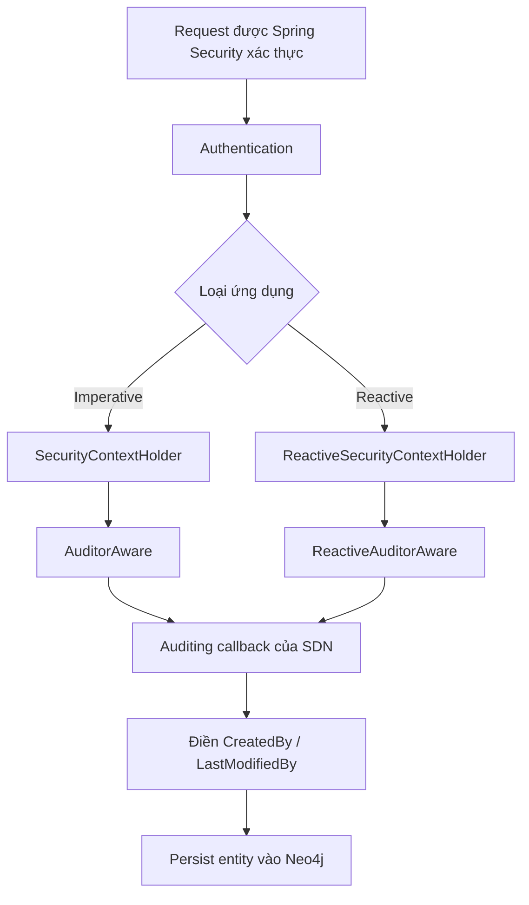

# Lấy người thao tác từ ngữ cảnh bảo mật đồng bộ hoặc reactive

Spring Data Neo4j (SDN) có thể tự điền người tạo và người sửa entity thông qua `@CreatedBy` và `@LastModifiedBy`. Để biết ai đang thao tác, auditing cần một nguồn cung cấp auditor. Trong ứng dụng dùng Spring Security, nguồn đó thường đọc `Authentication` từ `SecurityContextHolder` ở luồng đồng bộ hoặc từ `ReactiveSecurityContextHolder` trong luồng reactive.

Hai mô hình lấy ngữ cảnh này có cách hoạt động khác nhau. Ứng dụng imperative dùng `AuditorAware<T>` trả `Optional<T>`; ứng dụng reactive dùng `ReactiveAuditorAware<T>` trả `Mono<T>`. Chọn đúng SPI giúp SDN ghi nhận danh tính người dùng trong lúc lưu node hoặc relationship đã được mapping, mà không phải truyền tên người thao tác qua từng phương thức repository.

Bài học thuộc module **SPRING_DATA_NEO4J**, tập trung xây dựng tầng dữ liệu đồ thị qua node entity, relationship, repository và Cypher. Ví dụ dùng entity `Document` để ghi nhận người tạo, người sửa và thời điểm thay đổi, sau đó triển khai auditor cho cả Spring MVC và WebFlux.

## 1. Auditor trong Spring Data Auditing là gì?

Auditor là người dùng hoặc tiến trình đang thực hiện thao tác ghi. Spring Data định nghĩa hai SPI để ứng dụng cung cấp danh tính đó:

| Hạ tầng | SPI | Giá trị trả về | Nguồn ngữ cảnh Spring Security |
|---|---|---|---|
| Đồng bộ (imperative) | `AuditorAware<T>` | `Optional<T>` | `SecurityContextHolder` |
| Reactive | `ReactiveAuditorAware<T>` | `Mono<T>` | `ReactiveSecurityContextHolder` |

Kiểu `T` phải tương thích với kiểu của property được đánh dấu `@CreatedBy` và `@LastModifiedBy`. Ví dụ, nếu entity lưu ID người dùng dưới dạng `String`, hãy khai báo `AuditorAware<String>` hoặc `ReactiveAuditorAware<String>`.

Luồng xử lý tổng quát:



Auditing ghi nhận ai đã thực hiện thao tác. Nó không quyết định người đó có quyền sửa entity hay không; authorization vẫn phải được kiểm tra ở tầng bảo mật và nghiệp vụ.

## 2. Khai báo trường audit trên entity

Các annotation auditing thuộc Spring Data Commons:

- `@CreatedBy`: người tạo entity.
- `@LastModifiedBy`: người sửa gần nhất.
- `@CreatedDate`: thời điểm tạo.
- `@LastModifiedDate`: thời điểm sửa gần nhất.

Ví dụ node `Document`:

```java
import java.time.Instant;

import org.springframework.data.annotation.CreatedBy;
import org.springframework.data.annotation.CreatedDate;
import org.springframework.data.annotation.Id;
import org.springframework.data.annotation.LastModifiedBy;
import org.springframework.data.annotation.LastModifiedDate;
import org.springframework.data.neo4j.core.schema.GeneratedValue;
import org.springframework.data.neo4j.core.schema.Node;

@Node("Document")
public class Document {

    @Id
    @GeneratedValue
    private Long id;

    private String title;

    @CreatedBy
    private String createdBy;

    @LastModifiedBy
    private String lastModifiedBy;

    @CreatedDate
    private Instant createdAt;

    @LastModifiedDate
    private Instant lastModifiedAt;

    public Document(String title) {
        this.title = title;
    }

    // Getter và setter được lược bỏ.
}
```

Ở đây auditor được lưu bằng chuỗi định danh, ví dụ `user-1042` hoặc subject của JWT. Không nên lưu toàn bộ object `Authentication`, token truy cập hay mật khẩu vào property Neo4j. Lưu ID ổn định giúp dữ liệu audit gọn và ít phụ thuộc vào cấu trúc Spring Security.

Các trường audit là dữ liệu do server quản lý. Không bind `createdBy`, `lastModifiedBy`, `createdAt` hoặc `lastModifiedAt` trực tiếp từ request DTO; nếu client có thể tự gửi các trường này, họ có thể giả mạo lịch sử thay đổi.

Nếu chỉ cần lưu người tạo/sửa, có thể chỉ dùng hai annotation `@CreatedBy` và `@LastModifiedBy`. Nếu chỉ theo dõi thời gian, không cần cung cấp `AuditorAware`; SDN dùng `DateTimeProvider` mặc định để điền các trường ngày giờ.

## 3. Bật auditing cho ứng dụng đồng bộ

Trong cấu hình Spring, bật `@EnableNeo4jAuditing` và chỉ rõ bean `AuditorAware` bằng `auditorAwareRef`:

```java
import org.springframework.context.annotation.Configuration;
import org.springframework.data.neo4j.config.EnableNeo4jAuditing;

@Configuration
@EnableNeo4jAuditing(auditorAwareRef = "auditorProvider")
public class Neo4jAuditingConfiguration {
}
```

Bean có tên `auditorProvider` phải tồn tại trong application context và triển khai `AuditorAware<T>`. Nếu không chỉ định `auditorAwareRef`, Spring Data sẽ tìm bean auditor theo quy tắc mặc định; khai báo tên tường minh giúp tránh nhầm lẫn khi ứng dụng có nhiều nguồn auditor.

## 4. Đọc người dùng từ SecurityContextHolder

Trong ứng dụng imperative, Spring Security lưu `SecurityContext` trong `SecurityContextHolder`. `Authentication` cung cấp thông tin về principal hiện tại.

```java
import java.util.Optional;

import org.springframework.data.domain.AuditorAware;
import org.springframework.security.authentication.AnonymousAuthenticationToken;
import org.springframework.security.core.Authentication;
import org.springframework.security.core.context.SecurityContextHolder;
import org.springframework.stereotype.Component;
import org.springframework.util.StringUtils;

@Component("auditorProvider")
public class SecurityAuditorAware implements AuditorAware<String> {

    @Override
    public Optional<String> getCurrentAuditor() {
        Authentication authentication = SecurityContextHolder
            .getContext()
            .getAuthentication();

        if (authentication == null
                || !authentication.isAuthenticated()
                || authentication instanceof AnonymousAuthenticationToken) {
            return Optional.empty();
        }

        return Optional.ofNullable(authentication.getName())
            .filter(StringUtils::hasText);
    }
}
```

`Authentication.getName()` trả về tên định danh của principal. Với `UserDetails` thông thường, giá trị này thường là username; với `JwtAuthenticationToken`, nó thường là claim `sub`. Nếu hệ thống có ID người dùng bất biến riêng, hãy lấy ID đó từ custom principal thay cho username có thể thay đổi.

### 4.1. Vì sao phải loại AnonymousAuthenticationToken?

Không nên chỉ kiểm tra `Authentication.isAuthenticated()`. `AnonymousAuthenticationToken` có thể báo `isAuthenticated() == true` dù request chưa đăng nhập bằng tài khoản thực. Nếu không loại anonymous token, audit có thể ghi một tên giả như `anonymousUser` thay vì người thao tác thực.

Nếu ứng dụng không bật anonymous authentication, điều kiện kiểm tra vẫn hữu ích vì nó làm rõ auditor chỉ đại diện cho principal đã được xác thực.

### 4.2. Khi không có SecurityContext

`Optional.empty()` có nghĩa auditor hiện tại không xác định. Trong trường hợp đó, auditing không có giá trị để ghi vào các trường `@CreatedBy` hoặc `@LastModifiedBy`; các trường này có thể giữ `null` hoặc giá trị hiện tại tùy trạng thái entity.

Đừng tự động thay mọi trường hợp thiếu SecurityContext bằng một username chung như `admin`. Điều đó có thể làm mất dấu khác biệt giữa request chưa xác thực, job nền và thao tác do hệ thống thực hiện. Hãy chọn quy tắc theo nghiệp vụ:

- Request cần đăng nhập: cấu hình security để chặn request trước khi gọi service ghi.
- Job nền: dùng một auditor hệ thống có tên rõ như `system:nightly-import`.
- Không chấp nhận thiếu auditor: fail fast bằng exception hoặc kiểm tra ở service trước khi persist.
- Chấp nhận không có người thao tác: để `Optional.empty()` và cho phép trường audit rỗng.

Nếu cần một fallback cụ thể cho tác vụ batch, có thể tạo bean auditor riêng hoặc đặt danh tính service trong security context của job. Không nên dùng fallback hệ thống chung cho mọi request web.

## 5. Bật auditing cho ứng dụng reactive

Với WebFlux và reactive repositories/template, dùng `@EnableReactiveNeo4jAuditing`:

```java
import org.springframework.context.annotation.Configuration;
import org.springframework.data.neo4j.config.EnableReactiveNeo4jAuditing;

@Configuration
@EnableReactiveNeo4jAuditing(auditorAwareRef = "reactiveAuditorProvider")
public class ReactiveNeo4jAuditingConfiguration {
}
```

Bean được tham chiếu phải triển khai `ReactiveAuditorAware<T>`. SPI này trả về `Mono<T>` để việc lấy auditor là một phần của reactive pipeline, thay vì đọc trạng thái từ thread-local.

## 6. Đọc người dùng từ ReactiveSecurityContextHolder

Trong ứng dụng reactive, Spring Security lưu `SecurityContext` trong Reactor Context. Dùng `ReactiveSecurityContextHolder.getContext()` để truy xuất nó:

```java
import org.springframework.data.domain.ReactiveAuditorAware;
import org.springframework.security.authentication.AnonymousAuthenticationToken;
import org.springframework.security.core.Authentication;
import org.springframework.security.core.context.ReactiveSecurityContextHolder;
import org.springframework.stereotype.Component;
import org.springframework.util.StringUtils;

import reactor.core.publisher.Mono;

@Component("reactiveAuditorProvider")
public class ReactiveSecurityAuditorAware
        implements ReactiveAuditorAware<String> {

    @Override
    public Mono<String> getCurrentAuditor() {
        return ReactiveSecurityContextHolder.getContext()
            .map(securityContext -> securityContext.getAuthentication())
            .filter(this::isRealAuthenticatedUser)
            .map(Authentication::getName)
            .filter(StringUtils::hasText);
    }

    private boolean isRealAuthenticatedUser(Authentication authentication) {
        return authentication != null
            && authentication.isAuthenticated()
            && !(authentication instanceof AnonymousAuthenticationToken);
    }
}
```

Khi không có security context hoặc principal không hợp lệ, publisher hoàn tất rỗng. Khi có người dùng hợp lệ, publisher phát ra một ID auditor. SDN gọi SPI này trong quá trình reactive auditing trước khi entity được ghi.

Không dùng `SecurityContextHolder.getContext()` trong ứng dụng reactive. `SecurityContextHolder` dựa trên chiến lược lưu context theo thread; reactive pipeline có thể đổi thread trong lúc xử lý. `ReactiveSecurityContextHolder` đọc context từ Reactor Context nên phù hợp với WebFlux và các toán tử Reactor.

## 7. Phân biệt hai cách lấy auditor

| Tiêu chí | Imperative | Reactive |
|---|---|---|
| SPI | `AuditorAware<String>` | `ReactiveAuditorAware<String>` |
| Phương thức | `getCurrentAuditor()` | `getCurrentAuditor()` |
| Kiểu trả về | `Optional<String>` | `Mono<String>` |
| Nguồn security context | `SecurityContextHolder` | `ReactiveSecurityContextHolder` |
| Ngữ cảnh | Thread-bound | Reactor Context |
| Dùng với | `Neo4jRepository`, `Neo4jTemplate` | `ReactiveNeo4jRepository`, `ReactiveNeo4jTemplate` |

Chọn SPI theo stack persistence của use case. Không gọi API imperative trong callback reactive rồi kỳ vọng danh tính được truyền tự động qua các thread.

## 8. Principal có thể là UserDetails, JWT hoặc kiểu riêng

`Authentication` không bắt buộc phải chứa một loại principal duy nhất. Principal có thể là:

- `UserDetails` do `UserDetailsService` tạo.
- `Jwt` hoặc `JwtAuthenticationToken` trong OAuth2 Resource Server.
- Một custom principal do ứng dụng định nghĩa.
- Một chuỗi hoặc kiểu principal khác do authentication provider cung cấp.

`Authentication.getName()` là cách tổng quát để lấy tên định danh. Nếu audit cần một ID nội bộ ổn định, hãy chuẩn hóa việc trích xuất principal trong một hàm riêng:

```java
private String resolveAuditorId(Authentication authentication) {
    Object principal = authentication.getPrincipal();

    if (principal instanceof AppUserPrincipal appUser) {
        return appUser.getUserId();
    }

    return authentication.getName();
}
```

`AppUserPrincipal` ở đây là kiểu principal của ứng dụng, cần thay bằng class thực tế. Cách làm này tránh ép mọi principal thành `UserDetails` hoặc cast không an toàn khi ứng dụng hỗ trợ nhiều phương thức xác thực.

Nếu cần tra cứu ID người dùng từ một dịch vụ khác, hãy cân nhắc chi phí và tính reactive của việc tra cứu. Trong `ReactiveAuditorAware`, truy vấn tra cứu phải trả `Mono<T>` và được nối trong pipeline; không gọi `.block()`.

## 9. Ngữ cảnh bảo mật khi chạy tác vụ nền

Security context của request không tự động xuất hiện trong mọi tác vụ nền.

Với ứng dụng imperative:

- `SecurityContextHolder` thường dùng thread-local.
- Khi chuyển công việc sang executor hoặc `@Async`, thread mới có thể không có context của request.
- Nếu thực sự cần truyền security context, dùng cơ chế Spring Security như `DelegatingSecurityContextExecutor` hoặc cấu hình executor tương ứng.
- Với scheduled job, nên định nghĩa actor hệ thống riêng thay vì giả lập người dùng web.

Với ứng dụng reactive:

- Reactor Context đi cùng subscription qua các toán tử Reactor.
- Không tự tạo subscription mới trong service chỉ để giữ security context.
- Nếu tạo một publisher độc lập ngoài request flow, context của request có thể không có mặt.
- Tác vụ nền nên gắn actor hệ thống tường minh trong context của chính tác vụ hoặc dùng một cơ chế auditor riêng.

Nếu auditor trả rỗng trong một job nhưng không trong request web, hãy kiểm tra cách job được khởi chạy và nơi security context được thiết lập trước khi sửa entity mapping.

## 10. Auditor được ghi ở thời điểm nào?

SDN sử dụng auditing callback trước khi entity được bind và persist. Khi lưu qua `Neo4jRepository` hoặc `Neo4jTemplate`, callback auditing có thể đọc auditor rồi cập nhật các property được đánh dấu:

| Thao tác | Trường thường được cập nhật |
|---|---|
| Tạo entity mới | `@CreatedBy`, `@CreatedDate` |
| Sửa entity đã tồn tại | `@LastModifiedBy`, `@LastModifiedDate` |
| Tạo mới với `modifyOnCreate = true` | Có thể đồng thời điền trường last-modified |

`modifyOnCreate` của `@EnableNeo4jAuditing` và `@EnableReactiveNeo4jAuditing` mặc định là `true`. Nếu không muốn điền `@LastModifiedBy` và `@LastModifiedDate` khi tạo mới, cấu hình `modifyOnCreate = false`:

```java
@Configuration
@EnableNeo4jAuditing(
    auditorAwareRef = "auditorProvider",
    modifyOnCreate = false
)
public class Neo4jAuditingConfiguration {
}
```

Các annotation ngày giờ có thể dùng kiểu như `Instant`, `LocalDateTime`, `long`, `Long`, `Date` hoặc `Calendar` theo hỗ trợ của Spring Data. Mặc định thời gian được lấy từ `CurrentDateTimeProvider`; có thể cấu hình `dateTimeProviderRef` nếu cần một nguồn thời gian riêng.

## 11. Raw Cypher không tự chạy entity auditing callback

Auditing callback gắn với vòng đời persist entity được SDN mapping. Nếu dùng `Neo4jClient` hoặc Neo4j Java Driver để tự viết Cypher `CREATE`, `MERGE` hoặc `SET`, không nên kỳ vọng `@CreatedBy` hay `@LastModifiedBy` tự được điền.

Ví dụ với raw Cypher, hãy truyền auditor như một tham số rõ ràng:

```java
neo4jClient.query("""
        MATCH (p:Person {personId: $personId})
        CREATE (event:AuditEvent {
            eventType: $eventType,
            createdBy: $actorId,
            createdAt: datetime()
        })
        CREATE (event)-[:ABOUT]->(p)
        """)
    .bind(personId).to("personId")
    .bind(eventType).to("eventType")
    .bind(actorId).to("actorId")
    .run();
```

`actorId` phải được lấy từ cùng một nguồn đáng tin cậy như `AuditorAware`/`ReactiveAuditorAware`, hoặc truyền từ một service đã xác định actor. Không nhận trực tiếp `actorId` tùy ý từ request body vì client có thể giả mạo người tạo/sửa.

Nếu use case thường xuyên dùng raw Cypher để ghi entity, hãy đóng gói việc lấy auditor và bind tham số trong một service hoặc helper dùng chung để tránh các câu query quên trường audit.

## 12. Kiểm thử auditor đồng bộ

Trong test imperative, đặt `Authentication` vào `SecurityContextHolder`, gọi repository save rồi đọc lại entity để kiểm tra audit fields:

```java
import java.util.List;

import org.junit.jupiter.api.Test;
import org.springframework.security.authentication.UsernamePasswordAuthenticationToken;
import org.springframework.security.core.authority.SimpleGrantedAuthority;
import org.springframework.security.core.context.SecurityContextHolder;

import static org.assertj.core.api.Assertions.assertThat;

@Test
void shouldStoreCurrentUserAsCreator() {
    SecurityContextHolder.getContext().setAuthentication(
        new UsernamePasswordAuthenticationToken(
            "user-1042",
            "n/a",
            List.of(new SimpleGrantedAuthority("ROLE_USER"))
        )
    );

    try {
        Document saved = documentRepository.save(
            new Document("Architecture notes")
        );

        Document reloaded = documentRepository.findById(saved.getId())
            .orElseThrow();

        assertThat(reloaded.getCreatedBy()).isEqualTo("user-1042");
    } finally {
        SecurityContextHolder.clearContext();
    }
}
```

Đặt method trong test class có field `documentRepository` được inject và cấu hình Neo4j test. Luôn gọi `SecurityContextHolder.clearContext()` trong `finally` để không làm rò context sang test khác.

## 13. Kiểm thử auditor reactive

Trong reactive test, đưa authentication vào Reactor Context bằng `ReactiveSecurityContextHolder.withAuthentication(...)`:

```java
import java.util.List;

import org.junit.jupiter.api.Test;
import org.springframework.security.authentication.UsernamePasswordAuthenticationToken;
import org.springframework.security.core.Authentication;
import org.springframework.security.core.authority.SimpleGrantedAuthority;
import org.springframework.security.core.context.ReactiveSecurityContextHolder;
import reactor.core.publisher.Mono;
import reactor.test.StepVerifier;

import static org.assertj.core.api.Assertions.assertThat;

@Test
void shouldStoreCurrentUserAsCreator() {
    Authentication authentication =
        new UsernamePasswordAuthenticationToken(
            "user-2048",
            "n/a",
            List.of(new SimpleGrantedAuthority("ROLE_USER"))
        );

    Mono<Document> save = documentRepository.save(
        new Document("Reactive notes")
    );

    StepVerifier.create(
            save.contextWrite(
                ReactiveSecurityContextHolder.withAuthentication(authentication)
            )
        )
        .assertNext(document ->
            assertThat(document.getCreatedBy()).isEqualTo("user-2048")
        )
        .verifyComplete();
}
```

Đặt method trong test class có reactive `documentRepository` được inject cùng reactive Neo4j test infrastructure và fixture database. `contextWrite(...)` gắn security context vào subscription; không đặt context vào `SecurityContextHolder` imperative rồi mong reactive auditing đọc được.

Nên kiểm thử thêm các trường hợp:

- Không có authentication: auditor trả `Optional.empty()` hoặc `Mono.empty()`.
- Authentication là anonymous: không ghi `anonymousUser` làm actor.
- Principal có ID nội bộ: audit lưu ID đó thay cho display name.
- Job nền: audit lưu actor hệ thống theo quy ước đã chọn.
- Cập nhật entity: `@LastModifiedBy` đổi theo auditor hiện tại, còn `@CreatedBy` được giữ nguyên.

## 14. Lỗi thường gặp

| Lỗi | Nguyên nhân | Cách xử lý |
|---|---|---|
| Quên bật `@EnableNeo4jAuditing` | Auditing infrastructure chưa được đăng ký | Thêm annotation vào configuration imperative |
| Dùng `@EnableNeo4jAuditing` cho reactive stack | Đăng ký auditing infrastructure không phù hợp | Dùng `@EnableReactiveNeo4jAuditing` |
| `auditorAwareRef` không khớp tên bean | Spring không tìm thấy auditor provider | Đồng bộ bean name và annotation reference |
| Dùng `SecurityContextHolder` trong WebFlux | Context có thể không nằm trên thread hiện tại | Dùng `ReactiveSecurityContextHolder` |
| Chỉ kiểm tra `isAuthenticated()` | Anonymous token có thể vẫn trả true | Loại `AnonymousAuthenticationToken` |
| Principal không phải `UserDetails` | Cast principal sang kiểu cố định gây lỗi | Dùng `Authentication.getName()` hoặc resolver hỗ trợ nhiều principal |
| Auditor rỗng trong `@Async` hoặc scheduled job | Context không được truyền sang tác vụ nền | Dùng security-context-aware executor hoặc actor hệ thống |
| Ghi bằng `Neo4jClient` nhưng mong auditing tự chạy | Raw Cypher bỏ qua entity auditing callback | Bind actor và trường audit trực tiếp |
| Lưu username có thể thay đổi | Audit cũ mất tính nhất quán định danh | Lưu immutable user ID hoặc JWT subject |
| Dùng auditor như cơ chế phân quyền | Ghi nhận người thao tác không ngăn thao tác trái phép | Kiểm tra authorization riêng trước khi ghi |

## 15. Checklist triển khai

- Entity có property đúng kiểu cho `@CreatedBy` và `@LastModifiedBy`.
- Chọn `AuditorAware<T>` cho imperative hoặc `ReactiveAuditorAware<T>` cho reactive.
- Bật `@EnableNeo4jAuditing` hoặc `@EnableReactiveNeo4jAuditing` tương ứng.
- Khai báo `auditorAwareRef` khớp tên bean.
- Đọc đúng nguồn context: `SecurityContextHolder` hoặc `ReactiveSecurityContextHolder`.
- Loại anonymous và authentication không hợp lệ.
- Lưu ID người dùng ổn định, không lưu token hoặc toàn bộ principal object.
- Quy định rõ hành vi khi không có SecurityContext.
- Gán actor hệ thống riêng cho job nền.
- Không kỳ vọng raw Cypher tự kích hoạt auditing callback.
- Kiểm thử tạo mới, cập nhật, anonymous, thiếu context và tác vụ nền.
- Giữ authorization tách biệt với auditing.

## 16. Bài tập thực hành

1. Thêm `@CreatedBy` và `@LastModifiedBy` vào entity `Document` với kiểu `String`.
2. Viết `SecurityAuditorAware` lấy `Authentication.getName()` từ `SecurityContextHolder`.
3. Bật `@EnableNeo4jAuditing` và cấu hình đúng `auditorAwareRef`.
4. Viết test imperative đặt authentication, lưu document và kiểm tra `createdBy`.
5. Tạo một anonymous authentication và xác nhận auditor trả rỗng.
6. Viết `ReactiveSecurityAuditorAware` dùng `ReactiveSecurityContextHolder` và trả `Mono<String>`.
7. Bật `@EnableReactiveNeo4jAuditing` và kiểm thử bằng `StepVerifier` cùng `contextWrite`.
8. Tạo custom principal có `userId`; sửa resolver để lưu ID nội bộ thay cho username.
9. Tạo scheduled job và xác định actor hệ thống cần ghi vào audit.
10. Ghi một `AuditEvent` bằng `Neo4jClient`; bind `actorId` tường minh và giải thích vì sao callback auditing không tự chạy.
11. Cập nhật một document bằng hai người dùng khác nhau; xác nhận `createdBy` giữ nguyên và `lastModifiedBy` đổi theo người sửa cuối.

Khi hoàn thành, bạn cần biết lấy danh tính từ security context đúng với mô hình đồng bộ hoặc reactive, cấu hình auditor cho SDN và kiểm tra trường hợp không có principal. Cần nhớ rằng auditing ghi nhận actor trong quá trình SDN persist entity; các câu Cypher tự viết phải chủ động truyền và ghi thông tin audit.

## Tài liệu tham khảo

- [Spring Data Neo4j — FAQ: How do I audit entities?](https://docs.spring.io/spring-data/neo4j/reference/faq.html)
- [Spring Data Neo4j — Auditing](https://docs.spring.io/spring-data/neo4j/reference/auditing.html)
- [Spring Data Neo4j — EnableNeo4jAuditing API](https://docs.spring.io/spring-data/neo4j/reference/api/java/org/springframework/data/neo4j/config/EnableNeo4jAuditing.html)
- [Spring Data Neo4j — EnableReactiveNeo4jAuditing API](https://docs.spring.io/spring-data/neo4j/reference/api/java/org/springframework/data/neo4j/config/EnableReactiveNeo4jAuditing.html)
- [Spring Data Commons — AuditorAware API](https://docs.spring.io/spring-data/commons/reference/api/java/org/springframework/data/domain/AuditorAware.html)
- [Spring Data Commons — ReactiveAuditorAware API](https://docs.spring.io/spring-data/commons/reference/api/java/org/springframework/data/domain/ReactiveAuditorAware.html)
- [Spring Security — SecurityContextHolder](https://docs.spring.io/spring-security/reference/servlet/authentication/architecture.html)
- [Spring Security — Reactive SecurityContext](https://docs.spring.io/spring-security/reference/reactive/authorization/method.html)
